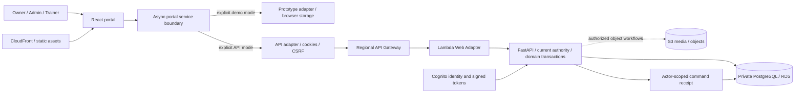
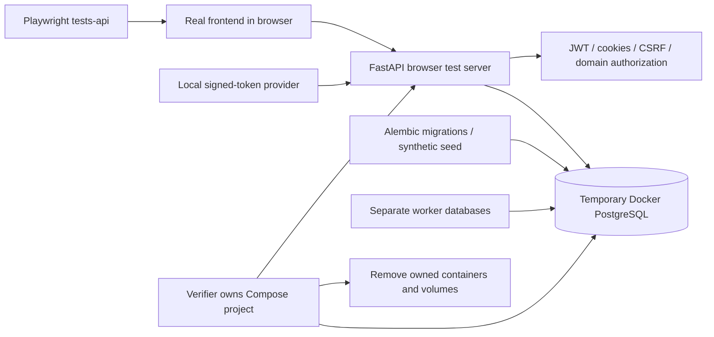
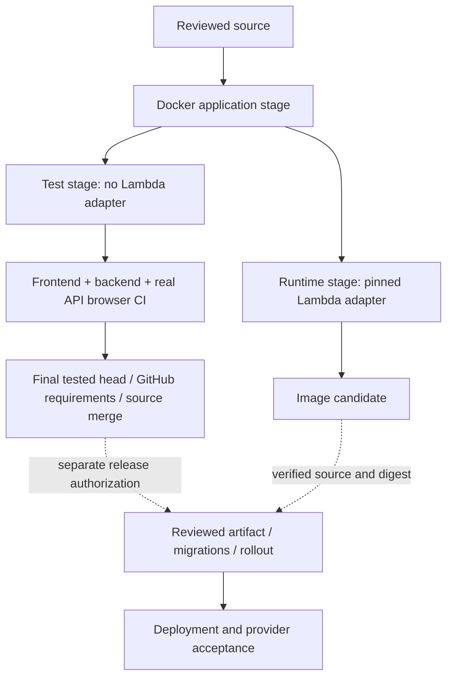

# Fitfinity system diagrams

[Explanation](README.md) · [Contracts and operation status](../SERVICE_CONTRACTS.md) · [Acceptance evidence](../../PROGRESS.md)

## Components and trust boundaries

This is the selected architecture, not a claim that the latest source is deployed. Dashed object/media paths remain subject to operation-specific integration status.



The demo branch is an explicit build/runtime mode, never a fallback after API failure. Domain authorization remains in FastAPI and PostgreSQL transactions. The [runbook](../AWS_DEPLOYMENT_RUNBOOK.md) owns deployed resources, network boundaries and release authority.

## Reviewed write and recovery

```mermaid
sequenceDiagram
  actor Staff
  participant UI as Portal UI
  participant API as FastAPI
  participant DB as PostgreSQL
  Staff->>UI: Review intended change
  UI->>API: Fetch authorized review
  API->>DB: Read current versions and scope
  DB-->>API: Current state
  API-->>UI: Review / expected version or digest
  Staff->>UI: Confirm
  UI->>API: Exact intent + original key + review
  API->>DB: Lock and recheck authority / versions / conflicts
  alt Valid command
    API->>DB: Commit records + history/notices + receipt atomically
    API-->>UI: Canonical saved result
    UI->>API: Reload authorized state
  else Stale or unauthorized
    API-->>UI: Definitive rejection; no changes
  end
  opt Response lost after possible commit
    UI->>API: Read receipt for original actor/key
    API->>DB: Reconcile original command
    API-->>UI: Saved result or unresolved original intent
  end
```

A requested supervised change persists a proposal and leaves the booking unchanged. Resolution is a distinct authorized operation. Unknown outcomes are not permission to submit a new intent; refresh failure does not undo a committed save.

## Isolated real-API tests



There is no path to production PostgreSQL, AWS identity delivery or customer records in this test topology. Cognito is substituted; FastAPI and PostgreSQL are not mocked. Simulator browser tests use a separate harness and provide different evidence.

## Build and acceptance boundaries



Source merge is not deployment authorization. OpenTelemetry/Grafana and performance budgets are backlog work; they are deliberately absent as existing runtime components.
