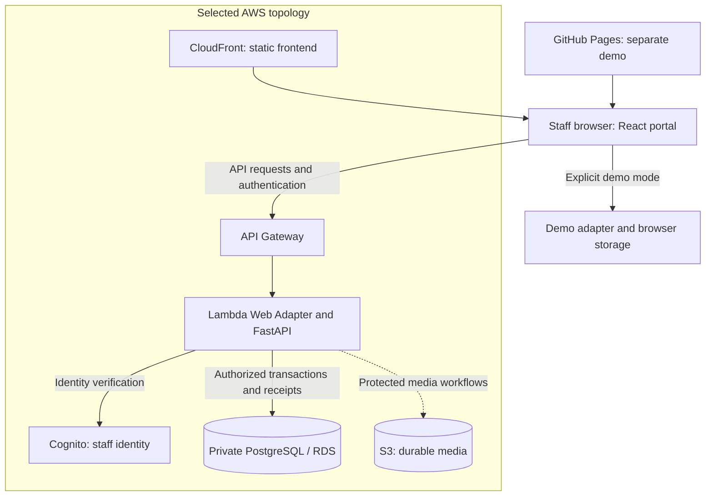
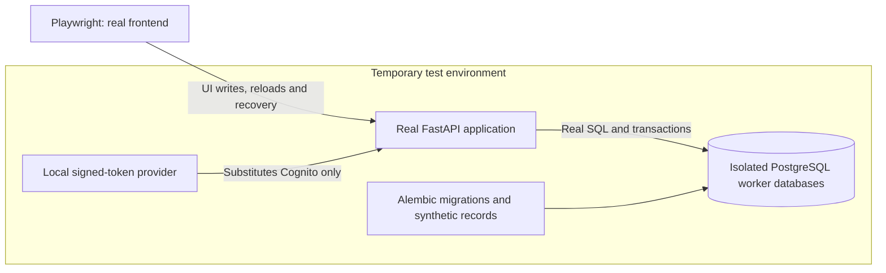

# Current system diagram

Selected Fitfinity architecture; current deployed source is recorded separately in [Progress](../../PROGRESS.md). Dashed media connections are planned or incomplete workflows. [One-page explanation](README.md) · [System rules](../SERVICE_CONTRACTS.md#part-1--current-system-rules).

The browser selects one service mode; API errors never switch to demo. Source merge does not update Lambda. Arrows describe responsibilities, not deployment approval or completion of every operation.

## Isolated real-API testing

The verifier owns test resources and cleanup. This environment has no production PostgreSQL target and makes no AWS/provider calls. Simulator browser tests are a separate suite; live Cognito, restart and physical-device acceptance require separate evidence.
