# Code owners and feature map

Snapshot: **28 October 2026**, based on main `1246fb815b1240a92fd953b85abc05f18f46bc73`. “Owner” means the module responsible for a behavior, not a person or GitHub review assignment. Start with the overview and follow numbered sections into smaller diagrams and linked source files. Arrows show responsibility breakdown unless explicitly labelled as request/data flow; this is not an exhaustive import graph or execution sequence.

This document owns code navigation. [System topology](Architecture/diagram.md) owns infrastructure/test topology, [Architecture](Architecture/README.md) explains runtime relationships, and [Service Contracts](SERVICE_CONTRACTS.md) owns business rules and the 55-operation matrix. [Progress](../PROGRESS.md) owns acceptance and planned work; [Versions](../Versions.md) owns dependency versions. Update this map when responsibilities move. Source ownership does not establish deployed/provider/device acceptance.

Format reference: [SoccerBotStudioSG Code Owners](https://github.com/LimYouSheng/SoccerBotStudioSG/blob/feat/version-inventory/docs/Code-Owners.md). Fitfinity retains its own React/FastAPI/PostgreSQL/Cognito boundaries.

## 1. Overview

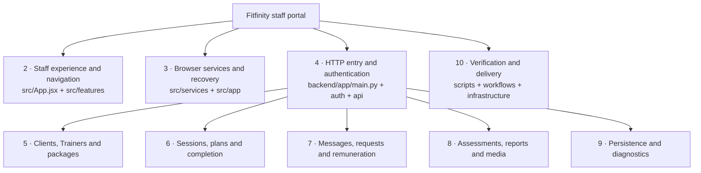

Navigation: [UI](#2-staff-experience-and-navigation) · [Services](#3-browser-contracts-and-recovery) · [Server/auth](#4-server-entry-and-identity) · [People/packages](#5-clients-trainers-and-packages) · [Sessions](#6-session-workflows) · [Operations](#7-messages-requests-and-remuneration) · [Records/media](#8-assessments-reports-and-media) · [Storage](#9-persistence-and-diagnostics) · [Delivery](#10-verification-and-delivery) · [Rule index](#11-business-rule-to-owner-index).

## 2. Staff experience and navigation

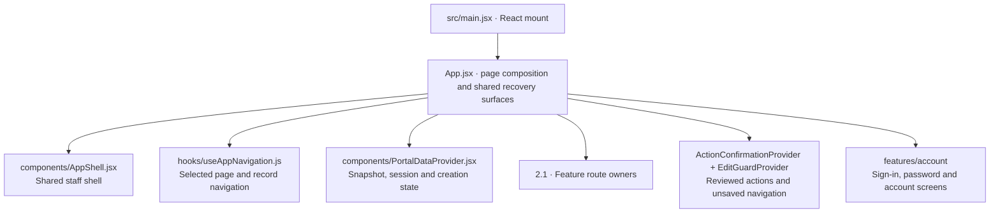

Source owners: [mount](../src/main.jsx), [composition](../src/App.jsx), [shell](../src/components/AppShell.jsx), [navigation](../src/hooks/useAppNavigation.js), [portal state](../src/components/PortalDataProvider.jsx), [confirmation](../src/components/ActionConfirmationProvider.jsx), [edit guard](../src/components/EditGuardProvider.jsx).

The provider owns shared snapshots and session lifetime. Feature editors own their drafts. Confirmation ownership is distinct from navigation/discard ownership; closing a dialog cannot undo a command already sent. Notifications and shared form/modal primitives live in `src/components`; visual styles live in [styles.css](../src/styles.css).

### 2.1 Feature route expansion

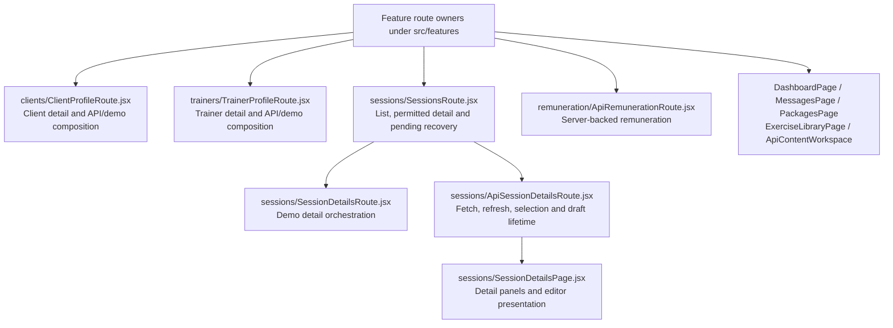

Source owners: [client route](../src/features/clients/ClientProfileRoute.jsx), [Trainer route](../src/features/trainers/TrainerProfileRoute.jsx), [sessions route](../src/features/sessions/SessionsRoute.jsx), [demo detail](../src/features/sessions/SessionDetailsRoute.jsx), [API detail lifecycle](../src/features/sessions/ApiSessionDetailsRoute.jsx), [detail UI](../src/features/sessions/SessionDetailsPage.jsx), [remuneration route](../src/features/remuneration/ApiRemunerationRoute.jsx), [content workspace](../src/features/content/ApiContentWorkspace.jsx).

## 3. Browser contracts and recovery

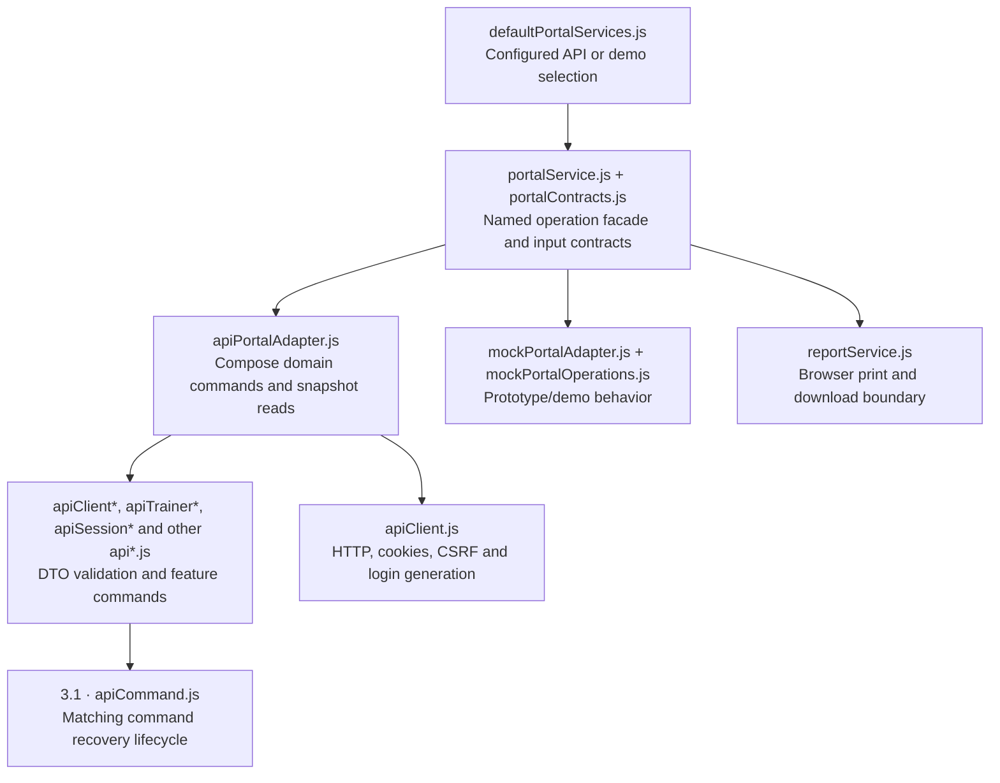

Source owners: [configuration](../src/services/defaultPortalServices.js), [facade](../src/services/portalService.js), [contracts](../src/services/portalContracts.js), [API composition](../src/services/apiPortalAdapter.js), [transport](../src/services/apiClient.js), [shared command](../src/services/apiCommand.js), [demo adapter](../src/services/mockPortalAdapter.js), [browser reports](../src/services/reportService.js).

API domain modules retain specialized review/recovery semantics where needed; they do not all use one identical lifecycle. `src/app` owns pure browser rules/projections (permissions, schedules, packages, progress, remuneration and assessments). These support UI and demo behavior; server checks remain authoritative. The service matrix owns operation coverage, not this diagram.

### 3.1 Command and editor recovery expansion

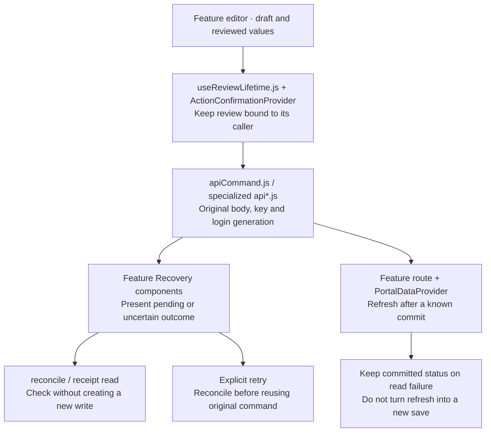

Source owners: [review lifetime](../src/hooks/useReviewLifetime.js), [shared command](../src/services/apiCommand.js), [profile recovery](../src/services/apiProfileRecovery.js), [profile recovery UI](../src/components/ProfileSaveRecovery.jsx), [plan recovery](../src/features/sessions/SessionPlanRecovery.jsx), [media commands](../src/services/apiSessionMedia.js), [snapshot owner](../src/components/PortalDataProvider.jsx).

This is a responsibility map, not a universal state machine. The [architecture lifecycle table](Architecture/README.md) explains retained editor boundaries. Receipt read, retry, refresh and authority retirement are distinct operations.

## 4. Server entry and identity

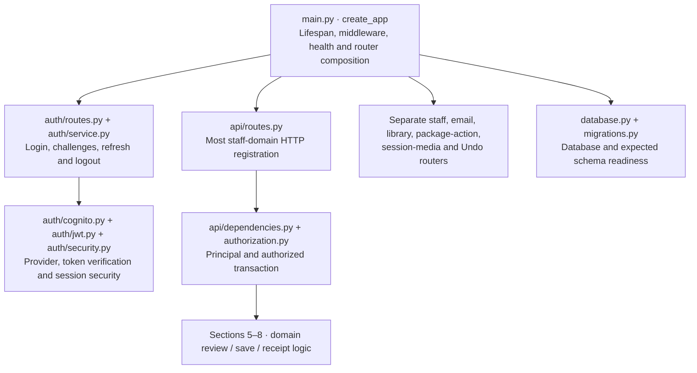

Source owners: [app entry](../backend/app/main.py), [staff routes](../backend/app/api/routes.py), [transaction boundary](../backend/app/api/dependencies.py), [authorization](../backend/app/authorization.py), [auth routes](../backend/app/auth/routes.py), [auth service](../backend/app/auth/service.py), [Cognito](../backend/app/auth/cognito.py), [JWT verification](../backend/app/auth/jwt.py), [request auth middleware](../backend/app/auth/middleware.py).

`api/routes.py` still registers many domains; the earlier broad domain-router extraction is not merged and is not shown as implemented. Authenticated API registration is controlled by app configuration. Client capabilities and hidden buttons do not authorize writes.

### 4.1 Staff account expansion

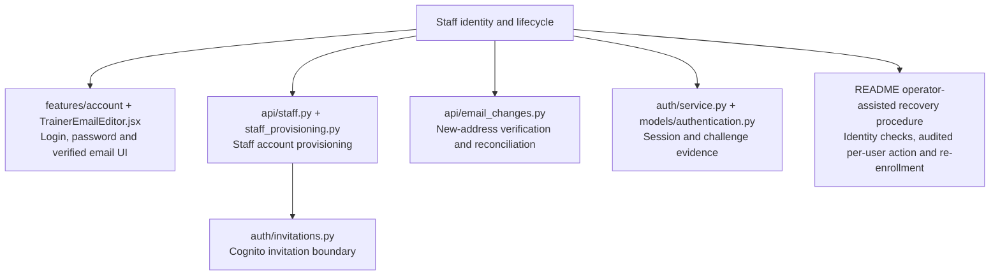

Source owners: [staff API](../backend/app/api/staff.py), [provisioning](../backend/app/api/staff_provisioning.py), [invitation adapter](../backend/app/auth/invitations.py), [verified email](../backend/app/api/email_changes.py), [authentication records](../backend/app/models/authentication.py).

The [operator recovery procedure](../README.md#operator-assisted-lost-authenticator-recovery) is an operator-owned process with test drills, not an Owner-facing MFA-reset feature. Real Cognito actions remain separately authorized.

## 5. Clients, Trainers and packages

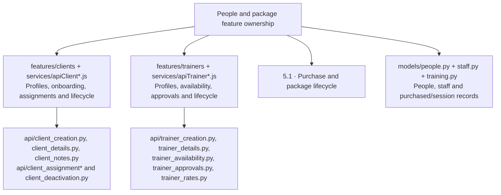

Source owners: [client profile](../src/features/clients/ClientProfilePage.jsx), [onboarding](../src/features/clients/ClientOnboardingForm.jsx), [client reassignment](../src/features/clients/ApiClientAssignmentButton.jsx), [Trainer profile](../src/features/trainers/TrainerProfilePage.jsx), [availability editor](../src/features/trainers/TrainerAvailabilityEditor.jsx), [Trainer deactivation](../src/features/trainers/TrainerDeactivationDialog.jsx), [package definitions](../src/features/setup/PackagesPage.jsx).

Source owners: [client create](../backend/app/api/client_creation.py), [client edit](../backend/app/api/client_details.py), [assignment review](../backend/app/api/client_assignment.py), [assignment save](../backend/app/api/client_assignment_save.py), [Trainer creation](../backend/app/api/trainer_creation.py), [Trainer availability](../backend/app/api/trainer_availability.py), [Trainer deactivation review](../backend/app/api/trainer_deactivation.py), [Trainer deactivation save](../backend/app/api/trainer_deactivation_save.py), [Trainer reactivation](../backend/app/api/trainer_reactivation.py).

### 5.1 Purchase and package lifecycle expansion

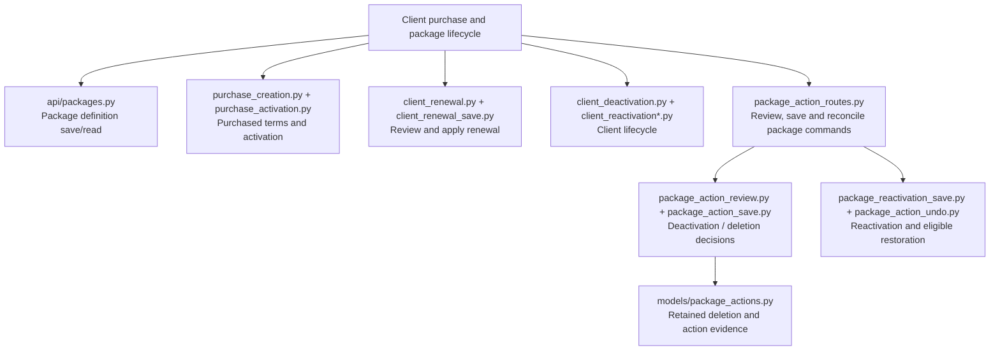

Source owners: [definitions](../backend/app/api/packages.py), [purchase create](../backend/app/api/purchase_creation.py), [activation](../backend/app/api/purchase_activation.py), [renewal save](../backend/app/api/client_renewal_save.py), [package routes](../backend/app/api/package_action_routes.py), [package review](../backend/app/api/package_action_review.py), [package save](../backend/app/api/package_action_save.py), [reactivation](../backend/app/api/package_reactivation_save.py), [package Undo](../backend/app/api/package_action_undo.py).

## 6. Session workflows

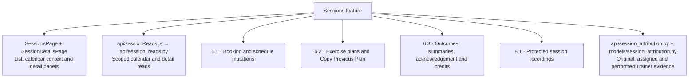

Source owners: [session list](../src/features/sessions/SessionsPage.jsx), [session details](../src/features/sessions/SessionDetailsPage.jsx), [schedule interaction](../src/features/sessions/useSessionSchedule.js), [change dialogs](../src/features/sessions/SessionChangeDialogs.jsx).

Source owners: [session reads](../backend/app/api/session_reads.py), [attribution](../backend/app/api/session_attribution.py).

### 6.1 Booking and schedule expansion

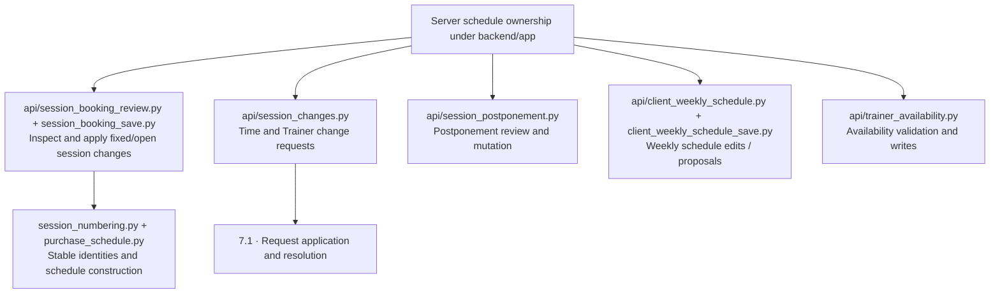

Source owners: [booking review](../backend/app/api/session_booking_review.py), [booking save](../backend/app/api/session_booking_save.py), [change requests](../backend/app/api/session_changes.py), [postponement](../backend/app/api/session_postponement.py), [weekly review](../backend/app/api/client_weekly_schedule.py), [weekly save](../backend/app/api/client_weekly_schedule_save.py), [numbering](../backend/app/session_numbering.py), [purchase schedule](../backend/app/purchase_schedule.py).

### 6.2 Exercise plan expansion

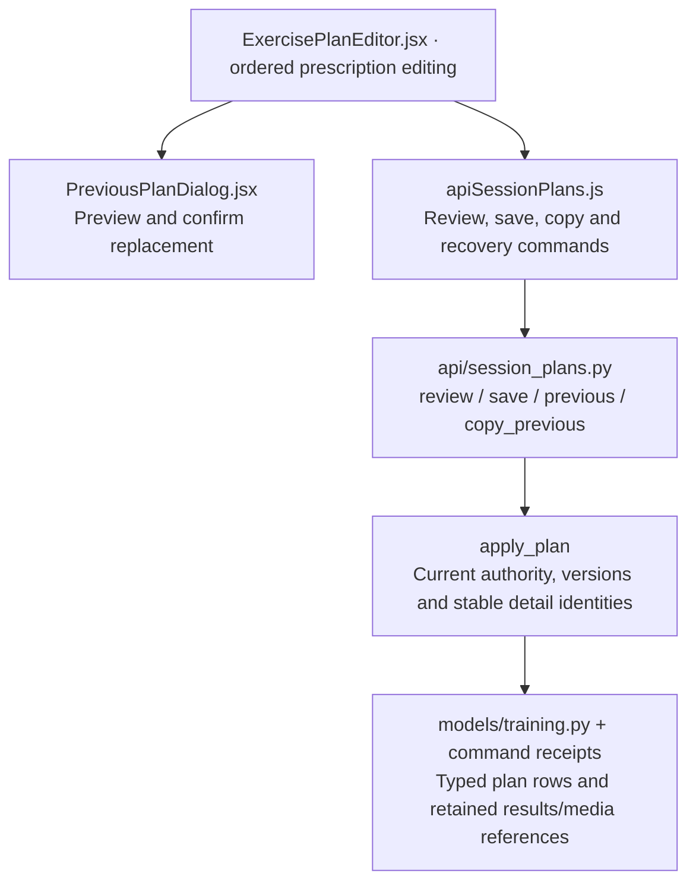

Source owners: [plan UI](../src/features/sessions/ExercisePlanEditor.jsx), [previous-plan confirmation](../src/features/sessions/PreviousPlanDialog.jsx), [plan commands](../src/services/apiSessionPlans.js).

Source owners: [plan transaction](../backend/app/api/session_plans.py), [training models](../backend/app/models/training.py).

### 6.3 Completion and credit expansion

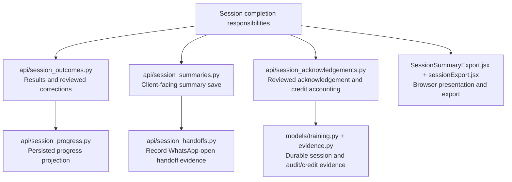

Source owners: [outcomes](../backend/app/api/session_outcomes.py), [progress](../backend/app/api/session_progress.py), [summaries](../backend/app/api/session_summaries.py), [handoff](../backend/app/api/session_handoffs.py), [acknowledgement](../backend/app/api/session_acknowledgements.py).

Source owners: [summary export](../src/features/sessions/SessionSummaryExport.jsx), [export formatting](../src/features/sessions/sessionExport.jsx).

A recorded WhatsApp-open action is not proof of provider delivery or customer receipt. Completion and credit rules remain in the linked contract section below.

## 7. Messages, requests and remuneration

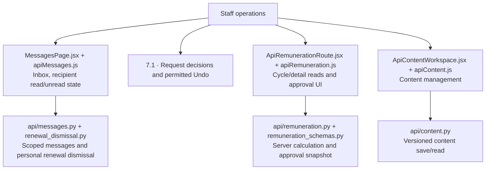

Source owners: [inbox](../src/features/messages/MessagesPage.jsx), [request review](../src/features/messages/RequestReview.jsx), [Undo UI](../src/features/messages/MessageUndo.jsx), [remuneration commands](../src/services/apiRemuneration.js), [content workspace](../src/features/content/ApiContentWorkspace.jsx).

Source owners: [message state](../backend/app/api/messages.py), [renewal dismissal](../backend/app/api/renewal_dismissal.py), [remuneration](../backend/app/api/remuneration.py), [content](../backend/app/api/content.py).

### 7.1 Decisions and Undo expansion

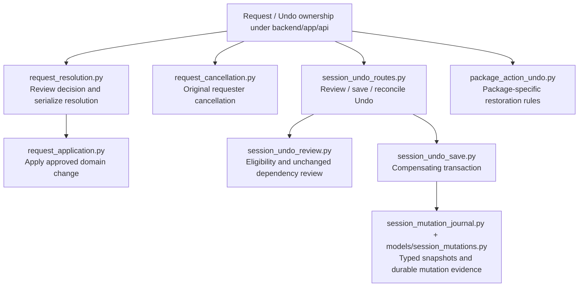

Source owners: [resolve](../backend/app/api/request_resolution.py), [apply](../backend/app/api/request_application.py), [cancel](../backend/app/api/request_cancellation.py), [Undo routes](../backend/app/api/session_undo_routes.py), [Undo review](../backend/app/api/session_undo_review.py), [Undo save](../backend/app/api/session_undo_save.py), [mutation journal](../backend/app/api/session_mutation_journal.py).

## 8. Assessments, reports and media

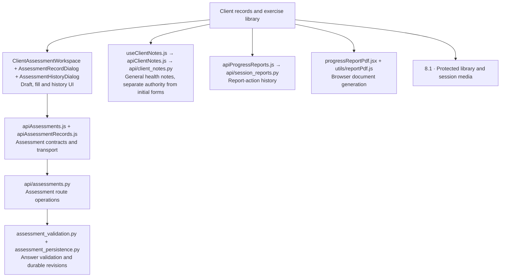

Source owners: [assessment workspace](../src/features/clients/ClientAssessmentWorkspace.jsx), [assessment form definitions](../src/app/assessmentForms.js), [assessment history](../src/features/clients/AssessmentHistoryDialog.jsx), [general notes](../src/features/clients/useClientNotes.js), [report PDF](../src/features/clients/progressReportPdf.jsx), [report history commands](../src/services/apiProgressReports.js).

Source owners: [assessment operations](../backend/app/api/assessments.py), [answer validation](../backend/app/assessment_validation.py), [revision persistence](../backend/app/assessment_persistence.py), [notes authorization](../backend/app/api/client_notes.py), [report actions](../backend/app/api/session_reports.py).

### 8.1 Media expansion

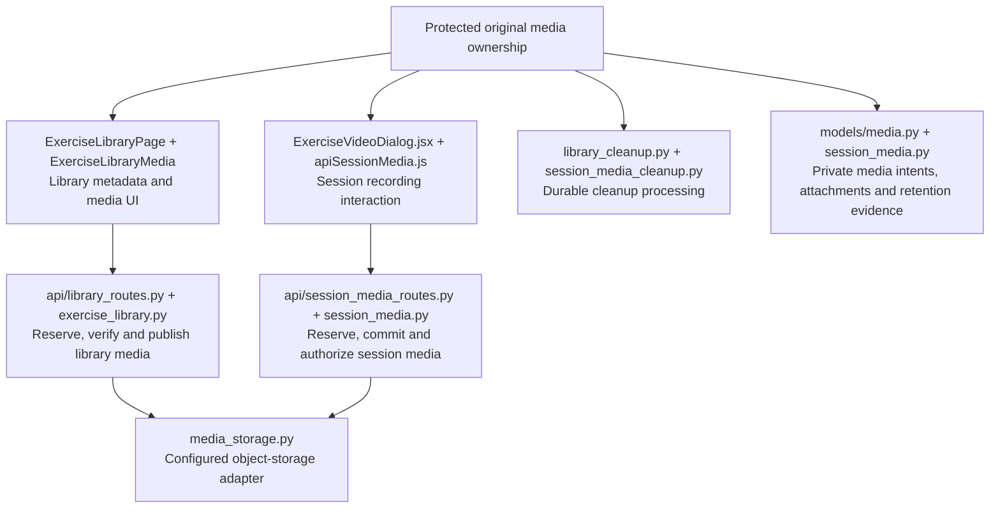

Source owners: [library UI](../src/features/exercises/ExerciseLibraryPage.jsx), [library transport](../src/services/apiLibraryMedia.js), [video dialog](../src/features/sessions/ExerciseVideoDialog.jsx), [recording transport](../src/services/apiSessionMedia.js).

Source owners: [library routes](../backend/app/api/library_routes.py), [library operations](../backend/app/api/exercise_library.py), [recording routes](../backend/app/api/session_media_routes.py), [recording operations](../backend/app/api/session_media.py), [storage adapter](../backend/app/media_storage.py), [library cleanup](../backend/app/library_cleanup.py), [recording cleanup](../backend/app/session_media_cleanup.py).

Cleanup code ownership does not mean cloud worker scheduling, transcoding or captions are deployed. M7 processing and rollout remain in Progress. Isolated tests use real RustFS object IO; production object storage is the separately configured S3 boundary.

## 9. Persistence and diagnostics

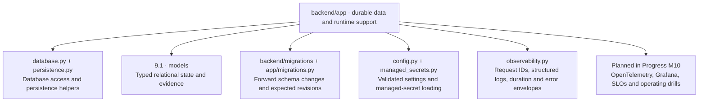

Source owners: [database](../backend/app/database.py), [persistence helpers](../backend/app/persistence.py), [schema readiness](../backend/app/migrations.py), [configuration](../backend/app/config.py), [managed secrets](../backend/app/managed_secrets.py), [request diagnostics](../backend/app/observability.py).

### 9.1 Model expansion

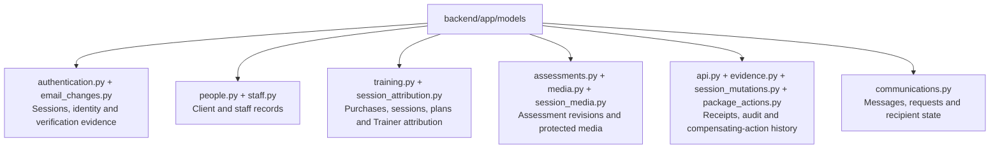

Source owners: [authentication](../backend/app/models/authentication.py), [people](../backend/app/models/people.py), [staff](../backend/app/models/staff.py), [training](../backend/app/models/training.py), [attribution](../backend/app/models/session_attribution.py), [assessments](../backend/app/models/assessments.py), [receipts](../backend/app/models/api.py), [audit evidence](../backend/app/models/evidence.py), [communications](../backend/app/models/communications.py), [mutation history](../backend/app/models/session_mutations.py).

## 10. Verification and delivery

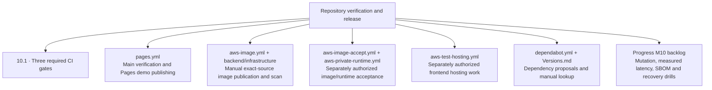

Source owners: [verification](../.github/workflows/verify.yml), [demo publication](../.github/workflows/pages.yml), [image publication](../.github/workflows/aws-image.yml), [image acceptance](../.github/workflows/aws-image-accept.yml), [private runtime](../.github/workflows/aws-private-runtime.yml), [frontend hosting](../.github/workflows/aws-test-hosting.yml).

Release scripts and resource reconciliation live in [backend/infrastructure](../backend/infrastructure); [backend/Dockerfile](../backend/Dockerfile) owns separate application/test/runtime stages. Normal source merges do not authorize AWS publication or Lambda deployment. Planned M10 work has no implied implemented module owner.

### 10.1 Verification expansion

```mermaid
flowchart TB
CI["verify.yml · required gates"]
  CI --> Front["frontend · macOS<br/>Lint, audit, units, simulator browser suites and source health"]
  Front --> FOwners["src/**/*.test.* + tests<br/>verify-lint, verify-quality and verify-code-health scripts"]
  CI --> Back["backend · Docker<br/>Actual isolated PostgreSQL and infrastructure verification"]
  Back --> BOwners["verify-backend.mjs + backend/scripts + backend/tests<br/>Transactions, authority, migrations and recovery"]
  CI --> Browser["api-browser · two shards plus required aggregate<br/>Actual UI to FastAPI to PostgreSQL"]
  Browser --> Harness["verify-api-browser.mjs + backend/tests/browser_server.py<br/>Synthetic identity, real database and media isolation"]
  Browser --> Cases["tests-api + playwright.api.config.js<br/>UI persistence, scope, conflicts and interrupted writes"]
  Browser --> Aggregate["verify-api-shards.mjs<br/>Complete discovered inventory, no omitted cases"]
```

Source owners: [backend harness](../scripts/verify-backend.mjs), [browser harness](../scripts/verify-api-browser.mjs), [shard aggregate](../scripts/verify-api-shards.mjs), [quality gates](../scripts/verify-quality.mjs), [result inventory](../scripts/verify-test-results.mjs), [source health](../scripts/verify-code-health.mjs).

[Real-API browser cases](../tests-api), [backend tests](../backend/tests) and [browser server](../backend/tests/browser_server.py) own acceptance probes. Simulator tests are frontend evidence; synthetic Cognito is not live-provider acceptance. Physical-device, deployed-service and operational-drill evidence remain distinct.

## 11. Business rule to owner index

These links navigate to the existing contract sections; they do not duplicate or renumber business rules. Multiple modules can enforce different boundaries of the same rule. Consult the full linked rule before changing an owner.

| Contract topic | Diagram expansion | Main code owners |
| --- | --- | --- |
| [Service boundary](SERVICE_CONTRACTS.md#service-boundary) and [operation matrix](SERVICE_CONTRACTS.md#domain-operation-inventory) | 3 | [portalContracts.js](../src/services/portalContracts.js), [apiPortalAdapter.js](../src/services/apiPortalAdapter.js), [routes.py](../backend/app/api/routes.py) |
| [Authority and privacy](SERVICE_CONTRACTS.md#authority-and-privacy) | 4, 8 | [authorization.py](../backend/app/authorization.py), [dependencies.py](../backend/app/api/dependencies.py), [assessments.py](../backend/app/api/assessments.py), [client_notes.py](../backend/app/api/client_notes.py) |
| [Persistence, conflicts and recovery](SERVICE_CONTRACTS.md#persistence-conflicts-and-recovery) | 3.1, 9 | [apiCommand.js](../src/services/apiCommand.js), [apiClient.js](../src/services/apiClient.js), [dependencies.py](../backend/app/api/dependencies.py), domain-specific review/save owners above |
| [Product invariants](SERVICE_CONTRACTS.md#product-invariants) | 5.1, 6.1 | [purchase_creation.py](../backend/app/api/purchase_creation.py), [session_booking_save.py](../backend/app/api/session_booking_save.py), [session_numbering.py](../backend/app/session_numbering.py) |
| [Permitted Undo](SERVICE_CONTRACTS.md#permitted-undo) | 7.1 | [session_undo_review.py](../backend/app/api/session_undo_review.py), [session_undo_save.py](../backend/app/api/session_undo_save.py), [package_action_undo.py](../backend/app/api/package_action_undo.py) |
| [Acknowledgement and credits](SERVICE_CONTRACTS.md#reviewed-acknowledgement-and-credit-accounting) | 6.3 | [session_acknowledgements.py](../backend/app/api/session_acknowledgements.py), [training.py](../backend/app/models/training.py) |
| [Outcomes and progress](SERVICE_CONTRACTS.md#outcome-corrections-and-persisted-progress) | 6.3 | [session_outcomes.py](../backend/app/api/session_outcomes.py), [session_progress.py](../backend/app/api/session_progress.py) |
| [Summaries](SERVICE_CONTRACTS.md#client-facing-summaries) and [report history](SERVICE_CONTRACTS.md#report-actions-and-retained-history) | 6.3, 8 | [session_summaries.py](../backend/app/api/session_summaries.py), [session_handoffs.py](../backend/app/api/session_handoffs.py), [session_reports.py](../backend/app/api/session_reports.py) |
| [Authentication](SERVICE_CONTRACTS.md#authentication-and-additional-routes) | 4.1 | [auth/service.py](../backend/app/auth/service.py), [email_changes.py](../backend/app/api/email_changes.py); operator recovery remains a documented process |
| [Assessment policy](SERVICE_CONTRACTS.md#assessment-records-business-policy-and-retained-capacity-decisions) | 8 | [assessment_validation.py](../backend/app/assessment_validation.py), [assessment_persistence.py](../backend/app/assessment_persistence.py), [ClientAssessmentWorkspace.jsx](../src/features/clients/ClientAssessmentWorkspace.jsx) |
| [Deployment and acceptance](SERVICE_CONTRACTS.md#deployment-migration-and-acceptance) | 10 | [infrastructure](../backend/infrastructure), [workflows](../.github/workflows); operator authorization and live acceptance are not automated by a diagram |
