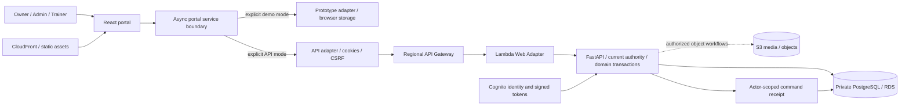
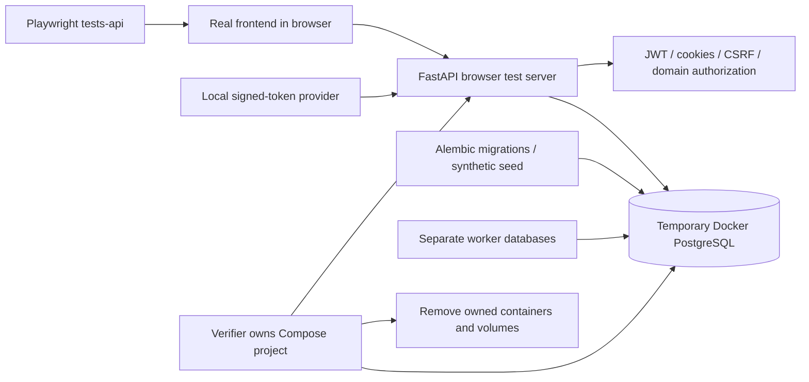
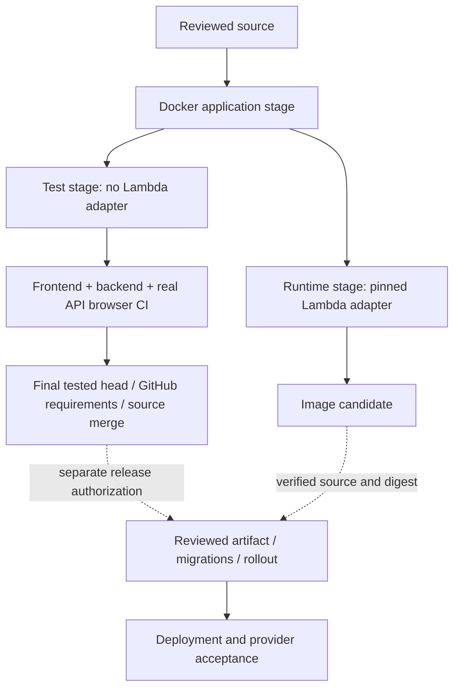

# Fitfinity — Service Contracts

This is the single source for current business rules, retained design decisions and the full dated history. [Architecture](Architecture/README.md) explains components; [the diagram](Architecture/diagram.md) shows their connections. [AGENTS](../AGENTS.md) owns engineering execution. Current rules below override dated history; historical approvals never authorize new operations. An operation's intended rules do not imply that its API is integrated: the matrix records source acceptance.

## Part 1 — Current system rules

Stable rule-group IDs identify the existing paragraphs below; they do not change their requirements. Keep IDs when editing or moving a rule, never reuse retired IDs, and allocate the next unused ID for a new rule. A group may include its immediately following table. The 55-operation matrix, milestone IDs and full dated history retain their separate identities. [Code ownership mapping](Code-Owners.md#11-business-rule-to-owner-index) links every BR ID to implementation or an explicitly labelled operational/planned owner.

### Service boundary

<a id="br-001"></a>

**BR-001** — The React UI calls asynchronous services through `createPortalServices`. Explicit demo mode uses the prototype adapter; API mode uses `apiPortalAdapter` and never falls back to demo storage. `load()` returns the authorized user, policy, capabilities and data snapshot; `invoke()` returns the canonical saved record or declared domain result. Unsupported operations fail explicitly and their controls remain unavailable. Capabilities describe the current API surface, not a client-side permission grant.

<a id="br-002"></a>

**BR-002** — Authentication and session/calendar reads are additional acceptance requirements, outside the 55 named domain operations. Reads return only authorized records; client selectors may select locally from that scoped snapshot. `trainerService.isSelectableForAvailability` is a local predicate, not an HTTP write or substitute for server conflict checks.

### Authority and privacy

<a id="br-003"></a>

**BR-003** — Owner/Admin manage operations; Trainers act only within current assignment and policy. Recheck active account, assignment, versions and permissions inside the write transaction. Historical coverage/read access does not confer mutation rights.
<a id="br-004"></a>

**BR-004** — The initial **11 assessment forms are Owner/Admin-only**. Current assigned Trainers may read/edit general health notes separately. Report history and clinical access retain their distinct permission checks.
<a id="br-005"></a>

**BR-005** — Rates are Owner-only to change; Admin cannot read rate/remuneration data. Remuneration approval is Owner-only. Trainer request cancellation is restricted to the originating Trainer and a pending request.
<a id="br-006"></a>

**BR-006** — Trainer login/recovery email changes verify the new address with a code before switching. Do not infer completion of all Trainer profile fields from one implemented branch.
<a id="br-007"></a>

**BR-007** — Verified identity, HTTP-only cookies, CSRF and server-side authorization protect API writes. Browser roles, record IDs and hidden controls are never authority. Media access must be authorized; no private credentials, health data or tokens in diagnostics.

<a id="br-008"></a>

**BR-008** — **Lost authenticator — operator-assisted policy.** Recovery uses an independently authorized operator, identity verification against existing trusted records, an audit reference and fresh MFA enrollment; the staff app receives no Cognito administrator recovery powers. Keep pool-wide MFA required and preserve the existing staff identity and provider subject. Password recovery and MFA-preference reconciliation do not recover a lost TOTP factor. Prepare user-specific recovery with session/flow revocation, controlled re-enrollment, exact target binding and explicit handling of uncertain provider outcomes. Never collect passwords, TOTP seeds or codes in source, logs or chat. Real provider execution and live acceptance require separate authorization. AWS now documents [AdminDeleteSoftwareToken](https://docs.aws.amazon.com/cognito-user-identity-pools/latest/APIReference/API_AdminDeleteSoftwareToken.html) for removing a lost factor and [required-MFA re-enrollment](https://docs.aws.amazon.com/cognito/latest/developerguide/user-pool-settings-mfa-totp.html); the [operator procedure](../README.md#operator-assisted-lost-authenticator-recovery) and synthetic drill are separate from live recovery acceptance.

### Persistence, conflicts and recovery

<a id="br-009"></a>

**BR-009** — A reviewed command binds its exact intent, current versions and actor-scoped idempotency key. Validate conflicts and authority again at commit; commit business records, version changes, history/notices and durable receipt atomically where the command requires them. A definitive rejection changes nothing. A lost response is an unknown outcome: reconcile the original receipt and retain the original intent/key; never automatically issue a replacement write. A failed refresh after a committed save does not turn that save into a failure. Ordinary same-client background versions must not discard an active editor: retain its reviewed snapshot and enforce stale-write checks, while changed identity, assignment or active status immediately retires private state. Cancelling a notes, client-information, Trainer-information/rates/approval or package-setup editor does not cancel an already-sent command. Same-login recovery remains available across routes after editing ends. Background refresh lists pending commands without consuming their receipts; an explicit Check reads the original receipt without writing, and only explicit retry confirmation may resume the original immutable body/key. An active creation editor retains its original command for Save again, preventing a background check from turning a retry into a new creation. Concurrent explicit retries stay guarded through the receipt read.

<a id="br-010"></a>

**BR-010** — Session editors likewise retain their reviewed values through ordinary background versions and temporary detail outages; Retry remains operable within the active edit. A changed session/client/purchase identity, assignment, finality or active scope retires the old editor, including loss of permanent client assignment for completed-session corrections. Definitive access denial clears private detail; Cancel reloads current values. A background read never silently replaces an unsaved booking time. Confirmations belong to their requesting screen and reviewed edit: unmount, session termination or a retired navigation edit cancels the pending decision and removes private previews without issuing a write. Late callbacks from retired screens and old abort signals cannot reopen or decide a newer confirmation. Delayed opening reviews for assignment, account/package lifecycle and weekly schedules must not claim the editor after their control retires or another edit disables it, even if that intervening edit has subsequently ended.

<a id="br-011"></a>

**BR-011** — Errors retain a readable message and stable error code. Session expiry clears private UI; account/generation changes reject stale replies. Missing/foreign records must not leak private scope. Stale reviews require a fresh review after a definitive conflict. Pending proposals leave the current booking unchanged until an authorized decision. Approval/Undo controls require their own connected operation and evidence.

### Product invariants

<a id="br-012"></a>

**BR-012** — Purchased package terms are immutable snapshots. Standard validity is 12 sessions/90 days, 24/180 and 36/270; inclusive end is start plus validity minus one. Catalogue edits do not rewrite purchased/custom terms, used credits or prior evidence.
<a id="br-013"></a>

**BR-013** — Add Client/Add Package share the reviewed matching wizard: Continue/Back/Edit do not persist. Revalidate active/versioned package, preference, availability, full cadence, validity and client/Trainer conflicts at final save. Queued purchases do not overlap existing eligible purchase validity and activate in Singapore business time under the retained lifecycle rules.
<a id="br-014"></a>

**BR-014** — Open sessions have stable identity but no date/time or chronological session number. Scheduling preserves purchase identity, purchased validity and credits. Postponement returns only the eligible target to Open; subsequent positions may change without moving other bookings. Scheduling reads do not complete scheduling writes.
<a id="br-015"></a>

**BR-015** — Supervised Trainer changes require an Owner/Admin operations decision; autonomous changes still require current assignment, policy and conflicts. Permanent reassignment and fixed weekly edits retain their separate scopes and reviewed evidence.
<a id="br-016"></a>

**BR-016** — Completed/acknowledged evidence is immutable under its domain rules. Acknowledgement and package Add/Deactivate do not have generic Undo. The distinct Delete Upcoming Sessions action retains its permitted 24-hour reversal without reactivating the purchase. Reactivation preserves expiry, credits and completed history and does not recreate deleted sessions.
<a id="br-017"></a>

**BR-017** — Package deletion retains stable session identities, typed booking archives, plans/results and audit records. Only Open or strictly future unacknowledged bookings qualify; completed/cancelled sessions, credits and approved-pay evidence remain protected. Separate deletion requires an inactive purchase and permits operations-only Undo within24 hours, subject to unchanged purchase/client/session evidence and actual unexpired media bytes. Restoration keeps original IDs/creation times, increases versions and never reactivates the purchase. Pending requests are rejected atomically; original decision history is retained. Cleanup keeps its immutable original reason and respects the earlier of the Undo hold and original media expiry. Generic Undo acceptance still requires all other permitted operation kinds.
<a id="br-018"></a>

**BR-018** — Previous Plan uses a preview and explicit confirmation before replacing the target plan (YS,23 October). That decision supersedes the historical undecided UI note; its source acceptance is recorded in the matrix. Copy prescriptions and details into new exercise identities; videos retain their original session ownership. Source selection uses the latest readable nonempty plan on a strictly earlier calendar date, excluding Open sessions.
<a id="br-019"></a>

**BR-019** — Plans, outcomes, summaries, credit accounting, remuneration, reports and media require their own durable workflows; database models alone do not complete them. Never fabricate WhatsApp/native-share sent or delivered states.
<a id="br-020"></a>

**BR-020** — General health-note and remarks drafts may survive a transient connection failure in memory only. Hide private UI while identity is unverified; restore only for the same verified user, role and login generation, retaining the original reviewed version. Clear drafts on logout, changed authority, explicit discard or successful save. This is not offline persistence or permission to replay an uncertain write.
<a id="br-021"></a>

**BR-021** — Preserve approved prototype appearance, navigation and workflow parity. Account-scoped Back/Forward/view state uses one navigation owner; editable drafts stay local and guarded. Client/person, couple identity, onboarding fields, signatures and detailed display decisions are retained in the [retained design history](#part-2--dated-changes-and-evidence); later explicit decisions take precedence.

### Domain operation inventory

**55/55 accepted in merged source: 54 server-connected operations and one local predicate.** PR80 completed full permitted Undo after all required final-head gates passed. Each row below retains its real API evidence owners; full dated implementation, failure, repair and merge receipts remain in Part 2. This is source integration, not deployment or production/provider/device acceptance. [Progress](../PROGRESS.md) owns remaining milestone work.

Each connected server row names actual PostgreSQL/HTTP and real-API browser evidence owners. Browser scenarios can cover several operations. Simulator tests supplement these tests; they do not establish persistence. Local execution uses temporary Docker PostgreSQL, synthetic records and a local signed-token Cognito substitute. Real Cognito, restart, physical devices and deployment acceptance remain separate.

| Named operation | Source status | Permission policy | Real API evidence owners |
| --- | --- | --- | --- |
| `staffService.createAdmin` | Connected | owner | [`test_admin_api.py`](../backend/tests/test_admin_api.py); [`staff.spec.js`](../tests-api/staff.spec.js) |
| `contentService.save` | Connected | Owner/Admin | [`test_content_api.py`](../backend/tests/test_content_api.py); [`records.spec.js`](../tests-api/records.spec.js) |
| `clientService.getAll` | Connected | authenticated | [`test_directory_api.py`](../backend/tests/test_directory_api.py); [`records.spec.js`](../tests-api/records.spec.js) |
| `clientService.getById` | Connected | authenticated | [`test_directory_api.py`](../backend/tests/test_directory_api.py); [`test_client_notes.py`](../backend/tests/test_client_notes.py); [`records.spec.js`](../tests-api/records.spec.js) |
| `clientService.create` | Connected | operations | [`test_client_creation.py`](../backend/tests/test_client_creation.py); [`test_client_matching.py`](../backend/tests/test_client_matching.py); [`records.spec.js`](../tests-api/records.spec.js) |
| `clientService.renewPackage` | Connected | Owner/Admin | [`test_client_renewal_review.py`](../backend/tests/test_client_renewal_review.py); [`test_client_renewal_save.py`](../backend/tests/test_client_renewal_save.py); [`test_purchase_activation.py`](../backend/tests/test_purchase_activation.py); [`records.spec.js`](../tests-api/records.spec.js) |
| `clientService.deactivatePackage` | Connected | Owner/Admin | [backend](../backend/tests/test_package_actions.py); [media](../backend/tests/test_package_media.py); [browser](../tests-api/package-actions.spec.js); PR78 source accepted |
| `clientService.reactivatePackage` | Connected | Owner/Admin | [`test_package_reactivation_review.py`](../backend/tests/test_package_reactivation_review.py); [`test_package_reactivation_save.py`](../backend/tests/test_package_reactivation_save.py); [`records.spec.js`](../tests-api/records.spec.js) |
| `clientService.deletePackageSessions` | Connected | Owner/Admin | [backend](../backend/tests/test_package_actions.py); [media](../backend/tests/test_package_media.py); [browser](../tests-api/package-actions.spec.js); PR78 source accepted |
| `clientService.update` | Connected: contacts, optional fields, general health notes and remarks | Owner/Admin contact edits; current assigned Trainer may edit general notes; assessment forms remain Owner/Admin | [`test_client_details.py`](../backend/tests/test_client_details.py); [`test_client_notes.py`](../backend/tests/test_client_notes.py); [`records.spec.js`](../tests-api/records.spec.js) |
| `clientService.saveAssessment` | Connected | Owner/Admin only; inactive records read-only | [`test_assessment_workflows.py`](../backend/tests/test_assessment_workflows.py); [`records.spec.js`](../tests-api/records.spec.js) |
| `clientService.saveFixedWeeklySchedule` | Connected | Owner/Admin or current assigned active Trainer; Trainer approval control enforced server-side | [`test_client_weekly_schedule.py`](../backend/tests/test_client_weekly_schedule.py); [`records.spec.js`](../tests-api/records.spec.js) |
| `clientService.reassignTrainer` | Connected | Owner/Admin only; active client and replacement | [`test_client_assignment_review.py`](../backend/tests/test_client_assignment_review.py); [`test_client_assignment_save.py`](../backend/tests/test_client_assignment_save.py); [`records.spec.js`](../tests-api/records.spec.js) |
| `clientService.recordProgressReportAction` | Connected | Scoped client report access, including retained historical/inactive reads | [backend](../backend/tests/test_progress_reports_api.py); [browser](../tests-api/progress-reports.spec.js) |
| `clientService.progressReportHistory` | Connected | Owner/Admin only | [backend](../backend/tests/test_progress_reports_api.py); [browser](../tests-api/progress-reports.spec.js) |
| `clientService.deactivate` | Connected | Owner/Admin | [`test_client_deactivation_api.py`](../backend/tests/test_client_deactivation_api.py); [`records.spec.js`](../tests-api/records.spec.js) |
| `clientService.reactivate` | Connected; open-session retention | Owner/Admin | [`test_client_reactivation_review.py`](../backend/tests/test_client_reactivation_review.py); [`test_client_reactivation_save.py`](../backend/tests/test_client_reactivation_save.py); [`records.spec.js`](../tests-api/records.spec.js) |
| `trainerService.create` | Connected | Owner/Admin; Owner-only submitted rates, Admin server defaults with no financial projection | [`test_trainer_creation.py`](../backend/tests/test_trainer_creation.py); [`staff.spec.js`](../tests-api/staff.spec.js) |
| `trainerService.saveAvailability` | Connected | active Trainer editing self | [`test_trainer_availability.py`](../backend/tests/test_trainer_availability.py); [`records.spec.js`](../tests-api/records.spec.js) |
| `trainerService.getAll` | Connected | authenticated | [`test_directory_api.py`](../backend/tests/test_directory_api.py); [`records.spec.js`](../tests-api/records.spec.js) |
| `trainerService.getActive` | Connected | authenticated | [`test_directory_api.py`](../backend/tests/test_directory_api.py); [`records.spec.js`](../tests-api/records.spec.js) |
| `trainerService.getById` | Connected | authenticated | [`test_directory_api.py`](../backend/tests/test_directory_api.py); [`records.spec.js`](../tests-api/records.spec.js) |
| `trainerService.isSelectableForAvailability` | Local | authenticated | [directory unit tests](../src/services/apiDirectory.test.js); no HTTP operation |
| `trainerService.update` | Connected | Manager profile/name edits; own active Trainer non-name profile fields; Owner rates; verified email before switching | [profile](../backend/tests/test_trainer_details.py); [rates](../backend/tests/test_trainer_rates.py); [email](../backend/tests/test_email_corrections.py); [browser](../tests-api/email-corrections.spec.js); PR77 accepted |
| `trainerService.updateAutonomy` | Connected | Owner/Admin only | [`test_trainer_approvals.py`](../backend/tests/test_trainer_approvals.py); [`records.spec.js`](../tests-api/records.spec.js) |
| `trainerService.deactivate` | Connected | Owner/Admin only; all remaining active-client/purchase sessions require available replacements | [`test_trainer_deactivation.py`](../backend/tests/test_trainer_deactivation.py); [`records.spec.js`](../tests-api/records.spec.js) |
| `trainerService.reactivate` | Connected | Owner/Admin | [`test_trainer_reactivation.py`](../backend/tests/test_trainer_reactivation.py); [`records.spec.js`](../tests-api/records.spec.js) |
| `sessionService.previewPostponement` | Connected | session | [backend](../backend/tests/test_session_postponement_api.py); [browser](../tests-api/session-postponement.spec.js); see Progress |
| `sessionService.postpone` | Connected | session | [backend](../backend/tests/test_session_postponement_api.py); [browser](../tests-api/session-postponement.spec.js); see Progress |
| `sessionService.loadVideo` | Connected | Current scoped reads; Owner/Admin or assigned Trainer writes; final/inactive records read-only | [backend](../backend/tests/test_session_media_api.py); [browser](../tests-api/session-media.spec.js); PR79 accepted |
| `sessionService.saveVideo` | Connected | Current scoped reads; Owner/Admin or assigned Trainer writes; final/inactive records read-only | [backend](../backend/tests/test_session_media_api.py); [browser](../tests-api/session-media.spec.js); PR79 accepted |
| `sessionService.removeVideo` | Connected | Current scoped reads; Owner/Admin or assigned Trainer writes; final/inactive records read-only | [backend](../backend/tests/test_session_media_api.py); [browser](../tests-api/session-media.spec.js); PR79 accepted |
| `sessionService.updateDetails` | Connected | operationsSession | [backend](../backend/tests/test_session_booking_api.py); [browser](../tests-api/session-booking.spec.js); see Progress |
| `sessionService.requestTimeChange` | Connected | Current assigned active Trainer; server approval policy | [backend](../backend/tests/test_session_changes_api.py); [browser](../tests-api/session-changes.spec.js); see Progress |
| `sessionService.requestTrainerChange` | Connected | Current assigned active Trainer; active replacement and server approval policy | [backend](../backend/tests/test_session_changes_api.py); [browser](../tests-api/session-changes.spec.js); see Progress |
| `sessionService.saveExercisePlan` | Connected | Owner/Admin or current assigned active Trainer; active editable session | [backend](../backend/tests/test_session_plans_api.py); [browser](../tests-api/session-plans.spec.js); PR67 accepted |
| `sessionService.previousPlanFor` | Connected | Current assigned Trainer or operations; reviewed source/target scope | [backend](../backend/tests/test_previous_session_plan_api.py); [browser](../tests-api/previous-plan.spec.js); PR70 accepted |
| `sessionService.copyPreviousPlan` | Connected | Current assigned Trainer or operations; reviewed source/target scope | [backend](../backend/tests/test_previous_session_plan_api.py); [browser](../tests-api/previous-plan.spec.js); PR70 accepted |
| `sessionService.saveOutcome` | Connected | Owner/Admin or currently assigned active Trainer; terminal ad-hoc cover stays read-only | [backend](../backend/tests/test_session_outcomes_api.py); [browser](../tests-api/session-outcomes.spec.js); PR70 accepted |
| `sessionService.saveClientSummary` | Connected | Owner/Admin or current assigned active Trainer; terminal cover read-only | [backend](../backend/tests/test_session_summaries_api.py); [browser](../tests-api/session-summaries.spec.js); PR71 accepted |
| `sessionService.markWhatsAppOpened` | Connected | Current assigned Trainer or Owner/Admin; active client/purchase; training date reached | [backend](../backend/tests/test_session_handoffs_api.py); [browser](../tests-api/session-handoffs.spec.js); PR75 accepted; opening compatibility only, no delivery claim |
| `sessionService.acknowledge` | Connected | Current assigned Trainer or operations; terminal cover read-only | [backend](../backend/tests/test_session_acknowledgements_api.py); [browser](../tests-api/session-acknowledgements.spec.js); PR72 accepted |
| `packageService.save` | Connected | operations | [`test_package_api.py`](../backend/tests/test_package_api.py); [`persistence.spec.js`](../tests-api/persistence.spec.js) |
| `exerciseLibraryService.loadMedia` | Connected | authenticated | [backend](../backend/tests/test_exercise_library_api.py); [storage](../backend/tests/test_media_storage.py); [browser](../tests-api/exercise-library.spec.js); PR77 source accepted |
| `exerciseLibraryService.getAll` | Connected | authenticated | [backend](../backend/tests/test_exercise_library_api.py); [storage](../backend/tests/test_media_storage.py); [browser](../tests-api/exercise-library.spec.js); PR77 source accepted |
| `exerciseLibraryService.save` | Connected | operations | [backend](../backend/tests/test_exercise_library_api.py); [storage](../backend/tests/test_media_storage.py); [browser](../tests-api/exercise-library.spec.js); PR77 source accepted |
| `messageService.dismissRenewal` | Connected | visible renewal; Owner/Admin or current assigned Trainer | [`test_renewal_dismissal_api.py`](../backend/tests/test_renewal_dismissal_api.py); [`records.spec.js`](../tests-api/records.spec.js) |
| `messageService.undo` | Connected | Visible original change; Owner/Admin or original active Trainer with current scope | [backend](../backend/tests/test_session_undo_api.py); [resilience](../backend/tests/test_session_undo_resilience.py); [browser](../tests-api/session-undo.spec.js); PR80 source accepted |
| `messageService.markRead` | Connected | current message visibility; independent recipient state | [`test_message_api.py`](../backend/tests/test_message_api.py); [`records.spec.js`](../tests-api/records.spec.js) |
| `messageService.markUnread` | Connected | current message visibility; independent recipient state | [`test_message_api.py`](../backend/tests/test_message_api.py); [`records.spec.js`](../tests-api/records.spec.js) |
| `requestService.resolve` | Connected | Owner/Admin; atomic current-state approval or rejection | [`test_request_resolution.py`](../backend/tests/test_request_resolution.py); [`request-resolution.spec.js`](../tests-api/request-resolution.spec.js) |
| `requestService.cancel` | Connected | active requesting Trainer | [`test_request_cancellation.py`](../backend/tests/test_request_cancellation.py); [`records.spec.js`](../tests-api/records.spec.js) |
| `remunerationService.list` | Connected | Owner all Trainers; Trainer self only; Admin forbidden | [backend](../backend/tests/test_remuneration_api.py); [browser](../tests-api/remuneration.spec.js); PR75 accepted |
| `remunerationService.detail` | Connected | Owner all Trainers; Trainer self only; Admin forbidden | [backend](../backend/tests/test_remuneration_api.py); [browser](../tests-api/remuneration.spec.js); PR75 accepted |
| `remunerationService.approve` | Connected | Owner only; reviewed closed cycle, immutable approval and private recovery | [backend](../backend/tests/test_remuneration_api.py); [browser](../tests-api/remuneration.spec.js); PR75 accepted |

Operations means Owner/Admin. Assigned-client edits require current assignment; historical report access is a separate read permission. Assigned-trainer edits require self or operations access. Session commands require the current assigned Trainer or operations access; direct booking-detail edits require operations access. Finer domain validators remain mandatory.

### Permitted Undo

<a id="br-022"></a>

**BR-022** — Undo is an explicit reviewed compensating transaction within 24 hours of the original server write. Owner/Admin or the original active Trainer must still have current record scope and applicable scheduling autonomy. A visible message alone grants no write authority. Current domain state, child records, dependent bookings, pending proposals and original media must still match the reviewed change; reverse later dependent changes first. Started schedules, acknowledged/credited scheduling changes and approved pay-cycle changes cannot be reversed through Undo.

<a id="br-023"></a>

**BR-023** — Retain typed immutable before/after records, original command receipts, event/decision history and identities. Compensation advances versions, appends lifecycle/assignment/outcome evidence and never rewinds credits or revives revoked logins. A pending supervised proposal becomes cancelled with a new event; an approved decision remains approved with a separate reversal projection. Restoring recordings requires verified original bytes, current access, no cleanup lease and the unchanged original expiry. Handoff reversal cannot recall an external message or establish delivery. Package creation/status and acknowledgements are excluded; deleted package-session restoration remains in its separate package lifecycle owner.

<a id="br-024"></a>

**BR-024** — One actor-private original key governs an interrupted Undo. Recover its receipt before another write; changed intent, competing commands, expired windows and lost authority reject without partial effects. PR80 provides source acceptance for full permitted Undo; browser, PostgreSQL, migration and full final-head CI evidence is retained in Part 2. Deployment and live acceptance remain separate.

### Reviewed acknowledgement and credit accounting

<a id="br-025"></a>

**BR-025** — Completion binds the current session, client, purchase, plan/results, Singapore business date and used-credit balance. Only signature or late/no-show is accepted; signatures require actual bounded ink and a signer name. The server rejects future/open/cancelled sessions, inactive records and unauthorized/foreign targets. No-show may be corrected only to a signature, preserving both immutable acknowledgement records and exactly one debit. Completed ad-hoc cover remains read-only.

<a id="br-026"></a>

**BR-026** — Acknowledgement, completion, any legacy numeric plan measurements, one credit debit, the two-credit renewal notice and the actor-private original-command receipt share one transaction. An explicitly saved empty outcome stays empty. A later active purchase suppresses renewal; an existing purchase notice is not duplicated. No external message or delivery is recorded. Lost responses freeze the original intent until recovery, and replay does not reauthorize a new write or debit again. Populated receipt downgrades refuse evidence loss. PR72 provides source acceptance; deployment and live acceptance remain separate.

### Report actions and retained history

<a id="br-027"></a>

**BR-027** — Report audit writes record PDF export/share or legacy WhatsApp opening, never delivery or receipt by a client. The browser performs the explicit device action once; saving or recovering its audit must not repeat a download/share. Each new action has a stable UUID, explicit client/purchase membership and server-derived actor/time. Reusing an action ID with different intent or another actor conflicts without disclosing the prior private receipt. Audit and its internal notice commit together. Historical/inactive report access remains distinct from current coaching-write authority.

<a id="br-028"></a>

**BR-028** — Only Owner/Admin may read report history. Filtering by purchase must not mix another purchase or client. Existing CSV and legacy unassigned-purchase evidence remain readable; new CSV actions and new actions without a purchase are rejected. History is immutable, deterministically ordered and fails closed if it cannot be returned completely within its bounded contract. Unknown writes freeze audit intent and can recover after a focus refresh without repeating the native action. Physical-device sharing and actual provider delivery remain separate acceptance.

### Legacy session opening compatibility

<a id="br-029"></a>

**BR-029** — API-backed sessions with integrated summary support may export the existing PDF when current scope, active lifecycle and training date permit; unavailable mutations remain disabled. `markWhatsAppOpened` remains an explicit compatibility action; the current PDF UI does not call it or display a WhatsApp button. Its server review binds the session, client/purchase lifecycle and Singapore business date. New actions reject foreign, Open, future and inactive records; terminal historical cover remains read-only. One intent increments the opening count/time and version, records truthful audit/internal notice evidence and stores the actor-private original result atomically. Replaying that intent never adds another opening, and conflicting key reuse is rejected. Completion, signatures, credits and remuneration remain unchanged. This records an opening, never sending or delivery. No real messaging provider is called.

### Authentication and additional routes

<a id="br-030"></a>

**BR-030** — Trainer email correction: Managers must review the current pending request and Trainer version before replacing a stable requested/pending address. Sending/verifying ambiguity blocks correction. Superseded commands stay immutable, and earlier destinations remain reserved until the replacement is provider-verified; the database releases the entire predecessor chain with completion, including completion by the outgoing application. Corrections inherit send budgets/cooldowns and do not send mail. Only the account holder can send/verify a fresh code, and stale forms cannot verify a superseded request. Local login/recovery stays unchanged until verified provider readback and atomic completion revoke existing sessions. Creation is disabled by default until compatible-runtime cutover; after any correction exists, use only correction-aware rollback code. The completion compatibility regression covers reservation release, not old pending-request readers. PR77 provides source acceptance.

<a id="br-031"></a>

**BR-031** — Authentication includes enrollment/challenges, repeated login, session refresh/expiry, logout, password recovery and verified email changes. Evidence owners are [stored session lifecycle and races](../backend/tests/test_auth_sessions.py), [HTTP/JWT/cookie/CSRF security](../backend/tests/test_auth_security.py), [bootstrap and expiry](../backend/tests/test_auth_bootstrap.py), [enrollment/password/navigation browser workflows](../tests-api/authentication.spec.js), [verified email browser workflows](../tests-api/email-corrections.spec.js), [operator recovery drill](../backend/tests/test_mfa_recovery_drill.py) and [actual process restart](../backend/tests/test_process_restart.py). These use isolated storage and synthetic provider responses; live Cognito and physical-device receipts remain separate. See the implemented OpenAPI schema and [architecture explanation](Architecture/README.md). Session/calendar reads expose persisted assigned/authorized records and stable IDs; they do not add operations to this matrix. Assessment history and scoped directory routes likewise support the owning domain workflows.


### Outcome corrections and persisted progress

<a id="br-032"></a>

**BR-032** — Reviewed outcome saves retain measured loads/reps/sets and comments, deriving duration from the booking. Corrected or removed measurements retain stable identities and immutable prior revisions. They do not change completion status, signatures, acknowledgement history, package credits or remuneration approval evidence. Owner/Admin and the current assigned Trainer may correct eligible records; completed/cancelled ad-hoc cover remains read-only. Inactive clients/purchases reject writes. Original actor/key recovery remains possible after reassignment without granting new edit authority.

<a id="br-033"></a>

**BR-033** — Only signed completed attended results contribute to purchase-scoped progress; no-shows are excluded. An explicitly saved empty outcome never resurrects prescription defaults. Current full-profile scope and session visibility both apply to the projection; cover-session access does not grant full client progress. Outcome persistence and progress reads do not complete summary, acknowledgement, report-export/history or media operations. The matrix records source acceptance separately from deployment.

### Client-facing summaries

<a id="br-034"></a>

**BR-034** — A summary is reviewed client-facing text, saved separately from measured outcomes and completion. Replacing it retains immutable prior text, actor/time and the original command receipt. Current session assignment and active client/purchase authority apply; completed/cancelled ad-hoc cover remains read-only. A summary save never changes signatures, credits, measurements, or WhatsApp/share/delivery state. The editor requires nonblank text; the server enforces the bounded text contract and stale-version rejection. Source acceptance remains governed by the operation matrix.

### Product scope and retained design decisions

<a id="br-035"></a>

**BR-035** — **Scope and authority.** The staff portal preserves approved appearance, navigation and Owner/Admin/Trainer workflows. Public pages (Home, Gym Membership, Personal Training, About and agreed supporting content), the Glofox purchase handoff and website-specific content management remain a separate deliverable after the portal. Public members do not enter the staff portal. Cognito authenticates members; the backend checks Glofox entitlement for the member Exercise Library. Glofox credentials stay server-side; API entitlement, branch identifiers and fees remain prerequisites. Instructional library media and private session recordings are distinct.

<a id="br-036"></a>

**BR-036** — **Undecided scope.** Owner Profile remains read-only; additional Setup pages, payment collection and commercial overlapping-package eligibility are not inferred from existing services. Copy Previous Plan is now decided: preview, then confirm replacement. Session filming and production media processing still need separate acceptance.

<a id="br-037"></a>

**BR-037** — **Identity and personal fields.** Staff passwords are 15–128 characters without whitespace; long passphrases are allowed without a mandatory character-class mix or routine forced rotation. Staff MFA remains required. New-client onboarding requires type and each person's name, phone country code/number, email, birthday, gender and complete emergency contact; both members of a couple retain their own identity. Health/limitation notes and shared remarks are optional. New Trainers require name, email, phone, birthday, gender and type; qualifications are optional and Public profile defaults Visible. Trim names and reject blanks; display-name corrections preserve stable IDs, signatures and audit names. A couple display name never overwrites either person's name.

<a id="br-038"></a>

**BR-038** — **Onboarding and purchases.** Validate one wizard section at a time and preserve Back/Edit drafts; save only after final confirmation. Session counts accept bounded integers, not decimals, signed or exponential notation. Add Package reuses onboarding steps 2–5. Match an active template by saved ID, or unambiguous legacy session-count/validity; otherwise require selection. Prefill preferences, availability, exact weekly slots and Trainer. Propose a start after every noninactive purchase's inclusive end and no earlier than today. Additional purchases retain independent terms and settings until once-only business-date activation; inactive clients/purchases cannot activate. Existing sessions, personal data, original client start date, signatures and credits remain unchanged. Revalidate actual bookings and purchase overlap even when the older purchase has no remaining sessions.

<a id="br-039"></a>

**BR-039** — **Lifecycle and scope.** Owner/Admin lifecycle operations retain actor, time, reason and history. Historical assignment grants scoped read access, not mutation authority. Client/purchase inactivity blocks all content, scheduling, media, outcome, summary, acknowledgement and handoff mutations, including checks after asynchronous storage. Authorized read/report audits remain separate.

| Record | Deactivation | Reactivation |
| --- | --- | --- |
| Client | Freeze the client and its active purchases; retain sessions and history by default. | Restore only purchases disabled by that client action. Independently inactive purchases and ambiguous legacy provenance stay inactive; deleted sessions are not recreated. Revalidate retained scheduling without resetting expiry or used credits. |
| Trainer | Require an active, conflict-free replacement for every unfinished/non-cancelled session on an active client and active purchase, including Open sessions. Reassign the complete reviewed set and deactivate the Trainer/linked application account atomically; revoke existing login sessions. Permanent client reassignment remains a separate operation. | Restore the Trainer and linked application account without reclaiming reassigned sessions or changing purchases/history. Fresh sign-in is required; never revive closed sessions, create a missing provider account or re-enable a separately disabled provider identity. |
| Purchased package | Freeze only that purchase; retain terms, expiry, credits and sessions by default. Explicit deletion can remove eligible upcoming/Open bookings; deactivation itself has no generic Undo. | Restore only the reviewed purchase after scheduling checks, preserving expiry and used credits. Never recreate deleted bookings. |
| Catalogue package | Remove the template from new-purchase selection without changing existing purchased snapshots. | Restore catalogue eligibility without rewriting purchased terms or creating purchases. |

<a id="br-040"></a>

**BR-040** — Only strictly future bookings or Open sessions that are unfinished/non-cancelled and have no acknowledgement history or credit transactions qualify for explicit deletion. Cleanup rejects related pending requests and queues durable media deletion atomically; an empty retry adds no duplicate history. The separate Delete Upcoming Sessions action retains its conditional24-hour Undo, restoring original sessions while leaving the purchase inactive. Full deletion/media safeguards are stated under Product invariants above.


<a id="br-041"></a>

**BR-041** — **Reassignment and weekly schedules.** Permanent reassignment updates current and noninactive additional purchases plus eligible upcoming sessions, preserving times, terms, results and completed/started/cancelled evidence. It validates replacement availability/preferences and supersedes affected pending proposals. Weekly edits affect eligible current-schedule bookings, including unambiguous older-purchase records, without changing dates, IDs or Trainer assignments; separately scheduled additional purchases keep their own times. Resolve legacy slots by explicit slot ID, weekday, sole slot, then unique old time; ambiguity or conflicts reject the whole change. Duration derives from each booking's From/To times, not a stale stored duration.

<a id="br-042"></a>

**BR-042** — **Requests.** Time changes require both old and proposed starts strictly after the server's Singapore business time. Completed/cancelled bookings cannot be changed through these requests. Supervised proposals preserve underlying records until approval; autonomous changes still revalidate current scope and conflicts. Approval rechecks the frozen proposal and current state atomically. Stale pending requests may be rejected or cancelled without applying them. Only the originating active Trainer can cancel a pending request; terminal requests cannot be withdrawn. Cancellation preserves proposal, IDs and read state, records actor/time and one notice per recipient, never reverses domain effects, and races with decisions to one authoritative winner.

<a id="br-043"></a>

**BR-043** — **Completion, credits and remuneration.** Signature/no-show and legacy handoff actions unlock on the gym-local training date, not before it. A signature requires signer name and actual normalized finite SVG ink on a 600×200 surface with bounded strokes/points. Saved signatures are read-only; no-show may be corrected only to a signature, retaining both snapshots and actor/time. Completion consumes at most one credit; retries/corrections never debit or pay twice. Outcome duration and WhatsApp are not completion prerequisites. Signed attended results drive progress by stable session/result identity; no-shows do not. Explicitly empty results stay empty; numeric plan loads supply legacy results only when a result list is absent. Blank or nonnumeric loads are not measurements.

<a id="br-044"></a>

**BR-044** — Use saved rates and gym-local start time. Weekday peak windows are 06:30–08:30 and 18:00–20:30 with exclusive ends; weekends are peak all day. The pay cycle runs from the 16th through the next 15th and closes after that day. No-shows receive the applicable full rate with no attended minutes. Incomplete, invalid or future completion evidence prevents approval; frozen unfinished inactive records neither earn pay nor block approval. Approval retains its amount/evidence snapshot, rejects stale/duplicate approval and displays later source differences separately. Owner-only rates/approval and Admin financial restrictions above supersede older role descriptions in history. An API approval binds the reviewed cycle, trainer and source fingerprint; approval, typed lines, internal notice and recipient records commit together. Its actor-private receipt recovers the original approval after a lost response. This records approved remuneration, not a transfer or provider payment. Later rate/name changes leave the approved amount and names fixed; later attendance/booking evidence differences are shown separately. Financial reads are loaded on the remuneration route, not included in the general directory.

<a id="br-045"></a>

**BR-045** — **Messages and renewal reminders.** Read/unread belongs independently to each recipient; category/filter navigation does not mark records read. Typed metadata, not titles, determines categories. A fresh credit debit creates a single package-instance reminder at the configured remaining-session threshold (two: 10/12, 22/24, 34/36), atomically with usage. Retries and no-show corrections cannot duplicate it. Existing reminders survive later usage and reads; an old-package debit never notifies for a new purchase. Dashboard previews show at most three rows while totals include every visible reminder. Reading a reminder does not resolve it. Legacy normalization preserves unrelated records and publishes only after successful persistence.

<a id="br-046"></a>

**BR-046** — **Reports and sharing.** Every session, debit, result and new report audit carries its purchase identity. Resolve legacy links only from reliable provenance or one unambiguous purchase; retain unresolved evidence outside visible progress, never guess an exported purchase. Reports and history are purchase-scoped with independent ten-row pagination and retained Back/filter/selected-exercise state. Only one exercise chart expands; exports include all recorded exercises. Owner/Admin history remains out of Trainer snapshots. Reports use the canonical chart/PDF renderer, with serial rendering to bound memory.

<a id="br-047"></a>

**BR-047** — Download and Share PDF use the same prepared file. Equivalent refreshes retain it; content/purchase changes invalidate it and late work cannot replace it. Native sharing must retain user activation and check actual file support; failure offers Download/Open PDF and rendering failure offers Retry PDF. Cancellation/rejection records no share. Record `pdf_share_opened` only after native share resolves; it proves neither WhatsApp selection nor delivery. Failed audit persistence retries the same action ID without sharing/downloading again. Legacy CSV/WhatsApp events retain truthful labels; new CSV actions are rejected. Current session PDF export selects video captions and an optional checked-by-default client summary; no content means Continue disabled. Captions do not attach video bytes, and this export does not update legacy WhatsApp handoff fields.

<a id="br-048"></a>

**BR-048** — **Exercise Library.** Owner/Admin manage metadata and attachments; authenticated Trainers receive active catalogue entries only. Normalize names and reject duplicates/reserved custom names; retain approved categories, 180-character names and 2,000-character descriptions. Existing saved session plans retain their names and identities. Reference attachments accept nonempty JPEG/PNG/WebP/MP4/WebM/MOV up to50MiB. Reserve an actor-private immutable original command and unique object key before upload; short-lived conditional signatures bind length/type/checksum. Publish only after verifying stored bytes and rechecking current authority/version. An interrupted save reconciles its original key and bytes; different intents cannot reuse it. Notices and the final receipt commit atomically with the exercise. Reads require a current permitted attachment and a post-fetch scope check; signed URLs and bytes never enter durable browser snapshots. Replacements/removals deny new reads immediately but queue physical deletion until every upload lease expires. Abandoned uploads expire into durable cleanup; leased work survives lost responses and process death. Signature/header validation is not codec/transcoding or AWS deployment acceptance. Production activation and scheduling remain separate.

<a id="br-049"></a>

**BR-049** — **Session recording.** Reserve an actor-private frozen command and unique immutable object before uploading; verify stored bytes and recheck current session, plan, client/purchase and staff authority before publication. Replacement/removal preserves exercise identities and purchased credits. Publication fixes expiry to seven days from its server transaction; only that pending-to-ready transition can finalize expiry, and later edits/Undo never extend it. Read leases end by original expiry and playback requires a post-download scope/version check. Abandoned uploads and detached originals retain durable cleanup work, upload-lease protection and applicable Undo holds. Client-reported duration/audio/processing metadata is not verified transcoding evidence; M7 processing and physical capture acceptance remain separate.

<a id="br-050"></a>

**BR-050** — **Media.** Saved session media retains service-assigned attachment/expiry times and original session ownership. Completed-session playback may remain available, but replacement/removal controls obey finality. Check permission and expiry before and after fetching bytes; failed deletions remain retryable. The demo accepts nonempty video up to 5 MiB and normally readable duration up to 60 seconds; deferred processing/audio/unknown-duration fallbacks do not establish production compliance. Production requires protected storage, server-time expiry denial, lifecycle/orphan cleanup and separately accepted processing/capture behavior. Missing bytes must not produce successful metadata. Never treat local browser storage as durable production media.

<a id="br-051"></a>

**BR-051** — **Navigation, calendar and controls.** One owner manages account-scoped history, edit guards, confirmations and modals. Tabs, filters, pagination, scroll and selected charts survive Back/Forward/reload; drafts stay local and guarded. Async results cannot update another account or route. Navigation starts collapsed and allows one expanded category. Sessions initially show nearest Upcoming; All orders date/start descending with stable ID ties. Open sessions have no chronological number. Weekly calendar starts today and spans seven consecutive days; arrows move seven days. Monthly uses actual dates with Monday alignment and blank outside cells. Empty dates have no count/focus action; Trainer Weekly lists every session without a preview cap. Day routes preserve calendar context and role scope.

<a id="br-052"></a>

**BR-052** — Use shared SelectField, DateField and SuggestionField behavior, keyboard/disabled semantics, viewport-bounded menus and the existing modal/edit owner. Required controls start with the approved pink border; invalid controls strengthen it and optional controls remain neutral. Keep compact operational rows, approved dark palette, responsive profile navigation and accessible full labels. Installed touch PWAs prefer portrait with an isolated rotation fallback that preserves drafts; keyboard-reduced viewport size must not masquerade as rotation. Real Samsung/iPad picker, capture, sharing, orientation and scrolling behavior needs physical acceptance. Private APIs/media must not become offline cached public content.

<a id="br-053"></a>

**BR-053** — **Trainer attribution and assignment evidence.** Preserve three distinct identities: the original session Trainer, the current assignee and the Trainer credited at completion. The Owner/Admin who records acknowledgement is not the performer. Reassignment and Undo never rewrite original attribution, completed performer evidence or approved remuneration. Append assignment edges with their original actor, timestamp and reason; supervised changes also retain the request and initiating/approving actors. Historical session reads may consult original/assigned/performed Trainers and assignment history, but they do not grant broad client-profile access or current write authority. Keep original/performer evidence against the stable session identity so deletion and restoration of a live booking cannot erase it. Backfill only supported facts: completed assignments are protected evidence; a purchase snapshot alone does not prove original session ownership. Explicitly flag unresolved legacy originals rather than infer them. Preserve the outgoing assignment column during additive migration and reject a populated downgrade that would discard attribution.

<a id="br-054"></a>

**BR-054** — **Schema and design.** Identity, assignment, scheduling, packages, credits and money stay typed relational data. JSONB is limited to approved optional metadata and versioned validated assessment answers; sensitive answers retain explicit access control. Keep frontend/domain/persistence/infrastructure boundaries and one canonical code owner. Stateless application compute and stable HTTP contracts permit future hosting changes without buying idle capacity now.

### Assessment records, business policy and retained capacity decisions

<a id="br-055"></a>

**BR-055** — Each assessment belongs to one `client_people` person and one occasion, never a couple's shared account. The approved registry has 11 forms and 303 unique paper fields with immutable form/layout/PDF digests and retained render assets. Relational headers and immutable versioned JSONB revisions retain assessor, recording actor, displayed name/DOB and server time. Explicit Save appends a draft; completion appends a completed snapshot; corrections require a reason and retain submitted identity; reasoned void is terminal. Reassessment creates a new occasion. Commit revision and current pointer atomically with optimistic version checks and actor/operation/target/body-scoped retry evidence. Do not autosave a revision per keystroke or import browser records automatically.

<a id="br-056"></a>

**BR-056** — Version-1 answers reject unknown keys, invalid options/types/ranges, nonfinite numbers and oversized payloads. Missing answers remain absent, zero remains zero, checked boxes retain `"Yes"`, and unchecked boxes are absent. Text is bounded to 500 characters, textarea answers to 4,000 and each answer object to 65,536 UTF-8 bytes. Drafts may be empty; completion requires an answer except an explicitly saved unchecked six-checkbox hurdle checklist. No diagnosis, clinical clearance, compulsory-form policy, reassessment cadence or training block is inferred. Preserve genuine legacy supplementary answers for explicit import review without inventing questions or silently discarding evidence. Initial-form access remains Owner/Admin only; assigned general health notes are separate.

<a id="br-057"></a>

**BR-057** — Business time is `Asia/Singapore`, locale `en-SG` and currency SGD. Package counts are integers 1–365; standard validity is 90 days per 12 sessions rounded up, including the explicit 12/24/36 mappings above. Weekly frequency is 1–7; gym inclusion starts at two sessions per week. Renewal threshold is loaded policy, default two. Session video retention defaults to seven days from save, preserving original expiry after later configuration changes. Pay-cycle payout is the 16th. Loaded policy is authoritative for display; the server rechecks time and rules on writes. Missing records never invent an Owner, catalogue or purchased package.

<a id="br-058"></a>

**BR-058** — The retained initial capacity design is private encrypted Singapore PostgreSQL, TLS, separate migration/runtime identities and least privilege; Single-AZ `db.t4g.micro`, 20 GiB gp3 and a reviewed autoscaling ceiling are planning choices, not current capacity proof. The 14-day backup/PITR target, measured restore objectives, retention and any Multi-AZ promotion require release review. The S$60–90/month target is conditional historical budgeting, not a current quote; it assumed the reviewed NAT-instance option and excludes separate staging, substantial media traffic and labour. Re-price before provisioning. Private Lambda-to-RDS traffic needs no NAT; external calls need reviewed egress. No extra document database, managed proxy or search engine is selected. Avoid blanket JSONB indexes without measured queries; any longitudinal assessment projections must be unit/version-aware derivatives of canonical answers.

### Deployment, migration and acceptance

<a id="br-059"></a>

**BR-059** — AWS image publication requires manual initiation for an explicitly entered main commit SHA, complete frontend/backend/API-browser verification of that same SHA, and the existing protected AWS environment approval. Ordinary verification/demo publishing must not wait on image approval. New manual candidate receipts bind the canonical workflow, run/attempt, source, artifact and image digest; historical candidates retain their original evidence rules. Publication is separate from Lambda deployment and migrations.

<a id="br-060"></a>

**BR-060** — Preserve existing database, Cognito pool/Owner, retained buckets and successful edge. Historical creation, deletion and replacement procedures are completed evidence, not steps to replay. New source needs a matching reviewed artifact/image, provenance/security review, populated-database migration/grant/backup/recovery plan and applicable authorization. Old source/image manifests must reject incompatible new bytes. Historical security exceptions have expired; neither renewal nor teardown is implied.

<a id="br-061"></a>

**BR-061** — Applied migrations are immutable. Additive schema changes must tolerate existing rows and outgoing code; review locking/runtime costs. Destructive evolution uses expand → compatible code/backfill → verified transition → later contract after the rollback window. Alembic success does not prove application compatibility, and downgrade cannot reconstruct deleted data. Code rollback does not reverse financial/database effects. Resource/network identity, least privilege, secret protection, capacity and cost remain part of release review; selected WAF/throttling or observability designs do not establish deployed controls.

### Milestones and retained acceptance criteria

<a id="br-062"></a>

**BR-062** — The [full milestone roadmap in Progress](../PROGRESS.md#full-milestone-roadmap) owns M0–M10 scope, current status and milestone exit criteria. This section owns the cross-cutting acceptance requirements. The 55-operation matrix does not replace later event/media, public-site, staging or launch acceptance.

<a id="br-063"></a>

**BR-063** — The staff-portal goal is all 55 matrix operations, plus authentication and route parity. Completion needs durable behavior, server permissions, prototype parity and meaningful real-database evidence, not an endpoint or API-enabled flag. Shared data must survive reload, sign-out, another browser/device and service restart. Conflict, idempotency and unknown-write recovery must preserve intent and exactly-once effects. Equivalent data must demonstrate layout, navigation, filters, pagination, Back behavior, accessibility and responsive parity without fabricated schedules or missing workflows.

<a id="br-064"></a>

**BR-064** — All final-head frontend/backend/API-browser CI must pass. Real enrollment/login/refresh/expiry/sign-out, account lifecycle and secure lost-authenticator recovery, physical desktop/Samsung/iPad checks, populated recovery and release acceptance remain separately evidenced. Preserve historic milestone IDs and criteria in Part 2; no blanket M4/M5/M6 closure follows from a source increment. Public-site design/content/routes, Glofox handoff, member authorization and authorized publication have their own acceptance after portal completion.


## Part 2 — Dated changes and evidence

### 28 October 2026 — stable business-rule IDs and complete ownership index

The user corrected the initial broad section-level ownership index: the canonical rules themselves must be numbered like SoccerBot. Existing Part1 rule groups now have stable anchors and labels BR-001 through BR-064; Code Owners section11 has exactly one corresponding row for each group, with specific implementation links and diagram-area references. Operator procedures and future scope are explicitly labelled. The lifecycle table belongs to BR-039; the55-operation matrix and milestone IDs retain their separate identities. A preservation check stripped only the new labels/anchors and confirmed unchanged original rule wording, all table rows and the full pre-existing history. All64 IDs map exactly once, all owner links resolve, and all21 Mermaid diagrams parse. AGENTS now requires stable IDs and complete mappings on future rule changes. No business requirement, application code or deployment changed.

### 28 October 2026 — hierarchical code ownership map

The user explicitly requested one additional docs file following SoccerBot's `feat/version-inventory/docs/Code-Owners.md` format. `docs/Code-Owners.md` maps current Fitfinity source through21 Mermaid diagrams: one overview, feature/domain expansions and smaller lifecycle/storage/test expansions, with source links and an index into existing business-rule sections. “Owner” means a responsible module, not a person or GitHub reviewer. It separates code navigation from architecture topology, canonical rules, version inventory and acceptance history. The still-central staff routes and planned M7/M10 capabilities are labelled accurately; no router extraction, provider action or deployment is inferred. This extends the earlier document-count constraint by explicit user request without duplicating the business rules or historical ledger.

### 28 October 2026 — PR104 acceptance, alert reconciliation and root version inventory

PR104 head `c8f0634820758b5d5de229cfab501d7ef6726189` passed complete frontend/backend/API-browser CI in run40530155757. Both real-API shards completed in about15½ minutes, with the reviewed Ubuntu mirror selection working and the20-minute budgets unchanged. It merged as `1246fb815b1240a92fd953b85abc05f18f46bc73` at09:24 Singapore. Fresh main run40614828297 is separately in progress at this documentation checkpoint. No Lambda deployment occurred.

The user reports GitHub security alerts **0 open /26 closed**. The alerts API remains403, so individual closure reasons are not independently verified. The user requested PR cleanup: routine Dependabot105/107/108 were closed unmerged, their branches preserved and107's active CI cancelled. Closing proposals is not vulnerability remediation or disabling scheduled updates.

The user explicitly requested a new root version reference, extending the earlier seven-document structure with `Versions.md`. It enumerates all271 npm lock entries (including optional/platform/nested entries),42 Python distributions across both hashed locks, direct declarations, image/runtime selections,8 Action commit pins and Playwright engine revisions. Source input fingerprints, manual patch guidance and unknown deployed/OS/tool versions distinguish source inventory from artifact SBOM or live acceptance. README links it; AGENTS requires refreshing it with version changes. No dependencies or production resources changed in this documentation slice.

### 27 October 2026 — correct GitHub runner mirror-list source handling

Run40516140632 at `5907f191f9e38a052f745a02e3d229d817a727c9` passed complete frontend and backend gates; both API shards failed in the new source-selection step with `Unexpected Ubuntu source layout`, before browser installation or tests. This is a setup defect in the mirror trial, not an application failure or evidence about the replacement mirror's speed. The initial fixtures covered direct URLs but missed GitHub's mirror-list transport.

The [exact ubuntu24/20261012.334 image build script](https://github.com/actions/runner-images/blob/ubuntu24/20261012.334/images/ubuntu/scripts/build/configure-apt-sources.sh) replaces Azure URLs with `mirror+file:/etc/apt/apt-mirrors.txt`. That list prioritises Azure, then archive.ubuntu.com, then security.ubuntu.com. The selector now recognises this exact URI as well as direct Azure URLs and replaces it with the reviewed US archive HTTPS URI, without editing the mirror list or other sources. Regression coverage exercises this layout, exact preservation of suites/components/signing keys/security sources, repeat invocation and rejection of unknown layouts. All97 quality checks and531-file lint pass with required execution permissions; the first restricted execution produced only a test-process failure and is not a passing receipt. Full new-head CI and actual download performance remain pending; no assertion, retry, timeout or runner budget was weakened.

### 27 October 2026 — Ubuntu download-path diagnosis and official mirror trial

PR103's actual main application run40498328753 passed; Dependabot update-job success was not used as application acceptance. PR104 run40508051161 at `4e2346a77d052584bc0987fe774d2df37b18d8cd` passed backend and API shard1, while shard2 exhausted its20-minute budget downloading packages before tests. Both shards used Ubuntu image20261012.334.1: shard1 fetched119MB in4seconds, while shard2 stalled through the budget. Earlier PR93 evidence also took11m49s for119MB. Playwright1.64.1 was unchanged. This establishes variable package-download-path performance, not a proven global Ubuntu outage or application regression.

The user selected keeping the existing runner and investigating package sources. `prepare-browser-apt.py` replaces only the Azure archive URI with `https://us.archive.ubuntu.com/ubuntu/`, preserves suites/components/Signed-By and separate security sources, supports repeat invocation and rejects unexpected layouts without writing. Workflow checks require source selection and browser installation;96/96 checks and531-file lint pass. A local13,601,102-byte libflite package probe took0.782s from the US archive and matched the main archive SHA256 `367f1d0da5cd38759a0515eafc27aa133b2d7bf99308cac34831df0212e96b75`. Workspace proxy measurements do not prove GitHub performance; final-head CI remains required. No timeout, retry, runner, test inventory or package-signature policy changed.

Before that decision, official Playwright1.64.1 Noble image digest `sha256:47b510dd9230bf0b9bfc9b20102241e577ea7a99334ab4c3ca19f19770e9b8ea` was independently scanned with checksum-verified Trivy0.76.1. The report found7 high affected-package entries across6 distinct CVEs: GStreamer CVE-2025-3887 in two OS packages, brace-expansion CVE-2026-102276/102278, http-cache-semantics CVE-2026-93748, and undici CVE-2026-109869/19534 in bundled npm. Trivy listed no GStreamer fix, but [Canonical's advisory](https://ubuntu.com/security/CVE-2025-3887) lists Noble1.24.2-1ubuntu4+esm1 through Ubuntu Pro/ESM Apps. No paid service was enabled. The container trial was stopped before complete acceptance, archived and reverted; its scan/report/patch remain under `/workspace/work/fitfinity-browser-image-scan/`. The retained runner's OS/browser packages need separate triage; changing a mirror does not patch these findings. No AWS image scan/publication or deployed remediation is claimed.

### 27 October 2026 — complete offline-editor readiness and download blockage

The first PR104 fixture adjustment covered only the initial client. A local run passed23/24 and exposed the same assessment-card layout shift when opening a second client after receipt recovery; the original trace is retained under `/workspace/work/pr104-failure/local-first/`. All notes-editor openings now share an assessment-readiness prerequisite, including alternate browser pages. The broader local suite passed24/24 in2.2m; review then corrected two prerequisite calls to target their actual alternate page, and all9 affected real-API cases passed on desktop/phone/tablet in the focused final check. Lint passes531 files. Existing lost-response, exact-write-count, conflict, identity and persistence assertions are unchanged.

Run40499150071 on head `23ce6dff024b191e61deef0cee198aa7bf95b1f8` passed backend and API shard2. Shard1 exhausted its existing20-minute budget fetching Ubuntu browser dependencies; no API tests started in that shard. No timeout or runner setting was changed. New final-head CI is required. GitHub's post-PR103 push banner reports2 moderate alerts instead of19; detailed alert reads still return403, so no individual-alert closure or deployed patch is inferred. Main application run40498328753 must be checked independently of successful Dependabot update jobs.

### 27 October 2026 — PR103 source acceptance and PR104 remaining browser failure

PR103 head `6304c855816d9c3e9a0ad6cc54f14a47db75274a` passed complete frontend/backend/API-browser CI in run40478715048 and merged as `bc674ad4ecd5c7c65e9326d792cd0555373b072a`. The audit and grouped update policy are now source-accepted. Main verification and deployment remain separate. Dependabot then opened grouped Docker patch PR105, Actions PR107 and npm PR108, plus independent PyJWT security PR106. PR106 changed only the manifest, omitting the hashed locks; it was closed as covered by PR104 and its redundant run40498474632 was cancelled. Bot activity confirms operational proposals, not complete settings API access or vulnerability remediation.

PR104 initial head `5ad56be8ff0fe42d5dc22d0198c0497af581c2f2` passed frontend/backend CI, but run40479433974 passed368/369 real-API cases: tablet offline-notes setup missed its Edit click while assessment cards expanded above Remarks. Trace artifact12723231888 records the assessment response ending at338152ms between coordinate selection and click completion at338184ms. No editor or write began. The complete local updated-Python backend gate independently passed1,353/1,353 tests in1,087.09s; no live/provider acceptance is inferred. Original traces and local runs remain in `/workspace/work/pr104-failure/`. PR104 stays draft until the corrected exact head passes every gate. Assessment and email loading layout shifts remain UI-hardening follow-ups.

### 27 October 2026 — Python security update preparation

Dependent branch `chore/python-security-updates` starts from PR103 head `6304c855816d9c3e9a0ad6cc54f14a47db75274a`. The42-distribution PyPI query identified PyJWT GHSA-42vr-xj54-vc7v / GHSA-x33g-cr3x-6449 and urllib3 GHSA-8988-9cw3-xx77 / GHSA-gh4c-6fx4-qh6g / GHSA-vxq7-64xx-v4gw. Published fixes are PyJWT2.15.0 and urllib3 2.8.0. Both runtime/test locks were resolved with uv, constraining all other versions; only the two generated version/hash blocks changed, preserving existing provenance comments. The updated image installs with `--require-hashes` and passes `pip check`. A subsequent query lists no advisories for the replacement versions; this is a known-advisory snapshot, not full security certification.

Fitfinity already bounds JWT length and uses signed RS256 verification with its own trusted-key loader, not the affected unverified-payload PyJWKClient/OKP flows. Upgrading still removes the vulnerable library versions. urllib3 is used transitively by botocore; trusted provider targets are not a waiver. Authentication, provider-contract, media and full isolated PostgreSQL tests remain required. No real provider request, AWS image publication, deployment or historical artifact-contract rewrite is authorized by this patch. Preparation evidence is retained in `/workspace/work/fitfinity-python-security/`; original cache-location failures remain recorded before corrected workspace-cache/buildx runs.

### 27 October 2026 — PR103 real-API fixture diagnosis and broader dependency inventory

Initial head `529a2ca68bc0b4d822f82f52a6c7d25b52fdc822` in run40475524665 passed368/369 real-API cases. The tablet rates-recovery case clicked while the preceding email-status section replaced its loading paragraph with a button. Trace timestamps show the response completing between actionability/coordinate selection and click completion; no editor opened and no mutation was sent. The fixture now waits for the expected ready email control before clicking Edit. All33 profile-recovery cases pass locally against isolated Docker PostgreSQL, retaining private receipts, exact write counts, fresh-login persistence and foreign-record assertions. No timeout, retry or assertion was relaxed. Original trace artifact12720639154 and local `/workspace/work/pr103-failure/` retain evidence. The loading-state layout shift remains a UX hardening observation, not a demonstrated save/persistence defect.

A read-only PyPI advisory query checked all42 unique distributions in both Python locks. PyJWT2.14.0 and urllib3 2.7.0 have published advisories with fixed versions2.15.0 and2.8.0; aliases are not independent findings. Separate hashed-lock preparation is underway; no backend fix or deployed acceptance is claimed. GitHub confirms `allow_auto_merge=false`; alert and automated-security-update settings reads return403 even after reconnecting the confirmed LimYouSheng identity. SoccerBot's current Progress likewise records owner-confirmed settings and npm audit remediation rather than API verification. Sensitive tooling is excluded from both version and security groups without ignoring its individual updates.

### 27 October 2026 — dependency cleanup and security-policy preparation

PR91 merged as `bcf2164daaf6214d4436a6052ad6c9f5e3b522f8` after exact-head run40459653015; PR92 merged as `92a28daa598560abc58f6cda147e78550af3352e` after run40459955156. All three required gates passed. The user subsequently cancelled PR93 and dependency/grouping PRs94–102; no dependency fixes or stricter grouping reached main through those closed PRs. Original branches, logs and traces remain preserved. The combined optional npm trial passed1,471/1,472 units and failed the account-navigation outage-draft test; it was archived and reverted, not accepted.

`chore/security-update-policy` prepares narrower security updates, controlled groups and a required high/critical npm audit. GitHub reported 19 alerts (5high,10moderate,4low); main npm audit reported 6 affected package entries (4high,2moderate), not 6 total GitHub alerts. The alerts API returned 403 again; complete reconciliation requires authorized read access or the exported list. No alerts were dismissed, no deployed vulnerability fix is claimed, and Python/container/live evidence remains separate. README owns the operating policy and Progress owns current acceptance. Candidate versions are Vite8.3.5, Vitest/mocker4.1.12, undici8.12.3, source-map-js1.2.2 and Zod4.6.7, with required toolchain transitives. The baseline npm report contains24 unique advisory IDs aggregated into6 package entries; the candidate audit reports0. All1,472 units/150 files pass in124.42s,91 verifier checks pass and531 files pass lint. The first verifier run caught five accidentally duplicated policy cases in the unrelated shard-fixture loop; only the misplaced copies were removed after verifying the identical policy cases passed and remained intact. Original failed output is retained under `/workspace/work/fitfinity-security-quality.log`; no existing regression was removed. Full CI and deployment acceptance remain pending.


### 27 October 2026 Singapore — Bounded dependency maintenance preparation

Dependent branch `chore/bounded-dependency-updates` starts from unmerged PR91 head `b7beebd2b54404649cb2c736198113aa0883f8af`. Five frontend declarations move from `latest` to their existing locked versions: jest-dom7.0.1, React Testing Library16.3.3, user-event14.6.6, plugin-react6.1.1 and jsdom30.0.1. All non-root resolved lockfile records remain identical. `npm ci --dry-run --ignore-scripts --offline` passes;83 verifier checks cover exact tooling pins and bounded update configuration. PR91’s1,472-unit and81-case real-API receipts remain applicable to unchanged runtime/source/dependency bytes; this slice still requires its own full final-head CI.

Dependabot source configuration schedules weekly npm/Actions/Dockerfile updates with2/2/1 open version-PR limits and separate npm majors. Python custom uv-generated hashed locks remain manual: inspected upstream [pip file discovery](https://github.com/dependabot/dependabot-core/blob/main/python/lib/dependabot/python/shared_file_fetcher.rb) selects `.txt`/`.in`, not these `.lock` files. Compose pins, remaining image references and proven Python updater integration remain H4 work. Actual bot activity, security-alert settings, SBOM/provenance and deployment acceptance are not claimed. README owns severity-based triage/review instructions; no automatic merge or AWS release is introduced.

### 27 October 2026 Singapore — Session routing ownership preparation

Branch `refactor/session-route-ownership` starts from PR90 accepted main. It renames the internal API-mode marker to `apiBackedWorkflows`, updates its consumers/fixtures, and extracts session recovery/detail/list routing while retaining recovery precedence, current record visibility and record/login-generation keys. `App.jsx` shrinks from480 to442 lines; the domain owner is34 lines. Existing confirmation, command and refresh owners remain separate; their transitions are explained in Architecture instead of adding a generic state machine. Source-health caught and prompted repair of an incorrect placeholder import during extraction. The full local unit gate passes1,472/150 files in151.55s; source-health covers531 files and78 verifier checks pass. All81 affected real-API cases pass in6.0m across desktop/phone/tablet against isolated Docker PostgreSQL with owned cleanup; final-head CI remains pending; no server contract or write behavior is intentionally changed. The obsolete PR88 main run40444066504 had passed verification/build/demo but waited on image approval; cancelling that superseded wait without approval unblocked PR90 main run40458427527.

### 27 October 2026 Singapore — PR90 source acceptance

PR90 merged normally as `e821befc18674884632db767649937708d744a9c` after exact head `67ce41c27feb352b188e2e3683eb62f4c101be25` passed run40447077391: frontend37m37s, backend22m57s, both real-API shards and the369-case aggregate. Image publication is now manually initiated and exact-source verified before protected AWS approval. This is source acceptance; no release was dispatched, image approved or Lambda deployed.

### 27 October 2026 Singapore — Manual image release preparation

User requested tighter release control with independent verification: manual initiation plus approval for image publication. Branch `fix/manual-image-release` starts from PR89 merge `751f3c84d0348a024ebf08330e66d81c012629d6`. `pages.yml` no longer calls image publication. `aws-image.yml` accepts only manual dispatch, requires an exact entered main SHA and explicit activation, reruns all three verification gates, and retains `aws-test` approval, AWS serialization, exact account/role, scan and receipt safeguards. Runtime source validation rejects pushes and other workflow identities. The candidate reader preserves legacy receipts while requiring all three gates for the new canonical manual workflow. No release was dispatched or approved and no AWS operation was performed.

Initial host infrastructure verification stopped because `boto3` was absent; the first read-only container invocation could not read the mount as UID10001. Using the existing test image as workspace UID1000 with network disabled passes636/636 offline infrastructure checks (including three new provenance regressions). Original logs remain in `/workspace/work/fitfinity-manual-release-20261027/`. All78 workflow/verifier checks pass, including executing the SHA guard with matching, mismatched, empty, malformed and shell-like input. Python lint initially found four overlong lines; targeted formatting plus wrapping the remaining literal repairs them. Final Python lint/format checks and the636-test isolated rerun pass; JS lint/source health pass530 files. Final-head CI remains pending.

### 27 October 2026 Singapore — PR88 and PR89 source acceptance

PR88 merged as `cd6d03dca03f8aa2a3e04171f18eea180c8c682a` after exact head `fe1877a95a6f499379704cc7c39b0ae17f71bbae` passed run40439232307 (frontend34m25s, backend23m7s, complete369-case API aggregate). PR89 merged as `751f3c84d0348a024ebf08330e66d81c012629d6` after exact head `7f21dd5e2bf2e3aba89268908f10b064c6c7d7f1` passed run40442412057 (frontend40m53s, backend23m35s, complete369-case API aggregate). PR89 inventory is1,472 units/150 files,1,152 simulator cases and1,353 backend/PostgreSQL tests. Both normal merges used the tested heads; publication, deployment and physical/provider acceptance remain separate.

### 27 October 2026 Singapore — Remaining lifecycle review audit

Dependent `fix/lifecycle-review-scope` starts at unmerged PR88 head `fe1877a95a6f499379704cc7c39b0ae17f71bbae`. Fifteen additional probes cover client deactivation/reactivation, Trainer reactivation, package actions and fixed weekly schedules after removal, disabling for another edit, and re-enabling before the old response arrives. Thirteen fail; the two unmounted confirmation cases already benefit from PR87. A shared `useReviewLifetime` guard now owns this boundary, including the two PR88 controls. Package IDs are passed explicitly so an old review cannot open for a different purchased record. It does not abandon an already-sent command or replace server checks. The initial39 affected unit cases pass. Two additional record-identity probes also pass (17 retirement probes total). The first expanded real-API run passes48/51; its three package-reactivation variants time out because the new interceptor incorrectly targets `/purchases/` instead of the actual `/packages/` review URL. The original logs/traces are retained; only that fixture URL is corrected for the next run, with assertions and deadlines unchanged. The corrected run passes51/51 in3.5m across desktop/phone/tablet against isolated Docker PostgreSQL, including fresh reviews and persisted writes after retirement; owned containers are removed. Lint/source health pass530 files and72 verifier checks pass. A sandbox `spawnSync git EPERM` blocked the first source-health invocation; rerunning with supported subprocess permissions passes without source changes. The complete local unit gate passes1,472/150 files in125.75s and its exact-inventory verifier passes. Final-head CI remains pending. Evidence is retained in `/workspace/work/fitfinity-lifecycle-audit-20261027/`.

### 27 October 2026 Singapore — PR87 source acceptance

[PR87](https://github.com/LimYouSheng/FitfinityReact/pull/87) merged as `f62bb450d374e55361956a2e0132e472223ea61f` after exact head `d995d914c027820ca6e188c15e2e2d21fe515984` passed [run40436948308](https://github.com/LimYouSheng/FitfinityReact/actions/runs/40436948308):1,449 units/149 files,1,152 simulator browser cases,1,353 backend/PostgreSQL tests and369 real-API cases, including both shards and the aggregate. Frontend finished in39m2s and backend in23m26s; deadlines were unchanged. Normal protected merge used the tested head. The later pending-review branch remains separately unaccepted. No AWS publication, deployment, production database or real-provider action was authorized or performed.

### 27 October 2026 Singapore — Delayed profile-review audit

Dependent branch `fix/pending-review-lifetime` starts from unmerged PR87 head `d995d914c027820ca6e188c15e2e2d21fe515984`. Four initial deterministic probes failed: both client assignment and Trainer deactivation still called their parent editing callback after unmount or after another edit disabled the control. Real browser probes held actual successful review responses while the user edited client email or Trainer qualifications; both desktop cases failed because the late dialog opened over the newer draft.

Each control now binds the request to its current record/enabled lifetime, ignoring retired results and errors without issuing a write. The scope changes even when an intervening edit ends before the response arrives. All13 focused cases pass, including six new retirement probes. Both enhanced durable workflows pass across desktop/phone/tablet:6/6 in54.6s against isolated Docker PostgreSQL, retaining the newer draft and permitting a fresh reviewed reassignment/deactivation/reactivation afterward. Existing persistence assertions remain intact. Lint/source health cover528files;72 verifier checks pass. The complete local unit gate passes1,455/149 files in119.03s; final-head CI remains pending. The original failed logs/traces and fixed evidence are retained in `/workspace/work/fitfinity-review-audit-20261027/`; no production database, provider or AWS action was used.

### 27 October 2026 Singapore — Historical-read Postpone control follow-up

Screenshot inspection of the confirmation recheck exposed an enabled Postpone button after Trainer reassignment. Independent worker253 actions confirmed it requested a review that correctly returned404; the booking remained with the replacement at16:00–17:00. The first manual attempt timed out while creating the fresh worker; explicitly completing the normal isolated `/auth/policy` setup before browser navigation allowed the unchanged probe to run, without increasing a deadline. The corresponding unit probe failed1/23 because the historical Trainer's button was enabled. Postpone now additionally requires operations authority or current session assignment; all34 affected unit cases pass, including Owner/Admin/current-Trainer positive controls. The reassignment real-API case additionally requires the button disabled and direct review404. This is a UI authority repair, not a server bypass.

The in-progress369-case local run and CI40435788177 were superseded for this additional fix and are not full passes; original output is retained. The final unit inventory becomes1,449/149 files, API inventory remains369/24. Updated complete verification remains pending. No server rule, timeout, retry or assertion was weakened.

### 27 October 2026 Singapore — Confirmation lifetime audit

Candidate `fix/confirmation-lifetime` starts from PR86 merge `379bd1e2ab58eceb86bcc519fc7fffcfa830ba0f`. Initial focused probes reproduced four failures: caller teardown, late callbacks, session termination and provider teardown did not retire/resolve pending confirmations. Independent Chromium actions against synthetic Docker PostgreSQL worker249 showed an old Trainer plan confirmation surviving Owner UI reassignment (the attempted stale write correctly returned404) and a signature preview surviving another-tab logout while protected reads returned401. This demonstrates stale/private UI, not a server permission bypass.

The repair binds each request to its caller, resolves retired decisions false, cleans abort listeners, and prevents old callers/signals from dismissing replacement dialogs. Navigation decisions cancel when the active edit clears or changes. All56 affected units pass, including StrictMode and replacement/abort cases. Independent worker250 rechecks show no stale dialogs/private preview, no saved plan and protected401; no browser script errors occurred. Original and fixed evidence remains in `/workspace/work/fitfinity-confirmation-audit-20261026/`. The expanded affected real-API gate passes30/30 in2.7m across desktop/phone/tablet, including fresh-login completion with one credit and unchanged foreign records; the complete inventory is369 cases/24 files. The first full unit run passed1,441/1,445: an existing Undo test expected the now-retired dialog to remain clickable, and a renewal mock omitted the newly used session-event export. The Undo test now requires dialog removal and retains its no-write assertion; the renewal fixture preserves actual module constants. All24 affected units then pass, and the corrected full unit gate passes1,445/149 files in139.72s. Lint/source health cover528 files and72 verifier checks pass. Superseded PR87 run40435181939 was cancelled; complete corrected-head CI/merge remain pending. No deployment or production database was used.

### 27 October 2026 Singapore — PR86 source acceptance reconciled

[PR86](https://github.com/LimYouSheng/FitfinityReact/pull/86) merged normally as `379bd1e2ab58eceb86bcc519fc7fffcfa830ba0f` after exact head `131a6d73de40041566d03ec99ab57c77911d6f22` passed [run40285361823](https://github.com/LimYouSheng/FitfinityReact/actions/runs/40285361823):1,436 units/149 files,1,152 simulator browser cases,1,353 backend/PostgreSQL tests and366 real-API cases across both shards. The user-requested frontend-only rerun also passed; API/backend were not reexecuted in that attempt. Tested source and merge source matched. The obsolete PR85 main run waiting for image approval was cancelled without approval, allowing PR86 main verification, build and separate Pages demo publishing to pass. PR86’s AWS image job now awaits separate approval; no AWS approval/deployment was performed. The earlier pending/failure entries below remain historical evidence.

### 26 October 2026 Singapore — PR86 dialog-transition regression follow-up

The first complete PR86 workflow [40279899583](https://github.com/LimYouSheng/FitfinityReact/actions/runs/40279899583) exposed two desktop real-API failures: stale completion lost its conflict alert, and an interrupted postponement could lose its reopened recovery dialog. Both reproduced against isolated Docker PostgreSQL. The new generic edit-guard exit refresh was firing during acknowledgement confirmation and postponement cancellation, replacing the page as the read observed committed finality/open state. Explicit inline-editor exit notification now owns discarded-draft refresh; dialog transitions do not trigger it. Two strengthened unit assertions first failed (32/34 passed), then all 53 affected units passed after the repair. The existing completion browser case additionally requires HTTP 409 and the retained note. No existing browser assertion, retry, timeout or inventory is weakened. The corrected full local browser run passed 366/366 in 24.7m and full units passed 1,436/149 files in 134.70s; workflow40281401496 passed both API shards/366-case aggregate and 1,353 backend tests. Independent Owner/Admin UI checks confirmed HTTP 409, retained note, one acknowledgement/credit, and interrupted postponement recovery with one write and unchanged credits. Screenshot review then exposed the acknowledgement error behind the modal overlay: it is now rendered inside the dialog, with unit/browser assertions scoped there; 53 affected units and lint pass. The first manual response injector was attached after the API client captured fetch and therefore did not interrupt anything; a browser network interception corrected the probe without an application change. The next focused run was 38/39: a tablet postponement test mutated the booking before its initial preview finished, so the trace correctly returned version 2/11:30 and accepted a current save. The test now waits for the original preview/table and original times before creating the competing edit, then requires HTTP 409 as well as the existing alert and unchanged-booking checks. No application change or timeout relaxation was needed for this test-ordering race. Complete final-head verification remains pending; first logs, traces and screenshots are retained.

### 26 October 2026 Singapore — Continued session draft, refresh and authority audit

Candidate branch `fix/session-logic-audit`, based on PR85 merge `df8eee96c51bd1e6faf3ebbe07447f02433c8943`. The audit reproduced plan/outcome/summary drafts unmounting on temporary detail failures, booking-time drafts overwritten by ordinary background changes, and active editors surviving reassignment/completion. Same-authority reviews now remain mounted until editing ends; changed identity/assignment/finality/client/purchase scope and definitive denials retire old private state. Cancel reads the current record. Committed-save refresh recovery remains reachable when the calendar changes first, without another write. Inline Retry and validation errors remain above active-edit dimming.

First focused unit run retained five failures (three draft losses, two stale editors). First new browser run was 3/15: the actual edit overlay blocked Retry, while an outcome textarea locator and a 403 expectation needed correction to the accessible textbox role and the server's privacy-preserving 404. The broader run was 86/87; a tablet test clicked the outgoing profile's generic Edit button before the destination rendered. An exact destination-heading assertion fixes navigation readiness without sleeps, forced clicks, retries or relaxed timeouts. The corrected affected browser run passed **87/87 in 5.6m**, with real FastAPI/migrations and isolated Docker PostgreSQL across desktop/phone/tablet; the full inventory is **366 in 24 files**. Units pass **1,436/149 files**, including 34 session-route cases, with 528-file lint/source health and 72 verifier checks. A deferred-refresh unit fixture was corrected after a safe diagnostic showed its simulated refresh had not returned; the original failure is retained. Source-health's initial child-process EPERM was an execution restriction; the unchanged checker passed under supported permissions.

Independent Chromium actions used separate synthetic Owner/Admin/Trainer logins against owned Docker worker245, without importing automated scenarios or simulator fixtures. A competing Admin booking save preserved the Owner's 14:00 draft and rejected its stale write with409; Cancel displayed the authoritative time. An interrupted outcome read preserved the draft; explicit Retry and Save persisted comments to another login/reload while acknowledgement history and used credit (1→1) remained unchanged. Reassignment retired the Trainer's draft; protected write-review and an existing foreign session returned404. A screenshot exposed a dimmed validation message, repaired and visually rechecked above the overlay. No browser script error occurred. Three usable reloads measured922/875/944ms; the slowest of109 captured API requests was a calendar read at1,354.767ms (the next was339.427ms). The noticeable outlier remains performance evidence, not a percentile baseline or M10 acceptance.

All earlier Contracts history and the seven-document structure remain preserved. The obsolete push run40180250466 at56beb305 was confirmed to await image approval and cancelled to release the main verification queue; no image approval was granted. Final-head CI and normal source merge remain required. No backend domain rule/schema, AWS infrastructure, production PostgreSQL or real-provider action changed. Physical-device, Cognito, deployment and M10 tooling acceptance remain separate.

### 26 October 2026 Singapore — PR85 final source acceptance

[PR85](https://github.com/LimYouSheng/FitfinityReact/pull/85) merged as `df8eee96c51bd1e6faf3ebbe07447f02433c8943` after exact-head `0458df27256903f0a4d9ddb8577c3dbb5d1e9562` passed [run40269733030](https://github.com/LimYouSheng/FitfinityReact/actions/runs/40269733030): 1,423 units/149 files, 1,152 frontend simulator browser cases, 1,353 backend/PostgreSQL tests and all 351 real-API browser cases exactly once across both isolated shards, plus lint/source-health/verifier gates. The earlier entries below retain the first failures and local independent probes. The measured 1.42-second reload remains a performance follow-up, not a percentile budget. This is source acceptance only; no production PostgreSQL, AWS deployment, real Cognito or current physical-device acceptance was performed.

### 26 October 2026 Singapore — Continued audit closes recovery gaps across simple forms

After opening [PR85](https://github.com/LimYouSheng/FitfinityReact/pull/85), the continued wrapper audit found the same inaccessible uncertain-command state in client details, Trainer details/rates/approval settings and package setup. The repair therefore replaces the notes-only panel with one session-scoped owner above routes. Passive refresh only lists pending command kinds; explicit Check reads the original receipt, and confirmed Retry submits only the original transformed body/key. Active editors keep ownership of their own receipt so a lost package-creation response followed by Save again cannot become a second creation. Current actor/record checks remain server-enforced; old-login pending intent is neither exposed nor resumed.

The first expanded browser pass retained53/54 successes and exposed an additional UI defect: approval Cancel looked enabled during a pending write but its handler ignored the click. It is now visibly disabled until the operation settles. A dedicated creation replay case adds three profile variants. The final affected real-API gate passes **57/57 in4.4m**, with committed/uncommitted outcomes for all six simple form types, Cancel/navigation, immutable-key/body replay, existing foreign records, fresh-login persistence, active creation replay and draft/conflict/privacy cases. The complete API-browser inventory is351. Full units pass **1,423/1,423 across149 files in150.74s**;527-file lint/source health and72 verifier regressions pass. No assertions, timeout, retry, workflow budget or production rule was weakened. First logs/traces remain in `/workspace/work/fitfinity-profile-repair-20261026/`.

An independent Chromium rule-led recheck against fresh isolated Docker PostgreSQL confirms disabled Cancel during a deliberately held approval write, recovery from Home after Cancel, a read-only Check with no new POST, and explicit identical-key/body replay with durable approval state. A committed-but-lost package creation followed by Save again produces exactly one POST and one persisted package. No browser script error was observed. Three final usable-profile reloads took987/1,420/929ms; the1.42s wait is noticeable and retained for performance follow-up, with the slowest observed API GET364ms. This does not establish p95/p99, a latency budget or M10 acceptance. Initial manual worker setup exceeded the driver's10s request limit before application review; initialized isolated databases were inspected and the unchanged worker subsequently returned200. No timeout was raised. Expanded evidence is retained in `expanded/REVIEW.md` beneath the same local evidence directory.

The earlier notes-only head `f995b56fd19f5f92bfa8c73ccd8b82ca38307cff` and its [run40267222679](https://github.com/LimYouSheng/FitfinityReact/actions/runs/40267222679) cannot accept this expanded candidate. Complete final-head frontend/backend/full API-browser CI and GitHub requirements remain mandatory before normal source merge. Prior history is preserved byte-for-byte. No AWS, production database, deployment, paid service or real-provider action occurred; physical/provider/live acceptance remains separate.


### 26 October 2026 Singapore — Profile draft and uncertain-command audit repairs

PR84 merged at09:00 Singapore as `bdee849dad80887341b56b990b49da7593e1ef85`; exact head `9ca1f362d76318f6cd74b7120722a8d69a0859ee` passed full frontend/backend/API-browser CI in [run40244798892](https://github.com/LimYouSheng/FitfinityReact/actions/runs/40244798892). Its acceptance supersedes the pending status in earlier dated entries without rewriting them.

A deeper source audit and deterministic probes then confirmed two additional defects: same-client background revisions could unmount profile descendants and erase unsaved general/assessment work; Cancel removed the editor draft while an uncertain notes command continued blocking new intents without an accessible receipt check. The repair freezes reviewed profile data during editing, immediately retires changed identity/assignment/status, and separates receipt recovery from editor lifetime. Confirmed retry uses the original body/key. Further review found a shared concurrency gap while retries awaited receipt reads; the in-flight guard now covers that read. No backend domain rule or server authority is relaxed.

Initial validation retained21/24 real-API browser passes; three assessment scenarios hit the actual login429 limit because new cases overused the contacts account. Dedicated synthetic cohorts repair the fixture without changing limits, waits or assertions. The first full unit run exposed a null-state demo-mode regression in the new recovery panel and route-only tests missing its edit-guard providers; both are repaired with explicit regression/provider setup. First failure logs/traces and audit evidence are retained in `/workspace/work/fitfinity-profile-repair-20261026/` and `/workspace/work/fitfinity-deep-audit-20261026/`. Final local application validation passes1,408 units/148 files in123.01s,24 focused real-API cases in1.8m across desktop/phone/tablet profiles,524-file lint/source health and72 verifier checks. Full API-browser inventory is318 cases. The independent rule-led Chromium pass, using actual FastAPI/migrations/PostgreSQL and no automated scenario imports, preserved an assessment answer across another window's notes write, saved/reloaded that answer, retained general-information input after a stale409, and recovered original notes after Cancel/navigation with one failed transmission and one explicitly confirmed identical-key/body retry. A real foreign client returned404 to Trainer and initial assessment forms returned403. No browser script error or unresolved finding was observed in this finite reviewed scope. Three usable-profile reloads took896/863/907ms; the slowest of65 recorded API response timings was325ms. These remain observations, not M10 percentile/budget or physical-device acceptance. Full final-head CI and source acceptance remain pending for this candidate. No AWS, production PostgreSQL, real provider or deployment action is authorized by this repair.


### 26 October 2026 Singapore — Repeated rule-led review repairs stale notes Retry

The user requested repeated exploratory review and repairs before physical testing. A fresh isolated Docker PostgreSQL walkthrough found a concurrent-device edge: the optimized notes read correctly rejected a stale directory version, but Retry repeated that stale input. An initial local getById repair was rejected during continued exploration because its independently refreshed profile left the portal directory stale; the next background refresh could unmount an assessment editor. The final repair awaits the authorized portal reload before retrying notes, retaining the normal scoped-read optimization and original draft versions.

The repaired cross-device read and next focus refresh preserve the opened editor. Subsequent Chromium desktop/phone and Linux WebKit tablet exploration found no unresolved issue in the reviewed scope: stale/offline drafts, explicit discard, permission boundaries, assessment draft/completion/history, plan persistence, postponement/Undo, purchase/client freeze/reactivation, Trainer session revocation/reactivation without reclaiming assignments, no-show/signature correction, failed post-save detail read and sign-out/Back. Read-only PostgreSQL confirms exactly one credit debit after correction. Interrupted post-save GET recovery issues no second POST. WebKit reload observations are872/863ms; these are not M10 percentile or physical-device evidence.

Full review, original failures, driver mistakes and scope limits are retained in `/workspace/work/fitfinity-rule-review-20261026/REVIEW.md`. Nine focused real-API recovery cases pass in55.3s; the complete unit gate passes1,392 cases/146 files in119.88s, with521-file lint, source health and72 verifier regressions passing. API-browser inventory is303 cases. Full new-head CI/merge remains required. The earlier PR84 head's300-case API-browser CI passed, but cannot accept this later repair. No AWS, production PostgreSQL, real provider or deployment action occurred; physical-device and full milestone acceptance remain separate.


### 26 October 2026 Singapore — Exploratory review and recovery candidate

The rule-led local walkthrough of PR82 application inputs found four frontend issues: a pre-write connection failure discarded notes drafts, redundant/sequential reads delayed profiles, postponement feedback preceded fresh details, and a resolved connection warning remained visible. Original screenshots, timings, request failures and SQL corroboration are retained in `/workspace/work/fitfinity-manual-20261025/REVIEW.md`. Observed client reloads reached3,883ms; these are individual observations, not a latency distribution or M10 acceptance. No automated test scenarios were used for that exploratory review.

After the user approved the diagnosis and repair plan, branch `fix/portal-offline-recovery` adds login-scoped in-memory draft recovery, removes duplicate bootstrap/focus loads, reads notes without refetching the directory, parallelizes independent snapshot reads, confines progress loading to its tab, and keeps session writes guarded until refreshed details arrive. A failed post-save read offers read-only retry; uncertain POST warnings remain visible while verified recovery clears GET connection warnings. Server permissions and write/version/idempotency rules remain unchanged.

The first focused real-API invocation passed15/18 cases; three account-switch cases incorrectly attempted login in an already authenticated second tab. The corrected scenario signs out in that tab before signing in as Admin. All six new recovery cases then passed across desktop/phone/tablet in43.2s against disposable Docker PostgreSQL; original traces remain in `offline-first-failures`. The twelve existing postponement cases passed in the first invocation. Focused unit regressions,31 adapter cases,521-file lint, source health and72 verifier checks pass. The complete unit gate passes1,391/1,391 across146 files. Manual Chromium and Linux WebKit rechecks restore the offline draft; Chromium saves/reloads it and WebKit explicit Cancel discards it. Three profile reloads reach usable notes in434/888/404ms with one directory read each. Postponement reaches fresh Open details in858ms, showing an updating status and guarded controls in between. Evidence is retained in `/workspace/work/fitfinity-offline-recheck-20261026/REVIEW.md`; these observations are not M10 percentile/budget evidence. Final-head CI/merge remain pending; accepted application source and physical/provider/deployed acceptance are unchanged.


### 25 October 2026 Singapore — M6 source-exit accepted; live acceptance remains separate

[PR82](https://github.com/LimYouSheng/FitfinityReact/pull/82) merged normally as `51b61599ca3bfc15b968cad3f7a8d9d85aa86b0d` after exact head `9359d5524cdf36eac02b31590e6315ec2efc34de` passed every required gate in [run40174094706](https://github.com/LimYouSheng/FitfinityReact/actions/runs/40174094706): 1,384 units/145 files, 1,152 simulator browser cases, 1,353 backend/PostgreSQL tests, 633 infrastructure checks and 294 real-API browser cases. GitHub had no review submissions or unresolved review threads, main remained the tested base `1274664`, and merge used the exact tested head without bypass. The 55/55 named-operation count is unchanged: 54 server-connected operations plus one local predicate.

This accepts stable Trainer attribution/history and conservative migration 0046, actual HTTP process-crash/restart evidence, authentication/navigation browser coverage and the documented operator-assisted lost-authenticator procedure with synthetic provider drills. It does not grant app recovery-admin powers or establish real Cognito, Lambda, current physical-device/UAT or production acceptance. Those remaining M6 boundaries stay explicit in Progress alongside the retained M7–M10 roadmap.

The complete repaired local gate passes 1,353 backend cases in 1,120.86 seconds plus 633 infrastructure checks. Phase-separated diagnostics measure at most 168.63 ms GC during test calls; no concurrent scenario records a GC pause of 50 ms or more. The longest 1,374.97 ms collection occurs during teardown, after dependent fixtures close. Normal CI, without diagnostic instrumentation, passes 1,353 backend cases in 1,369.94 seconds. Automatic collection during scenarios, cold setup, concurrency, assertions, database deadlines and runner settings remain unchanged. This is a fixture-lifecycle repair, not implementation of the planned M10 mutation/latency suite. The prior failures and diagnostic artifacts remain retained; superseded run40171778770’s partial frontend job was cancelled and is not counted as a pass.

Owned disposable test databases/media services were removed after validation. The eight existing stashes, seven-document layout and complete prior historical suffix remain preserved. Post-merge run40177144153 initially queued behind PR81 run40135325108, whose verification/build/Pages jobs had passed but image job still awaited approval. The obsolete run was cancelled to release the queue without approving or publishing an image. Subsequent Pages/demo status belongs to its workflow receipt and is separate from application-source acceptance. No AWS change, image approval, Lambda deployment, production PostgreSQL or real provider action occurred.


### 25 October 2026 Singapore — M6 full validation and recurring concurrency diagnosis

Head `155ef2bbc8dcfa858b9bb7f340400b1342edbe0a` passes the complete local1,353 backend/PostgreSQL gate in693.48s plus633 offline infrastructure checks. All24 acknowledgement/postponement browser cases pass in2.1m with unchanged assertions and deadlines; the earlier failing phone acknowledgement passes in12.3s. Scoped local services are removed after the gate. Run40171778770 passes both real-API shards and the complete294-case aggregate, but backend passes1,352/1,353: `test_independent_conflicting_outcomes_have_one_winner` times out acquiring shared decision lock714602045. The postponement test passes. Artifact12590758118 and decoded failure are preserved separately; the complete prior local gate does not override this CI failure.

The recurrence across summary, postponement and outcome concurrency prompted a parameter-free full-suite diagnostic, which passes1,353 cases in749.78s but records196 collection pauses over50ms. Generation-2 cleanup pauses reach1,414.75ms wall/1,412.13ms CPU while reclaiming295,348 objects; other pauses exceed one second, and concurrent acknowledgement/profile scenarios encounter783.54/811.66ms pauses. This demonstrates accumulated in-process test graphs can consume the unchanged database lock budget; it does not prove which pause occurred in an uninstrumented CI run. The empty-snapshot optimization alone did not resolve the recurring failure.

A root autouse fixture now collects unreachable completed test graphs after dependent function fixtures have closed their clients, sessions and databases. It does not disable automatic collection during scenarios, warm application caches, change lock ownership, add retries or modify assertions/deadlines/runner settings. All88 focused concurrent-write/restart/recovery cases pass in95.80s. No call-phase GC pause reaches50ms in that cohort; the largest measured collection is678.71ms during teardown, after transactions close. Python lint passes. Complete new-head CI remains required. The diagnostic is a retained one-off artifact, not implementation of the planned M10 latency suite. PR82 remains draft; no AWS or production action occurs.


### 25 October 2026 Singapore — M6 final-candidate CI diagnosis

PR82 head `dda67caf97103651fa8973fcff6440660bbb9abc`, run40167827120, passes the complete frontend gate and API shard1. Backend passes1,352/1,353: concurrent postponement returns200/503 instead of two identical200 responses; captured durations are1,055ms for the committed write and1,047ms for the rejected duplicate. API shard2 passes144/145: the phone acknowledgement trace spends17,011ms creating its initial blank page, completes the acknowledgement UI, then reaches the unchanged30-second budget opening a fresh page. The aggregate correctly fails. Complete backend artifact12589846776 and browser trace12589757191 are retained under `m6-final-ci-first`; no original evidence is overwritten. These results do not establish M6 acceptance.

The unchanged postponement concurrency case passes locally in3.19s. A parameter-free SQL diagnostic identifies32 empty-set SELECTs across setup and requests, including compensation snapshots of untouched model types. The journal now returns an empty snapshot directly when its explicit ID collection is empty, avoiding redundant SQL while retaining identical populated reads, locks, transaction boundaries and evidence. This reduces avoidable work; it does not prove the CI runner's underlying slowdown or establish a latency budget. All60 affected postponement/Undo cases pass in63.91s; the diagnostic now observes five empty-set SELECTs rather than32. Python lint/format checks pass. Complete new-head CI remains required. Browser timing evidence supports revalidation with unchanged assertions, retries, deadlines and runner settings. No deployment or provider action occurred.


### 25 October 2026 Singapore — Consolidated M6 source-exit candidate

The remaining restart, authentication, recovery-procedure and navigation evidence is incorporated into PR82 alongside attribution, giving one final source-exit head the required complete CI. No second PR or independent merge acceptance is claimed. The corrected Admin suite passes31/31 after the prior affected selection passed87/88;72 verifier regressions,519-file semantic lint and source health pass. Browser discovery confirms294 cases, retaining every prior282 case. The nine authentication cases and corrected three-profile navigation cases pass; four tracked restart/recovery tests pass. Actual backend application/migration/dependency inputs are identical to the complete local1,349-case attribution pass, but the expanded1,353-case final-head CI remains required. The seven-document structure, all pre-existing history and eight stashes remain preserved. Source integration remains55/55; full M6 still requires its separately authorized live/provider/device evidence.


### 25 October 2026 Singapore — M6 validation diagnostics and lifecycle clarification

PR82 run40166342461 passes the complete282-case real-API aggregate but its first backend attempt passes1,348/1,349 with one `LockNotAvailable` in `test_independent_summary_writes_have_one_effect[False]`, waiting on decision advisory lock714602045 under the unchanged1-second limit. Original full artifact `pr82-backend-first-failure.zip`, decoded `m6-pr82-full-first.log` and job log are retained. Both unchanged concurrency cases pass a focused parameter-free SQL diagnostic in3.68s, with competing lock waits74.2ms and59.98ms. Backend application/migration/dependency inputs remain identical to the complete local1,349-case pass. This supports one same-head revalidation; it does not establish the CI host cause or a performance budget. No lock deadline, assertion, runner or test retry was changed.

The new authentication browser file initially passed9/12; all lifecycle cases passed while three navigation assertions used the nonexistent `/deactivation-review` path. Correcting it to the real `/deactivation` route and adding a positive Owner read before Trainer denial produces3/3 passing navigation cases across profiles. Original traces/logs remain retained; no accepted404 was substituted for testing a real endpoint. The affected frontend selection passed87/88; its sole failure asserted the obsolete account-page copy intentionally removed by this slice. Preserve its Admin privacy/capability assertions and replace the copy assertion with absence of that obsolete claim plus the accessible Clients action. An initial replacement did not match the source assertion; the unchanged failure is retained and the exact assertion is now repaired. Final validation remains required.

The user's lifecycle questions were reconciled against source. Part1 now states client, Trainer, purchased-package and catalogue-package deactivation/reactivation separately, including linked-account revocation, retained history, replacements, independent inactivity, unchanged expiry/credits and deletion Undo. This clarifies existing rules; it does not introduce a new lifecycle permission or provider action.


### 25 October 2026 Singapore — M6 restart and operator recovery evidence candidate

PR82 attribution head `6ff8346b7d40b216584023654ab242088176fe67` passes the complete local1,349-case backend/PostgreSQL gate and633 infrastructure checks; the18 affected real-API browser journeys pass across desktop/phone/tablet in1.7 minutes with owned Docker cleanup. Semantic lint and source health pass. The first health-check attempt was blocked by sandbox process launch (`spawnSync git EPERM`); the same check passed with the supported execution permission. Required GitHub acceptance remains [run40166342461](https://github.com/LimYouSheng/FitfinityReact/actions/runs/40166342461); do not infer merge/deployment from local receipts.

The dependent `feat/m6-exit-evidence` candidate adds actual Uvicorn HTTP worker death/restart against the same disposable PostgreSQL database: committed content/receipts and stored sessions survive; a deterministic uncommitted barrier followed by process death leaves no content/receipt, and retry commits exactly once. No test-only HTTP endpoint, fixed sleep or production target is introduced. Two operator-recovery drills exercise the existing identity trigger, revoked sessions/flows, preserved staff/provider identity and an untouched foreign account. SDK-stubbed per-user global sign-out/factor deletion and readback permit fresh MFA enrollment only in the confirmed scenario; an uncertain provider result leaves identity inactive. All four tracked cases pass locally in5.85s. The pinned SDK already supports `AdminDeleteSoftwareToken`; no dependency update or live AWS call was needed.

New browser cases cover temporary-password/MFA enrollment, password-change/reset revocation across browser contexts, and directory pagination/Back/reload/account boundaries. Only the local provider fixture gains synthetic lifecycle responses. Remove the obsolete account-page claim that integrated workflows await a later release; capabilities and permissions are unchanged. Target inventories become1,353 backend and294 real-API browser cases, with the complete existing inventories retained. These browser additions and final-head CI/merge remain pending at this receipt. The seven-document structure and prior history remain intact; mutation/latency/Grafana and live deployment/provider/device acceptance are not claimed.


### 25 October 2026 Singapore — Attribution regression diagnosis and historical migration preservation

The first complete attribution backend run passed1,314/1,349 cases and failed35;633 infrastructure checks passed after the synthetic current-image fixture was updated for0046. The failures exposed stale OpenAPI/schema inventories, earlier downgrade guards now preempted by retained attribution, and four historical round-trip fixtures that attempted to discard newly captured evidence. Current-head downgrade tests now require the precise attribution refusal and retain their data-preservation assertions. Historical round trips instead copy synthetic fixture records into a separate actual0045 database, preserving the original assessment, email-correction, open-session and numbering migration exercises without disabling current guards or rewriting applied migrations.

Focused repairs passed32/35, then29/30; retained failures identified the extra HTTP operation, trigger count and a legacy fixture write missing the mandatory version increment. Final focused attribution/numbering validation passed9/9, including an intermediate covering Trainer who can read the original session after reassignment but cannot write it, read another session or open the client profile. Source checks and the full corrected backend run remain pending at this receipt. No deadlines, retries, inventories or authorization assertions were reduced. Original logs remain in the workspace evidence directory; this is not merged or deployed acceptance.


### 25 October 2026 Singapore — M6 exit audit and Trainer-attribution candidate

The user authorized continuing until M6 completion after the 55/55 source target. During the audit, the user selected operator-assisted lost-authenticator recovery instead of an Owner-facing workflow. This authorizes source/procedure preparation and synthetic tests, not a real Cognito reset. Starting main is PR81 merge `12746640452c2778c83c3f6a1207bf2356118937`, with all final-head checks passing in run40132434584; subsequent main run40135325108 also passed verification/build/Pages and awaited separate AWS image approval. No AWS approval or deployment is part of this continuation. The working tree started clean and all eight stashes remain untouched.

The audit found the retained M6.2 attribution design still unimplemented: a single `training_sessions.trainer_id` plus purchase/permanent-assignment snapshots did not provide explicit original/assigned/performed identities or complete ad-hoc assignment history. The additive candidate keeps `trainer_id` for outgoing code, exposes its generated `assigned_trainer_id` projection, stores original/performer evidence against stable session identities, and derives append-only assignment edges from immutable session events. Supervised events link their original request; Undo appends the reverse edge. A scoped attribution read leaves existing strict detail responses unchanged. Completed-session database immutability supports performer backfill; unproven legacy originals are explicitly unresolved. No customer records are inspected or backfilled.

Initial focused PostgreSQL validation passed30 cases, including canonical model/migration parity; populated outgoing-schema upgrade validation subsequently passed6 cases. Original diagnostics are retained: unsupported Compose `run --no-build` was corrected, Ruff formatting/import issues were fixed, and synthetic upgrade setup was corrected to use explicit dependency order and valid initial versions. A broader110-case run passed108 and exposed two older downgrade-message expectations: the new retained attribution now refuses loss earlier. Assertions are updated to the precise new guard while preserving existing data assertions. These are intermediate receipts, not final-head acceptance; full backend and real-API browser validation and normal PR CI/merge remain required. Authentication/route parity and actual process-restart evidence remain separate M6 exit work.


### 25 October 2026 Singapore — Final-ledger CI browser-startup stall

At head `0aacdd198bd132da9866e889a2dfc2fa9181cdf4`, [run40131047952](https://github.com/LimYouSheng/FitfinityReact/actions/runs/40131047952) passes backend and browser shard2. Shard1 passes140/141, including the previously failed weekly-schedule read, but the first phone email-correction scenario exceeds its unchanged30-second deadline; the aggregate correctly fails. Its trace shows initial `newPage` taking16.377 seconds before application navigation. The subsequent independent directory read reaches teardown at the overall deadline, producing `Response has been disposed`; this is distinct from the earlier socket reset. Retained originals: `ledger-transport-ci-failure.log` and `ledger-transport-traces.zip`.

The unchanged full email-correction file then passes all12 desktop/phone/tablet cases against disposable Docker PostgreSQL in1.4 minutes (`ledger-email-diagnosis.log`); the same phone case takes17.5 seconds and owned resources are cleaned. This supports an isolated browser-startup stall, without proving its host-level cause. One full CI revalidation is justified by that trace and focused diagnostic evidence. No application fix is claimed, and no deadlines, assertions, workers, test retries or inventories change. The failed attempt remains failed; PR81 must still pass complete final-head CI before merge.

### 25 October 2026 Singapore — Final ledger and assertion-connection repair

The final ledger follow-up is [PR81](https://github.com/LimYouSheng/FitfinityReact/pull/81). Its first head `f1360f518173eccfdcd58e4f2deb3529e04001fd` retains all 55 operation identities, the seven-document structure, unchanged AGENTS/diagram inputs and the complete historical suffix. It reconciles the accepted PR80 source while preserving broader M6–M10 exit criteria. Current file links and whitespace checks pass; application code remains unchanged.

In run40129004382, backend and browser shard2 pass, but shard1 reports140/141 passing cases and one `ECONNRESET` during the weekly-schedule phone scenario’s independent GET `/api/session-calendar`; the aggregate correctly fails. The UI save/reload checks had passed before this read. The retained trace records the prior Node API read ending at381088.106ms and the next starting at386159.667ms:5.071561 seconds idle, consistent with reusing a socket at Uvicorn’s unchanged five-second keep-alive expiry. The installed runtime default is verified. Original evidence is retained in `ledger-shard1-failure.log` and `ledger-shard1-traces.zip`. Browser-engine installation took9m44, but this job finished within20 minutes; no job-budget change is needed for this failure.

The shared Node assertion read/write helpers now request `Connection: close`, giving these assertions short-lived HTTP connections across intervening UI actions. Actual API routes, cookies, permissions, persistence and response assertions remain exercised. Browser UI traffic, server settings, test deadlines, workers, retries and inventories are unchanged. All42 affected records cases pass across desktop/phone/tablet after the repair (`ledger-transport-records-1.log`), and518-file lint passes. Final publication evidence is owned by PR81’s complete final-head checks and merge receipt. Source integration remains55/55 through PR80; this follow-up changes the ledger and test transport, not application behavior or deployment.


### 25 October 2026 Singapore — Full named-operation source acceptance: 55/55

[PR80](https://github.com/LimYouSheng/FitfinityReact/pull/80) merged at 2026-10-24T20:14:21Z as `4c66e83cd510cbbfec2fead12c9d3ce6e55fd5ca`. Exact head `8cd66670aee495e17244b8b6bf15bf42c8740c63` passed all required final-head gates in [run40125921904](https://github.com/LimYouSheng/FitfinityReact/actions/runs/40125921904): 1,384 units/145 files, 1,152 simulator browser cases, 1,341 backend/PostgreSQL, 633 infrastructure and all 282 real-API browser cases across the two user-approved isolated shards and required identity/completeness aggregate. Normal GitHub merge requirements were respected without bypass. The original failed/cancelled runs remain below; the new successful head does not rewrite them.

Full permitted Undo is the final named operation: 54 server-connected operations plus the intentionally local availability predicate complete 55/55. The user-requested remaining 18 are now source-accepted. Real routes, migrations, JWT/cookies/CSRF, authorization, transactional persistence and private object IO use disposable Docker PostgreSQL/storage with synthetic identities; no production database is involved. The named-operation target does not by itself close broader M6 authentication/route/attribution/restart acceptance, M7 processing/events, M8/M9 release/UAT, M10 hardening or the separate public website. No AWS image publication, Lambda deployment, provider action, paid service activation or new physical-device acceptance occurred.


### 25 October 2026 Singapore — Approved backend CI job budget

After the complete1,341-test backend summary passed but its15-minute overall job budget cancelled final verification/cleanup, the user explicitly approved the prepared one-line change to60 minutes, matching frontend. Only `.github/workflows/verify.yml` backend `timeout-minutes` changes. The production one-second lock limit, test deadlines, assertions, inventories, runner class, browser shards and required final-head gates remain unchanged. Matching complete local application receipts remain valid; a new complete CI run is required. The cancelled job and its original evidence are preserved below, not relabelled as accepted. Source acceptance stays54/55 until PR80 passes and merges.


### 25 October 2026 Singapore — Corrected tests pass; backend job budget blocks acceptance

Head `7bb3b070f199acf5edad81edf1909b9eb3108a75` passes the complete local1,341-backend/PostgreSQL gate in736.38s plus633 infrastructure checks (`undo-contention-full-1.log`); owned Docker resources are cleaned up. [Run40121008126](https://github.com/LimYouSheng/FitfinityReact/actions/runs/40121008126) passes both API-browser shards and the required exact282-case aggregate. Backend job120952594720 reports1,341 passed in838.93s, with no test failure, but GitHub cancels the overall job at its15-minute limit before final verification/cleanup can establish a successful job receipt. The annotation explicitly states “The job has exceeded the maximum execution time of 15m0s”; `undo-contention-ci-timeout.log` retains the evidence. A passed pytest summary is not a passed complete CI job.

The one-line proposed backend budget change is15→60 minutes, matching the existing frontend job limit. It is not yet applied or approved. Production one-second lock limits, test timeouts, assertions, inventories and the approved browser shards remain unchanged. This separate timeout change requires an explicit decision under the standing restriction. Frontend CI remains pending at this checkpoint; source acceptance stays54/55 and PR80 remains draft. No unchanged-head rerun or merge was performed.


### 25 October 2026 Singapore — Complete shard evidence and deterministic contention repair

Head `65be0c3d073369c8590133563568536d34a2a28d` passes both CI browser shards and the required aggregate in [run40119285796](https://github.com/LimYouSheng/FitfinityReact/actions/runs/40119285796). Local shards each pass141 cases in9.6m/9.8m (`undo-shard-1-local.log`, `undo-shard-2-local.log`); the actual JSON reports pass the complete282-case identity comparison. The first obsolete timed-out run was cancelled after the new head was pushed; its partial frontend receipt is not accepted.

CI backend job120948384527 passes1,337/1,339 cases in590.85s, but the duplicate acknowledgement and duplicate Undo writer cases receive PostgreSQL `LockNotAvailable` at the advisory lock. The complete original artifact and log remain in `undo-shards-backend-first` and `undo-shards-ci-backend-1.log`. Both fixtures started the full first-writer workload while the second writer’s deliberate one-second production lock deadline was running. The repaired shared helper flushes the first writer’s actual effects, then requires `pg_locks` to show an independent second writer blocked before releasing the original commit. It uses independent pools/PIDs and bounded events, with no sleep, retry or timeout increase. Existing duplicate200/200, competing200/409, receipt equality and exactly-once state assertions remain unchanged.

Two additional real-HTTP regressions deliberately hold the same production lock until the request returns503, verify no partial receipt/credit/compensation, then release it and prove recovery with the original key creates exactly one effect. The affected acknowledgement and Undo files pass33/33 cases in28.95s (`undo-contention-focused-1.log`). Backend inventory increases to1,341 for these two new cases; production code, lock budgets and browser scenarios are unchanged. The corrected complete backend run and every new-head CI gate remain required before source acceptance. All databases/storage remain isolated Docker resources; no production or provider actions occur.


### 24 October 2026 UTC — User-approved complete browser CI split

After reviewing the retained20-minute timeout, the user explicitly approved two isolated CI shards with a required combined completeness gate. Each shard retains the Ubuntu runner class, two Playwright workers, existing20-minute budget, all browser profiles and zero retries. Each invocation owns disposable PostgreSQL and private test storage. The required `verify / api-browser` name now belongs to the aggregate, which runs after both shards even on failure and requires their successful job result plus the exact282 discovered case identities. Missing/duplicate/substituted cases, missing shards, skipped/flaky/failed cases, retries, runner errors and incomplete reports fail closed. Artifact retrieval is pinned and scoped to the current run/attempt; traces are retained separately. The complete local suite command remains unchanged.

All72 verifier regressions pass, including25 added workflow/aggregate checks. The first sandboxed verifier attempt could not execute its child test process; the same command passes with supported child-process access (`undo-shards-quality-1.log`, `undo-shards-quality-2.log`). Lint/source health cover518 files with no issues, and all three diagrams parse. Local shard execution and new-head final CI remain pending at this checkpoint. Prior complete local application receipts retain matching application inputs; only tooling/workflow/documentation changes are added. This approval does not authorize longer timeouts, reduced coverage, retries, AWS actions or deployment. Source acceptance remains54/55 until the final named operation passes and merges.


### 24 October 2026 UTC — Undo local validation complete; full browser CI blocked

PR80 head `5caa3c3396ef64ccbb8eeba75672cb6eef6b77de` passes all 1,339 backend/PostgreSQL cases in704.08s and633 infrastructure checks locally (`undo-backend-full-2.log`), all1,384 frontend units/145 files in139.11s, and all21 final affected real-API browser cases in1.7m (`undo-browser-final.log`). GitHub backend job120938723128 passes1,339 cases in593.77s in [run40116398067](https://github.com/LimYouSheng/FitfinityReact/actions/runs/40116398067). The original failed receipts above are retained.

API-browser job120938723119 started17:31:13UTC and ended17:51:29UTC. Its annotation states “The job has exceeded the maximum execution time of 20m0s”; the retained log (`undo-pr80-browser-cancelled.log`) contains269 completed passing cases out of282, with no assertion failure before cancellation. This is incomplete evidence, not a pass. Prior PR79’s261 cases completed in13.4m; matched common cases in this run were broadly slower, but the comparison does not isolate an application or environment cause. No retry, timeout increase, runner change or merge was performed. Frontend CI remains pending at this checkpoint. A proposed two-shard arrangement would preserve every case, assertions, per-job budget, browser profiles and isolated resources, with a required aggregate identity/completeness gate; changing that arrangement requires an explicit decision under the standing runner restriction.

The canonical matrix remains54/55 accepted. Its55 distinct rows, current evidence links, seven-document layout and existing Part2 historical suffix are verified; all eight stashes are preserved. Synthetic Docker databases and private test storage only; no production PostgreSQL, AWS publication/deployment or paid services.


### 24 October 2026 UTC — Undo complete-gate compatibility repair

Draft [PR80](https://github.com/LimYouSheng/FitfinityReact/pull/80) first head `26118f620c04ec598a61f2aa42882ed91a5da654` passes633 infrastructure checks and1,329/1,339 backend cases locally in799.56s (`undo-backend-full-1.log`). [Run40115129665](https://github.com/LimYouSheng/FitfinityReact/actions/runs/40115129665) backend reports the same ten failures and1,329 passes in604.93s; its connector-fetched job log is retained as `undo-pr80-backend-connector.log`. The earlier direct CLI download was blocked and is not a log receipt.

Nine failures require the established owning-operation downgrade diagnostic, now obscured by the earlier Undo-history guard. The unpublished0045 migration retains its refusal before any history loss and now identifies each retained operation using those existing diagnostics; their assertions are unchanged. The directory contract test explicitly adds and checks the real `sessionUndoWrites` capability. All ten original failing cases pass in11.73s (`undo-backend-compatibility.log`). Complete frontend validation passes1,384/1,384 units across145 files in139.11s (`undo-units-full-1.log`). A corrected full backend run and new-head CI remain required; no failed-head rerun, coverage skip, timeout or runner change is used. Accepted source remains54/55.


### 24 October 2026 — Full permitted Undo candidate and retained test repairs

The candidate on `feat/permitted-session-undo-api`, based on accepted main2b873cc, adds typed immutable snapshots, dependency hashes, actor-private recovery and atomic compensating history. Scope covers booking/time/Trainer changes, postponement, plans/copy, outcomes/summaries, recording and handoff, weekly scheduling, assignment/lifecycle and supervised proposals/applied decisions. Package-only restoration remains its existing owner. No acknowledgement, package creation/status, provider or production Undo is introduced.

Focused PostgreSQL checks initially pass20/20 (`undo-backend-5.log`). Expanded validation passes29/30; outcome restoration correctly exposes missing outgoing measurement history (`undo-backend-6.log`). Compensation now uses the canonical outgoing revision writer, preserving old and replaced values while the restored measurement remains current. The next run passes41/41 including actual-byte failures, actor deactivation during storage IO, immutable evidence and model/237-trigger parity (`undo-backend-7.log`,40.00s). Added child-state dependency hashing passes41/42 but exposes in-memory floating-point versus persisted decimal serialization drift (`undo-backend-8.log`); hashing now reads canonical stored values. All five history/dependency regressions pass (`undo-backend-9.log`,7.42s), including reversing a later plan before an earlier summary.

The first9-case browser run fails because Trainer Undo still inherits the package-only capability check. A separate server capability fixes the UI; subsequent failures reveal ambiguous duplicate alert/status selectors and a recording test reopening before refreshing its committed session version. Exact message/time selectors and an explicit reload preserve assertions. Original logs/traces remain under `undo-browser-1-traces`, `undo-browser-2-traces` and `undo-browser-3-traces`. The expanded21-case run passes across desktop/phone/tablet in1.6m (`undo-browser-4.log`): fresh-login persistence, lost-response recovery with one write, stale/foreign rejection, plan retirement, scheduling restoration, proposal cancellation and original recording identity/expiry/playback. Final locking changes additionally serialize booking creation/renewal/reactivation with Undo and preserve lifecycle lock order; complete gates follow.

Offline schema review adds three Undo routes without removing/changing existing paths, plus typed Undo evidence and the directory capability. Python lint,517-file frontend lint/source-health,47 verifier regressions and3 Mermaid parses pass; an initial sandbox-only health check failed to spawn git and passed with local child-process access. Historical Contracts suffix remains byte-preserved. The complete1,339-backend/633-infrastructure gate is running; complete frontend units and final-head CI/merge remain pending. Acceptance stays54/55. All databases/media are disposable synthetic Docker resources; no AWS publication, deployment, production PostgreSQL, real provider or paid service action occurs.


### 24 October 2026 — Recording source acceptance: 54/55

[PR79](https://github.com/LimYouSheng/FitfinityReact/pull/79) merged at 16:55:43 UTC as `2b873cc669f711f365f55ff3e6019a2729b91a15`. Exact head `cfce8f46cf8b1106e6b6db36950106c17b28d117` passed all three required gates in [run40110647325](https://github.com/LimYouSheng/FitfinityReact/actions/runs/40110647325): 1,381 units/144 files, 1,152 simulator browser cases, 1,298 backend/PostgreSQL, 633 infrastructure and 261 real-API browser cases. Normal GitHub merge enforcement succeeded without bypass. Load/save/remove recording bring source acceptance to 54/55; full permitted Undo remains unfinished. No image publication, Lambda deployment, production database, real provider or device acceptance occurred. Separate main validation remains pending.


### 24 October 2026 — Recording complete local gate and remaining Undo work

PR79 head `cfce8f46cf8b1106e6b6db36950106c17b28d117` publishes the three recording candidates. Corrected full local backend validation passes1,298/1,298 in701.00s and633/633 infrastructure checks (`session-media-backend-full-3.log`), preserving the expiry assertion and original failure. Frontend inputs passed1,381 units/144 files,21 final recording/plan browser cases,514-file lint/source-health and47 verifier regressions. [Run40110647325](https://github.com/LimYouSheng/FitfinityReact/actions/runs/40110647325) is the pending exact-head CI; source acceptance remains51/55 until an eligible merge.

Work continues on `feat/permitted-session-undo-api` overcfce8f4, preserving all eight existing stashes. Its unaccepted draft introduces typed immutable before/after records, private original-command recovery and compensating writes. Initial summary rollback/staleness tests are under development; the remaining operation kinds, browser coverage, inventories, schema/permission guards and complete final-head gates are unfinished. Backend recording inputs stayed frozen through their full run; subsequent Undo changes are not included in that receipt. No deployment, paid service, real provider or production PostgreSQL action occurs.


### 24 October 2026 — Package lifecycle source acceptance:51/55

PR78 merged exact tested head `08b47664de2067d419dd814516ec446f2528d84d` as `1b1105c087c9fb4a30714f5aeb0b040c548869d5` at16:11:53UTC. [Run40107406176](https://github.com/LimYouSheng/FitfinityReact/actions/runs/40107406176) passes all three required gates:1,373 units/143 files,1,152 simulator browser cases,1,284 backend/PostgreSQL,633 infrastructure and252 real-API browser cases. GitHub reports mergeable/CLEAN; normal exact-head merge succeeds without bypass. Local package receipts and original failures remain below.

Package deactivation and separate upcoming-session deletion bring accepted source to51/55. Package-specific Undo is included but does not complete the full generic Undo operation. The three recording operations and full Undo remain unaccepted. Separate main/release/provider/device acceptance remains pending; no AWS publication approval, deployment or production database action occurs.


### 24 October 2026 — Library and Trainer update source acceptance:49/55

PR77 merged exact tested head `5d74afd10fa0f66564fc8d5974ed8f31ae98717c` as `c625b1575218dd3fab43cccc8fa1d25b4036b743` at16:06:49UTC. [Run40106432772](https://github.com/LimYouSheng/FitfinityReact/actions/runs/40106432772) completes all three required gates successfully:1,366 units/142 files,1,152 simulator browser cases,1,265 backend/PostgreSQL,633 infrastructure and243 real-API browser cases. GitHub reports mergeable/CLEAN; normal merge used exact-head matching without bypass. The protection-detail API returns403, so no inaccessible protection settings are asserted; GitHub's ordinary merge enforcement remains intact. PR76 is also marked merged because its source is included.

The three library operations and complete Trainer update increase accepted source from45 to49/55. PR78 package actions and the recording candidate remain separate pending increments. All tests use synthetic isolated databases/providers/storage; no AWS publication approval, Lambda deployment or production/provider/device acceptance occurred. Prior failures and fixture repairs remain below.


### 24 October 2026 — Session recording candidate focused evidence

The candidate on `feat/session-recording-api` builds on package receipt08b4766 and adds load/save/remove recording workflows with real PostgreSQL intents and protected object IO. Migration0044 retains immutable ownership and finalizes the original seven-day expiry once at publication. Storage happens outside database locks; the commit rechecks current permission and reviewed records. Cleanup respects upload leases, expiry and retained Undo bytes. Browser recovery freezes the original file/command and reads its receipt before an explicit resume. Existing historical readers can play recordings without gaining mutation controls. No processing/transcoding, production worker or live-device acceptance is claimed.

Eight initial recording backend cases pass in10.07s; the expanded14 recording plus4 existing package-media cases pass18/18 in20.72s (`session-media-backend-1.log`, `session-media-backend-2.log`). Coverage includes actual private bytes, two independent PostgreSQL connections/PIDs, duplicate/competing commits, scope revocation during storage IO, completed-session read/write boundaries, fixed expiry, abandoned uploads and replacement cleanup. Initial browser run passes7/9 but Chromium rejects MediaRecorder's codec-qualified MIME type; original traces remain in `session-media-browser-failure-1`. The client now canonicalizes only the container MIME header, preserving bytes and server checksum/header verification. A regression covers exact unchanged bytes, and the stale UI test now requires a real server409 response. All nine browser cases pass in54.2s (`session-media-browser-2.log`). Later focused service/UI checks pass27 cases including historical playback and changed-command refusal;514-file lint/source-health pass. Complete1,381-unit/144-file validation passes (`session-media-units-full-1.log`). The first full backend gate stops before tests on the stale OpenAPI snapshot (`session-media-backend-full-1.log`); the reviewed update adds seven recording routes and six schemas plus the directory capability, with no existing route changes. The complete backend run passes633 infrastructure checks and1,297/1,298 PostgreSQL/backend cases in706.09s; its sole failure is the existing expiry test requiring the established “immutable field” diagnostic. Migration0044 now preserves that diagnostic; its assertion remains unchanged. The original failed receipt is retained (`session-media-backend-full-2.log`). All47 verifier regressions pass with required child-process permissions; the initial sandbox-only invocation could not run the test file. The final rebuilt recording/plan browser run passes21/21 cases across all three profiles in1.8m (`session-media-browser-final.log`); the corrected complete backend gate is running. Draft publication starts final-head CI with acceptance still pending. Accepted main is now51/55 after PR78, as recorded above.

### 24 October 2026 — Package candidate complete local backend gate

[PR78](https://github.com/LimYouSheng/FitfinityReact/pull/78) includes PR77 and the package lifecycle candidate. Backend inputs at2f0ea043fa4160c8f0b4c1dd4f5214f083cbc3e4 pass all1,284 real PostgreSQL/backend cases in666.27s and633 infrastructure checks (`package-backend-full-2.log`). The owned Docker database/object-storage containers and network were removed successfully. The first1,282/1,284 failure remains retained; the repaired directory expectation and email initialization fixture pass in the complete gate. No timeouts, warning policies, retries or business assertions changed.

Package frontend inputs remain those of the retained1,373-unit/143-file receipt, nine real browser cases and511-file lint/source-health receipts. New session-recording frontend edits on `feat/session-recording-api` began separately during the frozen backend run and are not included in PR78 or those receipts. The seven-document structure, three Mermaid diagrams and full prior historical suffix were checked; candidate status changes are confined to the current matrix. PR78 initially targeted the dependency branch, which does not trigger this repository's main-target PR workflow; it now targets main, with this documentation checkpoint triggering complete final-head CI. PR77 head5d74afd/run40106432772 remains under verification. Superseded run40104881655 was cancelled rather than retried. Main remains45/55 until eligible tested source merges; PR77 would reach49 and the package slice51. No AWS, production database or deployment action occurred.

### 24 October 2026 — Superseded PR77 run released

Run40102831829 at00daff9 was cancelled after its API-browser failure was retained, releasing repaired head9e5ce64/run40104881655. The old backend gate passed; its frontend run was incomplete and is not acceptance. Frontend artifact12564685981 is retained as `pr77-superseded-frontend.zip`; the direct CLI download was blocked by the artifact host, and the connected GitHub artifact download succeeded. All three repaired-head gates are running. No obsolete AWS publication was approved.

### 24 October 2026 — Package lifecycle candidate, retained history and isolated browser evidence

The package candidate on `feat/package-session-lifecycle-api` now includes PR77 repair head `9e5ce64e9753152b89cffbb0d8132a4111a67d16`. It implements package deactivation and the distinct inactive-package session deletion, with typed archives, original-command recovery and package-specific 24-hour Undo. Original attachment links enforce actual unexpired bytes; request links retain rejected decisions and derive their later reversal without rewriting history. Explicit local cleanup retains immutable work reasons and leased recovery. This candidate does not complete generic Undo or activate a production worker.

All1,373 units/143 files pass in120.20s (`package-units-full-1.log`); the subsequent PR77 change affects only the Python browser harness and Playwright worker setup, so those unit inputs remain unchanged. All47 focused backend/schema/media cases pass in32.03s (`package-links-1.log`), including actual disposable RustFS bytes, media expiry, concurrent PostgreSQL connections, migration roundtrip/refusal and unchanged historical decisions. The final9-case package browser run passes all desktop/phone/tablet cases in57.4s (`package-browser-4.log`), covering fresh-login persistence, exactly-one-write lost-response recovery, stale confirmation, foreign purchase scope and Trainer denial. The earlier browser run's three failures came from an absent synthetic Trainer identity; `package-browser-failure-3` retains its traces and the fixture now creates that identity. The original stopped shared-connection barrier run and immutable-cleanup-reason failure remain in `package-media-1.log` and `package-media-2.log`; separate database connections and preservation of the original work reason repair those defects. Full1,284-backend/633-infrastructure validation is running; complete source acceptance is still pending. Accepted main stays45/55.

### 24 October 2026 — Library/email aggregate full local gate and package continuation

Draft [PR77](https://github.com/LimYouSheng/FitfinityReact/pull/77) head `031c80a5f8dea5c20eaba33490da6058d4c0ff6b` includes PR76. All1,366 units/142 files,1,264 backend/PostgreSQL cases in656.83s and633 infrastructure checks pass locally; guarded email browser12/12 passes in1.5 minutes. Logs `email-units-full-1.log`, `email-backend-full-1.log` and `email-browser-2.log` retain complete evidence and owned Docker cleanup. CI run40099710109 backend and243-case real-API browser gates pass; macOS frontend remains pending, so45/55 remains the accepted count. The aggregate would reach49/55 only after complete final-head acceptance and merge.

Active package work fast-forwards `feat/package-session-lifecycle-api` to031c80a. Its unaccepted candidate separates permanent session identities/history from live bookings, with typed deletion archives and original-command receipts. Completed/acknowledged/credited/approved-pay barriers remain; only eligible Open or strictly future unacknowledged rows can be deleted. Separate Delete Sessions requires its24-hour Undo without changing purchase status, retaining original media expiry and checking actual bytes before restoration. The generic Undo operation remains incomplete until all permitted operation kinds are supported. No package/media/Undo increment is claimed.

### 24 October 2026 — Competing email fixture initialization repair

The broader package candidate's full isolated run retained1,282/1,284 backend passes in621.85s plus633 infrastructure passes (`package-backend-full-1.log`). One failure is the package candidate's missing directory-capability expectation. The other exposes the existing email duplicate-concurrency fixture: only one database PID reaches the barrier because the other request fails during concurrent first-use FastAPI validation with `UnsupportedFieldAttributeWarning`. Pinned FastAPI builds TypeAdapters under `warnings.catch_warnings`; Python3.12 shares those filters across the separate TestClient event-loop threads. This is prior to the endpoint/database operation, not evidence of a duplicate business write.

Each replica now validates an intentionally empty request sequentially, requiring422 and no barrier entry, before launching the original competing writes. The test retains separate application pools, two distinct PostgreSQL PIDs, original barrier/deadline, exact200/200 or200/409 results, one current request and no provider sends. No warning filter, timeout, retry or assertion is weakened. All23 affected directory/email cases pass in20.51s (`package-repair-focused-1.log`), including the package capability expectation repair. The email-only fixture change is published to PR77; package application work remains uncommitted. Complete final-head gates remain required; accepted main stays45/55.

### 24 October 2026 — Real browser worker initialization repair

PR77 repair00daff9/run40102831829 passes backend but API-browser finishes241/243; two Owner email scenarios fail in phone/tablet. Artifact12564440563, original traces and `pr77-worker-ci-failure.log` remain retained. The tablet trace shows a4.719s `/me` wait while account loading, and the phone case exhausts its30s scenario budget. Inspection found synchronous migration/seeding in the shared ASGI event loop and first-request worker creation inside scenario timing. A deterministic barrier regression fails against the exact previous dispatcher in2.13s (`pr77-worker-before-failure.log`) and passes after the fix; all14 harness regressions pass in1.44s (`pr77-worker-regression-1.log`).

The harness now reserves one initialization task per worker, serializes owned resource creation off the event loop and lets existing applications serve requests. Playwright performs real migration/seeding through the existing public policy route during worker fixture setup before scenario timing. There are no test/reset endpoints, added retries, increased timeouts, runner changes, skipped assertions or production connections. Production application code is unchanged. The first12-case focused email run passes under the preceding package candidate artifact, the rebuilt exact-email-branch run also passes12/12 (`pr77-worker-email-browser-2.log`).507-file lint/source-health pass; backend inventory becomes1,265 because of the added regression. Complete new-head CI remains required.

### 24 October 2026 — PR77 CI diagnosis and package candidate checkpoint

PR77 head031c80a passes backend and all243 real-API browser cases in run40099710109. Local full1,264 backend/633 infrastructure (`email-backend-full-1.log`) and12 guarded email browser cases (`email-browser-2.log`) pass. Frontend passes1,366 units but fails the same simulator email-recovery case in three profiles:1,149/1,152 browser cases pass. Job120889161553 and its original log `pr77-frontend-failure.log` retain the failure. After the lost response, the UI correctly freezes the original email and exposes Check Original Request; `tests/m6-directory.spec.js` still searched for Request Verification and a second confirmation. The repair asserts the frozen field and direct recovery without another dialog while retaining the exactly-one-mutation and account-holder verification assertions. No rerun of the old head, retries, timeout changes or assertion weakening. The repaired case passes all three profiles in13.1s inside the existing browser-runtime image (`pr77-repair-simulator-3.log`);507-file lint passes. Initial host execution was blocked first by preview-server sandbox access and then missing WebKit host libraries; those logs/traces remain retained. Application/backend inputs are unchanged from031c80a, so its full local receipts retain their original scope; repaired-head GitHub gates are still required.

The package candidate is preserved in a named stash, not accepted or published. Typed stable session identities and archives preserve plans/results/history while eligible live bookings are removed. Eight focused API/schema checks pass (`package-api-1.log`); eight package checks including original-ID/increasing-version Undo pass (`package-undo-1.log`). Initial schema comparison correctly required its new199-trigger inventory. Initial six-case browser attempt fails because named service contracts had not yet enabled the new package actions; the missing flags are repaired in the stashed candidate, with original traces retained in `package-browser-failure-1`. Additional migration, browser, media, concurrency and full-gate acceptance remain unfinished. Generic Undo is not complete from package-only restoration. Accepted main remains45/55; no AWS, production database, deployment or provider action occurs.

### 24 October 2026 — PR76 browser infrastructure cancellation and guarded email evidence

PR76 exact repair headbe66bc7 passed backend CI in run40097683306. Its API-browser job120883556729 was cancelled at the unchanged20-minute job limit after160/231 passing cases and no reported test failure. Dependency installation ran from13:21:41 to13:31:32UTC, dominated by slow `azure.archive.ubuntu.com` package transfers; actual tests began13:32:16. The incomplete result is not accepted. Artifact12562217167 is retained as `pr76-repair-browser-cancelled.zip` and `.log`. No old-job rerun or timeout/runner change occurred. The dependent email head includes the library repairs and will require its own complete three-gate acceptance before either increment is accepted.

Guarded email source passes all1,366 units/142 files in122.24s (`email-units-full-1.log`) and22 correction/directory cases (`email-guard-backend-1.log`). Concurrency review replaced same-pool thread contention with separate application pools and asserted distinct PostgreSQL backend PIDs: both duplicate and competing-command cases pass (`email-concurrency-1.log`), retaining exactly one replacement and original-key evidence. Expected full backend inventory becomes1,264. Source-health507 files and47 quality checks pass. Initial Python static validation found six formatting/import issues in newly added SQL/test strings; exact formatting repairs pass without changing assertions. Guarded browser and full backend acceptance remain pending.

### 24 October 2026 — Email correction focused persistence and rollout boundary

All50 affected PostgreSQL/email/schema cases pass in21.83s (`email-backend-2.log`), and all12 new real-API browser cases pass in1.2 minutes across desktop/phone/tablet (`email-browser-1.log`). Owner/Admin UI correction, current-email preservation, account-holder-only verification, fresh login at the verified address, superseded/foreign receipt denial, stale review and lost-response original-key recovery pass. No real provider action occurs.

Review identified that pre-correction application versions cannot read the new superseded state safely. The candidate therefore adds a default-disabled explicit correction-creation setting, a server guard and matching UI capability. Tests enable it only inside isolated fixtures; ordinary email verification remains available. Completion-by-outgoing-code checks cover reservation release, not general rollback compatibility. Once superseded records exist, rollback must retain correction-aware readers; populated downgrade refuses. New guarded-source acceptance is pending; earlier focused receipts are retained, not relabeled final.

### 24 October 2026 — PR76 repair full local acceptance and email continuation

PR76 repair head `be66bc7731b7359a978931685a5972d65f349199` passes all1,360 units/142 files and1,249 real-PostgreSQL/backend cases in574.17s, plus633 infrastructure checks. The prior unchanged full backend receipt took841.66s. Every scenario still owns its database; fresh migration and schema-isolation checks pass. Logs `pr76-repair-units-full.log` and `pr76-repair-backend-full.log` retain complete evidence and cleanup exit0. Source health506 files/245 reachable modules, CSS962 rules/3387 declarations,47 quality regressions, three Mermaid diagrams, seven-file structure/current links and the accepted Contracts history suffix pass. Initial source-health/quality invocations were blocked by sandbox child-process permission; the diagnosed permitted invocations pass in `pr76-repair-health-2.log` and `pr76-repair-quality-2.log`, retaining the original logs. New CI run40097683306 remains required; previous run40095294691 was cancelled by the new push with its failed/partial results retained.

The dependent `feat/trainer-email-correction` branch fast-forwards to that library head and restores the owned email candidate without dropping any of six stashes. Expanded validation adds prior-application completion compatibility, retained reservation chains, exhausted send budgets, stale/foreign requests, migration preservation and browser persistence/recovery. All16 affected frontend checks pass in `email-units-2.log`. Neither candidate increases45/55 until final-head CI and source merge.

### 24 October 2026 — PR76 focused repair acceptance

All27 library/remuneration real-API browser cases pass across desktop, phone and tablet in2.5 minutes (`pr76-browser-repair-1.log`), including unchanged stale-review, exact original-command recovery, foreign-scope and fresh-login persistence assertions. All8 remuneration units pass, including the strengthened background-refresh recovery regression. Semantic lint passes506 files. The complete1,360-unit and1,249-backend/633-infrastructure checks and new final-head CI remain pending. These focused receipts do not change45/55 accepted source.

### 24 October 2026 — PR76 failure diagnosis and measured fixture repair

Run40095294691 completed API-browser at227/231. Preserved `pr76-browser-failures.zip` contains all four original traces. A stale-remuneration test allowed a background detail refresh to load the new rates before opening confirmation, so approval was valid; it now opens the original reviewed confirmation before the competing write. A real UI defect hid original-command recovery when a concurrent refresh showed Approved: recovery now remains visible for an uncertain command regardless of displayed approval status, and the existing unit regression additionally rerenders that state and preserves original-call equality. All8 remuneration units pass.

The library Owner save committed successfully, but its subsequent calendar refresh took4.16s, exceeding the test's immediate heading expectation while the app was still refreshing. The test now awaits the actual catalogue response containing its committed record before asserting navigation. The upload-loss test mistook the recovery button changing to Checking for completion and asserted zero commits while recovery was still active; it now requires the saved exercise heading before asserting exactly one commit and one upload. Assertions, timeouts and runner settings remain intact; these checks are functional evidence, not a latency budget.

Before fixture changes, the unchanged17-case plan cohort passed in16.41s, with typical setup0.34–0.37s. The migrated-schema candidate passes those17 plus two new isolation/fresh-migration regressions in13.10s, with typical setup0.14s. Real Alembic creates one empty session template; each domain test receives a separate cloned database and retains its own transactions and cleanup. Direct database/migration tests still begin empty, and explicit migration exercises remain real. New expected backend inventory is1,249. Logs `fixture-baseline-1.log` and `fixture-candidate-1.log` preserve measurements. Full-gate performance and exact-head CI remain pending; no timeout increase, skipped test, parallel test runner or old-job rerun was introduced.

Email correction source is preserved in the named stash `Owned Trainer email correction candidate; pause for PR76 backend fixture budget` and its outside-checkout draft. The five older stashes remain untouched. This checkpoint adds no accepted operation.


### 24 October 2026 — PR76 CI budget and email candidate checkpoint

PR76 backend job120876129319 was cancelled at the existing15-minute job boundary after reaching94% of the1,247-case pytest inventory, with no assertion failure in its retained partial log. This is not a pass. The local full gate remains a separate completed receipt. Retained artifact/log: `pr76-backend-cancelled.zip` and `.log`. No workflow rerun or timeout change occurred. Investigate repeated41-revision per-test schema setup; any fixture optimization must preserve every case, per-test isolated databases, real migration execution, direct fresh-database migration coverage and runner settings.

The email candidate's first backend cohort passed15/17. One new test switched only cookies while leaving the deterministic provider configured as the Trainer, so restoring the Manager failed authentication. The test now restores the provider identity context too. An older downgrade assertion expected0013's message;0042 correctly refuses earlier, and the exact expected error is updated. These fixes are not yet rerun. Email work is preserved while the library CI budget is addressed; neither candidate increases45/55 accepted source.


### 24 October 2026 — PR76 complete local backend receipt and dependent email candidate

Library head `1c8863967f093af9596bcc21a4ff2997d3ce07d8` passes the complete1,247/1,247 backend/PostgreSQL gate in841.66s and633/633 infrastructure checks, with strict inventory validation and owned-resource cleanup (`library-backend-full-3.log`). Runtime and backend test inputs stayed frozen throughout. [PR76](https://github.com/LimYouSheng/FitfinityReact/pull/76) is draft; all three jobs in [run40095294691](https://github.com/LimYouSheng/FitfinityReact/actions/runs/40095294691) remain in progress at this checkpoint. Its full231-case browser result will supply exact-head acceptance if it passes; unchanged full browser execution need not be duplicated locally. Source acceptance remains45/55.

Dependent work now uses `feat/trainer-email-correction` based on that unaccepted library head. The candidate permits Manager correction only of a reviewed stable request; immutable predecessor evidence and destination reservations remain until the account holder verifies a replacement. Sending/verifying ambiguity blocks correction, inherited code-send counters/cooldowns prevent budget reset, and stale Trainer forms refresh the current request after rejection without automatic provider actions. Forward migration0042, frontend and focused tests are under validation, not accepted. All15 affected frontend tests pass; backend/browser/full gates remain outstanding. Local provider substitution sends no real email; real Cognito acceptance remains separate.


### 24 October 2026 — strict library contract focused gate passed

After required original-key binding, all52 affected API-contract, directory, library and cleanup cases passed in54.66s (`library-contracts-2.log`) using real isolated PostgreSQL and object storage. Missing/mismatched keys are rejected without publishing; original-command recovery and storage cleanup remain covered. Final Python lint/format and frontend lint pass. The complete1,247-case backend and231-case browser gates, followed by exact-head GitHub requirements, remain necessary before source acceptance. Prior1,360-unit receipt is reusable because runtime JavaScript and unit-test inputs remain unchanged; later changes affect backend, browser fixtures and documentation only.


### 24 October 2026 — library full backend failures and strict header repair

The second full backend invocation passed633 infrastructure checks and1,243/1,245 backend cases in870.42s. Two stale expectations failed: reviewed OpenAPI grew from123 paths/135 operations to130/142, and the directory gained `exerciseLibraryWorkflows`. Correcting those exact expectations exposed a real missing required-header declaration on upload/commit in the focused contract gate (34/35 passed). Both routes now require `Idempotency-Key` to match the immutable original path key; two new negative cases prove missing/mismatched keys cannot mutate the intent. Expected backend inventory is now1,247. Browser direct-command fixtures send their actual original keys. Original logs `library-backend-full-2.log` and `library-contracts-1.log` remain preserved; full acceptance is still pending.

The current run also passed the unchanged plan concurrency case that failed in PR75 main; that isolated success does not establish the earlier timeout's root cause. The sign-in browser fixture now waits for the page's existing accessible heading-focus transition before filling the authenticator code, addressing the trace's fill/focus boundary without retrying a click or extending timeouts. This requires new full browser acceptance. Seven-document structure, current relative links, full original Contracts history suffix and all three Mermaid diagrams passed local validation.


### 24 October 2026 — PR75 separate main validation failures retained

Main run40090436409 completed with frontend success but1,217/1,218 backend and215/216 real-API browser cases passed. The backend failure was the independent-connection plan-save duplicate test waiting beyond the existing one-second advisory-lock limit; it is not an ECR/build failure. The tablet Admin outcome case failed during sign-in, before any outcome write: trace shows a successful sign-in response, an empty authenticator input after fill/click, and no `/auth/challenge` network request. Root causes remain under investigation; neither failure is waived or described as passing. Build, Pages deployment and image publication were skipped. PR75's earlier complete exact-head PR acceptance remains a separate receipt.

Downloaded original backend log and browser trace artifacts are retained under `/workspace/work/fitfinity-handoff/pr75-main-*`. No old workflow rerun, higher timeout, repeated click or automatic retry was introduced. The active library candidate will require its own complete gates.


### 24 October 2026 — library complete unit and focused browser receipts

The frozen frontend candidate passes1,360/1,360 unit tests across142 files (`library-units-full-1.log`,148.56s), with strict inventory verification. All15 new real-API browser cases pass across desktop Chromium, phone WebKit and tablet WebKit:12 catalogue/upload/fresh-login/removal/conflict/permission/commit-response-loss cases (`library-browser-4.log`,1.1min) and3 upload-response-loss cases (`library-upload-loss-browser-2.log`,23.7s). These use isolated Docker PostgreSQL and actual isolated S3-compatible bytes; no production database or AWS resource is used.

The third browser attempt retained3/12 passes and exposed the prepared browser container sending its local storage request through the external proxy. The runner now preserves external proxy/CA configuration and adds only the owned `test-media` hostname to its existing bypass list. A local network probe and subsequent browser run validate the repair. The first upload-loss run passed Chromium but exposed WebKit interception omitting the File request body: the fault fixture now checks PUT and the original checksum, forwards those exact fixture bytes, and drops the response only after real storage success. The uncertain-save assertion accepts the legitimate frozen editor or focus-triggered original-command recovery state, requiring no enabled edit input and explicit recovery. No application retry, timeout increase, browser-security relaxation or skipped coverage was introduced. Original logs/traces remain under `/workspace/work/fitfinity-handoff/`.

The first full backend invocation stopped before PostgreSQL tests because its offline candidate-image fixture still described migration0040. The fixture and missing/modified-file regressions now include0041, its runtime files and least-privilege library-intent grants. Historical deployment contracts remain unchanged. The second full backend run is in progress; full231-case API-browser and final-head CI acceptance remain outstanding. Accepted source remains45/55.


### 24 October 2026 — library storage design and focused validation candidate

Protected storage uses the existing pinned boto3 SDK with immutable conditional PUT, signed Content-Length/type/SHA256 and private short-lived reads. A real local protocol probe demonstrated exact bytes, overwrite412 and changed checksum/length rejection. The Docker test service pins official [RustFS1.0.3](https://github.com/rustfs/rustfs/releases/tag/1.0.3) at `sha256:9ca9559533b537d10482fe923288b676ad08f92a7069d9a17327fbae3cab688b`; upstream [MinIO](https://github.com/minio/minio) was archived and current official image tags were unavailable during inspection. No third-party mirror or cloud resource was substituted. This is local S3-compatibility evidence, not live AWS acceptance.

The first24 focused storage/library/cleanup cases passed after correcting the HTTP500 fault expectation (`library-faults-2.log`). Library migration0041 preserves typed original commands and refuses populated downgrade. Initial browser run12/12 failed because the inbox projection replaced the new library snapshot; the single snapshot owner and a unit regression repaired that defect. The next run passed3/12 permission/conflict cases; media cases exposed CORS rejection of Playwright's synthetic worker header. A real preflight regression reproduced403, then passed after the test-only, exact-origin allowlist admitted that header; foreign origins remain rejected. First/second trace sets and all original logs are retained under `/workspace/work/fitfinity-handoff/`. A corrupt PNG fixture checksum was corrected before playback acceptance. No retries, timeouts, browser security settings or assertions were weakened. Complete final-head acceptance remains outstanding; no library operation is counted accepted yet.


### 24 October 2026 — PR75 source acceptance:45/55

[PR75](https://github.com/LimYouSheng/FitfinityReact/pull/75) merged as `fa5206ed9e86908ab0ef9b44f2d413a0f810cf1c` after all three required gates passed for exact head `5e1a9c82e6666ee256f088ad8a9a8fe9a5cf2dee` in [run40087358523](https://github.com/LimYouSheng/FitfinityReact/actions/runs/40087358523). Frontend completed successfully at11:29:52UTC; backend and API-browser also succeeded. Inventories:1,353 units/141 files,1,218 backend/PostgreSQL,633 infrastructure,1,152 simulator browser and216 real-API browser cases. GitHub reported MERGEABLE/CLEAN before the ordinary expected-head merge; no protection was bypassed.

This accepts four additional operations: remuneration list/detail/approval and legacy handoff, bringing accepted source to45/55 (44 server operations plus one local predicate). GitHub also marked ancestor PR74 merged at11:34:18UTC because its commits were included in PR75. PR74's own failed browser head remains failed, and its rejected rerun was never executed; acceptance rests on PR75's complete final-head gates. Main run40090436409 is separate and was in progress at this checkpoint. No AWS publication, Lambda deployment, production PostgreSQL, provider payment/message or device acceptance occurred.

Library work remains unaccepted on `feat/exercise-library-api`. Eleven actual isolated S3-compatible storage tests passed, and the first five library API/immutable-receipt tests now pass against isolated PostgreSQL and storage. Initial HTTP tests omitted required JSON bodies, then exposed a new-exercise/notice insertion-order defect; corrected inputs and an explicit exercise flush retain strict middleware and foreign keys. Original logs library-api-1/2, library-immutable-1 and passing library-api-3 remain in the local evidence directory. Migration/model comparison passed. UI, cleanup, expanded permission/concurrency/fault coverage and full gates remain outstanding.


### 24 October 2026 — PR75 complete backend receipt

At frozen head `5e1a9c82e6666ee256f088ad8a9a8fe9a5cf2dee`, `python scripts/verify.py` passed all1,218 backend/PostgreSQL cases in895.64s and633 offline infrastructure checks. Receipt `/workspace/work/fitfinity-handoff/handoff-backend-full-1.log`; backend inputs remained unchanged throughout, exit0 and owned resource cleanup confirmed. PR75 run40087358523 also passed backend and216-case API-browser gates; frontend remains running. Source acceptance remains41/55 until all final-head requirements pass.


### 24 October 2026 — handoff/PDF browser and unit gates

After the summary-export guard repair, all12 real-API browser cases passed in46.9s, including real PDF bytes, unchanged handoff/completion/credit fields during export, explicit compatibility writes, fresh-login persistence, stale/foreign/forged denial and original-intent recovery. Owned Docker resources were removed with exit0. All1,353 units across141 files passed in122.73s and strict inventory validation passed. Updated lint501 files, source health242 runtime modules and47 verifier regression cases also pass. Receipts: `handoff-browser-2.log`, `handoff-units-full-1.log`, `handoff-lint-2.log`, `handoff-health-2.log`, `handoff-quality-3.log` under `/workspace/work/fitfinity-handoff/`. The complete1,218-case backend gate and216-case final-head API-browser CI remain pending.


### 24 October 2026 — remuneration rerun boundary

Run40084360664 completed with frontend/backend success and the retained203/204 browser failure. While it was active, GitHub refused a job rerun. After completion, automatic approval review rejected the proposed rerun, citing the older head and the no-retries rule. No rerun was performed and no acceptance is claimed. Continue the already prepared handoff/PDF integration with complete final-head gates; a later eligible stacked PR may supersede PR74, retaining this failed receipt rather than bypassing review.


### 24 October 2026 — handoff browser first failure and summary-export repair

The first12-case handoff browser run failed at the shared Export Summary enabled assertion: API sessions still passed the old blanket read-only flag into the PDF component, even after summary integration. Original log `/workspace/work/fitfinity-handoff/handoff-browser-1.log` and traces `/workspace/work/fitfinity-handoff/handoff-browser-first-traces` are retained. A narrow opt-in now allows the existing PDF UI for integrated summary support and eligible current scope, retaining inactive/future/terminal-cover restrictions and all unrelated write guards. Export does not call the handoff marker. The first focused UI regression run passed24/24; inactive/future assertions were then strengthened before the full unit gate. Browser rerun and full acceptance remain pending.


### 24 October 2026 — legacy handoff implementation and focused backend evidence

On `feat/session-handoff-api`, based on remuneration head `3da8ee72ee68aeb2b68f5b2de798f4a09a10693b`, the legacy `markWhatsAppOpened` compatibility service now has real routes, immutable receipt storage and recovery. Current PDF UI behavior is preserved; no new WhatsApp action or delivery claim is introduced. Migration0040 adds typed receipt ownership, actor/immutable guards and a populated downgrade refusal. OpenAPI has123 paths/135 operations; all prior routes and schemas compare unchanged semantically.

All65 focused handoff/contract/core-schema PostgreSQL cases passed, including13 new cases for duplicate/concurrent intents, stale/forged/foreign actions, future/Open dates, lifecycle/cover boundaries, original receipt privacy, rollback after the event/notice flush and populated migration recovery. Receipt: `/workspace/work/fitfinity-handoff/handoff-backend-1.log`. Five frontend command cases passed during preparation. Lint501 files, source health242 runtime modules and47 verifier regressions pass. The first static run exposed project-relative import ordering, corrected before testing; the first sandboxed verifier child process failed, while the supported subprocess-permission run passed unchanged. Browser and full gates remain pending. Accepted source remains41/55.


### 24 October 2026 — unchanged remuneration full browser reproduction

At exact application head `3da8ee72ee68aeb2b68f5b2de798f4a09a10693b`, the full isolated Docker real-API browser suite passed204/204 in12.0 minutes, including the previously failing phone request-resolution receipt-denial case and all remuneration cases. Strict result validation passed and cleanup completed with exit0. Receipt: `/workspace/work/fitfinity-handoff/remuneration-browser-full-1.log`. Only documentation was edited during this run; application, fixtures, assertions, timeouts and retry settings were unchanged. Together with the original ECONNRESET trace before any HTTP status and203 other CI passes, this supports a transient CI transport failure and a deliberate failed-job rerun, not acceptance of the failed gate.


### 24 October 2026 — PR72 main validation and obsolete image wait

Run40082807735 at main `935db1eb6fcd9c485d758874d4271d63370b1a04` passed frontend, backend, real-API browser, build and Pages demo deployment. Only `image / image` remained waiting for AWS approval. After PR73 merged, that obsolete wait was cancelled to release report-main run40086143997; no publication approval or Lambda deployment was performed.


### 24 October 2026 — PR73 report source acceptance: 41/55

PR73 merged tested head `b7b96d554b69d22f18affc3d2d0a33b471674b97` as `d14cbc5711b1e43742b857058c7df47408705833` after all three exact-head gates succeeded in [run40082179585](https://github.com/LimYouSheng/FitfinityReact/actions/runs/40082179585) and GitHub reported a clean, mergeable PR. Evidence: 1,341 units across139 files, 1,152 simulator browser cases, 1,188 backend/PostgreSQL, 633 infrastructure and192 real-API browser cases. `recordProgressReportAction` and `progressReportHistory` are now accepted source, bringing the canonical total to41/55. Main/release validation, Lambda deployment, real Cognito and physical-device acceptance remain separate.


### 24 October 2026 — remuneration full backend and first final-head browser CI

At head `3da8ee72ee68aeb2b68f5b2de798f4a09a10693b`, `python scripts/verify.py` completed all 1,205 backend/PostgreSQL tests and 633 offline infrastructure checks. Local receipt: `/workspace/work/fitfinity-handoff/remuneration-backend-full-2.log`; backend inputs remained identical throughout the run. The workspace connection interruption did not interrupt this gate, and its disposable Docker resources were removed. Final-head GitHub backend also passed in run40084360664.

The same run's real-API browser gate passed 203/204 cases, including all remuneration cases, and failed the existing phone request-resolution lost-response test at its foreign-role receipt GET: Playwright reported `ECONNRESET` before an HTTP status was available. This is not a passed gate or an authorization result. Original artifact `12556429282` and its log/trace are retained locally in `/workspace/work/fitfinity-handoff/remuneration-ci-first-artifact`. A full local 204-case reproduction is in progress; no assertions, timeouts or retry settings were changed. Source acceptance remains 39/55 pending complete final-head CI.


### 24 October 2026 — remuneration Admin capability correction

The first full remuneration backend run passed static/OpenAPI/infrastructure checks, then an older Admin test failed: it rejected the routing capability's name and still expected the newly implemented remuneration route to return404. The known-failing run was stopped after identifying the correction; it is not a complete passed receipt. Its original log is `remuneration-backend-full-1.log`, and the owned test container/database/network were removed.

DirectorySnapshot now defaults the capability closed; the server enables it only for Owner/Trainer. The Admin test explicitly requires false, retains the full financial-data prohibition for every other response field, and requires403/forbidden on the actual remuneration route. All53 focused remuneration, directory, contract and Admin HTTP/PostgreSQL cases pass (`remuneration-backend-2.log`,39.96seconds). A fresh complete gate is required. Frontend inputs are unchanged from the1,347-unit receipt; the browser Admin denial remains the same.


### 24 October 2026 — remuneration unit and static gates

All 1,347 unit tests across 140 files passed in129.95 seconds and the strict inventory verifier passed (`remuneration-units-full-1.log`). Lint and source health passed all498 frontend files; all47 verifier regressions passed. Python checks pass all264 files and the reviewed OpenAPI has120 paths/132 operations; every prior path is semantically unchanged, and DirectorySnapshot adds only the capability flag. No applied migration was changed. Full1,205-case backend/PostgreSQL and633-check infrastructure validation is running in `remuneration-backend-full-1.log`; final-head CI and full204-case API-browser acceptance remain pending.


### 24 October 2026 — remuneration browser validation

The corrected remuneration real-API browser suite passed all 12 cases in 1.1 minutes across desktop Chromium, phone and tablet. It includes actual UI approval, fresh-login Trainer persistence, Admin and foreign-Trainer denial, stale-rate rejection followed by review of the changed total, and inline/focus-refresh recovery after a lost committed response with exactly one original POST. Log: `/workspace/work/fitfinity-handoff/remuneration-browser-2.log`. All databases are disposable Docker PostgreSQL; the only identity provider is the local signed-token substitute. No payment, real notification delivery, AWS change or production database access occurred.


### 24 October 2026 — remuneration browser first failure retained

The first real-API browser run passed nine of twelve cases across desktop Chromium, phone and tablet. All three failures were the same stale-rate test step after successful stale rejection: it tried to click “Show remuneration amounts” after reload, but the approved page-state behavior had already retained visible amounts. The test now asserts “Hide remuneration amounts” and the exact revised total before approval. Timeouts, retries and application visibility behavior were not changed. Original log: `remuneration-browser-1.log`; traces: `/workspace/work/fitfinity-handoff/remuneration-browser-first-traces`. The corrected twelve-case run is pending.


### 24 October 2026 — report full gate and remuneration iteration

Report head `b7b96d554b69d22f18affc3d2d0a33b471674b97` passed the complete local backend gate: all 1,188 backend/PostgreSQL tests in 771.08 seconds, all 633 infrastructure checks, Ruff and OpenAPI. Log: `/workspace/work/fitfinity-handoff/report-backend-full-2.log`; owned Compose resources were removed. The obsolete `cb9bab` PR run40081846420 was cancelled after its formatting failure and 192-case API-browser pass; final-head run40082179585 runs separately. PR71 main run40080233582 passed validation, build and Pages deployment, then waited only for AWS image approval. Its obsolete wait was cancelled after PR72 merged; no image publication was approved.

Remuneration iteration on `feat/remuneration-api`: all 17 new PostgreSQL cases passed on the first focused run. The 52-case run had 51 passes and one directory exact-field-set failure because its expectation omitted the new `remunerationWorkflows` capability. The expectation now includes the typed flag; no financial data was added to the directory. First log: `remuneration-backend-1.log`. Thirteen focused frontend cases pass, including uncertain approval recovery without a second confirmation. The source-health invocation initially hit sandbox `spawnSync git EPERM`; the supported permission rerun passed all498 frontend files. Full suites and browser evidence remain pending.


### 24 October 2026 — acknowledgement accepted, report formatting correction

PR72 merged as `935db1eb6fcd9c485d758874d4271d63370b1a04` after exact head `623d38351dc47a15d483acc7dbe743b12f053da5` passed all three required CI gates in [run40079726495](https://github.com/LimYouSheng/FitfinityReact/actions/runs/40079726495). Evidence: 1,336 units across 138 files, 1,174 backend/PostgreSQL tests, 633 infrastructure checks, 177 real-API browser cases and 1,152 simulator browser cases. Accepted source coverage is 39/55: 38 server-connected and one local predicate. This does not establish deployment or live acceptance.

Report PR73 first full local gate stopped before backend tests at Ruff's formatting check: one recovery-fixture list entry was misindented. Original failure remains in `/workspace/work/fitfinity-handoff/report-backend-full-1.log`. Formatting-only correction `b7b96d5` was pushed; full isolated backend gate is running in `report-backend-full-2.log`. Local merge `c53be182e09c4e1fa19def2b1dad38b7654f98cd` reconciles accepted PR72 and has exactly the same Git tree as `b7b96d5`. Remuneration draft work is on `feat/remuneration-api`; no candidate is counted as accepted.


### Report focused acceptance and unit gate — 24 October 2026

The repaired report/outcome browser gate passed all 27 cases across desktop, phone and tablet in 1.9 minutes. Actual downloaded PDFs have a valid header and nonempty content; inline and focus-refresh recovery each retain one download and one audit. The deliberately malformed numeric action-ID unit regression first failed with a TypeError; input validation now returns INVALID_REQUEST before any request. All 1,341 units across 139 files subsequently passed, with strict inventory verification. All 14 report/PostgreSQL cases pass. Full backend/infrastructure and final-head CI remain pending; neither report operation is counted as accepted.


### Report action/history integration candidate — 24 October 2026

Active `feat/progress-report-api` is stacked on PR72 and accepted PR71. PR72 head623d383 passed all1,336 units/138 files, all1,174 backend/PostgreSQL tests in750.46s and633 infrastructure checks locally. Exact-head run40079726495 passed backend and all177 real-API browser cases; frontend remains pending. No repeated full local API-browser run is required for that unchanged source after its authoritative CI result.

The report candidate adds three routes and reuses immutable ReportAudit evidence: no applied migration is changed. The OpenAPI contract has116 paths/128 operations; all existing path definitions are semantically unchanged and DirectorySnapshot adds its capability. The first45-case backend/schema/directory run and19 focused frontend cases passed. Expanded14 report cases initially passed13: cross-actor key reuse raised an unmapped PersistenceConflict500. The API now maps that collision to deliberate409 without exposing the previous receipt; all14 pass, including independent-connection duplication, rollback, launch kinds, inactive audit access and retained CSV/unassigned history.

Initial report/outcome browser validation passed24/27. Lint also identified the same unreachable report recovery branch: a preceding general client route handled focus refresh first. The branch now precedes that client route, with assertions and timeouts intact. First traces remain in `report-browser-first-traces`; the corrected run also checks downloaded bytes begin with a PDF header and contain nonempty document content. Complete candidate validation and source acceptance remain pending. All records and databases are synthetic/disposable Docker PostgreSQL; no real provider action or AWS deployment occurred.


### PR71 summary source acceptance — 24 October 2026

PR71 merged as `be738a1641c1aba37e5111fb23e7bf89177be35c` after exact head `0e00025115e5235a2eed4e6bdb1295099173b64b` passed frontend, backend and real-API browser in run40077655738. Accepted coverage is38/55 (37 server-connected plus one local predicate). Evidence includes1,328 units/137 files,1,152 simulator browser cases,1,151 PostgreSQL/backend tests,633 infrastructure checks and165 real-API browser cases. Source acceptance does not imply Lambda deployment or live-provider acceptance.

PR72 acknowledgement candidate `623d38351dc47a15d483acc7dbe743b12f053da5` passed all1,336 units/138 files,23 focused acknowledgement/PostgreSQL cases and12 new real-API browser cases. The previously failing Open and renewal fixtures now meet the unchanged database constraints. The main reconciliation merge `2504c8f` has exactly the same Git tree as623d383, so running validation inputs are unchanged. Full candidate gates and final-head CI remain pending.


### Acknowledgement and credit integration candidate — 24 October 2026

User authorized completing all remaining 18 operations with the existing real PostgreSQL stress and recovery coverage. Work continues on `feat/session-acknowledgement-api`, based on PR71 head `0e00025115e5235a2eed4e6bdb1295099173b64b`. Summary CI run40077655738 passed backend and API-browser; frontend remains pending at this checkpoint. Accepted main stays PR70, 37/55.

Migration0039 and reviewed acknowledgement routes implement atomic completion, permanent signature/no-show history, exactly-one credit, renewal notice and actor-private receipt recovery. The UI reviews before opening completion, freezes uncertain intent and recovers its original receipt. Existing outcomes and explicit empty results are retained; only absent results may use numeric plan prescriptions. Existing OpenAPI paths are semantically unchanged; the new contract has113 paths/125 operations and one additional directory capability.

The initial nine PostgreSQL cases passed. Expanded78-case validation passed76; the two failures were fixture prescription expectation12kg versus20kg and old OpenAPI route counts. The next50-case run passed47; three new fixtures omitted Open-session nullable identities or mismatched purchase/template names. These constraints stayed intact and fixtures were corrected. Initial frontend checks passed31/34 because an unconditional optional await changed synchronous demo opening; awaiting only the actual API review restored all39 affected checks. Three additional recovery/terminal-cover regressions subsequently passed in the18-case route suite.

First real-API browser validation passed3/12: Admin completion/correction passed in all three profiles, while Trainer login failed401 because the new synthetic Trainer cohorts lacked user linkage. Preserved traces are in `ack-browser-first-traces`; correcting the linkage produced12/12 passing cases, including fresh-context persistence, one debit across correction, foreign records, stale conflicts, frozen uncertain intent and one-write original-receipt recovery. Source-health and semantic lint passed489 files;47 quality-checker regressions passed. Complete candidate gates and final-head source acceptance remain pending. All databases are disposable Docker PostgreSQL; no production/provider/AWS action occurred.


### 24 October 2026 — PR70 accepted: 37/55 source integration

Exact head `3b546079f59a84f52c9b5efd6feaffd14a0b0eef` passed frontend/backend/API-browser in [run40073999540](https://github.com/LimYouSheng/FitfinityReact/actions/runs/40073999540) and merged as `3c78282ca4219bab3e7c5e07d80743d50e88d363` at 08:06:04 UTC. Accepted inventories: 1,320 units / 136 files, 1,152 simulator cases, 1,132 backend/PostgreSQL, 633 infrastructure and 153 real-API browser cases. `previousPlanFor`, `copyPreviousPlan` and `saveOutcome` add three named operations, raising accepted source from 34/55 to 37/55 (36 server-connected plus one local predicate). PR68 is closed and its head `31fdcd8` is an ancestor of accepted main; do not double-count it.

Direct full-log artifact capture resolved the console deadline issue without changing test commands, assertions, inventories or the 15-minute limit; backend CI finished successfully in 13m32s. A local logging-transport check also retained all 100 simulated output lines while printing 60 console lines and preserving exact exit codes 0 and 7. Main `8ec4329` passed complete validation and Pages deployment in run40071210314; its remaining AWS image-approval wait was cancelled after the newer source merge. No AWS image publication, Lambda deployment, production PostgreSQL, real-provider or device acceptance is claimed. PR71 remains a separate unaccepted summary candidate. Merging main into that branch changed no tree bytes while its local backend verification was running.

### 24 October 2026 — Client-summary candidate and initial verification

The next named operation, saveClientSummary, adds migration0038 and three additive review/save/receipt routes (110 paths/122 operations). It uses current terminal-cover/lifecycle authorization, immutable actor-private prior/new text receipts, version-bound review and one atomic summary/event/receipt commit, with no completion or delivery effect. Browser recovery freezes the original text and reconciles its original key.

The first19-case PostgreSQL run passed17 with two fixture assertions reading status from the wrong response level; fixing the nested session assertion and explicitly checking unchanged handoff fields makes all19 behavior cases pass. Independent connection PIDs exercise duplicate and competing writes; rollback, stale/foreign/inactive/forged input, private receipts and downgrade protection are covered. The combined71-case run passed69; its two remaining failures identified the trigger inventory (182, not181) and explicit OpenAPI regeneration. Both targeted checks then passed.28 focused frontend cases, lint485 files and47 quality checks passed. The first browser attempt built dist while the harness serves dist-api-test, loading the prior frontend; all12 cases timed out waiting for the absent edit control. Original traces are preserved. Rebuilding with the canonical build:api-test command made all12 cases pass in46.6s across desktop Chromium, phone and tablet/WebKit. Source health passed485 files/234 reachable modules. The full unit gate passed1,328/1,328 cases across137 files with strict receipt verification. Complete backend/API-browser and final-head acceptance are pending; this candidate adds no accepted operation yet.

### 24 October 2026 — Summary full-gate repair and stronger preservation fixtures

At f799a86, the first complete backend run passed1,150/1,151 in720.11s plus633 infrastructure checks. Its sole failure was the exact directory-field expectation omitting sessionSummaryWrites; add that field and assert its true value without loosening the allowlist. Strengthen signed/cancelled summary fixtures with a real saved20kg measurement and existing trainer comments; browser cohorts likewise contain measured rows/comments and assert they exist before saving. All three targeted PostgreSQL checks pass in 4.16s. Application code and inventories are unchanged by these test repairs. At 29a07e9, the complete rerun passed all 1,151 backend/PostgreSQL cases in 721.97s plus 633 infrastructure cases; owned database resources were removed. The full 165-case API-browser gate then passed with strict receipt validation and owned-container cleanup, including the strengthened nonempty preservation fixtures. Final lint passed 485 files. The 1,328-unit / 137-file receipt remains applicable: application/unit-test inputs are unchanged by the fixture, directory-assertion and documentation repairs. Final-head GitHub CI remains required.

### 24 October 2026 — Complete CI backend receipt still exceeds console deadline

Run40072612578 at571bb7b passed1,132/1,132 backend cases in784.43s and633 infrastructure cases, but GitHub cancelled the15-minute job as its verbose console stream finished draining. Successful-log replay was removed, yet console delivery still added approximately a minute beyond test execution. Keep the exact test commands, inventory, assertions and timeout; capture complete backend output directly into the existing uploaded artifact and print its final60 lines to the console. Preserve the exact process exit status. This changes logging transport, not test coverage or execution settings. Final-head CI remains required; cancelled receipts never establish acceptance.

### 24 October 2026 — CI cancellation diagnosed without weakening gates

PR68 head31fdcd8 run40071249659 passed all1,109 backend cases in718.45s, but the wrapper replayed the complete already-streamed log for approximately98 additional seconds. GitHub cancelled the job for exceeding its15-minute limit. A cancelled job is not acceptance even when its test receipt passed. Commit571bb7b removes redundant successful-log replay, retains diagnostic replay on failure and isolated cleanup, and passes all21 health-checker regressions. No timeout, worker setting, assertion or inventory was relaxed.

PR70 initial head25f239c run40072244356 passed its unit gate but browser installation failed with DNS ENOTFOUND for storage.googleapis.com before browser tests. Preserve that first failure; the superseded run was cancelled to release the queue for the logging repair. PR70 includes PR68’s full ancestry; accept the aggregate only after all exact final-head gates and GitHub requirements pass, then close PR68 as superseded. Source coverage remains34/55 until accepted. No AWS image approval or production database action occurred.

### 24 October 2026 — Outcome API candidate and demonstrated repairs

The preserved candidate introduces migration0037, immutable actor-private outcome receipts, measurement retirement/correction history and scoped signed-session progress. Initial four-case backend and focused frontend evidence preceded the pause; the original browser run passed4/12. Resume reproduced two frontend defects: App blocked the progress route and local original-command recovery emitted ordinary-save copy. Two regressions failed before repair. A separate terminal-cover review found both UI and API incorrectly allowing completed/cancelled ad-hoc outcome edits; two UI and two actual PostgreSQL regressions reproduced and repaired that scope gap. Assertions and runner settings remain intact.

Twenty initial outcome PostgreSQL cases passed, then the expanded75-case outcome/schema/OpenAPI gate passed, including23 outcome cases, independent connection PIDs for duplicate and competing writes, rollback, foreign/inactive/forged-field rejection, immutable revisions and downgrade protection.26 affected frontend cases and12/12 real-API browser cases passed (45.8s), with UI writes, reload/fresh-login progress, stale conflict and lost-response recovery preserving signatures/credits and one committed write.47 quality checks, lint481 files and source health232 modules passed. The first full unit gate passed1,319/1,320 with one unhandled error: the existing refresh-contract harness omitted saving/error setters required by the outcome editor. Its real state setters are restored with the draft/Cancel assertions unchanged; the rerun passed all1,320 cases in136 files. Runtime25f239c then passed the complete1,132-case backend/PostgreSQL gate in692.82s and633 offline infrastructure checks. All11 immutable assessment versions/303 fields still match. The complete153-case real-API browser gate also passed locally, with strict receipt verification and owned-container cleanup. Final-head GitHub CI remains pending at this checkpoint. OpenAPI adds four routes (107 paths/119 operations); existing route definitions are unchanged and DirectorySnapshot adds an explicit capability. No source acceptance, provider call or deployment is claimed.

### 24 October 2026 — Documentation accepted; API work resumes

PR69 exact head2461162 passed all three gates in run39932902207 and merged as8ec4329. PR68 head191d960 passed frontend/API-browser but its backend job was cancelled, so it remains unaccepted. Incorporate the accepted documentation and obtain new final-head gates; no cancelled job counts as passed. User resumes API integration with the same isolated database, permission, concurrency/conflict and interrupted-write acceptance. Mutation/load testing remain M10 plans.

### 23 October 2026 — Add M10 operational hardening and observability

The user adds M10 to the active Progress roadmap for Grafana/observability, migration/recovery, backups and related engineering hardening. Existing H1–H7 tasks become its work packages, retaining dependencies, acceptance evidence and rollout boundaries. M8/M9 launch-critical security and recovery requirements remain prerequisites; M10 is planned and does not authorize tooling activation, paid services or production operations. Architecture links these planned capabilities to M10 without duplicating its task ledger.


### 23 October 2026 — Restore the active milestone roadmap

The user identified that M6/M7 had become visible only in retained history after consolidation. Initially restored M6.1–M6.5, M7, the separate public-site deliverable and the original combined M8/M9 sequence to Part 1; the user then specified that the complete active roadmap belongs in Progress. M0–M9 scope, status and exit criteria now live there, with links from North Star and current contracts. Preserve original numbering and later explicit permission decisions; the 55-operation matrix is not a replacement for milestone acceptance. No milestone is newly completed by this documentation repair.

### 23 October 2026 — Planned architecture and full verification map

The user requested the future Grafana, Dependabot and other hardening work in the architecture explanation and diagrams, plus a third diagram for the full test suite. Architecture now shows selected runtime/delivery with planned observability, supply-chain/security and operations; the isolated test environment with planned measurement; and existing versus planned verification suites. Mutation/performance, expanded resilience, telemetry validation, scanning and recovery drills are explicitly planned, not installed or CI-accepted. Backlog ownership remains Progress → Remaining work and command ownership remains README. No tooling activation, AWS change or production test is authorized by these diagrams.

### 23 October 2026 — Restore explicit engineering safeguards

The user requested a comprehensive engineering guide suitable as a starting structure for future projects. Comparison with pre-consolidation AGENTS, North Star and cloud instructions found safeguards had become implicit: checkpoint/ancestry and runtime verification, completion evidence before implementation, diagnosis before retries, runner-setting protection and explicit blocked/draft status. These are restored to active AGENTS alongside test-impact review, source/CI/release distinctions and handoff requirements. Project-specific technology and permissions must be re-established when adapting the guide; Fitfinity merge/browser authority does not transfer. The seven-document layout, business rules, operation count and full retained history are unchanged. No runtime or deployment change is included.

### 23 October 2026 — Seven-document consolidation

The user requires exactly four root documents and three files under docs, using SoccerBot's format. Current business rules and design decisions precede this full history ledger. Extra guides, journey, compatibility and history files are removed only after their content is retained here. Exact repeated paragraphs are stored once across the retained records below; no unique original paragraph is discarded. Original source links preserve each complete snapshot and ordering. Old current-status labels, permissions, candidate claims and approvals are historical; Part 1 and current AGENTS govern. The operation matrix above is the sole current matrix; earlier inventories below are dated evidence.

The prior architecture-folder correction in PR63 did not satisfy the requested consolidation. API outcome work is paused and its existing changes preserved. Previous Plan requires preview and confirmation, superseding the old undecided UI statement. Mutation testing, measured latency budgets and Grafana remain planned. No production database, AWS mutation or deployment is part of this documentation change.

### SoccerBot reference and adaptation — 23 October 2026

Inspected current AGENTS, README, North Star, Progress and Service Contracts, plus latest merged PRs89,88,87,86 and engineering additions80,83,84. Source links below explain the adaptation; Fitfinity's own permissions and architecture govern execution.

| Source | Adopt / adapt / defer and reason |
| --- | --- |
| [PR89 document ownership](https://github.com/LimYouSheng/SoccerBotStudioSG/pull/89), [PR86 consolidation](https://github.com/LimYouSheng/SoccerBotStudioSG/pull/86) | Adopt one owner per document, clear current/history separation and short entry point. Adapt the Architecture folder with explanation and diagrams; retain Fitfinity's own runtime topology and concise operation matrix |
| [PR88 function summaries](https://github.com/LimYouSheng/SoccerBotStudioSG/pull/88) | Adapt concise purpose/constraint summaries for substantial new functions and test-impact review; defer bulk comment rewrite |
| [PR87 obsolete artifacts](https://github.com/LimYouSheng/SoccerBotStudioSG/pull/87) | Adopt reference/loader checks and immutable evidence links before cleanup; PR59's verified unused-fixture deletion is accepted through PR63; preserve unknown files |
| [PR83 load campaign](https://github.com/LimYouSheng/SoccerBotStudioSG/pull/83), [PR84 overload recovery](https://github.com/LimYouSheng/SoccerBotStudioSG/pull/84) | Adapt bounded baseline/fault/overload campaigns, exact retry identity, failure receipts and source fingerprints to FastAPI/PostgreSQL; synthetic capacity does not establish production throughput |
| [PR80 telemetry](https://github.com/LimYouSheng/SoccerBotStudioSG/pull/80) | Adapt redaction allowlists, disabled export, bounded sampling/cost, failure isolation and honest correlation limits; defer Grafana activation and omit Cloudflare Tail/DO specifics |
| [Current Progress](https://github.com/LimYouSheng/SoccerBotStudioSG/blob/main/PROGRESS.md) | Adopt separate PR versus main/release acceptance and explicit security-maintenance gaps. Do not import owner-only browser execution or its merge/provider rules; Fitfinity authorization governs |


### Retained record — PROGRESS.md

Original snapshot: [PROGRESS.md](https://github.com/LimYouSheng/FitfinityReact/blob/191d960f8b6b1b89aaf82ca45898ccb70a363683/PROGRESS.md). Dated entries below retain their original state and limitations.

#### Fitfinity current progress

#### Current checkpoint — 23 October 2026 Singapore

Accepted main is `c68a7ac4ddd43da480ee278066a772eeb90f6656` (PR67 exercise-plan saving). Tested head `ecda8a1f3b92bbb2eb4ffbb24024ff8c15fa7945` passed all three final-head gates in [run39919404417](https://github.com/LimYouSheng/FitfinityReact/actions/runs/39919404417): 1,301 units,1,152 simulator browser cases,1,096 backend,633 infrastructure and132 real-API browser cases. The protected merge completed on23 October at08:21:46 UTC; no Lambda/AWS deployment or production PostgreSQL access was performed.

**34/55 integrated in merged source: 33 server-connected plus one local predicate.** 21 remain unaccepted, including partial Trainer update. [Service Contracts](https://github.com/LimYouSheng/FitfinityReact/blob/191d960f8b6b1b89aaf82ca45898ccb70a363683/docs/SERVICE_CONTRACTS.md#domain-operation-inventory) owns the only operation matrix. The earlier26/55 omitted Trainer deactivation; corrected baseline27/55 gained three scheduling operations through PR64, request resolution through PR65 and two Trainer request operations through PR66 and exercise-plan saving through PR67. Session/calendar reads do not add named operations.

| Work | Current state / acceptance boundary |
| --- | --- |
| PR60 | Merged: real PostgreSQL coverage expansion, Docker application/test/runtime separation and initial documentation cleanup. The initial cleanup did **not** fulfill the requested architecture-folder refactor. |
| Documentation correction | PR63 merged: Architecture explanations and four diagrams, concise111-line contracts retaining55 rows, historical material relocated, unique ownership and ledger corrected. Inventory, links, history-preservation and633 offline infrastructure cases passed locally; complete frontend/backend/api-browser CI passed at the final head. |
| PR59 cleanup | Original head01ef529: frontend/backend passed; API browser cancelled during engine installation before tests. It also conflicted with main. Its sole fixture deletion was accepted through PR63; its obsolete ledger is replaced here, not cherry-picked. PR59 is closed as superseded by [PR63](https://github.com/LimYouSheng/FitfinityReact/pull/63); its replacement PR63 has passed final CI and merged. |
| PR61 numbering | Closed as superseded after PR64 merged. Source ancestry is included in the accepted aggregate; earlier standalone final runs39894499184 and39898033276 remain historical receipts. No named-operation increment. |
| PR62 booking edits | Closed as superseded after PR64 merged. Head71b99e2 is an ancestor of accepted heada0fc3c4; its earlier standalone run39895921353 remains historical evidence. |
| PR64 scheduling | Merged after full final-head CI: Owner/Admin booking edits, Open-session scheduling and autonomous/supervised postponement; atomic numbering/history/notices/retry receipts and three completed operations. Earlier failures and repairs are retained below. |
| PR65 request decisions | Merged after all three final-head gates passed. Approvals/rejections apply frozen proposals with current authority and atomic history/notices/receipts; stale snapshot coalescing repaired. One completed operation. |
| PR66 Trainer requests | Merged after all three final-head gates: atomic time-change/reassignment proposals or autonomous application, current scope/policy and original-key recovery. Two completed operations. |
| PR67 exercise plans | Merged after all three final-head gates: stable exercise identities, ordered details, retirement of removed rows and original-key recovery. One completed operation. |
| Deployment / provider / devices | Prior-main run39918334513 passed all three gates and automatically published the GitHub Pages demo at source41d3718. Its obsolete AWS image job was waiting for approval; cancellation was requested after PR67 merged to release current-main validation. No AWS image approval/publication, Lambda deployment or production PostgreSQL test traffic; real Cognito and devices remain separate. |

#### Immediate next actions

1. Complete PR68 previous-plan validation and final-head frontend/backend/API-browser CI on current main; merge only when all gates and GitHub requirements pass, then record its two-operation increment.
2. Continue the outcome candidate, including durable measured results and client progress; preserve completed signature/credit evidence.
3. Continue outcomes/summary/acknowledgement/credits and the remaining named operations. Keep deployed/provider/device acceptance separate.

#### Exercise-plan acceptance (PR67)

[PR67](https://github.com/LimYouSheng/FitfinityReact/pull/67) merged at the checkpoint above. The Start Plan/Edit/Save workflow persists ordered details, stable exercise IDs and actor-private receipts while retaining removed result/media identities. Outcome, acknowledgement and media writes remain separate operations. [Historical validation and repairs](https://github.com/LimYouSheng/FitfinityReact/blob/191d960f8b6b1b89aaf82ca45898ccb70a363683/PROGRESS.md#exercise-plan-local-validation-receipts) retain the first full-run failures; final corrected CI passed all1,096 backend cases.

#### Previous-plan candidate

Draft [PR68](https://github.com/LimYouSheng/FitfinityReact/pull/68), branch `feat/previous-session-plan-api`, incorporates accepted PR67/main `c68a7ac`; its only proposed increment is the two previous-plan operations. Runtime candidate is `e39aa0406481ee346aec0494c23e2aa483f8f681`. Previous Plan previews the latest permitted nonempty plan on a strictly earlier day, then requires Replace Plan confirmation. The candidate binds source/target reviews, rechecks source selection, creates new item identities and preserves original media/results. Ordinary saves and copies share original-command recovery. No additional operation is counted before final acceptance.

Local runtime `e39aa04` passed **1,309/1,309 units**, **141/141 real-API browser cases**,40 focused PostgreSQL/contract checks,47 quality checks, lint476 files and source health229 modules. The frozen-source full gate passed **1,109/1,109 backend tests** against isolated PostgreSQL and **633/633 offline infrastructure checks** (599.38s for backend tests). Final-head GitHub frontend/backend/API-browser gates remain required. [Detailed validation and recovery repairs](https://github.com/LimYouSheng/FitfinityReact/blob/191d960f8b6b1b89aaf82ca45898ccb70a363683/PROGRESS.md#previous-plan-local-validation-receipts) retain earlier failures.

#### Active sequence and acceptance

| Priority | Task | Dependencies | Completion evidence / boundary |
| --- | --- | --- | --- |
| Complete (PR63) | Refactor docs and record hardening backlog | Inspect current source and SoccerBot recent merges | One reading order, North Star, ledger and operation matrix; historical evidence retained; links and consistency checked; source-only |
| Baseline complete (PR60); ongoing per operation | Real API tests for every integrated server operation plus local-predicate evidence | Coverage audit; isolated PostgreSQL harness; ECR dependency repair | Trace every operation to actual route/DB tests, UI writes + reload/fresh login, foreign-record role checks, conflicts/retry/interruption; no simulator-only acceptance; final frontend/backend/api-browser CI |
| Complete (PR60) | Separate app/test base from production Lambda-adapter stage | Inspect Docker and infrastructure guards | Tests build without adapter pull; production runtime retains adapter, user, entrypoint and source; validate both paths; no image publication or AWS change |
| 2 | Session scheduling writes / requests / approvals | Priority1 accepted; reuse session reads and weekly review | Complete next matrix operation with atomic persistence, permissions, prototype parity and real-browser evidence; do not redo completed operations |
| 3 | Plans/outcomes/summary/acknowledgement/credits | Scheduling dependencies | Durable histories, finality and exactly-once credit evidence |
| 4 | Remaining assessment/report/media and messaging/Undo/remuneration/profile gaps | Relevant owning operations | Permission, storage/recovery and full workflow evidence; Trainer email verification remains required |
| 5 | Release and live acceptance | Tested merged source; reviewed deployment plan | Separate authorization for AWS/image/provider actions; real Cognito, restart/recovery and devices distinct |
| 6 | Approved public website and website content management | Staff portal complete; retained public HTML design and product rules | Separate public-site delivery and acceptance; the55-operation staff goal does not mark the whole website delivered; publishing requires its applicable authority |

#### Previous-plan local validation receipts

Current focused evidence: 28 PostgreSQL cases (11 new plus17 existing plan-save cases) and14 recovery/service/UI units pass. The subsequent40-case PostgreSQL/contract run passed, including all13 new cases and27 contract checks; media ownership, retired results and assignment-change receipt recovery are verified. The first browser run passed6/9; all three loss-recovery profiles exposed an unsupported display-only `items` field in recovery dispatch. The dispatch now passes only the declared copy input; validation remains strict. The corrected run passed **9/9** across desktop, phone and tablet (36.7s), including one-write original receipt recovery after focus refresh. Initial test-harness mistakes and their repairs are preserved in the local logs; lint475 files passed, and source health229 modules passed with its required git subprocess. 47 quality-checker cases passed; **1309/1309 frontend units in135 files passed** (117.18s) with strict receipt validation; complete final-head CI will execute the1109-case backend gate. The full **141/141 real-API browser cases passed** (7.2min) with strict receipt validation and owned Docker cleanup. The frozen e39aa04 full run subsequently passed1,109/1,109 backend tests and633/633 offline infrastructure checks, with no skipped cases. The API contract adds two routes (103 paths/115 operations) and extends the existing receipt union; existing response schemas are unchanged. Full final-head gates remain required.

#### Prior source acceptance

Accepted main is `41d3718b6dcad668208e79bcdc5160a6cbd3e282` (PR66 Trainer scheduling requests). Tested head `12b930ce8ed30c26455f4af9afdd9a6661785dea` passed all three final-head gates in [run39913730303](https://github.com/LimYouSheng/FitfinityReact/actions/runs/39913730303): 1,293 units,1,152 simulator browser cases,1,079 backend,633 infrastructure and120 real-API browser cases. The protected merge completed on23 October at07:31:29 UTC; no Lambda/AWS deployment or production PostgreSQL access was performed.

PR67 local evidence before final CI:132/132 real-API browser cases,65 focused PostgreSQL/schema/read cases,28 focused frontend cases,47 quality checks, lint472 files and health228 modules passed. All1,301 units in133 files passed. The frozen first full backend run passed1,090/1,096 and633 infrastructure checks; six outdated route/migration assertions were corrected and passed focused validation, followed by the complete green final-head CI recorded above. PR67 source is integrated, not deployed to Lambda.

#### Historical PR60 validation receipts

- Docker test and runtime builds passed locally with the environment's public CA trust configuration. Test image omits the Lambda adapter; runtime retains it, UID10001 and the existing launch command, and excludes test code. No image was published.
- Every connected matrix row now links its real PostgreSQL/HTTP test owners. The local directory predicate has23 passing directory-unit cases, including its role variants; it is not a database operation.
- Browser candidate:21 scenarios across three projects (63 cases). Responsive navigation and real-response-loss injection repaired harness defects. A62/63 run exposed legitimate stale Trainer-catalogue reviews between parallel tests; separate worker databases now isolate scenarios without altering concurrency or relaxing conflicts. The isolated53/63 run exposed an onboarding default-selection race (fixed with a form regression) and WebKit stalls. Subsequent desktop21/21 passed.
- [PR60 CI39888114739](https://github.com/LimYouSheng/FitfinityReact/actions/runs/39888114739), head29f68d2: backend passed; API browser51/63 failed with WebKit internal network errors and `corrupted double-linked list`. [Upstream Playwright issue42803](https://github.com/microsoft/playwright/issues/42803) identifies bundled libsoup3.6.5 memory corruption, fixed in Playwright1.64. Pinning1.64.1 supplies libsoup3.6.6 (verified in the downloaded engine). The matching local Docker runner passed **63/63** in3 minutes, with unchanged assertions, concurrency, retries and timeouts. Final-head CI, including existing1152 browser cases, remains required. First-failure traces and logs are retained outside the checkout under `/workspace/work/fitfinity-handoff/`.
- Full unit gate1248/1248 in128 files passed after the onboarding selection fix; lint456 files, health222 reachable runtime modules and47 quality-checker tests passed. Temporary diagnostics are removed. Final frontend/backend/api-browser CI remains required.
- The backend harness rejects non-isolated database URLs before connecting. All data is synthetic, Compose projects/databases are temporary, Cognito signing/provisioning/delivery are local substitutes, and no production PostgreSQL/AWS resources are used.

#### Engineering-hardening backlog (planned, not provisioned)

This is the only task ledger. Priorities below follow integrated-operation evidence; introduce tools only in a scoped implementation task. No paid services, AWS changes or deployment are authorized merely by this list.

| ID / priority | Scope | Dependencies | Acceptance evidence | Rollout boundary |
| --- | --- | --- | --- | --- |
| H1 / next | Mutation testing for critical JS/Python authorization, scheduling, credits, idempotency and persistence | Real-DB coverage map; stable focused tests | Baseline mutants by owner, classify surviving/equivalent/uncovered mutations, repair meaningful gaps; justify per-area gates from baseline, retain time/cost report | Start bounded locally/CI; do not substitute mock-only mutations for DB invariants or set arbitrary global score |
| H2 / next | Latency/throughput/errors/resources; p50/p95/p99, concurrency, representative data, cold/warm starts, DB queries and browser performance | Repeatable isolated data, functional correctness, source/environment fingerprints | Bounded baseline/fault/overload cohorts; sample counts, duration, query/connection/memory/CPU data and browser vitals; measured budgets and regression thresholds after baseline | Synthetic isolated targets first; no production load or claimed Lambda cold-start evidence from local containers |
| H3 / next | Secret scanning, static analysis and permission regression; rate limits, dependency failures, interrupted-write recovery | Permission matrix and operation coverage | Negative-role/foreign-record checks, forged actors, stale authority, 429/503/disconnect/restart recovery and no duplicate/partial writes; review false positives | Inspect supported GitHub controls before enabling; provider faults synthetic; no credential disclosure |
| H4 / next | Dependabot for npm/Python/Actions/container images; supply-chain review | Inventory exact pins/lockfiles, supported update ecosystems and CI | Grouped reviewed update PRs, lockfile/hash validation, vulnerability severity/triage deadlines, all final-head CI; assess SBOM and artifact/source provenance with verified digest | No auto-merge or unreviewed runtime updates; account settings remain unverified until read; provenance generation is not deployment |
| H5 / later | OpenTelemetry traces/metrics/structured logs and Grafana dashboards | H2 baseline, threat/data review, stable request correlation | Cross-layer correlation, latency/error/saturation dashboards, proposed SLOs/error budgets and actionable alert/runbook exercises; redact health/PII, tokens/cookies, SQL parameters; test sampling, retention, cardinality, export failures and cost caps | Prepare default-disabled instrumentation first; separately approve stack/credentials/ingestion/production activation; no planned-capability claim |
| H6 / release | Production operations: health/readiness, synthetic checks, incidents, rollback, backup/restore, migration recovery, capacity/cost | Release runbook, H2/H5 where relevant; reviewed recovery environment | Version/digest-bound health and synthetic evidence, incident ownership and drills, measured RPO/RTO, populated restore/forward-recovery and rollback constraints, capacity/cost alerts | Isolated restore drills first; never replay bootstrap, rewrite applied migrations, touch customer data or deploy under source authority |
| H7 / ongoing | Documentation/test impact and obsolete artifact audit | Source reference/loader scan and owners | Updated affected tests/fixtures/inventories, preserved first failures, no stale status, meaningful purpose comments; retain historical evidence by immutable link | No blanket deletion, architecture transplant or comment-only churn; retain the PR59/63 cleanup evidence |

#### SoccerBot practices reviewed and disposition

Inspected current AGENTS, README, North Star, Progress and Service Contracts, plus latest merged PRs89,88,87,86 and engineering additions80,83,84. Source links below explain the adaptation; Fitfinity's own permissions and architecture govern execution.

| Source | Adopt / adapt / defer and reason |
| --- | --- |
| [PR89 document ownership](https://github.com/LimYouSheng/SoccerBotStudioSG/pull/89), [PR86 consolidation](https://github.com/LimYouSheng/SoccerBotStudioSG/pull/86) | Adopt one owner per document, clear current/history separation and short entry point. Adapt the Architecture folder with explanation and diagrams; retain Fitfinity's own runtime topology and concise operation matrix |
| [PR88 function summaries](https://github.com/LimYouSheng/SoccerBotStudioSG/pull/88) | Adapt concise purpose/constraint summaries for substantial new functions and test-impact review; defer bulk comment rewrite |
| [PR87 obsolete artifacts](https://github.com/LimYouSheng/SoccerBotStudioSG/pull/87) | Adopt reference/loader checks and immutable evidence links before cleanup; PR59's verified unused-fixture deletion is accepted through PR63; preserve unknown files |
| [PR83 load campaign](https://github.com/LimYouSheng/SoccerBotStudioSG/pull/83), [PR84 overload recovery](https://github.com/LimYouSheng/SoccerBotStudioSG/pull/84) | Adapt bounded baseline/fault/overload campaigns, exact retry identity, failure receipts and source fingerprints to FastAPI/PostgreSQL; synthetic capacity does not establish production throughput |
| [PR80 telemetry](https://github.com/LimYouSheng/SoccerBotStudioSG/pull/80) | Adapt redaction allowlists, disabled export, bounded sampling/cost, failure isolation and honest correlation limits; defer Grafana activation and omit Cloudflare Tail/DO specifics |
| [Current Progress](https://github.com/LimYouSheng/SoccerBotStudioSG/blob/main/PROGRESS.md) | Adopt separate PR versus main/release acceptance and explicit security-maintenance gaps. Do not import owner-only browser execution or its merge/provider rules; Fitfinity authorization governs |

#### Historical evidence

#### Demo workflow queue evidence

Earlier observed queue state: Prior-main run39907085517 passed all three verification jobs and automatically published the GitHub Pages demo at source d8b280d; its now-superseded AWS image job was waiting for approval; it was cancelled to release new-main run39913205491. Earlier superseded run39903347668 (demo source d45962e) was cancelled while waiting for image approval to release this main run. No AWS image approval/publication, Lambda deployment or production PostgreSQL test traffic; real Cognito and devices remain separate.

#### Exercise-plan local validation receipts

- The first focused PostgreSQL run passed26/30; four fixtures attempted invalid direct lifecycle/completion updates or omitted the principal's Trainer field. Fixtures now use actual lifecycle/acknowledgement transitions; all15 initial new cases passed. Constraints and assertions were retained.
- A new cross-session empty-review regression reproduced a200 instead of409. The review now binds exact session/client/purchase/Trainer identities, not just coincident versions. Expanded focused PostgreSQL/schema/read checks passed65/65, including media/result retention, retired-item immutability and downgrade protection.
- All12 new real-API browser cases passed, then all132 existing/new cases passed in6.3 minutes. A subsequent confirmation-text change suppresses the unavailable video-filming claim; the complete unit gate and final CI cover it. Current-plan reads exclude the full retired archive while retaining scoped IDs needed by saved results.
- The first full backend run at5ac57b8 finished1,090/1,096 in595.12 seconds and passed633/633 infrastructure checks; its six failures were stale exact route-count/migration-head assertions. All six passed after updating101 paths/113 operations and revision0036, with security and loss-prevention assertions intact. Complete final-head CI remains required.
- OpenAPI adds three plan operations (113 total), with unchanged existing operation definitions. DirectorySnapshot, SessionDetailRead and SessionPlanRead gain explicit fields; deployment needs matching frontend/backend/migration artifacts. Source acceptance does not authorize or establish that rollout.

The following receipts describe their recorded checkpoints, including then-pending work. They do not override the current checkpoint or next actions above.

The complete prior ledger is retained at [main before refactor](https://github.com/LimYouSheng/FitfinityReact/blob/df9cbbb75373eb7e57b31187eeb93077ea35cec8/PROGRESS.md); [Journey](https://github.com/LimYouSheng/FitfinityReact/blob/191d960f8b6b1b89aaf82ca45898ccb70a363683/docs/FITFINITY_JOURNEY.md) retains earlier decisions. In particular, the full local baseline had five native-touch/WebKit failures, assertions unchanged; later authoritative macOS PR CI passed. Historical local failures are not erased by that pass. The AWS runbook owns exact retained deployment identities and expired exception evidence; old approvals never renew themselves.

#### Trainer scheduling-request local validation receipts

PR66 accepted head `12b930c` passed full local1,079/1,079 backend tests plus633 infrastructure checks,1,293 units and120 real-API browser cases. Final frontend/backend/api-browser CI passed in run39913730303; main merge41d3718 completed. Earlier repairs below remain historical.

The first 98-case focused database run passed 90, with six failures and two fixture errors: a fixture name shadowed the signed-token provider, and the imported replacement fixture moved the second booking into the target interval. Corrected fixture ownership/order and a real synthetic replacement identity produced 20/20 new passing cases; all 78 affected existing decision/booking/schema cases had passed. Five additional concurrency/no-op and autonomous rollback cases are pending. The configured-service and UI recovery checks passed 14/14; affected earlier frontend checks passed 38/38. The first six-journey browser run passed 9/18: all time-change, approval and stale-conflict cases passed; reassignment cases stopped at an ambiguous selector matching native and visible custom options. The selector is now scoped to the visible listbox, with original assertions/timeouts intact. Follow-up passed 15/18; the remaining three cases incorrectly expected removal of the original Trainer’s permitted historical read scope. They now require that historical projection plus explicit denial of new review/write authority. Lost-response coverage also drives a focus refresh and the dedicated original-command recovery screen. The six affected browser follow-ups passed 6/6 across all profiles; full 120/120 API browser validation passed with strict receipt validation and owned Docker cleanup. Full **1,293/1,293 units in 132 files** passed; lint468 files, 47 quality-checker cases and source health226 runtime modules passed. The first full backend gate passed 1,078/1,079 plus 633 infrastructure checks: the exact directory-key assertion omitted the new sessionChangeWrites flag. Its field list and explicit true assertion are repaired; all privacy assertions remain. Two concurrency cases now use independent connection pools with distinct PostgreSQL backend PIDs, and no-op receipts must reject changed intent on the same key. A focused follow-up and complete backend rerun are in progress. Final review added two failing regressions for a UI-only finality gap: request capability must not enable completed/cancelled sessions; the server already rejects them. The full browser pass precedes the narrow finality UI guard repair; both formerly failing cases now pass in a 16-case focused frontend run, and final-head CI remains required. No candidate increment is claimed.

Latest focused follow-up:33/33 passed after the exact directory capability assertion was updated, and after concurrency used distinct PostgreSQL backend PIDs from separate connection pools. No-op receipts also reject changed intent using the same key. Complete backend rerun pending at this checkpoint.

#### Request-decision local validation receipts

- [PR65](https://github.com/LimYouSheng/FitfinityReact/pull/65), runtime checkpoint`c52d9f9` plus recipient fix`6dbb603`, now targets merged PR64/main; not accepted main. Shared scheduling application helpers keep domain rules in their current owners. Approval revalidates the frozen proposal and current permissions; rejection can retire a stale proposal without changing the domain. Migration0034 adds immutable actor-scoped decision receipts.
- First focused run104/111 passed: availability approval exposed duplicate Owner notification receipts, rollback tests incorrectly expected an exception rather than the API's500 response, and a downgrade fixture used the wrong argument position. A separate transaction test identified the duplicate recipient; deduplication repaired it. Second run25/27 retained that failure; final focused run112/112 passed, including existing availability/weekly/booking/postponement tests. No HTTP failure fallback or softened assertion was introduced.
- Focused frontend42/42 passed: reviewed decision validation, role rejection, original-key recovery, changed-intent rejection and locked original decision/version after transport loss. The first15-case real-browser run exposed the missing named-operation API flag; the full service-adapter dispatch regression now passes after enabling it. The repaired focused browser run passed15/15 across desktop/phone/tablet: UI approvals/rejection, fresh-login scoped persistence, stale approval then rejection and a discarded real committed response. Full1279/1279 units in131 files,47 quality-checker cases and20 health-checker cases passed; lint464 files and source health224 runtime modules passed. The full backend gate passed1054/1054 with633/633 offline infrastructure checks on`c52d9f9`. The complete API browser follow-up and final-head CI are recorded below. All PostgreSQL runs use disposable local Docker databases and synthetic records.

- The first complete backend attempt stopped at an outdated candidate-image fixture before database tests: migration0034 and its receipt table are now included with tamper checks. The next attempt passed633 infrastructure checks but was deliberately stopped before completion to repair a replacement-Trainer decision notice; it is not passing evidence. Focused notification/concurrency tests then found the single-identity Cognito fixture unsuitable for concurrent Owner/Trainer HTTP requests; its local provider now returns the corresponding verified signed-token identity. No authentication checks were bypassed. The corrected focused decision/cancellation run passed44/44, including competing real HTTP requests and Open-session replacement notification.
- Approval/rejection/cancellation share a transaction lock taken before actor/Trainer row locks, preventing lock-order inversion while retaining current authority at commit. Decisions notify original and replacement Trainers where applicable, including approved undated Open reassignment. Final prototype review requires excluding replacement Trainers from rejected-proposal notices; the strengthened rejected-reassignment test failed before repair, then all44 decision/cancellation cases passed after the one-condition fix. Full final-head CI remains required.

- Full API browser run on`6dbb603`:101/102. The Owner package-create case committed successfully but showed Package unavailable because a post-save refresh reused a directory load begun before the write. Trace ordering and two controlled adapter regressions reproduce the stale load, including a lost committed response. Coalescing now includes the completed-command revision; the requested follow-up refresh starts a new read without repeating writes. The original browser assertion is unchanged. The expanded full unit gate passed 1,281/1,281 in 131 files; lint, 47 quality-checker cases and source health passed again. The full browser follow-up passed **102/102** in five minutes at runtime head `68d4c24`; strict receipts and owned Docker cleanup passed. Final-head CI is running in [run39908904567](https://github.com/LimYouSheng/FitfinityReact/actions/runs/39908904567).

#### Documentation correction checkpoint

Reference inspected: SoccerBot main96814c08ecef, merged PR89 (ownership/client delivery), PR88 (function summaries), PR87 (obsolete evidence) and PR86 (architecture consolidation). Adopt `docs/Architecture/README.md` and `diagram.md`; keep Fitfinity's own AWS/FastAPI/PostgreSQL/Cognito system and standing browser/merge authority. Its381KB contracts/history file is not copied: Fitfinity current contracts remain concise and frozen detail lives under `docs/history/`. Planned client staging, Tail Worker, D1/DO and provider-specific rules are not Fitfinity capabilities or permissions. H1–H7 retain the requested hardening dependencies/evidence/boundaries.

The full pre-refactor Rules/Architecture and service detail are retained with relative links relocated. The operation matrix exists only in current Service Contracts; Git history preserves the original verbose rows. The former rules filename is a compatibility map with no separate authority. No product/security rule is intentionally relaxed by moving its historical evidence.

#### Booking implementation checkpoint

`feat/session-details-api` continues from PR61 head9c8c887. The unmerged candidate adds reviewed Owner/Admin booking changes, immutable actor-private retry receipts, atomic history/notices and chronological positions. The expanded23 booking cases and52 schema/contract cases passed against isolated Docker PostgreSQL (75/75). Seven focused adapter cases pass, including the configured application boundary and response-loss reconciliation. The first browser run exposed a missing configured-service binding; it is fixed with a regression test. Browser/full acceptance remains pending; no new operation is counted until UI persistence, conflict and recovery coverage passes. Source integration remains27/55.

Booking validation checkpoint: full frontend units1255/1255 in129 files, lint459 files, source health223 reachable runtime modules,20 health-checker cases and47 quality-checker cases passed. The12-case focused real-browser run passed11; phone fresh-login persistence reached its deadline while full unit/backend/checker jobs shared the host (load average13.27). Trace shows the persisted14:00–15:00 state in the fresh Admin session. This is retained as a failure, not acceptance. No timeout/retry/concurrency setting changed; the full75-case real-API browser gate will run separately after backend completion. The earlier configured-service binding and synthetic Open-fixture defects are fixed.

#### Booking local validation checkpoint

Draft [PR62](https://github.com/LimYouSheng/FitfinityReact/pull/62), head `71b99e2a22b6780718a64a8218e5174883d32954`, passed1006/1006 backend/PostgreSQL cases,633/633 offline infrastructure cases,1255/1255 units in129 files, and the full75/75 real-API browser cases (including12 new booking cases). The standalone browser run retained all original settings and passed its strict receipt validator after other heavy local jobs finished. Previous failures above remain historical evidence. Final-head CI [run39895921353](https://github.com/LimYouSheng/FitfinityReact/actions/runs/39895921353) is pending; this is not a merged or deployed operation. PR61 backend and63-case API-browser CI passed in run39894499184; frontend is pending.

`feat/session-postponement-api` continues from PR62. Next acceptance: real review and atomic postponement of upcoming current-package bookings, retained IDs/plans/credits/validity, chronological numbering, Owner/Admin or assigned autonomous Trainer application, supervised Trainer proposals without premature calendar changes, actor-private replay/reconciliation, pending-request and stale-review guards, and real UI/database evidence. Approval resolution and Undo remain separately incomplete.

Postponement candidate:18 new HTTP/PostgreSQL cases and affected booking/schema/directory/contract checks passed101/101. Five new adapter cases plus affected UI/contract checks passed46/46; semantic lint passed462 files. An initial test assertion opened a nested connection against the existing one-connection pool; moving that assertion outside the active transaction fixed the fixture without changing pool/time limits. Full87-case real-API browser validation is running. PR62 backend and75-case API-browser CI passed in run39895921353; frontend remains pending.

#### Postponement validation follow-up — 23 October

PR59 is closed as superseded by documentation/cleanup PR63 (head4b234ab); that replacement contains the missing Architecture folder and concise55-row contracts. Its final CI is pending. Scheduling source below remains a candidate.

Full postponement browser run1:82/87; run2:86/87. A background snapshot exposed an active message-read save as uncertain recovery; the new unit reproduces the failure before repair. Active saves are now excluded from recovery projections until their outcome is uncertain. A second regression reproduces session-detail refresh unmounting a reviewed dialog; retain the same authorized identity/generation while refreshing. Focused services37/37 and session-detail4/4 pass after fixes. Full backend/unit/browser gates remain in progress/pending; unchanged timeouts, assertions and concurrency. First failure evidence remains outside the checkout.

Independent main run39894139373 passed backend/API browser but failed1/1152 simulator cases: desktop sidebar scroll-lock expected body top-120px, observed0px. Retrieved its trace via the connector after direct artifact download was forbidden. No main rerun or passed-main claim; scroll/navigation timing remains to diagnose. This is distinct from PR60's green final-head receipt.

The documentation merge removed the unused fixture while a local health-checker copy was already running; that invocation failed with ENOENT. Rerun that checker on the settled source; do not change its assertions.

#### Scheduling repair checkpoint

The message read and same-session detail refresh regressions now pass (37 affected service cases and4 detail-route cases). The sidebar main failure exposed a delayed animation-frame restoration that can overwrite scrolling after the page is interactive; the new two-case regression fails before the repair and verifies both retained user scrolling and normal saved-position restoration after it. Combined affected regression run40/40 passed. Full1262-unit gate passed before this final navigation repair; expanded1264-unit gate is running. Lint462 files, health224 reachable modules,47 quality-checker and20 health-checker cases passed; the failed checker invocation caused by the concurrent fixture removal remains recorded above.

PR63 head4b234ab has successful backend/API-browser CI in run39899636421; frontend remains pending. Source is not yet merged, deployed or production-accepted. Once documentation acceptance lands, the scheduling candidate can carry the already-tested PR61/62 dependencies through one final aggregate gate instead of treating their earlier heads as acceptance for later changes. All GitHub requirements still apply.

#### Scheduling local acceptance checkpoint

Runtime source `e52402e` (plus this ledger-only receipt):1264/1264 units across130 files;1024/1024 backend cases against temporary Docker PostgreSQL;633/633 offline infrastructure cases;87/87 real-API browser cases in4.5 minutes after the two demonstrated refresh repairs;3/3 focused sidebar browser profiles after the scroll-restoration repair. Lint462 files, health224 runtime modules,47 quality-checker and20 health-checker cases passed. Strict unit/browser receipt validators passed. Container/database cleanup completed. The earlier failures and diagnosis remain above; no assertions, counts, retries, timeouts or runner settings were weakened.

The candidate incorporates PR61 numbering, PR62 Owner/Admin booking writes and two postponement operations, with immutable receipts, atomic notices/history, supervised proposals, stale/foreign denial and original-key recovery. It would raise accepted source coverage to30/55 only after complete aggregate final-head CI and merge. Request resolution and Undo remain distinct incomplete operations. Next: `requestService.resolve` across all five proposal kinds, with server authority, stale/conflicting approval rejection, atomic effects/event/notice/receipt and real-browser approval/rejection/reload/unknown-outcome evidence. Preserve rejection of stale requests as a way to retire them without applying changes.

Publish this candidate stacked on documentation PR63. After63 passes and merges, retarget to main, incorporate its exact merge commit and run all final-head gates. PR61/62 can then be closed as superseded only when their source is accepted through the aggregate. Do not reuse their earlier green heads as acceptance for these later fixes.

### Retained record — docs/FITFINITY_JOURNEY.md

Original snapshot: [docs/FITFINITY_JOURNEY.md](https://github.com/LimYouSheng/FitfinityReact/blob/191d960f8b6b1b89aaf82ca45898ccb70a363683/docs/FITFINITY_JOURNEY.md). Dated entries below retain their original state and limitations.

<!-- FITFINITY-DOCS-SPLIT-2026-09-10 -->
#### Fitfinity — Journey and Iteration History

Updated 9 October 2026. This document is the chronological record: milestone evolution, verification receipts, failed candidates, repairs and the decisions that changed the roadmap. For current business rules, architecture and development constraints, read [Fitfinity Rules, Architecture and Design Philosophy](https://github.com/LimYouSheng/FitfinityReact/blob/191d960f8b6b1b89aaf82ca45898ccb70a363683/docs/FITFINITY_RULES_AND_ARCHITECTURE.md).

#### Hosting IAM completed; changed scan findings stopped continuation — 9 October 2026

At main `28dec686f24ff18f6f99ec183ffd82375f4dec99`, immutable release 37743179778 was verified without rebuilding. Owner-authorized CloudShell provisioning completed the exact three-resource hosting IAM stack at 8 October 23:06:40 Singapore; all 41 responses and readbacks were reconciled. The owner saved/read back the hosting environment variable while preserving protections and automatic triggers.

The single authorized scan refresh completed at 8 October 23:29:27 Singapore. Complete evidence contains only the unchanged zlib HIGH; the previously recorded gcc-14 HIGH is no longer reported. The helper stopped on the changed exact finding set, preserving its intents/STOP/ZIPs. This is successful scan collection with blocked acceptance, not a scan failure or a patched image. No repeat request or acceptance/hosting dispatch followed.

The owner authorized preparation of a narrowly scoped approval correction for review. It retains the original image/provenance/expiry and requires owner merge; it does not establish current image acceptance. Any merge advances main and requires separately authorized replacement frontend release evidence to preserve same-source binding. The [AWS runbook](https://github.com/LimYouSheng/FitfinityReact/blob/191d960f8b6b1b89aaf82ca45898ccb70a363683/docs/AWS_DEPLOYMENT_RUNBOOK.md#exact-scan-re-review-pending--9-october-2026-singapore) records actual identifiers/checksums and the next decision. Older ledger entries below retain their original historical claims.

#### AWS-TEST-HOSTING-01 source recovery and canonical preparation — 8 October 2026

PR #16 merged at `e6b4a13b003ade5e7ee49032d5ca3fe95b1d28a9`; merged-main run 37732930429 passed both required verification jobs. The user supplied the missing October 6 hosting owner: outer SHA-256 `1acfe7808c1781470224812c8eceede96c90cc4466c499e096961bae68784af0`, payload SHA-256 `a65cd0069c69423822b2a4cd0048b9654894e57f0b7cc190914fd1061a664d30`, revision `2026-10-06-test-login-1`; all 57 embedded manifest entries and safe paths independently passed. The historical entry point was never executed, and original receipts/pins remain outside Git.

The recovered first-release design/operator/frontend builder and tests now have canonical repository owners. Existing metadata, image approval/runtime binding and atomic-write services are reused. A fresh exact-source API-mode artifact carries build/PWA, source/configuration/file manifests and accepted-backend compatibility. Hosting consumes authenticated immutable bytes, using a separate proposed role and protected main-only workflow. Edge and app change sets each pause for a concrete review token; interrupted writes/uploads reconcile ownership and checksums. Failed public smoke does not grant acceptance. Scoped first-release rollback retains frontend versions and the existing database, secrets, Cognito pool and Owner.

Sixty-one hosting tests retain the recovered scope and add cloud input/authority/recovery checks; all 486 existing infrastructure cases remain. Two workflow checks extend the 43 existing quality cases. The unchanged full backend gate passed all 416 PostgreSQL/backend cases; final affected checks and final-SHA CI belong in the draft PR. The [AWS runbook](https://github.com/LimYouSheng/FitfinityReact/blob/191d960f8b6b1b89aaf82ca45898ccb70a363683/docs/AWS_DEPLOYMENT_RUNBOOK.md#aws-test-hosting-01--canonical-first-release-preparation-8-october-2026) owns exact implemented commands, permissions, release flow and recovery procedure. This is prepared automation only: live IAM, release execution, public hosting, human sign-in and recovery acceptance are still pending. Runtime proof, original image provenance, scan freshness and the existing TEST exception expiry are unchanged. No AWS deployment or merge occurred in this implementation task.

#### AWS-PRIVATE-RUNTIME-01 completed; persistent TEST hosting next — 8 October 2026 (Singapore)

PR #15 merged as `087f744884f7ed0d3374aa8e4e2ba1e9ddbf3932`; both final feature CI jobs passed in [37701169959](https://github.com/LimYouSheng/FitfinityReact/actions/runs/37701169959). The exact immutable-ID trust correction and supported credentials-output account check resolved the earlier authentication failure in run 37653771533. Collection [37714088812](https://github.com/LimYouSheng/FitfinityReact/actions/runs/37714088812) succeeded without cloud writes. Successful authentication confirms the trust repair operationally; owner-provided Mac provisioning evidence remains separately attributed.

The separately authorized [runtime run 37721383277](https://github.com/LimYouSheng/FitfinityReact/actions/runs/37721383277), attempt 1, passed full frontend/backend and runtime jobs on that exact operator source. Uploaded artifact `11528371887` SHA-256 `5d11866916b82ccfec8e33700465427606394d59e8cfa1d12aac2fc1a58f8296` and diagnostic `11528282139` SHA-256 `e8b064c823d5a95d387807108bb8277a87c34f29499c20e4d75ca4f7573d5b55` match authenticated GitHub metadata. Receipt/state, canonical template/probe hashes and all four request/response pairs independently agree. Operation `aa2b2e439c3943b3b425de90302833ab` completed at **12:23:04.884777 Singapore**: accepted runtime proof and owned cleanup, two-subnet FastAPI startup/health/shutdown, TLSv1.3 verify-full read-only database access, 18 Cognito checks/JWKS, 54 source files/33 dependencies. Capacity was 1000 total/unreserved; no quota resubmission.

Exact backend digest remains `sha256:861837230551824fdf37f868def500ca14abdbe489583f60ddacee932451eb5a`, built from `33d124fcd59ffd3f9cb30d645660bdad99a21278`, not the operator merge. TEST exception expiry remains 11 October 2026, 20:41:44 Singapore, with two High findings and fresh-scan checks still required. `application_deployed=false` and `live_authentication_accepted=false`; temporary cleanup is not populated-data restore/rollout recovery acceptance.

The [AWS runbook](https://github.com/LimYouSheng/FitfinityReact/blob/191d960f8b6b1b89aaf82ca45898ccb70a363683/docs/AWS_DEPLOYMENT_RUNBOOK.md#aws-private-runtime-01-completed--8-october-2026-singapore) owns exact evidence, executed sequence and recovery boundaries. Raw artifacts remain outside Git. The registry now records scoped runtime acceptance and corrects stale Owner/OIDC/image blockers while keeping full deployment refused. The next objective is AWS-TEST-HOSTING-01: recover the exact reviewed `Fitfinity_AWS_Test_Login_2026-10-06.sh` source before adaptation, then prepare immutable API-mode release input, separate hosting permissions/templates/workflow and failure/recovery coverage. That hosting source is not present in the available checkout/runtime bundle; no hosting implementation or live release is claimed. This reconciliation task did not call AWS or rerun the completed proof.

#### PR #11 merged and exact-image acceptance completed — 7 October 2026 (Singapore)

LimYouSheng merged [PR #11](https://github.com/LimYouSheng/FitfinityReact/pull/11), final feature `1689f84970eee2608ff526a34597e30592f6538e`, as main `c66acf9032b9bf7b9b71fcf118f375e8bb6e9fd1`. Both final required jobs passed in [run 37598689305](https://github.com/LimYouSheng/FitfinityReact/actions/runs/37598689305): 948 unit tests, 849 macOS Chromium/WebKit browser cases, 416 backend/PostgreSQL and 434 infrastructure cases. The earlier tablet failure and evidenced readiness repair remain in the historical ledger below.

Separately authorized live [acceptance run 37613240855](https://github.com/LimYouSheng/FitfinityReact/actions/runs/37613240855), attempt 1, succeeded at that main policy revision. The authenticated artifact `11480831590` and downloaded ZIP checksum were independently verified in AWS-HOSTING-PREFLIGHT-01. Receipt created `2026-10-07T11:54:33.956262+00:00` (19:54:33.956262 Singapore): `accepted_with_test_exception`, `image_security_accepted=true`, `scan_policy_passed=false`, two HIGH findings remain. Exact digest `sha256:861837230551824fdf37f868def500ca14abdbe489583f60ddacee932451eb5a` retains its original source/build provenance; the [AWS runbook](https://github.com/LimYouSheng/FitfinityReact/blob/191d960f8b6b1b89aaf82ca45898ccb70a363683/docs/AWS_DEPLOYMENT_RUNBOOK.md) owns the complete immutable receipt identifiers and hosting prerequisites. Application deployment and live authentication remain false; cloud-write attempts are empty.

[Post-merge run 37612539030](https://github.com/LimYouSheng/FitfinityReact/actions/runs/37612539030) separately passed frontend, backend, build and Pages, but failed strict image scanning. It remains failed; the exception receipt does not rewrite its result or approve its new image.

The following approval ledger is historical, preserved from before merge. Its proposal/unmerged, pending final-CI and live-unverified statements describe that earlier checkpoint and are superseded by the verified completion above. CLOUD-01 public-preview acceptance and live hosting/authentication/recovery remain separate blockers.

#### Retained historical task — AWS-IMAGE-APPROVAL-01, 7 October 2026 (Singapore)

- Goal: prepare the exact proposed TEST exception in [draft PR #11](https://github.com/LimYouSheng/FitfinityReact/pull/11), then stop for YS review and merge. No approval has been granted and no live image evaluation occurred.
- Entry: clean tracked/untracked tree on `feat/aws-image-test-acceptance-2026-10-07`, full HEAD `e2418b694ba672510cf14c0725f3c214965b7aab`, origin `https://github.com/LimYouSheng/FitfinityReact.git`. Fetched main and remote main matched `33d124fcd59ffd3f9cb30d645660bdad99a21278`; created authorized `docs/test-image-approval-2026-10-07` there in the same checkout. No reset/worktree. Initial documentation commit `33bbed8d76e970959d48993a668796b691eb803c` obtained the actual draft PR URL before adding the policy entry.
- Runtime: Node `v24.19.0`, npm `11.9.0`, Python `3.12.14`, Docker `28.4.0`; installed dependencies, caches and cloud-only backend trust reused. Same retained runtime; no restoration or frontend-input change requiring a repeated local browser suite. Full final macOS CI remains mandatory.
- Budget: one agent, three repairs or 30 minutes active work; existing CI wait separate. No workflow dispatch, AWS calls/writes, scan request, rebuild/publication, deployment, credential setup, IAM change, merge/auto-merge/main/force push, tunnel retry or environment republishing.

| Task | Evidence required | State |
| --- | --- | --- |
| AWS-IMAGE-APPROVAL-01 | Exact artifact/source verification; proposed entry and actual PR reference; unchanged validator/rejection checks; canonical backend/PostgreSQL and full final CI | Readiness repair passed local checks; final full CI pending; user review and live evaluation outstanding |

#### Authorized frontend-check follow-up — 7 October 2026 (Singapore)

- Clean starting branch `docs/test-image-approval-2026-10-07`, full HEAD `dd902adaae94886bc905efc60e036485e66f3626`; local and draft PR #11 heads matched, required main `33d124fcd59ffd3f9cb30d645660bdad99a21278` is an ancestor. No tracked/untracked changes at entry. Node `v24.19.0`, npm `11.9.0`, Python `3.12.14`; retained browser/container/cache/trust setup reused. This follow-up has its own one-agent, three-repair/30-active-minute limit; existing CI wait is separate.
- Failed [run 37592795160](https://github.com/LimYouSheng/FitfinityReact/actions/runs/37592795160), frontend job `112698963660`, retained artifact `11471555171`: 948 units passed, 848 browser cases passed, one tablet WebKit failure in `tests/smoke.spec.js` at the strength-progress alignment assertion. Backend passed 416 PostgreSQL/backend and 434 infrastructure cases. This failed run remains historical evidence.
- **Cause: measurement before the chevron finished its legitimate CSS transition.** The retained trace has four successful data-column edge comparisons followed by the fifth (chevron) failure at `1.31817626953125px`. The first row closes when the second opens; measurement followed that click completion by about 77ms, within the chevron's existing 150ms transform transition. Chart removal/visibility confirms React state, not animation completion. `StrengthProgress.jsx` owns the toggle and `src/styles.css` owns the unchanged chevron rotation.
- The unmodified focused scenario passed **3/3** locally (`baseline.log`); that pass alone was not used as a diagnosis. Temporary diagnostic instrumentation then sampled the real closing transition on animation frames: the first four column deltas stayed zero while only the chevron edge moved beyond 1px (tablet sample **1.4827880859375px** around 99ms), returning within tolerance at completion. Original settled geometry was **0px across all five columns** in all three projects. Instrumentation and extra diagnostic interactions were removed. Diagnostic log and inspected desktop/phone/tablet settled screenshots are under `/workspace/work/pr11-alignment/`; no persistent application misalignment was demonstrated.
- **Repair:** the existing browser scenario awaits the measured first-row chevron's `getAnimations()` completion promises before its original geometry read. All five comparisons and `<=1px` tolerance remain byte-identical. No arbitrary sleep, polling-until-aligned, extra retry, timeout/runner/browser change, CSS override, application change or suppressed failure. Existing animation and responsive appearance are preserved.
- Exact focused command, run through the cloud guide's retained `fitfinity-browser-runtime:node24-pw1.62.1` with caller UID/GID, locked browser mount, `CI=true`, demo mode and empty API URL: `npm run test:e2e -- tests/smoke.spec.js --grep 'client profile navigation tabs contain package session and progress data' --reporter=list`. Each run includes fresh root/Pages/API-fixture builds and all three PWA checks. Final repaired run passed **3/3 in 17.6s**, all three fresh builds and all three PWA checks passed (40 resources each), log `final-browser.log`. Full macOS CI remains separate.
- Final `npm run verify:lint`, `npm run verify:health` and `npm run verify:quality-checker` passed (37/37). Documentation links/fences/Bash syntax, unchanged approval/history, preservation of all original test assertions/interactions and `git diff --check` passed. Logs `lint.log`, `health.log`, `quality.log`, `documentation.log` under `/workspace/work/pr11-alignment/`. One repair iteration; no application change. Final SHA and complete final-CI results belong in draft PR #11 and the delivery report without a self-recording CI commit.
- Backend receipt is **reused, not rerun**: `/workspace/work/test-image-approval/backend.log`, 416/416 real-PostgreSQL/backend and 434/434 infrastructure cases. Relevant backend, verification scripts, dependency and workflow inputs are unchanged from `dd902adaae94886bc905efc60e036485e66f3626`; canonical Dockerfile SHA256 `0cc408586b4b64971fc9646c3b3b5dc8c2b4a89fa840e882ac4197b1df33a3c4` and host/stored CA SHA256 `43e169bf3454bc74c12d3df8c1403f0b4e7da135bf5959f8ab31eb634896bf73` match the retained trust receipt. Full final GitHub backend CI still runs.
- Proposed approval JSON remains byte-identical, SHA256 `054c6f32f5ba8541d4c389da8fdabc85f6e9c0720a8f53924044da7531c42991`. Original digest/build run/attempt/artifact/source/approval reference/expiry remain unchanged. The frontend repair revision does not replace candidate provenance. No AWS calls, image build, dispatch, deployment, merge or environment republishing.

#### Proposed terms and evidence

- Proposed ID `FITFINITY-TEST-2026-10-07-86183723`, intended approver `LimYouSheng`; policy `approved_at` is the **proposed timestamp** `2026-10-07T16:12:01+08:00`, not a claim of a past approval. Expiry `2026-10-11T20:41:44+08:00`. The schema's proposed `status=approved` becomes authoritative only through the evaluator's required YS-merged dedicated PR check. PR #11 is currently draft/unmerged and must be rejected as authorization.
- Exact TEST scope: account `418638389566`, region `ap-southeast-1`, repository `fitfinity-test-api`, digest `sha256:861837230551824fdf37f868def500ca14abdbe489583f60ddacee932451eb5a`. Controlled development/deployment validation only while the two findings remain open; production excluded, no deployment/runtime authorization.
- Original run `37584327992`, attempt `1`, artifact `11467134068`; authenticated metadata/ZIP checksum and all 160 backend source objects matched original main. Both required source CI jobs passed; build/Pages passed; strict image job and overall run failed. Exact hashes, findings and dated scan review are in the AWS runbook. Historical `353907f…` exception is preserved separately; no transfer or renewal.
- Tested candidate: the proposed policy/documentation working tree based on `33bbed8d76e970959d48993a668796b691eb803c`, with unchanged acceptance code/workflows/application. Exact final commit SHA and authoritative CI links/results belong in PR #11 and the delivery report, without a self-recording CI commit.
- Fresh canonical gate `PATH=/workspace/fitfinity-setup-evidence/backend-trust/bin:$PATH BUILDX_CONFIG=/workspace/fitfinity-setup-evidence/buildx npm run verify:backend` passed **416/416 backend/real-PostgreSQL and 434/434 infrastructure cases**, including the existing approval-authority/rejection regressions, Ruff/format and API contract. No immediately duplicated infrastructure suite. Log `/workspace/work/test-image-approval/backend.log`.
- Existing evaluator, exact policy and downloaded artifact passed the offline simulation in `check-proposal.py` using retained Python 3.12 backend image `fitfinity-verify-19494-11411e209f5a-tests:latest`, caller UID/GID, read-only workspace and `--network none`: matching proposal accepted only in simulation; wrong digest, changed findings and expiry rejected; actual draft/unmerged PR #11 rejected by `reviewed_approval`. No AWS call or live receipt. Log `proposal.log` in the same evidence directory.
- `npm run verify:lint`, `npm run verify:health`, `npm run verify:quality-checker` (**37/37**) and documentation checks passed: seven canonical files, relative links, Bash syntax/fences, one active goal, actual PR reference, preserved historical AWS command ledger and `git diff --check`. Logs `lint.log`, `health.log`, `quality.log`, `documentation.log` in that directory.
- Two initial execution restrictions were diagnosed: the retained image user could not read the scratch script (rerun as the workspace owner), and the sandbox blocked health-check Git spawning (rerun with execution permission). Both checks then passed without source, assertion, count, timeout or runner changes. Prior browser/build/PWA evidence remains historical; no duplicate local frontend suite was needed for these policy/documentation-only changes.

PR #10's completed implementation receipt and final successful CI are in Journey. SESSION-OPEN-01 remains accepted for the demo with YS-reported physical checks completed. CLOUD-01 public PR preview remains incomplete; main Pages does not satisfy it. Live API, media, AWS hosting and unrelated acceptance stay separate.

#### AWS-IMAGE-ACCEPT-01 implementation merged — 7 October 2026 (Singapore)

[PR #10](https://github.com/LimYouSheng/FitfinityReact/pull/10) was merged by YS at 14:56:27 Singapore as main `33d124fcd59ffd3f9cb30d645660bdad99a21278`. Final feature `e2418b694ba672510cf14c0725f3c214965b7aab` passed both required jobs in [run 37580783214](https://github.com/LimYouSheng/FitfinityReact/actions/runs/37580783214): 948 units, 849 unchanged macOS Chromium/WebKit browser cases, 416 backend/PostgreSQL and 434 infrastructure cases. Read-only existing-image acceptance was implemented; live image security acceptance was unverified at that implementation checkpoint and subsequently completed for the exact digest recorded above.

[Main run 37584327992](https://github.com/LimYouSheng/FitfinityReact/actions/runs/37584327992), attempt 1, passed frontend, backend, build and Pages deployment. Its `image / image` job failed strict security policy after publishing `sha256:861837230551824fdf37f868def500ca14abdbe489583f60ddacee932451eb5a`; the overall run remains failed. The exact candidate and subsequent merged approval/acceptance are owned by the AWS runbook; the proposal ledger is retained above. No completed risk authorization or live evaluation is inferred from publication.

The implementation ledger below is retained historical evidence. Its pending final-CI wording is superseded by the complete results above; its older candidate remains historical, not the candidate selected for the new approval review.

#### Retained AWS-IMAGE-ACCEPT-01 implementation ledger, 7 October 2026 (Singapore)

- Goal: a separate read-only existing-image acceptance command/workflow, verified build provenance and an exact user-reviewed TEST approval contract. Implementation and local verification passed; final-SHA GitHub CI remains pending at this commit. Live execution is unverified and unauthorized in this task.
- Entry was clean at `437e6e5c7a74356c5f75c31d7b4ba1fbf7cdd0c6` on `docs/codex-cloud-workflow-2026-10-06`, origin `https://github.com/LimYouSheng/FitfinityReact.git`, no tracked/untracked changes. Fetched origin/main matched the explicitly accepted `40e8bb36868958e56813e2daa27c6ff074b9aced`; created `feat/aws-image-test-acceptance-2026-10-07` from that exact commit in the same checkout. PR #8 is merged; this work requires a new draft PR.
- Host Node `v24.19.0`, npm `11.9.0`, Python `3.12.14`, retained Docker `28.4.0`. Dependencies, caches, browser runtime and cloud-only backend trust reused; no installer or environment change.
- One agent; maximum three repair iterations or 30 minutes active work. Waiting for existing final CI is separate. Stop for user review. No merge, auto-merge, main/force push, AWS writes, live risk approval, image publication, deployment, IAM/protection changes, tunnel retry or environment republishing.

| Task | Evidence required | State |
| --- | --- | --- |
| AWS-IMAGE-ACCEPT-01 | Trusted original build/artifact and ECR identity; shared complete/fresh scan validation; exact expiring reviewed approvals; truthful receipts; write-free evaluator; local full backend and final frontend/backend CI | Local checks passed; final CI pending; live acceptance unverified |

#### Candidate review and checks

- The retained artifact `fitfinity-image-candidate-37570932661-1`, ID `11462505272`, was downloaded from GitHub. It binds digest `sha256:ca6545a53aecb57b7120da79ff20a23d49b4b549aa57704ac54c8ac73f979b6a` to accepted main. Its 157-file backend manifest was independently compared with that exact Git revision. Full review, finding identities, evidence age and remaining requirements are in the AWS runbook; this is dated artifact evidence, not a live scan or approval.
- The canonical three-project restoration smoke passed **3/3** in the retained browser container, with fresh root/Pages/API-fixture builds and all three PWA checks (40 resources each). Command: the cloud guide's `npm run test:e2e -- tests/m4-navigation.spec.js --grep 'password screen returns' --reporter=list`, `CI=true`, demo mode and explicit empty API URL. Log: `/workspace/work/aws-image-accept/browser.log`.
- Offline infrastructure verification passes **434/434** (26 new acceptance cases; all original 408 retained). The host lacks boto3; no dependency was installed. Focused checks use the retained locked backend image, network disabled. Log: `/workspace/work/aws-image-accept/infrastructure-final.log`.
- Workflow/lint checks passed, including **37/37 quality regressions** (four new rejection cases). The unchanged canonical full backend/PostgreSQL gate passed: **416/416 backend cases and 434/434 infrastructure cases**, including Ruff/format and API contract checks. Exact command: `PATH=/workspace/fitfinity-setup-evidence/backend-trust/bin:$PATH BUILDX_CONFIG=/workspace/fitfinity-setup-evidence/buildx npm run verify:backend`; log `/workspace/work/aws-image-accept/backend-final.log`. The old 408-case receipt was not reused for modified infrastructure. Source health passed (`health.log`); documentation/workflow checks and `git diff --check` passed (`documentation-checks.log`). Only ordinary deprecation/build-size warnings remain; checks/settings were not weakened.
- Local logs are environment evidence, not GitHub artifacts. Final full SHA and CI links/status belong in the new draft PR and delivery report, without another commit solely to record its own CI.

SESSION-OPEN-01 is accepted for the demo. Its completed summary and original implementation receipt moved to Journey; YS's physical-check confirmation is attributed there. CLOUD-01 remains deferred/incomplete because public PR preview is blocked; main Pages does not satisfy it. Live API, media and unrelated acceptance remain separate.

#### SESSION-OPEN-01 accepted for the demo — 7 October 2026 (Singapore)

Final feature SHA `437e6e5c7a74356c5f75c31d7b4ba1fbf7cdd0c6` passed both frontend and backend in [PR run 37566994808](https://github.com/LimYouSheng/FitfinityReact/actions/runs/37566994808), including all 948 units and 849 macOS Chromium/WebKit browser cases. YS merged PR #8 as main `40e8bb36868958e56813e2daa27c6ff074b9aced`. [Main run 37570932661](https://github.com/LimYouSheng/FitfinityReact/actions/runs/37570932661) passed frontend, backend, build and Pages deployment; its AWS image job **failed** strict security policy.

**YS confirmed all postponement physical checks passed on 7 October 2026.** This is user-reported demo acceptance; no device models or additional tested scenarios were supplied. Undated postponement, both scheduling entry points, chronological numbering, last-session movement and Undo are accepted for the demo. Live API business writes, media and unrelated acceptance limitations remain separate. Main Pages deployment does not satisfy CLOUD-01's blocked public PR-preview criterion.

The subsequent AWS-IMAGE-ACCEPT-01 implementation is recorded above; the active approval-review task is owned by PROGRESS. The failed image run remains failed; any future acceptance produces separate evidence for the exact digest. Earlier pending notes in the following implementation receipt are historical, superseded by this acceptance.

#### Retained SESSION-OPEN-01 implementation receipt

#### Initial implementation checkpoint

- Authorized scope: undated postponement, both open-session list entry points, chronological package numbering, last-session ad-hoc movement and safe Undo. Implemented and locally verified; final-candidate full CI and user review remain pending at this commit. Rules and scenarios are recorded together in Rules/Service Contracts.
- Started in `/workspace/FitfinityReact`, clean tracked/untracked tree, branch `docs/codex-cloud-workflow-2026-10-06`, full HEAD `53aefd6ae8dcaf2f639bbf40548368fb111cce43`; origin and remote draft PR #8 match. Accepted-main ancestor `7970f65b5975a6554c46eb521c7ca118939e4bb9` passed. No worktree or source advance.
- Host Node `v24.19.0`, npm `11.9.0`, Python `3.12.14`; retained Docker `28.4.0`/Compose `v2.40.3` and recorded Playwright 1.62.1 runtime reused. No installation or environment republishing.
- Prior candidate [CI run 37560945624](https://github.com/LimYouSheng/FitfinityReact/actions/runs/37560945624) passed both required jobs. This feature requires its own final-SHA full CI, including unchanged macOS/WebKit coverage.
- Evidence is consolidated below. All local paths are environment evidence, not public GitHub artifacts. Final exact SHA and authoritative CI links/results belong in draft PR #8 and the delivery report; do not add a commit solely to record its own CI.
- One agent, maximum three repair iterations or 30 minutes active work. CI waiting is separate; no automatic stop at 30 elapsed minutes. If active budget is exhausted, preserve the checkpoint and report incomplete work. Keep PR #8 draft and stop for user review.

#### Local verification receipt

Tested working tree: feature changes based on exact starting SHA `53aefd6ae8dcaf2f639bbf40548368fb111cce43`, 7 October 2026 (Singapore), before the publication commit. The final commit contains that reviewed candidate; its full SHA and CI receipt are recorded in PR #8. This local receipt does not claim final-SHA GitHub acceptance.

- `npm test -- --reporter=verbose`: **948/948 units in 86/86 files passed** (`/workspace/work/fitfinity-open-sessions/all-units-final.log`). Eight additional units and four browser scenarios increase strict inventories to 948 units and 849 full browser cases; obsolete totals, skips and retries remain rejected.
- `npm run test:e2e -- tests/session-actions.spec.js --reporter=list`: **51/51 passed**, 17 scenarios in desktop Chromium, phone WebKit and tablet WebKit (`browser-final.log` in the same directory). Run through the documented retained `fitfinity-browser-runtime:node24-pw1.62.1` container and pinned browser mount, as the caller UID, with `CI=true`, `VITE_PORTAL_MODE=demo`, explicit empty `VITE_API_BASE_URL`. Fresh root, Pages and API-fixture builds plus all three PWA checks passed, with 40 precached resources per build. The existing Vite chunk-size warning remains; limits/settings were not changed.
- Final stale-logic audit removed even unused replacement-slot service arguments and notice fields. `npm test -- src/services/sessionActions.test.js` passed **98/98** after adding legacy-pending-request rejection assertions (`legacy-final.log`); final session-service/dialog review passed **117/117** (`final-audit-tests.log`). `npm run test:e2e -- tests/session-actions.spec.js --grep 'once weekly' --reporter=list` through the same container passed **3/3** with fresh builds/PWA checks (`browser-legacy-removal.log`). Only fail-closed legacy-request rejection and negative test fixtures retain `lastSlot`; no automatic-date arithmetic, last-booking anchor, alternative-slot controls or conflict fallback survives in runtime code.
- `npm run verify:lint`, `npm run verify:health`, `npm run verify:quality-checker` and `git diff --check` passed; **33/33** quality-tooling cases. Documentation checks cover relative targets, fences, Bash syntax, canonical ownership, new-vs-historical acceptance and unchanged AWS runbook (`documentation-checks.log`). Final static results: `static-final.log`.
- Backend results are **reused**, not fresh executions: **416 backend/real-PostgreSQL and 408 offline infrastructure cases**, from the setup receipt at `16eea945f9324b6f20610d0a0b98b1a1cb6014e9`. `git diff` confirms unchanged backend, backend/infrastructure verifiers, dependency lock and CI inputs. Canonical Dockerfile and current host/stored CA SHA256 values match the reusable receipt below. Supporting log remains `/workspace/fitfinity-setup-evidence/backend-trust-permissions.log`; trust override, caches and runtime were preserved. Full final GitHub backend CI still runs normally.
- Iteration findings: updated superseded replacement-date/fixed-number test expectations while retaining credit, identity, booking and Undo assertions; kept legacy duplicate-request cancellation coverage using an explicit persisted fixture because new submissions deduplicate. An initial browser run passed 49/51; two phone list-entry tests needed to open the existing collapsed profile menu. The corrected 12 new cases passed, then the complete affected 51 passed. The first full unit run passed 942/946; four remaining legacy-number/duplicate-fixture expectations were corrected, and lifecycle coverage expanded to the final 948. No cases were skipped, no safety assertion removed, and no retries, timeouts, runner or CI coverage changes were made.

Implemented scenarios: undated Postpone; scheduling through both lists for owner/trainer; deterministic multiple-open ordering and reload; last-session movement without postponing; all three 12/2/10 examples; package isolation; trainer/client conflicts and supervised apply; stale/duplicate submissions; atomic booking/numbering Undo; completion, lifecycle and evidence protections. Shared Add New Client outline styling is reused. Historical physical-device acceptance applies only to the superseded behavior. New physical-device/PWA/media acceptance and unsupported live API business writes remain separate; public-preview acceptance is still blocked. No deployment or merge occurred.

#### Accepted local checkpoint on main; cloud experiment retained — 6 October 2026, 22:46 Singapore

- Fresh user Git output confirmed local main and origin/main both at `d2e8a4b7e44c1554b1f31b5337b87014e6446fdf`, no tracked changes or unpublished commits, and only `docs/AWS_DEPLOYMENT_RUNBOOK.md` untracked. The earlier report that local application code was ahead is superseded by this evidence. Earlier duplicate-file entries were absent from the latest inventory; this task did not delete or classify them as disposable.
- User-confirmed runbook blob `041d15c2e68e8b878d71455c30299a9b5b755ff4` matched the prepared bytes. PR #9 added only that file; both required checks passed in [run 37469198825](https://github.com/LimYouSheng/FitfinityReact/actions/runs/37469198825).
- GitHub records `LimYouSheng` merging PR #9 at 22:46:11 Singapore, producing main `7970f65b5975a6554c46eb521c7ca118939e4bb9`. The runbook matches exactly and all 516 pre-existing files remain unchanged. [Post-merge run 37481747347](https://github.com/LimYouSheng/FitfinityReact/actions/runs/37481747347) was still running at this checkpoint; this is not a deployment-success receipt.
- The user keeps PR #8 draft and unmerged for the cloud experiment. Incorporate the accepted main checkpoint into its existing branch, refresh the source-cutover ledger and retain normal full CI. No force push or replacement PR. Prior PR #8 checks passed at `821005d50c764134865af8f00ae4aa561260b878` in [run 37466883211](https://github.com/LimYouSheng/FitfinityReact/actions/runs/37466883211); those results do not accept a newer candidate.
- Local-source reconciliation is complete. Next is cloud environment setup on `docs/codex-cloud-workflow-2026-10-06`, followed by a fresh-task/preview receipt. The environment has not been published or accepted by this checkpoint. No AWS operation or application deployment was performed by the assistant.

#### Codex Cloud process preparation — 6 October 2026

The user requested conversion of the engineering process/documentation for pure Codex Cloud and explicitly referenced recent prompts/replies in **Model Context Protocol Overview** and **Engineering Workflow Principles**. They then required concise, precise `AGENTS.md` sections/point forms and efficient, affordable Ralph loops/North Stars.

- Carry forward bounded milestone work, canonical owners, strict tests and feature branch → PR → full CI → separately reviewed merge/release. The development loop stops at PR-ready and does not deploy or change protected infrastructure.
- Codex Cloud now owns routine implementation, internal preview and affected browser execution; the old assistant-browser/local-installer restriction is superseded for that workflow. Preserve macOS WebKit/full PostgreSQL CI and separate physical/live acceptance.
- Add a short root agent checklist, one active North Star and one compact progress/task ledger. Reuse existing architecture/contracts as detailed owners. Limit loops by task/acceptance/blocker; do not create a daemon, schedule, automatic model escalation or duplicate full verification runs.
- Inspect actual Fitfinity configuration: Node 24, Python 3.12, PostgreSQL 17.11, existing canonical test commands. No other project's runtime/test assumptions were imported. Existing Pages publishes merged main and provides no PR preview deployment.
- Preserve the user's local-ahead work, including the AWS runbook copied into docs. The reviewed GitHub base is `d2e8a4b7e44c1554b1f31b5337b87014e6446fdf`; local parity has not been verified. Record source reconciliation and fresh cloud setup/preview as open acceptance gates.
- The AWS runbook records first-owner acceptance and the current hosting quota stop. No AWS API call, application deploy, credential transfer, source-manifest weakening or quota resubmission is part of this documentation change.

This is preparation evidence, not acceptance of a configured cloud environment. See root PROGRESS for current task state and the documentation PR for actual validation/CI results. Historical receipts below retain their original scope and outcome.

#### Package reactivation calendar-label repair — 4 October 2026

Native run `kDHJ12` activated installed Node 24 automatically and passed 109 selected units, 3 inventory checks, lint, source health and fresh demo/PWA verification. It passed 65 of 66 browser cases; only desktop package reactivation with a competing booking failed while locating the replacement date. Phone and tablet passed the same case. No publication ran.

The failing test hard-coded `11 Sep 2026`, while the shared DateField formats accessible labels with the browser's `Intl.DateTimeFormat('en-SG')`; September abbreviations can differ by engine (`Sep`/`Sept`). The repaired test formats the intended ISO date in the browser, retains exact role/name selection and the real click/tap, and explicitly checks calendar visibility, dismissal and the resulting ISO field value. No runtime, business rule, timeout, retry or test-count change. Native rerun remains required; the pasted log did not include a trace inspection.

Both delivery scripts are rebuilt against the corrected complete source. The local script recognizes and backs up the exact failed candidate before repair; unrelated edits still stop it. The publisher requires the new matching successful 109/3/66 receipt, so neither the partial run nor an older candidate can authorize publication.

#### Combined package reactivation, validity and Messages PR — 4 October 2026, 14:19 Singapore

The user reports all preceding **54 unit / 3 tooling / 39 browser** local checks passed, then requests Reactivate Package, removal of the deactivation finality wording and **12 sessions / 90 days, 24 / 180, 36 / 270** validity. Combine the additions, accepted message/Undo repairs and automatic Node setup into one PR. Main remains `6f69012fe03d626977ad9ea865051ddfeef07b95`; no PR is open at preparation. The earlier exclusion of standalone package reactivation is superseded.

Owner/Admin can reactivate one inactive purchase on an active client from Past Packages. The existing reactivation review is scoped to that purchase. Retained-session conflicts require a free date; current access, reviewed evidence and the full calendar are checked at save. Another active purchase with overlapping validity blocks activation. Credits, expiry, other packages, completed evidence and deletion history are preserved. Deleted sessions are not recreated. Failed saves preserve state and duplicate retries produce one history/message. Package reactivation has no generic Messages Undo. The deactivation dialog's finality sentence is removed.

Catalogue/new purchases already follow the requested validity rule. Fresh demo purchases/history now do too. On load, correct only the identifiable original untemplated 24-session demo purchase with the old 90-day term; preserve bookings, credits, purchased/custom snapshots and stored historical terms. Renewal tests verify all three totals and inclusive expiry dates after reload.

Assistant verification passes **189 affected units**. Expanded native scope: **109 selected units / 3 tooling / 66 browser cases** across desktop/phone/tablet, plus lint, source health and fresh demo/PWA checks. At publication, the guarded publisher verified the complete matching native success receipt: 109 selected units, 3 tooling checks, 66 browser cases and all supporting gates. Full CI and merge remain pending. Required full inventory is **940 units / 86 files, 837 browser / 279 per project, 416 backend, 408 infrastructure, 33 quality and 20 health-tooling**. These counts are not a full-run receipt.

The updated `Fitfinity_Package_Messages_Local_2026-10-04.sh` applies/tests locally with automatic Node activation. `Fitfinity_Package_Reactivation_PR_2026-10-04.sh --publish` requires the exact expanded-source success receipt before creating `feat/package-reactivation-and-messages-2026-10-04`, committing the 29 reviewed files and opening one PR. It resumes its own branch/commit/PR after interruption. No force-push, main push, merge, deployment or AWS activation. The prior 54/3/39 receipt does not accept this expanded source.

#### Automatic local Node setup — 4 October 2026, 14:16 Singapore

The package/message repair stopped in the user's fresh Mac terminal because `node` was absent from PATH. Its combined Node/dependency error was misleading: source changes and dependency checks had not started. The user requires this setup to be embedded in future scripts. The same local repair now keeps an active Node 24 or loads the existing nvm installation and runs `nvm use 24`, then verifies the actual runtime. It installs nothing and changes no terminal profiles/default aliases. Missing Node, nvm activation failures and missing/mismatched dependencies have separate diagnostics. Failed setup still produces the normal stopped receipt. The earlier exact repair candidate remains accepted for safe reruns. Application fixes, selected 54/3/39 scope and pending native browser acceptance are unchanged.

#### Package Undo and message-row hit areas — 4 October 2026, 13:25 Singapore

The user reports an incorrect Undo on package messages and large nonresponsive areas in message rows. PR #6 has merged as `6f69012fe03d626977ad9ea865051ddfeef07b95`, from head `cb926ebc67650e634a60662538d75a6277185d4d`; main workflow `37177021964` completed successfully. All 516 source blobs match the reviewed publication manifest. Individual job totals and the live PWA revision were not reread at this checkpoint. The following repair starts from that exact published source.

The generic session journal captured Add Package and Deactivate Package because they create/delete bookings or freeze their availability. These are package lifecycle actions and must not expose generic Undo. Exclude `client.renewPackage` and `client.deactivatePackage` from new reversal capture, hide legacy package Undo metadata and reject direct/stale reversal requests for all roles without changing stored history. Acknowledgement finality and ordinary session Undo remain unchanged. Deactivation with its optional deletion is one final package action; remove the old 24-hour Undo promise from that dialog and Message. The separate Delete Upcoming Sessions operation remains a reversible session deletion and does not reactivate the package.

At 13:28 the user asks whether packages already have deactivation/reactivation. Clarification: Deactivate Package exists, while Reactivate currently belongs to the client and restores only packages disabled with that client. Separately deactivated packages remain inactive. No standalone Reactivate Package action is implemented or added by this repair.

The full-width Undo and renewal-Remove wrappers stopped click propagation for their whitespace, deadlines, errors and status text. Remove those blanket handlers; completed row clicks now reach MessageInbox. Actual Undo/Remove buttons keep their own handlers and are excluded by the row handler even when disabled, so they do not open the message accidentally. Title/Read keyboard controls, confirmation boundaries, native/swipe Back, compact previews and scroll gestures retain their existing owners.

Ten desired-behavior unit checks reproduced the defects before correction. Assistant verification passes **148 affected service/UI units** after the fixes. Existing package-positive-Undo tests now require finality; added cases cover old available/already-undone journals for Owner/Admin/trainer, row whitespace and all Undo states, retry text, and action-button separation. Existing renewal browser flows verify package messages have no Undo after reload. Three new browser scenarios cover legacy package history, Undo row areas/status text and Remove-section whitespace with native taps on phone/iPad.

`Fitfinity_Package_Messages_Local_2026-10-04.sh` applies backed-up canonical changes locally, preserving branch, HEAD and index. Selected scope: **54 affected units, 3 inventory checks and 39 browser cases** across desktop Chromium, phone WebKit and tablet WebKit, plus lint/source health/fresh demo/PWA checks. Native browser acceptance remains pending and is user/CI-owned; no Playwright execution, discovery or installation occurs in the assistant workspace. No dependency installation, commit, push, PR, deployment or AWS action. Full inventory becomes **913 units / 86 files, 819 browser / 273 per project**, with unchanged **416 backend, 408 infrastructure, 33 quality and 20 health-tooling**. These are required counts, not full-run receipts. Local acceptance precedes a new feature PR because PR #6 is merged. API business writes remain unavailable and infrastructure progression stays paused.

#### Renewal-preview correction accepted; PR #6 update authorized — 4 October 2026, 11:38 Singapore

The user reports all selected local checks passed for `Fitfinity_Renewal_Preview_Local_2026-10-04.sh` and requests the PR command: **7 affected units, 3 inventory checks, 18 browser cases**, plus lint, source health and fresh demo/PWA verification. This is user-reported native acceptance; no final success JSON was uploaded. Accepted 516-file fingerprint: `0bbbbfc533313ea079b386f3aaaf60c3dbd4d91405acbdf5b9f50de6d22c9e5f`. The earlier browser failure and repair remain documented below.

`Fitfinity_Renewal_Preview_PR_Update_2026-10-04.sh --publish` verifies the full accepted source and matching successful native receipt, records acceptance in the three canonical documents, commits exactly six reviewed files and fast-forward pushes the existing `feat/renewals-acknowledgement-finality-2026-10-04` branch to update PR #6. At preparation, PR #6 remains open at `43eb049bf350b0feeeeefac64e7162dc21b2f93b` and main remains `c871aca5d74660d862f7214b6457887da08ac523`. It resumes its own commit after interruption and creates no new PR. Runtime and tests retain their accepted bytes.

Full CI must pass again at **899 units / 86 files, 810 browser, 416 backend, 408 infrastructure, 33 quality and 20 health-tooling**. The prior 807/810 run is not accepted. The publisher runs no application tests, installs no dependencies and performs no force-push, main push, merge, deployment or AWS operation. Publication readback, full CI and physical feature acceptance remain pending. API business writes remain unavailable; infrastructure progression remains paused.

#### PR #6 renewal-preview layout correction — 4 October 2026

PR #6 was published at head `43eb049bf350b0feeeeefac64e7162dc21b2f93b` on `feat/renewals-acknowledgement-finality-2026-10-04`, based on main `c871aca5d74660d862f7214b6457887da08ac523`. All 516 Git blobs match the reviewed publication manifest. Full CI run `37171778445` passed all **899 units / 86 files** and the backend verification job, but browser verification failed **3/810 cases**: the same dashboard renewal-preview scenario in desktop Chromium, phone WebKit and tablet WebKit. **807 browser cases passed**. Build, deployment and image jobs were skipped. This is not full-CI acceptance.

The new row-level Remove control also rendered inside the compact dashboard preview. Its full-width grid row expanded each preview from the existing **44px** contract to **74.1875px** on all three projects. The selected local scope had covered the new cleanup flows but omitted this affected existing layout case. This is a real presentation regression, not a slow test or a reason to raise timeouts.

The canonical MessageInbox now renders row-level Remove only in the full Renewals category. Dashboard rows retain their title and Read/Unread controls; their shared detail popup still provides confirmed Remove. No CSS override, business-rule, service, data or acknowledgement change is needed. The existing popup-removal unit case now starts from an embedded preview with dismissal enabled and verifies two row controls before removing through its popup; it failed before the fix (three controls) and passes afterward. The existing browser scenario additionally checks the two controls and popup Remove while retaining every 44px, long-title, read-state, reload and Back assertion.

Assistant verification passed all **16 MessageInbox units** after the correction. `Fitfinity_Renewal_Preview_Local_2026-10-04.sh` backs up and applies only the six reviewed component/test/document files on the existing PR #6 checkout, then runs **7 affected units, 3 inventory checks and 18 browser cases**: the failing preview scenario, trainer preview/empty-state coverage and four renewal-cleanup scenarios across all three canonical projects, plus lint/source health/fresh demo/PWA checks. Browser execution remains user/CI-owned; no Playwright execution, discovery or installation occurs in the assistant workspace. Corrected native acceptance remains pending.

The script preserves the branch, HEAD and index and performs no installation, commit, push, PR update, deployment or AWS action. After selected local acceptance, update this same PR #6 and require full CI again. Full inventories remain **899 units / 86 files, 810 browser, 416 backend, 408 infrastructure, 33 quality and 20 health-tooling**. Future selected scopes must include affected existing shared-component cases alongside new feature cases. API business writes remain unavailable; AWS continuation stays paused.

#### Combined renewals and acknowledgement checks accepted; one PR prepared — 4 October 2026, 10:30 Singapore

The user reports “all passed” for the corrected `Fitfinity_Renewals_Acknowledgement_Local_2026-10-04.sh`: **54 selected units, 3 inventory checks and 21 browser cases**, plus targeted lint, source health and fresh demo/PWA verification. This supersedes the failed `cfFVqz` combined browser result below. Acceptance is by user report; no new success JSON was uploaded. The complete accepted 516-file fingerprint is `0cef4b2b82c6810180ca8d5f2f464f3df3d9358297ce7e41820438cd97129a81`.

Prepare the requested single PR for renewal cleanup and acknowledgement finality. `Fitfinity_Renewals_Acknowledgement_PR_2026-10-04.sh --publish` independently verifies that exact source and the matching complete native success receipt, updates only these three documentation checkpoints, creates `feat/renewals-acknowledgement-finality-2026-10-04` from main `c871aca5d74660d862f7214b6457887da08ac523`, commits the 23 reviewed files and opens one PR. GitHub main still matches that base and no PR is open at preparation time. The operator supports the PR #5 checkout or merged main and resumes its own exact commit/PR after interruption.

Runtime and test bytes stay exactly as locally accepted. Full CI remains pending at **899 units / 86 files, 810 browser / 270 per project, 416 backend, 408 infrastructure, 33 quality and 20 health-tooling**. These are required inventories, not new full-run receipts. Publication and its PR URL await script execution; merge, deployment and physical feature checks remain separate. The script runs no application tests, installs no dependencies, never force-pushes or pushes main, and performs no merge, deployment or AWS call. API business writes remain unavailable and infrastructure progression remains paused.

#### Acknowledgement browser navigation repair — 4 October 2026, 10:22 Singapore

Uploaded native run `cfFVqz` passed **54 selected units, 3 inventory checks, targeted lint, source health and fresh demo/PWA verification** (39 resources, revision `f6fda3506b93287922dd`). All **12 renewal browser cases passed**, while the three acknowledgement scenarios failed in all three projects: **12/21 passed, 9 failed**. This is not combined acceptance.

The tests changed demo identity and then searched for acknowledgement Messages without navigating back to Messages. `App.switchAccount` intentionally clears navigation and replaces the route with Dashboard on every successful switch. The first two scenarios therefore found zero message buttons after switching to the trainer; the legacy scenario timed out looking for its Message after a switch. The failure is in test navigation, not evidence that the stored acknowledgements vanished.

The canonical browser helper now positively checks the Messages route and heading. Both affected switch sites explicitly reopen Messages before checking rows or the absence of Undo. Keep every completion, signature/no-show correction, credit/history, recipient visibility and legacy-preservation assertion. Runtime, business rules, unit tests, browser settings, timeouts, retries and inventories remain unchanged. No Playwright execution, discovery or installation occurs in the assistant workspace.

The refreshed `Fitfinity_Renewals_Acknowledgement_Local_2026-10-04.sh` accepts the exact failed candidate `6bec82255ec1356a85dfded747239c131449a6887c0edaefbaaae0e90cca063e` as well as the earlier accepted renewal/published sources. It changes only the owning browser spec and the three canonical documents from that failed candidate. Preserve its logs and backup. Rerun the unchanged **54-unit / 3-inventory / 21-browser** selected gate; the corrected native browser result remains pending. Full CI targets remain **899 units / 86 files, 810 browser / 270 per project** and unchanged backend/infrastructure/tooling gates. Keep both features for one later PR; nothing is published by this repair.

#### Acknowledgements are final; combine with renewals in one later PR — 4 October 2026, 10:02 Singapore

At 09:51 the user reports all local renewal checks passed for `Fitfinity_Renewals_Local_2026-10-04.sh`: **35 selected units, 3 inventory checks and 12 browser cases**, plus supporting lint/health/demo/PWA checks. Acceptance is by user report; no final success JSON was uploaded. Accepted 516-file fingerprint: `256accb31139034c4c05ea1ed0393dae2a8e9f8513ed3c1a954578a0d615d28c`. Keep its automatic removal after Add Package, confirmed manual removal and Deactivate Package eligibility rules.

After reviewing the existing acknowledgement rules, the user removes acknowledgement Undo and its acknowledgement-specific reversal conditions. Signature completion, late/no-show completion and correcting no-show to signature must not be reversible by Owner, Admin or trainer. No-show may still be corrected to signature with the original record retained and no second credit deduction. The suggested Owner/Admin-only Reopen Session/reason workflow was not adopted. Scheduling Undo, including trainer/date/time/fixed-weekly changes, retains its existing 24-hour, authorization, dependency, booking and approved-pay protections. Timing rules were not changed by this decision.

New acknowledgements retain their normal completion Message, signature/history and single debit but no reversible journal entry. Projection hides Undo for older acknowledgement entries, and direct or stale requests are rejected inside the service. Existing completed reversals from older releases remain historical evidence; the update neither replays nor retroactively cancels them. Remove the obsolete completion-credit compensation writer from the shared reversal owner. The existing fresh-acknowledgement revision guard continues to protect records already reopened under an older release.

`Fitfinity_Renewals_Acknowledgement_Local_2026-10-04.sh` combines both features and accepts the exact published PR #5/main source or the accepted renewal candidate. It backs up and updates canonical files, retains the Git branch/index, installs no dependencies and performs no publication/deployment/AWS action. Selected scope: **54 units, 3 inventory checks and 21 browser cases** (four renewal scenarios plus three acknowledgement scenarios, each on desktop Chromium, phone WebKit and tablet WebKit). Assistant verification passed **162 affected units**, targeted lint, source health, three inventory checks and fresh demo/PWA verification. Native browser execution remains user/CI-owned and the new combined native receipt is pending. No Playwright execution, discovery or installation occurred here.

Full CI inventory is now **899 units / 86 files, 810 browser / 270 per project**, with unchanged **416 backend, 408 infrastructure, 33 quality and 20 health-tooling**. Four unit cases and two browser scenarios are added; former positive acknowledgement-Undo cases now assert finality and retained credit/history. These totals are required inventories, not full-run receipts. The user explicitly requests **one later feature PR for renewals and acknowledgement finality**. Keep publication on hold until combined local acceptance. API business writes remain unavailable; AWS progression is paused.

#### Renewal follow-up cleanup — 4 October 2026; selected native checks pending

The user accepts Postpone and Undo on physical devices, then asks for renewed clients to leave the Renewals list after Add Package and for a manual Remove action for stale nonrenewals. PR #5 merged as `c871aca5d74660d862f7214b6457887da08ac523`; main workflow `37130259933` completed successfully. All 514 published source blobs match the accepted publication manifest. The user reports Postpone and Undo physical checks passed on 4 October 2026. Individual job totals and the live PWA revision were not re-read at this checkpoint.

Adding a valid later package resolves the previous package's follow-up immediately, even before the new package starts. Existing already-renewed data receives the same derived status on load. Cancelled/failed submissions do not clear it; Deactivating the later package restores eligibility if no other valid renewal remains, unless the reminder was manually removed. Inactive future purchases do not count as renewal. The existing reminder creation threshold is unchanged.

The dashboard renewal list, Renewals category and total show active follow-ups only. Rows and the detail popup offer a confirmed Remove action for the owner, Admin and the client's current assigned trainer. Manual dismissal persists on that one message and is shared among its recipients; it changes no client, purchase, credit, booking or personal read receipt. All Messages retains the historical entry with a closed status. A later package may produce its own new reminder. Current actor, assignment and replacement-session checks run again when saving; failures preserve a retryable list entry.

`Fitfinity_Renewals_Local_2026-10-04.sh` accepts the complete PR #5/main source, backs up changed files and applies only this feature and its tests/documentation. Selected scope: **35 unit checks (23 new and 12 affected contract checks), 3 inventory checks and 12 browser cases (four scenarios in each canonical desktop/phone/tablet project)**, plus targeted lint, source health and a fresh demo/PWA build. No dependency installation, branch/index change, commit, push, PR or AWS/deployment action. Strict native browser settings remain unchanged. Assistant verification passed **83 affected units**, lint, source health, three inventory checks and demo/PWA build; native browser execution and physical renewal checks remain pending. No Playwright execution, discovery or installation occurred in the assistant workspace.

Full CI inventory becomes **895 units / 86 files, 804 browser / 268 per project**, with unchanged **416 backend, 408 infrastructure, 33 quality and 20 health-tooling**. These are required inventories, not claimed full-run receipts. Continue local selected acceptance, then a separately authorized feature PR and full CI. API business writes remain unavailable; AWS infrastructure closure resumes after this user-requested feature.

#### Single-session Postpone publication authorized — 3 October 2026, 20:14 Singapore

Following the reported local pass, the user says “ok go” to the new feature PR step. Prepare `Fitfinity_Postpone_PR_2026-10-03.sh --publish` to verify the exact accepted source and the Mac's successful **58-unit / 3-inventory / 27-browser** receipt, carry the three documentation checkpoints, create `fix/single-session-postpone-2026-10-03` from main `ffab1788dd77a2a5d3d9b17e418804ecd9dadccb`, commit exactly the 19 reviewed files, push that feature branch and open a new PR. Main still matches this base and no PR for the new branch exists at preparation time.

This script runs no application tests, installs no dependencies, never force-pushes or pushes main, and performs no merge, deployment or AWS call. It accepts the original PR #4 checkout or merged main, preserves unknown edits, and resumes its own exact commit/PR after interruption. The pending full CI inventory is **872 units / 86 files, 792 browser / 264 per project, 416 backend, 408 infrastructure, 33 quality and 20 health-tooling**. Publication authorization does not accept full CI, physical devices, merge or deployment. The new PR URL remains pending the publication receipt.

#### Single-session Postpone accepted locally; feature PR next — 3 October 2026, 20:11 Singapore

The user reports “ok all pass” after running `Fitfinity_Postpone_Local_2026-10-03.sh`. Record selected native acceptance by user report: **58 affected units, 3 inventory checks and all 27 browser cases**, plus targeted lint, source health and fresh demo/PWA verification. No final success JSON was uploaded. Accepted source fingerprint: `e8caefebd5057ac143af81abd0479b1dc8031a3b55aa852d8a4d157c5578d9b7` across 514 files.

The accepted rule moves only the selected upcoming session one week after the current package's final booking. Thursday is unchanged when Monday is postponed. Confirmation, editable conflict alternatives, unchanged credits and 24-hour Undo remain the agreed scope. This checkpoint changes only the three canonical documents and preserves all accepted runtime/test bytes.

Next: a new feature branch and PR with the successful selected-test receipt, then full CI at **872 units / 86 files, 792 browser / 264 per project, 416 backend, 408 infrastructure, 33 quality and 20 health-tooling**. Do not reuse merged PR #4 or push directly to main. Publication, merge, deployment and physical-device acceptance remain separate. No Git publication, cloud write or deployment is performed by recording this acceptance. Resume AWS infrastructure closure after the correction passes full CI and deployment verification.

#### Postpone corrected to one session; infrastructure paused — 3 October 2026, 19:58 Singapore

The user reports the deployed Postpone action rejects many manually rescheduled sessions with “An affected session was individually…”, asks to return to the feature, and requires a confirmation popup with an alternative date/time when the trainer has another client booked. At 19:48 the user simplifies the rule to moving only the selected upcoming session to one week after the current package's last session. At 19:57 the user explicitly confirms that postponing Monday in a Monday/Thursday schedule must leave Thursday unchanged. This supersedes the earlier full-week cascade assumption. The occupied dates happen to match a full-week shift for a once-weekly schedule; they do not for a twice-weekly schedule. Popup copy must accurately explain one move, not claim all bookings shift.

The correction changes the canonical domain/service/UI owners: a preview contains one old/new interval, an anchor from the current package and any booking conflict. The suggested date is the last noncancelled booking plus seven calendar days at its time. Manual reschedules are allowed. Other sessions, package terms, standing weekly schedule and credits stay unchanged. A conflicting preview opens another-slot controls; checking availability only updates the preview, and a separate confirmation saves it. Save and supervised approval recheck conflicts and the reviewed anchor. Existing 24-hour Undo remains. Old pending cascade proposals cannot be silently reinterpreted.

`Fitfinity_Postpone_Local_2026-10-03.sh` guards all 514 source files, accepts the published PR #4 head or merged main and the documented local checkpoint, backs up source and runs only selected local checks. Scope: **58 affected units, 3 inventory checks, 9 browser scenarios across desktop/phone/tablet (27 cases)** plus lint, source health and a fresh demo/PWA build. Assistant verification passed 108 affected unit tests across the three touched-boundary suites; native browser acceptance and physical devices remain pending. New full CI inventory: **872 units / 86 files, 792 browser / 264 per project**; backend 416, infrastructure 408, quality 33 and health-tooling 20 are unchanged. Inventory fixtures are not full-suite acceptance receipts.

Pause the prepared AWS image operator until the feature correction is accepted. No source reset, Git push, rollback deployment, AWS activation or workflow dispatch was performed. The previously verified PR #4 deployment remains historical evidence, not acceptance of this corrected behavior. Next: selected native local checks, separate feature PR/full CI/deployment, then resume infrastructure closure.

#### PR #4 deployment verified; infrastructure closure resumes — 3 October 2026, 19:16 Singapore

The user reports deployment succeeded and requests verification and the next milestone. GitHub confirms [PR #4](https://github.com/LimYouSheng/FitfinityReact/pull/4) merged at 18:15:23 Singapore: head `24b5940bd1b4ddeca6caa526d8c8a108ec065768`, main `ffab1788dd77a2a5d3d9b17e418804ecd9dadccb`, tree `c7ef036a40c1e39aa1af98fce5fa1f22e7c59ef1`. All 514 published Git blobs match the reviewed publication manifest, with no missing, additional or differing files. PR run `37113934451` passed both required verification jobs. [Main run `37115808925`](https://github.com/LimYouSheng/FitfinityReact/actions/runs/37115808925) passed frontend, backend, build and Pages deploy; image was skipped.

Actual main logs confirm **855/855 units in 86 files, 789/789 browser, 416/416 backend/PostgreSQL, 408/408 offline infrastructure, 33/33 quality and 20/20 health-tooling** passed. The build verifies 39 PWA resources at revision `278b94e9c7518a48b7b5`. Pages reports deployment success at 18:49:10 Singapore. Public HTTP reads of HTML, service worker and manifest return 200; the live worker matches that revision and inventory. This is source/build/HTTP verification, without assistant browser execution or physical-device acceptance. Postpone and 24-hour Undo have shipped in demo mode; live API business writes remain disabled.

Resume the agreed infrastructure-first sequence. Prepare `Fitfinity_AWS_Current_Image_2026-10-03.sh`: `--plan` reviews without remote writes; `--run` checks exact main, protections, GitHub identity, immutable OIDC subject, main-only environment and role variables, enables `AWS_IMAGE_RELEASE_ENABLED=true`, and dispatches the existing full-CI main workflow. Activation persists for future main runs. The existing pipeline also republishes the demo. Its separate image role builds/publishes/scans a unique current-source ECR image under the current scan policy, without an old vulnerability exception. No local source edit, Git publication, IAM/protection change, migration, Owner creation or application rollout occurs.

Private state and receipts preserve progress. The script refuses an unrelated active main workflow, checkpoints intent before dispatch, and resumes an existing run rather than blindly retrying a lost response. `--collect` downloads the exact run/attempt image evidence and requires successful CI/image/build/deploy jobs plus matching source/account/role/tag/digest and accepted scan evidence. Failed runs remain failed and are not automatically retried. Preparation is not image acceptance; no GitHub/AWS write was performed in this assistant turn.

The old metadata verifier still targets the September digest and its expired 29 September exception. Preserve that refusal rather than pretending it verifies a new image. GitHub shows no previous workflow-dispatch run at this checkpoint. After current-image acceptance, address current-digest runtime/metadata evidence, the one-time first Owner/live authentication, then application release/recovery and automatic rollout acceptance. Do not replay accepted foundation provisioning or restart an unrestricted audit.

Preserve the exact published manifest before updating only the three canonical documents. Runtime, tests, workflows, dependencies and migrations retain deployed bytes. These local documentation updates must travel in a later reviewed delivery/PR; the new image operator builds the already-published main commit.

#### Session actions publication authorized — 3 October 2026, 17:31 Singapore

After reporting all selected local checks passed, the user requests the push script. `Fitfinity_Session_Actions_PR_2026-10-03.sh --publish` verifies the complete accepted source and its successful local receipt, records this acceptance in the three canonical documents, creates `feat/session-postpone-and-undo-2026-10-03` from merged main `abfe553c11eb9c30f7ff4f985b748a2bcecced5d`, commits exactly the reviewed changes, pushes that branch and opens a new PR. It supports the accepted PR #3 checkout or merged main without reusing the closed PR or replacing its history. A rerun recognizes its existing commit and PR.

The user has authorized publication through the script, not merge or deployment. Full CI is still required at **855 units / 86 files, 789 browser / 263 per project, 416 backend, 408 infrastructure, 33 quality and 20 health-tooling**. The script performs no test rerun, dependency installation, force-push, main push, merge, AWS call or deployment. The PR workflow supplies complete CI. Execution and its new PR URL remain pending until the user's publication receipt is available.

#### Session actions selected local acceptance — 3 October 2026, 17:26 Singapore

The user reports **all checks passed** for the corrected `Fitfinity_Session_Actions_Local_2026-10-03.sh`: **75 selected units, 3 receipt checks and 24 browser cases**, plus targeted lint, source health and demo/PWA verification. Accepted candidate fingerprint: `7f2ceca38e0acceae150a5445f85e677d5786d2e75534456b28cb4c14c119191` across 514 source files. Acceptance is by explicit user report; no final success JSON was uploaded. This supersedes the 18/24 browser failure and native-pending implementation entries below.

Postpone and 24-hour Messages Undo are now locally accepted in the demo adapter. The two storage-injection fixture corrections passed the selected native gate. This checkpoint changes only the three canonical documents. Full CI remains required at **855 units / 86 files, 789 browser / 263 per project, 416 backend, 408 infrastructure, 33 quality and 20 health-tooling**.

Next: prepare a new feature branch and PR for these accepted changes, then require full CI before merge and deployment. Merged PR #3 is historical and must not be reused. This report does not authorize publication and does not claim a push, PR, merge or deployment occurred. Physical-device acceptance and live API/AWS application support remain separate.

#### Session-action browser fixture repair — 3 October 2026, 11:48 Singapore

Uploaded native output `SNz17i` passed **75 selected units / 3 receipt checks**, targeted lint, source health and fresh demo/PWA verification (39 resources, revision `32c53e5a915a38246f93`). Browser execution passed **18/24 cases**. The two failing scenarios repeated on desktop, phone and tablet: a newly injected booking did not block Undo, and an injected inactive client left Postpone enabled. The already-started-session assertion passed.

Both tests wrote directly to localStorage after the app had loaded, then used hash-only navigation. That navigation preserves the document and the cached mockDb snapshot, so neither test had loaded its new fixture into the application. `tests/session-actions.spec.js` now reloads after each storage injection and waits for portal readiness before continuing. It also verifies the conflict booking remains present and the inactive-client state is visible. This repairs test setup without changing runtime behavior, weakening assertions, increasing timeouts or adding retries.

The refreshed `Fitfinity_Session_Actions_Local_2026-10-03.sh` accepts the exact candidate already installed by the failed run as well as the prior known baselines. From the failed candidate, only the browser spec and the three canonical documents change. Source guards, backups, strict native settings and the **75 unit / 3 receipt / 24 browser** selected gate remain. No Playwright execution/discovery/installation took place in the assistant environment. The corrected native browser run is **pending**; 18/24 is not acceptance. Full CI targets remain **855 units / 86 files, 789 browser / 263 per project, 416 backend, 408 infrastructure, 33 quality and 20 health-tooling**. Publication and deployment remain pending.

#### Session actions implementation — 3 October 2026; selected native acceptance pending

`Fitfinity_Session_Actions_Local_2026-10-03.sh` implements the two requested features in the existing demo service boundary. Postpone previews and atomically shifts the selected and later eligible sessions of one purchased package by a full week, preserving fixed weekly slots and credits. Trainer approval settings still govern the whole cascade. The full-week interpretation remains the recorded working assumption.

Messages now shows a prominent Undo in the row and detail view, with a fixed 24-hour deadline. A shared durable mutation journal records the committed, normalized transaction for session details, time/trainer/weekly changes, plans, outcomes, summaries, media, acknowledgements and indirect client/trainer/package workflows. Undo restores affected fields and sessions, preserves original messages/history and appends compensation. Pending proposals cancel; applied approvals become Undone without reopening. Ordinary signature editing remains locked. Completion Undo retains original evidence and restores credit once; fresh re-completion requires the reversal revision and new evidence. Approved remuneration and missing/expired media block unsafe reversal. No adjustment workflow or live API business endpoint is enabled.

Focused checks caught and corrected authorization error precedence, a false acknowledgement reversal when restoring a deleted row, purchase-specific credit compensation, normalized renewal projection, historical signature metadata and legacy reactivation replay. Retained media obeys its original expiry and the Undo deadline. Replacement-login and commit-time checks protect delayed submissions.

Assistant verification: **318/318 affected unit checks in 18 files**, including **74 new cases**, plus **3 updated receipt checks**, targeted lint, source health and a fresh demo/PWA build (39 resources, revision `32c53e5a915a38246f93`). No Playwright command, discovery, installation or browser execution was performed here. Eight new browser scenarios are written for the existing desktop, phone and tablet projects: **24 cases remain pending native execution**. They cover once/twice-weekly previews and restoration, expiry during confirmation, supervised approval, completion credits/history, summary/message Back navigation, booking conflicts and disabled states. Existing swipe implementation and tests remain unchanged; physical PWA acceptance remains separate.

The guarded Mac script accepts the published PR #3/main tree with or without the prior docs-only rules update, or this exact candidate for reruns. It backs up changed sources and runs **75 selected units (74 new + one updated copy assertion), 3 receipt checks and 24 new browser cases**, plus targeted lint/source health and a fresh demo/PWA build. It installs no dependencies, changes no branch/index and performs no Git publication, AWS calls or deployment. Full CI remains pending at **855 units / 86 files, 789 browser / 263 per project**, with **416 backend / 408 infrastructure / 33 quality / 20 health-tooling** unchanged. After local acceptance, create a new feature branch/PR; do not reuse merged PR #3.

#### Session Postpone and Messages Undo requirements — 3 October 2026, 09:10 Singapore

The user requests two business-rule additions: a Postpone action that cascades upcoming package sessions along the fixed weekly schedule without changing credits, and a prominent Undo action on Messages generated by session mutations. The canonical [Rules and Architecture](https://github.com/LimYouSheng/FitfinityReact/blob/191d960f8b6b1b89aaf82ca45898ccb70a363683/docs/FITFINITY_RULES_AND_ARCHITECTURE.md#session-postponement-and-messages-undo--requested-3-october-2026-0910-singapore) now records the scope, examples, inverse-operation requirements and planned acceptance cases. Service-boundary implementation requirements are recorded in [Service Contracts](https://github.com/LimYouSheng/FitfinityReact/blob/191d960f8b6b1b89aaf82ca45898ccb70a363683/docs/SERVICE_CONTRACTS.md).

At 09:16 Singapore, the user limits Undo to **one day**. Define this as 24 elapsed hours from the original committed mutation, enforced at the atomic reversal boundary and displayed in gym time. Reading/refreshing/retrying must not extend it. Retain expired history with an Undo expired state. Confirmation opened before the deadline cannot authorize a new reversal after it; retries of an already committed reversal return the established result without another credit or write.

Code inspection confirms individual schedule validation and transactional mock saves already exist, but there is no cascade action or durable session-mutation reversal journal. Signed acknowledgements are currently permanent and media replacement/removal can delete blobs, so a general Undo cannot be implemented honestly as a UI-only button or a full-state snapshot restore. Completion Undo needs a new explicit compensation path which preserves signature evidence, credits exactly once and immutable approved pay. All session mutation owners, including indirect bulk workflows, need coverage.

The working schedule interpretation is a full-week cascade within the same purchased package, not movement by one slot in a twice-weekly schedule or moving only the selected session to the end. That detail is recorded as an assumption, not as an explicit user selection. “All session mutation” includes completion in the planned scope; runtime behavior has not changed. **This update changes only the three canonical documents. No new tests, application implementation, Git publication or deployment is included.** Continue with focused local acceptance before the next feature PR; do not treat the existing green suites as evidence for these unimplemented features.

#### UI repair merged and Pages deployment verified — 3 October 2026

GitHub verification confirms PR #3 is merged into main as `abfe553c11eb9c30f7ff4f985b748a2bcecced5d`. PR run `37076405844` on `5a3063b6bdd3b55d4495359539929a6b62b85724` passed both required checks. Main run `37082538918` completed successfully with frontend, backend, build and Pages deploy passed; image publication was skipped. The publisher rerun also updated the existing PR description. The earlier stop after push did not lose the accepted source.

The previous full-CI-pending entries below are historical. The implemented inventory remains 781 units / 84 files, 765 browser cases, 416 backend, 408 infrastructure, 33 quality and 20 health-tooling. This closes the bounded UI repair and demo deployment, without claiming physical-device or live AWS application acceptance.

#### Selected local acceptance and PR #3 update — 3 October 2026, 06:54 Singapore

The user reports all checks passed for `Fitfinity_UI_Touch_Local_2026-10-02.sh`: **12 selected units, 3 inventory checks and 48 browser cases**, plus targeted lint and demo/PWA build. Accepted 508-file source fingerprint: `8c3a9947de32bddb4fb6853ccb86e96895110174bbf4a87d082b3e0d31fc19fe`. No final success JSON was uploaded; the browser acceptance is by explicit user report. This supersedes the preceding 47/48 failure as the current selected-local checkpoint.

The user authorized publication to the existing PR #3, `fix/mobile-scroll-and-dropdowns-2026-10-02`, whose previous head is `a213fcaaa553eca57365bf1dbd5e84ef5e6ca3f3`. Publish the verified runtime/tests and this documentation-only acceptance update. The same PR carries the release-activation repairs, dropdown implementation coverage, corrected browser locators/onboarding flow and sticky-header bounds regression.

Full PR CI remains mandatory at **781 units / 84 files, 765 browser cases, 416 backend, 408 infrastructure, 33 quality and 20 health-tooling**. Selected local acceptance is not full CI or physical-device acceptance. Merge and deployment are separate later steps. Main stays at `056d66cb6d4c76b59597f0986a08e9af552d889a`; AWS application/Owner/live-authentication closure remains pending.

#### Native 47/48 result and sticky-header popup bounds — 3 October 2026

Archive `Fitfinity_UI_Touch_Local_2026-10-02.vbkTBX-failure.zip` supplies the complete native receipt for source `6c992d75d50a6867234c29d4dc63786e94453547a38b7e03a77061392e43f392`: **47/48 browser cases passed in 71.0 seconds**, zero retries/skips, plus all 11 then-selected units, 3 inventory checks, lint and demo/PWA build. All five failures in the published PR #3's older CI now pass locally: drawer desktop/phone/tablet and reassignment phone/tablet. Those corrections have not been pushed; the GitHub result does not describe the current local source.

The sole remaining failure is the phone client-personal scenario selecting its emergency-contact country code. Trace and screenshot show the 360px upward menu starting at y=28.5 behind the 62px sticky header. The Home button intercepts the native option tap. This is a shared popup-positioning defect, not a reason to force taps or increase timeouts.

`FieldPopover` now subtracts the page header's occupied space when placing page-owned menus. It retains the edit owner and existing overlay stacking; menus in modal layers continue to use the available visual viewport. The viewport's bottom boundary remains independent of the header. One new regression uses the recorded phone geometry and checks header resize, visual-viewport resize, upward/downward bounds and modal ownership. It fails against the former component with `28.5 < 74` and passes with the correction.

Assistant validation passed **12 selected units, 3 updated inventory checks, targeted lint and a fresh demo/PWA build** (39 resources, revision `b023dede27c53298ac3d`). No browser suite was executed in the assistant environment. The unchanged 48 selected native browser cases must be rerun on the Mac. Full CI inventory becomes **781 units / 84 files**, with **765 browser / 255 per project**, 416 backend, 408 infrastructure, 33 quality and 20 health-tooling unchanged. The previous 780-unit receipt is explicitly rejected by the updated full-inventory checker.

The replacement local script accepts the exact preceding known sources, backs up canonical files, and preserves branch/HEAD/index. Its new scope is 12 units / 3 inventory checks / 48 browser cases plus lint/demo/PWA build. No commit, push, PR update, merge, deployment or AWS action is included. Selected browser acceptance, full CI and physical-device acceptance remain separate.

#### Expanded native dropdown run: test locator and onboarding repair — 3 October 2026

Native receipt `Fitfinity_UI_Touch_Local_2026-10-02.mQy78y.json` and its failure archive identify source `c8ef4503dea547601892698569a3a8bb883ee217fb17282a7a7ed29fb57a6c77`. Targeted lint, all 11 selected units, 3 inventory checks and fresh demo/PWA build passed. Browser results were **15/48 passed, 33 failed, zero retries/skips**, in 84.1 seconds. Branch, HEAD and index were unchanged and nothing was published.

All three device profiles passed the drawer, trainer reassignment, both directory searches and exercise choices. This supplies the first successful native phone/tablet reassignment option-selection and field-reopen evidence for the correction below. It is not complete dropdown, physical-device or full-CI acceptance.

All 33 recorded failures were in the new browser test code: 30 assertions used a label locator that matched both the select and its identically labelled open listbox; three package cases attempted to skip the required Health & Assessments navigation step. The affected select locators now use exact `combobox` roles, including nested calendar menus and all later form/filter/account controls. The package case advances through Health & Assessments and verifies each step heading before proceeding. No runtime component, timeout, retry, test count or gate requirement changed in this correction.

The refreshed local-only script accepts the exact preceding 508-file candidate as well as the earlier known sources, backs up before writing, rejects unknown edits and still requires **11 new units / 3 inventory checks / 48 new browser cases**. The next native browser run is pending. Full inventories remain 780 units / 84 files, 765 browser / 255 per project, 416 backend, 408 infrastructure, 33 quality and 20 health-tooling. Keep PR #3 and deployment untouched until selected local acceptance and separate publication authorization.

#### Native option-tap failure and dropdown coverage expansion — 3 October 2026

Native receipt `Fitfinity_UI_Touch_Local_2026-10-02.gKhYK8.json` confirms the first local correction was applied without changing branch, HEAD or index. Eleven selected units, three inventory checks, targeted lint and fresh demo/PWA build passed. The supplied browser archive reports **4/6 browser cases passed in 15.0 seconds**: all three drawer cases and desktop reassignment passed. Phone/tablet reassignment failed at the newly native `option.tap()` selection, before reaching the field-reopen assertion. The field remained open with its empty value. This is useful partial evidence, not acceptance of touch opening or complete CI.

The option buttons in both `SelectField` and `SuggestionField` still cancelled `pointerdown` while depending on a later click. They now preserve the native touch event path and limit focus suppression to `mousedown`, matching the existing directory-search options. Selection remains a completed-click action; scrolling/cancellation must not select. Shared field-trigger release handling remains intact. The existing new select/date/suggestion units now verify uncancelled option contact/movement, no selection on contact/cancellation, and exactly one change after release. The select/suggestion assertions fail against the prior option implementation and pass with this correction.

At 00:06 Singapore the user reported the issue across dropdowns and requested mobile/iPad coverage for all implementations. Static inventory found **37 `SelectField` uses across 20 owning files**, seven `DateField` uses (including the reusable date filter), one `SuggestionField` use, two directory-search implementations, the exercise-name picker, responsive profile navigation and the global profile-action menu. The shared fix applies to every select/suggestion use. New `tests/dropdown-touch.spec.js` adds **14 scenarios**, run on all three canonical projects using their real configured viewports. They use native `tap()` for touch contexts and actual rendered choices, with no `selectOption()` substitution for the control under test. Fixture-only setup may still use the existing required-field helper.

| Implementation / context | New coverage |
| --- | --- |
| List/filter selects | Clients, trainers, sessions, content and exercises; assigned-client filters |
| Form selects | Client type/contact/gender/package/preferences, trainer fields/public profile, content status, exercise category |
| Date and nested menus | Client/trainer birthdays, session From/To filters, package start date, nested year/month options |
| Editable/search suggestions | Trainer type and both directory searches |
| Other selectors | Weekly/monthly calendar periods, demo identity, signed-out account choices |
| Button menus | Exercise library/custom-name choices, responsive profile navigation, global profile actions |
| Popup / scroll ownership | Existing new trainer-reassignment and hamburger cases retained |

Selected local target is now **11 units + 3 updated inventory checks + 48 browser cases** (16 new scenarios × 3 projects). Full CI targets advance only in browser inventory: **780 units / 84 files, 765 browser / 255 per project**, unchanged backend 416, infrastructure 408, quality 33 and health-tooling 20. The previous 723-browser receipt is rejected. No unrelated test suite is run in the local script, and no timeout, retry or skip is added to make tests pass. The browser cases check cancelled pointer contact, selection and reopening; the existing Chromium case exercises native scrolling. Actual iPhone/iPad swipe behavior still requires physical-device acceptance.

Assistant selected evidence: 11/11 units, 3/3 updated receipt checks, targeted lint and a fresh demo/PWA build passed. No assistant browser execution/discovery/installation took place. Expanded native browser acceptance is pending. The replacement `Fitfinity_UI_Touch_Local_2026-10-02.sh` accepts the exact original PR #3 source or the preceding known local repair, backs up canonical files, keeps HEAD `a213fcaaa553eca57365bf1dbd5e84ef5e6ca3f3` and the index unchanged, and runs only the selected checks. Any failure now produces a Desktop ZIP containing its logs, browser JSON and available traces/event diagnostics. No commit, push, PR update, AWS call, installation or deployment occurs.

#### PR #3 touch repair and local-only selected verification — 2 October 2026

PR #3 is open on `fix/mobile-scroll-and-dropdowns-2026-10-02` at `a213fcaaa553eca57365bf1dbd5e84ef5e6ca3f3`. CI run `37004640361` passed backend verification and 780 unit cases, but browser verification passed 718/723: the new drawer case failed in all three projects, and the new reassignment case failed on phone/tablet. Build, deployment and image publication were skipped. The earlier candidate is not accepted.

The drawer assertion used an accessible-role locator after the desktop breakpoint intentionally hid its target. The corrected test separately checks that the button is hidden and reads its collapsed state with `includeHidden`, retaining the scroll-unlock and sidebar assertions. The WebKit traces show a completed native tap leaving the reassignment field closed. Select/date fields now share `useFieldActivation`: a primary touch/pen opens only on a matching release within the field and within 10 CSS pixels of the press. Movement beyond that tolerance, pointer cancellation and capture loss disarm it; moving back does not rearm it. A later compatibility click cannot reopen it. Mouse click and keyboard/accessibility activation remain available. No touch-move handler cancels browser scrolling. This is a candidate correction; native browser execution and real-device acceptance remain pending.

At 23:28–23:30 Singapore the user explicitly requested local tests only, limited to new cases, including units and other relevant checks. `Fitfinity_UI_Touch_Local_2026-10-02.sh` applies this repair to the existing PR #3 checkout and runs exactly **11 new unit cases**, **three inventory-receipt cases updated by the UI iteration**, and **six browser cases (the two new scenarios across desktop, phone and tablet)**. It also lints only affected source owners, builds a fresh demo bundle and checks that bundle's PWA inventory. Older units reported as filtered/skipped are outside this selected run; none of the eleven selected cases may skip. The receipt validates exact test identities and counts. This is not a complete CI receipt. Backend/infrastructure and unchanged health-tooling suites are not rerun. All full CI inventories and policies remain unchanged.

Assistant-side selected verification passed 11/11 new units and 3/3 receipt checks, plus targeted lint and a fresh root/PWA build. The strengthened select/date unit cases also reproduce failure against the previous runtime. No assistant Playwright execution, discovery or installation is performed. The Mac script keeps complete logs/traces, source backup and a receipt. It uses installed pinned dependencies, performs no dependency installation and refuses unknown source edits. It leaves the same branch, HEAD and Git index in place: no commit, push, PR change, AWS call or deployment. Preserve PR #3 and publish a later correction only after native selected acceptance.

#### Main demo deployment accepted; mobile interaction repair candidate — 2 October 2026

PR #2 passed full CI run `36980359398` attempt 2 and merged into main `056d66cb6d4c76b59597f0986a08e9af552d889a` (tree `70e8ab6a36ef78797521e2423b042649285163e8`). Main run `36991077259` attempt 1 passed all verification gates: **769 units / 84 files, 717 browser, 416 backend/PostgreSQL, 408 offline infrastructure, 33 quality-tooling and 20 health-tooling**. Browser duration was 28.7 minutes. It then failed at `Read Pages location` with `Get Pages site failed — Not Found`. After the Pages setting recovery, attempt 2 completed successfully: frontend/backend verification, build and Pages deployment all report success. The AWS image job was skipped. This accepts the protected PR → CI → merge → main CI → GitHub Pages demo path. It does not accept AWS application deployment or live authentication.

At 19:16–19:17 Singapore, the user reported background scrolling while the hamburger menu is expanded and dropdowns opening as a finger begins scrolling. They explicitly requested release-based opening for all dropdowns. The bounded candidate fixes both canonical owners:

- `usePageScrollLock` now owns the existing fixed-body/scroll-position mechanism for both `ModalPortal` and the hamburger drawer. Reference counting preserves the lock while any overlapping overlay is open. Closing, route/account changes, unmounting and the 781px desktop transition release the drawer's claim; prior inline styles and position are restored after the final claim. The sidebar keeps independent scrolling and the scrim suppresses touch panning.
- Select and date menus open from completed `click` activation instead of initial `pointerdown`. The early handler only suppresses the native picker/focus. Browser touch panning and pointer cancellation can finish without opening a menu. Editable suggestion and directory-search menus open on a completed click or typed input, not initial focus. Keyboard selection and the native form/change contract remain available.
- Eleven added unit cases in existing owners cover opening after release, cancelled scroll sequences, editable/search suggestions, saved scroll position, route/account cleanup, desktop resize, unmount and both overlapping-overlay close orders. Existing control tests now require release-based activation. The shared jsdom setup provides its missing media-query boundary; layout-specific tests retain their own stubs.
- Two browser cases are added in the existing sidebar and trainer-deactivation suites (**723 total / 241 per project**). They check locked background/independent sidebar scrolling and release-based trainer-reassignment selection without mutating assignments on Cancel. Chromium exercises actual touch-scroll input from the dropdown and scrim. WebKit checks the cancelled pointer sequence, scroll containers and completed activation; physical-device swipe acceptance remains separate.

Candidate gates: **780 units / 84 files, 723 browser, 416 backend/PostgreSQL, 408 offline infrastructure, 33 quality and 20 health-tooling**. Receipt checks reject the previous unit/browser totals. No timeout, retry, worker, dependency, authentication, API or database contract changes. Local verification passed: **780/780 units in 84 files (48.08 seconds)**, 33 quality checks, 20 health-tooling checks, semantic/Hooks lint on 302 files, source health (168 runtime modules), CSS (948 rules / 3349 declarations), and fresh root/Pages/API builds with matching PWA receipts. Replaying the two expanded test owners against the accepted runtime produced **13 expected failures / 4 passes**: all eleven new cases and the two updated early-opening assertions detect the old behavior. The guarded publisher passed 34 isolated tests plus full 506-file packaged publication and safe-rerun checks against local bare Git remotes. Full candidate browser/native acceptance remains pending. Assistant Playwright discovery, execution and installation were not performed.

`Fitfinity_UI_Touch_2026-10-02.sh --publish` uses the complete accepted 505-file main tree, backs up source and creates `fix/mobile-scroll-and-dropdowns-2026-10-02`. It supports the clean PR #2 checkout at `52f6f8f942e1c4cad7b80edca6fb81ad0401341c` or clean merged main, publishes the exact 506-file candidate and opens its PR. CI verifies the candidate before a separately authorized merge and demo deployment. No AWS activation or cloud changes are part of this repair. Resume infrastructure closure afterward: real workflow OIDC proof, current-image scan/runtime evidence, first Owner/live authentication and application release/recovery acceptance; remaining M6.1 business integration follows those milestones.

#### PR #2 frontend job budget — 2 October 2026

PR #2 (`fix/navigation-swipe-fixture-2026-10-02`) published the 505-file navigation fixture repair at `905b71e3777729a45a3ebc7a33a3577d2ad8c362`. Run `36973338215` was cancelled at the configured 30-minute frontend job limit. Its logs confirm 769/769 units passed, 652 browser cases completed, and the previously failing previous-cycle trainer-history navigation case passed on desktop Chromium, phone and tablet. The backend job passed. This partial browser run is not full acceptance; the remaining browser cases and downstream health gate still require completion.

At 15:25 Singapore the user authorized increasing the overall frontend job budget to **60 minutes** and trying the existing PR again. `Fitfinity_CI_Timeout_2026-10-02.sh --publish` updates only the frontend `jobs.frontend.timeout-minutes` value in the canonical shared workflow, plus this Journey record and the current Rules checkpoint. It commits onto the same reviewed PR branch and pushes a verified direct descendant of its known head, triggering a new PR CI run. PR #2 remains open for review; no merge, main push, AWS call or image activation occurs. Individual test/assertion timeouts, retries, workers, trace retention and all strict gate inventories remain unchanged: 769 units / 84 files, 717 browser, 416 backend/PostgreSQL, 408 infrastructure, 33 quality and 20 health-tooling. Full candidate and later main-CI acceptance remain pending.

#### PR controls accepted; main CI navigation-fixture repair — 2 October 2026

PR #1 published the accepted 504-file snapshot and passed CI run `36946096801`. Corrected branch-protection receipt `Fitfinity_Branch_Protection_2026-10-02.R86stM.json` completed at 11:46:47 Singapore: PRs, strict up-to-date checks `verify / frontend` and `verify / backend` bound to GitHub Actions app `15368`, administrator enforcement and zero required reviewer approvals are verified. Force pushes and deletion remain blocked. The earlier `vm59P3` attempt failed with HTTP 422 because the request included both `contexts` and `checks`; the corrected request sends `checks` only. Response objects may legitimately include both.

The user merged PR #1 at 13:31:42 Singapore. Main is `44a4a9cfce22662aaf9372565ac264a02721cfe1` (tree `43fe98e08c02b690a6647ddea15e5d51bab8128a`). Its CI run `36969337682` is **not green**: backend passed and frontend units passed 767/767, but browser verification passed 716/717. The failing desktop Chromium case was `M4 trainer previous-cycle trainer and session history survive reload and both Back controls`, at the final swipe after native Forward: expected `#/remuneration`, remained `#/remuneration/2020-09`. Downstream build/deploy jobs were skipped. This is a failed new-main receipt, not a reversal of earlier PR acceptance.

The artifact includes the browser log and page snapshot, but no trace: `on-first-retry` captured nothing with zero retries. Investigation reproduced an independent defect in the actual browser swipe helper using the production hook in jsdom. The helper reread moving element bounds for every touch event; drag translation double-counted horizontal travel, and a 240px page scroll converted the intended horizontal gesture to a vertical one, suppressing Back. Native Forward scroll restoration is a plausible trigger, not an event sequence proven by the failed artifact.

Candidate `Fitfinity_Navigation_Fixture_Repair_2026-10-02.sh` extracts the helper to `tests/swipe-fixture.js` and holds finger viewport coordinates relative to the single start origin. All existing navigation cases/assertions and touch event targets remain. Two regressions in the existing hook test owner fail before the fix and pass afterward. The browser configuration now retains traces on every failure without adding retries. Unit receipt targets advance from 767 to **769 / 84 files**; browser remains **717 / 239 per project**, backend/PostgreSQL 416, infrastructure 408, quality 33 and health-tooling 20. Timeouts, workers, skips and production navigation are unchanged.

Local verification: 41 focused navigation units / 3 files; all **769 units / 84 files** in 35.68 seconds; 33 quality-tooling cases; semantic/Hooks lint and code health on 301 source files, 167 reachable runtime modules and unchanged 948 CSS rules / 3347 declarations. Browser execution/discovery/installation remains user/CI-owned. No browser pass or current-main deployment is claimed. The guarded operator creates `fix/navigation-swipe-fixture-2026-10-02` from the exact merged main, applies the six test/config changes and these three canonical documents, then commits/publishes that branch and opens its PR with `--publish`. Full PR CI and subsequent main CI are still required before accepting the candidate. No main push, merge, AWS calls or image activation is part of this repair.

#### Image tooling and AWS/GitHub setup accepted; PR publication prepared — 1 October 2026

- **08:04 Singapore:** user reports all native gates passed for `Fitfinity_Infrastructure_Image_Automation_2026-10-01.sh` (SHA-256 `32cf98117396e2f4bae92d46d954c8eb40f0bd469abb138b64673e215e179dff`). Accepted source: 504 files, fingerprint `15997d6b7ef42c558763a9bd8cfeaea053fc8f7661a595387c838d9054c8df02`. Targets: 767 units / 84 files, 416 backend/PostgreSQL, 408 infrastructure, 717 browser / 239 per project, 33 quality and 20 health-tooling plus supporting gates. Acceptance is by user report, without a new complete successful raw log.
- **21:29 Singapore:** `Fitfinity_AWS_GitHub_Preflight_2026-10-01.kspn2K.json` confirms the source, account/identity, public repository, immutable OIDC subject, existing ECR configuration and absence of the setup resources. Earlier private-repository 403 results were resolved by the user's temporary public-visibility decision. No setup writes occurred in preflight.
- **21:50 Singapore:** `Fitfinity_AWS_GitHub_Setup_2026-10-01.HJbfXU.json` stopped before any write because the operator combined mutually incompatible `gh --slurp` and `--jq` flags. The operator was corrected in place to filter each page to names and combine the JSON stream in Python. Thirty offline tests cover the original controls plus empty/multiple-page results, later-page active settings, partial failures and reruns. These tests use mocked APIs and real local jq, not a live GitHub CLI/API acceptance run.
- **22:07:30 Singapore:** corrected native setup `Fitfinity_AWS_GitHub_Setup_2026-10-01.2gmeXz.json` completed successfully. The corrected script SHA-256 is `8513fecda06b53ced48e54bb49ec42f21cbfe5050615cd91688b7d491a9e9cf1`. All nine reviewed writes were accepted and read back. Both CloudFormation IAM-role stacks are `CREATE_COMPLETE`; source and index are unchanged. The receipt was uploaded and verified at 22:14.

Created: the GitHub OIDC provider, scoped image and read-only verification roles, main-only `aws-test` environment, its two role variables, disabled repository image-activation variable and basic main history protection. Exact trust subject: `repo:LimYouSheng@141623519/FitfinityReact@1353173586:environment:aws-test`. This records real setup completion; real workflow OIDC use, a current image build/scan, required PR/check enforcement, first Owner/live authentication and full application deployment remain pending.

The user explicitly selected **feature branch → PR → CI → required checks green → merge to main → deploy**. Initial setup/recovery retains the downloadable-script format. At 22:17 the user requested the next script. `Fitfinity_PR_Publication_2026-10-01.sh` prepares publication of all previously accepted changes since published main `dbe9946d4eee427648ab5c18d52c922e77d06200`, together with these three documentation updates. The PR is intentionally broader than tonight's setup work because main still contains the earlier 241-file checkpoint. No application/workflow/test/dependency changes are added during this preparation.

Publication requires explicit `--publish`, exact complete source and Git guards, full source backup, a dedicated branch and exact staged-tree verification. Reruns reuse only the matching commit/remote branch/PR. The operator makes no AWS call, does not enable image publication or change protection settings, and cannot merge or publish main. Its Desktop receipt identifies the actual PR/commit and current CI observations. CI acceptance and required-check binding are subsequent steps. This entry records preparation, not a claim that publication or CI has already succeeded.

#### Session review accepted; infrastructure closure resumed — 1 October 2026

**Acceptance at 03:21 Singapore:** the user reports all gates passed for `Fitfinity_Session_Lifecycle_Review_2026-10-01.sh` (SHA-256 `aa1c1a1a23b5801853774b3915d70af3a5544d35580dda9bb36029f928676634`). The accepted source is **500 files**, fingerprint `7208b97902ebecfc83458be0003bf2c5acc00201dd7b4cbb7595034aa6b24ad3`. Accepted targets: 767 units / 84 files, 416 backend/PostgreSQL, 378 offline infrastructure, 717 browser / 239 per project, 25 quality and 20 health-tooling plus supporting gates. This is user-reported full native acceptance; no new successful full rerun log was supplied.

Retain the preceding diagnostic history: `Pasted text(9).txt` passed the earlier gates but ended with **714 browser passes and three 30-second timeouts** (phone client navigation, phone video file selection, tablet assessment journey). Offline trace inspection did not establish a production defect. The unchanged focused rerun in `Fitfinity_Focused_Diagnostics.zip` passed **9/9 in 35.8 seconds with four workers**; that alone was not full acceptance. The subsequent all-gates-passed report closes the bounded review. No timeout, retry, worker or test-exclusion change was made.

**Roadmap correction at 03:36 Singapore:** the user wants to close infrastructure and add automated testing/deployment before continuing business API integration. Earlier advice presented M6.1 integration as a prerequisite for the first Owner; that was incorrect. The Owner primitive exists and business writes/assessments are not required for it. Live browser authentication additionally needs the deployed authentication API and frontend. The new ordered closure criteria are at the top of Rules and Architecture.

#### First implementation: current-image automation

The old image exception expired on September 29. Prepare a repeatable image-candidate stage before using a new runtime for Owner/live authentication acceptance:

- Add canonical `release_image.py` behind `deploy.py image-candidate`. Verify the exact Actions identity/main commit, isolated tracked source context, fresh linux/amd64 runtime build, immutable publication, returned manifest/configuration identity and complete current basic-scan evidence. Keep the old accepted-image publisher and historical manifests unchanged.
- Add callable `aws-image.yml` and a post-verification main-only caller in Pages. Publication requires explicit activation through the repository variable, the protected `aws-test` environment and a separate scoped image role. It is not active merely because the installer was applied. Shared PR/main verification, demo Pages publication and read-only metadata verification remain intact.
- Add **30 offline infrastructure regressions** for source drift, changed identities/configuration, denied operations, publication integrity, scan pagination/expiry/policy failures, bounded polling, private receipts and CLI/IAM separation. Add **eight quality-checker regressions** for gate/activation/environment/role/concurrency bypasses. All old cases remain.
- Correct deployment-blocker wording: the Owner primitive is already implemented; its reviewed live invocation and acceptance are pending. Full application deployment remains blocked and is not represented as complete.

Observed assistant checks: **408/408 offline infrastructure**, **33/33 quality**, semantic/Hooks lint on 300 files, Ruff/format on 118 Python files, and shared source/CSS health. AWS/GitHub/Docker publication and live sign-in were not executed. The infrastructure suite forbids unstubbed network/subprocess/database access; its historical fixture clock never propagates into the live operator. No new browser execution, discovery or installation occurred. Native PostgreSQL/browser/full supporting acceptance for this candidate is pending.

Deliver **`Fitfinity_Infrastructure_Image_Automation_2026-10-01.sh`** against the complete accepted lifecycle source or its own exact rerun. Preserve backups, full-source guards, Git HEAD/index, dependency restoration, coloured logs and exact native gates. New targets: **767 units / 84 files, 416 backend/PostgreSQL, 408 infrastructure, 717 browser, 33 quality, 20 health-tooling**. The installer runs local isolated checks only. After acceptance, the next live step is authorized source publication, exact OIDC/environment setup and a real full-CI image candidate receipt; then proceed with Owner/authentication hosting and the remaining release stages. Do not return to an unrestricted audit or silently switch back to business API work.

#### Accepted A12/A13 and bounded session lifecycle review — 1 October 2026

The user reports **all gates passed** for `Fitfinity_Session_Lifecycle_Fixes_2026-09-30.sh` at 01:45 Singapore on 1 October 2026. The accepted baseline is the complete **500-file** revision `2aaebdd38b4ebc69f814c7bf68971fa6e33b3c651f923f39e5850bd26f783632`: 758 units / 84 files, 416 backend/PostgreSQL, 378 infrastructure, 714 browser, 25 quality and 20 health-tooling cases plus supporting gates. All 500 local hashes were verified before edits. This is user-reported native acceptance, without a new raw log or physical-device receipt. It supersedes the A12/A13 pending status below.

This bounded review covers sign-in, sign-out, password changes, refresh, pending submissions and recovery. It adds nine unit cases in existing owners and one browser scenario, and strengthens four existing PostgreSQL session tests. Four desired-behavior checks failed before their corresponding fixes:

- **Session establishment:** clearing local credentials previously erased the evidence needed to recognize the next login as a new session. A delayed anonymous `/me` expiry could clear completed MFA; delayed sign-in/recovery-start responses could also survive a newer verified login. `apiClient` now advances the local generation when authority is established after a clear. Initial bootstrap and same-session reads retain their existing behavior. `apiPortalAdapter` coalesces account loads only within the same generation, so completed MFA can load its account while an earlier anonymous read remains pending.
- **Password-form ownership:** the same user's replacement session retained the prior password draft and pending state. The existing `ChangePasswordPage` is now keyed by the verified session generation. Replacement removes those secrets and provides a fresh form; delayed logout/password completion cannot clear the replacement's form.

These are local concurrency guards, not credentials or caller authority. No generation is sent to the server. The server still decides whether a session is valid. Successful password change/reset revokes all existing sessions for that account; only a login established after that operation, or an unaffected account, is expected to survive. A13 still prevents delayed response deletion of replacement cookies. These checks do not claim global ordering of concurrent cookie-issuing sign-ins across tabs: the browser applies actual Set-Cookie responses, and account reads must verify the resulting cookie.

#### Lifecycle coverage and exit criteria

| Flow | Normal behavior retained | Replacement/pending behavior covered in existing owners |
| --- | --- | --- |
| Sign-in | Password → temporary-password/TOTP enrollment or MFA; no private account before verification; invalid-code correction and challenge expiry | `apiPortalAdapter.test.js`: late sign-in/challenge after newer verification; anonymous read versus completed MFA. `m6-authentication.spec.js`: actual HTTP hold, independent account load, late expiry, reload, one MFA POST. |
| Sign-out | CSRF bootstrap even after access expiry; no refresh; immediate server revocation; failed network response is not success | Bound preflight, delayed completion and newer password form in adapter/assembled tests; HTTP cookie tests preserve replacement handles; existing PostgreSQL test now checks idempotent old logout as well as rejected all-session logout. |
| Password changes | Confirmation, policy, correct CSRF, sign-out after success; wrong current password preserves the session | Fresh form per verified generation; old pending completion preserves the new form. Existing server test now verifies a later login survives a retry using the revoked handle. |
| Refresh | One coalesced refresh, fixed absolute lifetime, late TOKEN_EXPIRED does not consume twice, ambiguous refresh is not replayed | Existing transport test rejects old refresh completion after replacement. Existing PostgreSQL refresh/logout race now establishes a replacement login before the old refresh returns and verifies it survives. |
| Pending submissions | Duplicate pending sign-in blocked; same-session focus preserves a pending mutation; explicit Admin retry retains its stable key | Existing Admin tests cover same/different identity, role changes, replacement before/during preflight, pending/failed directory reads and stale success/error/network responses. New account tests assert one old auth POST and retain the newer password draft. |
| Recovery | Generic verified-email response; reset returns to sign-in; invalid code can be corrected; account-load retry never repeats successful MFA | Late forgot/reset responses rejected after newer verification; existing HTTP tests preserve replacement cookies. Existing PostgreSQL reset test now verifies consumed-flow retry cannot revoke a subsequent login. Admin outage/navigation recovery remains covered. |

#### Verification and handoff

Observed local passes: **767 frontend units / 84 files** (39.86 seconds); **62 backend HTTP/security cases** (1.64 seconds); **378 offline infrastructure cases**; **25 quality + 20 health-tooling cases**; semantic/Hooks lint on 300 files; Ruff and format on 116 backend files; 28 OpenAPI operations; 11 forms / 303 fields; source health (167 reachable runtime modules, CSS unchanged at 948 rules / 3347 declarations); root/Pages/API builds and PWA checks. Ten actual HTTP fixture checks pass, including held anonymous responses and teardown, without importing Playwright. The existing large-chunk build advisory remains; no threshold is changed. Backend collection remains 416; the four strengthened PostgreSQL cases require native execution and are not claimed as locally passed.

The candidate is **`Fitfinity_Session_Lifecycle_Review_2026-10-01.sh`**; its native acceptance is **pending**. Required full targets: **767 units / 84 files; 416 backend/PostgreSQL; 378 infrastructure; 717 browser (239 per project); 25 quality; 20 health-tooling**, plus the existing lint, forms, contract, builds/PWA and integrity gates. Exact receipt checks now reject the previous 758-unit/714-browser totals. The browser count is the accepted inventory plus one scenario per project, not an assistant discovery receipt. No assistant browser execution/discovery/installation, AWS calls, real email or Git publication occurred.

The guarded installer accepts the complete accepted baseline or its own exact rerun, backs up all 500 source files, rejects partial/unknown/edited/staged/drifted sources, restores pinned dependencies and runs the unchanged full native gate process. Git HEAD/index, dependency locks, production backend behavior, migration history and gate timing/retry/worker policies remain unchanged. Exit this bounded review after the candidate's full native gates pass; continue remaining M6.1 integration rather than automatically beginning another unrestricted audit. Concrete failures still receive targeted triage. A3–A5 deployment/evidence work, Owner/Admin assessment permissions, pending frontend assessment integration and later milestones remain unchanged.

#### A12/A13 session lifecycle correction — 30 September 2026

The user authorized fixing A12/A13 after accepting `Fitfinity_Browser_Fixture_Repair_2026-09-30.sh`. The last accepted Mac baseline is the complete **500-file** revision `eea270c5337d6f2628ce1ea3cb89667570fbdd79c8499a221143ac3fb5cdd3c8`, on the user's all-gates-passed report. This new candidate is **`Fitfinity_Session_Lifecycle_Fixes_2026-09-30.sh`**. Its full native acceptance remains **pending**; the previous pass does not certify these changes.

- **A12 implemented:** `portalService.js` supplies session-bound service closures to `PortalDataProvider` for each rendered API snapshot. The local generation is a concurrency guard, never an actor/role claim, request-body field, HTTP header or credential. `apiPortalAdapter` checks that initiating generation both before and after session preflight for Admin creation, password change and sign-out. A replacement discovered by the action itself or by a background directory load stops the old action before POST. The provider retires the old Admin recovery store, removes the old private view and re-verifies the account; a directory failure leaves an explicit Retry path. Old closures remain stale after a replacement load. Same-session actions, stable retry keys and the existing demo service boundary remain intact.
- **A13 implemented:** `auth.routes` no longer emits cookie deletion on successful logout, password change/reset or flow completion. Superseded `AuthResult.clear_session/clear_flow` fields and their callers are removed. Server-side logout revocation, account-epoch invalidation, refresh revocation and flow consumption remain authoritative and unchanged. A revoked cookie may remain in the browser until expiry/replacement; it cannot restore the revoked server session. New session/flow issuance retains HttpOnly, Secure, SameSite, Path and lifetime controls. Avoiding unconditional deletion prevents a delayed successful old response from erasing a newer cookie. Existing late-expiry protections remain.

#### Scoped regression and verification evidence

Eight frontend cases cover replacement before submit, during preflight, while directory recovery is pending/fails, a role change, and session-bound Admin/password/logout commands including stale callbacks and valid new-session actions. Five assembled-app regressions fail against the old runtime. Three new real-HTTP response/cookie tests cover delayed logout, password-change and password-reset success; all three fail against the old service/response contract. These use controlled authentication callbacks and the actual idempotent logout result with a fake absent-row transaction; they do not claim live password-provider or PostgreSQL execution. Existing PostgreSQL revocation/flow-consumption assertions remain in the native suite, with obsolete cookie-clear-flag assertions replaced by the public signedOut result.

Observed local passes: **758 frontend units / 84 files** in **45.15 seconds**; **62 backend HTTP/security cases** in **2.08 seconds**; **378 offline infrastructure cases**; **25 quality + 20 health-tooling cases**; semantic/Hooks lint on **300 files**; Ruff/format on **116 backend files**; **28 API operations**; **11 forms / 303 fields**; source health (**167 reachable runtime modules**) and unchanged CSS (**948 rules / 3347 declarations**); root/Pages/API builds and all PWA checks. Seven actual HTTP-fixture checks also pass without importing Playwright. Full backend collection is **416**; collection is not a PostgreSQL execution receipt. The first focused frontend run exposed that rebinding unscoped demo services bypassed injected test/service wrappers; scoping is now limited to snapshots carrying the API generation, and the complete suite passes. One test import-order lint error was corrected; no gate was relaxed.

One new browser scenario covers replacement discovered at Admin submit followed by exactly one valid new-session creation. The existing authentication browser scenario now verifies no deletion header, the retained HttpOnly cookie, and sign-in after logout/reload, proving fixture revocation rather than cookie erasure. The fixture follows the same response contract; prior real-HTTP delay/cleanup behavior remains. Browser execution/discovery/installation remains user/CI-owned. Required native targets are **758 units / 84 files; 416 backend/PostgreSQL; 378 infrastructure; 714 browser (238 per project); 25 quality; 20 health-tooling**, plus all existing supporting gates. Receipt checks reject the older 750-unit/711-browser inventories. No timeout, retry, worker, skip or coverage setting changes.

#### Acceptance and next step

The installer recognizes the complete accepted baseline, the complete documentation-only audit snapshot, or its own exact rerun. It preserves dependency-free source checks, pinned dependency restore, full-source backup, coloured verbose full gates, Git/index preservation and final integrity. The 22 isolated installer safety checks verify all 500 backup files and reject partial/unknown/edited/missing/redirected/staged/drifted sources and incorrect Git/environment state. No cloud, real email, publication, data reset, migration rewrite or deployment is included.

This is the bounded A12/A13 correction. After its unchanged native gates pass and the documented scenarios are accepted, continue remaining M6.1 integration; do not automatically start another unrestricted audit. Concrete new defects still warrant triage. A3–A5 deployment/evidence work remains separate. Preserve the corrected accepted assessment policy: Owner/Admin access, actual actor evidence and no expanded trainer health access; frontend API assessment integration remains pending.

#### Accepted browser-fixture repair and follow-up audit — 30 September 2026

The user reports **all gates passed** for `Fitfinity_Browser_Fixture_Repair_2026-09-30.sh` at 23:39 Singapore time. The accepted baseline is **500 files**, fingerprint `eea270c5337d6f2628ce1ea3cb89667570fbdd79c8499a221143ac3fb5cdd3c8`. All 500 local source hashes match that installer revision. This is **user-reported native acceptance**; no new raw gate log or physical-device receipt accompanied the report. The accepted targets remain **750 frontend units / 84 files; 413 backend/PostgreSQL; 378 infrastructure; 711 browser (237 per project); 25 quality; 20 health-tooling**, plus the established lint, forms, contract, builds/PWA and integrity gates. This entry supersedes the pending status below; the earlier failed native receipt remains historical evidence.

The A10 outage navigation correction and A11 late-expiry correction are accepted for their covered cases. A targeted follow-up source audit reproduces two additional boundaries:

- **A12 / P2 — Admin submission can adopt a replacement session.** `apiPortalAdapter.invoke()` takes the generation returned by its own fresh `/me` preflight and immediately submits the existing draft under it, without binding that action to the session which owns the displayed form. Replace the same Owner's cookie before this tab finishes a refresh, then submit: the old draft is POSTed with the new CSRF token. The subsequent successful reload retires the old recovery store, leaving a blank form and discarding the successful creation result. The assembled-app observation verifies one POST of the old payload under token B and the missing success message; the unchanged-session control preserves the success result. Bind the workflow/action to its initiating verified session across preflight and reconcile a replacement before dispatch. Backend Owner authorization remains enforced; this is not an established privilege escalation.
- **A13 / P2 — Delayed successful logout deletes a newer login cookie.** `AuthService.sign_out(..., everywhere=False)` revokes the captured handle, then returns `clear_session=True, clear_flow=True`. `auth.routes._response()` emits unconditional cookie deletion. Hold that old logout, complete a newer login, then deliver the old success: the real HTTP cookie jar loses the fresh cookie and `/me` returns 401. Restoring the fresh handle makes `/me` succeed, showing the newer session was lost at the cookie boundary. JavaScript generation checks occur after cookie processing and cannot repair this. Preserve authoritative logout revocation while preventing stale completion from deleting a replacement login/flow. Review related successful password/session transitions for the same shared-cookie mechanism; only delayed sign-out is newly reproduced here.

**Assessment-policy documentation correction:** Earlier September 30 audit summaries incorrectly said backend assessments remain Owner-only. The accepted September 24 Admin capability table explicitly permits Admin assessment access and changes. The canonical backend uses `Principal.operations()` and `test_admin_assessments_record_the_actual_admin_and_completed_sessions_remain_read_only` verifies Admin creation with the actual Admin actor. Preserve that accepted Owner/Admin behavior; trainer health access is not broadened, and frontend API assessment integration is still pending. This corrects the earlier audit wording, not runtime permissions. The older Owner-only statements below are superseded by this correction. The existing PostgreSQL test was inspected, not newly executed during this audit.

These findings are **open, not fixed**. Seven focused checks pass as observations/controls: two assembled React/adapter observations, one delayed-logout HTTP observation, the three existing delayed-expiry HTTP controls, and one existing security-template control. Observation passes demonstrate the defect, not desired-behavior regression acceptance. HTTP authentication is stubbed at the service boundary; no PostgreSQL, Cognito, email or browser behavior is claimed from these observations. No critical/high-severity issue or authorization bypass was established in the inspected paths; this is not an exhaustive security certification.

This audit changes only the three canonical documents. Runtime, tests, configuration, dependencies, migrations, Git HEAD and index remain unchanged. Preserve the accepted manifest separately from this documentation-only snapshot for the next guarded correction. No new installer or repeated full gate run is required just to read this audit. The existing audit-to-release process applies to A12/A13; remaining M6.1 integration and the separate A3–A5 deployment/evidence backlog are unchanged. No assistant Playwright execution/discovery/installation, AWS call, real email, Git publication, data reset or deployment occurred.

#### Native boundary receipt and browser-fixture repair — 30 September 2026

The uploaded `Pasted text(8).txt` records the installed **500-file** A10/A11 candidate `b0348fc8345395ee32f6d95f95cf6a6555efea8642e4c7dec8f59f555fd43222`. It is **not accepted**: the full browser gate failed. The first invocation stopped before writes because Docker was unavailable; the second invocation started Docker successfully, verified the accepted recovery baseline, backed up all source and installed this candidate. The last fully accepted baseline remains `2e2914687c9c14deedb08aed24d360cb871cc0b9380035c7b14c5c8a8f80bb11`.

#### Observed native result

- **Passed:** 750 frontend units / 84 files (80.90 seconds), 413 backend/PostgreSQL tests (100.28 seconds), 378 offline infrastructure cases, 25 quality checks, semantic/Hooks lint on 300 files, form parity and the root/Pages/API builds/PWA checks. Backend Ruff and the 28-operation contract passed within the backend gate.
- **Failed:** 709 browser cases passed and 2 timed out after 30 seconds, in a 14-minute run. Both failures were the new `A delayed old-session expiry preserves a newer Owner login and its new Admin draft` scenario, on phone and tablet WebKit. Its desktop Chromium case passed; the outage/Back/Cancel/retry-key scenario passed on all three projects.
- **Not reached:** the installer stopped before health-tooling, final source/CSS health and final integrity. This receipt must not be recorded as all gates passed. The pasted log contains no exact stalled step or trace contents, so it does not prove which browser wait stalled or establish a new production defect.

#### Canonical fixture correction

`tests/auth-api-fixture.js` now owns the delayed expiry at its existing real HTTP server. The request first passes cookie, CSRF, role and input checks, then is held before account creation. The test can observe its captured request, verify the new session while it remains pending, and explicitly release the old 401. The control is consumed once, and both test and fixture teardown release pending work. The PWA service worker and browser settings remain enabled and unchanged.

`tests/admin-access.spec.js` uses that server control instead of `page.route()` and the opaque request-capture/`response.finished()` waits. Named test steps and bounded polling expose the failed phase if native verification fails again. Assertions still require the new session's draft to survive, the delayed response to be SESSION_EXPIRED, the new CSRF token to be used and exactly one Admin account to exist. They additionally check no expiry Set-Cookie and a fresh request key. The server now sees **two** Admin requests (old expired, new successful), so both are explicitly checked; previously browser interception kept the old request outside the server's mutation log. No timeout, retry, worker, skip, fixture permission or production behavior is relaxed.

Seven local HTTP checks execute the actual fixture callback with the canonical transport, without importing or executing Playwright. They verify normal CSRF rejection before the hold, single-use capture, concurrent new-session verification, stale expiry rejection, exactly one successful new Admin and cleanup of completed/abandoned requests. Semantic/Hooks lint and all 25 quality checks pass. Browser execution/discovery/installation remains user/CI-owned; this HTTP verification is not WebKit acceptance.

`Fitfinity_Browser_Fixture_Repair_2026-09-30.sh` applies the fixture/docs repair from the exact installed failed candidate or the previous complete accepted recovery baseline, and supports its own exact rerun. All manifest, backup, dependency, Git/index and drift guards remain; the full native gate sequence and exact targets remain **750 units / 84 files, 413 backend/PostgreSQL, 378 infrastructure, 711 browser (237 per project), 25 quality and 20 health-tooling**. Current runtime/backend source, dependencies, workflows, migrations and browser configuration match the installed candidate. Full acceptance of the repair remains **pending**. No AWS action, real email, Git staging/commit/push, data reset or deployment occurred. M6.1 continuation and the separate A3–A5 deployment backlog remain at their recorded stopping points.

#### A10/A11 navigation and session correction candidate — 30 September 2026

The user authorized fixing both defects. The accepted baseline remains the complete **500-file** A7–A9 revision `2e2914687c9c14deedb08aed24d360cb871cc0b9380035c7b14c5c8a8f80bb11`, accepted on the user's all-gates-passed report. This candidate is `Fitfinity_Boundary_Fixes_2026-09-30.sh`; its full native acceptance is **pending**. This section supersedes older open-finding and candidate status statements below without changing their historical evidence.

- **A10 / P2 implemented:** `PortalWorkspace` retains the single canonical `useAppNavigation` owner while directory views are absent. The existing edit guard covers native Back, Forward and direct hash changes during outages. Cancel preserves the draft, history entry and uncertain request key; confirmed departure resets the workflow. Recovery can complete while a leave prompt is open. Private directory data remains removed until verification succeeds; no browser-storage recovery copy is introduced.
- **A11 / P2 implemented:** The transport advances its session generation when a known cookie-bound CSRF token or verified principal changes, including a replacement login for the same Owner. Response acceptance and session updates occur together after the generation check. Stale success, expiry, forbidden, unreadable and network responses cannot mutate the newer transport. Follow-up directory/mutation requests use the session generation that authorized them; expired GET refresh remains coalesced and consuming mutations are never replayed. The provider scopes terminal effects and retires Admin recovery by principal plus session generation. A real current-session expiry still removes authority and requires sign-in.
- **A11 HTTP cookie boundary:** `AuthError` responses no longer delete the shared session cookie: a delayed request cannot expire a newer login. Existing explicit successful authentication transitions retain their cookie set/clear behavior and security attributes. No backend authorization or expiry check is relaxed.

#### Verification and remaining acceptance

**750/750 frontend units in 84 files** passed in **42.71 seconds** with the unchanged full Vitest command and configuration. Sixteen new cases cover the two defects and controls. **59/59 backend security cases** passed in **1.38 seconds**, including three new delayed-expiry cases (`/me`, `/auth/session`, `/auth/refresh`) using FastAPI's real HTTP response/cookie jar and controlled authentication stubs: an old request is held, a new login cookie is issued, then the old 401 arrives without Set-Cookie and `/me` still accepts the new cookie. These are HTTP boundary tests, not live Cognito or PostgreSQL acceptance.

Other observed passes: **378/378 offline infrastructure**, **25/25 quality**, **20/20 health-tooling**, semantic/Hooks lint (**300 files**), backend Ruff check/format (**116 files**), typed API contract (**28 operations**), source/import/layer/cycle checks (**167 runtime modules**), CSS (**948 rules / 3347 declarations**), **11 forms / 303 fields**, root/Pages/API builds and all three PWA checks. Existing build chunk-size and upstream AnyIO deprecation advisories remain visible; no thresholds or warning policies changed. Locked backend dependencies installed in an isolated environment without changing repository pins.

Overlaid on a separate accepted-runtime copy, the expanded frontend files produced **15 failures / 32 passes** (including the new generation API expectations); the assembled A10/A11 behavior cases fail on that runtime. All three new backend cookie-race cases fail on the original Set-Cookie deletion. These are deliberate baseline sensitivity checks, separate from passing candidate receipts.

One browser scenario is added and the existing interrupted-invitation scenario is extended with outage/Back/Cancel/Retry. Browser source is statically checked only; assistant Playwright discovery, execution and installation remain prohibited. The native target is **750 units / 84 files, 413 backend/PostgreSQL, 378 offline infrastructure, 711 browser (237 per project), 25 quality and 20 health-tooling**, plus the established supporting gates. Exact receipt checks reject the previous 734-unit/708-browser totals. Full PostgreSQL and browser acceptance remains user/CI-owned and pending.

The installer preserves complete manifest guards, all-source backup, dependency recovery, no-op exact reruns, coloured verbose logs and the full native gate order. It accepts only the whole accepted baseline, the complete docs-only audit snapshot, or its own exact revision. Guard changes are confined to the descriptive revision and exact new browser inventory. All **22 isolated installer safety checks passed**, covering accepted/doc-only/candidate sources, dependency/syntax preflight, verified **500-file backup**, apply, no-op rerun and refusal of partial, independently edited, missing, redirected, unknown, staged, hidden-index, wrong-branch/origin, occupied-port and drifted source. Candidate fingerprints and installer SHA are recorded outside hashed source. No source staging/commit/push, AWS action, real email, migration/data reset or deployment occurred. A3–A5 and the expired-image/live-Owner/release backlog remain open. Continue remaining M6.1 only after native acceptance, preserving M6.2–M6.5 and the original public website.

#### Accepted recovery fixes and second follow-up audit — 30 September 2026

The user reports **all gates passed** for `Fitfinity_Audit_Recovery_2026-09-30.sh` and requests another code audit. Accept the complete **500-file** source fingerprint `2e2914687c9c14deedb08aed24d360cb871cc0b9380035c7b14c5c8a8f80bb11`; installer SHA-256 `ad8476d2419f691fc2324f655d57d76d14ef548a6b35d166253e8067e992f2e2`. Acceptance is user-reported; no new raw native receipt or run duration was supplied. The required accepted inventory is **734 units / 84 files, 410 backend/PostgreSQL, 378 offline infrastructure, 708 browser (236 per project), 25 quality and 20 health-tooling**, plus existing lint, form parity, API contract, builds/PWA and integrity checks. The pending-candidate statements below are historical.

All 500 local source hashes matched the accepted installer before this review. Reviewed the recovery-state owner, dialog lifecycle, outage fallback, navigation/unload guards, API session-generation and error handling, optional-contact UI/commit validation, visibility conversion, backend session-cookie expiration and Admin provisioning authority/receipts. Deployment/workflow stopping points were checked as source; no live resources were inspected. This is a targeted code audit, not exhaustive security certification.

#### Confirmed remaining findings

| ID / priority | Accepted-source locations | Reproduction, consequence and corrective direction |
| --- | --- | --- |
| **A10 / P2 — Native Back bypasses recovery protection during a directory outage** | `src/App.jsx:46` and `:103–107`; `src/hooks/useAppNavigation.js:149–154`; `src/features/staff/CreateAdminDialog.jsx:8–23` | The outage fallback unmounts StaffPortal and its history listeners. The recovery component retains the unload warning, but same-document Back does not unload. From Dashboard → Create Admin, a failed refresh → native Back reaches Dashboard without a leave prompt. On Retry, the non-creation route resets the retained state. Observed for both an unsaved draft and an ambiguous POST; re-entering the same body then uses a different Idempotency-Key. Keep the canonical navigation/edit guard alive or explicitly reconcile the retained workflow before clearing it on a changed route. Preserve private-data removal, real Back/Forward history and explicit discard semantics. No duplicate account was demonstrated; backend email uniqueness remains in place. |
| **A11 / P2 — An old expiry response invalidates a newer verified session** | `src/services/apiClient.js:29–33`, `:63–70`, `:98–106`; `src/components/PortalDataProvider.jsx:63–72`; related server handler `backend/app/main.py:82–93` | A pending Admin request captures the old session. A later focus read verifies a new cookie-bound CSRF token, for either the same Owner or a different Admin, but `remember()` does not advance the transport generation. The old response's SESSION_EXPIRED still passes the generation check, clears current transport state and unconditionally signs the provider out. Both cases reproduced; the newer HTTP-fixture login remained valid and could be loaded again. The same-Owner draft was lost. Bind responses/terminal errors to the observed session generation, not only explicit local clear calls; preserve genuine current-session expiry handling. Source review also found that the server error handler always deletes the shared session cookie on SESSION_EXPIRED, so a frontend-only fix is insufficient for the real cookie race. Review that response behavior and add backend/browser integration coverage. The server-cookie side effect was reviewed statically, not executed in this audit. |

An isolated copy of the exact accepted source ran **five focused Vitest observations in 3.11 seconds**: one healthy Back/Cancel control, two A10 variants and two A11 variants. All five asserted the observed behavior successfully. These are defect observations, not fixes or additions to the canonical 734-test inventory. Full fixture and log are packaged with the audit. No Playwright execution/discovery/browser installation occurred; no backend/PostgreSQL suite or real browser-cookie/Cognito/email flow was run. The local Python environment lacks the backend test dependencies, so no backend execution is implied by source review.

#### Disposition and next step

- **A1/A2 and A8/A9:** accepted corrections remain intact in the reviewed paths. **A7:** the originally reproduced refresh-only recovery cases are fixed and accepted; A10 identifies the remaining outage/navigation variant. **A11:** separately exposes the stale-session response boundary.
- No new critical/high-severity defect or authorization bypass was established. A11 is a session-availability/state-loss race; the audit does not claim access to another account's private data.
- Address A10/A11 before extending M6.1. Their regression plan must cover healthy and outage Back/Forward, explicit discard versus retained reconciliation, replacement sessions for the same identity and another role, late failures/successes, genuine current expiry, and real response-cookie behavior. Keep all existing assertions and timing/worker/retry rules.
- **A3–A5 remain open**: full app release/hosting and populated-database upgrades/rollback, a current approved image/scan path, first Owner live acceptance and measured GitHub/OIDC/environment/branch evidence. AWS remains historically accepted through authentication initialization on 25 September; the expired image exception is unchanged. Preserve remaining M6.1 and the M6.2–M6.5/public-website roadmap.

This audit changes only the three canonical documentation files. Runtime, tests, dependencies, workflows, backend, migrations and installer bytes remain at the accepted revision. The audit package carries separate accepted and documented manifests; do not manually copy its docs over the guarded Mac baseline. The next implementation installer must accept the full accepted fingerprint above and include these docs with the actual corrections. No AWS action, real email, Git staging/commit/push, data reset or deployment occurred.

#### A7–A9 fixes and audit process hardening — 30 September 2026

The user requests that the audit process be solidified and the defects fixed. The accepted source is the 500-file `4e64bde9b8c3fd98547914966b46e213178cf7b26321e5a35596862efdbfa83d` revision described below. All 500 saved accepted source hashes were checked before constructing this correction. The audit's three docs-only changes are included with the fixes; they are not assumed to have been installed on the Mac.

#### Candidate changes

| Finding | Canonical correction | Permanent regression coverage |
| --- | --- | --- |
| A7 / P2 | Retain Admin creation state outside disposable directory views, scoped to the verified Owner. Preserve the original request key/body, pending status and confirmed outcome across refresh failures. Keep private data hidden and unload protection active. Retire state on sign-out/session/authority changes, including changed identity followed by directory failure; ignore late retired/reset writes. | Existing App Admin and dialog tests exercise focus/storage outages, ambiguous POST reconciliation, follow-up read failure, pending POST recovery, changed Owner, lost role, expiry, forbidden creation and sign-out with a late response. |
| A8 / P2 | Validate supplied optional contact values through the shared UI/commit validator. Retain blank legacy fields. Require per-person couple edits; validate Individual scalar edits. | Existing onboarding and service tests cover both person counts, valid leap dates, blank legacy fields, malformed phone/email/birthday/emergency data and unchanged storage/messages on rejection; assembled UI rejects before confirmation. |
| A9 / P3 | Map strict API boolean visibility to canonical `Visible`/`Hidden`. | Existing directory UI tests render both values; boundary tests reject malformed wire types. |

Twenty-three added units extend the existing 84 test files to **734**. Existing assertions and native gate settings are preserved. The receipt checker requires the new exact inventory and rejects the old 711 total. Rules and Architecture now makes manifest anchoring, observation-to-regression conversion, async recovery/identity coverage, evidence separation and guarded native acceptance an explicit process. Service Contracts records the implemented recovery, contact validation and wire/domain mapping boundaries.

#### Verification and delivery

Assistant verification passed **734/734 units in 84 files** in 39.45 seconds using the unchanged full Vitest command/configuration; **25/25 quality** and **20/20 health-tooling** checks; semantic/Hooks lint on **300 files**; source/import/layer/cycle checks across **167 runtime modules**; CSS checks on **948 rules / 3347 declarations**; **11 forms / 303 fields**; root, Pages and API-mode production builds and all three PWA checks. The existing build chunk-size advisory remains; no thresholds were changed. The exact unit receipt validator confirmed 734/734.

The new desired-behavior regressions were also overlaid on an isolated copy of the accepted runtime: **15 failed / 68 passed across five selected files**, confirming sensitivity to the reported defects. Those intentional failures are baseline evidence, not candidate failures. Initial candidate-focused attempts also exposed test-fixture issues (Admin directory responses must omit rates, role labels use uppercase) and navigation synchronization (wait for the rendered authenticated identity before routing). Their actual fixtures/waits were corrected without changing timing limits, retries, workers or production authorization.

The installer passed **22 isolated safety checks**: accepted Mac and complete audit-doc baselines, exact rerun, dependency/syntax preflight, complete **500-file backup**, successful apply, unchanged timestamps on unchanged files, no-op rerun, and refusal of partial/independent/missing/redirected/unknown source, staged/hidden-index changes, wrong branch/origin, occupied ports and post-preflight drift. Guard-runner logic is unchanged apart from its descriptive revision label. Git HEAD/tree and the working index remain at the recorded checkpoint; no staging or publication occurred.

Full native acceptance is pending. Controlled HTTP and localStorage tests do not prove real Cognito/API/PostgreSQL behavior. Browser discovery/execution/installation is user/CI-owned; Docker/PostgreSQL gates remain native-owned in this environment. No AWS call, real invitation email, source staging/commit/push, deployment, migration rewrite or data reset occurred.

Deliver `Fitfinity_Audit_Recovery_2026-09-30.sh` against the exact accepted Mac baseline, the complete docs-only audit snapshot, or its exact own rerun. It preserves the established guard runner and full native gate sequence. Current baseline/target fingerprints and installer hash are recorded outside hashed source to avoid self-reference. A7–A9 are implemented and locally verified when the checks below pass; they are not yet natively accepted. A1/A2 stay accepted; A3–A5 remain open. Resume the agreed M6.1 work only after this candidate's acceptance; preserve M6.2–M6.5 and the original public website requirement.

#### Accepted audit fixes and follow-up code audit — 30 September 2026

The user reports **all gates passed** for `Fitfinity_Audit_Fixes_2026-09-30.sh` and requests a code audit. Accept the complete **500-file** source fingerprint `4e64bde9b8c3fd98547914966b46e213178cf7b26321e5a35596862efdbfa83d`; installer SHA-256 `a82622e189650c5fa5e5a1d6a4ef4378edcce11e5f730b0f4ae93f2b8d1ab9d7`. This is user-reported native acceptance; no new raw native receipt or duration accompanied it. The candidate-pending statements below are historical. Accepted inventory is **711 frontend units / 84 files, 410 backend/PostgreSQL, 378 offline infrastructure, 708 browser, 25 quality and 20 health-tooling**, plus the existing lint, forms, contract, build/PWA and integrity gates.

All 500 local source hashes matched the delivered installer before review. A1 strict directory-date rejection and A2 client-service role/actor wording are closed for that accepted source. Reviewed their owners and adjacent profile validation, API adapter/transport, portal refresh and Admin creation UI, stored-role gates, booking/reactivation, backend authorization/assessment/provisioning transactions and deployment/workflow boundaries. This is a targeted code audit; no exhaustive certification or new cloud/device acceptance is claimed.

#### New reproducible findings

| ID / priority | Location in accepted source | Evidence, impact and corrective direction |
| --- | --- | --- |
| **A7 / P2 — Admin creation recovery lost on refresh failure** | `src/components/PortalDataProvider.jsx:24`; `src/features/staff/CreateAdminDialog.jsx:11` and `:16`; `src/App.jsx:46` and `:363` | API refresh failure clears the snapshot, unmounting StaffPortal and its local Admin draft/key/result. Focus and periodic refresh can trigger this without navigation confirmation. R1 loses an unsaved name; R2 loses the original idempotency key after an ambiguous POST and submits identical details with a new key; R3 hides the confirmed creation response when its follow-up directory read fails. Preserve account-scoped draft/reconciliation state independently of the disposable directory view, and preserve committed results. Continue clearing or blocking private views when authority cannot be verified; do not simply keep stale sensitive records visible. Revalidate identity before resuming. Database email uniqueness still limits duplicates; duplicate account creation was not demonstrated. The proven defect is draft/recovery-key loss and hidden success. |
| **A8 / P2 — Profile edits skip contact validity** | `src/app/clientOnboarding.js:190`; `src/services/clientService.js:218` and `:227`; `src/features/clients/ClientGeneralInformation.jsx:29` | `requireComplete: false` disables all phone/email/birthday/emergency-contact validation. R4 saves `not-an-email` and `letters-only` through the normal Edit → Save → Confirm UI. R5 persists `2026-02-31` and an invalid emergency phone through the canonical service. Keep legacy blank fields optional but validate supplied values in UI and at commit, for individual/couple and supported patch paths. This is the current demo-domain write path; production client writes remain unavailable, and no backend impossible-date storage is claimed. |
| **A9 / P3 — API public-profile visibility is blank** | `src/services/apiDirectory.js:42`; `src/features/trainers/TrainerProfilePage.jsx:212` | API adaptation returns boolean `publicProfile`, while the canonical demo/domain profile uses `Visible`/`Hidden`. React renders boolean children as no text. R6 checks both server values in the assembled API-mode profile; both display an empty value. Map the validated wire boolean to the canonical display/domain representation and retain strict wire-type rejection. |

All **seven audit observations reproduced** in 3.31 seconds using an isolated copy of the accepted source, the unchanged Vitest configuration, real assembled components/services and fake HTTP responses/localStorage. These tests intentionally assert the existing defects so they provide evidence; their green result does not mean the defects are fixed. They are outside canonical source and do not alter the 711-test inventory. The audit fixture and full log are retained in `Fitfinity_Code_Audit_2026-09-30.zip`.

No additional critical/high-severity defect was established in the inspected paths. Existing limitations remain: demo storage is not a production multi-user transaction mechanism; controlled HTTP fixtures do not prove live Cognito/API/PostgreSQL behavior. No browser discovery/execution, browser installation, backend database execution, AWS operation, real email, source runtime fix, dependency change, Git stage/commit/push or deployment occurred in this audit.

#### Status and continuation

- **A1/A2:** fixed and now natively accepted on the user's report. **A6:** current documentation reconciled; historical receipts retained.
- **A7/A8/A9:** open, confirmed above. Address these bounded defects before advancing production integration; keep changes in the existing owners and add desired-behavior regressions in their existing test files.
- **A3/A4/A5:** remain the separate release/evidence backlog: application runtime/hosting/release contract, a current approved image/scan path (the prior exception expired), populated-database upgrades/rollback, first Owner live acceptance and measured GitHub/OIDC/environment/branch evidence.
- After fixes and native acceptance, resume remaining **M6.1 client/trainer/package writes and durable assessment integration**. AWS remains historically accepted through authentication initialization on 25 September. Pages publishes the demo; the AWS workflow verifies metadata only; full app deployment remains intentionally blocked. Preserve M6.2–M6.5 and the required original public website.

This audit updates only the three canonical documentation files. The new doc hashes differ from the accepted Mac source, which is retained separately in the audit pack. No documentation-only installer is required. The next implementation installer must recognize the exact accepted 500-file Mac source above and include these doc updates with real fixes; do not relax guards or assume the audit docs were installed on the Mac.

#### A1/A2 audit corrections — 30 September 2026

The user requests the next phase by fixing the recorded audit findings. Verified the supplied handoff: all 500 source hashes and 511 packaged records pass, with the documented three handoff-doc differences. Restored the exact Git bundle checkpoint with the complete source overlay; no staging, commit, push, cloud action or deployment.

| Item | Change and disposition |
| --- | --- |
| A1 | Fixed in the candidate. Directory date-only fields use the existing strict calendar validator. Ten unit cases cover all five fields, impossible February/April dates, non-leap and century dates, malformed/types and valid leap/month/year boundaries. Invalid values preserve the existing response error. |
| A2 | Fixed in the candidate. Eight client-service denial messages and the weekly-approval notice name Owner/Admin; trainer-facing deactivation names the stored actor. Eight denial cases preserve trainer/forged-role rejection and no mutation; two Owner/Admin deactivation cases check attribution, recipients, personal receipts and unchanged sessions. The existing weekly-request test retains its state assertions and checks the corrected copy. |
| A3–A5 | Still open release/evidence work. No runtime hosting/release path, current image approval, populated-database upgrade/rollback, live Owner receipt, or external GitHub setup/duration evidence is created by this slice. |
| A6 | Current documentation updated in place; original audit and native history retained below. |

Before the runtime fixes, the new tests reproduce five invalid-date acceptances, eight outdated role errors and two incorrect actor notices: **15 failures / 22 passes** in the two affected test files. After the fixes, an initial focused run exposed a new test expectation mistake: forged roles are rejected by stored-identity validation before the operations guard. Corrected those expectations to require the existing identity error, while preserving exact Owner/Admin wording checks for a genuine Trainer and unchanged-store assertions for all actors. No permission check or test timing was altered.

Assistant verification passes **711/711 units in 84 files (36.58 seconds)** with the strict shared receipt, semantic/Hooks lint, **25/25 quality** and **20/20 health-tooling** cases, source/CSS health, immutable **11-form/303-field** parity, and root/Pages/API builds with all three PWA checks. An initial redirected full-unit invocation produced no test summary; it was rejected as incomplete. The unchanged command rerun with a visible terminal produced the complete passing receipt. No worker, timeout, retry or skip setting changed. All **22 installer-safety checks pass** on disposable bundle clones: accepted/handoff/candidate recognition, independent/partial/unknown/missing/redirected/staged/hidden-index/wrong-branch/wrong-origin/occupied-port refusal, complete dependency/syntax validation, all 500 backup hashes, apply integrity, unchanged-file timestamps, no-write reruns and post-preflight drift refusal. HEAD/index and an environment sentinel are preserved; guard-runner logic is unchanged.

Candidate source remains **500 files**. Twenty new cases bring the required unit receipt to **711 / 84 files**; quality fixtures explicitly reject the old 691-test receipt. All **410 backend/PostgreSQL, 378 infrastructure, 708 browser, 25 quality and 20 health-tooling** gates remain required. Browser sources/configuration, dependencies, backend, infrastructure, workflows, CSS and migrations are unchanged. No assistant Playwright discovery/execution or browser installation occurs. Docker is unavailable here; no fresh backend/PostgreSQL or infrastructure acceptance is claimed.

Deliver one guarded `Fitfinity_Audit_Fixes_2026-09-30.sh`. Accept only the complete accepted Mac source (`5633640213ec95808623a1f25cffaf5a4bf2d51ffcdbe38b261429bb642b3761`), the complete handoff source (`a3aa54bc185a581e74c28b10cbbd8c4aa52b6dca9882620accbe7eae21533038`) or this candidate's exact rerun. Retain full backup-before-write, refusal of independent/partial/staged/redirected edits, unchanged-file timestamps, source/index/HEAD integrity, pinned dependency setup and every full colored native gate. Full native candidate acceptance remains pending.

**Main path after acceptance:** continue remaining M6.1 domain API writes and assessment integration. AWS remains historically accepted through authentication initialization on 25 September; first Owner live acceptance and actual application deployment are pending. Pages publishes the demo after verification; the AWS workflow remains manual read-only metadata verification, and full deployment remains blocked. Preserve the expired image evidence, reviewed current-image/release work, M6.2–M6.5 and the required original public website.

#### Final audit and GPT 6.1 handoff — 30 September 2026

**Accepted:** the user reports “all gates passed” for the latest reactivation/infrastructure-fixture installer and requests a final audit, updated documentation and a handoff to GPT 6.1. Accept that report without asking for the same confirmation again. No new full native log or run duration was supplied. The latest complete candidate is 500 files, fingerprint `5633640213ec95808623a1f25cffaf5a4bf2d51ffcdbe38b261429bb642b3761`; installer SHA-256 `8e90ff3843038a7aa466a4de7055960fb521427f46e67cfd447596306b8d5db2`. The failed 499-file receipts below explain the repair history; they no longer describe the accepted candidate.

The accepted inventory is **691 units / 84 files, 410 backend/PostgreSQL, 378 offline infrastructure, 708 browser / 236 per established project, 25 quality and 20 health-tooling cases**. Other gates remain semantic/Hooks lint, Ruff/format, 28 OpenAPI operations, 11 forms / 303 fields, root/Pages/API builds and PWA checks, source and backup integrity. User-reported native acceptance is separate from this audit's focused checks. No new browser/device, live Cognito, AWS or full real-API browser receipt is claimed.

#### Review scope and conclusion

Reviewed service contracts and adapter availability, stored-actor authorization, Admin projection, trainer approval/rate boundaries, booking occupancy and replacement selection, reactivation review/commit, media save authorization, per-recipient read state, backend transaction/locking and schedule validation, infrastructure command routing and image evidence, and all four workflows. The source has explicit owners and testable boundaries; **no broad rewrite is warranted by this review**. No new high-severity runtime defect was established in the inspected paths. This is not an exhaustive proof of correctness or a production security certification.

| Audit item | Evidence and consequence | Disposition |
| --- | --- | --- |
| A1 Calendar response validation | `src/services/apiDirectory.js` uses `Date.parse` after a shape check. Calling `directorySnapshot` with the repository fixture accepts `2026-02-31` and `2026-04-31`; `2026-13-01` rejects. The same helper handles business date, birthday and purchase dates. Typed backend dates reduce current exposure, but the strict client response boundary is incomplete. | P2 bounded defect, open. Reuse the canonical real-calendar check and test valid leap days plus impossible dates. No runtime patch in this handoff. |
| A2 Outdated role wording | Several `src/services/clientService.js` errors say “Only the owner” although the guard is `managesOperations`; deactivation notification attributes the action to the owner even when an Admin performs it. Permissions match the accepted broader operations policy. | P3 copy defect, open. Correct role/actor wording without changing authority. |
| A3 AWS release contract incomplete | `deployment-test.json` records foundation through authentication; `deploy.py deploy` refuses release. Application hosting/runtime, general image rollout, populated-database upgrades and smoke/rollback remain missing. | Release blocker, open. Local all-green is not AWS application deployment. |
| A4 Historical image no longer current | The test-image exception expired 29 September at 23:59 Singapore; current persistence source differs from its manifest. Fixed-clock offline image fixtures do not renew live approval. | Release blocker, open. Prepare a current reviewed image/scan path; preserve old evidence and expiry. |
| A5 CI duration and external setup evidence | Shared backend job allows 15 minutes; historical Mac backend-only receipt took 2460.57 seconds. Platforms differ. OIDC trust, protected environment and required-check settings are external and not verified. | Operational risk/evidence gap, not a reproduced CI failure. Measure GitHub execution and verify setup before release; do not silently raise timeouts. |
| A6 Documentation drift | Old “M6.1 not started”, Owner-only operational wording, positional service signatures and 374/396 counts remained visible as current. Registry text also says Owner bootstrap is unimplemented although `auth/admin.py` contains the primitive. | Documentation corrected/qualified in this handoff. Registry/runtime bytes remain unchanged; live first Owner acceptance is still pending. |

Validated safeguards by source tracing: generic trainer profile updates reject approval controls; Admin rate projection applies at service responses and backend directory DTOs; stored authority is checked inside mutations and after video upload; completed/no-show sessions retain occupancy; client and trainer overlaps are checked over the full interval; replacement choices account for provisional batch selections; reactivation preserves original package/history and rechecks the competing calendar; read receipts are viewer-specific. Backend purchase creation locks the reviewed client and relevant trainer rows before conflict queries and commits the aggregate atomically. These are implemented protections, not evidence that all corresponding demo operations have production API endpoints.

Important test boundary: API-mode browser authentication coverage uses controlled HTTP fixtures. Demo-domain tests and isolated backend tests do not establish a live Cognito → FastAPI → PostgreSQL browser journey. Current API mode explicitly exposes directory reads and Owner Admin creation; unsupported domain operations fail before HTTP. Demo localStorage transactions are not a production multi-user concurrency guarantee. Preserve explicit production transaction and authorization ownership as M6 progresses.

#### Main path and deployment stopping point

M6.1 is **partially complete**: authentication/transport, directory reads and Owner Admin creation are implemented. Remaining work is real client/trainer/package writes and durable assessment draft/resume, first-fill and reassessment/history integration. Continue there; GPT 6.1 is the next model, not a request to restart the M6.1 milestone. Preserve M6.2–M6.5 and the required public website after the staff portal.

The most recent recorded cloud checkpoint is authentication secret initialization and managed startup proof on **25 September 2026**, registry timestamp `2026-09-25T13:33:42.499544+00:00`. Foundation, egress, Cognito, historical image/runtime, private forwarding, database access and initial schema are recorded accepted. Temporary proof resources were removed according to the earlier acceptance record. This audit did not query AWS, so it does not certify their present state. **First Owner live acceptance and actual application deployment remain pending.** The guarded bootstrap primitive already exists in `backend/app/auth/admin.py`; prepare its live procedure rather than duplicating it.

GitHub workflow code currently verifies all domains and publishes **the Pages demo** on eligible main runs. The separate AWS workflow is manual, protected, OIDC and read-only. The deployment entry point is intentionally blocked. Accepted bootstrap scripts skip replay but do not update/reconcile the full app automatically. Next cloud work needs a current image/scan contract, app runtime/hosting/origins/IAM, Owner acceptance, migration upgrades with rollback/recovery, deployment-role setup and post-deployment smoke checks. Wire push-to-deploy only after this complete path is implemented and accepted. The [current rules checkpoint](https://github.com/LimYouSheng/FitfinityReact/blob/191d960f8b6b1b89aaf82ca45898ccb70a363683/docs/FITFINITY_RULES_AND_ARCHITECTURE.md#current-accepted-checkpoint-and-gpt-61-handoff--30-september-2026) contains the current command/workflow map and sequence.

#### Handoff changes and verification

Only `FITFINITY_JOURNEY.md`, `FITFINITY_RULES_AND_ARCHITECTURE.md` and `SERVICE_CONTRACTS.md` change. The rules document now begins with a current accepted checkpoint and clearly bounds older dated notes; current service signatures, role wording and infrastructure command counts are reconciled. Full receipt history is preserved. Runtime, workflows, dependencies, migrations, tests, installer, historical image contracts and Git history are unchanged.

The portable archive includes complete source, the accepted installer, Git bundle, separate accepted-Mac and handoff manifests, read-only package verifier, focused audit reproduction/receipt and a concise human handoff. The bundle's HEAD is `dbe9946d4eee427648ab5c18d52c922e77d06200` and contains only 241 tracked checkpoint files; all 500 source files must be overlaid to recover current work. Do not treat the old remote checkpoint as the accepted application. Keep the three updated handoff docs distinct from the docs currently installed on the Mac, so the next installer accepts the real complete baseline and does not repeat the previous mismatch failure.

Audit verification checks original 500-file hashes, documentation-only differences, Python syntax, JSON parsing, package inventories and focused pure-JavaScript behavior. The portable focused check reproduces A1, checks booking interval behavior and validates case-insensitive path guards. Package verification hashes source/evidence, validates the bundle checkpoint and tests rejection of a tampered source copy. These are scoped offline checks, not another full-suite run. Docker and full backend dependencies are unavailable here; no dependency download retry or assistant Playwright execution/discovery was attempted. No cloud operation, real email, data reset, Git stage/commit/push or deployment occurred. No new installer is necessary for a documentation handoff.

#### Earlier attempts and retained receipts

The following entries preserve their original chronology and historical acceptance wording. The final acceptance above supersedes their pending/failed status for the repaired candidate.

#### Native backend passed; offline image fixture repair — 30 September 2026

`Pasted text(7).txt` confirms installation of the complete 499-file `33252c02ea76abd2b2156afef2e5f9fefd4d4c6d17678e77095c1492ccf488da` revision, with logs under `Fitfinity_Reactivation_Integrity_2026-09-30.8X3w2W`. Source/dependency checks, lint, 25 quality cases, form parity, backend Ruff and the 28-operation API contract passed. **All 410 backend/PostgreSQL tests passed**, including both completed/no-show parameters, in 2460.57 seconds with one upstream warning. The following offline infrastructure gate ran all 378 cases and failed 11. Frontend units, browser inventory/execution, builds and final health/integrity gates were not reached; the release is not accepted.

All eleven failures stop at the historical image's file-integrity preflight. Its 51-file manifest still correctly pins the previously published AWS image. Exactly one current checkout file differs: `app/persistence.py`, changed by the reactivation/schedule repair. The offline tests incorrectly treated the current checkout as that older image, so later secret-reference, SDK cleanup and loader assertions never reached their intended paths. This is a missed infrastructure-fixture dependency in the earlier change, not eleven independently established cloud defects. Never rewrite the historical image contract or renew its expired exception to make a local test pass.

Add one shared offline image-fixture owner. It snapshots real source files and the CA into a temporary directory, copies the historical contract and records the snapshot's hashes once. Only the test's operator instance receives that copied contract, through scoped mocks. The canonical source packers, loaders and runtime hash comparisons still run. Migration and auth tests use that snapshot; subsequent tampering or missing files cannot trigger a fresh manifest calculation. The original deployment contract, image digest, schema evidence, expiry, application source and database rules remain byte-identical. Temporary files and instance overrides clean up after each test.

Strengthen existing negative tests with physical changes and deletions to `app/persistence.py`, plus migration/configuration files; retain their original bad-expected-hash assertions and add checks that failure occurs before SDK/SQL access. Positive tests also verify the historical contract is unchanged. Keep all 41 migration and 37 authentication test cases, and the full 378-case infrastructure inventory. In the canonical backend gate, run infrastructure after Ruff/OpenAPI and before pytest so a fast infrastructure failure is reported before a long database run. All commands, receipt checks, counts and later gates remain required.

Local focused verification reproduces both original file-preflight failures and passes 13 checks against the unmodified runtime hash loop/auth preflight handler using real temporary files. It covers all 51 snapshot hashes, both auth modes, physical tampering/removal, wrong expected hashes, expiry, cleanup and source preservation. The migration check stops explicitly at its Alembic dependency boundary; it does not simulate a successful schema inspection. Both real operator packers produce the fixture contracts within loader limits and restore their original source bundles afterward. Two mocked orchestration checks verify full command order and fail-fast behavior. Python syntax passes; infrastructure case inventory remains unchanged. Locked dependency retrieval timed out, and Docker is unavailable, so the full 378-case SDK/Alembic/loader integration run, Ruff and native full acceptance remain pending. No browser execution/discovery, AWS operation, real email, database reset or Git publication occurs.

Replace the same guarded installer, accepting the latest complete installed revision and all earlier supported baselines. The latest upgrade changes two infrastructure test owners, the new shared fixture, the backend gate ordering and these two canonical documents: six files total, 500 files in the resulting source. Preserve the shell wrapper, guard runner, full native gate commands, backup-before-write, independent/partial/staged-edit refusals and exact reruns.

#### Native backend receipt and lifecycle fixture repair — 30 September 2026

The supplied `Pasted text(6).txt` confirms the corrected installer accepted the complete `fdae4e7e5582a2fa2f02b87e37de921b97ca1689240d1d9ebd881dcdd29c441e` baseline and installed the 499-file candidate `3a7fab9e5b008203b458f806080ec59bc38c9a5173aecd5c15f625e1ee1955aa`. Logs are under `Fitfinity_Reactivation_Integrity_2026-09-30.oc7YWb`. Source/Git/dependency checks, backup and mutation, semantic/Hooks lint, all 25 quality-checker cases and 11-form/303-field parity passed. Backend Ruff lint/format and the 28-operation OpenAPI contract passed. PostgreSQL tests stopped at **409 passed / one failed of 410**, with one upstream warning, in 1215.92 seconds. Infrastructure, frontend units, browser inventory/execution, builds and final health/integrity gates were not reached in this native run. This is not complete acceptance.

The sole failure is the inactive parameter of `test_completed_no_show_keeps_its_full_interval_even_when_inactive`. Its setup directly changed client and purchase statuses without recording or linking lifecycle events; the database correctly rejected the first transaction with `lifecycle state requires matching recorded evidence`, before the intended booking-conflict assertion. This is an invalid new test fixture. Preserve the migration and lifecycle enforcement.

Repair that existing test owner using the established, independently passing evidence-schema pattern: record the Owner's inactive-client event, record the purchase's matching event with the client event as its cause, and attach both event IDs when changing statuses in the same transaction. Read the committed state in a fresh transaction and assert inactive statuses and the purchase-to-client cause link before attempting the conflicting booking. Preserve the active parameter, completed/no-show acknowledgement, full-interval overlap, nonmasking second booking, expected conflict and purchase/session rollback assertions. Test inventory remains unchanged.

Replace the same guarded installer. Add the exact installed 499-file candidate as an accepted complete baseline and retain all previously supported baselines. Upgrading that latest candidate changes only the test file and these two canonical documents. Preserve the guard runner and every full native gate byte for byte, including all 410 backend, 691 unit, 378 infrastructure, 708 browser, 20 health-tooling and 25 quality-tooling cases. No test timeout, retry, worker, exclusion, dependency, runtime, infrastructure or database rule is changed. Full native verification remains required; no PostgreSQL or browser execution is claimed for this repair in the assistant workspace.

Repair verification: all 115 backend Python files pass syntax compilation. AST comparison confirms the corrected lifecycle setup and committed-evidence assertions match the existing native-passing evidence-schema test, every original conflict/rollback statement remains and all other test bodies are unchanged. Payload checks preserve all four accepted complete baselines and validate every candidate byte; only the declared three source files differ from the latest installed revision. Shell and embedded runner syntax pass. Thirteen isolated source-preflight checks pass, covering the installed baseline, exact corrected rerun, restored baseline and rejection of independent/partial/staged/unknown/redirected source, occupied preview port, wrong branch/origin and hidden index flags. These source-only checks preserve source timestamps, index and environment sentinels. They do not execute dependency preflight, mutation, PostgreSQL or browser gates; those remain in the native installer.

#### Reactivation installer baseline correction — 30 September 2026

The first native reactivation attempt stopped at dependency-free source preflight with **no source writes**. Its five reported hashes exactly match the previously packaged complete `fdae4e7e5582a2fa2f02b87e37de921b97ca1689240d1d9ebd881dcdd29c441e` revision: the two canonical documents and three assembled-app unit files. This was an installer baseline-selection error, not evidence that the new reactivation code ran or regressed the app.

Accept that entire known revision in addition to the later `2dc1f...` baseline. Include the three intervening unit-test corrections in the upgrade payload; they are already present in the previously verified 691-test target. Also accept the originally delivered complete reactivation candidate for a documentation-only upgrade. Validate every file against a complete recorded manifest; mixed revisions, unrelated edits, unknown files, staged changes and redirected paths still fail before source writes. Preserve full backups, unchanged-file modification times, dependency recovery, all native gates and exact reruns. Application, backend, infrastructure, dependency and test target bytes are unchanged by this installer repair. Native acceptance remains pending.

#### Reactivation, saved access and schedule integrity — 30 September 2026

The user reported **all gates passed** before this audit. The initial installer assumed the later complete 493-file correction `2dc1f958642602cc70d3cfd937c5bcb36fa87ec013a275e8892853a0239aec26`; the subsequent native source-preflight receipt instead matches the earlier complete revision `fdae4e7e5582a2fa2f02b87e37de921b97ca1689240d1d9ebd881dcdd29c441e` for all five reported mismatches. The all-green report must not be attributed to the later correction without a matching native receipt. A fresh audit reproduced conflicting client reactivation, delayed writes after trainer access changed, Admin video Blobs becoming empty objects, and impossible dates/times reaching the domain store. It also found that backend purchase conflict checks omitted completed/no-show intervals.

The user approved conflict-aware reactivation, pending-save authorization repairs and authoritative schedule validation. “Financial fields” means protected trainer pay rates/remuneration, not session exercise videos. Preserve that restriction while fixing media projection.

- Reactivation reviews every retained unfinished session that will become active, including past sessions. Show one labelled date picker per conflict. Validate all proposed dates together against both trainer and client bookings, including completed/no-show intervals. Keep time, trainer and original purchased package attached; retain package validity/offline contract policy. No one-hour or 90-minute restriction is introduced.
- Restore only purchases disabled with the client. Separately inactive purchases and cancelled/deleted sessions are not restored. Completed/acknowledged/debited evidence cannot be moved through this action. Inactive assigned trainers block restoration with an actionable message.
- Preview is read-only. The commit checks current stored staff authorization, reviewed client/package/session evidence and the current competing calendar. Reactivation, date moves, lifecycle history and messages commit atomically. A stale or conflicting save leaves them unchanged. Preserve unsaved dates on failure; disable duplicate submission while saving and guard navigation away from the editor.
- Session writes explicitly receive the adapter-owned actor and recheck the active stored identity and current session assignment at commit. Trainer status, reassignments and account revocation invalidate pending saves. Client creation/edits and trainer reactivation also recheck authorization. Video replacement checks again after storage and deletes only the new upload if access was lost, preserving the original media.
- Admin projection preserves media Blobs while still stripping protected pay fields. Session details, trainer requests/approvals and reactivation use real calendar-date and 24-hour, minute-precision interval validation. Backend purchase persistence validates typed dates/times before writing and retains completed/no-show occupancy even for inactive clients/packages. Its conflict query remains batched.

Regression inventory is **691 units in 84 files, 410 backend/PostgreSQL cases, 378 offline infrastructure cases and 708 browser cases (236 per established project)**. Add 59 unit cases for the service races, calendar review, date controls, failure recovery, media projection and malformed schedules; add 14 backend cases and two browser journeys executed by each of the three projects. Existing assertions remain: direct domain tests now pass actual stored staff identities, including the older trainer request fixtures. No timeouts, retries, workers, skips or exclusions change.

Assistant verification: **691/691 units**, **25/25 quality-checker cases**, **20/20 health-tooling cases**, semantic/Hooks lint on 300 files, source/CSS health, 11-form/303-field parity, root/Pages/API builds and all PWA checks pass. Python 3.12 syntax checks pass. Browser tests were reviewed as source only, without execution, discovery or browser installation. Docker is unavailable; an isolated locked Python dependency install also could not reach the package index. Thus backend Ruff/contract/pytest, PostgreSQL and infrastructure execution remain pending the full native installer. Local frontend passes are not native/device acceptance.

Deliver `Fitfinity_Reactivation_Integrity_2026-09-30.sh` against this latest accepted baseline or its own exact rerun. Preserve source/Git/dependency preflight, complete source backup, refusal of independent/staged/partial edits, full coloured native gates and final integrity checking. No AWS action, real email, development-database reset or Git publication occurs. Production client/session/trainer write endpoints remain unavailable; the backend persistence correction does not enable those routes.

#### Native unit timing and navigation receipt correction — 30 September 2026

The next supplied Mac receipt, `Pasted text(5).txt`, installed the complete 493-file source `fdae4e7e5582a2fa2f02b87e37de921b97ca1689240d1d9ebd881dcdd29c441e`. Lint, 25 quality-checker cases, 11-form/303-field parity, 396 backend/PostgreSQL cases and 378 offline infrastructure cases passed. The unit gate stopped at **628 passed / 4 failed in 81 files**. Browser inventory was discovered; browser execution, builds and final health/integrity gates were not reached. This receipt does not accept the preceding browser correction.

Three existing assembled-app scenarios exceeded the unchanged 5000 ms limit: Create Admin/Back, Owner Clients Back/Forward, and the busy Owner/Trainer calendar journey. The immediately following progress-report scenario expected a client profile but found Owner Dashboard. Exact manifest comparison establishes that the preceding correction changed only two browser files and these documents: all application and unit-test bytes were identical to the preceding native 632/632 pass. The slower native run took 142.70 s versus the preceding 83.13 s; this is evidence of timing variability, not a diagnosis of the Mac. Late history work from the timed-out calendar scenario is a plausible explanation for the following wrong-page failure, but the receipt does not prove its cause.

All 46 scenarios in the three affected files passed locally before editing. Repair their existing test owners: remove only artificial demo transport delay from the three affected journeys (including the common navigation matrix), settle asynchronous React actions, scope accessible queries to the owning region, and require the actual rendered destination as well as the URL. Calendar closure checks require the dialog to leave; identity checks require the new trainer and completed switch. The following report scenario explicitly requires its client route and identity before checking General Information. Preserve the legacy `#dashboard` entry in the Admin case, real history traversal, adapters, validation, persistence, permission checks and all original assertions. An intermediate focused run caught an overly strict new slash-form route expectation; correct that expectation to the unchanged entry format before the full gate.

Assistant verification: **632/632 units in 81 files pass**, with no skipped cases, errors, raised timeouts, changed retry/worker settings or browser execution/discovery. The full local unit run took 42.73 s; it is a different host and is not a benchmark against the Mac. Runtime, service, backend, infrastructure, dependency, configuration and browser-test bytes are unchanged in this correction. Full native/browser acceptance is still required. This is a repair of timing-sensitive tests, not evidence that every application workflow is regression-free.

Replace the existing booking-integrity installer. From the latest installed source, change only these three canonical unit files and the two canonical documents. Accept the original complete baseline, both complete installed booking-integrity revisions and the new exact rerun; retain full backups, dependency recovery, independent/staged/partial-edit refusals and every native gate. No AWS operation, real email, development-database reset or Git publication occurs.

#### Native booking-integrity browser receipt correction — 30 September 2026

The supplied Mac receipt confirms the complete installed 493-file booking-integrity source `2647601414a008f2db006d11d8c4d5557618aa06011eef93e8caa0df76663a3d`. Dependency restoration completed: **231 packages in 3 minutes**, using Node 24.20.0 / npm 11.19.0. The earlier `idealTree buildDeps` pause eventually cleared; this receipt does not establish its cause and does not justify changing npm versions or the lockfile.

Native gates passed: semantic/Hooks lint, **25 quality-checker cases, 11 forms / 303 fields, 396 backend/PostgreSQL cases, 378 offline infrastructure cases, 632 unit cases in 81 files**, root/Pages/API builds and PWA checks. Browser discovery confirmed 702 cases. Actual browser execution ended **696 passed / 6 failed**; the final 20 health-tooling, source-health and integrity gates were not reached. This is not full acceptance.

All six failures are the two new browser scenarios across desktop Chromium, phone WebKit and tablet WebKit. Correct their canonical tests only:

- Scope the onboarding no-match status assertion to the matching section. The page also contains the successful first client's notification; a page-wide status query incorrectly matched both elements. Keep the booking exclusion, immediate reservation and no-extra-client assertions.
- After deactivation, assert the existing return to the trainer list, find the deactivated trainer, verify its inactive row and reopen the profile before asserting its inactive status. The route intentionally navigates away after a successful save. Preserve all replacement-option, save enablement, session assignment, staff status and original package assertions; also assert the stored trainer status.

Application, service, CSS, backend, infrastructure, dependency and configuration bytes are unchanged from the installed source. Unit/browser counts remain **632 / 702**. No test is skipped, removed or weakened; no timeout, retry or worker setting is changed. Browser execution and discovery remain user/CI-only. The corrected browser assertions require another native full-gate receipt; local static verification is not browser acceptance.

Update the existing `Fitfinity_Booking_Integrity_2026-09-29.sh` download. Preserve its dependency-free source check, locked dependency restoration, complete pre-flight, per-stage progress, backups and full colored gate sequence. Accept the exact latest installed source, the previously accepted complete baseline and the corrected candidate's exact rerun. Independent, partial and staged edits remain refusals. No AWS calls, real emails, development-database reset or Git publication is performed.

#### Trainer permissions and booking integrity — 29 September 2026

The latest supplied native receipt accepts the complete 490-file source fingerprint `84d73f373902a9e0bec69ef6e7eb1a4c4c8ad421d1c6ccbe3565ce12fcbebb9d`: **595 units in 80 files, 396 backend/PostgreSQL, 378 offline infrastructure, 696 browser, 20 health-tooling and 25 quality-tooling cases**, with lint, assessment parity, all builds/PWA checks and source integrity passing. That receipt supersedes the earlier partial browser run recorded below.

The user confirmed all four audit decisions, including the final completion/no-show rule:

1. A trainer cannot change their own approval requirements through any profile or dedicated action. Generic trainer edits accept only named profile fields; rates remain Owner-only. Approvals require the dedicated Owner/Admin action with all four boolean settings. The stored active actor is checked inside the mutation, including revocation during a pending call.
2. Trainer deactivation lists only active replacement trainers who have no overlapping booking for that session's actual date and interval. Provisional choices are checked together. Save revalidates the whole batch before writing sessions, messages or status. Individual cover can remain outside declared weekly hours by the existing offline-agreement rule.
3. New-client matching and renewal matching consider every generated date in the selected package. A committed booking immediately excludes conflicting matches; direct creation checks the same calendar atomically. Declared recurring availability stays intact. Cancelled sessions and inactive unfinished purchases release their slots; adjacent sessions are allowed. Both trainer and client overlap are blocked.
4. Completed sessions, including no-shows or early completion, retain the entire recorded scheduled interval, even if their client/package becomes inactive. Completion time does not shorten the reserved interval. Weekly changes and approvals recheck those historical records.

`src/app/bookingAvailability.js` owns occupied-session and interval-conflict semantics, shared by creation, renewals, individual and weekly changes, approvals, permanent reassignment and deactivation. The onboarding matcher generates the real purchased dates rather than reserving every week indefinitely. Saved renewal schedules are not silently changed. Existing package attribution, contracts, duration flexibility and last-minute Owner/Admin changes are retained.

Regression inventory for this candidate: **632 unit cases in 81 files and 702 browser cases (234 per project)**. The 37 new unit cases cover protected fields, direct and delayed authorization, booking atomicity, concurrent creates, full intervals, matching alternatives and stale dropdowns. Two new browser scenarios cover occupied onboarding dates/new reservations and deactivation cover selection; the existing three browser projects execute both. Six old unit failures exposed overlapping fixtures; independent examples now use free dates, and signed/credited history fixtures remain immutable at distinct times. Original assertions are retained. Receipt-validator negative cases still reject old/incomplete totals, skips, retries and errors.

Assistant verification: **632/632 units in 81 files, 25/25 quality-checker cases, 20/20 source-checker cases, semantic/Hooks lint, source/CSS health, 11-form/303-field parity, root/Pages/API builds and all three PWA checks pass**. An earlier full run timed out in one unchanged dashboard test at its existing 5-second limit; the finalized full run passed that test and the entire suite with unchanged timing configuration. Browser cases were reviewed as source, not executed or discovered. Docker is unavailable here, so backend/PostgreSQL and offline infrastructure were not rerun; their source bytes are unchanged. The full native installer run remains required, including the unchanged **396 backend/PostgreSQL, 378 infrastructure, 20 health-tooling and 25 quality-tooling** gates. Browser execution, discovery and engine installation are user/CI-only. No timeouts, retries, worker settings or test exclusions are changed. Production client/session/trainer write endpoints remain unavailable; these changes secure the implemented domain/demo workflows without claiming an AWS deployment.

Deliver `Fitfinity_Booking_Integrity_2026-09-29.sh`, accepting only the exact latest accepted source above and its own exact rerun. Preserve complete inventory guards, backup-before-write, independent/staged-edit refusal, Git HEAD/index and environment files. Keep the full colored native gate sequence. No AWS operation, real email, development-database reset, commit, push or deployment is performed.

#### Browser receipt-contract correction — 28 September 2026

The latest Mac receipt installed the 490-file candidate `db15fec8d6a0dbd18015a3390f3220d8713e7e030fbf2fb8b6d76bf223626808` from `Fitfinity_Message_Read_Receipt_Test_Repair_2026-09-28.sh`. The full **595/595 units in 80 files**, **396 backend/PostgreSQL**, **378 offline infrastructure** and **25 quality-checker** cases passed, along with lint, assessment parity, root/Pages/API builds and PWA checks. Browser execution reached **678 passed / 18 failed** of 696. Final health/integrity gates were not reached, so the candidate is not fully accepted.

All 18 failures are the same missed storage-contract migration at three browser assertions: exercise creation (one scenario × three projects), trainer creation (one × three), and request cancellation (four request types × three). These assertions still expected a stored shared `read: false`, although canonical messages now persist personal `readBy` receipts and only viewer projections expose `read`. The earlier unit-only repairs did not change runtime or browser source; clearing the unit gate exposed this omission from the message-receipt change. Take responsibility for the incomplete browser-test migration; do not claim these failures prove 18 independent application defects or that clearing their first failure guarantees the remaining steps pass.

Correct the owning assertions in `tests/m3-exercise-library.spec.js`, `tests/m3-trainer-onboarding.spec.js` and `tests/m4-request-cancellation.spec.js`. Require an exact empty `readBy` map on each newly generated unread notice and absence of legacy shared `read`/`readAt` fields. Preserve all recipient/entity/status checks and every following UI, navigation, persistence and domain-state assertion. Audit all browser read-state references: remaining legacy `read: false` inputs exercise normalization, `readAt` absence is intentional, and UI read labels/classes remain valid. Keep those fixtures and assertions. The existing shared-renewal browser scenario passed on all three projects and checks Owner/Trainer receipt independence, refresh and marking unread; its source remains unchanged.

Assistant verification re-runs the existing **57 service cases across four files** covering personal receipts, trainer creation, exercise creation and cancellation; all pass. Semantic/Hooks lint and source/CSS health also pass. The native 595-case unit receipt remains applicable to unchanged application and unit-test bytes. Browser discovery, execution and installation remain user/CI-only, and this correction does not claim a new 696-case pass.

Update the existing installer download, accepting the exact newly installed candidate plus the earlier complete known baselines and its exact rerun. Only the three browser test files and these two records change. Keep all **595 unit / 696 browser / 396 backend / 378 infrastructure / 20 health-tooling / 25 quality-tooling** gates, colored output, source backup, HEAD/index/environment protection and independent-edit refusal. Do not change application behavior, timeouts, retries, worker counts, test inventories or expected pass totals. No AWS operation, real email, development-database reset, Git publication or deployment is performed. Full native acceptance remains pending the corrected installer run.

#### Native history-navigation test follow-up — 28 September 2026

The next supplied Mac receipt installed all 490 files of `Fitfinity_Message_Read_Receipt_Test_Repair_2026-09-28.sh`, fingerprint `191a7fa946009c9efa5f0087af34968e74c01dcc029dbddf3c50271b75b9c293`. All three previously failing UI scenarios passed natively. The run then finished **594/595 units** in 79/80 passing files: the existing client-history Back/Forward/refresh scenario exceeded the unchanged 5000 ms limit (5421 ms reported). Lint, 25 quality-checker cases, 396 backend/PostgreSQL cases and 378 offline infrastructure cases passed again. The 696 browser cases were discovered only; browser execution, builds and final health gates were not reached. This is still a partial acceptance receipt.

Correct only that remaining scenario in `src/App.test.jsx`. Keep the 22-session fixture and every navigation, pagination and refreshed-data check. Remove only artificial demo transport latency; await initial profile readiness, observe the real destination URL and rendered view before scoped accessible-role checks, and query the selected row's View control. Keep real application routing, native `history.back()`/`history.forward()`, focus-triggered reload, authorization and persistence. Retain the changed client-name assertion as evidence that fresh data arrived; additionally verify the selected session route and the same row after refresh and the final return. No timer mocking, timeout increases, retries, worker changes or test exclusions are introduced.

Assistant verification of this follow-up: **595/595 units in 80 files**, semantic/Hooks lint and source/CSS health pass locally. The affected navigation case also passes in the full run. The other 594 scenarios are retained, including all three cases corrected previously. The native timeout did not reproduce in the focused local baseline; this correction addresses observed test-wait inefficiency without claiming a demonstrated application defect or native/browser acceptance.

Update the existing `Fitfinity_Message_Read_Receipt_Test_Repair_2026-09-28.sh` download. Its exact-baseline guard accepts this newly installed source as well as prior known complete baselines and its own exact rerun. Only one test file and these two records change relative to the latest installed candidate; runtime/UI, browser, backend, infrastructure and dependency bytes remain identical. Keep the full colored **595 unit / 696 browser / 396 backend / 378 infrastructure / 20 health-tooling / 25 quality-tooling** sequence, backups, independent-edit refusal and HEAD/index/environment preservation. No AWS operation, real email, development-database reset, Git publication or deployment is authorized by this correction. Browser discovery/execution/installation remains user/CI-only. Native acceptance of the updated candidate remains pending.

#### Native UI-test timing correction — 28 September 2026

The supplied Mac receipt confirms that `Fitfinity_Message_Read_Receipts_2026-09-26.sh` installed all 490 files, fingerprint `8502fea384dacfc4ac7fd7e732cfec6a94f576270dfbfd6661c2c516bee6b063`, with source backup and unchanged HEAD/index. Semantic/Hooks lint, 25 quality-checker cases, 396 backend/PostgreSQL cases and 378 offline infrastructure cases passed. The actual unit run failed **592/595** in 78/80 passing files; browser execution was not reached. Earlier 595/595 and 696/696 lines inside the quality-checker output are synthetic receipt-validator fixtures, not acceptance of this native run. All 18 personal-message-receipt unit cases passed.

Correct only the three affected assembled-UI scenarios in `src/App.test.jsx` and `src/App.admin.test.jsx`: wait for asynchronous React transitions, query calendar controls inside their toolbar/mode group, query trainer creation inside its form, and wait for the committed identity before checking the new dashboard and client profile. Reacquire the current content region after identity changes because private UI is remounted. Mock only the demo transport's artificial delay in the two affected scenarios that still used it; real adapters, staff authorization, record validation and persistence continue running. The progress-report test already stubbed that delay and retains its PDF/OS boundary stubs.

Preserve all scenario steps, input values, role/name checks and existing assertions; add visibility/readiness checks where transition waits become scoped. Do not change product source, permissions, personal receipt behavior, database/infrastructure code, styles, browser scenarios, dependency locks, unit/browser configuration, timeouts, retries or worker settings. Keep the complete **595 units / 80 files; 696 browser; 396 backend/PostgreSQL; 378 infrastructure; 20 source-checker; 25 quality-checker** gate sequence and live colored output. The correction requires a new native full-gate run; it is not accepted by the previous partial receipt.

Assistant verification of the correction: **595/595 unit cases in 80 files**, **25/25 quality-checker cases**, **20/20 source-checker cases**, clean semantic/Hooks lint and source/CSS health. The three affected cases pass in the full local run. The original Mac failures did not reproduce in the focused local baseline; expensive queries and artificial delay are the timing diagnosis, not a demonstrated product failure. Backend/infrastructure and browser code are unchanged; their full native gates remain required in the delivered installer.

Deliver `Fitfinity_Message_Read_Receipt_Test_Repair_2026-09-28.sh`. Its source guard accepts the exact installed message-receipt source plus the existing known complete baselines and its own exact rerun. Preserve backups, independent-edit refusal, Git HEAD/index and environment files. No AWS action, real email, development-database reset, commit, push or deployment is performed. Browser discovery/execution/installation remains user/CI-only. The generic trainer-profile approval-setting authorization finding remains a separate open item.

#### Personal message read receipts — 26 September 2026

The user reports all gates passed for `Fitfinity_Service_Contracts_2026-09-26.sh`, accepting the 488-file source fingerprint `6538d9fbe0e5b31ce6fb9462ecb9bd7f631edd8a073c8cc5ddadd869b47d17a9`; no fresh raw native log accompanied that report. The user clarified that a message delivered to multiple people must have independent read/unread state in each person's inbox.

- Store one message and independent receipts keyed by immutable staff user ID, including separate Admin accounts. Opening or marking unread changes only the authenticated recipient's receipt. The drawer/header count, inbox ordering and dashboard renewal preview use that recipient's projected state.
- One shared visibility rule governs Messages, navigation counts and read/unread authorization. Renewal notices retain additive Owner/Admin and assigned-trainer routing. Admin financial restrictions remain enforced. Domain writes recheck the active stored identity and recipient relationship when committing.
- Shared request approval/rejection/cancellation status remains shared. Reading is not deciding a request. Service results and loaded snapshots expose only the current user's read/readAt fields, not other users' receipt maps.
- Canonical stored messages contain `readBy`, not a global `read`/`readAt`. Migrate legacy data atomically before exposing it. Preserve clearly attributable individual reads; old role/shared flags cannot identify the reader and start unread once. Existing personal receipts and message identities/content/status are retained. Failed storage must not publish partial migrations or receipt writes.
- The existing PostgreSQL `MessageReceipt(message_id, user_id, read_at)` model already represents personal receipts. This frontend/demo correction changes no backend schema or AWS resources and does not enable the still-unavailable production message endpoints.

The candidate adds 18 unit cases: full inventory **595 units in 80 files**, with **696 browser cases** retained. Existing browser cases now assert personal stored receipts; the renewal scenario verifies Owner-read/Trainer-unread, trainer read/unread, refresh and Owner receipt preservation. Full native gates remain **396 backend/PostgreSQL / 378 offline infrastructure / 20 source-checker / 25 quality-checker** plus semantic/Hooks lint, builds/PWA and source/CSS health. Native acceptance of this candidate is pending the user's installer run; browser discovery/execution/installation stays user/CI-only. Deliver `Fitfinity_Message_Read_Receipts_2026-09-26.sh` with the existing source guards, backup and full gate sequence. No stage, commit, push or deployment is performed.

The separate audit finding about generic trainer updates accepting approval-setting fields remains open; this receipt change does not alter trainer edit permissions or enable disabled UI controls.

#### Explicit service contracts and quality gates — 26 September 2026

The user reports all gates passed for the corrected maintenance installer, accepting its 477-file source fingerprint `0cbd9f2af382f2f01eb53b770daba97e59cab97a788a22e161b077d24caedbf9`. No fresh raw native receipt was supplied. The earlier maintenance entries below are historical; their pending-acceptance wording is superseded by this report.

This candidate replaces positional portal requests and the actor-index table with named inputs, a closed validated catalog, adapter-owned authentication context and explicit domain handlers. It preserves Admin rate privacy and all agreed scheduling/package rules. Request decisions and remuneration approvals now return their own records. Read [Portal service contracts](https://github.com/LimYouSheng/FitfinityReact/blob/191d960f8b6b1b89aaf82ca45898ccb70a363683/docs/SERVICE_CONTRACTS.md) for the operation inventory, results, errors, access ownership and current API availability.

Add pinned ESLint 10/React Hooks checks, explicit parser dependencies and 25 quality-gate regressions. Fix dependency issues while preserving active drafts, navigation and media previews. Pull requests and main now share the complete frontend/backend/infrastructure verification workflow; publication remains gated to verified main. GitHub branch protection and pending AWS app deployment are not configured by this change.

Assistant verification covers **577/577 unit tests in 79 files**, **20/20 existing tooling checks**, **25/25 new quality checks**, **378/378 offline infrastructure cases**, clean semantic/Hooks and source/CSS checks, three builds/PWA checks and 11-form/303-field parity. Existing dependency versions, CSS, backend runtime, infrastructure code and the 696-case browser inventory are retained. Deliver one `Fitfinity_Service_Contracts_2026-09-26.sh` with source guards, backup, pinned dependency installation and the complete native sequence. This candidate's native **396 backend/PostgreSQL and 696 browser** acceptance remains pending the user's run. No assistant browser discovery/execution, AWS action, email or Git publication is performed.

#### Mac filename-collision correction — 26 September 2026

The first maintenance installer stopped at preflight on the user's Mac with no source writes. Its new `SessionExport.jsx` component collided with the existing `sessionExport.jsx` PDF helper on a case-insensitive filesystem. The reported hash `336f470ec278e17aa85c882bfcbc80ed756ff8de7adde6bd5c23dd9dc2992408` is the accepted helper's exact hash, not evidence of an independent edit.

Rename the component to `SessionSummaryExport.jsx` and update its sole page import; preserve the PDF helper unchanged. Canonical source health now rejects case-insensitive filename and parent-directory collisions, with two cross-platform regression cases. Embed that same check in installer preflight and reject non-portable manifests during packaging. Keep strict source hashes, accepted baselines, backups and refusal of partial/independent edits; never accept a mismatching file merely to get past the guard.

The tooling gate is now **20 cases**; the other full native inventories remain **561 unit / 396 backend/PostgreSQL / 378 infrastructure / 696 browser**. The corrected installer replaces the previous download under the same filename. Native acceptance is still pending; the failed preflight did not install the first maintenance candidate. A Linux filesystem simulation reproduces the old Mac alias/hash failure and verifies the corrected upgrade, exact rerun and no-write refusals. This simulation does not claim physical Mac/browser certification.

#### Scheduling accepted; combined maintenance refactor prepared — 26 September 2026

The user reports all gates passed for `Fitfinity_Session_Scheduling_2026-09-26.sh`, accepting the 451-file source fingerprint `c7d33b76fc98bcd41c6b8da4953b28e76d3971c9582dad6ea606625328f2a353`. No new raw native log was supplied. They then requested UI components and infrastructure scripts be refactored together in one pass.

Build an isolated candidate from those exact accepted bytes. Separate session scheduling, overview/dialog rendering, note editing and PDF export; split client general-information/coaching-note drafts and trainer availability, assigned-client filtering and deactivation. Move profile/session service wiring from the app router into feature routes. Retain the canonical navigation/edit/confirmation providers, all CSS and the existing rendered structure. Include sessions in selected-client memo dependencies so visibility follows reassignment refreshes.

Replace cross-script global mutation with six canonical operator classes and explicit per-run context. Keep CLI paths as thin constructors. Share context deliberately within auth/migration/database orchestration; keep egress prerequisite receipts independent. Extract database read reviews and pure probe templates. The read-only deployment audit supplies its client and receipt through constructors; injected clients retain operation-scope, confirmation and recovery checks. No production runtime bootstrap, pinned contract, AWS template, migration or image is changed.

All 374 prior offline infrastructure cases remain and four dependency/state isolation regressions bring the suite to **378/378**. The refactored UI passes **561/561 unit tests in 77 files**; **18/18 tooling**, Ruff, source/CSS health, all three builds/PWA checks and 11-form/303-field parity pass. Browser cases remain 696 and backend/PostgreSQL cases remain 396. The guarded installer retains all older recognized baselines and the complete native gate sequence; its source-upgrade/refusal tests preserve backup, rerun and no-write refusal behavior. No assistant browser discovery, AWS action, Docker runtime build or Git publication is performed.

Deliver one `Fitfinity_Maintenance_Refactor_2026-09-26.sh`. Its native Docker/PostgreSQL/browser acceptance remains pending the user's run; previous scheduling acceptance is not reused as evidence for this candidate. This is a maintenance refactor, not a claim that pending full-AWS application deployment is enabled.

#### Consolidation accepted; scheduling policy reviewed and individual conflict repair prepared — 26 September 2026

The user reports **all gates passed** for the repaired consolidation installer, candidate `14ad9b65e15af46258dac0e790fd741b833182f07c054d69729cc3243a8d789e`. This is user-reported acceptance, not a newly inspected raw native receipt. The earlier missing-Compose failure and its repair remain historical evidence below. Flexible durations are explicitly retained: Couple does not imply 90 minutes.

A read-only code-health audit compared all 450 delivered source hashes and reproduced an occupied-slot inconsistency: direct Owner edits and autonomous trainer time changes persisted an overlap, while approval of the same proposal rejected it. The user requested a business-rule review before implementing a fix. They chose hard trainer-conflict blocking, allowed individual availability and package-validity exceptions coordinated offline, retained Owner/Admin corrections after the scheduled start, and then expressly confirmed that the same client must not be booked with different trainers at overlapping times. An out-of-validity session remains attached to its original package, with unchanged credit rules and Owner enforcement of the offline contract.

The repair places one individual-session conflict validator in the existing scheduling domain module. It runs for direct edits, trainer time/trainer changes, request submission and approval against current state. Completed historical bookings still occupy their time; cancelled bookings and unfinished inactive-package/client bookings do not. Existing terminal-session locks now also reject cancelled subjects at the service boundary. Back-to-back bookings, flexible durations, existing autonomy controls and original purchase/credit identity remain intact. No recurring-schedule, package-generation, permanent-reassignment or live API enablement is added.

The new normal-adapter regression matrix adds 28 meaningful cases, bringing the explicit unit gate from 533/76 to **561 tests in 77 files**. The 696 browser, 396 backend/PostgreSQL, 374 infrastructure and 18 tooling inventories are unchanged. `Fitfinity_Session_Scheduling_2026-09-26.sh` preserves all guarded-source installation and full native verification steps. Its new native acceptance remains pending; previous acceptance cannot substitute for running this candidate. Other audit findings remain separate work.

#### Native consolidation stops at omitted test-image input; repair prepared — 26 September 2026

Read `Pasted text(20260926-062304).txt` from the user. The consolidation installer accepted baseline `7c54c7b949e3a32d22db1f650cca933decb7a1cb8d5cf72614d74b638d071cdf`, backed it up and installed the exact 450-file candidate `c06f52244ff5db9cb3ab01d138146e09d5ed0dabbe04460610c0ce7dea53ce25`. Paper checks, Ruff, the 28-operation OpenAPI contract and **396/396 native backend/PostgreSQL cases** passed. All 374 infrastructure cases ran, with 373 successes and one FileNotFoundError for `/app/compose.yaml`. The installer stopped and cleaned its temporary Docker resources. Frontend/build/browser/tooling/final-integrity gates were not reached; no complete acceptance is inferred.

The Dockerfile test target copied infrastructure and scripts but omitted Compose, which the new command/CI test reads. The context's allowlist also excluded that file. Correct both owning files: allow `compose.yaml` in `backend/.dockerignore` and copy it in the test stage. Keep the test mandatory, preserve all suite totals, and improve failed-suite output to distinguish cases run from failures/errors/skips. The runtime stage and all application/migration/AWS-operator bytes stay unchanged.

Reconstruct the installed candidate from the delivered payload and verify all 450 hashes in an isolated checkout. Replay all 374 cases from the original Docker COPY file layout and reproduce exactly the missing-file error. Rebuild that layout from the corrected definitions and pass all **374/374** cases with no skips. Ruff check/format pass for all 104 Python files. Docker is unavailable assistant-side, so this does not claim native container acceptance. No assistant Playwright, AWS action, image publication or Git publication occurs.

Replace the existing consolidation installer, add the installed candidate as a recognized baseline and retain every native gate and source guard. The user's next run installs the repair over the already-installed consolidation source, then performs the full local verification sequence. The actual Docker correction and complete source gate remain pending the next native receipt. Existing full-deployment blockers and the exact AWS image exception are unchanged.

#### Auth accepted; Admin rates hardened and infrastructure checks consolidated — 25 September 2026

Read the latest auth receipt at **21:33:42 Singapore time**. Authentication-secret verification, private managed-runtime proof and temporary cleanup all passed. Accept the retained initialized secret, 18 Cognito configuration checks, crypto proof and READ ONLY PostgreSQL 17.11/TLSv1.3 startup. Owner creation and application deployment are still false. No retry of the successful setup is needed.

The user asks for two changes: remove Admin access to trainer rates, including Add Trainer, and consolidate correct infrastructure deployment scripts/tests for eventual full automation. Pause further AWS deployment. Review confirms profile/onboarding presentation and API redaction already exist; strengthen the missing direct demo-service write guard, remove the creation component's default Owner identity and make rate-edit authority explicit. Admin creation has four steps, no rates fields or rates review, and applies Owner defaults internally. Extend the assembled UI, service and three-device browser scenario through completed Admin trainer creation. Test forged actors, missing/disabled Owner authority, protected writes and rate-free read results. Existing Owner editing and trainer viewing remain supported.

Bring the latest foundation, egress, Cognito, image, private-probe and accumulated DB/auth operators/tests into `backend/infrastructure/`. Replace embedded operator/template duplicates with references to canonical files. Move required native diagnostic/template fixtures into the repository; remove absolute scratch-path and downloaded-wrapper dependencies. Preserve the previously accepted auth/shared operator bytes and live exception policy. The consolidated runner contains **374 cases**: the accumulated 229 DB/auth cases, 118 earlier deployment cases, one explicit egress audit case and 26 new command/CI/receipt cases. Historical smaller suite totals are superseded, not added again. Freeze historical time only inside the offline regression process; live checks use the real clock.

Add `npm run verify:infrastructure`, include the same runner in `verify:backend`, and add PR/manual reusable CI coverage. Its standalone container has no network or AWS credentials. Add a repository command registry with historical acceptance, explicit stage kinds, no replay of completed bootstrap steps, read-only live metadata verification and a fail-closed full-release command. The live audit reuses reviewed validators and never invokes setup or repair. Add a separate manual OIDC verification workflow and proposed restricted role template. These definitions are source changes; OIDC/IAM/GitHub configuration and native live-audit acceptance remain pending. No AWS or GitHub write occurred.

Several portable-test issues surfaced during consolidation: missing file-relative paths, naming of individual unittest scenarios, a DOM scroll method missing from the unit-test environment, and a projection test accidentally matching `HasClientSecret` when looking for `ClientSecret`. Correct the harnesses and rerun them; no failed attempt is counted as acceptance. Verify **533/533 frontend tests (76 files)**, **374/374 infrastructure cases**, **18/18 tooling cases**, Ruff/source health, production build and PWA. The browser case count remains 696 with stronger Admin onboarding assertions. Do not run assistant-side Playwright. Docker is unavailable here; the source installer retains the complete native 396-case PostgreSQL/backend gate and all browser gates, and now also requires the infrastructure suite.

Prepare **Fitfinity_Deployment_Consolidation_2026-09-25.sh** using the existing guarded source-sync runner and all accepted baseline manifests. Keep source backup, exact candidate integrity, staged/unknown/redirected/race-edit refusals and unchanged HEAD/index. The installer updates source and runs native gates; it does not deploy, stage, commit or push. No fresh runtime-image build is required because backend application/migration/runtime-image inputs are unchanged. The existing image exception remains exact-digest and expires **29 September 2026 23:59 Singapore time**.

This completes source/test consolidation, not full app CD. First Owner, runtime/API/frontend definitions, populated-database upgrades, new-image release policy, deployment smoke checks and accepted deployment identity remain the implementation sequence. Keep these blockers in the command's status output rather than reporting a successful deployment after metadata checks alone. Both canonical documents are synchronized in the new source package.

#### Initial schema accepted natively; authentication secret operator prepared — 25 September 2026

Read both new migration receipts locally. The first, `Fitfinity_AWS_Database_Migrations_t936s189.json`, stopped at the subnet lookup before any cloud writes; the direct subnet query subsequently succeeded. Its underlying CLI error remains unconfirmed. The second, `Fitfinity_AWS_Database_Migrations_s9zsj0qk.json` (SHA-256 `8319741ba4ce31eae10a9d2134de47bc5dfd5b6f5054d7a729281818bce5c963`), records success at **25 September 2026 20:39:23 Singapore time**. Accept all six migrations through **20260924_0006**, a confirmed commit from the empty state, restricted runtime grants and the independent application proof on actual AWS PostgreSQL **17.11**. Both connections use verify-full TLSv1.3. The 44 total tables, 24 functions, 113 triggers and 11 assessment definitions match both proofs. DDL, migration-role escalation, migration metadata/seed edits and TRUNCATE were denied to the application account; real DML/trigger writes were rolled back. `migrations_applied`, `runtime_access_verified` and `temporary_cleanup_complete` are all true. The temporary migration stack was removed. No business records or Owner were created. Stop asking for migration retries.

The user's **lets go** authorizes preparation of the next authentication checkpoint. Implement `backend/infrastructure/test-auth-secrets.py`, `test-auth-bootstrap.py`, `test-auth-contract.json` and `verify-auth-secrets.py`. Reuse the established private loader and support module. Add only optional authentication-cost accounting and create-time stack termination protection to the shared operator, preserving earlier defaults. The accepted app image, migrations and application code are unchanged. Keep the first Owner and API/frontend deployment as subsequent native steps; obtain the intended Owner identity through the later bootstrap rather than guessing a person or sending an invitation now.

Create one retained, termination-protected CloudFormation authentication-secret container, initially without a value. A temporary private initializer copies the accepted Cognito confidential client secret and generates one 32-byte session-encryption key inside AWS. Store the existing strict four-field auth-secret JSON format. A deterministic initial version token permits verification after response loss and prevents a competing initializer from replacing the key with a different value under that version. Refuse unknown versions, rotation, metadata/configuration drift and unsupported stack failures; do not silently repair or rotate. The Mac operator reads metadata and a projected credential-presence flag only. No credential values enter the template, local files, invocation payload or receipt.

A second private function has no PutSecretValue permission. It exercises the actual managed-settings loader, 18 canonical Cognito configuration checks, authenticated-encryption round trip and a READ ONLY transaction against the existing schema using the application credential and verify-full TLS. It checks the accepted revision/marker without rerunning migrations. Its temporary `https://bootstrap.invalid` settings are an isolated configuration test, not the eventual staff portal origin. Both functions validate the same 51 accepted image files, CA and exact non-root runtime identity before secret retrieval. Their three-resource sets use the reviewed private subnet/security-group topology, one-day logs and the same image exception deadline. Only after both proofs pass does cleanup delete the six temporary resources; the initialized auth secret remains.

All **37 new focused checks**, **151 shared-operator checks** and **41 migration checks** pass locally. The tests cover real application validators/encryption/managed-settings code, actual SDK client closure with stubbed responses, the real hash-pinned loader, empty/complete/response-loss paths, secret drift, IAM scope, uncertainty after failure, confirmation refusal and successful-only cleanup. SQL responses and AWS operations are simulated; these are not new native AWS acceptance. The new no-key-generation rerun test initially also blocked the encryption test's 12-byte nonce; constrain it to reject 32-byte key generation while allowing that nonce. Review caught and corrected the initial expected Cognito check count to 18. Ruff, syntax, exact eight-file package extraction and tamper refusal pass. No assistant-side Playwright, cloud action or repeated application/physical gate occurs.

Deliver **Fitfinity_AWS_Auth_Secret_2026-09-25.sh**, SHA-256 **2144a6ebbface45a9fbd5fe7cd000b8be5895a3f62057cff0e54856ae3f6cfab**. Run without arguments; review the account-number confirmation and upload the final receipt. The native script refreshes all base rates before confirmation. At the last accepted rates, this fourth managed secret adds US$0.40/month, bringing the base estimate to **US$34.766 (US$34.77)** before temporary Lambda/logs, API calls, ECR, transfer, backups/CPU overages, subsequent app services, tax and FX. This is not spend or a cap. No image rebuild/ECR upload is needed; the existing exact-image exception still expires **29 September 2026 23:59 Singapore time**. Authentication initialization/native startup proof, Owner creation, deployment, device UAT and deployment CI/CD remain pending. Both documents and infrastructure sources are updated here; synchronization to the Mac checkout remains queued.

#### Initial schema operator prepared after accepted database access — 25 September 2026

The user's **go** advances to Alembic deployment. Review the six existing revisions, the accepted image, restricted-role proofs and actual backend SQL usage. Prepare the initial-schema operator/runtime/contract in the canonical infrastructure directory. Reuse established network, identity, scan, price, secret/TLS and private-loader implementations through narrow optional arguments; no application image or earlier migration is changed. The standalone migration script packages seven canonical infrastructure files and verifies 51 image files before secret access. Its new stack has two private functions, two roles and two one-day log groups. The functions read only their own restricted credential; neither receives administrator-secret access.

Apply Alembic through **20260924_0006** and explicit runtime grants in one shared transaction. Validate the 44 total tables, 24 trigger functions, 113 triggers, zero sequences and 11 frozen assessment definitions before commit. Keep migration metadata/definitions read-only, evidence append-only and mutable-table permissions explicit; do not grant future objects automatically. Store a schema/contract fingerprint and permit only a fully verified, unpopulated completed-state rerun. Run an independent application login, permission denials and a real content INSERT/UPDATE/trigger proof that must roll back. Delete only the exact temporary stack after both proofs; preserve failure evidence and distinguish uncertain commit status from a confirmed commit followed by a failed application check.

All **41 focused checks** and **151 existing operator regression checks** pass. Supplementary real-SQL verification on PostgreSQL **18.3 PGlite** confirms a late injected failure rolls back the complete upgrade, then confirms upgrade, application permissions, completed-state rerun and eight drift refusals without repair. The attempted PostgreSQL 17.5 WebAssembly runner failed to complete and is not counted as passed. The local fixture substitutes connection/TLS handling only; native AWS PostgreSQL 17.11/TLS remains the acceptance gate. SQL execution exposed an empty-parameter-tuple bug in the new catalog helper; preserve unbound statements as unbound so literal LIKE percent patterns are not interpreted as psycopg placeholders. Add focused regression coverage for both bound and unbound queries. Ruff, syntax, exact payload/source parity and whitespace checks pass. No AWS calls, app/browser gates or physical checks are executed by the assistant.

Deliver **Fitfinity_AWS_Database_Migrations_2026-09-25.sh**, SHA-256 **1a0810081089c5e513d0e93a294bf17bd22dc84b767278025ea9a820c06d6e2f**. Run it without flags on the Mac and review its receipt before marking schema/runtime access/cleanup accepted. The script re-quotes rates; the latest accepted base remains US$34.37/month before exclusions. This step adds no permanent AWS resource, and the exact-image exception still expires 29 September at 23:59 Singapore time. Authentication secret, first Owner, API/staff frontend deployment, device UAT and deployment CI/CD remain pending. Update both canonical documents; source/docs synchronization to the Mac remains queued.

#### Restricted database setup passes natively and cleanup completes — 25 September 2026

Read `Fitfinity_AWS_Database_Access_vle0p7n_(1).json` locally. At **25 September 2026 18:51:47 Singapore time**, the full `2026-09-25-rds-tls-verification` run completes the reviewed update and both runtime preflights, creates the restricted roles, and passes the real database checks. Administrator, migrator and application connections all use verify-full and TLSv1.3 against the expected PostgreSQL 17.11 database/user. The RDS API separately confirms rds.force_ssl=1 in the in-sync attached parameter group. This natively accepts the corrected TLS helper.

The migrator's schema-object creation and DDL/DML rollback proof pass. The application account's table-creation and migration-role escalation attempts are denied. Both restricted accounts lack database-level schema creation and temporary-object permission. `database_access_verified=true` and `temporary_cleanup_complete=true`: the exact temporary bootstrap stack, both functions, both roles and both test log groups are removed after success. The receipt records one update, four invocations and one deletion; UPDATE_COMPLETE is the earlier provisioning result. The two restricted database roles and their protected secrets persist.

Accept the database-access milestone and stop requesting retries of this operator. The next stage is Alembic through 20260924_0006 with reviewed runtime object grants and read-only migration metadata. Authentication secret, first Owner, API/staff frontend deployment and device UAT follow. The receipt explicitly leaves migrations, authentication-secret creation, Owner creation and app deployment false. AWS deployment CI/CD has not been added by this step.

The native price refresh retains **US$34.37/month** base under the existing 730-hour/storage assumptions and exclusions, with FREE/ACTIVE and US$137.28 credits. This is not billed spend or a cap. The later authentication secret adds US$0.40/month at the quoted rate. The approved exact-image exception still expires **29 September 2026 at 23:59 Singapore time**. Update both canonical documents; source/docs synchronization to the Mac remains queued. This receipt review requires no operator replacement, image rebuild, cloud action or repeated application/browser gate.

#### Diagnostic proves TLS and pinpoints SQL lookup; full setup resumes — 25 September 2026

Read `Fitfinity_AWS_Database_Access_c86fkuo6.json` locally. At **25 September 2026 18:19:20 Singapore time**, the read-only diagnostic revision reaches UPDATE_COMPLETE, passes both runtime preflights and proves administrator verify-full TLSv1.3 against PostgreSQL 17.11 with the expected database/user. Schema/owner checks pass and both restricted roles are absent. The original TLS query returns 42704 while the missing-ok lookup confirms `rds.force_ssl` is not exposed through SQL. The transaction is read-only and rolled back; no role setup or cleanup occurs.

This confirms the invalid managed-parameter lookup as the blocker. The earlier `enabled=false` with `present_in_sql=false` is not an RDS enforcement result. Keep the operator's RDS API checks requiring rds.force_ssl=1 and in-sync application, and now record that evidence explicitly. Correct the TLS helper to verify the current connection through pg_stat_ssl after libpq's existing verify-full handshake. Update diagnostic labels/null handling for an unavailable SQL setting; leave all other existing SQL helpers, secret controls, runtime guards and permissions unchanged.

Add the successful diagnostic template hash `88064cbb2703b61874e482bb9fdeaff9af4b4839e65d37bcdc5777b821fb33a9` to the exact pin-only update review. Deliver the same standalone filename with revision `2026-09-25-rds-tls-verification`, SHA-256 `2a4d86473106ad58af34cfa4e3d00f2cc09cbca517dceec398600b2f863c3267`. The next command uses **no mode flags**, continuing authorized restricted-role setup, actual account permission checks and successful-only exact temporary-stack cleanup. No image rebuild, ECR upload or additional diagnostic-only run is requested.

All **151 focused checks** pass, including native-receipt-shaped TLS regression, mandatory RDS policy rejection cases, plaintext/identity/protocol refusal and exact baseline update/configuration review. Remaining SQL helpers retain AST equivalence. Ruff, syntax and package parity pass. No AWS action or application/browser gate is run by the assistant. Native administrator TLS is accepted; restricted accounts, their permission proofs and cleanup still require the next receipt. Both documents are updated; Mac source/docs synchronization remains queued.

The receipt again refreshes the **US$34.37/month** base estimate and FREE/ACTIVE US$137.28 credits before the same exclusions. No permanent-resource or image-exception scope/expiry change is introduced.

#### Client fix passes natively; administrator SQL diagnosis prepared — 25 September 2026

Read `Fitfinity_AWS_Database_Access_0dodsqvu.json` locally. At **25 September 2026 17:33:03 Singapore time**, the client-lifecycle revision completes its exact bootstrap-pin update, verifies UPDATE_COMPLETE and passes both runtime preflights. Setup gets beyond all three secret reads and client closure, then stops at `administrator_login` with UndefinedObject / **42704**. One update and three invocations are recorded. The SDK fix is accepted; database setup, app login and temporary cleanup remain incomplete. The stage does not pinpoint the failing SQL statement, so a successful administrator login/TLS proof is not yet claimed.

Review the unchanged initial SQL checks and PostgreSQL/AWS documentation. The direct SQL lookup of `rds.force_ssl` is a candidate, but the receipt lacks enough detail to identify the missing object. Preserve TLS and existing permissions. Add `--diagnose-database` to the canonical operator, distinct from runtime-only `--diagnose`. The new action repeats existing guards/preflights, reads only the administrator credential inside AWS, closes its client and executes fixed checks under a verified READ ONLY transaction with per-check and outer rollback. It reports connection identity/TLS, SQL setting visibility, original TLS-query success/error, schema readiness and exact role-state results without raw errors or passwords. It never calls setup, the application login probe or cleanup, and never marks database access accepted.

Recognize the successful client-lifecycle baseline template `42dedd7436d7aa4efe9613f1331993cdca90b1ba65647d3620cfec7efab6c2e3`; only the two bootstrap SHA arguments may change after full resource/configuration review. Deliver the same standalone filename with revision `2026-09-25-read-only-db-diagnostic`, SHA-256 `8c5fc9f8e048c026369b00c591438bc789392cf88d4889363b622177773081d1`. Request the replacement script with `--diagnose-database` and its final receipt. No default setup retry, image rebuild or ECR upload is requested at this point.

All **145 focused checks** pass, including the new mode end to end through the real loader and stubbed SDK, read-only verification, simulated 42704 query failure with later checks preserved, no setup/cleanup, rerun/resource/mode restrictions and unchanged SQL helper ASTs. These are offline checks with simulated PostgreSQL behavior. Ruff, syntax and four-file package parity pass. No native AWS operation or application/browser gate is performed by the assistant. Both canonical documents are updated; Mac source/docs synchronization remains queued.

Latest native rates remain **US$34.37/month** base before documented exclusions, with FREE/ACTIVE and US$137.28 credits. The diagnostic adds no permanent resources. Existing image exception scope and expiry are unchanged.

#### Full setup reaches SDK client defect; replacement prepared — 25 September 2026

Read `Fitfinity_AWS_Database_Access_adsb1l34.json` locally. At **25 September 2026 16:56:37 Singapore time**, the full run reuses the UPDATE_COMPLETE temporary stack, passes both runtime preflights and invokes setup. That invocation returns `secret_retrieval` / TypeError / null SQLSTATE. Three Lambda invocations are recorded; no stack update or cleanup is recorded. Database access, migrations, authentication secret, Owner and app deployment remain unverified.

Reproduce the failure with the project's actual boto3/botocore 1.43.94. The script uses the Secrets Manager client directly as a context manager, which that client does not support. Running the previous hash-matched handler confirms the failure precedes the first secret-value request and SQL connection. Correct the canonical bootstrap with `contextlib.closing`, close the client before SQL, and distinguish client construction from secret retrieval in sanitized diagnostics. Preserve all SQL helper implementations, TLS verification, exact secret validation, retry/timeouts, runtime identity and exception expiry.

Teach the existing pin-only updater to recognize the already-deployed identity template (`1768b444cc695fc41e3af6ed764ebf3dd0d4a5193fef06d10bf3e519a37c0265`) using the prior delivered source and native receipt. Exact stack/resource/configuration verification remains mandatory; only the two bootstrap source hashes change. The six-resource stack and two credential secrets are reused. No new permission, image, ECR publication or exception extension is needed. Deliver the same standalone filename with revision `2026-09-25-secret-client-lifecycle` and SHA-256 `60ba30c25365561925bd67f127cf0e4c0a2e4bd8f79047d510959ebd41ca8a81`; the user should replace the earlier download and run the default setup command without flags. Prior authorization covers continuation and successful-only temporary cleanup.

All **135 focused checks** pass. New coverage uses real SDK clients and stubbed AWS responses, verifies setup/app secret scope, closure and error redaction, reproduces the previous failure, and exercises actual loader dispatch through secret retrieval to both SQL connection entry points. A new drift test initially expected a later rejection message; the earlier state guard already rejected it before writes, and the assertion was corrected. Ruff, syntax and package parity pass. No native AWS/PostgreSQL action or application/browser gate is run by the assistant. Database proof and cleanup remain pending the next native receipt; source/docs delivery to the Mac remains queued.

The receipt's rate refresh retains the **US$34.37/month** base estimate and FREE/ACTIVE US$137.28 credits, before the documented usage/overage/transfer/tax and later-resource exclusions. Existing image exception scope and expiry remain unchanged.

#### Both native preflights pass; database setup authorized next — 25 September 2026

Read `Fitfinity_AWS_Database_Access_9u85jpyx.json` locally. At 25 September 2026 16:37:41 Singapore time, the current identity-correction operator records UPDATE_COMPLETE and successful preflights for both private functions. Response modes/nonces, numeric Lambda identity and the pinned CA fingerprint pass, with runtime_preflight_verified=true. Bootstrap/loader hashes match canonical files. This accepts the new runtime identity guard; the CA-bundle check does not yet prove database TLS connectivity or login. No SQL or secret-value retrieval occurred in diagnostic mode.

The user's 16:38 **go** continues the authorized database-access step. Run the same script with no mode flags, reuse the existing corrected resources/secrets, repeat checks, then perform actual restricted-role setup and TLS/permission probes. Successful proofs permit cleanup of the exact temporary stack; persistent secrets and database roles remain. Migrations, authentication, first Owner and app deployment follow later. No replacement download, source edit, image rebuild or ECR upload is needed. The native rate refresh retains the US$34.37/month base estimate before existing exclusions; the image exception is unchanged. Update both canonical documents without repeating application/browser gates. Database access and cleanup remain pending their native receipt.

#### Direct account-plan retry succeeds; diagnostic rerun requested — 25 September 2026

At 25 September 2026 16:33 Singapore time, the direct lookup returns FREE / ACTIVE with US$137.28 credits and the unchanged 22 March 2027 expiry. The earlier error's cause remains unconfirmed. Request another `--diagnose` run using the current identity-correction script; no new download, permission change, plan upgrade or source repair is required. Record the successful lookup separately from the still-pending identity-correction deployment and runtime/database checks. This response does not refresh resource prices. Only documentation is changed here.

#### Earlier stopped attempt

Read `Fitfinity_AWS_Database_Access__bdvv4kh.json` locally. At 25 September 2026 15:45:14 Singapore time, the latest identity-correction operator stops at the initial Free Tier account-plan lookup. STS identity verification preceded it, but the receipt has no plan response and no cloud writes. The new bootstrap identity check was neither deployed nor invoked in this attempt. Preserve the earlier accepted UPDATE_COMPLETE evidence and pending runtime/database milestones.

Request a direct read-only `aws freetier get-account-plan-state` lookup with the same profile and us-east-1 region, showing plan/status/credits/expiry on success or the CLI's normal error on failure. No debug output, login reset, permission changes or plan upgrade is prescribed without the actual error. Update the canonical documents only; no source/script changes, cloud operations or application/browser gates. No current rate refresh occurred in this run.

#### Native update succeeds; actual Lambda identity identified — 25 September 2026

Read `Fitfinity_AWS_Database_Access_09yifpg8.json` locally. At 25 September 2026 15:36:28 Singapore time, revision `2026-09-25-retained-resource-review` records the reviewed rollback-enabled update reaching UPDATE_COMPLETE, exact template/resource/live-configuration verification, and both private preflight invocations. The configuration-size and blocked-update repairs are now natively accepted. Earlier retained resource failures in the receipt are the pre-update review snapshot.

Both functions stop at runtime_identity with UID/EUID 993 and GID/EGID 990. The bootstrap had required local Docker EUID 10001. This is now a directly identified runtime mismatch, not an inferred database, IAM or certificate problem. Neither CA verification nor secret-value retrieval/SQL was reached. Correct the owning bootstrap to accept the exact local 10001 tuple and observed Lambda 993/990 tuple, while rejecting root in any field and unreviewed or mixed identities. The numeric Lambda values are observed evidence, not an AWS stability guarantee. All other guards and SQL functions remain unchanged; the current cloud process user and AWS authority are not modified.

Extend the existing operator's review for the now-successful loader template hash `ae592c424ff6cb6d8e090a2974e6295722cd87c652d3de37d5de6f39932c79f2`. Verify all six physical resources and live configuration before confirmation and update; permit only the two bootstrap hash arguments to change. Resume normal disabled-rollback preservation for this small update from the successful baseline. No new resources, permissions, image build or ECR upload. Update the same standalone script to revision `2026-09-25-lambda-runtime-identity`, SHA-256 `1855f5bc1e5e0e898223598ada5c9316988fe6bef1acf132bbe77726999d6b56`, and request `--diagnose` again before database setup.

All 125 focused offline checks pass, including the exact runtime identity from the native receipt, full identity/root/drift refusals, pin-only template changes, certificate/expiry checks and existing SQL/secret controls. Two initial new proposal-drift tests called an orchestration path that rebuilt the canonical proposal; invoking the review function directly fixed the test fixtures and demonstrated both refusals. Ruff, shell/Python syntax and four-file package parity pass. No application/browser gate or cloud action was run here. Runtime preflight acceptance, database access and remaining app milestones are still pending. Latest native rates retain the US$34.37 monthly base estimate with prior exclusions. Image exception scope/expiry remains unchanged; recognizing the actual non-root identity does not change runtime privileges or exposure. Source/docs synchronization to the Mac remains queued.

#### Exact retained failure records supplied; operator continuation repaired — 25 September 2026

At 25 September 2026 15:22 Singapore time, the user supplies the requested six-resource inventory. Both Lambda functions retain UPDATE_ROLLBACK_FAILED from 13:57:53 Singapore, with the previously reviewed 5,120-byte request rejection. Roles/log groups are CREATE_COMPLETE and physical identities are unchanged. The failed final guard is now explained; resource timestamps precede the completed stack rollback. No fresh live Lambda or runtime result is inferred from this inventory alone.

Update the canonical operator to recognize only this exact stack/template, historical failure times/reason, function IDs and complete physical inventory, followed by all existing full live configuration/security checks. Preserve these checks before confirmation and immediately before updating. The receipt now captures resource status details and identifies any rejected resource. Diagnostic continuation explicitly enables CloudFormation rollback for this verified case because the earlier rejection named the disabled-rollback path. Explain that behavior in the existing execution preview and enforce it in the write guard. The requested change still contains only the two temporary function code transports; no new resource or persistent data change. Failed updates record state/events before template comparison and stop before invocation. After successful deployment, retained resource failures are no longer accepted for invocation.

All 112 focused offline checks pass, using an independent fixture of the native resource inventory plus drift, unexpected-failure, confirmation, write-boundary and post-update failure cases. Shell/Python syntax, Ruff and four-file payload parity pass. Package revision `2026-09-25-retained-resource-review`, SHA-256 `7c5f9bb9f094e0487154b9e6aeacd1b4d88864f210930d9800d01ea1c4dd80e1`, replaces the same standalone script. Request `--diagnose` directly; its fresh baseline verification makes another separate recovery run unnecessary. An optional completed-state `--recover` verifies without writes. Native update acceptance, both runtime preflights and all database/app milestones remain pending. Bootstrap/loader/image/secret-template bytes, existing exception scope/expiry and latest US$34.37 monthly base estimate are unchanged; execution refreshes prices. No cloud operation or application/browser gate was performed here. Canonical source/docs updates remain queued for the next Mac source installer.

#### Native rollback reaches complete; final inventory check stops — 25 September 2026

Read `Fitfinity_AWS_Database_Access_8dd2l_5n.json` locally. At 25 September 2026 15:12:56 Singapore time, the current recovery-only operator records one rollback-stack request and stack UPDATE_ROLLBACK_COMPLETE. No continuation/resource skips, function invocation or SQL occurred. The final completed-stack branch accepts unchanged physical identities and the pinned previous successful template, but its resource type/status guard then stops. The report's recovery_review remains the pre-rollback snapshot; no stack_recovery_verified flag is emitted.

Record stack-level rollback completion separately from the pending full resource/live-configuration review. The generic guard error omits the actual resource/status. Request the exact stack's read-only resource listing with identifiers, types, states, timestamps and reasons before another update or any guard change. Do not issue another script or infer a specific resource failure from this receipt. Database access, the new transport deployment, runtime diagnosis, migrations and app deployment remain pending. The native price refresh preserves the US$34.37 monthly base estimate and its existing exclusions. Update both canonical documents; source synchronization to the Mac remains queued. No code change, cloud action or application/browser gate is performed here.

#### CloudTrail identifies failed-rollback blocker; recovery mode prepared — 25 September 2026

The user supplies two CloudTrail UpdateStack events. The 14:30:20 Singapore rejection matches the latest execution receipt and says resources in UPDATE_ROLLBACK_FAILED prevent update-stack/create-change-set with rollback disabled. Its stack field is null, explaining why the initial exact-stack filter discarded it; the repeated empty filtered results were not proof of an event-delivery delay. The earlier 13:57:43 accepted update names the exact temporary stack. Record the precise reason and retain the original runtime/SQL uncertainty.

Add `--recover` to the existing canonical operator. Verify a recorded successful stack state, all six preserved resources, the two known templates, current full security configuration and both live function configurations matching the pinned previous successful revision. Rollback from the actual UPDATE_FAILED stack state. If rollback repeats only the known 5,120-byte errors and reaches stack UPDATE_ROLLBACK_FAILED, reverify and skip only the failed Lambda resources whose live configuration already equals that rollback target. Require final UPDATE_ROLLBACK_COMPLETE, the successful template hash and unchanged physical identities. Never skip changed/unverified resources or other failures. Recovery has a separate write allowlist and never invokes Lambda, accesses secret values/SQL, updates templates or deletes resources. The existing account-number prompt describes the complete action. Regular and diagnostic modes stop before repeating the blocked update.

All 95 focused offline checks pass after correcting three initially exposed issues: a preserved-flag guard regression, an identity-error assertion, and handling a retained Lambda failed-last-update status after a metadata skip. Tests cover successful rollback, verified conditional skips, smallest failed set, missing stable state, drift, refusal, failed continuation, identity mismatch, reruns and subsequent diagnostic updates. The final new-configuration check still requires Successful before invocation. Shell/Python syntax, Ruff and exact four-file payload parity pass. Bootstrap, loader, persistent-secret template and image remain unchanged; full native application/browser gates are not repeated.

Deliver revision `2026-09-25-rollback-recovery`, script SHA-256 `c5fc337d5c4ff6c14235079b1188ea29213db6b731c0a7d442cb8c7681c3a1bb`, replacing the same standalone file. Request `--recover` and its new receipt. Recovery success is its own flag and must not be treated as database-access or runtime acceptance. CloudFormation rejection receipts now retain the single service explanation for the three reviewed stack mutation operations, without raw/debug output. All current source/docs changes remain queued for the next Mac source delivery. No additional resource or service is introduced; rates refresh at native execution.

#### Recovery preflight passes; CloudFormation rejects update request — 25 September 2026

Read `Fitfinity_AWS_Database_Access_hg_pn3sd.json` locally. The 25 September 2026 14:30:20 Singapore receipt confirms revision `2026-09-25-invoke-payload`, diagnostic mode, the expected UPDATE_FAILED stack/attempted template, and both live configuration hashes from the earlier working revision. The new local combined-request budgets pass. The update call itself returns `ValidationError` with raw text omitted. No successful submission flag or Lambda invocation follows. Because the operator appends attempted calls before invoking AWS, the single `cloud_writes` entry does not prove the rejected change was applied.

Do not guess the validation cause or claim native transport recovery. Prepare a read-only CloudTrail UpdateStack lookup over 06:00–06:31 UTC, scoped to the exact temporary stack and projecting only event time, error code/message and request ID. Do not disclose full identity/request/template records. Obtain this service reason before further mutations; no new script, permission changes or resource deletion is performed. Event-history absence requires a later read-only retry, not an assumed diagnosis. The original runtime prerequisite and database checks remain pending.

The receipt repeats the unchanged US$34.37/month base and US$137.28 FREE/ACTIVE credits, with the established exclusions and no billed-spend claim. Record the evidence in both canonical documents. Current operator/source remains unchanged and the next Mac source delivery still needs to include accumulated infrastructure/documentation changes.

#### Combined Lambda request limit found; bootstrap transport repaired — 25 September 2026

Read `Fitfinity_AWS_Database_Access_4d5v0oqf.json` locally. The 25 September 2026 13:58:10 Singapore receipt records one CloudFormation update and no Lambda invocation. IAM/full configuration checks now pass. The update then fails for both functions because UpdateFunctionConfiguration rejects requests of 5,120 bytes or more. Stack state is UPDATE_FAILED; the resource events also show failed rollback attempts for the same size error. Database access and original runtime prerequisite diagnosis remain pending. Preserve the existing secrets and temporary resources.

The prior size check was incomplete: separate sub-4-KiB ImageConfig/environment values can exceed the combined update request limit. Replace the compressed split payload with a small hash-pinned loader in `test-db-loader.py`, owned by the existing operator. Deliver the exact same diagnostic/bootstrap source through the private synchronous invocation; verify its fixed SHA-256 before execution, limit envelope/source sizes and preserve the original action/nonce checks. Remove the source-tail environment variable. No additional AWS resource, permission, public endpoint, image build or application change is needed.

The new configuration uses 2,031 ImageConfig bytes, 464/329 environment bytes and modeled whole requests of 2,867/2,736 bytes for Setup/Application. A new gate includes another 1,024-byte allowance and requires the sum below 5,120. Both old split-source revisions reproduce failure under that gate. Permit a narrowly verified repair of the exact preserved UPDATE_FAILED stack: only its two known historical templates/configuration pairs, the latest matching function size errors, unchanged roles/logs/image/network and the six expected resources. Recheck before the update, retain disabled rollback and require successful exact live configuration after it completes. Unknown failures/drift stop. Normal setup and diagnostic mode remain separate; `--diagnose` never reads secret values, connects to SQL or cleans up.

All 78 focused local checks pass, including real loader/handler execution with both preflight modes, source tampering and malformed/oversized input rejection, recovery from the recorded failed state, live configuration drift, request-budget regression, and retained SQL/permission/expiry checks. Ruff, shell/Python syntax and exact four-file payload parity pass. Native AWS and PostgreSQL acceptance remain pending; accepted application and physical-profile gates are unaffected. Replace the same standalone delivery with revision `2026-09-25-invoke-payload`, SHA-256 `095410b49614dd720b966c83a5ed116bfa87fca9fb88f09e40cd1f6a4083c6ac`, then request the new diagnostic receipt. This supersedes the earlier instruction to retry the unchanged script. The standalone does not synchronize the user's Mac source checkout; include these canonical changes in the next source installer.

Receipt pricing remains US$34.37/month base under the recorded 730-hour/20-GiB/8-GiB assumptions, including three existing database secrets. Later authentication secret is another US$0.40/month; usage/tax/FX and other recorded exclusions remain additional. FREE/ACTIVE credits still report US$137.28. No new persistent resources or extra always-on compute are introduced by the repair.

#### Both direct IAM lookups succeed — 25 September 2026

The user supplies successful direct GetRole results for SetupRole `fitfinity-test-db-bootstrap-SetupRole-VvysP0EEFXFJ` and ApplicationRole `fitfinity-test-db-bootstrap-ApplicationRole-NF8mXUbui3by`, with their expected account-418638389566 role ARNs. The earlier IAM read failure is not reproduced in these calls, but its cause remains unconfirmed. Continue by rerunning the same existing operator with `--diagnose`; retain all full live-configuration and permission checks. Do not change IAM permissions, release another script or infer that the original runtime prerequisite failure has been resolved.

#### Diagnostic attempt stops before update at IAM GetRole — 25 September 2026

Read `Fitfinity_AWS_Database_Access_43paxkzl.json` locally. The 25 September 2026 12:42:35 Singapore receipt identifies the current diagnostic-only operator, but contains no cloud writes or runtime-preflight results. It stops during live IAM-role verification with an unclassified CLI error whose raw output was omitted. This attempt did not install the new diagnostic bootstrap, invoke Lambda or access database credentials/SQL. The earlier successful packaging update remains accepted; the original runtime prerequisite failure remains unresolved.

The masked error is insufficient to diagnose permissions, authentication or transport. Prepare direct read-only commands resolving SetupRole/ApplicationRole from the exact temporary stack and querying IAM GetRole, with ordinary error output and only name/ARN on success. Keep the existing script and infrastructure unchanged while obtaining that evidence. No speculative permission change, additional recovery, rebuild or test rerun is justified. Current base rates are unchanged; FREE/ACTIVE credits report US$137.28 without an itemized spend attribution.

#### Lambda repair succeeds; request-stage diagnostic prepared — 25 September 2026

The user supplies `Fitfinity_AWS_Database_Access_8vwpef2z.json`, checked at 25 September 2026 11:56:20 Singapore time. It records one temporary-stack update followed by one Setup invocation. The operator had completed both functions' live configuration, image, IAM and network checks before invoking. Accept the earlier size repair; the invocation then returns a matching nonce with `request` / `RuntimeError` / null SQLSTATE. The prior handler does not label its initial checks individually, so the specific failing requirement is unknown. The failure precedes all secret-value retrieval and SQL connections. Preserve the secrets and temporary stack; do not claim database setup or cleanup passed.

Add distinct request/nonce/expiry/runtime-identity/CA/secret-reference stages and sanitized diagnostic fields to the owning bootstrap handler. Retain all existing requirements and every SQL function. Add a preflight-only action before AWS client or database connection creation. Update the same standalone operator to accept `--diagnose`, forwarding its argument through the wrapper. This mode permits only the reviewed update of the exact completed temporary stack and two preflight invocations, with no resource creation, secret values, SQL calls or cleanup. A rerun with the updated template performs only the two invocations. Stop on drift or unknown state; retire the superseded CREATE_FAILED repair path.

All 67 current focused checks pass, including the real local FastAPI preflight path, both functions' diagnostics, retained UID/root/CA/expiry checks, unchanged SQL ASTs, live configuration drift, update-only scope, refusal and rerun paths. Updated configuration remains below both observed 4 KiB limits. These are local checks, not a claim that the native failure is fixed. Deliver the diagnostic command and collect its new receipt before deciding how to correct the actual runtime prerequisite. Application image and accepted UI gates need no rebuild/rerun. Current live-rate base remains US$34.37/month before the recorded exclusions; this diagnostic adds no permanent resources. All source/docs updates remain queued for the next Mac source delivery.

#### Secret provisioning succeeds; temporary Lambda size failure repaired — 25 September 2026

Read `Fitfinity_AWS_Database_Access_wnyig5eo.json` locally. Its 25 September 11:22:54 Singapore receipt confirms the earlier RDS field-name repair allowed preflight to complete. Live network/database configuration, scan exception and price checks passed; the two managed database credentials and their protected CloudFormation stack were created. Creation of the temporary six-resource stack then failed because both Lambda functions rejected the 6,634-byte ImageConfig with a 4 KB limit error. The run issued no Lambda invocation, so SQL role setup/TLS checks and successful-test cleanup remain pending. Preserve the failed stack and existing secrets; do not repeat the earlier no-cloud-writes conclusion for this receipt.

Correct the operator packaging to keep the full ImageConfig and environment independently below 4,096 bytes, even though the published general image-settings quota says 16 KB. Transport the identical compressed bootstrap source in a command argument plus a non-secret environment variable, hash it before execution, and compare both pieces during live verification. New full JSON sizes are 3,651 image-config bytes for both functions, 3,751 environment bytes for Setup and 3,616 for Application. Check the limits before AWS access. Keep the bootstrap SQL source, template resource count, accepted image, permissions, URLs, secret handling and exception expiry unchanged.

Prepare a recovery restricted to the exact preserved stack ID ending `4f92faf0-b890-11f1-8866-066e2b180577`, its original template hash, successful role/log resources and both recorded function-size failures. Verify no functions exist and no other template change is proposed. After the existing concrete account-number confirmation, recheck and update that stack with rollback disabled; reuse the existing two-secret stack. No delete/recreate or password reset is part of recovery. Resume an in-progress corrected update without submitting another one. Native configuration verification and the two private database invocations remain required before cleanup and success.

The run's live rate receipt yields a base estimate of US$34.37/month including the two newly created credentials, at 730 hours and the confirmed 20 GiB/8 GiB storage allocations. The later authentication secret adds US$0.40/month; previously documented usage/exclusions remain extra. Reported FREE/ACTIVE credits remain US$137.62; no billed-spend claim is made.

All 62 focused offline checks pass, including generated-command execution, exact source reconstruction, tampering/size refusal, constrained recovery and a simulated complete operator run that performs one update while reusing secrets. Infrastructure Ruff checks pass. Retain the full native evidence boundary: these local checks are not an AWS update, SQL login or cleanup receipt. Replace the same standalone operator, revision `2026-09-25-image-config-4k`, after packaging validation. No app rebuild, accepted application-gate rerun or source synchronization on the user's Mac occurs in this repair.

#### Database preflight stopped; operator field name repaired — 25 September 2026

Read the supplied `Fitfinity_AWS_Database_Access_vvxqgqbq.json` receipt locally. At 25 September 2026 10:46:18 Singapore time, the first database-access attempt stopped with `RDS security groups differ`. Its cloud-write list is empty and all completion flags are false. Existing resources remain as before; this attempt created no resources, secrets, SQL roles or deployment. The FREE/ACTIVE plan reports US$137.62 remaining credits, not incurred spend.

Identify an operator defect rather than an AWS configuration failure: `network()` read `VPCSecurityGroups`; the RDS API spells the field `VpcSecurityGroups`. Add a regression exercising the full network preflight with an RDS response validated against the installed Botocore API model. Observe the exact reported failure before the one-line source correction. After correction, all 41 focused offline checks pass, including rejection of absent/empty, changed, additional or inactive groups and the invalid all-capitals spelling. The exact security-group guard remains enforced; no cloud repair is required by this evidence.

Update the same standalone database-access deliverable. Keep its secret template, private bootstrap service, accepted application image, current-rate refresh, exception expiry and cloud action scope unchanged. Infrastructure Ruff validation, shell/Python syntax and embedded-source parity checks pass. Comparing the previous payload confirms that only the RDS field lookup changed. The user's next corrected-script receipt is still required for actual database provisioning, native SQL/TLS permission checks and cleanup acceptance. Do not rebuild the image, repeat accepted application gates or mark migration/deployment complete for this repair. Canonical source and these two documents remain queued for the next Mac source delivery.

#### Private database role setup prepared — 25 September 2026

Following explicit approval of the exact Admin image test exception and the 1 December trainer-UAT milestone, the user asks to continue. Prepare the next bounded database step rather than rerunning the completed network probe or accepted application gates. Reuse the accepted foundation receipt's exact endpoint/admin-secret/subnet/security-group references and the published Admin image. Add the canonical infrastructure operator, two-secret template and private bootstrap service; deliver them as one standalone `Fitfinity_AWS_Database_Access_2026-09-25.sh` without changing the user's installed source or building another image.

The preview covers two retained database secrets and six temporary private resources. The administrator secret is consumed only within AWS to provision two restricted SQL roles in the unmigrated database. Real login checks must establish verified TLS, migration DDL permission with rollback, and application DDL/role-assumption denial. Only successful checks authorize cleanup of this exact temporary stack. Migrations, object grants, Cognito authentication secret, Owner bootstrap and staff app deployment remain pending. The active exception retains its 29 September 23:59 Singapore expiry and early termination conditions; neither this step nor the December milestone extends it.

Check the public Singapore Secrets Manager price offer directly: US$0.40 per secret/month, US$0.000005 per API request; the usage type is singular `APS1-AWSSecretsManager-Secret`. Two new credentials add US$0.80/month. The last accepted base plus these credentials is approximately US$34.37/month under unchanged allocations/rates, before the documented exclusions. Require the operator to reprice all included services at execution and report actual allocated storage; retain the later authentication secret as an additional pending cost.

33 focused offline checks pass for the operator's safeguards, SQL/protocol contracts, redaction and rerun/failure paths. No Docker engine, PostgreSQL server or AWS account was used for these local checks; the user's guarded AWS run supplies the native SQL/TLS evidence. Do not mark database setup, temporary cleanup, migrations or deployment as complete until the corresponding receipt is supplied. The two canonical documents and new infrastructure source owners are local updates to include in the next source delivery.

#### Test exception approved; trainer UAT milestone set — 25 September 2026

The user explicitly approves `FITFINITY-TEST-2026-09-25-ZLIB` for image `sha256:efa53edd08c54786bb7e04cc2509b6ace31ff903d1a2c473f203548b2e4d6d12` in test account `418638389566`, ap-southeast-1, under the scope and controls recorded in the architecture document. This supersedes the pending-approval status in the earlier chronological entries below. The unresolved zlib HIGH remains recorded; approval is not remediation or a deployment receipt. Expiry remains **29 September 2026 at 23:59 Singapore time**, with the existing earlier termination conditions. No automatic expiry action is configured.

The user has time for private testing and schedules the first trainer UAT round for **1 December 2026**. Record private UAT before trainer UAT; this milestone does not extend the exception, approve real client data or require rushing deployment. Continue restricted database roles/secrets, private TLS checks, migrations and Owner bootstrap, followed by deployed private UAT and deployment automation. Review the actual release and its readiness before trainer access. Testing beyond September's expiry needs remediation or a separately reviewed renewal.

This update changes only the two canonical documents. It does not rebuild or deploy the app, rerun already accepted application gates, or synchronize the user's Mac; carry the updated documents in the next source delivery.

#### Native Admin image inspection received — 25 September 2026

The user supplies `Fitfinity_Image_Runtime_efa53edd08c5_akjgr62p.json`, checked at 24 September 17:59:10.998099 UTC / 25 September 01:59:10 Singapore. Exact ID `efa53edd08c54786bb7e04cc2509b6ace31ff903d1a2c473f203548b2e4d6d12`, creation time, linux/amd64 and configured/effective non-root user match the accepted runtime. There are no directory inspection errors or per-file ELF parse errors. The package query's nonzero exit is explained by the absent requested perl-modules-5.40 package; Perl's nonzero result explicitly identifies absent Pod/Text.pm.

The runtime loads zlib 1.3.1 from zlib1g 1:1.3.dfsg+really1.3.1-1+b1. Perl-base 5.40.1-6+deb13u1 is present, while full perl is not installed and Pod::Text cannot be loaded from the default paths. Record the scoped module-absent rationale for CVE-2026-82560 in this image, retaining the raw HIGH scan finding. The eleven privileged executables are chage, chfn, chsh, expiry, gpasswd, mount, newgrp, passwd, su, umount and unix_chkpwd. All report no RPATH/RUNPATH entries and no file capabilities. The described origin-path prerequisite for the two glibc findings is not identified in these checked files; glibc remains an affected package, and the inspection is not proof about future AWS runtime controls or every possible transitive path.

The zlib HIGH remains unresolved. Current Debian package records still mark it vulnerable; absence of direct backend invocation and upstream version-number comparisons do not establish safety. The earlier user-approved exception is explicitly restricted to the older image and ends on an image/configuration change, so do not silently transfer it. Prepare a concrete replacement proposal in the architecture document: new exact digest, same test account/region, synthetic records only, existing authentication/MFA/private-DB/least-privilege/managed-secret requirements, and expiry 29 September 2026 at 23:59 Singapore or an earlier fix/risk/configuration change. This is a proposal awaiting approval, not an accepted exception, deployment receipt or automatic expiry action.

No further inspection script, rebuild or full gate rerun is needed for this report review. Preserve both supplied JSON files and update only the two canonical documentation owners, to accompany the next source delivery. Restricted database roles/secrets and private TLS are the next infrastructure implementation; deploying this affected application image still requires resolution or acceptance of the recorded risk.

#### Admin image scan received; package reachability review — 25 September 2026

Read the uploaded `Fitfinity_ECR_Admin_Scan_efa53edd08c5_6w5hegqo.json` from its provided local attachment. Its account/repository and exact `efa53edd08c54786bb7e04cc2509b6ace31ff903d1a2c473f203548b2e4d6d12` digest match the pinned Admin uploader. The scan completed at 25 September 01:46:07 Singapore time and contains four findings, consistent with its severity totals: zero critical, two high, one medium and one low. Accept ECR image presence and completed scanning, not security acceptance or app deployment.

The zlib HIGH CVE-2026-85091 persists. Perl CVE-2026-82560 is now HIGH instead of the older scan's UNDEFINED rating. New glibc entries are CVE-2026-86805 (MEDIUM) and CVE-2026-95818 (LOW), both against source package 2.41-12+deb13u4. Debian's current tracker lists the matching Trixie zlib, Perl and glibc packages as vulnerable without fixed distribution versions for these records. Do not infer that adding Admin introduced the underlying vulnerabilities, that another unmodified rebuild will remove them, or that absence of critical findings clears the release.

Source inspection finds no direct matching Perl/zlib/gzip/subprocess/ctypes dispatch in backend/app; transitive/native reachability remains unproven. The older image's absence of Pod::Text and its approved test-only zlib exception do not transfer to this new image. Prepare one read-only local runtime inspector pinned to the exact digest. It queries installed package/runtime versions and Pod::Text, reads privileged-file ELF loader metadata without executing those files, and reports inspection errors rather than silently treating unreadable files as safe. Network is disabled, the image filesystem is read-only, capabilities are dropped and privilege escalation is disabled for the inspection process. These settings are not evidence of future Lambda configuration.

The inspector passes 18 local checks: actual host ELF results agree with readelf, fixtures cover RPATH/RUNPATH origin paths in both ELF widths/byte orders, malformed ELF remains an error, and mocked orchestration refuses unexpected image/user/remote engine and writes only a private review receipt. No Docker target image or AWS service was accessed in the assistant environment. Native image inspection remains the next evidence step. Preserve the uploaded scan unmodified; update only these two canonical documentation owners and provide the local inspection operator. No rebuild, complete application gate rerun or deployment is requested at this checkpoint.

#### Admin accepted locally; current image uploader prepared — 25 September 2026

After the Account removal was delivered, the user still saw the section. Their Mac hashes identified both the older formatting installer (`b28bc365312c344067911599800cebc9569e352a5a9641c1959d7b7d20341384`) and its profile source (`046e1d03706e5c06af1d6e01c8076489cec7d289c59c9315abf66f27e67ef07b`). The replacement installer hash is `4a555b42fd92d776e6799399fe6bcfde964b16d73ad3e08395cf963a1022bfd2`; its profile hash is `7928bca254b14a4f8aa2489c737ed05618c8ce670664dbf1618daf9aa31ca3a4`. No speculative cache or additional UI change was needed. The user subsequently confirms all gates passed and physical checks are okay. Record user-reported acceptance of the delivered 395-file candidate `7c54c7b949e3a32d22db1f650cca933decb7a1cb8d5cf72614d74b638d071cdf`, with the 396 backend / 531 unit / 696 browser / 17 tooling inventories. No full new native log accompanies this confirmation.

The supplied image inspection identifies `fitfinity-api:admin-access` as linux/amd64, ID `sha256:efa53edd08c54786bb7e04cc2509b6ace31ff903d1a2c473f203548b2e4d6d12`, created `2026-09-24T17:33:51.472849773Z` (25 September, 01:33:51 Singapore). This is local build evidence, not proof of ECR publication, vulnerability acceptance, real Cognito invitation delivery or app deployment.

Update the same existing ECR operator to this image and exact test account. Reuse only the verified owned private repository; remove the now-unneeded repository-creation path. Preserve immutable-tag verification, local Docker restriction and isolated temporary login. Verify basic registry scanning without changing settings. Read the new digest's full scan findings; if absent, request one basic scan, handle scan-on-push limit races through reads and poll at ten-second intervals for up to nineteen reads. Exact uploaded reruns do not push again. Save returned reports as `Fitfinity_ECR_Admin_Scan_efa53edd08c5_*.json`; pending or failed status stops without claiming security acceptance. Upload success remains distinct from scan completion/review.

Shell and embedded Python syntax plus 35 offline mocked operator scenarios pass. The checks cover upload/reuse, missing scans, bounded waiting, denial/failure, wrong account/image/repository/response, refusal of changed scanning settings or truncated findings, and temporary credential cleanup. No AWS/Docker network call, real email, database change or full application-gate rerun occurred. The repository changes only these two canonical docs; their acceptance note will travel with the next source installer without rebuilding the already accepted application image. Next is the user's upload/scan report, then restricted database credentials/TLS, migrations, Owner bootstrap and HTTPS deployment. Old scan exceptions are not transferred; previously quoted infrastructure rates remain historical observations.

#### Remove the duplicate Account section from Admin My Profile — 25 September 2026

The user supplies the installed formatted profile screenshot and asks to remove its Account section. Preserve source `b82096c33b41bfde1ae65caf7b953a916faf3106fe9d67515e48ac4830ccdbc8` as the exact formatting baseline. No additional native gate log or runtime image identity accompanies this request.

Remove the profile's Account panel and its now-unneeded overview wrapper in the canonical StaffAccountPage. Header, avatar/status and General Information remain. Account controls continue in the existing profile menu/main navigation and on the API dashboard. Adjust the existing Admin password navigation to the menu, and return Home before the existing API package-directory shortcut. Keep those password/Back, profile, rate-restriction and directory assertions; no cases, budgets or retry settings change. The focused 17 account/Admin/directory units pass. Full native inventories remain 396 backend, 531 units in 76 files, 696 browser cases and 17 tooling.

Update the same guarded installer with this complete known formatting baseline, earlier complete sources and its own no-write rerun. Preserve backups, full coloured native gates, settings, Git HEAD/index, backend/CSS/authorization bytes and the final local runtime image build. No AWS calls, real emails, database changes, Git publication or deployment occur. Physical acceptance is that Admin My Profile shows only the identity header and General Information, while menu navigation and Back continue working.

Local verification: **17/17 focused Admin/account/directory tests**, source/CSS health and all three production/PWA builds pass. No new full unit/backend/browser execution is claimed for this small removal; the installer retains the complete native gates.

#### Admin profile matches the trainer presentation — 24 September 2026

The user confirms all gates passed for the 395-file Back-guard candidate `6d9341b895e451cc383a9cf4fae7a4a8d0f4ae4e4575d5eb75927af17dc92576`. No complete new log or image ID is attached, so retain this as reported acceptance. The supplied screenshots show the functional Admin account page with a generic Your account heading and unstyled definition list, contrasted with the trainer's established identity header and information cards. The requested follow-up is formatting.

Update the canonical StaffAccountPage for Admin My Profile, passing the existing account-route context from App. Reuse the trainer's shared initials avatar, identity/status layout, Panel component, responsive information grid and row typography without adding CSS overrides or a second Admin profile component. Display the signed-in name and available personal fields using existing phone/date formatting; fields missing from the current API projection remain em dashes. Keep the current account actions in a separate matching card. The API-mode dashboard and other roles' existing account landing presentation remain unchanged.

Adjust existing Admin profile unit/browser selectors to the actual staff-name heading and shared row markup, preserving all user actions, role/email checks, direct entry, reload, password navigation, native Back and financial-access restrictions. No new test cases are needed for this formatting change: totals remain **396 backend / 531 unit / 696 browser / 17 tooling**. The same installer continues complete source backup, exact known-baseline checks, no-write reruns, unchanged Git HEAD/index/settings, full coloured gate logs and local runtime image build. Backend, database migrations, shared CSS, permissions, test budgets and AWS resources are unchanged. Full native verification and a physical visual check follow installation; no deployment or Git publication is performed.

Local verification passes **531/531 units in 76 files**, including the 17 existing Admin/account/directory cases, source/CSS health and root/Pages/API builds with all three exact PWA checks. No assistant browser discovery or execution occurred. The user must run the complete native gates and compare the resulting Admin profile on desktop and phone.

#### Admin phone Back timing gap reproduced and corrected — 24 September 2026

The first supplied profile-repair run (`Pasted markdown(20260924-140609).md`, report k2SLrs) stopped after successful backend/unit/build checks because port 4173 was occupied; browser cases did not execute. The next run (`Pasted markdown(20260924-142902).md`, report U9Mbc5) installed the same 395-file candidate `91218f430a0f39d3db158cb9625b25432081c25b0f400694def38f716c0ee7a5`. All **396 backend**, **530 unit** and three production/PWA builds passed. Browsers completed **695 passed / 1 failed in 15.1 minutes**. The new Admin profile scenario passed on every project. Phone/WebKit dirty-form Back alone failed to display Leave this edit; later gates and the fresh image build were not reached.

Inspect `trace(8).zip` and `error-context(8).md` as recorded data without launching or discovering Playwright. At trace time 210423.841 ms the input value and React-controlled value attribute both contain Unsaved staff and aria-invalid is false. The pre-Back snapshot at 210432.212 ms retains that draft; the recorded DOM contains no edit-active marker. Back starts at 210425.565 ms, reports navigation to the root at 210436.795 ms and ends on the dashboard with the Admin dialog removed. No leave confirmation is recorded. This establishes a lost unsaved-draft guard, not just a hidden dialog or slow assertion; the trace does not expose React's internal scheduling.

Reproduce the registration gap in a unit on the exact installed source: observe the controlled value attribute's first commit after native input, before deferred effects have been flushed by the test harness. The rendered guard status is none instead of New Admin. Change only the owning CreateAdminDialog guard effect to useLayoutEffect. The same regression passes; all 22 focused Admin/navigation units pass. Extend the existing App dirty-form case to test actual history Back, both cancellation routes, preserved draft/depth and exactly one confirmed return. Its asynchronous confirmation choices are awaited before issuing the next navigation. Browser test and configuration bytes remain unchanged.

Update the same sole Admin installer and the exact unit receipt count to **531 in 76 files**. Keep **396 backend / 696 browser / 17 tooling** and every full native gate, coloured log, failure trace, source backup and local image step. The new installer supports all four complete known starting sources and a no-write exact rerun; unknown/partial/staged/redirected sources remain rejected. No source reset, database change, AWS action, real invitation, Git publication or application deployment occurs. The current cloud estimate remains the previously observed US$33.57/month with documented exclusions; no fresh price or billing observation is claimed.

Local verification passes **531/531 units in 76 files**, the 22 focused Admin/navigation cases, source/CSS health and all three production/PWA builds. The first Pages check encountered a temporary sync file in generated output; removing only generated Pages/API output and rerunning the same builds/checks succeeded. Build configuration and PWA verification remain unchanged. Complete native browser gates, runtime image and physical-device checks remain pending.

#### Admin profile unavailable in demo: corrected — 24 September 2026

The user reports all gates passed for the HTTP repair, then finds My Profile unavailable after switching to Admin. This is a reported gate result plus a physical-test defect, not a supplied native log/image receipt. The installed candidate is 395 files with fingerprint `869fd73bb762eefdb517180bbf86bbf31d9fdca475823810d5db222c69045ac3`.

The profile menu correctly targeted account. App's account branch incorrectly required the API directory capability, leaving demo Admin profiles unavailable. Enabled the same canonical account page in both modes and made its directory-only notice capability-dependent. The existing signed-in identity, profile menu, password route and navigation/back implementation remain the owners of their behavior.

Two new unit cases fail on the prior source and pass with the correction; they cover profile-menu navigation/Back and direct profile entry/password settings. Existing API-mode coverage now also checks My Profile. One new browser case exercises a newly created Admin's profile, reload and Back. Native inventory becomes 396 backend, **530 units in 76 files**, **696 browser cases**, and 17 tooling cases. Full browser execution remains user-owned, with no changed budgets or skipped cases.

Update the same Admin installer to accept the exact installed HTTP-repaired candidate as well as earlier complete baselines. Backend/schema/AWS sources remain byte-identical and no cloud mutation is part of this correction. The user's next physical check is to switch to Admin, open My Profile, verify the account identity, reload and go Back to the prior page.

Local verification: **530/530 unit tests in 76 files** pass. Source/CSS health and root/Pages builds with exact PWA checks pass. The API build initially retained stale generated bundles from the prior local build; after removing only generated API output, the same API build and exact PWA check passed. No production build configuration or PWA validation was relaxed. Full Mac/browser gates and the physical profile retest remain pending.

#### Admin creation hangs on HTTP IP: reproduced and repaired — 24 September 2026

After reporting all gates passed for the 394-file Admin-access candidate (`1df42fbd362ca4d86110ba8c4d0edf196ae85c6d14242e57cb39fc609a99a9e9`), the user reported the physical HTTP-IP preview froze at Creating after filling the popup. The screenshot supports the stuck UI; no new full native receipt or runtime image ID accompanies it.

Reproduced by removing randomUUID while retaining getRandomValues: all three new regression cases failed, with the popup throwing an unhandled TypeError outside its cleanup and the demo service failing on the same browser capability. The original 127.0.0.1 browser gate did not exercise ordinary HTTP LAN-IP restrictions. This is a frontend preparation failure; the reproduced popup path never called the account service.

Replaced the two new Admin-only direct UUID calls with one cryptographic UUID v4 helper. Request preparation now participates in try/finally, releases busy and restores the form after a pre-submit error, while preserving retry keys after uncertain dispatched requests. Added UI/service regression coverage and a browser capability case that checks persisted creation across reload. Real authentication continues to require its existing trusted HTTPS configuration. No backend/schema/cloud changes were needed.

Update the existing Admin installer, preserving its identity and full gate sequence. Support both its original baseline and the exact installed Admin candidate; keep complete source backup, strict unknown/partial/staged-source refusal, unchanged Git index/HEAD/local settings, and a no-write exact repaired rerun. Native totals are now **396 backend, 528 units in 76 files, 693 browser cases (231 per project), 17 tooling**. Browser discovery/execution remains user-owned. The user should stop preview, install/run the gates, restart preview and repeat Create Admin on the original HTTP IP address. The previously reported all-gates result does not certify this repaired candidate or the physical retest.

Local correction verification: **528/528 units in 76 files** pass, including the three reproduced regressions. Source/CSS health, 11-form/303-field parity, root/Pages/API production builds and all PWA checks pass. One initial build check encountered an already-generated worker during parallel local verification; subsequent sequential builds and exact precache checks passed without source/build-check changes. The guarded Mac sequence remains sequential. Backend and tooling code are unchanged; their last results are retained, while the full native gate reruns them. No assistant browser discovery or execution, AWS calls or real emails occurred.

#### Owner creates operational Admin accounts — 24 September 2026

The user requested Create Admin as the first item in the Owner profile popup, opening a staff form based on trainer General Information without trainer-specific fields. Implemented the modal with name, email, phone, birthday and gender, shared field controls, validation, unsaved-change/back protection and duplicate-submit handling. Admin is a separate staff role: ordinary operational capabilities follow Owner access within implemented services, while rates, remuneration and privileged account creation remain excluded.

Backend work adds the strict authenticated Owner-only POST /api/staff/admins, role-aware rate-free directory serialization, local-role authentication and actual Admin audit attribution. Migration 20260924_0006 expands staff roles and adds constrained Admin contacts plus durable invitation receipts. It preserves old columns/history and refuses a populated downgrade. Retry/lease handling avoids duplicate local accounts, refuses changed request keys, binds Cognito through an immutable staff UUID marker and preserves ambiguous delivery without automatic resend or credential reset. No passwords or live contact drafts enter API responses/browser storage. Detailed permissions, deployment prerequisites and physical checks are in the canonical Rules document.

The Cognito source now includes optional staff_id and the portal-link invitation template; a separate narrow policy lists the eventual application's three required operations against the exact test pool. Invitations remain disabled by default. These source changes are not live AWS changes, and real email/MFA acceptance must follow deployment. The API-mode portal retains its existing read-only directory scope for other operational domains; this feature does not claim those domain writes, trainer provisioning or AWS CI/CD are complete.

Verification here: **525/525 frontend units in 76 files**, **237 portable backend tests**, **17/17 tooling tests**, all three builds/PWA checks, 11-form/303-field parity, whole-backend lint/format, exact OpenAPI and source/CSS integrity pass. Complete backend inventory is **396**, including **159 real PostgreSQL cases** pending the user's Docker gate. Six new browser cases raise the native requirement from 672 to **690 (230 each for desktop/phone/tablet)**; their source was parsed, without assistant Playwright discovery, installation or execution. Existing timeout/retry/worker settings remain unchanged.

Prepared Fitfinity_Admin_Access_2026-09-24.sh against the exact latest passed managed-secret baseline. It backs up the full source, preserves local environment/data and Git HEAD/index, refuses unknown/partial/staged/redirected source, and supports its exact candidate as a no-write rerun. It runs every native gate, then builds fitfinity-api:admin-access. The new image still needs its own publication/scan review. No AWS resources, emails or Git publication are performed by this installer. The last receipt-backed infrastructure estimate remains US$33.57/month with existing exclusions; no new price/billing observation is claimed.

#### Managed-secret repair accepted: complete native gates and image — 24 September 2026

The user's latest complete receipt confirms ALL GATES PASSED: 339 backend tests; 509 units in 73 files; 672 browser cases in 17.1 minutes; 17 tooling checks; forms/builds/PWA/source integrity; and the subsequent runtime image build. This closes the prior tablet timeout repair. Accepted 377-file source fingerprint is `55f6e269d06edd325b5d216ba6227e20e8581086cbffff38ed80096f336ab830`; Git HEAD remains `dbe9946d4eee427648ab5c18d52c922e77d06200`. Native report is `/Users/lys/Library/Logs/Fitfinity/Fitfinity_AWS_Managed_Secrets_2026-09-24.bWZJ5i`.

Local image `fitfinity-api:aws-config` is linux/amd64, ID `sha256:3b6c6418c02ace94b7a17b58b9f5a02b7a6885ecb7bf52fca80d4e39d53e3c5c`, created `2026-09-24T10:10:54.456227401Z`. Its ECR publication/scan and application deployment remain pending. The new Admin feature supersedes it as the next source/image candidate; no old vulnerability exception automatically applies. Earlier failed-candidate entries below remain historical evidence.

#### Tablet assessment timeout repair — 24 September 2026

The native managed-secret run installed fingerprint `dafd31ec95964d5ca2398e37172567fae4b7ca09c9ca4e7d465d6249640d74cb` (377 files). Its supplied log confirms **339/339 backend tests**, **509/509 units in 73 files**, form parity and root/Pages/API builds passed; the browser gate finished **671 passed / 1 failed**, so later tooling/final-integrity gates and the fresh runtime image build were not reached. This remains a failed candidate, not an all-gates-passed or deployment receipt. AWS infrastructure and the existing ECR image were unchanged.

Uploaded `trace(7).zip` and `error-context(7).md` match the tablet `assessment-onboarding.spec.js` case that fills, saves and reopens all 11 forms. Page creation took 2.699 seconds, navigation 1.277 seconds and the portal-ready assertion 2.331 seconds. The final Static Balance reopen call lasted only about 157 ms before cancellation; its target was visible, enabled and stable, and the snapshot shows ten forms already filled. This supports cumulative exhaustion of the 30-second test budget; it does not establish a blocked button or failed save. Desktop/phone copies passed in 15.4/17.7 seconds in the same native run. [Playwright test timeout includes fixture setup and test actions](https://playwright.dev/docs/test-timeouts).

Edit only the owning case in `tests/assessment-onboarding.spec.js`: await its four independent dialog metadata assertions together, then after Save await dialog removal, filled class and restored focus together. Each group completes before the next mutation. Preserve all 11 forms, answer values, assertions, action order, draft/non-persistence and wizard-back checks. All other cases, shared setup/fixtures, runtime code, timeout/retry/worker settings, trace capture and exact receipt gates remain unchanged. The correction reduces unnecessary serialization; actual tablet timing and complete acceptance require the native rerun.

Update the same `Fitfinity_AWS_Managed_Secrets_2026-09-24.sh` to accept both the complete pre-install image-security baseline and this exact installed managed-secret candidate, plus a no-write exact repaired rerun. From the installed candidate it backs up source and changes only this test and the two canonical documents. Partial, unknown or staged source remains rejected. Retain the full **339 backend / 509 unit / 672 browser / 17 tooling** gate sequence and the subsequent new `fitfinity-api:aws-config` build; no isolated-test pass can replace the full receipt. No assistant browser discovery/execution or AWS action accompanies the repair. Static AST comparison preserves all 57 matcher expressions, 61 action/read expressions and all form data in this file; shared source/CSS health and git diff --check pass. Twelve installer checks pass, including both known baselines, complete verified backups, a no-write repaired rerun, malformed/partial/changed-source refusals and unchanged full native gate commands.

#### Managed-secret source integration prepared — 24 September 2026

Prepared the next guarded source installer, `Fitfinity_AWS_Managed_Secrets_2026-09-24.sh`, from the accepted 369-file image-security baseline. It synchronizes the pending Cognito audit/template corrections, infrastructure sources and this managed-secret integration, preserving canonical ownership, local environment files and Git HEAD/index. Forty new backend credential-boundary cases raise the required native backend receipt from 299 to **339**; all frontend/browser/tooling gate commands and inventories remain unchanged. The final runtime image uses the separate tag `fitfinity-api:aws-config`; a new digest requires fresh ECR publication/scan review.

AWS loading is opt-in, uses bounded verified HTTPS calls and full same-account Singapore ARNs, rejects mixed direct/mounted credentials and reads only AWSCURRENT. The application accepts its restricted fitfinity_app credential and pool/client-bound auth secret; Alembic accepts fitfinity_migrator and never reads auth secrets. URLs force verify-full against bundled official Singapore RDS roots, SHA-256 `3c696020a3b7c6721085d182211c28024ab01873ade35dcc7eeebb89c20ee979`. Password punctuation is encoded safely; unknown/duplicate fields, incorrect identities, changed CA bytes and provider errors fail closed without returning secret input. Values remain process-memory startup snapshots; credential changes require an explicit compatible rollout.

Verification here: **119 focused tests passed**, including all 40 new cases and corrected Cognito audit coverage; **339 backend tests collected**. Whole-backend lint/format passes. Existing private-probe source needed formatting before joining the complete backend gate; its AST is unchanged and both template inline copies now match the formatted canonical source. Historical cloud acceptance and the old delivered operator remain tied to their original code/template hashes; do not rerun the completed probe. Ten installer checks pass: accepted-baseline backup/install, no-write exact rerun, refusals for unknown/staged/redirected/partial/intervening/tampered source and preservation of the complete native gate commands. Shared JS/CSS source health and git diff --check also pass.

No AWS secrets, SQL roles, schema changes, database connections, image publication or Git operations were performed. The existing resource estimate remains US$33.57/month at the accepted 24 September rates, excluding additional services/usage. Three future application/migration/auth secrets require a new storage/API cost quote in addition to the administrator-secret allowance. Native Mac gates and image build remain pending, then digest-specific vulnerability review and the private role/TLS provisioning/check precede migrations, owner bootstrap and app deployment.

#### Both private application subnets passed HTTPS forwarding; test cleanup complete — 24 September 2026

Accept native receipt `Fitfinity_AWS_Private_Egress_Probe_9vu1hx5f.json`, checked **08:04:02 UTC (16:04 Singapore)**: private_runtime_connectivity_verified=true, cleanup_complete=true, app_deployed=false. Both subnet A and subnet B probes obtained two public Cognito JWKS keys over certificate-verified HTTPS and observed the accepted NAT public IPv4 52.77.93.192. This establishes the fixed HTTPS path from each application's private subnet using the application security group. It does not establish database authentication, migration-role access, Glofox reachability, load behavior or production availability.

Both downloaded Lambda packages matched the AWS package hash, contained only index.py, and matched the exact reviewed 1153-byte source SHA-256 `1ee79c65ad141afe08ea984804f6590e9d443d0a370bd80772a9fdc94ab184bd`. The user completed the Python 3.13 certificate setup before this successful rerun. HTTPS verification remained enabled; no deployed probe code or network policy change was needed to resolve the local download failure.

The five-resource temporary probe stack, ARN ending `b39f83a0-b7e7-11f1-a598-066165dc9ddf`, was deleted after both successes. Its temporary Lambda/log/role resources are no longer needed; do not rerun this completed probe merely to reproduce acceptance because that would create a new test stack. The receipt verifies successful cleanup separately from test success. The terminal's repeated cleanup waits ended successfully; no additional manual resource deletion is requested. Existing foundation, Cognito, NAT and ECR resources remain.

Fresh native prices retain the same five SKUs/rates effective 1 September 2026: RDS micro US$0.025/hour, RDS gp3 US$0.138/GB-month, NAT micro US$0.0106/hour, EC2 gp3 US$0.096/GB-month, public IPv4 US$0.005/hour. Base totals remain foundation **US$21.41/month**, NAT **US$12.156/month**, combined **US$33.566/month**, rounded **US$33.57**, using 730 hours, 20-GiB DB, 8-GiB NAT and US$0.40 managed-secret allowance. Account FREE/ACTIVE; observed remaining credits **US$138.35**. These are price/balance observations, not billed spend; earlier exclusions and S$80–95 conditional full-app planning range still apply.

Next deployment work is managed-secret runtime integration and private database TLS/authentication with separate runtime/migration roles, followed by schema migration/first-owner bootstrap and the application deployment. The Cognito audit source changes and any new runtime code must be installed and pass the user's native gates before an updated image is published/scanned and accepted. The existing image's test-only security exception is digest-scoped and does not transfer to a rebuilt image. Real staff login/MFA and Samsung/iPad device checks follow application deployment. No application deployment, Git publication, database changes or additional AWS writes accompany this receipt review.

#### Local Python TLS trust failure confirmed — 24 September 2026

Receipt `Fitfinity_AWS_Private_Egress_Probe_qy_q2yhy.json`, checked at 07:34:57 UTC (15:34 Singapore), identifies URLError with reason SSLCertVerificationError during subnet A's code-package download. No Lambda invocation occurred, results is empty, private_runtime_connectivity_verified=false and cleanup_complete=false. Temporary probe stack ARN ends `b39f83a0-b7e7-11f1-a598-066165dc9ddf`; retain and reuse it. This proves a certificate-verification failure in the Mac Python HTTPS path, not an AWS NAT failure. A missing/outdated Python root-certificate setup is a possible cause; the receipt does not establish the exact trust-chain defect.

For a python.org macOS framework installation, run the bundled `/Applications/Python <active major.minor>/Install Certificates.command` for the same Python interpreter used by the probe. Guard that the active base interpreter is that framework and that the installer exists; otherwise report the executable path for an appropriate installation-specific repair. The official Python macOS installation guide documents this certificate setup. Keep HTTPS verification enabled; do not use insecure SSL contexts or curl -k. Then rerun the unchanged probe operator against its existing owned stack. Native certificate repair and connectivity acceptance remain pending. [Python macOS installation](https://docs.python.org/3/using/mac.html).

Fresh receipt confirms FREE/ACTIVE and **US$138.35 remaining credits**, an observed balance rather than incurred-spend evidence. All five price dimensions are effective 1 September 2026: micro NAT US$0.0106/hour (KVDBNHWN4332K9WE), EC2 gp3 US$0.096/GB-month (X8SY8CJFS8WV7VQN), IPv4 US$0.005/hour (C8D8VMQRDHMB9KRU), RDS micro US$0.025/hour (BQ5T85JXP99J9D2J), RDS gp3 US$0.138/GB-month (FXXDJWB23UZKQHCN). Monthly base remains US$21.41 + US$12.156 = **US$33.566**, rounded **US$33.57**, with the US$0.40 secret allowance and stated exclusions unchanged. This supersedes older balance snapshots for this timestamp, not for future checks.

#### Private probe creation passed; local package verification diagnosis — 24 September 2026

The user's terminal log shows two expired-session refusals before any probe creation, then successful reauthentication as fitfinity-deployer. Fresh pricing again quotes foundation US$21.41/month, micro NAT US$12.16/month and combined US$33.57/month with the previously documented assumptions/exclusions. These refreshed totals are terminal evidence; new individual SKU/effective-date details require the next JSON receipt.

The user confirmed the test and temporary-stack cleanup. CloudFormation reached CREATE_COMPLETE, then the local operator stopped with `Unable to verify exact probe code package`, saving `Fitfinity_AWS_Private_Egress_Probe_infwlx9i.json`. The error occurred during verification before the first Lambda invocation; no subnet connectivity or cleanup acceptance follows. Existing temporary resources remain available. This error concerns downloading/validating code on the Mac, not demonstrated failure of the private NAT path. Its original generic exception does not identify whether the cause is TLS trust, download failure, hash, ZIP structure or source mismatch; do not guess or weaken the verification.

Update the same delivered operator's diagnostic handling only. Separate bounded HTTPS download errors, certificate failures, package hash, archive entries and exact source-byte checks. Record non-secret stage/type/hash/size metadata; never log the temporary signed code URL or source body. Retain certificate verification, exact code comparison, ownership guards, refusal before invocation on mismatch, and successful-test-only cleanup. The CloudFormation template, deployed probe code, IAM/network configuration and stack ownership hash are unchanged. An exact existing-stack rerun reuses its five resources; no repair/redeployment is requested.

Fourteen mocked orchestration scenarios pass, including certificate/HTTP failures, wrong package hash, invalid archive, unexpected entries and changed source; these cases block invocation and do not disclose the test signed URL. Earlier fixed-handler, pricing arithmetic and mutation guards still pass. Native rerun is required to reveal the actual cause or complete verification if the previous download failure was transient. No cloud writes or full application gates were performed here.

#### Private-subnet probe prepared and rates reconciled — 24 September 2026

Prepared `Fitfinity_AWS_Private_Egress_Probe_2026-09-24.sh` with canonical `backend/infrastructure/private-egress-probe.py` and `test-private-egress-probe.json`. Five temporary CloudFormation resources provide two arm64 Python 3.12 Lambda probes, each pinned to one application subnet and the existing application security group, one VPC execution role and two one-day log groups. No public endpoint, event trigger, secret permission, database operation or production application deployment. The role grants Lambda ENI management and scoped test logging; an explicit SourceFunctionArn-conditioned deny prevents the function code from using those EC2 permissions.

Before mutation the operator verifies the accepted NAT stack/template and live cloud configuration, existing foundation/Cognito status, expected IAM identity and FREE/ACTIVE plan. Refresh five Singapore list rates through AWS Pricing: db.t4g.micro, RDS gp3, t4g.micro, EC2 gp3, and public IPv4. Store rate, SKU, unit and effective-date evidence in the receipt; stop on missing/ambiguous prices. Display running-cost arithmetic with the separate US$0.40 secret allowance, exclusions and temporary-test scope. Account-number confirmation authorizes the temporary stack, two synchronous invocations and cleanup of only that stack after both pass.

Latest observed rates remain RDS US$0.025/hour plus US$0.138/GiB-month; NAT US$0.0106/hour plus US$0.096/GiB-month; public IPv4 US$0.005/hour. At 730 hours, 20-GiB DB, 8-GiB NAT and one IPv4, foundation US$21.41 + NAT US$12.156 = **US$33.566/month**, rounded **US$33.57**. These are 22 September receipt-backed rates, not a claimed 24 September price fetch or billed spend. Correct the architecture networking section's stale nano selection/US$8.52 and mark the 15 September comparison historical. Full-app S$80–95 remains a conditional light-use planning band, with the prior FX/GST assumptions rather than a complete fresh quote.

Each probe has 128 MiB and a 30-second timeout, makes fixed certificate-verified HTTPS requests to the public Cognito JWKS and AWS check-IP endpoints, bounds responses, rejects redirects/non-200 results and requires observed public IP 52.77.93.192. Before invoking, check function VPC/runtime settings and download its temporary AWS code package to verify both hash and exact index.py bytes without logging its signed URL. Input payload cannot supply destinations. This validates the application security-group path in both subnets; it does not prove database authentication, migration-role configuration, Glofox access or load/availability behavior.

On both successes, save per-subnet proof and delete only the exact owned five-resource test stack, including its test logs; wait for cleanup completion. On any failed probe, preserve resources/logs for diagnosis. If cleanup times out, record probe success separately from incomplete cleanup. No existing foundation, Cognito, NAT, ECR image or app data is deleted. Temporary Lambda/log/transfer usage can consume credits; idle probe functions have no provisioned concurrency, and this does not add always-on EC2 compute. Native provisioning/probe/cleanup remain pending.

Local checks pass nine mocked orchestration scenarios covering new/rerun, identity/confirmation refusal, modified code, incorrect public IP, each subnet failure, and unexpected cleanup inventory; command guards prevent deleting foundation or invoking unrelated functions. Fixed-handler, price arithmetic, shell syntax and embedded Python checks pass. No AWS calls or full application/native browser gates were run for this infrastructure-only preparation. No Git commit/push or Mac source installation.

#### NAT deployment accepted; private forwarding probe pending — receipt reviewed 24 September 2026

Supplied `Fitfinity_AWS_Egress_Execution_c87so5c2.json` records successful recovery at **22 September 2026, 13:02:44 UTC (21:02 Singapore)**. It is not a fresh 24 September cloud-state check. Stack `fitfinity-test-egress`, ARN ending `91ae3440-b683-11f1-a1c7-0216717a447b`, is UPDATE_COMPLETE with corrected template SHA-256 `ffe82f91c2715188f9a399d76f7e79ca7a24e1f1011d06195cfbc736e5644952`. The nested recovery_events are historical 22 September validation failures retained as evidence, not a new failure of the repaired deployment.

Accept egress_configuration_verified=true from the guarded native operator. The operator checked all 15 resource records, exact template, running pinned t4g.micro, required IMDSv2, no SSH key, encrypted 8-GiB gp3 at 3000 IOPS/125 MiB/s, Standard CPU credits, restricted security-group rules, disabled NAT ENI source/destination checks, app routes and preserved local-only database/default routes. Native SSM proof confirms matching bootstrap files, forwarding enabled, default-drop forwarding chain, four forwarding rules, one NAT rule and successful TLS retrieval of two Cognito JWKS keys from the NAT host.

Recorded resource identities: instance `i-0fc0373d803ed17ec`; ENI `eni-0189d693bfad0c7fa`; public subnet `subnet-07b16cccfdb545ea9`; security group `sg-0d03efcabf0ad946c`; public IPv4 `52.77.93.192`. SSM command `d4f38c89-00d0-4e91-9409-881fb1d330ec`. Do not recreate or re-repair this completed stack.

The receipt explicitly reports private_runtime_connectivity_verified=false and app_deployed=false. Next concrete validation is HTTPS forwarding from an isolated private runtime using the intended application subnet/security-group path, covering both application subnets; host-origin HTTPS alone does not establish that result. Database login/TLS/roles/migration and secret integration remain separate subsequent checks. No physical device acceptance or production readiness is inferred.

At the receipt's captured rates, foundation plus running NAT base is approximately US$33.57/month, before ECR/application usage, transfer and previously stated exclusions. The observed FREE/ACTIVE plan and US$120 credits are snapshots from that execution, not today's balance or billed spend. New NAT resources now exist and can consume credits while development continues. Record receipt acceptance in the two canonical documents; no source installer, Git publication or additional AWS mutation accompanies this review.

#### Egress validation failure and guarded repair — 22 September 2026

Native execution `Fitfinity_AWS_Egress_Execution_09d1m58v.json` reached CREATE_FAILED at 12:46 UTC, with preflight passed and no egress/app acceptance. Detailed receipt `Fitfinity_AWS_Egress_Failure_Details.json` identifies exactly one PROPERTY_VALIDATION error: NatInstance, `/Resources/NatInstance/Properties/BlockDeviceMappings/0/Ebs`, `Unsupported property [Throughput]`. This is an authored template error, not evidence of account-plan or IAM rejection. Earlier mocked checks did not validate this AWS property schema.

Remove only Throughput from the canonical instance EBS mapping; retain encrypted 8-GiB gp3 and 3000 IOPS. Keep the actual-volume postcheck requiring 125 MiB/s throughput. Corrected template SHA-256 is `ffe82f91c2715188f9a399d76f7e79ca7a24e1f1011d06195cfbc736e5644952`. Bootstrap and other resource definitions are unchanged. [Supported instance EBS properties](https://docs.aws.amazon.com/AWSCloudFormation/latest/TemplateReference/aws-properties-ec2-instance-ebs.html).

Update the same egress executor to recognize only the exact old template/hash and failed stack ARN ending `91ae3440-b683-11f1-a1c7-0216717a447b`. Before repair require CREATE_FAILED, termination protection, matching ownership, an empty resource inventory, and the exact validation failure; rerun topology, eligibility and current prices. After the concrete preview/account-number confirmation, recheck guards and submit update-stack with disable-rollback, preserving original ownership tags and stack identity. No deletion or account upgrade. If inventory is nonempty, stop for review rather than assuming the failure left no resources. Corrected-template reruns accept UPDATE_COMPLETE and verify cloud/host settings; forwarded private-runtime connectivity remains separately pending. Collect DescribeEvents failures in future receipts so property details are not lost.

Twenty mocked execution scenarios pass, including exact failed-stack repair, rejection of nonempty inventory/different validation errors, declined repair, and previous identity/security/host-failure guards. Shell syntax, embedded Python compilation and the EBS-property regression check pass. No native recovery or boot success is claimed. Monthly projections remain unchanged; actual NAT resource existence and incurred spend are not established by these failure receipts. Replace the existing delivered script, then request the new execution receipt.

#### Concrete test egress deployment and cost checkpoint — 22 September 2026

The accepted preflight reports t4g.nano FreeTierEligible=false and t4g.micro=true. Select **t4g.micro** for this FREE/ACTIVE account, superseding the earlier nano proposal for this deployment. Offering availability alone does not establish plan eligibility. Recheck both the instance type and pinned Amazon Linux AMI eligibility before writes; never upgrade the account automatically. [AWS eligibility](https://docs.aws.amazon.com/AWSEC2/latest/UserGuide/ec2-free-tier-usage.html).

Current provisioned foundation run rate is **US$21.41/month** at 730 hours, 20 GiB and the US$0.40 managed-secret allowance, plus unmeasured ECR storage and incidental usage. The selected NAT adds **US$12.156/month** (US$0.0106/hour compute, 8 GiB at US$0.096/GiB-month, one IPv4 at US$0.005/hour), making the foundation-plus-NAT base **US$33.566/month**, rounded US$33.57. These are running-cost estimates, not incurred spend or a bill. Latest observed credits are US$120; eligible credits can offset usage but are not a spending cap. Taxes/FX, transfer including cross-AZ, excess storage/backups, API operations and application resources are additional. Using the earlier light-use full-system model and its US$1=S$1.35 and 9% GST assumptions, the micro premium moves the central estimate to about S$82.67/month; use **S$80–95/month** as a planning range, not a freshly repriced full-system quote. Heavy media, separate staging, Glofox subscription, domain and operating labour remain outside that range.

Prepared canonical `backend/infrastructure/test-egress.json` and `test-egress-bootstrap.sh`, delivered through `Fitfinity_AWS_Egress_Execute_2026-09-22.sh`. The 15-resource stack adds one public subnet, internet gateway, routes, restricted NAT security group, ENI/EIP, limited SSM role/profile and one micro instance. It preserves private database routes. The instance uses the pinned arm64 AMI, encrypted 8-GiB gp3 root, required IMDSv2, Standard CPU credits, no SSH key/public SSH ingress, and persistent default-deny forwarding that permits private app/migration HTTPS egress only. Bootstrap installs nftables and enables the guarded forwarding service; instance traffic and management use HTTPS.

The executor refreshes identity, account eligibility, topology and prices, validates the template and requests the account number after showing concrete resources and running costs. It creates only the reviewed egress stack, enables termination protection and preserves failed resources. Exact owned-stack reruns inspect/resume rather than create duplicates or automatically repair changed resources. Postchecks inspect routes, instance/volume/SG settings and fixed SSM host checks of installed configuration, forwarding/firewall service and TLS access to public Cognito JWKS. Host-origin HTTPS does **not** prove forwarded connectivity from a private runtime: the receipt explicitly keeps private_runtime_connectivity_verified=false and app_deployed=false.

Local verification: 16 mocked execution/failure scenarios plus command guards, template dependency/resource checks, shell syntax and embedded Python compilation pass. No native EC2 boot, firewall execution, SSM command or AWS resource creation has been performed here. The deployment and private-runtime probe remain pending. A single instance/AZ remains an egress failure point; patching, monitoring and replacement/recovery procedures remain required before production. Cognito audit source updates, managed-secret runtime integration, rebuilt/scanned image, private database roles/migrations/owner bootstrap and Lambda/API/frontend deployment still precede device testing. No Git commit/push or Mac source installation is performed by this egress script.

#### Outbound preflight accepted — 22 September 2026

Native receipt `Fitfinity_AWS_Egress_Preflight_qpz7194_.json`, checked at 11:46:36 UTC (19:46 Singapore), confirms preflight_passed=true, read_only=true, egress_deployed=false and app_deployed=false. The account remains FREE/ACTIVE and reports US$120 credits at that instant. Both existing stacks remain UPDATE_COMPLETE. No internet gateway, NAT gateway, VPC endpoint or active EC2 instance is present in the target VPC. Existing routes are local-only and 10.84.0.0/24 is available for the proposed public subnet.

Candidate AMI: `ami-021e6de04c7a84a9f`, Amazon owner `137112412989`, `al2023-ami-2023.12.20260918.0-kernel-6.18-arm64`, created 18 September 2026, root `/dev/xvda`, 8-GiB gp3. The source snapshot reports unencrypted storage; the deployment must explicitly request an encrypted EBS root volume. This is an ordinary Amazon Linux image; NAT boot/firewall configuration and private-runtime connectivity are still unimplemented/unverified. Both t4g.nano and t4g.micro are offered in ap-southeast-1a, without a capacity/quota/Free-plan provisioning guarantee.

Native Singapore prices, effective 1 September 2026: t4g.nano US$0.0053/hour (SKU YNP87TGG5MUZDAE6), t4g.micro US$0.0106/hour (KVDBNHWN4332K9WE), gp3 US$0.096/GB-month (X8SY8CJFS8WV7VQN), public IPv4 US$0.005/hour (C8D8VMQRDHMB9KRU). Independently recomputed 730-hour plus 8-GiB totals are US$8.287/month for nano and US$12.156/month for micro; difference US$3.869/month. These are egress base estimates only, before tax/FX, transfer including cross-AZ, operations, snapshots and labour. Adding the previously accepted US$21.41 foundation estimate gives US$29.697 or US$33.566/month respectively, still excluding the application and the same other charges. No full-system quote or spend cap is established.

Reviewed collected ACL/security-group evidence: one default ACL permits IPv4 inbound/outbound before terminal deny; app/migration SGs permit outbound HTTPS plus PostgreSQL to the DB SG, with no inbound rules; DB SG allows PostgreSQL only from app/migration groups. The default SG remains separately present and is not the application SG. This configuration review is not an actual packet-path test. Preserve private DB routes and avoid assigning the default SG to future app/NAT resources.

Next concrete stage: prepare the guarded egress template/deployment preview pinned to this AMI and existing topology, recheck prices/state at execution, and expose running costs before provisioning. No egress cloud mutation or deployment acceptance has occurred. Runtime secret integration, updated backend audit image, private database roles/migrations/owner bootstrap and app/physical testing remain pending.

#### Egress preflight CLI correction — 22 September 2026

Receipt `Fitfinity_AWS_Egress_Preflight_b43suow3.json` at 11:43:18 UTC reports preflight_passed=false. Account remains FREE/ACTIVE and reports US$120 credits at that time. Foundation and Cognito stacks are UPDATE_COMPLETE; expected private subnets/routes and an empty internet-gateway inventory were read successfully. The NAT-gateway lookup failed at local CLI parsing because the operator passed `--filters`; this specific EC2 command requires singular `--filter`. AMI discovery and pricing were not reached, so no current egress price or image is accepted from this partial receipt. No cloud writes occurred.

Corrected the existing preflight operator in place and strengthened mocked command-argument checks to require singular --filter for describe-nat-gateways and plural --filters for the other inventory operations. Shell syntax, embedded Python compilation and all nine mocked scenarios pass with these checks. Native rerun remains required. [AWS CLI reference](https://docs.aws.amazon.com/cli/latest/reference/ec2/describe-nat-gateways.html).

#### Outbound network preflight prepared — 22 September 2026

After accepted foundation and Cognito receipts, prepared `Fitfinity_AWS_Egress_Preflight_2026-09-22.sh` for the user's Mac. This stage is read-only and creates no CloudFormation change set or running resource. It verifies the exact deployer/account/region, ACTIVE FREE plan, completed foundation/Cognito stack IDs, expected VPC and app subnet/route associations, local-only routes, unoccupied candidate public-subnet CIDR 10.84.0.0/24, and absence of active existing egress/EC2 resources. It records security groups and ACLs for the later packet-path review; preflight does not certify ACL correctness or connectivity.

Resolve the public Amazon Linux 2023 arm64 SSM AMI parameter, require an Amazon-owned available HVM/EBS image, record exact AMI metadata/root volume size, and compare t4g.nano/t4g.micro offerings in ap-southeast-1a. This is a normal OS image requiring NAT configuration, not the obsolete prebuilt NAT AMI. Retrieve current Singapore On-Demand Linux shared compute, EC2 gp3 and in-use public IPv4 rates through AWS Pricing. Calculate each candidate's 730-hour base plus one public IPv4 and at least 8 GiB gp3 (or larger AMI minimum). Missing or ambiguous prices stop acceptance while preserving a partial receipt. No fresh numeric price is claimed until native output arrives. Existing foundation costs are separate; transfer/cross-AZ, operations, taxes/FX, snapshots and labour remain excluded. Standard CPU credits are proposed to avoid unlimited-credit overage but can throttle sustained traffic. Neither proposal is a spend cap.

The proposed separate egress stack will use one instance/EIP in a public subnet, an internet gateway and app-subnet routes through the NAT ENI, preserving database-local routing. Required future controls: no inbound SSH/public administration; restricted SSM management; IMDSv2; encrypted boot volume; constrained persistent forwarding/firewall; source/destination-check disable only for the NAT interface; patch, health, replacement and route-restoration procedures; private-runtime HTTPS/JWKS/secret probes. One instance/AZ is a failure point and requires an explicit operational tradeoff. This preflight does not select capacity or prove Free-plan eligibility, quotas, NAT boot success or application readiness. No managed NAT gateway or paid interface endpoints are deployed.

Validation passed: shell syntax, embedded Python compilation, nine mocked scenarios (success, identity mismatch, CIDR overlap, changed route, existing egress, wrong AMI architecture, missing offering, missing price and ambiguous price), plus cloud-write/private-parameter refusal checks. No AWS API calls or Playwright ran in this workspace. Native receipt is required to pin the actual AMI, cost and topology for the concrete deployment preview.

References: [AWS NAT instances](https://docs.aws.amazon.com/vpc/latest/userguide/VPC_NAT_Instance.html), [VPC pricing](https://aws.amazon.com/vpc/pricing/). The historical S$60–90 complete-system target remains conditional and has not been replaced with a current quote.

#### Cognito recovery accepted — 22 September 2026

Native receipt `Fitfinity_AWS_Cognito_Execution_c3hufxxq.json`, checked at 10:11:56 UTC (18:11 Singapore), confirms UPDATE_COMPLETE and `cognito_verified: true` on the existing test stack `776045f0-b66b-11f1-92b4-06ffd526f669`. Template SHA-256 `c54ad8e8034cd6258dbc5fd25be078d861343e04e3c8821deb35ee51bb804887` matches the current canonical template. The preserved Essentials pool is `ap-southeast-1_La0Y3MXCj`; created backend client ID is `2jj6r722g5591u5kf2b812pkgm`. AWS accepted the corrected required-email write permission.

The receipt records password-only authentication, revocation enabled, refresh rotation with zero grace, five-minute access/ID tokens, eight-hour refresh lifetime, five-minute challenges, generic existence errors, read attributes email/email_verified and write attributes email/name. The secret-presence boolean is true; no secret value appears in the receipt. The operator success condition additionally checks required TOTP-only MFA, invitation-only signup, verification before email changes, preserved pool identity, termination protection and the stack policy denying pool replacement/deletion. This is configuration acceptance, not a completed login/MFA/recovery or private-runtime connectivity test.

`app_deployed` remains false. Next stage is outbound-network planning and connectivity, followed by managed-secret integration, restricted private database migration and owner bootstrap, and application deployment. The corrected backend audit still needs the guarded Mac source update, native gates and a rebuilt/scanned image before use. No invitations, staff users, physical device acceptance or production approval are established by this receipt.

#### Cognito required-email recovery prepared — 22 September 2026

User-supplied live schema confirms pool `ap-southeast-1_La0Y3MXCj` exists on ESSENTIALS with email as the username. Standard `name` exists and is mutable/optional; `email` is mutable/required; `sub` is immutable/required. This rules out a missing `name` schema entry and supports the required-email write-permission diagnosis for StaffClient's invalid-write-attributes rejection. AWS documents that app clients can write required attributes. Native acceptance of the corrected client remains pending.

Corrected canonical template WriteAttributes from `["name"]` to `["email", "name"]`, explicitly excluding email_verified, phone attributes and default broad permissions. Added pool UserAttributeUpdateSettings requiring email verification before an email update takes effect. No schema, username mode or pool replacement is requested. The backend configuration audit now checks that exact write set (order-independent), verified email updates and Essentials tier: 18 checks. Existing template/security tests were updated. The earlier promise that Cognito client permissions make email unwritable was incompatible with required-email semantics and is superseded. Fitfinity keeps provider tokens encrypted server-side, exposes opaque session cookies, has no self-service email-change route and authorizes linked staff using issuer/sub; provider permissions alone are not an administrator-only email-change guarantee. Future email-change functionality needs a deliberate database/provider synchronization flow.

Updated the existing `Fitfinity_AWS_Cognito_Execute_2026-09-22.sh` in place. Recovery is pinned to stack `776045f0-b66b-11f1-92b4-06ffd526f669` and pool `ap-southeast-1_La0Y3MXCj`. It checks the original template, ownership, failed-client reason, preserved pool/schema and absence of existing clients, then previews the exact changes. After terminal confirmation it installs a stack policy denying StaffPool replacement/deletion and updates the preserved CREATE_FAILED stack with rollback disabled. Unexpected pre-existing policies are not overwritten. Reruns resume the exact corrected template through UPDATE_COMPLETE; receipt verifies the same pool ID, MFA/rotation/token settings, bounded client permissions and email verification policy. Original template SHA ownership tag remains a creation identifier; the new receipt records corrected template SHA-256 `c54ad8e8034cd6258dbc5fd25be078d861343e04e3c8821deb35ee51bb804887`.

Validation: shell syntax/embedded compilation and 15 mocked recovery scenarios passed, including successful recovery/rerun, declined confirmation, wrong identity/ownership/template/failure/schema, unexpected client/policy, denied update, weakened rotation/email policy, broad permissions and changed pool identity. Canonical configuration audit functions were exercised in isolation for accepted/rejected permission and email-update settings; canonical template test passed. These are targeted static/mocked checks, not full native backend/browser gates or live AWS acceptance. No cloud call or Playwright execution occurred in the assistant workspace.

The user Mac source remains at its prior installed baseline; deliver these template/admin/test/docs changes with the next guarded source synchronization and full user-owned gates. Because admin.py is included in the runtime image, the next deployed application image must include the corrected audit and receive a fresh scan/security review; the old image is not ready for owner bootstrap with this policy. This infrastructure recovery can run first. No users, invitations, secret disclosure, network/database changes or GitHub push occur here.

References: [attribute permissions](https://docs.aws.amazon.com/cognito/latest/developerguide/user-pool-settings-attributes.html), [verification before updates](https://docs.aws.amazon.com/cognito-user-identity-pools/latest/APIReference/API_UserAttributeUpdateSettingsType.html), [CloudFormation failed-stack recovery](https://docs.aws.amazon.com/AWSCloudFormation/latest/UserGuide/stack-failure-options.html).

#### Cognito creation failed; attribute diagnosis pending — 22 September 2026

Native receipt `Fitfinity_AWS_Cognito_Execution_t98cifsg.json`, checked at 09:53:50 UTC, records `CREATE_FAILED`, `cognito_verified: false`, `app_deployed: false`, and `write_attempted: true`. Stack: `arn:aws:cloudformation:ap-southeast-1:418638389566:stack/fitfinity-test-cognito/776045f0-b66b-11f1-92b4-06ffd526f669`. Submitted template SHA-256 matches the Essentials candidate `3fd67c4720badfc8a9e57e0febb0d38a8f4c6cc8ed11239c39015b4e64a9a5f1`. StaffClient failed with Cognito HTTP 400: “Invalid write attributes specified while creating a client”. Resources are preserved; do not recreate/delete the pool or rerun an unchanged creation expecting recovery.

The candidate permits only `name` in client WriteAttributes while requiring `email` in the pool. AWS documentation states all app clients can write required attributes. This is a leading configuration-conflict diagnosis, not yet a verified live-schema finding. Retrieve the preserved resource inventory and pool SchemaAttributes (metadata only) before choosing an in-place recovery. Do not silently grant broad default write permissions, modify the established identity policy or mark authentication accepted. The current backend configuration audit also expects exactly `["name"]`; any final permission correction must reconcile that audit, tests and email-identity protections. [AWS attribute permissions](https://docs.aws.amazon.com/cognito/latest/developerguide/user-pool-settings-attributes.html).

#### Cognito deployment candidate and service-tier correction — 22 September 2026

Before provisioning staff authentication, official AWS documentation revealed that the accepted candidate's Lite tier cannot provide its configured refresh-token rotation. Corrected the canonical Cognito template to Essentials, preserving required TOTP, invitation-only email login, five-minute access/ID tokens, confidential client and rotating eight-hour refresh sessions. Extended the existing template security test to prevent regression. Essentials is a Cognito service tier, not an upgrade of the AWS Free account plan. The previous local gates did not establish this cloud feature entitlement. References: [AWS rotation announcement](https://aws.amazon.com/about-aws/whats-new/2025/04/amazon-cognito-refresh-token-rotation/), [pricing](https://aws.amazon.com/cognito/pricing/).

Prepared `Fitfinity_AWS_Cognito_Execute_2026-09-22.sh`, embedding canonical template SHA-256 `3fd67c4720badfc8a9e57e0febb0d38a8f4c6cc8ed11239c39015b4e64a9a5f1`. It provisions exactly the user pool and backend client in a separate protected stack, checks test identity/region/Free plan and the accepted foundation, previews scope and pricing implications, requires the existing terminal account-number confirmation, preserves failures and resumes exact matching creations. It refuses unexpected stacks/templates/configuration and records verification in a private JSON receipt. Client lookup uses an allowlisted projection plus secret-presence boolean; no secret value is printed or persisted. No user/invitation, network, database, image, Lambda/API/frontend deployment or deletion is performed.

Validation passed: shell syntax, embedded Python compilation, 12 mocked deployment cases (new creation, completed rerun, declined confirmation, wrong identity, foreign ownership, changed template, weakened MFA, disabled rotation, missing client secret, wrong tier, failed creation and denied creation), secret-projection guard and disallowed-operation guard. The existing template security test was executed in isolation from database/runtime fixtures and passed. No AWS calls, full native gates or Playwright were run from this workspace. Live deployment/configuration verification remains pending; a generated script is not deployment evidence.

The operator carries the corrected template directly, so this stage does not rebuild the backend image. The user's Mac checkout has not yet received this template/test/doc delta or the foundation source template; include them in the next guarded source synchronization before a GitHub checkpoint. No commit or push occurred. Outbound networking, secret bootstrap, private DB migration/roles, first-owner creation and application/device verification remain subsequent work. API PrivateLink availability was rechecked, but JWKS reachability is not established by the reviewed page and must be tested on the chosen private runtime route.

#### AWS foundation recovery accepted — 22 September 2026

The supplied `Fitfinity_AWS_Foundation_Execution_9n_nxqjg.json` records successful foundation verification at 09:32:28 UTC (17:32 Singapore time), account 418638389566, region ap-southeast-1. Its corrected template SHA-256 `fc3671d622fce133ea5a2cec81d400e48de906269b2d61747aa61200b65bb5c1` matches the canonical test foundation exactly. Stack ARN: `arn:aws:cloudformation:ap-southeast-1:418638389566:stack/fitfinity-test-foundation/6b51b020-b65f-11f1-82ee-0a2a8f1e9b2d`. This native operator receipt supersedes the earlier CREATE_FAILED checkpoint and establishes that AWS accepted one-day retention for this test configuration; it does not establish the Free-plan maximum.

Verified by the operator: private encrypted PostgreSQL on db.t4g.micro, Single-AZ, gp3 with 30-GiB autoscaling ceiling, one-day automated backups, applied forced TLS, database deletion protection, stack termination protection and a stack policy denying Database replacement/deletion. The receipt reports `foundation_verified: true` and `app_deployed: false`. The managed administrator secret's ARN is present, but no password was disclosed. The production backup target remains 14 days. These configuration checks are not evidence of a tested restore, private SQL connection, migrated schema, least-privilege application DB role or physical device acceptance.

Provisioned integration references: VPC `vpc-0b55320bb1a054441`; app subnets `subnet-0a6ea67e00f370997` / `subnet-0fcdf32ab544f1207`; app route tables `rtb-09f050cad93faea2c` / `rtb-046a15665b5999a5a`; application SG `sg-09bcb69b70968f702`; migration SG `sg-0e900a9be9ca081a8`; database SG `sg-02e32d9cff9e4e8b6`. Database endpoint and managed-secret ARN remain available in the execution receipt for the next guarded deployment stage; do not substitute the default VPC or administrator database identity for the application.

The native price receipt confirms US$0.025/hour compute and US$0.138/GB-month gp3 (effective 1 September 2026). At 730 hours and 20 GiB the foundation base estimate is US$21.41/month including the separately identified US$0.40 secret allowance, before the previously documented exclusions; the 30-GiB case is US$22.79/month. The foundation now exists and usage can consume credits while application work continues. Do not rerun the earlier planner or recovery to create another foundation. Next deployment work: outbound connectivity and Cognito/secrets integration, restricted database migration and first-owner bootstrap, Lambda/API/frontend deployment, then Samsung/iPad physical checks. No application deployment is claimed by this receipt review.

#### AWS Free-plan backup-retention failure and test recovery — 22 September 2026

The user's native execution confirmed live Singapore list rates of US$0.025/hour for db.t4g.micro and US$0.138/GiB-month for gp3. The displayed 730-hour foundation base was US$21.41/month at 20 GiB, or US$22.79/month at the 30-GiB ceiling, including the separately identified US$0.40 managed-secret allowance and excluding taxes, CPU overages, excess backups/snapshots, API calls, transfer and later application services. The user entered the target account number and authorized execution. The stack reached CREATE_FAILED. The attached `Fitfinity_AWS_Foundation_Execution_ewppy28s.json` reports Database as the sole named failed resource: AWS rejected BackupRetentionPeriod=14 because it exceeds the Free-plan maximum. The error does not state that maximum. Do not blame credentials, application code or image security for this failure, and do not claim a specific Free-plan maximum from this receipt.

Correct the canonical TEST foundation's BackupRetentionPeriod from 14 to 1 day; all other template fields remain byte-equivalent after JSON parsing. One day retains automated backups and is the documented RDS API default, but actual Free-plan acceptance remains to be demonstrated. This is a synthetic-data test-environment adaptation; the production 14-day backup/PITR target remains unchanged. Do not disable backups, silently upgrade the AWS plan, delete/recreate the network, or reduce backup history on an existing database. Corrected test-template SHA-256: `fc3671d622fce133ea5a2cec81d400e48de906269b2d61747aa61200b65bb5c1`.

Replace the existing `Fitfinity_AWS_Foundation_Execute_2026-09-22.sh` with a recovery-capable version. It verifies the exact original failed template, original ownership tags, all 20 expected resource identities/types, the specific retention rejection, the other 19 resources in CREATE_COMPLETE, no existing database named fitfinity-test-db, and an ACTIVE FREE plan. Refresh live pricing and explicitly display the 14-to-1-day test-only change before the existing account-number confirmation. Submit a CloudFormation update-stack with only that template change and preserve-successful-resources enabled. CloudFormation supports updating CREATE_FAILED stacks under this mode. Original stack TemplateSHA256 ownership tag is retained as the original creation identifier; the recovery receipt records the corrected actual template hash separately. A changed failure, additional incomplete resources or existing DB stops the recovery for review rather than bypassing a guard.

Reruns recognize UPDATE_IN_PROGRESS and UPDATE_COMPLETE for the corrected template. Keep private/encrypted/TLS/deletion-protection checks, managed-secret metadata verification, stack termination protection and Database replacement/deletion-denying policy. Expect one-day test retention in post-provision verification. No secret values, AWS plan upgrade, deletion or app deployment is included. The original executor is superseded; download the updated same filename and replace the local copy. Do not rerun the original foundation planner against the failed stack.

Validation: exact one-field template-diff check, shell syntax/Python compilation and 12 mocked recovery/refusal checks pass (success, declined confirmation, absent price, altered template, wrong identity, wrong created DB settings, successful rerun, update denied, existing DB, unrelated failure, incomplete network, prohibited operation). Live recovery remains pending; the failure-only receipt does not itself prove every network resource completed or the DB is absent, so the operator verifies both before updating. No recovery has been run from the assistant workspace.

References: [RDS backup retention](https://docs.aws.amazon.com/AmazonRDS/latest/UserGuide/USER_WorkingWithAutomatedBackups.BackupRetention.html), [CloudFormation preserved-resource recovery](https://docs.aws.amazon.com/AWSCloudFormation/latest/UserGuide/stack-failure-options.html).

#### AWS foundation preview verified; guarded execution prepared — 22 September 2026

The supplied `Fitfinity_AWS_Foundation_Plan_5gp8300p.json` records the live CREATE change set `arn:aws:cloudformation:ap-southeast-1:418638389566:changeSet/foundation-67d405fd41489323c1ef/ea14ec3e-f149-418f-b279-5cf9a0f31428`, generated at 08:27:25 UTC. Its complete template equals the canonical `backend/infrastructure/test-foundation.json` and SHA-256 `67d405fd41489323c1efb89785f475e696f6149d429fa9a67318c35d55af07e4`. All 20 changes are additions; no modification/deletion is proposed. The receipt explicitly records `executed: false`. This establishes the preview, not successful provisioning or app readiness.

Prepare `Fitfinity_AWS_Foundation_Execute_2026-09-22.sh`, pinned to that exact change-set ARN, account, IAM deployer, template and 20-resource set. Before first execution it rereads AWS state and ownership tags, refuses service-role/parameter changes, retrieves the account-plan state and current Singapore on-demand RDS compute/gp3 prices via the AWS Pricing API in us-east-1, and prints a 730-hour/20-GiB base estimate plus the 30-GiB autoscaling case. A US$0.40/month managed-secret allowance is separately identified from AWS's published pricing example. Taxes, currency conversion, CPU credit overages, excess backup/snapshot storage, secret API requests, transfer and all later application services are excluded. Neither estimate is a spend cap. The public regional price catalog timed out in the assistant environment, so no current numeric RDS rate is claimed here; missing or ambiguous live price data stops execution. No account-plan upgrade occurs automatically.

The operator sees the target and running-cost implications, then enters the account number to execute. This is the concrete cost/execution confirmation within the established guarded AWS operator flow, not blanket production approval. It creates only the already reviewed network/database foundation; existing application code, image security exception, Cognito and frontend remain unchanged. This next step may start database costs before application preparation is complete; no physical app test is possible from the foundation alone. The earlier instruction to leave the preview unexecuted applied to its review stage and is superseded only when the operator accepts this execution preview.

Execute with a stable request token and rollback disabled to preserve partial resources for review on failure. Show progress and retain a bounded wait; a rerun resumes verification of the exact already-started stack rather than issuing a new creation. After CREATE_COMPLETE, check the original template, available PostgreSQL 17.11 database, class/storage/backup/encryption/private-access/deletion-protection settings, VPC/security group, active managed administrator secret metadata and applied `rds.force_ssl=1`. Retrieve no passwords or secret values. Enable stack termination protection and set a stack policy denying Database replacement/deletion. These protections intentionally require a separately reviewed cleanup/change procedure; failed resources may still incur costs. Save a private receipt distinguishing foundation verification from application deployment. A template and service configuration check does not establish SQL/TLS connectivity or successful migration, which require the later private migration/application stage.

Validation: shell syntax, Python compilation and nine mocked checks pass: successful first execution, declined confirmation, missing pricing, altered template, wrong IAM identity, unexpected public DB configuration, completed-stack rerun, execution denial and disallowed operation refusal. Native AWS pricing/provisioning and resulting database checks remain user-owned and pending. No cloud action was taken from the assistant workspace. Upload the resulting `Fitfinity_AWS_Foundation_Execution_*.json` before proceeding to the application/network/secrets stage.

References: [AWS Pricing API](https://docs.aws.amazon.com/cli/latest/reference/pricing/get-products.html), [execute-change-set](https://docs.aws.amazon.com/cli/latest/reference/cloudformation/execute-change-set.html), [RDS pricing](https://aws.amazon.com/rds/postgresql/pricing/), [Secrets Manager pricing](https://aws.amazon.com/secrets-manager/pricing/).

#### AWS preflight accepted; foundation preview candidate — 22 September 2026

The supplied `Fitfinity_AWS_Infrastructure_Preflight_r4m4kebs.json`, captured at 08:18:26 UTC, verifies account `418638389566`, Singapore, ACTIVE FREE plan with US$100 reported credit and expiry 22 March 2027. Lambda remains at 10 total/unreserved concurrency with zero functions. PostgreSQL 17.11 is offered on encrypted gp3/db.t4g.micro (20 GiB minimum) in all three Singapore AZs. No databases, Fitfinity stacks or matching staff pools were returned; only the default 172.31.0.0/16 VPC was returned. This is a filtered inventory, not proof that no unrelated resources exist. The exact replacement image scan remains COMPLETE with one HIGH and one UNDEFINED; the previously documented test exception is unchanged. Read/API availability does not prove free-plan entitlement to provision every proposed service.

Prepare the canonical `backend/infrastructure/test-foundation.json` (SHA-256 `67d405fd41489323c1efb89785f475e696f6149d429fa9a67318c35d55af07e4`) and standalone `Fitfinity_AWS_Foundation_Plan_2026-09-22.sh`. The operator targets only `fitfinity-test-foundation`, creates a CloudFormation CREATE change set (possibly a REVIEW_IN_PROGRESS stack placeholder), verifies AWS's returned original template and all 20 expected Add actions, and writes a private JSON receipt. It does not execute the change set. Exact preview reruns reuse it; deployed stacks, unrelated placeholders, conflicting database names, overlapping VPC CIDRs, wrong identity, credential overrides, unavailable DB options and unexpected templates/actions stop the operator. No stack deletion, source installation, Git publication, secret-value retrieval or paid runtime provisioning is performed by this planner.

The proposed foundation uses 10.84.0.0/16, separate private app/database subnets in ap-southeast-1a and 1b, explicit local-only route tables and dedicated application/migration/database security groups. PostgreSQL permits 5432 only from those application/migration groups. The database is PostgreSQL 17.11, db.t4g.micro, Single-AZ in 1a, encrypted 20 GiB gp3, storage autoscaling capped at 30 GiB, 14-day backups, forced TLS, deletion protection, retained automated backups and snapshot deletion/replacement policies. Disable paid extended-support enrollment. RDS manages the administrator password in Secrets Manager; only the secret ARN is an output. Do not run the application under this administrator identity. Two database subnet AZs do not imply Multi-AZ failover. The future migration and application roles still need separate least-privilege database credentials. No public DB, internet gateway, NAT, EC2, Lambda, API, Cognito or frontend resource is included in this foundation preview.

Cost and execution boundary: preview creation does not start the proposed database or secret-storage charges. Execution later incurs database compute/storage, secret storage and applicable backup/IO/transfer costs; credit eligibility is account/service dependent. Re-price the concrete configuration before execution rather than reusing the historic whole-system estimate. Keep this preview unexecuted while finalizing outbound connectivity, secret delivery and the application/migration stage, avoiding a running idle database during preparation. Snapshot retention and deletion protection require deliberate cleanup; test-exception expiry is not automatic resource teardown. Neither this template nor the script silently purchases managed NAT, changes account plans or modifies the default VPC.

Validation: shell syntax, embedded Python compilation, static template protection/reference checks and eight mocked operator cases pass (new preview, exact rerun, wrong identity, overlapping CIDR, access denial, unexpected returned template, unexpected action, existing deployed stack). AWS validate-template, live change-set creation and eventual provisioning remain user-run and unverified here. No native app gates or browser tests were rerun for this infrastructure-only candidate. The new template is present in the assistant's canonical checkout; the standalone planner does not install it into the user's Mac checkout, so a later guarded source delivery must include it explicitly.

#### AWS test exception and deployment automation — 22 September 2026

The user approved documenting the limited test exception and continuing AWS preparation. Exception `FITFINITY-TEST-2026-09-22-ZLIB` applies only to CVE-2026-85091 in ECR manifest `sha256:63c6e6f20ffd3236e9d6582494270525ebdecc267e9bee8dc339bc6588a7eb2f`, account `418638389566`, Singapore region `ap-southeast-1`, and the user's own temporary Fitfinity test environment. It expires **29 September 2026 at 23:59 Singapore time**, or earlier if a fixed package is available, findings worsen, a reachable attack path is identified, or the image/configuration changes. This records the user's acceptance of the proposed test-only scope, not proof of unreachability or production security acceptance. The image retains one unresolved HIGH finding. Pod::Text is unavailable in the default runtime based on the exact-image check; preserve that evidence without deleting or suppressing scan results.

Use synthetic client, health, session and payment records only; operator test login details are still protected. Authentication/MFA, server-side authorization, private encrypted PostgreSQL with verified TLS, least-privilege runtime roles and secret handling remain required. No anonymous business-data access or production traffic is authorized by this exception. Review the scan again before deployment. At expiry, stop using the affected release for testing unless remediation or an explicitly reviewed renewal is recorded; a document does not automatically stop AWS resources. No automatic reminder, expiry enforcement or AWS deployment has yet been configured.

Continue with `Fitfinity_AWS_Infrastructure_Preflight_2026-09-22.sh`: verify the exact non-root IAM identity; read account plan, Lambda limits, AZs, available PostgreSQL 17/db.t4g.micro/gp3 combinations, existing databases/VPCs/Fitfinity stacks and pools, small ARM instance offerings and the exact image scan. Save a private, uniquely named local JSON receipt. The script performs no cloud writes and retrieves no secret values. Offerings and read permissions do not guarantee free-plan provisioning eligibility or capacity. Collecting small-instance offerings does not select or approve a NAT instance. Review actual egress and regional prices before provisioning; the historical S$60–90 estimate is conditional, not a fresh quote.

**Automation decision:** extend the existing CloudFormation approach (`backend/infrastructure/cognito.json`) with version-controlled environment parameters and reviewed change sets. Keep one canonical infrastructure implementation; do not rebuild resources manually for each code release. Separate first-time account/bootstrap work from routine application deployments. A future GitHub Actions workflow should use OIDC short-lived AWS role credentials with repository/environment-scoped trust and least-privilege permissions, not stored administrator access keys. The current Pages workflow is not an AWS deployment pipeline. No Git publication or new Actions workflow is installed by this documentation step.

The intended release sequence is: full existing gates → immutable image build and ECR upload → exact-digest scan plus explicit expiry-aware exception evaluation → CloudFormation change-set review → backward-compatible Alembic migrations using a separate migration identity → Lambda release and health/auth checks → frontend deployment and cache/update checks → physical Samsung/iPad acceptance. Record source revision, image digest, schema revision, scan/exception and deployment receipts. Pin third-party CI actions when implementing the workflow. Keep secrets in AWS managed secret storage, outside source, frontend build variables, images and logs; secret retrieval and rotation must be deliberately integrated into the runtime. Roll back application traffic only where schema compatibility permits; never assume an Alembic downgrade safely undoes destructive data changes. Use EXPAND → MIGRATE → CONTRACT for destructive schema evolution, with contract changes in a later release. Preserve protected data/backups during rollback and teardown.

Current implementation gaps: the backend reads environment or mounted-file secrets, but does not yet retrieve managed secrets itself; Cognito calls and JWKS retrieval need outbound connectivity from the private Lambda subnets; database provisioning, restricted migration runner and first-owner bootstrap remain to be implemented and checked. These are deployment work, not reasons to disable authentication, expose RDS, or provision an unreviewed managed NAT Gateway. Next use the account preflight receipt to finalize the concrete infrastructure proposal and resource costs.

References: [CloudFormation change sets](https://docs.aws.amazon.com/AWSCloudFormation/latest/UserGuide/using-cfn-updating-stacks-changesets.html), [GitHub OIDC for AWS](https://docs.github.com/en/actions/how-tos/secure-your-work/security-harden-deployments/oidc-in-aws), [Lambda VPC internet access](https://docs.aws.amazon.com/lambda/latest/dg/configuration-vpc-internet.html).

#### Replacement image scan verified — two findings remain

The supplied `Fitfinity_ECR_Security_Scan_equnqo9p.json` verifies account 418638389566, repository fitfinity-test-api, manifest `sha256:63c6e6f20ffd3236e9d6582494270525ebdecc267e9bee8dc339bc6588a7eb2f`, scan COMPLETE at 22 September 2026 16:01:37 +08:00. Counts: one HIGH and one UNDEFINED, with no CRITICAL or MEDIUM findings reported. Remaining findings are CVE-2026-85091 on zlib `1.3.dfsg+really1.3.1-1` and CVE-2026-82560 on Perl `5.40.1-6+deb13u1`. This supersedes screenshot-only uncertainty and establishes the new published image's scan results, not production security acceptance.

Debian still lists both installed source packages as vulnerable with no fixed distribution version shown. The zlib advisory describes non-blocking gzwrite/gzprintf/gzvprintf behavior; the Perl advisory concerns Pod::Text formatting attacker-controlled POD. No direct matching operations, Perl process invocation or subprocess dispatch were found in backend/app. This is source-level evidence only and does not prove absence of transitive native-library paths. The user subsequently ran the exact immutable image locally with networking disabled, a read-only filesystem, all capabilities dropped and no-new-privileges. Python reports zlib runtime 1.3.1; dpkg reports zlib1g:amd64 1:1.3.dfsg+really1.3.1-1+b1 and perl-base 5.40.1-6+deb13u1, no perl-modules-5.40 package, and no version for the perl entry. Loading Pod::Text fails because Pod/Text.pm is absent from the default module search path. This supports a runtime not-applicable disposition for CVE-2026-82560 in this exact image and default configuration; it does not remove the ECR finding or extend to rebuilt images. CVE-2026-85091 remains an unresolved HIGH: the installed zlib is present, Debian still marks its source version vulnerable, and absence of direct backend calls does not establish full transitive unreachability. Do not suppress this finding solely from a generic version-range comparison. Recommendation: continue test-infrastructure preparation; any use of this digest for a limited synthetic-data deployment must explicitly record the remaining zlib risk, scope and review expiry before deployment. At that review checkpoint no deployment exception had been granted; the later test-only exception above supersedes that pending decision. No cloud or application code changes were made by the image review.

#### Image security candidate — native gates accepted, replacement upload pending

The user reports all gates passed for `Fitfinity_Image_Security_2026-09-22.sh`. Record accepted source fingerprint `0fab868b3459d8f9ac40f32048a4b106f21548de2e2f63b81f1e92066cdf8ddd`, 369 files, without inventing a raw gate receipt or timings. Their `docker image inspect fitfinity-api:security-review` reports linux/amd64, created 2026-09-22T07:51:05.308358871Z, ID `sha256:63c6e6f20ffd3236e9d6582494270525ebdecc267e9bee8dc339bc6588a7eb2f`. This Docker Desktop image store previously returned the manifest digest as `.Id`; pin the replacement uploader to this exact reported ID and require the remote ECR manifest digest to match it. Do not infer the new config digest from the previous image.

Replace the same ECR operator script to target only `fitfinity-api:security-review`, retaining account confirmation, non-root IAM identity, region, ownership, immutable tag, architecture and credential-cleanup protections. Tag by manifest digest, preserve the old published image, and verify the exact remote digest. Then read the corresponding ECR scan into a uniquely named `Fitfinity_ECR_Security_Scan_*.json` under the user's Downloads. A rerun verifies the existing upload and retrieves the scan without overwriting an image. Pending/unavailable scans remain explicitly pending; COMPLETE does not certify security acceptance. Thirteen mocked operator checks and four scan-result checks pass locally; no live upload or scan is claimed. Application deployment and vulnerability acceptance remain pending the replacement scan.

#### Image security remediation candidate — 22 September 2026

The supplied `Fitfinity_ECR_Scan.json` matches published digest `sha256:23895c4d53eb8f342cc25c121c0cc06a5246b97c76a3dbe0cdd893820865dc87`. Its COMPLETE scan at 15:20:06 Singapore time reports 25 findings: 4 CRITICAL, 14 HIGH, 6 MEDIUM, 1 UNDEFINED. Source-package breakdown: Perl 13 (3 critical / 5 high / 4 medium / 1 undefined), OpenSSL 5 (1 critical / 3 high / 1 medium), util-linux 6 (5 high / 1 medium), zlib 1 high. These are operating-system package findings; this basic scan is not evidence that Python dependencies or application logic are vulnerability-free.

Debian lists Trixie fixes for the four critical findings: Perl CVE-2026-12087, CVE-2026-13221 and CVE-2026-57433 in `5.40.1-6+deb13u1`; OpenSSL CVE-2026-75803 in `3.5.7-1~deb13u2`. The scanned Bookworm versions remain listed as vulnerable. Official Python image metadata includes `3.12.14-slim-trixie` for amd64. Update the single canonical backend Dockerfile to that base, retaining Python 3.12.14, the locked Python dependencies, Lambda adapter, non-root runtime and test stage. Refresh Debian packages and fail the build unless perl-base and libssl3t64 meet the reviewed fixed-version floors. Do not delete package records, suppress findings or remove essential packages to make the scan look clean.

This is partial remediation pending actual image evidence. Debian still lists Trixie util-linux as vulnerable to CVE-2026-78409 and zlib as vulnerable to CVE-2026-85091. The zlib description's upstream version range differs from the scanned 1.2.13 package; that discrepancy alone does not justify dismissing Debian's status. No blanket exploitability exception or promise of zero findings is made. Reassess remaining findings against actual installed packages and reachable application/runtime features after rebuilding. Future exceptions require a recorded, specific rationale; critical/high counts are not silently accepted.

Sources checked: https://security-tracker.debian.org/tracker/CVE-2026-12087 ; https://security-tracker.debian.org/tracker/CVE-2026-13221 ; https://security-tracker.debian.org/tracker/CVE-2026-57433 ; https://security-tracker.debian.org/tracker/CVE-2026-75803 ; https://security-tracker.debian.org/tracker/CVE-2026-78409 ; https://security-tracker.debian.org/tracker/CVE-2026-85091 ; https://raw.githubusercontent.com/docker-library/official-images/master/library/python .

Deliver a guarded `Fitfinity_Image_Security_2026-09-22.sh` from the exact accepted 369-file directory source, changing only backend/Dockerfile and the two canonical docs. Preserve complete backup, HEAD/index, refusal of independent edits and the full native gates: 299 backend tests, 509 frontend units / 73 files, 672 browser cases and 17 tooling checks. After the full gate, build a fresh linux/amd64 runtime image with pull/no-cache and provenance disabled, under the distinct local tag `fitfinity-api:security-review`. Print its inspected ID for review. No AWS push, cloud mutation, database import/reset, Git publication or dependency-lock change is included. The original local test image and published ECR image remain untouched.

Assistant validation is limited to static source inspection and installer guards; Docker is unavailable here. No native container/backend execution or Playwright discovery/execution is claimed. Native full-gate acceptance, the replacement image digest, ECR upload, a new vulnerability scan and live deployment remain pending. The previous ECR uploader is pinned to the old image and must not be used to publish this candidate. Its replacement will use the new verified build receipt, not an arbitrary user-supplied digest.

#### AWS test preparation — operator image upload, 22 September 2026

#### ECR publication accepted — user receipt, 22 September 2026

The user reports `UPLOAD PASSED — remote image configuration verified.` The uploaded private Singapore image is `418638389566.dkr.ecr.ap-southeast-1.amazonaws.com/fitfinity-test-api@sha256:23895c4d53eb8f342cc25c121c0cc06a5246b97c76a3dbe0cdd893820865dc87`. The digest matches the accepted runtime build, and the uploader verified its config digest. This receipt establishes successful ECR publication only. Vulnerability findings have not yet been reviewed; Lambda/API/database/frontend deployment and physical acceptance remain pending. Use this exact digest for the reviewed infrastructure rather than a mutable tag. The user also reports that the GitHub repository has been made private; no visibility mutation was performed by the assistant.

#### ECR uploader correction — non-seekable terminal

The next Mac receipt passed account/image/repository preflight and stopped at the account confirmation with `File or stream is not seekable`, before any cloud write. Python text mode `r+` incorrectly assumed a seekable `/dev/tty`. Replace that prompt with separate write-only and read-only terminal handles, retaining the same typed account confirmation and all AWS/image guards. Bash syntax, all 13 mocked operator cases and an actual Linux pseudo-terminal confirmation check pass. Native Mac confirmation and live ECR publication remain pending; no image rebuild or resource cleanup is required for this failure.

#### ECR uploader correction — Docker image ID representation

The user's `docker image inspect` reports `sha256:23895c4d53eb8f342cc25c121c0cc06a5246b97c76a3dbe0cdd893820865dc87`, linux/amd64, created 22 September 2026 at 04:15:16 UTC. This exactly matches the manifest digest in the accepted build, rather than its config digest. The initial uploader incorrectly required `.Id` to equal the config digest; its refusal was a script defect, not evidence of a rebuilt or changed image. The earlier expired AWS login was separately corrected by the user's successful IAM identity receipt. All reported attempts stopped before cloud writes.

Replace the same operator script to accept exactly the two recorded digest representations and tag the actual inspected ID. Keep remote manifest/config verification, immutable tagging, IAM/account/region/repository guards and all unrelated behavior. Report preflight failures explicitly as no cloud writes instead of the generic possible-resource message. Bash syntax and 13/13 mocked safety checks pass, including both local ID representations and arbitrary-ID refusal. No live ECR upload is claimed. No application source or accepted gate inventory changes; no image rebuild is required.

The user has configured AWS CLI 2.36.50 on their Mac using profile `fitfinity-test`, verified as IAM user `fitfinity-deployer` rather than root. Their read-only receipt reports an ACTIVE FREE account plan with US$100 credit, expiry 22 March 2027 (earlier credit exhaustion can end the free plan), and Singapore Lambda concurrency 10 with zero functions. Docker Desktop 4.90.0 / Engine 29.7.2 and Buildx 0.36.1 work. MFA enrollment is not independently verified. Do not treat the 10-concurrency allowance as permission to configure reserved concurrency without reviewing AWS limits.

The supplied runtime build succeeds for `linux/amd64`, Docker target `runtime`, provenance disabled, local tag `fitfinity-api:test`. Accepted image configuration ID: `sha256:7027ba883bc9e3032a5d4ae96b980757276dc05aa564606b7f2698b9712cda65`; supplied manifest digest: `sha256:23895c4d53eb8f342cc25c121c0cc06a5246b97c76a3dbe0cdd893820865dc87`. This is image-build evidence only, not AWS runtime or health acceptance.

Provide standalone operator script `Fitfinity_AWS_Test_Image_2026-09-22.sh`. It validates the named IAM identity, exact local image and architecture, and local Docker engine. It previews the target account and requires the operator to type that account ID before any cloud mutation. It creates or reuses only the tagged, private `fitfinity-test-api` ECR repository in Singapore, using immutable image tags, AES256 encryption and a requested scan on push. It refuses unrelated repositories and unexpected configuration, does not alter registry-wide scanning, and never deletes images or resources. Docker registry authentication uses a disposable configuration; upload logs remain visible without printing credentials. It verifies the uploaded image manifest's configuration digest and prints a digest-pinned IMAGE_URI. ECR storage may consume credits; free-plan ECR availability is verified only when AWS accepts the calls. A successful upload is not vulnerability-scan acceptance.

Local validation: Bash syntax and 12/12 mocked operator safety cases pass, covering new/existing upload, verified rerun, root/wrong-image/wrong-architecture/remote-engine refusal, AWS access denial, unrelated repository, conflicting remote image, confirmation mismatch and failed-push cleanup. No live AWS or Docker push was performed by the assistant. The standalone script does not install source changes or rerun the accepted application gates. These documentation updates will travel in the next source handoff/installer. ECR upload remains pending the user's receipt; the API/frontend/private database/networking infrastructure, migration runner, secret loading, test identities, scan review, HTTPS checks and physical acceptance remain subsequent work. This bootstrap repository is operator-managed and must be referenced explicitly by the later infrastructure configuration, not recreated or silently adopted. No application deployment, DNS update or production launch is claimed.

#### Latest deployment decision — user-owned AWS test account, 22 September 2026

The user confirms: **“i am going to test on my own AWS first.”** Use their AWS account for an isolated Singapore test environment with synthetic records and mapped test identities. Keep the client-owned account as the eventual production target and make infrastructure reproducible across accounts. Account/profile access and existing resources still need to be established before account-specific provisioning. This clarification authorizes preparing that test target; no resources, credentials, DNS or publication are changed by recording it.

#### Latest acceptance — directory gates passed; early deployment preparation, 22 September 2026

The user reports **all gates passed** after the demo-startup repair. Accept delivered directory installer version 2, SHA-256 `452be1a8acabbb581504379ec3fb801ab7bf0233d9b923f5cba9af1bbcb62c28`, and its 369-file source `0e3b44b40368334ddde3af1283beee5b5a23fe386d3fb870acdf18138d0af4c8`. Required totals remain 299 backend/PostgreSQL, 509 units in 73 files, 672 browser cases and 17 tooling diagnostics, plus build/PWA/form/contract/source-integrity gates. This report supersedes the previous failed native receipts and pending repair wording. No new raw receipt, duration, log suffix, live-provider or physical result is invented.

Every workspace source file matches the accepted manifest before documentation changes. Preserve a complete accepted snapshot and manifest for the next guarded installer; only these two canonical documents change during acceptance recording. The delivered installer remains the accepted version and is not regenerated merely to force another full test run for this documentation update. HEAD/index remain unchanged, and all previous uncommitted application work is preserved.

The user's earlier request makes early HTTPS test-deployment preparation the next checkpoint. Read-only inventory finds the Cognito template, containerized backend, runtime validation and operator identity tools, while frontend/API/database infrastructure is still to be prepared. No configured AWS connection or AWS CLI is available in this workspace, and the account's current resources are unknown. Establish whether the client-owned AWS account is existing or new, then prepare the matching reviewable setup. Physical scope is real sign-in/MFA, session lifecycle and connected read-only client/trainer/package screens on Samsung installed PWA and iPad. This is not full M6 completion, production launch or authorization to import real client data. No resources, credentials, DNS, Git publication or deployment are changed by accepting the code gate.

#### Earlier repair — demo startup before phone Messages, 22 September 2026

The supplied `Pasted markdown(20260922-045114).md` records source `d1c62ba59d0d57050e5e79c222a67bdec63ddd68c514c52a53dd9514ea992066` and run `Fitfinity_M6_1_Directory_2026-09-22.5h6qIy`. The client-list repair passes: **299/299 backend/PostgreSQL tests in 73.48 seconds**, **509/509 frontend units in 73 files**, all root/Pages/API builds and PWA checks. Browser execution ends at **671 passed / one failed in 14.8 minutes**; all nine new directory cases pass. The remaining case is the phone project of `M3 request status is coloured in the list and remains the same after opening`. The full installer is still not green.

Inspect `error-context(6).md` and `trace(6).zip` as recorded data, without running or discovering Playwright. The failed screen contains only **Loading staff portal…**, at `/#/messages`. The main script completes in about 94 ms. The dynamic `mockPortalAdapter-sTtilDKc.js` request starts at trace time 312119.326 and has no recorded response/status before the assertion ends at 317053.810, about 4.93 seconds later. No message row renders before failure. This identifies a startup loading dependency, not evidence of an incorrect Pending label, colour, filter or message permission. The trace does not establish why the browser/local preview request remained unfinished; do not claim a confirmed browser-engine or server defect.

Update the existing Vite/PWA build owner to emit a same-origin, correctly based `modulepreload` for the required demo adapter in demo builds only. Resolve the emitted filename from the actual bundle; do not hardcode its hash. This makes the browser discover the required module alongside the shell while retaining lazy execution behind mode selection. API builds receive no demo preload. The existing schedule-approval scenario setup now calls the shared `waitForPortal` after navigation, separating startup readiness from message assertions. Preserve all scenario bodies, default timeouts, retries, workers and exact totals; no sleeps, skipped cases or retry-until-green behavior.

Root and Pages output checks confirm the preload points to the emitted adapter and respects `/` and `/FitfinityReact/`; API output has none and remains byte-identical by its complete PWA revision `27517596b41207da0cc6`. Root revision becomes `25050af969540f23301a`, Pages `14f45aec2273c87160ce`, each still 39 resources. All three build/PWA gates pass, as do 24 targeted API-adapter/service-worker units, code/CSS health and 17 tooling diagnostics. Application JavaScript, backend, migrations and assets are unchanged. Preserve the latest native 299/509 receipt as evidence for those unchanged sources; corrected native browser acceptance remains pending.

Replace the same guarded directory installer, supporting the exact authentication baseline, initial directory source, backend-corrected directory source above and exact corrected reruns. From the latest installed source only four files change: `vite.config.js`, the existing schedule-approval browser test and these two canonical documents. Full backups, independent/partial/staged-edit refusal, unchanged HEAD/index and full coloured fail-fast gates remain mandatory. The planned HTTPS test deployment and physical Samsung/iPad checks follow complete native acceptance; this repair does not publish or provision.

#### Earlier repair — M6.1 directory client-list failure, 22 September 2026

The supplied `Pasted markdown(20260922-040611).md` records installed candidate `be296941a8776a21930d294129e75d67da80deff584faa1cd1f4cbd69c02760e` and run `Fitfinity_M6_1_Directory_2026-09-22.FLv2mu`. Source integrity, form parity, backend lint and the 27-operation contract pass. Native PostgreSQL verification ends at **298 passed / one failed in 69.90 seconds**. All eight new directory/access cases pass. The existing trainer-scope case receives HTTP 500 from `/api/clients`; indexing its error response raises `KeyError: 'items'`. The installer stops there, so this receipt establishes no new frontend/build/browser acceptance.

The directory edit accidentally inserted `DirectorySnapshot` and `SessionClient` into the existing `page(...)` call as well as the intended import list. Remove those two extra arguments from the canonical route; retain both schema imports for their intended endpoints. Preserve all authorization predicates and projections. Add an explicit HTTP-200 assertion to the existing trainer-scope test before reading its items, retaining every scope/denial assertion and the exact 299-test inventory.

A focused local HTTP reproduction with controlled authority/rows fails with 500 before the correction and passes afterwards for owner/trainer projections, pagination, empty pages and invalid limits. It exercises the real route and paginator, but does not substitute for PostgreSQL or authentication acceptance. The 30 offline backend checks pass; lint, formatting, unchanged reviewed OpenAPI and collection of 299 backend cases pass. The frontend, browser scenarios/configuration, migrations and assets remain byte-identical to the previous candidate, so its local 509-unit/build/PWA receipts remain applicable; no additional browser execution/discovery occurs. Docker is still unavailable here.

Replace the same guarded directory installer. It accepts the exact authentication source, the exact failed directory source above, or its corrected complete rerun. From the failed directory source it backs up all 369 files and changes only the route, its existing test and these two canonical documents. Preserve HEAD/index/environment files, independent/partial/staged-edit refusal, coloured live logs, fail-fast behavior and all full gates. Full native acceptance remains pending. After that pass, prepare the previously requested HTTPS test deployment for physical checks; no publication, provisioning or live acceptance is claimed by this repair.

#### Earlier continuation — M6.1 directory checkpoint, 22 September 2026

The user reports **all gates passed** for the M6.1 authentication installer, then authorizes the next part. The workspace matches all 362 delivered files and fingerprint `457e577790ac6e0746ab0310b3c5b4c18538d430bb64a8f7c1e1013acf1845e7`. Record complete automated acceptance on that report; no additional raw terminal receipt, live-provider or physical result is inferred.

New decisions: ad-hoc session cover grants only session-scoped temporary client access, ending at Completed; covered-session acknowledgement/exercise/outcome and remuneration evidence remain historically readable. The original/permanent trainer retains relationship/history access without completed-session mutation rights. The architecture contract now records the required separate original/assigned/performed trainer fields and append-only session assignment history, with M6.2 implementation/migration status explicit. Alembic is distinct from rolling deployment; normal production changes support outgoing/incoming versions, with expand–migrate–contract for destructive changes and the nullable referral-source/name-to-display-name examples preserved.

Continue with a guarded read-only directory checkpoint connecting the existing client/trainer/package owners to real PostgreSQL projections. Preserve all existing demo behaviour and exact gate discipline. General/onboarding/package commands and durable assessment drafts/history remain subsequent M6.1 checkpoints. This candidate changes no applied migration and does not provision, migrate development data, import browser records or publish. Current/new gate receipts are recorded after implementation below.

The user additionally requests an early physical-test deployment and notification when ready. Target the new checkpoint's full native pass, then configured HTTPS test frontend/backend with live Cognito and mapped test identities; this can precede full M6 completion. Existing Pages is still a demo. Preserve Samsung/iPad acceptance as a separate result, and keep the required public website after staff delivery.

#### Directory candidate verification

The complete frontend suite passes **509/509 in 73 files**, including eleven new cases. Thirty targeted offline backend contract/HTTP cases pass; full native PostgreSQL execution is not claimed because Docker is unavailable here. Backend collection confirms 299 cases; the Mac installer runs all of them without skips. Root, Pages and API-mode builds/PWA checks, eleven-form/303-field parity, shared source/CSS health and all 17 tooling diagnostics pass. The existing Vite large-chunk warning remains visible and unchanged. The new three browser scenarios retain the existing projects and increase the required full native inventory to 672; no assistant browser execution or discovery occurs.

The initial source check found and corrected a JSX delimiter in the new trainer Add-button guard before the successful build. During final contract review, package template lifecycle version was separated from its immutable terms revision; latest terms are selected in one batch, while purchased terms remain fixed. Relevant fixtures/assertions cover different template and purchased revisions. Guarded installation uses the exact accepted authentication candidate or a complete rerun, backs up all source including these documents, preserves HEAD/index/environment files and rejects unknown/partial/staged source. Full new Mac/browser and live physical acceptance remain pending.

#### Accepted continuation — M6.1 authentication checkpoint, 22 September 2026

The fresh-chat archive was verified before edits: all 351 source files and packaged evidence match; only the two canonical documents differ from the accepted Mac source. M5.4 remains accepted on the user's “all gates passed” report. Git HEAD remains `dbe9946d4eee427648ab5c18d52c922e77d06200`, branch main, with the pre-existing index unchanged. The user explicitly selected **Separate checkpoints** for M6.1: authentication/API transport first, then real client/trainer/package workflows and durable assessment drafts/history.

Deliver `Fitfinity_M6_1_Authentication_2026-09-22.sh`. This candidate adds the real cookie/CSRF HTTP adapter, MFA/enrollment/recovery UI, production password policy, verified account/sign-out flow and a minimal session bootstrap for reload after access expiry. It keeps the default demo and accepted staff workflows available in demo mode, while explicitly limiting API mode to account operations until domain APIs are ready. The complete M6.1 scope and later M6.2–M6.5/public-site deliverables remain open. No schema migration, data import, development-data reset, AWS provisioning or publication occurs.

Assistant verification: the initial 27 focused frontend cases exposed four new-test fixture failures (missing cleanup between mounted pages and missing jsdom matchMedia). Those fixtures were corrected without weakening assertions or changing runner settings; all 27 then passed. All 497 tests / 71 files passed in the first complete frontend run. A further regression was added for a delayed expired response arriving after another request already refreshed the session; the transport now recognizes the completed refresh instead of consuming another token. The complete final frontend run passed **498/498 tests in 71/71 files**. The final required inventory is **498 frontend tests / 71 files**, **289 backend tests**, **663 browser cases / 221 per project** and the unchanged **17 tooling diagnostics**. Backend discovery confirms all 289 cases; 28 targeted backend contract/HTTP cases pass, including the new bootstrap response, CORS and invalid-session boundaries. The exact 25-operation OpenAPI check and Python lint/format checks pass. The existing upstream AnyIO deprecation warning remains visible.

The eleven-form/303-field parity check, root/Pages/API-mode builds, PWA verification, shared source/CSS health and all 17 tooling diagnostics pass. The standard Vite large-chunk notice remains; no threshold is raised. Full native PostgreSQL execution is **not claimed**: Docker is unavailable in this environment. No Playwright discovery, execution or browser-engine install is performed. The single installer retains those complete Mac/CI gates, full live coloured logs, strict totals and failure traces. Controlled HTTP browser fixtures are transport/UI evidence, not live-provider or production-database acceptance. M6.1 checkpoint acceptance remains pending the complete user-run receipt.

Live Cognito configuration, identity mapping and real authenticator/password-recovery acceptance are still separate. No credentials need to be uploaded here. Before that validation, confirm the configured backend, public staff/API origins and existence of mapped owner/trainer test identities through the already documented backend admin workflow. Preserve earlier M4 physical acceptance; do not infer new assessment or MFA device acceptance from it.

**Historical handoff — Assessment storage extension, 21 September 2026:** The user reports all gates passed for Calendar Trace Repair and authorizes the next Fitfinity part. Its exact 329-file source is verified/backed up. Deliver `Fitfinity_Assessment_Storage_2026-09-21.sh`: a new additive assessment migration after accepted M5.3, immutable per-person answers/history, strict form-version validation and internal persistence. The 176 existing backend cases are retained; 59 new cases bring the native gate to 235. The eleven-form/paper/backend parity gate is added; all frontend/browser inventories and settings remain. React still uses injected mocks; real assessment API integration remains M6.1. Native Docker/browser acceptance and outstanding owner workflow decisions remain required. M5.4 authorization/API contracts follow this extension. The original public website remains required. No browser execution/discovery/installation, development-data migration/reset or automatic Git publication is performed. Older current/pending statements below are historical.

> At this documentation split, the local authoritative checkout is expected to match GitHub main at commit `1591346e0d5c703e04dd3dfb30635be9810cd22e` (`Checkpoint verified M4.1 staff portal`). Hosted GitHub Pages/Actions status is separate evidence and is not assumed green merely because local source is current.

#### Milestone Journey

#### Milestones and current position

| Milestone | Status and scope |
|---|---|
| M0 | Frozen v0.57 behavioural reference. |
| M1 — Foundation | Completed: React shell, role navigation, demo identities, mock persistence, service boundaries, profiles, permissions and initial tests. |
| M2 — Sessions | Frozen at `ebcec81`, tag `m2-sessions-frontend`: session lists/details, planning, outcomes, package-credit invariants, summaries and responsive workflows. |
| M3 — Operations | Frozen and pushed at `7d114a14630f5c17ab2c761626695dd655a847c1`, tag `m3-operations-frontend`: client/trainer onboarding, approvals and Messages, remuneration, Exercise Library, Packages, shared notifications, accessibility and code-health repairs. |
| M4 / M4.1 — Staff frontend acceptance | Accepted/frozen behaviour: deployed `dbe9946`; retained 450/65 unit and 639 browser CI pass; code health passed separately; user confirms physical acceptance and documentation-installer gates fully passed on 15 September. No new tag or push implied. |
| M5.1 — Backend skeleton + database foundation | Accepted on user report; calendar physical check and shared code-health maintenance complete. |
| M5.2 — Core schema + persistence | Accepted after the time-change unit correction: native 81-case receipt plus later user confirmation that all gates passed. |
| M5.3 — Cognito + identity lifecycle | Accepted on the user’s all-gates-passed report; live-provider verification remains separate and pending. |
| Assessment workflow/schema extension — after M5.3, before finalizing M5.4 | All eleven forms received; frontend gates accepted on user report. Additive assessment storage candidate delivered, with native acceptance and owner workflow decisions pending; M5.2/M5.3 migrations remain unchanged. |
| M5.4 — Authorization + API contracts | Accepted on user-reported full gates. Role/record and assessment access scoping, direct-ID denial, stable errors, idempotency/stale writes and authoritative server clock. React continues to use injected mocks throughout M5. |
| M6 — Domain APIs | M6.1 authentication checkpoint candidate delivered, pending complete native acceptance; full M6.1 remains open. Replace mock adapters with durable domain APIs while preserving the frontend contracts and existing scenarios; M6.1 connects the reviewed Health & Assessments UI to durable services, draft/resume and histories, with historical notes retained. |
| M7 — Events and media | Backend events, scheduled notifications, protected cloud media and processing/delivery. |
| Public/client-facing website — required after staff portal | Pending: migrate/review the approved public pages, Glofox purchase handoff and agreed member access, then verify and publish with authorization. Staff-portal acceptance alone does not complete Fitfinity; keep this separate delivery entry visible without renumbering M5/M6. |
| M8 / M9 | Production-like staging and owner/trainer UAT; then launch, monitoring, backups and operating runbook. |

At the earlier pre-navigation remote inspection, the committed remote source was `046f99b50846cf148d7dc12e3aef11afdde2bde1`; all 212 file blobs matched the pre-navigation source. Its attached CI run failed one browser assertion, so that run did not deploy. The earlier renewal/service-review checkpoint `061470ceb641cbba46093deb48618352c9e1f8aa` had a successful Pages workflow. That then-current working candidate added the refinements described below and was uncommitted; the later 1591346e checkpoint is recorded at the top of this document. The publicly reachable deployment is a staff demo using browser-local records; real authentication and backend storage start at M5. Clients do not sign into the operational portal.

#### Verification and Iteration Receipts

#### Verification evidence and required gate

| Checkpoint | Evidence retained |
|---|---|
| Frozen M3 | Mac: 212 unit tests / 47 files, build and 357 browser cases, 119 per project; integrity/code health passed. 159-file fingerprint: `9648fe7a4801b90ef947d47bd2a009ff4396966420c55b0261afeb174d983ba6`. |
| M4.2E | Uploaded Mac receipt: all gates passed, 257 units / 54 files and 423 browser cases. Fingerprint: `89de2e49de4a68a3b4466f9fd6e1698ef749bf40853ded32e0a802e6ed5da6e4`. |
| M4.3 and media/client-refresh follow-up | Mac: 264 units / 54 files and 432 browser cases passed. Deployed checkpoint: `de257440787b88470d4ee096115abb9df2061acf`; fingerprint `d32f6ede6bee04bcdaedc585ee8d883860507c7bd018901ef63b3eea05cdd906`. |
| Report action history | Mac receipt 083541: all gates passed, 287 units / 56 files, root/Pages builds and PWA checks, 471 browser cases and code health. Fingerprint: `ddebf8a2aee5d031293b11bd5f42050053198a405e144f4af14e1ca24a84ddf3`. |
| Committed Oracle calendar | Mac receipt 134618: 289 units / 57 files, 471 browser cases, builds/PWA and code health passed. Fingerprint: `a37207fadcb3d407132ed4cd8f6c2a2f17c345e03e979341b07e1c49f9d28895`; all 209 Git blobs matched published commit `04dc6ebd`. |
| Label restoration / past-day dimming | User reported all gates passed; no new terminal receipts attached. Fingerprints: `b2b524777f02e25f700a667a6eed50c9a232bc250eb5dd9d5ecf813837fd08cf` and `3337a5db6821fb01a52e511b43ad1f2a4a6ff45ff271f3a3a159fd7904d0f39f`. |
| Dashboard/session follow-up | Workspace: 289 units / 57 files, both builds, PWA checks, 471-case discovery and code health passed for `86aff921a003044d1bf98ce525176c8666cccca71706f1a35d62b21dff68ee20`. No Mac browser receipt supplied. |
| Rolling-calendar/status/documentation candidate | Uploaded Mac receipt 153313: 289/289 units in 57 files and production/PWA builds passed; 468/471 browser cases passed. Three remuneration-width checks failed (desktop/tablet 120.234375px against 120px, phone 114.234375px against 112px). Candidate `2aaa8eb1ad6612c5439f8b20e02be15ef3d59f7dc284fdaf0283ff6cf273ebba` remains uncommitted; the installer stopped before final code health. |
| Compact-dashboard candidate | Uploaded Mac receipt 155743: all gates passed, 289 units / 57 files and 471 browser cases, root/Pages builds, PWA verification and code health. Fingerprint `54e58d9fc4cb10ef1af6d1c7a4fa840eba0da298028191a8bae394761f340f0f`; HEAD/tree/index remained unchanged. |
| Published renewal and service review | All 205 Git blobs match commit `061470ceb641cbba46093deb48618352c9e1f8aa`, fingerprint `c3943e524fde302ce6c8e6612ae0b787b242e660d69408501d67bd958f418b1a`. [GitHub workflow 34299827380](https://github.com/LimYouSheng/FitfinityReact/actions/runs/34299827380) succeeded with the exact 297-unit/474-browser gates and root/Pages/PWA builds. Workspace code health also passed before delivery. |
| Completion, media and PDF candidate | Uploaded Mac receipt 20260909-023420: candidate `4d8a86c2f0c8d4a5e77abab8c6b4dcda02e835a23bb0d17f244e73684a64cd96` (211 files), 316/316 units and root/Pages/PWA builds passed; 466/477 browser cases passed. Eleven failures: explicit WhatsApp nulls removed during reload (six), stale attachment fixture (three), PDF history assertion before asynchronous export completion (one), and delayed navigation after account switching (one). The installer stopped at the browser gate; this is not a green checkpoint. |
| Session/remuneration repair candidate | Uploaded Mac receipt 20260909-025957: candidate `5741299ec40c8ea8fe7dd39a2680ebd501aebe4048f6a539ba7314f1e0a3916a` (211 files), 322/322 units and root/Pages/PWA builds passed; 477/480 browser cases passed. The three failures are the same password-change/sign-out/re-login navigation scenario in all projects. The installer stopped at the browser gate; this is not a green checkpoint. |
| Completion status and PDF sharing candidate | Uses Completed as the sole completion gate for remuneration, retains immutable acknowledgement evidence, simplifies the session export selection, and resets the live navigation owner before sign-out unmounts private data. Progress WhatsApp prepares the actual report PDF for native file sharing, with download/manual-attachment fallback. Added regression coverage preserves the failed re-login scenario and checks actual PDF bytes, cancellation and history retries. The installer accepts only the exact preceding 211-file candidate or a complete rerun; use its report for this candidate's fingerprint and results. |

| Completion status/PDF sharing Mac receipt | Uploaded 20260909-033658: candidate `fecdc73634610c94d71517c01b172481d26bb5e3f29f35f755445d789aef2424` (212 files), 329/329 units, both builds/PWA checks and 480/483 browser cases passed. Native PDF payload, cancellation, fallback and re-login scenarios passed in all projects. Three no-show correction cases reloaded before the pending signature save because Completed was already visible. Native-share tests stub the OS boundary and do not prove real WhatsApp delivery. |
| Signature correction gate candidate | The browser scenario now waits for the saved signature control and both timestamped history entries before reloading, then retains every original persistence, actor, timestamp and single-debit assertion. No runtime application changes. Exact gate totals remain unchanged; full execution is required on Mac/CI. |
| Published checkpoint and CI receipt | GitHub main `046f99b50846cf148d7dc12e3aef11afdde2bde1`, tree `58ac1da366aa1e9523b7d01d6fe7928d46d118e9`, 212 tracked files; source fingerprint `0b094c1aa792da2e87f06a35410a694a4322c08438fde16bd4d78b6b875f3300`. The preceding local gate passed 329 units and 483 browser cases; the uploaded 20260909-041658 CI log has 482/483 browser passes and a PDF fallback history assertion before its asynchronous save. That CI run is not a successful deployment. |
| Navigation revision | Canonical shared navigation/swipe repair, independent remuneration pagers, history-aware creation Cancel, and stale-popup protection. The PDF fallback test now waits for its audit-save completion before retaining the original history assertion. The guarded installer accepts the exact published checkpoint or its own complete rerun, and leaves Git HEAD/index unchanged. Local unit/build/static checks and browser discovery are separate from the full Mac/CI browser and physical-device gates. |
| Navigation Mac receipt | Uploaded 20260909-045200: applied candidate `6afd7dbbd43670feb3dabb225245a7f08897a99c1bf025a50ee09190df45dabd` (216 files), 363/363 units and root/Pages/PWA builds passed; 554/558 browser cases passed. All 75 new navigation cases passed. The PDF audit-wait test referenced an undeclared `downloadButton` in all three projects; the desktop responsive category test did not dismiss after its fixed edge-coordinate click. Installer stopped at the browser gate; no green checkpoint or push. |
| Navigation gate correction | Test-only corrections bind the actual PDF download button and wait for audit completion, and click the category scrim at a verified hit target inside the viewport content area. Every original PDF byte/hash, user-activation, audit, responsive-style and dismissal assertion remains. No runtime application or CSS changes; exact gate totals stay 363 units / 558 browser cases. Physical swiping and OS PDF sharing remain unverified by these tests. |
| Compact Progress candidate | Replaces the exercise selector/cards with compact Exercise / Latest / Change / Completed rows. Charts start collapsed; clicking a row toggles its chart and closes the previous chart. Selection is retained through shared page state. The chart fits its row width on phone/tablet/desktop. The PDF renderer, report layout and shared SVG chart source remain byte-for-byte unchanged; every exercise is exported regardless of row expansion. Includes the navigation gate corrections above. Required total is now 365 units in 61 files and 558 browser cases. |
| Package progress and inactive-client revision | Uploaded 20260909-051527: candidate `3d595a1d52820514d4accad0b32b99cd47ef1f28dcb4fb5782f1feaf6ff08721`, 365/365 units and builds passed; 557/558 browser cases passed. The old deactivation test expected trainer access to disappear and failed during account switching. This revision replaces that obsolete expectation with retained read-only access, repairs cross-account route initialization, adds package-scoped progress/credit/report audit and owner Add Package from shared prefilled onboarding steps two to five, and adds a prepared-PDF viewer fallback. Required totals are 396 units in 63 files and 591 browser cases. Browser execution and OS share verification remain required on the Mac/CI and physical devices. |

The earlier package-progress user-reported browser run finished **562 passed / 29 failed** out of 591 cases and is not green. The package lifecycle revision preserves the existing suite and adds ten unit scenarios and three browser scenarios per project. It fixes future purchases replacing the current package, restores packages disabled with a client, retains trainer access through purchase/session identities, adds owner name editing and centres calendar day/date labels. Regression corrections wait for completed startup migration before taking no-write baselines, give historical pay fixtures explicit purchase references, preserve the enabled trainer status filter and expect the eight exercises actually assigned to the current PDF report. These corrections do not certify the unidentified details of every failure in the user's terminal; a complete Mac/CI execution remains required.

The completed September 9 Mac receipt for package lifecycle candidate `d89029d8257cbfaf0ba406c609e11a58ecd3cad98be890580c6749087ee893f8` confirms 406/406 units in 63 files, a successful production build and 597/600 browser cases passed. The same reactivation scenario failed in all three projects: it expected **Edit exercise plan** on an empty upcoming session, whose correct action is **Start Plan**. The corrected scenario retains the deactivation, trainer visibility, package restoration and unchanged-session assertions, then creates and saves a plan through Start Plan, reloads and opens Edit to verify restored mutation access and persistence. Runtime plan controls remain unchanged. This receipt is not a green checkpoint. The subsequent permanent trainer reassignment revision adds eight service and two UI scenarios, plus three browser scenarios in every project. That installer restored verbose Vitest and Playwright list streaming through `tee` with `pipefail`, but incorrectly disabled colours. Its colour handling is superseded by the M4.1 delivery convention below.

The uploaded September 9 Mac receipt for `Fitfinity_M4_Trainer_Reassignment_2026-09-09.sh` confirms **416/416 units in 64 files, 609/609 browser cases (203 per project), root/Pages builds, PWA checks and final code health**. The M4.1 source inspection compared all 229 files against the original installer manifest and reproduced candidate fingerprint `7f62e0922e17c339b6bee68f39dd389b7d03e0367f87d08b3a8c4a17753b43e6`. HEAD remained `046f99b50846cf148d7dc12e3aef11afdde2bde1`, with 65 tracked modifications, 17 untracked source files and an unchanged index. That is the installed M4.1 update baseline; the older 597/600 result is historical evidence, not the latest run. Physical-device acceptance and publication of this candidate are not established by that receipt.

M4.1 adds trainer cancellation of their own pending requests through Messages, original/proposed request details on trainer receipts, a Cancelled status, authenticated actor/time evidence and owner/trainer notices. The same canonical request review, injected service factory and shared navigation owners remain in use. It adds 12 service scenarios, two confirmation/retry UI scenarios and one status scenario, plus six browser scenarios per project. The original request-cancellation installer recognises only the exact installed 229-file trainer-reassignment candidate or its own complete rerun; the subsequent test-repair installer uses the installed 230-file cancellation candidate described below. Delivery restores forced colour with `NO_COLOR`/`NODE_DISABLE_COLORS` unset, preserves live individual results and complete logs, and stops at the first failed gate. CI uses verbose units and list browser results, and retains test logs/failure details with the pinned [upload-artifact v4.6.2 action](https://github.com/actions/upload-artifact/commit/ea165f8d65b6e75b540449e92b4886f43607fa02). M4.1 is the continuation label; historical M4.2/M4.3 receipt labels are retained rather than renumbered.

#### M4 work retained and M4.1 decisions

| Stage | Established work and remaining limits |
|---|---|
| M4 staff workflows | Owner/trainer calendars, renewal follow-ups, scoped Messages/approvals, onboarding, profile/content/exercise/package management and remuneration remain in the canonical portal. Completed controls earnings; signature/no-show evidence and single-debit credit history remain permanent. |
| M4 navigation and sharing | Shared account-scoped Back/Forward/swipe ownership, saved tabs/filters/pages/scroll, guarded dirty exits and stale-callback protection; compact Progress with complete PDF export, native file sharing and prepared-file fallbacks. OS edge gestures, installation and actual WhatsApp attachments still need physical acceptance. |
| M4 package lifecycle | Current and queued purchases stay distinct; package/client deactivation, restoration and eligible future-session deletion retain historical evidence. Owner name edits, package-scoped progress/report history and permanent trainer reassignment with timestamped assignment history are retained. |
| M4 final uploaded baseline | The last trainer-reassignment installer was applied: every one of its 229 candidate files matches the uploaded source. Its Mac receipt passed 416 units and 609 browser cases plus builds/PWA/code health. The empty-plan reactivation test now saves through Start Plan and verifies Edit and persistence after reload. Publication and physical acceptance are unconfirmed; M4 is open. |
| M4.1 implementation | Trainers can withdraw their own pending requests through Messages with confirmation, original/proposed details, Cancelled history and authenticated actor/time. All four request types are covered; another duplicate stays pending. Dedicated injected service and atomic persistence protect ownership, terminal decisions, unchanged domain data and retry behaviour. |
| M4.1 delivery and verification | Restore live coloured results and retained full logs in the guarded installer; preserve all preceding requirements, test coverage, canonical owners and navigation. The user now owns local Playwright execution. No automatic commit, push, deployment or milestone freeze. |

Assistant verification for the initial M4.1 request-cancellation candidate: the complete unit suite passed **431/431 in 64 files** with coloured verbose output; root and repository-path production builds and both final-byte PWA checks passed. The first CLI run also passed but Vitest suppressed its colours in the agent environment. A subsequent coloured run exposed one existing signature test checking the saved button before save completion (430 passed / 1 failed); the sequence stopped. The test now awaits the actual acknowledgement promise before the original visible-signature, history, actor and credit assertions. The full 431-test rerun passed without increasing timeouts/retries or removing coverage. The coloured workspace runs used Vitest's supported `startVitest` API with the same configured full suite and verbose reporter, because its CLI disables colours when it detects an agent. The Mac installer uses the normal verbose CLI with forced colours. Complete successful and failed logs are retained. No M4.1 browser case has been executed by the assistant: the earlier browser-engine download did not complete, and the user's subsequent instruction assigns future Playwright execution to the user. The 627-case discovery is inventory only. The subsequent user-executed Mac result is recorded below; physical-device checks remain pending.

Separate source/installer verification passed: 218 JavaScript/JSX/MJS files parsed; imports, dependency cycles, layering and 123 reachable runtime modules checked; canonical CSS remains 861 rules / 3,035 declarations; no disabled/exclusive tests, conflict markers or source whitespace errors. The shared navigation, swipe hooks, confirmation owner and CSS are byte-for-byte unchanged from the installed baseline. Eleven isolated installer checks cover exact baseline/apply/backup, write-free rerun, unknown/partial edits, links, staged/hidden index flags, tampered manifests, payload exclusions and preserved HEAD/index. Deliberately rejected guard inputs produce red full error stacks; successful checks and totals are green. Those expected rejections are safety-test passes, not application-suite failures.

One local final-byte check initially rejected a generated Pages worker containing unexpanded template placeholders after the earlier PWA check had passed. Its full failure log is retained; the cause of the intervening artifact replacement is not established. Rebuilding both generated outputs reproduced the same root revision `6de21ed4e5a1990f4c86` and Pages revision `169194e0a857c347cea9`, and the complete source/PWA check and a later independent read both passed. No PWA source logic or verifier was weakened or altered. The existing build warning about a main bundle above 500 kB remains. These are assistant workspace results, not completion of the user's ordered browser gate.

#### M4.1 Mac cancellation receipt and test-fixture repair

The uploaded `Pasted markdown(20260909-111117).md` records installation of candidate `814c3da5065f3fc3d6b6560829b37442b64af722ba92e45a05a1ca687d8c5e6c` (230 files), with **431/431 units in 64 files**, production/root/Pages builds and both PWA verifiers passed, followed by **609 passed / 18 failed out of 627 browser cases**. All six new cancellation scenarios failed in every project. The shared setup chose the first other active trainer record, Rachel Ong (`t2`), but the seed provides no demo user for that trainer. Dereferencing the missing account's `id` caused the setup exception before cancellation could be exercised. The existing 609 browser cases passed. The installer correctly stopped at the failed browser gate; final code health and the completion marker were not reached in this Mac run. This is not a green M4.1 receipt.

`Fitfinity_M4_1_Cancellation_Test_Repair_2026-09-09.sh` changes only this documentation and the canonical `tests/m4-request-cancellation.spec.js`. Its fixture selects another existing active trainer account with an active trainer record, preserving the second-account authorization check without creating a fake runtime login. It explicitly waits for the request popup to open after the read receipt saves before capturing state or injecting a cancellation write failure. Static review also scopes the stale-decision DOM assertion to the intentionally inert message layer beneath confirmation and verifies that the layer remains inert. All cancellation, duplicate isolation, persistence, actor/time, owner notification, terminal-state, failure/retry and navigation assertions remain; all six scenarios still run in each project. Runtime services/components, CSS, shared navigation, unit tests, dependency files, browser config, retries and timeouts are unchanged. Required totals remain 431 units / 64 files and 627 browser cases.

Repair verification is limited to source/integrity checks, the seeded setup callback evaluated in Node without a browser, and installer guard checks. The preceding 431-unit and build/PWA evidence applies to unchanged application and unit-test bytes; it is not presented as a new execution of those suites. The assistant does not run Playwright or install browser engines. The subsequent user message reports that all gates passed for this repair. That is user-reported acceptance; no new complete terminal receipt or fingerprint was attached with it. It is recorded separately from the preceding uploaded failure receipt and assistant verification. Physical acceptance and M4 freeze remain pending. Full Mac logs and the original source backup from the failed run remain in `$HOME/Library/Logs/Fitfinity/Fitfinity_M4_1_Request_Cancellation_2026-09-09.Ce8arE`.

#### M4.1 Progress packages and CSS cleanup

Baseline: the user reports **all gates passed** after `Fitfinity_M4_1_Cancellation_Test_Repair_2026-09-09.sh`. Before this revision, all 230 canonical workspace files were captured and matched that installer's complete candidate fingerprint `5038e6649408d880a22be8d95114b4d7eae06851a2d91e4a79415a4bff982ce5`. This installer accepts that exact candidate, or its own complete rerun, on the unchanged `046f99b5` HEAD/index. It does not assume the initial cancellation installer or older uploaded zip is still the installed base.

At the package/CSS checkpoint, Progress had one native **Progress package** dropdown containing the current purchase and past/inactive purchases, labelled with package name and dates. Queued purchases enter Progress when activated; they remain visible under Additional Packages in the Package view beforehand. The removed Unassigned Historical Records tab is not replaced by another report category. Selection remains in the existing account-scoped page state, including Back/reload; an obsolete saved selection falls back to a valid purchase. The entire Additional Packages panel is absent when no noninactive additional purchase exists. Past inactive packages retain their history.

Record cleanup runs behind the mock adapter's persistence boundary. Missing/null session purchase links use a unique purchase date range, with an additional narrowly identified repair for old generated demo sessions: matching stable session/client/date/number/total identity restores the original seeded purchase if it still exists, including in history after renewal. Existing explicit session purchase IDs remain authoritative. At this checkpoint, linked progress followed its saved session's purchase and standalone legacy measurements were retained when a purchase could be identified. The subsequent reliability revision below supersedes that baseline rule: operational Progress requires completed-session results. Unresolved measurements are preserved, with client/exercise identity and point payload, in internal `progressMigrationArchive` storage and removed from operational progress/baselines. Repeated loads do not duplicate archive entries; storage failure publishes no migrated state. The archive is excluded from portal snapshots and has no report tab. Raw sessions, signed evidence, measured session results and report audit events remain preserved; no purchase or date is invented for an ambiguous record. Existing report-history API reads for legacy null-scoped events remain compatible.

At the package/CSS checkpoint, fresh demo sessions and credit entries carried the purchase ID from construction. Amanda's simple current report contained nine exercises, including six independent imported baseline series. That fixture model and its page counts are superseded by the session-derived reliability revision below. The PDF renderer itself remains unchanged.

CSS cleanup removes 16 unused table-specific rules (54 declarations) because no runtime component renders those table elements. The four superseded Progress-tab rules are replaced in their original stylesheet section by three dropdown rules. Shared `.empty`, buttons, badges, accessibility utilities, mobile navigation and the palette remain intact. There are no override files or appended CSS/JS repair blocks. The earlier review's duplicate Back/hamburger scenarios and navigation helper retries/fixed waits are still present and explicitly deferred. Broader palette/media-query consolidation remains a separate review item; this revision does not claim every styling debt is eliminated.

Only directly affected tests were changed. Existing package export/share coverage now selects the dropdown; browser scenarios retain PDF payload/audit checks and verify selection across reload/Back and the absence of an empty Additional Packages panel. Seed/domain assertions now require valid purchase ownership. Four focused unit scenarios add stale dropdown selection, conditional panel visibility, legacy-link recovery and atomic migration failure coverage; the previous unresolved-record scenario now verifies preservation outside reports. No browser scenario was added or removed, and no previous duplicate/navigation-helper finding was edited. Required totals increase only from 431 to **435 units in 64 files**; browser totals stay **627 cases, 209 per project**.

Assistant execution: the complete configured unit suite passed **435/435 in 64/64 files** with live coloured verbose results. Final review strengthened archive preservation for a missing-session reference; the same full 435-test suite then passed again, followed in order by root/Pages production builds and both final-byte PWA checks. Both runs and their complete logs are retained. The existing Vite warning for a main bundle over 500 kB remains visible and its threshold is unchanged. The later workspace health gate detected that `dist/sw.js` had reverted to the public template after the earlier PWA verifier passed, and stopped. The complete failure is retained. To resolve possible interference from the workspace's background file synchronization, final build/PWA/health verification uses an isolated copy of the exact applied installer candidate; no PWA assertion, source build hook or test configuration is changed. Static/installer evidence is retained with this delivery's verification logs. Playwright was not run by the assistant, including discovery; the revised browser cases require the user's local run. Prior user-reported green applies to the preceding baseline, not automatically to this changed candidate. Physical-device testing and M4 freeze remain pending.

#### M4.1 Progress history, WhatsApp fallback and session-data reliability

The uploaded `Pasted markdown(20260909-120948).md` confirms that `Fitfinity_M4_1_Progress_Packages_CSS_2026-09-09.sh` was applied. All 230 canonical source files match its candidate fingerprint `e7830a9bd7c53bf9187e89c68a9d095fe6f8e090ce273b513bc4968df065374b`; this is the exact update baseline, not the earlier cancellation repair. The Mac passed **435/435 units in 64 files**, both builds and PWA checks, then **620/627 browser cases passed and seven failed**. Six failures were the two PDF scenarios across all three projects: their shared fixture adds 22 completed sessions, which required continuation pages and produced eleven images against an obsolete eight-image assertion. The seventh was the tablet trainer-request scenario: reopening a request raced the preceding save/refresh and the new dialog closed before Review Request. The installer stopped at the browser gate; final code health and the completion marker were not reached. Complete Mac logs remain in `$HOME/Library/Logs/Fitfinity/Fitfinity_M4_1_Progress_Packages_CSS_2026-09-09.CVPIgb`. The earlier user-reported green applies to the preceding cancellation repair only.

The preceding `Fitfinity_M4_1_Progress_Reliability_2026-09-09.sh` accepts that exact installed package/CSS candidate or its own complete rerun, with unchanged HEAD/index. It retains the dropdown, conditional Additional Packages panel, previous CSS cleanup and all accumulated M4/M4.1 service, cancellation, navigation, PWA and delivery requirements.

- **Stable export history:** App supplies a stable injected history loader. Loaded rows stay visible during background refresh; pagination mounts only after the first successful load and saves its page independently for each client/purchase. This removes the render → loading → empty pagination → page-state write → render loop. Focus/storage refresh and explicit retries still fetch current records. Errors preserve the last loaded rows; package changes remount scoped history so another purchase's records cannot leak into the view. Shared navigation and swipe owners remain unchanged.
- **Truthful WhatsApp tracking:** Preparing a PDF or detecting unsupported native file sharing creates no event. Successfully opening the explicit **Open WhatsApp** fallback now records `whatsapp_opened` through the injected report-action service, with purchase, authenticated actor, server/service time and an idempotent action ID. A blocked window creates no event. If audit persistence fails after launch, **Retry History Save** saves the same action without reopening WhatsApp. The bare chat still requires manual PDF attachment. Native sharing records `pdf_share_opened` only when the native share promise resolves; neither event claims message delivery or reveals the selected native app/recipient.
- **One source for Progress:** The mock persistence boundary now rebuilds report points from completed attended sessions and their saved exercise results, using signed numeric plan loads only when no explicit result list exists. It excludes no-shows and does not append independent demo curves or stale baseline points. Points retain session/result identity, date, purchase, load, sets and reps. Standalone legacy measurements, including those with a known purchase but no actual session, are preserved in the internal migration archive; that archive has no report tab and is excluded from ordinary snapshots. Rebuilds persist atomically before publication and repeat without duplicates. The portal adapter no longer repeats this projection on a separate read clone.
- **Coherent fresh demo history:** Generated completed sessions now progress by session number/date within the purchase; acknowledgement and credit timestamps agree with each session. Amanda's three completed sessions produce Goblet Squat (two measurements), Seated Cable Row (three) and DB Chest Press (one), so her ordinary report has three pages. The dense 22-session browser fixture produces five pages, retaining continuation-page and complete PDF payload coverage. Session History now identifies each row's status and package start date, including past unfinished sessions. Existing stored sessions, signed timestamps, credit evidence and audit events are preserved: this update does not silently reset the user's demo data or rewrite recorded dates. An older purchase without actual session results has an empty report; purchase-summary history is not fabricated into exercises. The existing explicit Reset Demo control can load the corrected fresh fixture, but also discards local demo changes and is never invoked by the installer.
- **Request save completion:** The two trainer request launchers remain disabled while a preceding request is saving and refreshing. A later completion callback therefore cannot close a newly opened draft. The existing browser scenario and its assertions are retained; no extra waits or retries were added to conceal the race.

Only directly affected tests and exact unit totals change. Three focused unit scenarios cover stable history/pagination during refresh, blocked/successful WhatsApp fallback with idempotent audit retry, and reopening after request completion. Existing seed, migration, report and package-scoping assertions now use real completed-session results and coherent purchase ownership. The affected PDF browser assertions retain actual PDF bytes, image/page counts, download/share equality, user activation, audit and reload checks. Browser scenarios remain **627, 209 per project**; no scenario is added, removed or skipped. Earlier duplicate Back/hamburger cases and navigation helper retries/fixed waits remain deferred and byte-identical, as do browser configuration, dependency files, shared navigation and canonical CSS. Broader CSS/media/palette cleanup and suite consolidation remain separate review findings.

Assistant execution: the full configured unit suite passed **438/438 in 64/64 files** with live coloured verbose output, then passed again after removing the redundant adapter projection. Both complete logs are retained. Builds/PWA, source health, PDF page-data checks and installer-safety evidence are recorded separately in this installer's verification archive; generated build verification uses an isolated copy of the exact candidate to avoid the previously observed workspace synchronization interference. The assistant does not execute Playwright, including discovery, or install browser engines. Full browser execution remains the user's local gate; physical Safari/PWA swipe gestures and actual WhatsApp attachment behaviour remain separate, unverified device checks. M4 remains open and unfrozen.

#### M4.1 paginated Progress flow, date filters and weekly demo scheduling

The uploaded `Pasted markdown(20260909-124645).md` confirms application of `Fitfinity_M4_1_Progress_Reliability_2026-09-09.sh`. Before editing, all **230 canonical files** matched its complete candidate fingerprint `4028b46043384e1e91568b1f751c624940276510ca0dcbc53785dac4436a8c2e`. HEAD remains `046f99b50846cf148d7dc12e3aef11afdde2bde1` with unchanged index. This is the update baseline for `Fitfinity_M4_1_Progress_Flow_Scheduling_2026-09-09.sh`.

That Mac receipt passed **438/438 units in 64 files**, both production builds and PWA verification, then **620/627 browsers passed and seven failed**. Three package-migration failures exposed a real persistence defect: defaults were assigned before capturing the pre-normalization comparison, leaving missing `packages` absent from storage. The canonical mock boundary now compares against the original loaded record and persists normalized data atomically. Three session-list failures used obsolete seeded August dates. The phone availability-request case switched accounts while the save/refresh editor was still closing; its existing scenario now waits for the Request Change control to return before switching. All original persistence and domain assertions remain. The installer stopped at browsers; final health and the completion marker were not reached. Complete Mac logs remain in `$HOME/Library/Logs/Fitfinity/Fitfinity_M4_1_Progress_Reliability_2026-09-09.rvcvFi`.

This revision supersedes the earlier Progress dropdown contract:

- **Progress → package list → package report:** Current and past/inactive purchases appear newest-first, ten per page, with package dates and completed/total counts. View opens `clients/<clientId>/progress/<packageId>` through shared navigation. The report contains the existing owner-only Export/WhatsApp History and exercise progress sections. Queued active purchases stay in Package → Additional Packages until activation. The entire Additional Packages panel remains absent when empty. Missing package links display an unavailable state without another purchase’s data.
- **Independent pagination:** Client Session History, Upcoming Sessions, the Progress package list, exercise rows, export-history entries and Trainer → Assigned Clients each use the canonical ten-row pager. Pagers are hidden for one page. Client/purchase/account and navigation-entry state retain the relevant page on Back/Forward and reload. The export-history loader remains stable and retains loaded rows during refresh. Export and share still include every exercise in the selected purchase, regardless of the visible page.
- **Date filters:** Session History and Upcoming Sessions each have inclusive From/To date filters. Blank bounds remain open-ended. Changing a bound resets that section to page one; each section keeps its own dates and page. History remains newest-first and upcoming sessions nearest-first. Filters and list state survive opening a session and returning.
- **Reassignment layout:** Reassign Trainer sits below the trainer name at the right edge on desktop/tablet and phone. On phone the trainer name aligns with the left edge of its field. The existing owner authorization, review, save, conflict checks and timestamped reassignment history remain unchanged.
- **Add Package default:** The earliest allowed boundary remains today or the day after the latest noninactive current/additional purchase ends, whichever is later. The default start advances to the first day in the saved fixed weekly schedule on or after that boundary. Queued packages cannot be overlapped and inactive additional purchases do not delay the default. Users may still choose a valid alternative date before review; shared scheduling/service validation remains authoritative.
- **Fresh demo timetable:** Both history and remaining sessions now come from the same weekly scheduler used for client onboarding. Completed sessions run consecutively before the demo reference date, 2 September 2026; remaining sessions continue on the next scheduled occurrence. Session numbers, purchase boundaries, usage, acknowledgement/debit timestamps and measured Progress points agree. Every generated booking matches its fixed day/time, fits the assigned trainer’s approved availability and avoids another seeded booking for that trainer. Amanda’s completed sessions are **Monday 17, 24 and 31 August, 18:00–19:00**, followed by weekly Mondays from **7 September**. Her package runs 17 August–14 November; Add Package defaults to Monday 16 November. Past package summaries without saved session results still have empty exercise reports; no historical measurements are invented.

**Existing saved data:** The installer does not rewrite stored session dates, signatures, credit evidence or local edits. To see the corrected fresh timetable, explicitly use **Reset Demo** in the app; this discards existing local demo changes. Installing or reloading alone does not reset demo storage. Do not use Reset Demo to conceal a gate failure or as a navigation repair.

CSS changes replace the superseded dropdown rules in their original stylesheet section with the package-list/date-filter rules and edit the canonical trainer-assignment and existing phone rules. No override tails, duplicate components or extra stylesheets are added. Shared navigation/swipe hooks, PDF renderer, service interfaces and previous cleanup remain intact. Earlier duplicate Back/hamburger scenarios, navigation helper retries/fixed waits, and broader palette/media-query consolidation remain deferred review findings.

Test changes are limited to these behaviours and directly affected seed/date fixtures. Four unit scenarios add inclusive date pagination, independent report pagers/full export, package drill-in navigation and weekly Add Package defaults; existing seed coverage now checks every generated booking’s day/time, availability and conflicts. Two browser scenarios add package/report pagination and filtered session/assigned-client navigation across three device projects. Existing report journeys now explicitly open a package; the reassignment journey also verifies placement. Clock-bound scenarios set explicit booking dates so changing demonstration scheduling cannot silently change the rule under test. Required totals are **442 units in 64 files and 633 browser cases, 211 per project**. No scenario is removed/skipped and no retry, timeout or shared navigation helper is changed.

Assistant verification is recorded in the delivery’s complete coloured logs and verification report. The first full unit run stopped the sequence at **433 passes / 9 failures**, all stale fixture assumptions exposed by the new timetable (calendar/list dates, an old pay cycle, eligible deletion count, a dirty-test date equal to the new default, and duplicated search emails). Those fixtures were corrected without relaxing behaviour assertions; the complete rerun passed **442/442 units in 64/64 files** in 46.94 seconds before builds. Both full logs are retained. Browser execution/discovery and browser-engine installation are not performed by the assistant. The user’s complete local browser receipt and actual phone/iPad Safari/PWA gestures/WhatsApp attachment checks remain separate requirements. M4 stays open and unfrozen.

#### M4.1 — Shared profile fields, demo exercise coherence and compact iPad reassignment (10 September 2026)

The uploaded `Pasted markdown(20260910-024805).md` confirms that `Fitfinity_M4_1_Progress_Flow_Scheduling_2026-09-09.sh` was applied: candidate `812dd06fb1bb273d4dc249b700130d8562b2082c6e2412b1c7be8b2f37a5fa1a`, 230 canonical files. All 230 workspace files matched that candidate before editing. HEAD remains `046f99b50846cf148d7dc12e3aef11afdde2bde1`, main, with the original index unchanged. This is the update baseline, not the older original ZIP or the initial M4 reassignment installer.

That Mac run passed **442/442 units in 64 files**, both production builds and PWA verification, then **621/633 browser cases passed and 12 failed**. Four failures repeated across three projects: the autonomy scenario omitted an existing approved Sunday block, automatic matching selected an existing Sunday trainer, elapsed package days expected 19 instead of 17, and the 2 September session filter expected one row instead of seven. The affected scenarios now retain existing blocks, use a unique 14:00–15:00 Sunday matching fixture, and assert the actual elapsed days and every filtered row's date. No prior behaviour assertions are discarded. The receipt does not reach final code health or the completion marker. Complete Mac logs remain in `$HOME/Library/Logs/Fitfinity/Fitfinity_M4_1_Progress_Flow_Scheduling_2026-09-09.f5xtab`.

Behaviour at that delivery (demo sets and assignment width are superseded below):

- **Client creation/edit parity:** Both use `ClientGeneralFields` and the existing `ClientPersonFields`. Gender is the same optional dropdown; phone country code, emergency relationship/country code, birthday, email, names, notes and remarks use the same controls. Purchased client type is visible but fixed during profile editing; package and schedule changes retain their dedicated actions. Couple editing exposes Client 1 and Client 2 independently. Saves synchronize aggregate primary contact fields with the person records. Contact-only edits preserve separately updated couple coaching notes. Older combined couple records are preserved on load and require explicit review of both names before saving; no individual identities or genders are guessed.
- **Trainer creation/edit parity:** Both use `TrainerGeneralFields`, including gender/public-profile dropdowns, split phone controls, birthday, trainer-type suggestions and multiline qualifications. Profile saves reuse the creation validation. Stored trainer phone remains the established display string; the form converts it to/from its country code and number. Name/email edits also update the linked staff identity, with duplicate account emails rejected. Rates accept at most two decimal places; blank/negative/over-precision values cannot become a saved zero by conversion.
- **Demo exercise coherence:** Amanda's report dates already matched her three completed Monday sessions; repeated loads made progression look static. In addition, 36 completed Walking Lunge rows were absent from charts because the numeric report projection could not parse `10 / side`. Fresh demonstration plans now record 20 total repetitions with a `10 repetitions per side (20 total)` custom detail, and loads advance with completed-session chronology. Every plotted point matches a completed session's purchase, date, load, reps and sets, and every completed demo plan row has exactly one plotted measurement. Amanda's Goblet Squat loads are 14 then 16 kg; Seated Cable Row is 22, 23 then 24 kg; DB Chest Press is 9 kg. This changes fresh demo plans only. Existing saved measurements, signatures, bookings, credit evidence and past-package summaries are not fabricated or rewritten.
- **iPad reassignment, latest explicit instruction:** One compact horizontal row, **Trainer → Reassign Trainer button → trainer name**, aligned vertically with small gaps. The name is not below the label or button. This replaces the earlier tablet layout instruction. The tablet layout uses the existing 700–1100 px range; phone retains the left-aligned name and bottom-right button, and wider desktop retains its earlier placement. The same single action and service path are used at every width.
- **CSS ownership:** Remove the obsolete profile-only contact/emergency selectors now that creation controls are reused. Edit tablet assignment rules alongside their canonical owner. No additional stylesheet, appended override tail, duplicated form implementation or navigation hook is introduced.

To see the refreshed demonstration exercises in existing demo storage, explicitly use **Reset Demo**, which discards local demo edits. Installing or reloading alone preserves those records. Resetting is never part of the installer or a way to conceal a failed gate. Past purchases without real session results remain empty reports.

Only affected tests changed. Five focused unit scenarios cover profile controls/validation, failed-save draft retention, individual/couple persistence, authorization, decimal rates and immutable session evidence. Existing seed coverage now verifies measurements in both directions. Two added browser scenarios cover couple/trainer editing through save and reload; the existing reassignment scenario checks the compact tablet row. The four receipt failures receive specific fixture/assertion corrections. Earlier duplicate Back/hamburger scenarios and shared navigation helper retries/fixed waits remain untouched and deferred. No test is removed, skipped or made exclusive, and no retry or timeout is increased.

**Assistant verification:** The first full unit run stopped the stage sequence at **446 passed / 1 failed** because the newly added assertion used singular `customDetail` instead of the stored `customDetails` array. It was corrected to verify the actual array and exact note, without changing runtime behaviour or reducing coverage. The full rerun passed **447/447 tests in 64/64 files**, 25.02 seconds. Both complete coloured logs are retained. Build, PWA, code-health and installer evidence are recorded in this delivery's verification archive. **Playwright execution, discovery and browser-engine installation remain user-owned and are not run by the assistant**, per the user's standing instruction. Required local/CI browser inventory is **639 cases, 213 per project**. Browser viewport tests and actual phone/iPad Safari/PWA/WhatsApp acceptance remain separate. M4 is open and unfrozen.

#### M4.1 — Consistent demo exercises and assignment layout correction (10 September 2026)

The latest supplied Mac receipt, `Pasted markdown(20260910-033845).md`, confirms the applied **Profile Fields/Progress** candidate `2ce05b7e5bc1b144ef9ffaf0cb7a77567b2c2959838806ba9fc558637043a2fd` (232 canonical files). All 232 files matched before this revision. The Mac passed **447/447 units**, root/Pages builds and PWA checks, then **635/639 browser cases passed; four failed**. Three failures were the same ambiguous Upcoming Sessions label after date filters were introduced. The fourth was the tablet emergency country-code/phone row splitting into separate rows. Final code health and the completion marker were not reached. Complete preceding Mac logs remain in `$HOME/Library/Logs/Fitfinity/Fitfinity_M4_1_Profile_Fields_Progress_2026-09-10.6dmy0a`. This receipt does not freeze M4.

The user confirmed **Reset Demo had already been used**, and supplied screenshots from `http://172.32.249.181:5173/#/clients/c1` and `http://172.32.249.181:5173/#/clients/c1/progress/client-package-c1`. The screenshots show the preceding seed's exact measurements, so blaming old saved data was incomplete. The trainer layout was restricted to 700–1100 px; the one-point chart created a triangular fill implying a trend without multiple measurements. The current correction is:

- Every seeded booking now has the **same six exercises**, in the same order: Goblet Squat, Seated Cable Row, DB Chest Press, Romanian Deadlift, Lat Pulldown and Walking Lunge. This includes all completed and upcoming demo sessions. Completed loads progress gradually; future plans do not produce measurements until completion. The existing production scheduler, package links, completion/signature evidence and credit dates remain the source of report chronology. New real client/package bookings retain the ordinary empty-plan workflow.
- Amanda's current package starts 17 August 2026. All six exercises have a measurement in each completed Monday session: **17, 24 and 31 August**. Goblet Squat is **14, 15, 16 kg**; Seated Cable Row **22, 23, 24 kg**; DB Chest Press **8, 9, 10 kg**; Romanian Deadlift **28, 29, 30 kg**; Lat Pulldown **26, 27, 28 kg**; Walking Lunge **6, 7, 8 kg**. Each exercise's Completed count is three. The client's 18 February start date is the earlier client relationship date, not the current purchase start. Past purchase summaries still do not invent session results.
- From **700 px upward with no upper limit**, assignment is one compact row: **Trainer → Reassign Trainer button → trainer name**, vertically centred, with 8 px gaps. The phone name remains flush left and its button at the bottom right. This supersedes the preceding desktop exception. The same single markup, canonical CSS and injected reassignment action remain in use.
- A chart with one measurement renders only its point and labels, without a fabricated area or connecting line. The app and exported PDF use the same corrected chart component. No saved measurement is altered by chart rendering.
- The shared emergency-contact grid has exactly two columns, keeping country code and number together on tablet as on the other widths. The same creation/edit fields remain canonical. CSS edits are limited to these two existing rules; no appended fixes or extra files.
- Only affected existing tests are updated. Demo checks verify every session's exercise set and every completed-session/measurement link in both directions. Empty-plan workflows explicitly prepare an empty session, including the earlier reactivation regression; their persistence assertions remain. PDF tests retain every page/byte/hash/share assertion with totals for the new six-series data. The profile browser scenario verifies all six charts' dates and loads. The existing reassignment case now checks compact spacing on all widths from 700 px. Upcoming Sessions locators target the exact list. Previous deferred test-suite findings, shared navigation helper retries/fixed waits, and unrelated scenarios are unchanged. Totals remain **447 units in 64 files / 639 browser cases (213 per project)**.

The new six-exercise fixtures take effect on a fresh demo or **Reset Demo after installing this correction**. Reset discards local demo edits and is never automatic. The reset already reported by the user loaded the preceding fixture and was not a failure to follow instructions. Layout and chart rendering fixes need only the updated application; stored measurements are preserved on install/reload.

Assistant verification runs the complete unit suite, then root/Pages builds, both PWA checks and code health in order, stopping on a failed stage, with verbose live ANSI results and complete retained logs. Actual results and any first-run failure are in this delivery's verification archive. **No assistant Playwright execution, discovery or browser installation**: the full browser gate remains user/CI-owned. Browser execution and physical Safari/iPad/PWA/WhatsApp acceptance are separate. There is no automatic staging, commit, push or deployment. M4 remains open and unfrozen.

#### M4.1 — Snapshot performance and Mac unit-gate receipt (10 September 2026)

`Pasted markdown(20260910-045840).md` confirms that the Consistent Demo/Layout installer applied candidate `cc21a41bd0764a5b61b6e92d7e3253767284b1d76045df4f0522fe6aeb5c1101` (232 files). The workspace matched all 232 bytes/hashes before this correction. The Mac discovered 639 browser cases but **did not execute them**: the earlier full unit gate stopped at **445 passed / 2 failed in 64 files**, 73.29 seconds. The failures were the unchanged assembled-app scenarios for history-page Back/Forward/refresh and list-filter/account isolation, each exceeding the existing 5000 ms limit. Builds, PWA checks and final code health were not reached in that Mac run. Full logs: `$HOME/Library/Logs/Fitfinity/Fitfinity_M4_1_Consistent_Demo_Layout_2026-09-10.jgwcbo`.

A full local diagnostic run with CPU profiling passed **447/447 units in 64 files**, 30.16 seconds; the two Mac timeouts did not reproduce locally. Profiling identified repeated complete snapshot serialization and quadratic legacy Progress archive comparisons as substantial runtime costs. This evidence supports the following narrow runtime correction; it does not establish the exact Mac scheduling/load conditions or certify a repaired Mac gate:

- The canonical mock persistence owner retains its committed JSON snapshot and parses an independent copy for each read. It no longer serializes all session plans, signatures and progress records again on every read. Writes still normalize, serialize and persist before publishing. Failed storage/migration/serialization leaves the previous snapshot available. A retained mutation draft or returned object cannot silently change committed data.
- The existing Progress cleanup builds a lazy set of serialized archive keys once per client cleanup when needed. It preserves the same exact deduplication comparison, archive order, evidence and package-link rules, without reserializing the growing archive for every individual comparison.
- The six-exercise demo, all CSS/components, injected frontend services, navigation/swipe owners, browser scenarios, unit navigation scenarios, prior deferred suite findings, dependencies, worker settings, timeouts and retries are unchanged. Only the existing mock-store failure test is extended to cover independent reads and post-commit draft/result isolation. Totals remain **447 units / 64 files and 639 browser cases**; no tests are removed or added.

An independent before/after service benchmark used the same full demo, the 22-session navigation fixture and seven samples: median time for 100 reads fell from **322.98 to 192.39 ms**; the removed-session migration fell from **231.62 to 13.12 ms**. Both produced the exact same serialized snapshot hash, including all **660 archived measurements**. These are local diagnostic measurements, not Mac timings or replacement gates. Full baseline profile evidence, benchmark samples and final candidate verification are retained in this delivery's archive.

The final application gates run afresh in order with live verbose colour and complete logs. **Playwright execution/discovery/engine installation remains user-owned and is not run by the assistant.** Physical-device acceptance remains separate. No Reset Demo is needed for this performance correction. There is no automatic stage, commit, push or deployment; M4 stays open and unfrozen until a complete current receipt establishes otherwise.

#### M4.1 — Session/Progress coherence and aligned profile values (10 September 2026)

The user reports five Amanda History rows but one Progress session and supplies profile screenshots at 14:32 and 14:37. The screenshots confirm that the trainer name sits immediately after the action, and Gender preference bypasses the shared label styling. They do not contain the saved session database, so the exact five-versus-one browser state cannot be independently reconstructed from these images. The current workspace matches all 232 files of the delivered Snapshot Performance candidate `955afcc6a544ee31273983482fa877a79597c4e36b27544874d826caf611da8c`; the last supplied Mac receipt confirms its preceding Consistent Demo/Layout candidate `cc21a41bd0764a5b61b6e92d7e3253767284b1d76045df4f0522fe6aeb5c1101`. Application of the performance installer is unconfirmed. The new guarded installer accepts either exact complete baseline and records which matched; mixed or edited source is rejected.

Current source inspection establishes three different concepts that must not be presented as one number: History includes completed and past-dated pending sessions, package `used` counts credit usage, and Progress charts count sessions with saved exercise measurements. The prior fresh demo was permanently anchored to 2 September, so subsequent dates move its pending bookings into History. Older stored plans/results also remain stored across installer updates. None of this authorizes fabricating exercise results, signatures or completions.

Current implementation and acceptance, superseding earlier date/layout descriptions:

- **One canonical demo generator:** `createDemoSeed(referenceDate)` uses the production fixed-weekly scheduler for every client. First use and the injected mock adapter's explicit Reset Demo supply the current business date. All completed bookings precede that date; the next planned bookings are on or after it. Each completed booking has the same six exercises, and each exercise has exactly one Progress point per completed session, with identical session ID, package, date, load, repetitions and sets. Package usage and credit evidence match those completions. The stable 2 September export remains the deterministic reference fixture; tests also exercise fresh demos on 10 September and 4 January 2027.
- **Saved data is stable:** The generated snapshot is persisted. Reloading on a later date never moves saved bookings, changes measurements or automatically completes pending sessions. Existing client-created bookings keep the normal empty-plan workflow. Explicit measurements and late/no-show semantics are preserved. The snapshot performance and archive deduplication correction remains included.
- **Coherent counts:** Progress package rows count actual completed sessions belonging to that purchase, rather than credits used. Package report headings show both completed sessions and sessions with exercise records. The earlier History summary showed its filtered session total, completed count and recorded-exercise count; the later user instruction below removes that line while retaining date filters and pagination. Five completed sessions with only one recorded workout remain honestly shown as five completed/one recorded; missing loads are not invented. No-show/cancelled/pending records cannot become measured workouts, and multiple exercises in one workout count as one recorded session. Past purchase summaries without saved sessions report zero completed records, even when their historical credit balance is fully used.
- **Trainer value alignment:** At 700 px and wider, the label and Reassign Trainer action remain beside one another in a single row; the trainer name is right-aligned beneath the Gender preference value. This explicitly replaces the earlier requirement that the name immediately follow the button with an 8 px gap. Vertical centring and the small label/button gap remain. Phone retains its flush-left name and bottom-right action. Only the existing canonical CSS declaration changes.
- **Standard labels:** Edit-profile Gender preference now uses the existing `OnboardingField` inside `ClientGeneralFields`, with the same 11 px, weight, colour and 16 px field spacing as the other creation/edit labels. No duplicate field component, CSS override, appended stylesheet rule or new navigation owner is added.
- **Bounded verification:** Existing seed, store, package/report, history, profile-label and reassignment scenarios are extended for these changes. Browser source includes real Reset Demo/date/reload coherence checks for all clients and computed alignment/label checks. There are no additional test cases: totals stay **447 units in 64 files / 639 browser cases (213 each)**. Previous deferred navigation/test-suite findings, shared helper waits/retries, browser configuration, dependencies, coverage and timing/worker settings remain unchanged.

**Use Reset Demo once after installing this data correction to replace the old demo fixture.** It discards local demo edits and is never run automatically by the installer. This is a newly date-aware fixture; the reset previously reported by the user loaded an older fixture. On a 10 September reset, Amanda has three completed Monday sessions (24 August, 31 August and 7 September), and all six exercise charts show three matching records. There are nine planned sessions. Existing five-row/one-workout data is not silently rewritten. These counts reflect actual generated completions, not an assumption that every past History row was completed. Later genuine sessions need their normal recording/acknowledgement/completion actions.

Final local execution evidence is recorded separately in the delivery's verification archive. The assistant runs the full unit suite, both builds, both PWA checks and full code health in order, stopping at a failed stage, with live ANSI results and complete logs. **The assistant does not run Playwright execution, discovery or browser installation.** A complete current Mac/CI browser receipt and separate physical iPad/Safari/PWA/WhatsApp checks remain required. There is no automatic Git staging, commit, push, reset or deployment. M4 remains open and unfrozen.

#### M4.1 — Package-linked reports, reassignment availability and calendar ranges (10 September)

`Pasted markdown(20260910-075620).md` confirms that **Progress Coherence was applied**, moving from `955afcc6a544ee31273983482fa877a79597c4e36b27544874d826caf611da8c` to `e0ddccac245540972b199a2125a30d7d6108d18094c85bae6b4a96e4b3912da6` across 232 canonical files. The workspace matched every file before this change. Its Mac unit gate passed **447/447 in 64 files, 58.92 seconds**. Root/Pages builds and PWA checks passed, then the browser gate finished **627 passed / 12 failed, 10.3 minutes**. The final code-health gate was not reached. M4 is still open and unfrozen; the earlier all-gates-passed statement does not certify this candidate.

The 12 browser failures were four scenarios across desktop, phone and tablet: September calendar navigation with a December-generated demo; signature and WhatsApp workflows opening a now-future demo session; and an empty February 2032 calendar populated by a newly date-aware demo. Only those existing fixtures now explicitly seed the fixed reference data and required action date. Future-date guards stay active. The calendar case additionally covers the new range selection and year boundary. Other navigation tests receive only the direct selector replacement required by the new range control; their routes, assertions, counts, waits and retries remain intact.

- **Progress source:** `clientProgressExercises(client, sessions)` is the single pure calculation used by both stored-cache rebuilding and the package report. Reports derive from the injected snapshot's completed session evidence and resolve each session's purchase through `packageForRecord`; a stale `strengthProgress` cache can no longer suppress workouts or supply an obsolete exported load. The package report, charts, completed/recorded counts and PDF dataset use the same linked sessions. Explicit measured results still take precedence over a signed plan. Pending, cancelled, no-show or genuinely unrecorded sessions do not acquire invented loads. Explicit purchase IDs remain authoritative after rescheduling.
- **Reported five/three/one regression:** The existing UI case now supplies five Amanda History sessions, three in her current purchase, two in a past purchase, and a deliberately stale one-session chart cache. History renders five records and the current report renders three points for every one of the six exercises. The existing all-client seed checks also verify a stale one-point cache cannot change any client's calculated report across the three reference dates. The supplied receipt does not contain the user's saved browser database, so it cannot establish whether any particular older row lacks completion or measurement evidence. This correction does not overwrite saved workouts, signatures, dates or credit transactions and requires no demo reset to rebuild a valid session-backed report.
- **Session package details:** The session's linked current, additional or past purchase supplies its name, total, dates, usage, remaining credits, frequency, validity and inactive state. `client.type` and cached `session.packageTotal` no longer stand in for the actual purchase. History and Upcoming use the same linked total. A missing/unknown purchase shows unavailable details rather than the client's unrelated current purchase. Session numbering retains its stored purchase sequence.
- **Reassignment availability:** The dialog and authoritative save share `trainerReassignmentAvailabilityError`. Every active current/additional purchase preference and saved weekly slot must fit, as must each eligible session's actual date/time after rescheduling. Unavailable trainers are disabled with the precise day/time or preference reason; review is blocked for an unavailable selection. The existing injected save still revalidates current availability, booking collisions, ownership and the original assignment snapshot atomically, preserving failure rollback, timestamps, history, idempotency and completed-session trainer evidence.
- **Calendar range selection:** Clicking the displayed range opens a native select. Weekly lists seven-day ranges beginning on days 1, 8, 15, 22 and, when present, 29 of the displayed month: four choices in a 28-day February and five otherwise. The final seven-day range can extend into the following month; the initial week remains today plus six days. Monthly lists January–December of the gym's current year. Arrows keep period starts within that year, and a saved older-year calendar view returns to today. Use All Session History for previous years. The selection uses the existing account-scoped page state, retaining mode/range on refresh and Back/Forward. Existing day routes, modal ownership, mobile/PWA swipe-back and session navigation remain in place. Native picker presentation still requires local Safari/iPad/PWA checks.
- **History wording:** Remove the entire `Sessions: … · Completed: … · With exercise records: …` line from Session History, as explicitly requested after this work began. Its inclusive From/To filters, rows and pagination remain. The selected Progress package's own report summary remains separate.
- **CSS and tests:** Replace the existing calendar range declarations in the canonical stylesheet; no appended fix, override file, duplicate component or new provider. Preserve the established trainer-value alignment and standardized label sizing. Extend directly affected existing cases only: **447 unit tests / 64 files and 639 browser cases remain the required totals**. Previous deferred test-suite findings, shared navigation helpers, retry/timeout/worker settings, dependencies and coverage remain unchanged.

Local execution for this correction: **447/447 units passed first run in 27.18 seconds**, then root and Pages builds and both PWA checks passed. The existing >500 kB build warning is retained. Full installer safety, scope and code-health evidence is supplied in the accompanying verification archive. Assistant browser execution, Playwright discovery/install and physical-device testing are **not performed**. The downloadable guarded installer validates the complete confirmed Progress Coherence baseline (or its own exact rerun), backs up source, applies canonical replacements, then runs the full required suites in order on the user's Mac with live coloured results and complete logs. No automatic source staging, commit, push, reset or deployment occurs.

The required M4.1 gate is **447/447 unit tests in 64/64 files; root and repository-path builds with PWA verification; 639/639 browser cases, 213 each on desktop Chromium, phone WebKit and tablet WebKit; source integrity and code health**. Candidate execution evidence must be recorded separately from the preceding Mac receipt. M4 remains open and unfrozen. Navigation adds 34 unit scenarios and 25 browser scenarios across three projects. Compact Progress adds two unit scenarios for accordion state and complete PDF export; the existing browser scenarios now verify row alignment, expansion/collapse, responsive chart width and selection after reload. Assembled tests run with the real shared history provider; isolated remuneration tests previously missed competing pagination writes. Coverage includes every role's main route, prior-cycle trainer/session pagination, reload, Back/Forward, data refresh during touch, nested client/trainer tabs, renewal and calendar popups, unsaved-edit cancellation, setup/content creation Cancel, duplicate Back and delayed message responses. Native-share tests render real PDFs and stub only the OS share boundary; they do not certify WhatsApp delivery. Touch tests exercise DOM events, not the operating system's reserved edge gesture. Test real Safari/installed PWA edge swipes on phone and iPad before treating physical navigation as verified. CI and the installer use the same exact result verifier. Discovery is not execution; failed, skipped, flaky, retried, interrupted or incomplete runs are not green.

Keep the original 40 M2 unit scenarios and 150 M2 browser cases within the growing suite. Preserve behavioural assertions; do not make a gate pass by skipping cases, raising retries or concealing failures.

#### Pre-M5 architecture and documentation decisions — 10 September 2026

The staff frontend continued through M4.1 because workflow, state, package/session/progress relationships, responsive/PWA behaviour and business rules are cheaper to settle before PostgreSQL/API integration. The stopping rule is now explicit: continue M4.1 only for changes that affect the product contract, backend data model, permissions, state transitions or material usability; do not keep polishing incidental demo cosmetics indefinitely.

Before M5, the production direction was clarified. Initial hosting targets roughly S$60–90/month and below S$100 where practical, while the previously discussed roughly S$200/month remains planning headroom rather than a spend target. Chau keeps the existing domain/DNS provider; Route 53 is not required. The low-cost AWS path is CloudFront + WAF + S3 frontends, Cognito identity, Amazon API Gateway HTTP API, Lambda running one portable FastAPI application, private Single-AZ RDS PostgreSQL, private S3 media, CloudWatch and managed secrets. The planned scale path replaces API Gateway/Lambda with ALB + EC2/ECS/Auto Scaling and upgrades RDS to Multi-AZ without rewriting the frontend contract or core backend.

Member-only Exercise Library access on the public/member website will use Cognito to authenticate the person and the backend to verify current Glofox membership entitlement. Glofox credentials stay server-side; Glofox is an entitlement authority, not the client-facing password system. Staff and members remain separate authorization domains.

The original broad M5 is formally split into M5.1 backend/database foundation, M5.2 core schema/persistence, M5.3 Cognito/identity and M5.4 authorization/API-contract hardening. M6 becomes feature-by-feature frontend/backend integration rather than a single cutover. Future field additions should use additive Alembic migrations and typed API/model changes; simple fields should be routine, while fields that alter scheduling, credits, packages or remuneration are treated as business features.

The remuneration wording in this split was subsequently corrected by the user: acknowledgement (client signature or trainer late/no-show) makes the session Completed and consumes one credit at most. **WhatsApp has no effect on remuneration eligibility, amount, review or approval.** The mistakenly introduced handoff dependency is superseded; optional sharing must still describe an opened handoff truthfully without claiming delivery.

Documentation is split at this point into this chronological Journey file and the separate authoritative Rules & Architecture file so historical receipts no longer obscure the current implementation contract.

#### M4.1 — Progress header, dropdown state and split-document installer reconciliation (10 September 2026, latest)

The user reported the previous local gates passed and confirmed the normal client/package/session workflow works. Further demo-data linkage polishing is paused. The independently pushed `main` checkpoint is `1591346e0d5c703e04dd3dfb30635be9810cd22e`, tree `e8b8fe05fb7ea9efe74eec432e057c030ce99cc3`; read-only verification matched all 232 original source blobs to the Package/Calendar candidate `ace829736ffd535e781e1265b08b7445a2b3ca7e32f7444bf91b5cbad9aa441e`.

The later `Pasted markdown(20260910-144235).md` CI receipt passed root/Pages builds and PWA verification but finished **638 passed / 1 failed of 639 browser cases, 20.2 minutes**. The desktop Chromium Message category responsive-navigation case retained `open` after a verified outside scrim click. This is separate from the user-reported earlier local success and does not establish deployment or a frozen M4.

The Progress Header correction places the selected purchase’s actual dates beside its heading and removes the complete `Completed: … · With exercise records: …` line, superseding historical descriptions of that summary above. Charts, exports, purchase scoping, pagination and route state remain. The shared canonical ProfileNavigation now owns open/close state directly from summary activation, preventing the competing native automatic toggle and its asynchronous state race. Existing scrim assertions remain; the same browser scenario adds native Enter/Space checks. The directly affected Progress scenario checks chart counts after reset/reload rather than relying on the removed summary. No data, service, history/swipe-owner or previous deferred test-suite changes are included.

The first local unit attempt stopped at **446 passed / 1 failed** because a new test used an unavailable `fireEvent.toggle` helper. After correcting dispatch, the next full gate stopped at **446 passed / 1 failed** because the installed user-event does not emulate native summary keyboard activation. The unit case now checks zero-detail activation clicks and queued-toggle behaviour; real Enter/Space assertions are retained in the browser scenario. The corrected full run passed **447/447 in 64 files, 27.80 seconds**. Both builds/PWA checks, full code health, 14 installer guards and five scope checks passed. All three coloured unit logs are retained. No assistant Playwright invocation or physical-device execution occurred.

The Mac then rejected `Fitfinity_M4_1_Progress_Header_2026-09-10.sh` during preflight with **Unknown files: docs/FITFINITY_JOURNEY.md, docs/FITFINITY_RULES_AND_ARCHITECTURE.md. No writes.** The split was absent from that installer’s source manifest. The user supplied both files and confirmed that they replace the monolithic document. The rejection was correct preservation behaviour; no application changes or test gates had run on the Mac.

`Fitfinity_M4_1_Progress_Header_Docs_2026-09-10.sh` replaces that delivery. It recognises the exact supplied pair, with the original monolith either unchanged or already removed. It backs up the complete matched source before updating the two documentation owners in place and retiring the original monolith. It keeps every prior code/test/CSS correction byte-for-byte, with no new runtime or test changes. Rules & Architecture retains the newer AWS/Cognito/Glofox, backend decomposition and password decisions. During this reconciliation the user explicitly rejected any remuneration requirement related to WhatsApp. Both documentation owners now state completion-based remuneration with no WhatsApp dependency; all current remuneration code/tests remain unchanged. This supersedes the mistaken WhatsApp condition in the supplied split files.

The replacement retains **447 unit tests / 64 files and 639 browser cases (213 per project)**, the same ordered fail-fast gates, live green/red individual results, full stacks/totals and complete logs. Its new verification archive records fresh local unit/build/PWA/health and both documentation-baseline guard results separately from the earlier candidate evidence. No retries, timeouts, coverage, dependencies, workers or browser configuration are changed. The assistant does not run Playwright execution/discovery/installation; user-run browser and separate physical-device acceptance remain required. No automatic stage, commit, push, reset or deployment. M4 remains open and unfrozen.

The fresh replacement unit gate passed **447/447 in 64 files, 26.75 seconds**, with live coloured individual results and complete logs. The later clarification changed documentation only; final application and test bytes are the same ones exercised by that run.

#### M4.1 compact lists and PDF sharing — 10 September 2026

The user confirmed all gates passed, pushed the prior Progress-header/dropdown/split-document update, and then reported **deployment succeeded**. Read-only GitHub inspection found main at `878ae4ec67923afadbc07529c73f26ef739000ee`, tree `951b2d80446f980481b4fe1ef867fac04205cb2e`, parent `1591346e0d5c703e04dd3dfb30635be9810cd22e`, message “M4.1: refine Progress header, fix dropdown state and reconcile split documentation”. All 233 local source blobs matched that pushed tree before editing. The all-gates/deployment statements are user-reported evidence for that previous checkpoint; no new physical-device receipt was supplied and M4 remains open.

The next requested scope is compact Assigned Clients and Progress package rows, persistent mobile From/To hints, one-line session purchase terms, aligned remuneration statistics, direct Progress PDF sharing with a general Share icon, and Share PDF in Export Summary. Canonical owning markup/CSS is updated; obsolete quick-row/share-dialog styles and the obsolete Progress popup are removed. A shared injected device reporting service and prepared-file lifecycle support both PDF flows. Progress keeps the existing chart/PDF presentation, package scoping, independent pagination and truthful report history. Session-summary PDFs include selected summary text and selected video captions, not video files; generic sharing does not label a WhatsApp handoff or affect remuneration.

The user’s earlier decision to stop repeated demo-linkage polishing remains in force. Seed data, package/session mutations, remuneration rules, shared navigation/swipe owners and the previous deferred test-suite findings are unchanged. Only affected existing tests are updated; the suite remains 447 unit tests in 64 files and 639 browser cases across the same three projects. Browser execution is owned by the user; the assistant does not execute/discover Playwright or install browsers.

Local verification history: the first complete unit run reported 445 passed / 2 failed: one obsolete assigned-client accessible-name selector and package PDF preparation during a rapid package change. After the selector correction, a second complete run reported 446 / 1. A diagnostic run of the existing 14-case package-flow file retained the failing preparation evidence (13 / 1); it was not treated as full-suite coverage. Preparation was starting after its owning view had unmounted; the canonical lifecycle now checks activity before starting work as well as discarding late completions. No timeout, retry, worker, coverage or fixture relaxation was made. The subsequent complete unit run passed **447 / 447 in 64 files, 26.57 seconds**. Both production builds passed (145 modules each), followed by root/Pages PWA checks (10 resources each; root revision `4d265470beacae08263d`, Pages revision `91b19d586d8b90f10afb`). Existing bundle-size advisory remains visible in the raw logs.

Installer/health verification and final candidate identity are recorded in the accompanying verification receipt. New browser and physical-device receipts remain pending for this scope. Delivery: `Fitfinity_M4_1_Compact_Lists_PDF_Sharing_2026-09-10.sh`. Full raw coloured logs retain both failed complete runs, the diagnostic run, the final passing run and every later gate. No application checkout staging, commit, push or deployment was performed by the assistant.

#### 10 September 2026 — Compact sharing Mac receipt and focused test repair

The user supplied `Pasted markdown(20260910-164014).md`. It confirms successful application of the compact lists/PDF sharing installer from pushed `878ae4ec` and source fingerprint `58f3d066bb3ef5d25da293474e02dde3288e3e0195647e448192fe0713ec5aa9` to installed candidate `3716dfba5ab2799ef5d3da5c9d8ae21fad3b40ee9469ba6201dfa1af3ae8152e` (235 source files). The Mac ran all 447 units successfully, then root/Pages builds and PWA checks, followed by 639 browser cases: **627 passed, 12 failed in 8.9 minutes**. It stopped at the browser failure; this is not an all-gates-green receipt.

The twelve failures are four existing cases repeated on desktop Chromium, phone WebKit and tablet WebKit:

- `m4-navigation`: Assigned Clients swipe/Back test still targets exact `View`; the compact row now has accessible name `View Amanda Lim`.
- `m4-physical-acceptance`: nested Assigned Clients navigation has the same stale selector.
- `m4-client-packages`: package-specific PDF sharing reads the stored audit before the async share finishes. Absence of the removed app popup does not establish completion.
- `m4-physical-acceptance`: PDF parity/history case reads the mock's file array before async PDF inspection and share completion.

The focused repair changes those selectors and waits for the persisted/visible share audit with the existing assertion timeout before inspecting PDF data. All original purchase, file type/name/image count/hash, activation, history/reload and navigation assertions remain. Three browser files and these two documents change; no application/CSS/unit/helper/configuration or unrelated test-review changes are included. Test inventory remains 447 units and 639 browser cases. The installer guards the exact candidate the Mac actually applied and preserves full source backups and ANSI logs. Updated local results and artifact fingerprints are in the accompanying verification receipt; a fresh user/CI browser receipt and physical-device acceptance remain separate pending evidence. No commit, push or deployment is performed by the assistant.

#### 11 September 2026 — Pay-cycle opening list, role-specific drill-in and session statuses

The user reported **“above run is all gates passed”** for `Fitfinity_M4_1_Compact_Sharing_Test_Repair_2026-09-10.sh`, candidate `a9f642dbe908101cd4716a455f2040debd6b34de1f5c00ab081f35954f8d5cf2`. This is user-reported acceptance of that full gate after the earlier 627/639 receipt and focused repair. No fresh raw browser log accompanied the report; physical-device certification was not implied. The local source was verified byte-for-byte against all 235 candidate files before this new work. No commit or push was requested for this update.

New requirements implemented in canonical owners:

- Remuneration begins with a paginated pay-cycle list, current first. The earlier list derived future cycle entries from upcoming bookings; the existing remuneration domain now omits unopened cycles while preserving all bookings, approvals and demo seed data.
- Owner: cycle list → trainer rows → session breakdown. Trainer: cycle list → own session breakdown directly. Existing own-trainer deep links remain compatible; other-trainer URLs remain inaccessible. Shared navigation and separate cycle/trainer/session pagers retain Back/Forward/reload state and money visibility.
- Trainer and session rows in remuneration use compact single horizontal grid rows on phones, retaining the existing columns; session amounts move alongside View instead of underneath it. Superseded mobile stacking and button/amount CSS are removed in place.
- The user's follow-up adds clear client Session History **Completed / Not completed** badges and Upcoming Sessions **Planned / Not Planned** badges. Cancelled and late/no-show evidence remains explicit; date filtering, pagination and navigation remain intact.

The same existing affected test cases now cover current/past cycle lists and cutoff/year rollover, cycle-list pagination, direct trainer sessions, legacy-link fallback, role boundaries, compact column geometry and client status badges. No test cases were added or removed; the inventory stays **447 unit tests / 64 files and 639 browser cases**. Shared browser fixtures, the navigation fixture helper, retries, timeouts and earlier unrelated test-suite findings are unchanged.

Local verification: the first full unit run passed **447/447 in 64 files, 26.87 seconds**, followed in order by successful root and Pages builds and PWA checks. The existing >500 kB bundle warning remains visible. Full code-health, installer safety/scope results, hashes and complete ANSI logs accompany `Fitfinity_M4_1_Remuneration_Cycles_2026-09-11.sh` in its verification archive. The assistant did not execute/discover Playwright or install browser engines. A new full user/CI browser receipt and physical-device acceptance are still required for this candidate; the preceding all-gates-passed message does not establish this new candidate as green or frozen. No demo reset, staging, commit, push or deployment occurred.

#### 11 September 2026 — Shared View colourway and client session action placement

The user reported **“all gates passed”** for `Fitfinity_M4_1_Remuneration_Cycles_2026-09-11.sh`, candidate `e0b740c3d46bdd1202393ac39fbe94a6ccea4bf401a1f380ba5f2d58d8131320`. All 235 local source files matched that accepted candidate before editing. This is a user-reported gate receipt without an attached raw run log; it does not imply a new push or physical-device certification.

The requested next update reuses remuneration's existing dark/grey/light secondary-button palette for textual View actions throughout the app. Compact list sizing remains shared. The old blue `.btn` implementation and message-link colour/hover rules are retired in the canonical stylesheet. Client Session History and Upcoming Sessions now place the status immediately before View in one horizontal action group and remove the full Package started/date item. Session date/time, trainer, session/package numbering and late/no-show qualifiers remain. No data repair/reset, workflow status, rate/approval or injected-service change is made. Shared page/filter/navigation/PWA swipe owners remain unchanged.

Only directly affected existing client-list unit/browser scenarios gain assertions for the removed metadata, status/View adjacency and responsive geometry/colour. The inventory stays 447 units in 64 files and 639 browser cases. No previous deferred test-bloat/helper findings are altered; retries, timeouts, coverage and configuration are preserved. Local unit/build/PWA/code-health and installer-guard receipts accompany `Fitfinity_M4_1_View_Colour_Session_Rows_2026-09-11.sh` in its verification archive, with complete live ANSI logs. Browser execution/discovery/installation is not performed by the assistant; a new local/CI browser receipt and separate physical-device acceptance remain pending. M4 remains open and unfrozen. No staging, commit, push or deployment is performed.

Local execution for this View/session-row update: **447/447 units in 64 files passed first run, 26.31 seconds**; root and Pages builds then passed, followed by both PWA checks (10 resources each). The existing bundle-size warning remains visible in the logs. Installer safety/code-health results and exact fingerprints are in the accompanying verification archive; browser and physical-device receipts for this candidate remain separate and pending.

#### 11 September 2026 — Phone-mode scrolling and remuneration status wording

The user reports **“all gates passed”** for `Fitfinity_M4_1_View_Colour_Session_Rows_2026-09-11.sh`, candidate `a8502cfac50af31b9bcd5580119a25c1b4bab75e2b90e34f7329da2e235161a5`, then reports difficulty scrolling in browser phone mode and requests removal of the redundant approval-opening sentence. All 235 source files matched that accepted candidate before editing. The message is user-reported gate acceptance without a new raw browser log, device receipt or push.

Inspection found that `useZoomLock` globally cancelled a single-finger downward touch movement at the top of the page. A source-level DOM event reproduction confirmed `defaultPrevented: true` for an ordinary five-pixel movement; its red diagnostic and complete output are retained. Earlier scrolling coverage used wheel input or programmatic document scrolling, which did not exercise that cancellation path. This evidence identifies a concrete gesture blocker, while the exact reported browser interaction still requires a fresh user-run check.

The canonical zoom hook now leaves one-finger panning to the browser and the existing pan-y/overscroll CSS. It keeps multi-touch/native gesture, modified-wheel and keyboard zoom suppression. The obsolete scrollable-ancestor/page-top heuristic is removed. Swipe-back, modal focus/background locks, page/filter state and all data/service operations remain unchanged. Remuneration drops **Approval opens after [date]** while keeping **In progress**, approval disabling, approved dates and review/error feedback.

Affected existing unit tests now exercise zoom protection and swipe-back together and assert that vertical touch movement remains uncancelled. Existing browser cases preserve viewport/zoom/overscroll assertions, add single-touch versus pinch checks and exercise native Chromium touch scrolling at phone width alongside the earlier scrolling coverage. Test inventory remains 447 units/64 files and 639 browser cases, without changing retries/timeouts, configuration, shared fixtures or prior deferred test-suite findings.

Delivery is `Fitfinity_M4_1_Touch_Scroll_2026-09-11.sh`. Local units/build/PWA/code-health and installer-guard receipts, the original event diagnostic and complete ANSI logs are retained in its verification archive. The assistant does not run/discover Playwright or install browsers. New full user/CI browser and separate physical-device acceptance remain pending; M4 remains open and unfrozen. No demo reset, staging, commit, push or deployment is performed.

Local execution for this touch-scroll correction: **447/447 units in 64 files passed first run, 26.08 seconds**; root and Pages builds then passed, followed by both PWA checks (10 resources each; root revision `087563183b5905c4644d`, Pages revision `4f6335ed69d099780046`). The existing bundle-size advisory remains visible. The earlier red source-level diagnostic is retained separately from the passing corrected suite. Installer safety/code-health results and exact fingerprints are supplied in the accompanying verification archive. No browser execution/discovery/installation or physical-device testing is performed by the assistant.

#### 11 September 2026 — Touch-scroll acceptance, EOF repair and confirmed deployment

The user reported **all gates passed** for the Touch Scroll candidate `e0c7680a05887384b4a2613f055b54d9078ea27ae55f54b0d81f8be13ecfff75` and requested the push command. Its staged whitespace check stopped at `src/utils/reportText.js:18: new blank line at EOF`. The helper was new relative to the pushed tree, so an unstaged diff check had not inspected it. The guarded one-file EOF repair removed exactly one newline byte, preserved staging and left application logic/tests unchanged; it did not rerun application suites or bypass the staged check. Four repair safety checks and the complete staged whitespace check passed in a disposable fixture. Candidate after that repair: `c98e893f452906262cdb4446a386957d06fa950ce4c8d4a2b8954c8f2a89d83b`.

Before the next edits, read-only GitHub inspection confirmed `main` at `6dbc54bce00f3f8b30bd2976b6c04290ff66be18`, tree `ab3fefc8e36d2a86e16fa9a2ed602b068966b5ad`, parent `878ae4ec67923afadbc07529c73f26ef739000ee`. Commit message: “M4.1: refine compact lists, PDF sharing and remuneration; fix touch scrolling”. All 235 local source blobs matched the pushed tree. [Verify and publish run 34561615516](https://github.com/LimYouSheng/FitfinityReact/actions/runs/34561615516) completed successfully for that commit. This confirms the preceding deployment and is separate from new candidate/device acceptance.

#### 11 September 2026 — Mobile date controls, header actions, remuneration pills and navigation categories

The user reported six mobile layout issues and requested exclusive expansion of navigation categories. Client History/Upcoming had separate native date inputs with hints outside the fields; they now reuse All Sessions’ DateFilterField with in-field Select start date / Select end date hints. Messages’ unread count is beside its heading. Remuneration’s Current badge is immediately beside View; approval pills keep equal outer dimensions with centered text. Package setup and Exercise Library reuse the directory header/add-button layout, while the client Current Package keeps Add Package at the top right and Deactivate below it on phones. Superseded date-input styles and library wrapping rules are removed in place.

AppShell now stores one expanded category, preserving keyboard toggle/collapse, destination revelation, account reset and responsive drawer behaviour. This explicitly supersedes independent category expansion. The existing browser navigation helper’s previous “open all groups” operation is incompatible with the new contract, so it now opens only the requested destination’s group. Its existing waits/retries and unrelated helper/refactor findings remain untouched. Only directly affected existing test scenarios change; there are still 447 units/64 files and 639 browser cases.

The initially reported one-exercise PDF issue was **withdrawn by the user after retesting: “the output is okay”**. No PDF implementation or PDF-assertion changes are included. No seed/data repair, service operation, remuneration business-rule, shared route/history/swipe or modal-owner change is included.

Delivery is `Fitfinity_M4_1_Mobile_Controls_Menu_2026-09-11.sh`, guarded against the exact new pushed checkpoint and all 235 baseline files, including both documentation owners. Source backups and complete live coloured logs remain outside the checkout; full local installer suites run in order and stop on failure. The assistant runs no Playwright execution/discovery/installation. Local verification receipts accompany the installer; new user/CI browser and separate physical-device acceptance remain pending. M4 remains open and unfrozen. No staging, commit, push or deployment is performed by the assistant.

Local application verification for this revision passed on the first full run: **447/447 unit tests in 64 files**, 25.37 seconds; exact unit receipt passed. Root then Pages builds passed with 145 modules each, followed by both PWA checks with 10 resources each (root `405764c4036b1fb457e9`, Pages `6614988aa1c9ea73deac`). Complete individual ANSI results, totals and unsuppressed build warnings are retained in the verification archive. The archive also records installer safety, final code health and scope checks for the final source fingerprint. No new browser or physical-device receipt is claimed.

#### 11 September 2026 — Final onboarding requirements, portrait handling and app pickers

The user reports all gates passed for the preceding Mobile Controls/Menu installer and targets an M4.1 freeze after the final batch. New requirements make Add Client personal fields compulsory except health notes/remarks, and Add Trainer personal fields compulsory except Public profile/qualifications. Both form and creation-service validation enforce the requirements; both members of a couple are covered. Existing profile editing and saved records keep their earlier requiredness. The canonical onboarding action row now keeps Back bottom left and Continue/Create bottom right throughout both flows.

The user also reports phone/iPad rotation and oversized Samsung PWA native dropdown/date sheets, requesting the first Messages filter’s design app-wide. Shared SelectField, SuggestionField, DateField and FieldPopover replace native picker opening while retaining the existing forms’ values, validation and saved state. The compact calendar and options stay within the viewport and remain inside any existing modal focus/isolation layer. Portrait is declared in the manifest and requested for installed touch-device sessions. Unsupported landscape displays a rotate-to-portrait dialog without unmounting the current form or losing entered values. This is a fallback where browsers cannot enforce the native orientation lock; physical device acceptance remains necessary.

Three focused unit scenarios raise the exact inventory from 447/64 to **450 tests in 65 files**. Existing onboarding/domain/service fixtures are completed with required personal details; affected browser cases retain their scheduling and lifecycle assertions and add compact-picker interaction, mobile action placement and rotation/draft persistence checks. The browser inventory remains **639** across the original three projects. No browser execution/discovery/installation is performed by the assistant. Earlier unrelated test-review findings, retry/timeout settings, seed data, package lifecycle, remuneration calculations, sharing and shared navigation remain untouched.

The first full unit run exposed outdated successful-creation fixtures, the now-text date selector expectations and the wrapped Demo identity label; those issues were corrected. A focused rerun exposed two old review-value expectations, which were also corrected. The corrected full suite and final post-review suite each passed **450/450 in 65 files**; final duration was **25.72 seconds**. Root and Pages production builds and their PWA checks passed. The existing bundle-size advisory remains visible in the retained logs. Installer safety, exact candidate fingerprint and code-health receipts are supplied separately in the verification archive. These are local receipts, not a claimed new browser/device pass.

`Fitfinity_M4_1_Final_Forms_Pickers_2026-09-11.sh` accepts the preceding 235-file candidate fingerprint `1a379c147de03b74a68e7e620914c00bd6031eef112a1fc8979b8c4e8a2fa22d` at pushed checkpoint `6dbc54bce00f3f8b30bd2976b6c04290ff66be18`, verifies and backs up its exact source, and applies the 241-file candidate. It runs every local gate with complete live colored results and rejects incomplete/skipped/flaky receipts. A complete exact rerun does not rewrite source. Unknown, mixed or independently edited files stop before replacement. It does not install dependencies, stage, commit, tag, push or deploy. M4.1 freeze remains pending the new full Mac/CI browser gate and real Samsung/iPad PWA acceptance.

#### 11 September 2026 — Repair blocked picker selection and missing required borders

The user supplied the Final Forms/Pickers installer receipt: exact installed candidate `5436f61d822b087a53716423a908528f6468957bf931881128bd512aee092e06`, HEAD `6dbc54bce00f3f8b30bd2976b6c04290ff66be18`, 450 unit passes, builds/PWA passing, and **626/639 browser passes with 13 failures**. They also reported that some dropdowns, especially the date picker, could not select choices and that some compulsory client/trainer fields lacked their highlight. No freeze or deployment is accepted from that failed gate.

The initial shared-control tests mounted controls without the app's active-edit guard. Extending those existing cases through real AppShell/EditGuardProvider reproduced both the unchanged dropdown value and unchanged date after clicking a choice: two failing integration assertions. FieldPopover was mounted at the root outside `.editing-section`; the existing capture guard correctly rejected those clicks as outside the editor. The repair portals inside the nearest owning editor or modal backdrop (and inside the parent calendar for nested month/year menus), preserving the guard and modal/focus ownership. The corrected integration cases cover options, date days/month/year/clearing and trainer-type suggestions, including a modal edit. Hidden calendar-period placeholders are excluded from the custom choices and keyboard selection.

The old required-border selectors covered direct controls and one wrapper depth, leaving grouped phone/emergency inputs neutral. A single canonical required-control selector now covers actual required/aria-required input, select and textarea fields at any depth; aria-invalid selects the existing error border. The superseded wrapper-only rules are removed. Existing browser cases check every compulsory control and optional-field exception on both flows, including both couple members.

The browser receipt also exposed a stale trainer birthday expectation and a profile label assertion tied to the select's old immediate parent. Both directly affected assertions are corrected without removing their original data/style checks. Portrait protection had accepted a mobile UA even when the context explicitly lacked touch capability, blocking hardware-keyboard navigation; it now checks actual touch capability. Two responsive cases intentionally resize only the browser viewport, so they mock physical orientation as portrait while retaining original layout dimensions, scroll/calendar assertions and separate real orientation/draft-retention coverage.

The full repaired unit suite passed 450 tests in 65 files. Exact browser inventory remains 639; no new cases, skipped coverage, timeout/retry increases or unrelated test refactors were introduced. Full initial reproduction, corrected unit/build/PWA, code-health, installer safety and scope receipts accompany the repair. The assistant performs no browser execution/discovery/installation and claims no new physical-device pass.

Delivery is `Fitfinity_M4_1_Picker_Selection_Repair_2026-09-11.sh`, guarded against the exact 241-file failed installed candidate. It retains the same source-backup, colored verbose gate, no-write rerun and unknown-edit protections. It does not install dependencies, stage, reset/stash, commit, tag, push or publish. The existing business validation, onboarding Back/Next row, records, remuneration, PDF sharing, route/history and confirmation owners remain unchanged. M4.1 remains pending a new complete Mac/CI browser receipt and real Samsung/iPad PWA acceptance.

#### 11 September 2026 — Pushed CI unit receipt mismatch

The user reported all local gates passed and pushed commit `8e0c89beded316874930272099e694988ebea969`, tree `8789153604d08fa4303d848082e2e78aaa5326b0`. Read-only inspection confirmed 241 source files, including the newer final forms/pickers and selection repair beyond the earlier 235-file Mobile Controls/Menu candidate. Its exact source fingerprint is `5adfec3917798e116dcb5975e9b62c62c4aca0aae2a21c4bb456203c86994b88`. The original assistant checkout was preserved; verification uses an isolated copy matched byte-for-byte to this pushed commit.

[CI run 34571468391](https://github.com/LimYouSheng/FitfinityReact/actions/runs/34571468391) failed. The supplied unit receipt reports **65 files passed and 450 tests passed**, duration **81.49 seconds**, followed by the validator error requiring **447/64**. The three added cases are in `FieldControls.test.jsx` and already documented in the final forms/pickers work. Their existence was valid; the canonical `scripts/verify-test-results.mjs` exact totals were not reconciled. The earlier push instruction staged src/tests/docs; this repair's push instructions must also include scripts.

`Fitfinity_M4_1_CI_Unit_Receipt_2026-09-11.sh` updates the exact unit passed/total comparisons, failure wording and green success receipt to **450/65**. The browser expectation stays 639. All rejection logic and every application/browser test remain byte-identical to this pushed baseline. Only the canonical validator and these two documents change. The installer checks the complete current 241-file baseline and Git checkpoint, creates a verified backup and runs the ordered full Mac gates with live coloured individual output, full errors, totals and retained logs. It stops on failure and performs no automatic staging, commit, push, deployment, dependency install or demo reset.

The user also requested the latest architecture decisions from the chat “Estimate AWS Costs”. Retrieval returned only older notes already represented in the architecture document, not the newest requested messages. Existing production architecture, ownership, costs, security and phase rules are preserved; no new architecture decision is inferred from the older handoff. Incorporating that latest discussion remains pending its actual text. The CI correction proceeds independently.

Local unit/build/PWA, strict synthetic-receipt rejection, installer-safety and code-health receipts accompany the repair. They do not certify a new Mac/CI browser run or a real device. M4/M4.1 remains open and unfrozen until those separate gates are satisfied.

Local repair verification passed first full run: **450/450 units in 65 files**, 26.51 seconds, followed by the corrected exact unit receipt. Root and Pages builds passed (150 modules each), then both PWA checks passed with 10 resources each (root `5ba31403a9e7f0a2eacf`, Pages `93f8ded8d2c5ae9a7e6e`). Thirteen synthetic receipt checks passed, proving exact-count enforcement and unchanged rejection of failed, skipped, flaky, interrupted, unrun, todo and retried reports. Synthetic inputs are diagnostic fixtures, not application/browser execution evidence. Complete individual ANSI results and unsuppressed warnings are retained.

#### 11 September 2026 — Preserve the omitted portrait manifest in the CI repair

The user supplied the Picker Selection Repair completion banner and successful push of `8e0c89b`. This is user-reported local all-gates acceptance; the full candidate fingerprint and physical-device receipt were not supplied. Read-only Actions inspection confirmed attempt 2 of run 34571468391 still used that commit: all 450 units in 65 files passed in 75.31 seconds, then the old 447/64 receipt check failed. Browser execution and deployment were skipped. Re-running the same commit cannot include an unpushed repair.

The first CI Unit Receipt installer stopped at preflight with no writes in `Fitfinity_M4_1_CI_Unit_Receipt_2026-09-11.eROpzV`: `public/manifest.webmanifest` had SHA-256 `35cd5bccbd43b64dc0b660ff86d2d481efa06ed8920f3b764c64b5f73ceeb980`. Reconstructing the pushed manifest with the sole change from `any` to `portrait` reproduces that exact digest. The earlier staging command omitted `public`, so the approved portrait declaration stayed local while the related components and documentation were pushed. The assistant's first repair baseline overlooked that split; the guard correctly preserved the user's file.

Replacement delivery: `Fitfinity_M4_1_CI_Manifest_Receipt_2026-09-11.sh`. It recognizes only the exact 241-file pushed baseline or that baseline with the proven portrait manifest (fingerprint `78ffef1ec227a72cb14fab7b1280c313bbc4e13cbc082ae3e73d3f57a1f765cf`), at unchanged `main`/HEAD/tree/index, plus an exact complete rerun. It keeps portrait in the final canonical manifest, corrects the exact CI receipt to 450/65, and updates the two documentation owners. The displayed unit gate label is also reconciled from 447/64 to 450/65. Unknown edits, arbitrary orientation values, mixed source or docs, and index changes remain rejected before mutation.

From the user's portrait baseline only the validator and two documents need replacement. From the pushed baseline the manifest is also corrected. No application components, services, CSS, test cases, helpers, workflows, dependency/configuration settings, retries, timeouts or coverage are changed. All historical requirements and the complete production architecture remain preserved. The pending request for the latest Estimate AWS Costs discussion still requires its actual text.

The next reviewed push must explicitly include both `public/manifest.webmanifest` and `scripts/verify-test-results.mjs`, along with the two docs. The installer itself never stages, commits, pushes or publishes. Current local unit/build/PWA, installer-safety and code-health evidence is recorded in the accompanying verification archive; no assistant Playwright execution, discovery, browser installation or physical-device acceptance is claimed. M4/M4.1 remains open.

#### 11 September 2026 — Recover the complete picker release and reconcile all omitted files

The user supplied a second no-write preflight failure, `Fitfinity_M4_1_CI_Manifest_Receipt_2026-09-11.SKeG8r`, for `scripts/verify-pwa.mjs` with SHA-256 `c619b3a8e408635db1f6b6de97cc39b0d66fbb8fc28ff174803e29ee53daf7fd`. The first-match diagnostic had hidden additional omitted files. The assistant's earlier manifest-only reconciliation was incomplete; both rejected installers left the user's source untouched.

The original `Fitfinity_M4_1_Picker_Selection_Repair_2026-09-11.sh` and verification archive were then recovered. Its verified full candidate fingerprint is `1ed64af39477ad9295f93024981bc10083409e3d97bc4eef3c932039a474f3bd`, 241 files. Comparing every original file hash with pushed commit `8e0c89b` proves exactly three differences: `public/manifest.webmanifest`, `scripts/verify-pwa.mjs` and `scripts/verify-test-results.mjs`. The manifest and PWA-checker hashes exactly match the supplied failures. The original receipt checker hash is `0570baca98d62bbc1f99df24e53ea13afb8cc9608a6349f9c76d4b18d1429fad`; it already enforces 450/65. All three contents were reconstructed and checked against the original delivery's hashes, not accepted from an arbitrary local digest.

This corrects the earlier account: the successful local picker release already contained the CI/PWA checks, but the push command omitted both public and scripts. The first two repair installers were based on incomplete representations of that local release. The failure was not an absent local 450/65 repair. Its complete local all-gates report remains user-reported evidence; the unsuccessful GitHub unit receipt and skipped deployment remain separate.

Delivery `Fitfinity_M4_1_Complete_Source_Reconciliation_2026-09-11.sh` recognizes the entire recovered original candidate or the exact pushed source at unchanged main/HEAD/tree/index. It preserves the three approved files without rewriting when installed and updates only the two documentation owners. From GitHub's incomplete source it restores those same three original files. Its preflight collects every unknown file/hash mismatch in one report while keeping strict whole-candidate matching, complete backup, no-write rejection and exact rerun protections.

No application components, services, CSS, tests, helpers, configuration, workflows, dependencies, retries, timeouts, coverage or business data change. Current local verification is retained separately in the accompanying archive. The installer retains the full ordered 450/65 unit and 639-case browser gates with individual live coloured results, full errors, totals and complete logs. The assistant performs no browser execution/discovery/installation and no physical-device testing. After source review and successful gates, explicitly stage all three public/scripts files and both docs for the next push. No Git publication is automatic. M4/M4.1 remains open; accumulated production architecture and the pending request for the unavailable latest AWS discussion are preserved.

#### 11 September 2026 — Confirm reconciliation and correct the PWA update test boundary

The supplied `Pasted markdown(20260911-080044).md` contains the two earlier no-write preflight failures and a new `Fitfinity_M4_1_Complete_Source_Reconciliation_2026-09-11.QoTOZO` run. The new run successfully recognizes the original complete picker candidate `1ed64af39477ad9295f93024981bc10083409e3d97bc4eef3c932039a474f3bd`, verifies its source backup and applies candidate `993be0a30e7bb8ff9126d75ee7091bfffe681351a4b6f4580730fb878c63ae40` (241 files). HEAD remains `8e0c89b`. This explicitly confirms application of the complete reconciliation; the earlier rejected installers remain unapplied.

Mac verification passed **450/450 units in 65 files, 47.84 seconds**, the exact unit receipt, production builds and root/Pages PWA checks. Browser execution finished **638 passed / 1 failed, 10.3 minutes**. The one failure was desktop Chromium, `tests/m4-pwa.spec.js`, `/FitfinityReact/`, “an update waits through an open edit and cleans only old shell caches after all tabs close”. After reopening, the old `fitfinity-react-shell-%2FFitfinityReact%2F-c2d3ef53c5fbc2172c0a` cache was still present alongside its `-next` cache and both unrelated caches. The original 5000 ms assertion failed. Later code health did not run; this receipt is NOT GREEN.

Source inspection identifies an unobserved lifecycle boundary in that existing test: immediately reopening after closing the last tab may give the still-active old worker a new client, while the helper checks only that some controller exists. That race is consistent with this receipt, but worker state was not captured, so no production cache-cleanup defect is claimed. The production worker already awaits deletion of older same-base caches before claiming clients and must keep waiting through active edits.

`Fitfinity_M4_1_PWA_Activation_2026-09-11.sh` changes only this existing browser case and both canonical docs. For Chromium it subscribes to the replacement-worker event before triggering the update. After closing both app tabs it uses read-only worker evaluation to require activated state, no waiting worker, removal of the old cache and retention of the replacement/unrelated caches before reopening. Every original edit, second-tab, cache and stored-record assertion remains. The phone/tablet WebKit scenarios retain their existing execution because Playwright's worker inspection is Chromium-only. No production worker/runtime/CSS/service code, test count, timeout, retry, coverage, browser project, dependency or unrelated test finding changes. No worker activation or cache cleanup is forced by the test.

This delivery accepts only the confirmed applied 993be0 candidate at unchanged main/HEAD/tree/index, or its own exact complete rerun. It retains the full source backup, aggregate no-write rejection diagnostics, ordered full Mac gates, live individual coloured output, complete errors/totals/logs and source fingerprint. Assistant verification and its limits are recorded in the accompanying archive: no assistant Playwright execution/discovery/browser installation or physical-device test is performed. Full Mac/CI browser verification and real-device acceptance are still required; M4/M4.1 remains open.

The next reviewed push must include all six differences from GitHub: the three already-approved public/scripts files, the affected PWA browser test, and both docs. The installer never stages, commits, pushes, deploys or resets data. The production architecture and outstanding request for the latest unavailable Estimate AWS Costs discussion remain unchanged.

#### M4.1 deployed checkpoint, code-health review and handoff — 15 September 2026

The user reports all gates passed for the PWA Activation correction and subsequently confirms deployment succeeded. Independent GitHub inspection establishes `main` at **`dbe9946d4eee427648ab5c18d52c922e77d06200`**, tree **`99af9ace1936479df317ed95f026285885e351e1`**, commit message “M4.1: reconcile CI checks and verify PWA update activation”. Its parent is `8e0c89beded316874930272099e694988ebea969`. All **241 tracked files** match the complete earlier PWA Activation candidate fingerprint **`df457311d5f736f1ba71dd4a12094a36cd0a5d6b8102d7eb3e7a40dedd6bc583`**. Recovery of the saved installer/verification package and comparison against a clean clone confirmed the baseline before editing; the original uploaded zip was not treated as current source.

[Actions run 34580507880](https://github.com/LimYouSheng/FitfinityReact/actions/runs/34580507880), first attempt at that exact commit, ran from 11 September 08:42:30 UTC and finished by 09:05:23 UTC. Its retained log confirms **450/450 units in 65 files (92.45 seconds)** and **639/639 browser cases (20.2 minutes)**, with the exact canonical validators passing. Root/Pages builds and PWA checks passed; `verify-and-build` and dependent `deploy` both concluded success. This supersedes the earlier stale 447/64 validator and 638/639 PWA update failure as current release evidence, while retaining those failures above as history. It also confirms all six intended public/scripts/test/docs files were included in the new pushed checkpoint. No further corrective push for those omitted files is pending.

The user's new request is code health and a handoff. The assistant inspected source ownership, service boundaries, the stylesheet, workflow and existing deferred test findings. Fresh local verification ran once in order: **450/450 units in 65 files, 27.88 seconds** → root build (521 ms) → Pages build (215 ms) → root and Pages PWA verification → static source/CSS health. Both builds transform 150 modules. PWA checks retain ten resources each, root revision **`4dc85fffb50f57ab165a`**, Pages revision **`c2d3ef53c5fbc2172c0a`**, matching the deployed CI output. Local environment was Node 24.19.0 / npm 11.9.0 with locked dependencies. No assistant Playwright execution/discovery/browser installation occurred; reading the existing CI log is not a new browser run. Physical-device acceptance remains pending.

Static health parsed **228 JS/JSX/MJS files**, checked relative imports, layering and cycles, and found all **132 runtime modules** reachable. Shared provider and stylesheet ownership remains intact; no direct feature-level persistence/HTTP bypass was found. CSS has **880 rules / 3,102 declarations**, with no duplicate properties in declaration blocks, undefined referenced custom properties or repeated full selector lists within the same at-rule context. A literal selector screen's four candidates were all explained by generated notification-tone or monthly-calendar classes; no selector was removed. Eight `!important` declarations are confined to the existing disabled-navigation colour and visually-hidden accessibility utility. All 241 source hashes and Git HEAD/tree/index stayed unchanged through the application audit.

The review retains these maintenance findings instead of treating parser success as a complete CSS cleanup: 260 distinct hex-colour literals before normalization; 19 media blocks across 11 conditions; eagerly imported main JS of 545.80 kB / 156.56 kB gzip at root and 545.86 kB / 156.58 kB gzip for Pages; several large canonical screen/service owners. The existing bundle advisory remains visible and its threshold is unchanged. The Pages workflow lacks the installer's full static source/CSS/integrity step; its green result proves the steps actually present, with fresh health supplied separately here. A future tooling change should share a canonical health owner between CI and installer. The previously deferred duplicate Back/hamburger/Home scenarios and navigation helper waits/attempt loop remain untouched. No runtime, CSS, tests, helpers, fixtures, dependencies, workflow, retries, timeouts or coverage changed.

Delivery: **`Fitfinity_M4_1_Code_Health_Handoff_2026-09-15.sh`**, guarded against the exact deployed 241-file baseline at `dbe9946`, or its own complete exact rerun. It updates only the two canonical documentation owners and retains every earlier requirement/history, the complete security/production/frontend architecture and the pending request for the unavailable latest Estimate AWS Costs discussion. The accompanying handoff and verification archive record the new documentation candidate fingerprint, review diff, guard receipts, complete local raw/coloured logs and original CI job log. They are review artifacts, not additional canonical repository documentation.

The local streaming formatter only adds ANSI colour; stripping ANSI proves the raw and coloured text match and all 450 individual passes are retained. One early chat output chunk was truncated by the tool's display limit; the complete logs are retained without filtering or heartbeat replacement. No agent identity, project dependency or test configuration was changed for colour. The installer preserves its full ordered Mac gate, exact totals, stop-on-failure behavior, outside-repository source backup and rejection of unknown/partial/staged/redirected/tampered source. No automatic staging, commit, push, deployment or demo reset occurs. Documentation-only scope verification and installer safeguards are in the delivery receipt; no new browser pass is claimed for this uncommitted documentation candidate.

Handoff priority: use this deployed baseline, preserve M4.1 business/service/navigation contracts, complete physical Samsung/iPad/installed-PWA acceptance before freezing M4/M4.1, and retain the deferred test/CSS findings as separate work. Do not resume repeated demo-data linkage changes without a new reproducible failure. M5.1 is the next backend foundation phase; M5.2–M5.4 establish schema, identity and authorization/contracts before M6 replaces frontend mock adapters. Obtain the actual latest AWS discussion before changing its architecture decisions.

#### 15 September 2026 — Physical acceptance complete; REST, networking and maintenance clarified

The user confirms: physical acceptance fully passed; the Code Health Handoff `.sh` returned all gates passed; there are no other local edits; the agreed planning target remains S$60–90/month. Record full physical acceptance on that user statement without inventing device versions, timestamps for individual observations or additional test execution. M4/M4.1 frontend acceptance is complete and accepted behaviour is frozen. No new Git tag/commit/deployment is implied. The historical physical matrix and unavailable-cost-conversation statements above describe their original dates and are superseded where addressed by this clarification.

Expected applied baseline is the original documentation candidate `7565277c791d06c9963d258890c53f90b59ac93a743c26256dc4eac0207c0612`, with retained Git HEAD `dbe9946d4eee427648ab5c18d52c922e77d06200`. It changes the two docs relative to deployed source `df457311d5f736f1ba71dd4a12094a36cd0a5d6b8102d7eb3e7a40dedd6bc583`. Verify the complete actual checkout before the next guarded installer; no need to ask the user to restate the application status. This revision prepares those same two canonical documentation owners for the next source delivery. No runtime, CSS, tests, dependencies, workflow or backend code is changed by this review.

The revised architecture recommends Regional API Gateway REST API with regional WAF and a portable FastAPI/Uvicorn Lambda container. AWS Lambda Web Adapter supports both gateway products and the same image on Lambda and ECS/Fargate. REST can later remain in front of ECS through VPC Link V2 and an internal ALB, or the API hostname can move to WAF/ALB/ECS. Deployments still need network/IAM/health/scaling/pool/cutover work; this is portability, not a zero-work migration. Canonical business rules and React service contracts stay independent of gateway events.

Official Singapore rates checked on 15 September show private Lambda-to-RDS routing does not require NAT; outbound external/API access is the recurring-cost decision. The conditional lean model is US$52.314/month, S$70.62 before tax or S$76.98 with 9% GST at a planning US$1=S$1.35. It assumes 730 hours, db.t4g.micro/20 GiB gp3, one small self-managed NAT instance/EIP, REST/Lambda, two WAF ACLs, light traffic/media and basic operations allowances. One managed NAT Gateway raises the model to S$133.63 including GST; adding RDS Proxy raises it to S$172.30. Merely resizing to db.t4g.small with lean networking reaches S$104.91. The S$60–90 target is conditional on workload and an owned NAT-instance operations/recovery plan. No public DB, removed backups, weakened authorization or deferred staff MFA is used to fit the number. No infrastructure was provisioned, and this recommendation is not launch approval.

At 100,000 monthly API calls, Singapore REST versus HTTP changes cost by only US$0.30, about S$0.41 before tax. NAT and optional database connection management dominate the choice. Interface endpoints are separately billed by service and AZ and cannot provide arbitrary external Glofox access. Connection pools/idle sessions, DB limits and Lambda concurrency require measured safety checks before selecting a direct-RDS production configuration; a Proxy remains an available upgrade. Detailed rates, formulas, assumptions and primary-source links are in the external review accompanying this handoff and the current Rules architecture section.

The maintenance recommendation is precisely one repository-owned source/CSS checker, an npm command, and invocation/log retention/failure propagation from CI and future installers. Revision hashes, backups and Git/preflight protections stay with the installer. Prove checker failures with isolated invalid fixtures, preserve existing PWA checks and the 450/65 unit + 639-browser inventory, and update these two docs when implemented. This is pending preventive tooling work, suitable as the opening task of M5.1. Broad CSS consolidation, bundle splitting, unrelated browser test cleanup and large-file splitting remain deferred. The original `.sh` only applied documentation and checked health; it did not implement this maintenance.

M5 remains explicitly split into **M5.1 skeleton/database, M5.2 schema/persistence, M5.3 identity/session lifecycle, and M5.4 authorization/API-contract hardening**. M6 retains clients/trainers/packages, sessions/progress, Messages/requests, remuneration, and library/media integration subparts. No React mock-adapter replacement begins in M5. No new demo-data repair is warranted without a reproducible defect. No assistant Playwright execution/discovery/browser installation, app-test rerun, stage, commit, push or deployment occurred in this review.

#### 15 September 2026 — Start M5.1: shared health and portable backend foundation

The user said “ok ready to start?” after accepting the revised handoff and maintenance recommendation. Work proceeded on M5.1 without reopening M4/M4.1 acceptance. GitHub remained at `dbe9946d4eee427648ab5c18d52c922e77d06200`, tree `99af9ace1936479df317ed95f026285885e351e1`. A fresh isolated checkout matched all 241 deployed file hashes, then the exact original documentation payload reconstructed the user-confirmed applied baseline `7565277c791d06c9963d258890c53f90b59ac93a743c26256dc4eac0207c0612` without changing HEAD/index. The intervening REST/network/cost review is incorporated into these same two canonical documents.

Implemented the reusable repository health checker, npm commands and CI/installer callers. An extraction-specific false positive occurred because the old text scan recognised a quoted stylesheet import inside the checker itself; actual AST import declarations now determine stylesheet ownership. Isolated diagnostic fixtures initially treated their dependency symlink as untracked source; that fixture's Git exclude now explicitly identifies its dependency link. The production source guard remains strict. All 17 checker diagnostics then passed, including deliberate syntax/import/cycle/layer/CSS/test-control failures and backend gate failure propagation. Canonical runtime/CSS, every frontend test, frontend dependencies/lockfile and browser configuration are unchanged.

The backend now has a FastAPI app factory, liveness/readiness routes, safe error envelopes/request IDs, redacted environment/mounted-secret configuration, JSON logs and bounded SQLAlchemy/psycopg connections with explicit transaction ownership. Alembic revision `20260915_0001` establishes the version baseline without creating domain tables. The same portable runtime uses Python 3.12.14 and Lambda Web Adapter 1.0.1; local Compose uses PostgreSQL 17.11. Production/test dependencies are fully pinned with hashes. Actual AWS Lambda invocation, ECS deployment, RDS provisioning, NAT selection and Cognito/domain integration remain future work.

Development uses its own persistent local database. Verification uses a unique Compose project and separate temporary PostgreSQL service. Each real DB test creates and removes only its own random database through an explicit `fitfinity_test` control URL; no fallback to the application database URL exists. Six DB cases cover migration upgrade/downgrade/re-upgrade and preserved unrelated data, readiness at the current revision, transaction rollback, bounded-pool exhaustion/recovery, server limits/UTC and initial isolation. The backend full gate requires exactly 29 passing cases and rejects skipped/failing/incomplete receipts.

The latest Starlette test client required `httpx2`, so test dependencies now pin HTTPX2 2.13.0. Its remaining AnyIO alias deprecation is reported through a narrow visible warning rule; other warnings remain errors. No tests or assertions are skipped to address that upstream warning. New development failures were corrected in their canonical owner; no duplicate implementations or browser-test weakening was introduced.

Local verification: frontend **450/450 units in 65 files, 27.86 seconds**; root/Pages builds and PWA checks with unchanged revisions `4dc85fffb50f57ab165a` / `c2d3ef53c5fbc2172c0a` (10 resources each); **17/17 tooling checks**; **23 available backend checks passed**, with the six real-DB cases explicitly deselected because Docker/native PostgreSQL cannot run in this restricted workspace. The standalone Uvicorn process also booted, served liveness 200 and safe readiness 503 against an unavailable DB, and shut down gracefully. A clean Python environment installed successfully from the hash-locked test requirements. Backend lint/format passed. Full logs and installer guard results accompany the delivery; these do not establish container, real-DB or Mac browser acceptance.

Delivery: `Fitfinity_M5_1_Foundation_2026-09-15.sh`. Docker Desktop/Compose is required before writes; backend dependencies install inside the pinned images, with no host Python setup required. The installer retains exact baseline/rerun recognition, aggregate no-write mismatch reporting, complete source backup, HEAD/index preservation, full live coloured Mac gates and named logs. It runs the existing user-owned browser inventory and 450/65 → build → 639-case gate, then Docker/backend/PostgreSQL, shared checker diagnostics/health and final integrity. It never stages/commits/pushes/deploys or resets demo/development data. CI adds the shared health checks and a Linux backend job; Pages deployment depends on both verification jobs.

M5.1 is a delivered candidate, not frozen or deployed. Wait for its full successful Mac/Docker/browser receipt before declaring M5.1 accepted and advancing to **M5.2 schema/persistence**, then **M5.3 identity** and **M5.4 authorization/contracts**. React remains on injected mocks through M5; M6 retains its five integration subparts. The S$60–90 conditional budget and private-data/security requirements remain unchanged. No assistant Playwright execution/discovery/browser installation occurred.

#### 15 September 2026 — M5.1 failed Mac receipt and calendar typography follow-up

The first command stopped before source writes because Docker Desktop was not running. The second command verified the exact applied M4.1 documentation baseline, backed it up, and installed M5.1 fingerprint `b2fc3999319e41f728855605cb64e5de49f6e7471fb0ee4f535e66c5ef4e7028`. Unit receipt: 450/450 in 65 files, 68.92 seconds. Both builds/PWA checks passed with the unchanged foundation revisions. Full browser receipt: 631 passed / eight failed, 13.3 minutes, all failures on desktop Chromium; phone and tablet each passed all 213. Backend/PostgreSQL was not run because the gate stopped correctly.

The supplied `Fitfinity_M5_1_Browser_Failures.zip` preserves eight error-context documents and the failed-run index. Expected reassignment/cancellation controls appear in later snapshots; PDF preparation is pending in another, and three snapshots are absent. The simultaneous 48–49-second stalls warrant tracing; no specific runtime defect or host cause is proven. Existing browser test/configuration bytes remain unchanged. The new installer adds failed-test trace retention without retries, relaxed timeouts, skipped cases or forced interactions. Its failure banner identifies the failed gate without suggesting every case failed.

The user's additional calendar request is implemented directly in the existing stylesheet. Dashboard modes/ranges/dropdown options and date-picker controls use consistent 12 px text; headings/counts/session text are reduced with hierarchy preserved. Existing small labels and touch-target sizes are retained. No React component, business service, test, backend, frontend dependency, workflow or browser configuration changes. The only checkout changes from the installed foundation are `src/styles.css` and these two canonical docs.

The guarded calendar installer requires the exact installed foundation or a complete exact rerun and keeps all source backups outside the checkout. Local verification is recorded in the accompanying calendar verification archive. Assistant Playwright execution, discovery and browser installation remain prohibited. Full Mac/browser/PostgreSQL acceptance and the calendar's visual check remain pending; no automatic Git publication or AWS deployment occurs. M5.2 schema/persistence, M5.3 identity and M5.4 authorization/contracts follow only after this gate, with React integration starting in M6.

#### 15 September 2026 — Calendar trace confirms accumulated test time

The calendar installer applied exact source `ed4ebfd7807c167d1dfd59c7a98f7a42c4f7e34f3f55143cc76d22639fd2350c`. The user's new raw receipt passed 450 units in 65 files (48.28 seconds), root/Pages builds and both PWA checks. Desktop and phone passed 213 each; tablet passed 212 and failed the existing Oracle calendar scenario, totalling 638/639 in 14.4 minutes. All eight preceding desktop failures passed on this run; their original cause remains unproven. The backend gate again was not reached.

The supplied `Fitfinity_M5_1_Calendar_Failure.zip` now contains the real trace. It records the first responsive resize at approximately 29.536 seconds into the 30-second budget, after the owner/trainer and weekly/monthly/dialog checks. The browser trace has 436 calls and 874 DOM snapshots; repeated checks for 44 dialog rows spend approximately 5.881 seconds on status visibility/text and accessible names. The deadline fires before the eventual Monthly-click error. No single blocked button explains this receipt; the trace supports removing avoidable serial test work.

The correction edits only the one affected browser scenario and its exclusive header-layout helper in `tests/m4-frontend-completion.spec.js`, plus the two canonical docs. Six awaited batches overlap independent read-only operations. Every original assertion, fixture, role/mode/width iteration, row/status count, accessibility/contrast/touch-target check and sequential user action remains. All 366 expectation/matcher expressions in the file and all 11 test definitions are statically identical; source outside the two allowed bodies is identical. Audit negative controls detect a removed visibility assertion or a reduced touch-target requirement. No test inventory, timeout, retry, trace policy, shared fixture, application/CSS or backend changes.

`Fitfinity_M5_1_Calendar_Test_2026-09-15.sh` accepts only that exact installed calendar source or its own complete exact rerun at the unchanged dbe9946 Git checkpoint. It preserves full backups, live coloured complete logs and every verification gate. Static source preservation and local permitted checks accompany the delivery; no assistant Playwright discovery/execution, new browser pass or measured runtime improvement is claimed. The complete new Mac receipt and visual confirmation are still required before M5.2. No commit/push/deployment is performed.

#### 15 September 2026 — M5.1 acceptance and M5.2 core schema candidate

The user first reports **all gates passed**, then confirms the calendar visual check with **done, lets go**. These are user-reported acceptance and authorization to begin the next sub-part, M5.2. No new full terminal receipt or Git publication was attached. The exact 265-file accepted calendar-test source was verified and backed up before M5.2 edits. M4/M4.1 physical acceptance and the M5.1 maintenance/calendar work are complete at this point.

M5.2 maps the existing records into 33 relational tables: staff/identity/trainer/client people, template revisions and purchases, schedules/sessions, plans/results and their evidence, acknowledgements/credit ledger, typed requests and Messages, pay/report audit and media/content metadata. Purchase snapshots and approved or signed evidence are protected from later edits. Mutable records have optimistic versions; dependent writes use an explicit outer transaction and rollback together. The two-person client and full purchase/session aggregate are validated at transaction end. Acknowledgement correction retains history and does not add another credit. Request history and pay line totals must match their parent records.

The frozen Alembic revision `20260915_0002` follows the existing foundation revision. It creates the core schema without importing mutable future model metadata, supports an empty-schema forward/back/forward cycle and refuses a populated downgrade before any destructive DDL. The shared range-index extension is retained. It introduces no data importer, production connection, domain API, real authentication or React adapter switch. M5.3, M5.4 and the existing M6 sub-parts remain separate.

The backend gate expands from 29 to **81** cases: the original 29 remain, with 52 additional signature/schema/persistence/workload cases. The native gate includes **45 real PostgreSQL cases** and **36 portable cases**, with no skips. Two writers with separate one-connection pools exercise stale completion/purchase protection; a 365-session purchase checks bounded query growth. Live full logs and strict total validation remain. The M5.2 installer executes the new backend gate immediately after guarded application, then runs every existing frontend/build/PWA/browser/tooling/health/integrity gate in its preserved frontend order.

Local verification uses the exact locked Python dependencies, Ruff, complete permitted frontend checks and supplemental direct PostgreSQL 17.5 SQL transaction checks. The supplemental SQL run passes **31 checks**, including empty-schema migration reversal, populated downgrade refusal, ownership/contact constraints, signature/credit permanence, request terminal history, pay reconciliation/immutability, fixed media expiry, durable deletion retries and causal client/purchase freezing. A separate embedded socket experiment encountered driver/protocol errors and is excluded from acceptance evidence; the complete native psycopg/Docker/concurrency gate is still required on the user's Mac. Assistant Playwright execution/discovery remains prohibited and was not performed.

The verification archive retains source manifests, exact diffs, complete local logs, supplemental experiment limitations and guarded-installer checks. No frontend runtime, CSS, browser test, package dependency, container image or CI workflow is changed by this candidate. No stage/commit/push/deployment is performed. A successful new full Mac receipt accepts M5.2; M5.3 identity is the next sub-part.

#### 15 September 2026 — Native M5.2 backend pass and time-change unit correction

The supplied `Pasted markdown(20260915-152614).md` verifies the exact installed M5.2 candidate `a8e3e5a11ab99739c1c069be1ea65fe77388aacf2de2f4359e982bfb899c800f` (280 files). Docker build, Ruff and all **81 backend cases passed in 24.89 seconds**, including 45 native PostgreSQL cases, both independent-writer cases and the maximum 365-session purchase. The existing narrow AnyIO deprecation warning remains visible. Verification containers and network were removed before the frontend gate; development data was separate.

Browser inventory discovery passed on the user's Mac. Vitest then passed **449/450 in 64/65 files** and failed `opens the API confirmation after reviewing a time change` in the remaining file: 6.363 seconds elapsed against the unchanged 5,000 ms limit. The full unit run took 84.33 seconds. The installer correctly stopped before builds and browser execution. This is a frontend test timeout, not a failed database gate, and it does not prove Docker or host load caused the timing failure. M5.2 is not yet accepted.

The existing test now searches for accessible controls within the active dialog, reacquires it after each reopen, and awaits React `act` for cancellation and submission of the API confirmation. Those two actions resolve a promise before the form reopens; the original immediate polling could query before that update and construct an expensive missing-dialog diagnostic. Both original polling/visibility assertions remain. A static AST audit preserves all 197 expectation/matcher expressions after normalizing only scoped query receivers, all 38 event calls in order, all 12 test definitions, eight waits and five fake-clock calls across the file, plus exact source outside the affected test. Two negative controls prove the audit detects a removed assertion or weakened time boundary. No timeout, retry, test count, worker setting or runtime code changes.

Delivery: `Fitfinity_M5_2_Time_Request_Test_2026-09-15.sh`, accepting only the complete installed M5.2 source or its complete exact rerun at unchanged Git HEAD/index. It backs up all 280 source files outside the checkout and edits only this unit-test file and the two canonical docs. All backend, application, CSS, browser-test, dependency, Docker and CI bytes remain unchanged. It retains the full 81-backend, 450-unit/65-file, build/PWA, 639-browser, 17-tooling, health and final-integrity gates with full live coloured logs, errors and failure traces. The verification archive records local checks and measurement limitations. No assistant Playwright discovery/execution/installation, stage, commit, push, deployment or data reset occurs. A new all-gates-passed Mac receipt is still required before M5.3; React remains mock-backed until M6.

#### 15 September 2026 — M5.2 accepted; M5.3 staff authentication candidate

The user reports **all gates passed**, then says **ok go**. The complete 280-file time-change correction candidate matches `bdf95aceec3a394817fd30d1125f36b980c02e6b0a99701da2b2f3b2fecd414c`; source and original Git/index are captured before edits. M5.2 is accepted on that report, without inventing a newer raw terminal receipt or Git publication. The user's request to stop generating unnecessary ZIPs is recorded as the current delivery rule: **one guarded `.sh` only**.

M5.3 implements Cognito's confidential password/challenge API, TOTP setup, verified-email recovery, access-token verification, `/me`, rotating refresh, sign-out and password change/reset. The browser receives an opaque protected cookie; only its hash and encrypted provider tokens are stored in PostgreSQL. Stored staff/trainer/identity state determines authority, never request roles or IDs. External provider calls release the database transaction first; saved epochs, challenge claims, refresh leases and password-operation barriers coordinate concurrent requests and fail closed after uncertain outcomes. Logout denies local authority even when remote revocation must be retried.

The frozen 0003 migration adds three auth tables (36 total, 96 invariant triggers) and controlled identity lifecycle fields. Direct SQL verification caught that M5.2's identity rows were immutable. The candidate preserves immutable person/issuer/subject ownership and deletion protection, permits a verified provider username to be bound once, and adds active/inactive identity state. Lifecycle changes revoke old sessions; account reactivation cannot resurrect them. Existing 0001/0002 migrations and domain evidence protections remain unchanged. Both native regressions and direct SQL checks cover this boundary.

Provider documentation corrected the earlier “spaces allowed” password assumption: Cognito change/reset APIs exclude whitespace. The current production contract is **15–128 characters, no whitespace, no mandatory character mix, no routine forced rotation**, authenticator-app MFA and verified-email recovery. Default absolute sessions last eight hours with five-minute access tokens and zero-grace refresh rotation. Backend-only protected cookies require the real frontend/API to share a site; M6 must verify credentialed requests and gateway Set-Cookie forwarding. See the current Rules & Architecture auth section for source links, exact routes, settings and operator commands.

The candidate contains a reviewable Singapore Cognito template and explicit read-only configuration audit/identity-link/bootstrap/cleanup CLI. It creates no AWS resources or accounts, sends no emails, changes no production settings and introduces no spending. Live Cognito pool/client policy, actual TOTP/recovery, email delivery, rotation/revocation, HTTPS cookies and gateway behavior are a separate pre-integration acceptance gate. A local passing Stubber/fake-provider test does not prove AWS acceptance. The S$60–90 conditional architecture budget, REST/Lambda-to-ECS portability, M5.4 scope and five M6 integration parts remain unchanged.

Local permitted evidence: **92 portable backend cases**, Ruff, **450 frontend units / 65 files**, root and Pages builds/PWA inventories, **17 tooling diagnostics** and shared source health passed. The expanded backend inventory is **176**, including **84 native PostgreSQL cases**; the original 81 cases/assertions are retained with only the new migration head/trigger count and disabled-auth test naming updated. Sixteen supplemental direct PostgreSQL 17.5 SQL checks pass; they do not replace native psycopg/concurrency/Docker acceptance. Docker is unavailable in this environment, and no assistant Playwright execution/discovery/installation occurred.

`Fitfinity_M5_3_Staff_Authentication_2026-09-15.sh` accepts the exact accepted M5.2 source or its exact complete rerun, backs up source before writes and retains full fail-fast coloured logs and all gates. It runs the entire 176-case backend gate before the unchanged frontend gate sequence. Source scope is backend plus the two canonical docs; all frontend/runtime/styles/browser/dependency/CI bytes are preserved. The native backend and 639 browser cases must pass on the user's Mac before accepting this code candidate and starting M5.4. There is no automatic development database migration, demo importer, stage, commit, push or deployment.

#### 16 September 2026 — Owner assessments planned; M5.3 installer regenerated

The owner supplied ten PDFs for the health questionnaire and physical assessments conducted with a client before starting training. The user confirms that these digital records will replace **Health/Limitation Notes** and that one more assessment is expected from the owner later on 16 September. The final form has not yet been received. The ten reviewed sources cover lifestyle/health history, upper- and lower-body flexibility, hurdle-step screening, bend-and-lift, push, pull, rotation, static balance and anthropometric measurements. The full filename inventory belongs to the planned Health & Assessments section in Rules & Architecture. Blank source forms/reference values are not completed client results.

The agreed sequence preserves the accepted M5.2 work and lets authentication proceed: run M5.3, receive and review the final form, define the complete assessment workflow, add its schema through a new additive migration, include assessment permissions/contracts before finalizing M5.4, and build the digital forms in M6.1 client integration. Keep the existing M5 numbering and M6.2–M6.5 sub-parts. Do not rewrite the accepted M5.2 or existing M5.3 migrations, pre-emptively edit the M5.2 installation, or make the outstanding form a blocker for the authentication gate.

Planned records belong to individual client people, including separate assessments for both members of a couple package. Reuse canonical identity details; include dates, assessor identity, drafts/completion state, form versions and reassessment/correction history. Preserve completed history and retain existing Health/Limitation Notes as historical notes when the visible section is replaced. General remarks remain separate. Exact mandatory forms/fields, automatic first-session blocking, owner/trainer view/edit permissions, reassessment frequency, units/side-specific results, signatures and export requirements remain decisions for the complete-form review. No client login or automatic clinical interpretation is added to the agreed scope.

The user explicitly requests this planning in both canonical docs and a regenerated M5.3 installer now. `Fitfinity_M5_3_Staff_Authentication_2026-09-16.sh` supersedes the 15 September installer for the next run from accepted M5.2. Its accepted baseline remains `bdf95aceec3a394817fd30d1125f36b980c02e6b0a99701da2b2f3b2fecd414c` (280 files), on unchanged HEAD `dbe9946d4eee427648ab5c18d52c922e77d06200` and original index. It also accepts its own exact complete rerun. The earlier unaccepted M5.3 source candidate is `5a84a73b854ab8511f6c816c852e17c3ce98a59994fceda35a9238e217547a60` (295 files); the regenerated candidate differs from it only in `docs/FITFINITY_RULES_AND_ARCHITECTURE.md` and `docs/FITFINITY_JOURNEY.md`.

The authentication implementation, migrations, backend/frontend tests, dependency locks, UI/CSS, browser configuration and CI remain byte-identical to the 15 September M5.3 candidate. Assessment implementation and any assessment-specific migration are still pending. Regeneration verification checks document scope, embedded source fingerprints/backups, shell syntax, exact baseline application/rerun, rejected unrelated/partial edits, shared health and preserved HEAD/index. Prior application-suite evidence is retained for identical code; no new application-suite or live-Cognito pass is implied by this documentation-only revision. The installer still requires every original gate with **176 backend tests, 450 frontend units in 65 files, both builds/PWA checks, 639 browser cases and 17 tooling diagnostics**, full coloured logs, failure traces, fail-fast behavior and final integrity. Assistant Playwright discovery/execution/installation remains prohibited. There is no ZIP, automatic stage/commit/push/deployment or change to the conditional S$60–90 architecture budget.

#### 17 September 2026 — M5.3 accepted; assessment grid and popup frontend follow-up

The user reports all gates passed for the regenerated M5.3. The final owner attachment, `25_Single_Leg_Assessment_Form.pdf`, supplies the step-up assessment; it is separate from the hurdle-step screen. All eleven PDFs are now present. The user approves a new step immediately after General Information, showing small named form cards initially grey/Not filled. Clicking a card opens its form; Save immediately returns to the main list with green/Filled status. This is a focused frontend follow-up built on accepted M5.3, not a rollback to M4 or an implementation of M5.4.

`src/app/assessmentForms.js` owns the versioned field catalog, typed answers and validation. `ClientAssessments.jsx` owns both editable onboarding grids/popups and read-only saved profile viewing. It uses the canonical field, modal, confirmation and swipe-back owners. Each couple member has independent records. Reopening preserves answers; cancelled popup edits preserve the last saved version. Blank saves are rejected; missing numeric answers do not become zero. Save requires date, entered assessor name and at least one answer/observation. Green means saved findings, not clinical clearance or universal questionnaire completion. All-form completion and automatic training blocks remain unagreed and are not imposed.

The wizard now has six steps including review; Add Package remains its own four-step flow without general-information or assessment steps. Review shows per-person form status/date/assessor and an Edit link back to the assessment grid. Popup Save/Continue/Back keep data in the onboarding draft. Only final confirmed Create Client calls the mock service to persist it. Existing service normalization now preserves assessment data through creation, reload and contact edits. A contact edit cannot overwrite saved assessments. Existing notes remain historical, and new-client general information no longer includes the replaced health-notes field. Profile reassessments, histories, durable draft resume, production permissions and real actor/timestamp authority remain future work.

Local verification: full **462/462 unit tests in 67 files**, both production builds/PWA checks, shared source/CSS health and **17/17 tooling diagnostics**. The 12 added units cover distinct source templates, validation, zero versus blank, persistence, contact-edit protection, popup save/cancel/focus, couple isolation and profile viewing. Four new browser scenarios cover all eleven cards, direct save/reopen, blank-save/discard, couple separation and long-popup scrolling/focus. Existing onboarding browser scenarios now traverse the new step and test assessment payloads in place of the removed notes inputs. The expected full browser inventory is **651 cases, 217 per project**; this is a source-based expectation, not an assistant browser run. Assistant Playwright execution/discovery/installation remains prohibited. The unchanged 176-case backend suite and full browser gate run on the user's Mac via the installer.

`Fitfinity_Assessment_Workflow_2026-09-17.sh` accepts only the exact accepted M5.3 fingerprint or its own complete rerun. It verifies a complete source backup before writing, rejects unrelated/staged/partial/redirected changes, keeps full live coloured per-test output and error totals, fails fast, retains browser failure traces, and checks final source/PWA/HEAD/staged-entry integrity. Backend, migrations, dependency locks, CI and calendar owners are unchanged. There is no ZIP, automatic stage/commit/push/deployment, database reset or assessment migration. The candidate's browser and owner physical acceptance remain pending. Next: owner review of field adaptations and workflow, additive assessment schema, M5.4 permission/contracts, then M6.1 real integration; remaining milestone sub-parts and conditional budget are preserved.

#### 17 September 2026 — Assessment Mac gate stopped; app-test query and refresh repair

The supplied `Pasted markdown(20260917-044348).md` records the exact installed assessment fingerprint `fdadd9de9c3adce98260a2d2b1b0d8b8381e340b2f7846ebfef54f40dec1df93` and successful source backup. Docker/PostgreSQL passed **176/176**, with the pre-existing warning. Browser discovery reported the full inventory before the frontend unit gate. Vitest ended at **459 passed / 3 failed in 67 files**, so the installer correctly stopped; full browser execution and downstream gates were not reached. Docker was not the failed gate.

The two five-second timeouts were `App.navigation.test.jsx` owner/clients Back/Forward and `App.test.jsx` client-history/page restoration. The next trainer-filter restoration case could not find Marcus Tan while the rendered portal was on Clients. A late continuation from the preceding timed-out navigation test is a plausible cascade, not a proven independent application defect. The new assessment tests passed in the supplied run.

Repair scope is two tests and the two canonical docs only. Topbar Back/Home/profile controls, sidebar group/item controls and list pagers use queries scoped to their owning region; they still require the same native button role and exact accessible name, and all existing route/state/visibility assertions are retained. The client-history refresh test now mutates a fixture name and waits for the changed heading before further history traversal. This adds actual refreshed-snapshot evidence to the previous already-visible-heading check. Production navigation, assessment forms, data normalization, backend, browser tests and all gate settings are byte-identical to the installed candidate.

Supplemental before/after measurements run **all 462 tests** in an isolated source copy, with temporary computed-style instrumentation only in that copy. They measure query work, not a guarantee of Mac elapsed time. In the same-host full-suite measurements, owner/clients computed-style reads fell from 477 to 219 (54.1%); client-history reads fell from 273 to 224 (17.9%). Instrumented case times changed from about 1,283 to 738 ms and 1,411 to 843 ms respectively. All 462 cases passed in each measurement run. Canonical verification passed **462/462 tests in 67 files**, shared source health, both build/PWA checks and **17/17 tooling diagnostics**. Both PWA revisions remain identical to the prior candidate because production code and assets are unchanged. No assistant Playwright execution/discovery/browser installation occurs.

`Fitfinity_Assessment_Test_Repair_2026-09-17.sh` requires the exact installed assessment source or its exact complete rerun, backs up all 300 source files before the four-file change, and preserves the full 176-backend/462-unit/651-browser gate, builds/PWA, 17-tooling, shared health and final integrity. It retains full live coloured logs, totals, fail-fast behavior and failure traces. Timeouts, retries, workers, suite size and assertions are not weakened. A new complete Mac receipt is required before accepting the assessment preview. No ZIP, database reset, migration, automatic Git publication or deployment is produced.

#### 17 September 2026 — Public-site scope retained; assessment paper layouts and browser failures

The user asked what happened to the initial client-facing site. The original public HTML design remains preserved; it has not been migrated into the current React staff portal. The existing plan deferred public-site publishing and website-specific content management until staff completion. The user now requests an explicit rule: public-site delivery remains required, and completion of the staff portal alone must never be reported as completion of the entire Fitfinity website. This is now recorded in Rules & Architecture and the remaining roadmap, with owner review, route/integration checks and authorized publication as its separate completion evidence. No public pages are built/published by this installer.

The latest `Pasted markdown(20260917-054135).md` is not all green. It verifies candidate `834210d0fcd5392d3933fd0669dde7074229649fc8f5af029e560b63720ac3a7`, passes 176 backend cases and 462 units in 67 files, completes root/Pages builds/PWA, then reports **632 passed / 19 failed of 651 browser cases in 14.7 minutes**. Fail-fast correctly stops later gates. Docker/PostgreSQL did not cause these failures.

The failures group into: missing observation argument in the client-summary test (3 projects); missing assessment step in trainer-to-client creation (3); premature client-name heading match before package-client persistence (9); and missing focus return after Save/Escape on phone/tablet WebKit (4). Repairs provide the argument and step, wait for the actual saved profile plus persisted client, and focus the assessment card explicitly before opening so the shared modal owner has a valid return target. All existing assertions and gate settings remain; no retries/timeouts/workers are changed.

The user requests a wider popup, four columns first, and strongest priority on resemblance to the physical forms. All eleven supplied PDFs were inspected, including questionnaire continuation pages and flexibility tables. The canonical renderer now uses numbered question groups, original topic order/condition checklist, source-order movement tables, joint-grouped flexibility rows with reference ROM separate from measured values, paired balance trials, and paired skinfold columns. Standard grids use four wide-screen columns; responsive layouts reduce columns, while source tables can scroll within the modal. Exact blank source PDFs are linked from each form for diagrams/protocols. Existing saved IDs and narrative values remain compatible, with optional additional fields. No source reference is saved as a client result.

Local verification passed **462/462 units in 67 files (45.20 seconds)**, **17/17 tooling diagnostics**, source health, both production builds and both PWA checks. Each build contains 21 cached resources, including the eleven exact blank source PDFs; root revision `090505d855e3375174ed`, Pages revision `890963bb1e08666b8a7c`. All 287 existing answer fields were checked against the prior definitions and retain their types, choices and values. The pre-existing bundle-size advisory remains visible in build logs. Full Mac browser execution and owner physical comparison remain required; previous physical acceptance did not cover this revised assessment UI. React still uses mocks; assessment persistence/migrations and history-aware reassessment remain the later agreed work. One guarded shell installer is the only user deliverable; no ZIP or Git publication is generated.

#### 17 September 2026 — Exact paper layout replaces the four-column adaptation

The user rejects the previous digital layout and directs: make it look the same as the physical forms, using the current styling colours. This supersedes the four-column questionnaire/table adaptation above, without changing the agreed grey-card → popup → Save → green-card workflow or the milestone sequence. The public/client-facing website rule remains required and unchanged.

Receipt `Pasted markdown(20260917-063137).md` confirms exact installed source `ec56dc471216b21982ed43b3727c13f95809815d5cc6e88ff472eb4fece2229e`, passes 176 backend cases (one existing warning), 462 units / 67 files and both builds/PWA checks, then reports **649 passed / 2 failed of 651 browser cases in 14.4 minutes**. All assessment scenarios and the previous 19 failures passed. The two remaining phone failures are repeated trainer Messages navigation with the target outside the viewport, and progress chart expansion missing after reload. This is not an all-green receipt; later installer gates were not reached. Docker/PostgreSQL passed and is not the failed boundary.

The canonical assessment renderer now uses 17 source-derived page artworks with 342 native editable overlays. Source wording, diagram positions, table lines, separate View/Location columns, merged cells and page breaks follow the physical PDFs. Existing dark/lavender styling is applied to the form; original illustrated panels retain their source colours/captions. The physical page pans inside its own region on phones instead of reflowing its questions; that region excludes swipe-back. The source PDFs remain untouched. Name/date/DOB appear in their printed slots where present, with the shared DateField and required assessor/date validation. Each page includes accessible source text, and every control is labelled. Additional answers outside the paper remain available below it.

All existing v1 answer fields remain compatible. New optional fields capture original checkboxes and split printed slots without inventing conversions of older combined narratives. Earlier narratives, separate left/right ROM and Unknown/Not applicable choices remain available. Reference ROM and hurdle-step examples never prefill results. Explicit observed-reference checkboxes and separately entered client findings are distinct from the guide's printed examples. Save still updates only the onboarding mock draft until final Create Client; no assessment migration or real domain API integration is delivered.

For the phone failures, route-owned drawer/profile closure is moved before paint, the menu exposes expanded state, and the existing browser helper verifies the drawer and visible destination. The progress test waits for PDF readiness, proves the chart expanded at selection and before reload, then retains its original restoration checks. The log cannot establish an exact root cause; the full Mac run must confirm the outcome. Existing tests are extended, not replaced with reduced gates. No retries, timeout changes, sleeps, worker changes or test suppression are introduced.

Local verification passed **462/462 units in 67 files (40.08 seconds)** and **17/17 tooling diagnostics**. Shared health passes 236 JS/JSX/MJS files, 134 reachable runtime modules and 947 CSS rules / 3333 declarations. Both production builds and PWA verification pass with 38 precached resources each (root revision `8a096eea77f3c34dc6d1`, Pages revision `f8bb244a8a2f67f7624b`). Static rendering inspected all 17 themed pages and 342 overlay bounds; original glyph positions match each source page. All 310 installed field definitions retain their IDs, types, options and constraints; all 11 source PDFs remain byte-identical. The existing bundle-size advisory remains visible. An unused test import was caught and fixed before the final full unit/health run; an incomplete local Pages build was rebuilt and its PWA verified. These are local verification results, not browser or physical acceptance. Browser discovery/execution/installation remains prohibited assistant-side. `Fitfinity_Assessment_Paper_Forms_2026-09-17.sh` is the single deliverable, accepts only the exact 311-file installed source or its own complete rerun, backs up before edits, and retains all 176 backend / 462 unit / 651 browser cases, both builds/PWA checks, 17 tooling diagnostics, source health and final source/Git integrity. No ZIP, reset, migration, automatic stage/commit/push/deployment or new documentation owner is created. Assessment owner acceptance and the public-site deliverable remain pending.

#### 17 September 2026 — Exact source questions, locked headers and no answer underlines

The latest user instruction removes answer underlines, makes the first metadata row prefilled and uneditable, and rejects all questions absent from the physical forms, specifically the extra hurdle-step questions. This supersedes the prior decision to expose supplementary/legacy answers under the paper pages. The original page geometry, wording, illustrations, table structure and Fitfinity colours remain. Source PDFs are untouched; only underscore answer-rule glyphs are removed from the 13 affected themed SVG pages, with every other SVG element/attribute preserved. Native answer controls lose their bottom underline. All 17 pages and 342 overlay placements remain.

Name/DOB reuse General Information, new assessment date uses the existing gym-timezone business clock, and assessor uses the signed-in user's name. All four header values and printed metadata slots are display-only. Saved assessment date/assessor survive reopening and profile viewing. Forms now render only source answer spaces; supplementary questions, extra observations and alternate ROM/side inputs are removed. Older stored answer IDs and values remain compatible and retained without inventing conversions. Hurdle Step has only its two source pages and six printed checkboxes; explicit Save also accepts all six unchecked, so no positive finding is forced. Opening/cancelling a blank form still leaves it grey. This does not infer medical clearance. Other blank-form validation is retained.

`Pasted markdown(20260917-071339).md` verifies the installed `03fe3dbfe34c93b7de223e66b4341cf706cdd0627ab655bf166fee20ba1b8bf4` candidate, then passes **176 backend cases in 33.01 seconds**, with the pre-existing warning. Vitest reports **461 passed / 1 failed of 462 in 67 files, 68.71 seconds**. The failure is the assessment grid save/focus/reopen case exceeding 5000ms. The installer stops correctly; browser execution and later gates were not reached. Docker/PostgreSQL was not the failure. The preceding two phone-browser repairs therefore remain unconfirmed by this receipt.

The assessment test now scopes card/footer queries and selects labelled answers within the actual paper page, retaining the same workflow assertions. The popup uses the shared modal's existing explicit initial-focus hook on its title. No timeout/retry/worker changes, new browser configuration, test suppression or inventory reductions are introduced. Existing browser cases fill actual printed fields and assert those same answers after reopening/client creation, replacing references to removed supplementary notes. Header locking, separate couple identities and the unchecked hurdle checklist extend existing cases. Exactly 462 units / 67 files, 651 browser cases / 217 per project, 176 backend cases and 17 tooling diagnostics remain mandatory.

`Fitfinity_Assessment_Exact_Forms_2026-09-17.sh` accepts only the exact installed 329-file source or its own complete rerun, backs up every source file and retains full live coloured gate output, exact inventory verification, failure traces and fail-fast behaviour. No ZIP, data reset, new migration, automatic staging/commit/push/deployment or new documentation owner is produced. Accepted M5.3, the later assessment migration/M5.4/M6 sub-parts, injected mock boundary and pending original public-site deliverable remain unchanged. Owner visual acceptance and the new full Mac/CI browser receipt remain required.

Local verification for this correction: **462/462 units in 67 files, 36.28 seconds**; the previously timed-out assessment case passes locally in 838ms. Initial new assertions selected alcohol on the wrong paper page and assumed balance contained a printed name/date row; those test assumptions were corrected to the supplied PDFs before the final complete passing run. **17/17 tooling diagnostics** and shared code health pass (236 JS/JSX/MJS files, 134 reachable runtime modules, 935 CSS rules / 3293 declarations). Root and Pages production builds/PWA checks pass with 38 cached resources each: root revision `e974f97c705fbf48d980`, Pages revision `3543e3c346f25f0f43ae`. All 17 themed pages were statically rendered/inspected; every non-underscore SVG element and every overlay placement matches the installed source. Original PDFs and all prior answer definitions are unchanged. Existing build-size advisories remain in the complete logs. These results do not claim fresh backend, browser or physical acceptance: the unchanged backend passed in the supplied Mac log; assistant-side browser execution/discovery/installation remains prohibited. The new installer runs the full unchanged gate chain on the user's Mac.

#### 18 September 2026 — Storage decision, automatic API documentation audit and onboarding review

The user requests the best storage architecture recorded in documentation, an audit of automatic API/other documentation support, disappearing compulsory-field outlines after entry, and clickable read-only assessment forms on the Add New Client review page.

The new upload `Pasted markdown(20260918-090536).md` is byte-identical to `Pasted markdown(20260917-071339).md`. It records **Paper Forms** source `03fe3dbfe34c93b7de223e66b4341cf706cdd0627ab655bf166fee20ba1b8bf4`, **176 backend passes** and **461/462 units** with the assessment case timed out, not a new run of Exact Forms. No new browser, physical or all-green acceptance can be inferred. The assistant workspace matches every file of the delivered Exact Forms source `7fc49b50bd1dca43de9dbaeeafe273a8545a2c3084079a1df708e605756cb6f0`. Both complete 329-file baselines are explicitly recognized by this delivery; unknown mixtures remain rejected. Installing from Paper Forms includes the prior Exact Forms correction.

The selected future architecture is one PostgreSQL database: typed relational business/identity/ownership records, immutable form-version definitions and versioned JSONB assessment answer documents, plus private S3 for media/generated files. Couple assessment ownership uses individual `client_people` IDs. Revision headers carry typed dates, actors, template versions, identity snapshots, status and correction links; validated answer documents preserve sparse values, explicit zero and earlier versions. This explicitly supersedes the earlier broad JSONB restriction only for the approved assessment boundary. Retain transactional revision creation/current-pointer updates, stale-write checks, idempotency, restricted access, backup/restore tests and explicit import policy. No PostgreSQL migration or table is added by this frontend/documentation delivery.

The conditional Singapore S$60–90 target and the separately dated September 15 price model remain. No new managed database, proxy, document store or search system is selected. The estimate depends on the existing self-managed NAT-instance trade-off, not free outbound internet. Source-reviewed PostgreSQL/FastAPI/AWS documentation is linked in Rules & Architecture; the illustrative answer-volume calculation is not a workload measurement or live AWS quote. Lambda-to-ECS portability, accepted M5.3, additive assessment migration, M5.4/M6 sub-parts and the required original public website remain intact.

The existing FastAPI factory already exposes local Swagger `/docs` and `/openapi.json`; ReDoc and non-local docs endpoints are disabled. Default Compose registers health only; configured authentication adds nine routes. Pydantic input schemas are present, but response/error/security contracts and a generated OpenAPI/SDK/ERD publication pipeline are incomplete. Those gaps and the M5.4 contract-generation requirement are now explicit. Backend source and dependencies are unchanged; this audit does not claim a fresh backend runtime test.

The shared OnboardingField now derives missing-required styling from controlled values, including grouped emergency/phone fields and dates/selects. Filled or defaulted values lose the required accent; clearing/whitespace restores it; zero remains filled. Error and focus styling, required labels/attributes and validation remain. Review & Confirm renders filled assessment names as per-person buttons; they reuse the canonical AssessmentDialog in read-only mode. Close/Escape restores focus and the review step; viewing does not save or mutate the draft. Unfilled forms remain Not filled. The existing Edit Health & Assessments action still owns edits. Tests extend existing cases and retain the 462/67 unit and 651/217-per-project browser inventories, with no timeout/retry/worker changes.

The single deliverable is `Fitfinity_Storage_Review_2026-09-18.sh`. It retains full coloured live output, all gate totals/errors, fail-fast behavior, backups, exact source/Git verification and failure traces. No ZIP, automatic stage/commit/push/deployment or additional documentation owner is created. Browser execution/discovery/installation remains user/CI-only; fresh full-gate and owner visual acceptance remain pending.

Local verification passes **462/462 units in 67 files (56.34 seconds)**, **17/17 tooling diagnostics**, source health (236 JS/JSX/MJS files, 134 reachable runtime modules, 936 CSS rules / 3298 declarations), both production builds and both PWA checks. Each final PWA contains 38 resources: root `f115c34c9a7f672fd237`, Pages `473bbf5059a58a6527de`. The initial Pages check detected five stale prior asset files absent from the generated precache; a fresh build removed those remnants and direct verification passed. Source/PWA configuration and the verification predicate were not weakened. Full original failure and final receipts are retained. Existing bundle-size advisories remain visible. Browser test files passed syntax checks only; no browser discovery/execution or new native backend run occurred. Backend, dependencies, migration source, CI and test gate counts retain their installed bytes. The new full 176-backend/462-unit/651-browser Mac gate and visual acceptance remain required.

#### 18 September 2026 — Form rendering, clear review rows and transparent read-only headers

The user reports slow form rendering, a messy Health & Assessments review and confusing coloured backgrounds on read-only first-row fields. The new `Pasted markdown(20260918-095343).md` confirms complete Storage Review source `08e17e789fe16c3e9f4e968b6c8b1f2d43f33256829f5c306a6fb80fe29ddc1f` (329 files). Docker/backend passes **176/176 in 44.42 seconds**, with the existing warning. Units pass **462/462 in 67 files, 62.58 seconds**; both builds/PWA checks pass. Browser execution ends **649 passed / 2 failed of 651 in 15.0 minutes**, so later gates correctly do not run. This is not an all-green receipt.

The failures are desktop Progress waiting for an enabled Download Progress Report PDF button, and phone health-form panning asserting Date of birth in the viewport without first establishing that row's vertical position. Only the pasted log is supplied; referenced trace/error-context files are not attached or claimed inspected. The log does not establish the PDF delay's exact cause. The twelve-exercise fixture generates a multi-page PDF, and coupling chart navigation to its completion introduced an unrelated readiness boundary. The correction keeps the preparation-status row mounted to prevent completion moving chart controls. The test navigates chart/history while preparation proceeds and still asserts PDF readiness before reload, preserving all chart, pagination, Back/Forward and restoration checks. No forced click, sleep, timeout increase, retry or worker change is introduced.

The canonical paper renderer now indexes definitions once and memoizes answer controls with stable callbacks. An edited field and linked checkbox alternatives update without rebuilding unrelated controls. The first artwork remains eager; later artwork loads near the viewport, with asynchronous image decoding and fixed dimensions. All questions, controls and accessible source text remain in the document. The phone case checks every image after scrolling to its page, then establishes vertical header visibility before testing horizontal panning. Header background transparency is checked before and during focus. Existing paper geometry, source PDFs/SVGs, diagrams, no-underlines rule, exact questions, saved answers, validation, grey/green workflow and shared modal ownership are preserved.

Review & Confirm displays an aligned full-width assessment list per person, with consistent form names, compact text-labelled status badges and separate saved date/assessor details. Filled rows open the same read-only dialog and return to the review row on close. Unfilled rows are noninteractive. Printed read-only name/date/DOB backgrounds are transparent, with accessible focus indicators preserved. No database migration, domain API integration or new documentation owner is added. React still uses mocks during M5; the storage/versioning/API-documentation decisions and remaining M5/M6 sub-parts remain. The original public/client-facing website remains required.

`Fitfinity_Assessment_Performance_2026-09-18.sh` is the single guarded deliverable. It accepts the exact complete Storage Review source or its own complete rerun, backs up all 329 source files, preserves HEAD/staged entries and retains full live coloured gate output, exact inventories and fail-fast behaviour. No ZIP or automatic Git publication/deployment is produced. Browser execution/discovery/installation remains user/CI-only; owner visual and performance acceptance is still required.

Supplemental isolated measurements run the identical existing **462-test / 67-file** suite against the prior and optimized renderer, using a temporary render counter outside the checkout. Both complete suites pass. The same balance/health save-and-reopen case executes **893 → 368 answer-control renders (58.8% fewer)**; all five assessment cases total **953 → 412 (56.8% fewer)**. These include mounts and updates, not just keystrokes. Whole-suite elapsed times are 54.61 and 57.51 seconds; they do not demonstrate a wall-clock improvement. No device frame-rate or first-paint measurement is claimed. The instrumentation is not shipped.

Canonical local verification passes **462/462 units in 67 files (54.68 seconds)**, **17/17 tooling diagnostics**, source health (236 JS/JSX/MJS files, 134 reachable runtime modules, 945 CSS rules / 3337 declarations), both production builds and PWA verification. Final shells each contain 38 resources: root `c5c8a4460404e7397d5d`, Pages `7de4f9b160709528d659`. The first local Pages build verified 43 resources because five older generated assets remained in its output directory. That complete generated output was retained outside the checkout, then an empty-directory build verified the expected 38 resources. No source/PWA verifier or gate predicate was changed. Original build-size advisories and all logs remain visible. The browser files pass syntax checks only; the two browser failures require a new full Mac/CI run. Backend source is unchanged and no fresh native backend or browser run is claimed. Original PDFs, SVG artwork, all overlay coordinates, dependency locks, CI and staged entries retain their installed bytes.

#### 21 September 2026 — Three browser traces; modal containment, PDF encoding and trainer refresh

Receipt `Pasted markdown(20260921-065443).md` confirms complete Assessment Performance source `c1f2c5b5a526bf1d195fd23c6ec885b6aa49a1497ae1ce16544ce2a5304831a4` (329 files). Backend passes **176/176 in 37.44 seconds**, with one existing warning; units pass **462/462 in 67 files in 56.70 seconds**. Root and Pages PWA checks each verify 38 resources, revisions `c5c8a4460404e7397d5d` / `7de4f9b160709528d659`. Browser execution stops at **648 passed / 3 failed of 651 in 16.0 minutes**. Later health/tooling/final gates were not reached. This receipt does not accept the current UI; Docker/PostgreSQL passed.

The user supplies `error-context.md` / `trace.zip` (phone health popup), `error-context(1).md` / `trace(1).zip` (phone trainer creation), and `error-context(2).md` / `trace(2).zip` (desktop PDF). Archive paths, event streams, DOM snapshots, network entries, recorded SVG pages and final screenshots were inspected without running or discovering browser tests.

The health dialog itself is horizontally scrolled 468 pixels at its final vertical position of 4037 pixels. Its four paper pages and Save/Close controls exist, but the outer header/footer lie offscreen. Fix the existing assessment grid's intrinsic-width propagation with shrinkable tracks and page-section items; keep sideways overflow inside the original paper region. Extend the existing scenario with zero outer horizontal overflow/offset and visible Close checks. Retain all lazy-page, DOB visibility/transparency, Save visibility, Tab focus trap, Escape and body-unlock assertions. Physical forms, all eleven PDFs, seventeen SVG pages and overlay coordinates remain unchanged.

The PDF trace records pages 1 through 9 of 12 starting at approximately 83906, 84234, 84723, 84827, 85314, 86479, 87548, 88630 and 89700 milliseconds; later intervals are approximately 1070 milliseconds. The PDF-ready assertion runs approximately 85457–90461 milliseconds. Quick module/SVG responses and no repeated page starts exclude a slow module request or visible preparation restart in this recording. Chromium source confirms main-thread idle JPEG scheduling with a one-second desktop start fallback, consistent with these gaps; the trace itself does not profile that internal queue. Review of Chromium source also ruled out the first local candidate (main-thread OffscreenCanvas), which would still use idle scheduling. That candidate was not delivered. The final correction uses one self-contained worker, owned by the existing PDF module, for sequential bitmap-to-JPEG encoding; SVG/image creation remains on the main thread. Preserve all report pages, original 2× resolution and 0.95 JPEG quality, supported-browser fallback and explicit errors. Unit coverage exercises the actual worker body with controlled image/codec APIs, both export paths, twelve-page output, bounded live canvases, resource cleanup, early worker failure and constructor fallback. Native browser pixel quality and speed remain for user/CI verification.

Trainer creation shows the success toast, the pending Creating state and no newly published demo identity. The source awaits `reload()` after its successful create action, and adapter load previously awaited unrelated video-storage housekeeping. IndexedDB timing is not exposed in the trace, so it is not claimed as a directly measured browser root cause. Remove that dependency in the existing retention/adapter owners: expire metadata and durably queue physical deletion before publishing data; coalesce physical cleanup in the background. Default explicit cleanup still awaits completion; failed deletions remain retryable and a metadata-write failure still rejects before physical deletion. The existing unit scenario now holds deletion and sweep promises pending, proves successive fresh snapshots contain a new trainer and its identity while expired metadata is hidden, checks queue acknowledgement and ensures refreshes do not duplicate an active sweep. No routing, optimistic create state, authentication or database change is introduced.

Final assistant verification passes **462/462 units in 67 files (27.30 seconds)**, **17/17 tooling diagnostics**, canonical code health, both production builds and both PWA checks. Health parses 236 JS/JSX/MJS files, verifies 134 reachable runtime modules and checks 946 CSS rules / 3340 declarations. The final clean builds each cache **38 resources**: root revision `46d88f30b6c1bd3d52a8`, Pages revision `a2be2934219fc3ed4a38`. Earlier local build outputs were retained outside the checkout before final clean builds; an initial root check included five stale generated assets (43 resources). No source or PWA gate was changed to suppress that distinction. The bundled worker body also executes independently after minification in both builds with a controlled codec; this is not native browser certification. Existing bundle-size advisories remain visible. Browser syntax passes; full Mac/CI browser execution and owner/device acceptance remain pending. The unchanged backend was not freshly executed here; its 176-pass result belongs to the supplied Mac receipt. All original form assets, overlay coordinates, backend files, dependency locks, CI, navigation owners and staged entries retain their installed bytes.

Only nine source files change: four existing runtime/style owners, two existing unit files, the existing assessment browser scenario and these two canonical documents. Existing case definitions are extended without increasing or reducing **462 units / 67 files**, **651 browser cases / 217 per project**, **176 backend cases** or **17 tooling diagnostics**. No timeout/retry/worker-count/configuration changes or assistant browser execution occur. The one guarded installer accepts the complete installed Assessment Performance source or its own exact rerun, verifies and backs up all 329 files, and retains the full ordered fail-fast Mac gate with coloured live logs and failure traces. No ZIP, git publication, migration or reset is generated. M5.3 stays accepted; assessment UI acceptance and the additive assessment migration precede M5.4; real API integration remains M6. The original public/client-facing site remains required.

#### 21 September 2026 — Tablet calendar trace confirms cumulative test-budget exhaustion

Receipt `Pasted markdown(20260921-075330).md` verifies installed source `854b095457a6bd8a6ec880d1bc33617cd5e6c8381fea0eb10df65053e51c0854` (329 files). Backend passes **176/176 in 42.42 seconds**, with one existing warning; units pass **462/462 in 67 files in 82.71 seconds**. Root/Pages PWA checks each verify 38 resources, revisions `46d88f30b6c1bd3d52a8` / `a2be2934219fc3ed4a38`. Browser execution records **650 passed / 1 failed of 651 in 17.3 minutes**. The health popup, progress package/PDF and newly created trainer matching/demo identity scenarios now pass in every project. Fail-fast correctly stops later health/tooling/final gates. This remains a partial receipt, not full current UI acceptance; Docker/PostgreSQL passed.

The remaining failure is tablet `M4 Oracle calendars show owner counts, every trainer weekly row and grouped complete day popups`, originally at line 208, reported at its Close action around line 383. The user supplies `error-context(3).md` and `trace(3).zip`. The 57-entry archive, recorded page state, event timing and screenshot were inspected statically, without launching a browser. Setup creates the page in approximately 2.58 seconds. The server records **339 calls**, including **198 assertions, 44 individual innerText reads and 50 selector waits**, with no failed server call before the overall deadline. Owner weekly/monthly dialogs close successfully. The third, trainer-weekly Close click starts at 29.705 seconds, takes approximately 0.165 seconds on the server, and the following zero-dialog check succeeds at 29.987 seconds. Runner events then continue into the monthly branch after 30 seconds and report a later Close timeout. The remaining responsive checks have not completed. This supports a cumulative test-budget problem; it does not demonstrate a broken Close button.

The correction is confined to the existing scenario and its header-layout helper. Independent checks over a settled calendar are awaited together; mutation/navigation remains sequential. Header rectangles are read in one DOM snapshot, trainer-row rectangles/overflow/status text are read together, and dialog/viewport status text and overflow reads are batched. Original role/mode loops, all rows, midnight transitions, reloads, clicks, Back restoration and widths 320, 900 and the original device width remain. Visibility and accessible names continue to use Playwright's assertions rather than a hand-built accessibility approximation. New geometry reads reject hidden or zero-size content before applying the same alignment/touch-target predicates. No changes to application code, calendar/assessment styling, modal ownership, source forms, PDF worker, video retention, authentication, backend, dependencies, CI or browser configuration are included.

Static preservation verification compares **183 matcher expressions**, **nine test definitions** and **97 interaction/helper-call expressions** in the affected file. The audit allows only the reviewed measurement-variable substitutions, verifies all source outside the affected case/header helper is byte-identical and proves removed visibility and lowered 44-pixel touch-target checks are rejected. All original thresholds, status labels, counts and scenarios remain. Test inventories stay **462 units / 67 files**, **651 browser cases / 217 per project**, **176 backend cases** and **17 tooling diagnostics**. No larger timeout, retries, worker-count change, forced clicks, sleep or skipped coverage is introduced.

Fresh assistant verification passes **462/462 units in 67 files (29.43 seconds)**, **17/17 tooling diagnostics**, canonical source health, both production builds and both PWA checks. Health verifies 236 JS/JSX/MJS files, 134 reachable runtime modules and 946 CSS rules / 3340 declarations. Both clean builds retain exactly **38 resources** and the same root/Pages revisions `46d88f30b6c1bd3d52a8` / `a2be2934219fc3ed4a38`, consistent with unchanged runtime assets. The existing bundle-size advisory remains visible. Browser syntax and the assertion-preservation audit pass; browser execution/discovery and browser installation were not performed. Backend source is unchanged and its 176-pass result belongs to the supplied Mac receipt, not a new assistant backend run. All baseline source was verified/backed up before edits; staged entries, HEAD, backend, dependency locks, CI, application files and paper assets remain unchanged.

One guarded shell installer accepts the complete installed Browser Trace Repair source or its own exact rerun, verifies/backups all 329 files and changes only the existing browser test file and these two documents. The complete ordered Mac gate, live coloured logs and retained failure traces remain mandatory. A new full Mac/CI run must establish runtime and acceptance; static batching is not a measured speed guarantee. No ZIP or automatic Git publication is produced. M5.3 remains accepted. Finish the assessment UI acceptance and additive assessment migration before M5.4; React still uses injected mocks until the agreed M6 integration. Preserve the required original public/client-facing website in every handoff.

#### 21 September 2026 — Accepted calendar repair; additive assessment storage

The user reports “all gates passed” for the Calendar Trace Repair, then asks to move to the next Fitfinity part. Source verification matches all 329 files to `1178d824f648f78518b5896e8e12deea0a22c8b1f2f6cee9488c3ccb56ae5638`; all were backed up before edits. HEAD remains `dbe9946d4eee427648ab5c18d52c922e77d06200`, with staged entries preserved. Acceptance is the user's report, not an independently inspected new full browser log. No additional physical-form acceptance is inferred.

Implement the previously documented storage extension after M5.3 and before M5.4. Migration `20260921_0004` adds `assessment_form_versions`, `client_assessments` and `client_assessment_revisions`. Existing migrations and data remain intact. The root's optimistic version is its deferred current-revision FK; every explicit draft save, completion, correction or void appends an immutable snapshot in the same outer transaction. Corrections retain originally submitted client/assessor headers while recording the current editor. Voids retain answers and require a reason; reassessment creates another occasion. Completed history is never overwritten. A populated assessment downgrade is refused before any table is dropped.

Seed only the eleven immutable version-1 definitions, with 303 paper answer fields, original source/layout/artwork digests and compatibility-only legacy IDs. Strict Pydantic validation and DB checks reject unknown keys, wrong JSON types/options, negative/out-of-range numbers, blank text and oversized answers. Explicit zero is retained; an explicitly saved unchecked hurdle checklist is valid. No clinical findings or scoring are inferred from reference text. The compatibility policy does not import or discard existing browser data; genuine legacy records need a later reviewed importer.

Internal save primitives use the established client/person/assessment lock order and optimistic versions. Native tests cover competing saves, rollback, incomplete pointers, immutable history, per-person isolation and migration preservation. No assessment HTTP endpoints, production role policy, idempotent HTTP operation store, S3 uploads, frontend adapter swap or durable browser draft/resume is delivered. M5.4 and M6.1 retain those responsibilities. The owner still needs to settle compulsory answers/training blocking, sensitive access, reassessment cadence and any signatures/export workflow before those features are enabled.

Add `verify:assessments` to compare the immutable DB release with current frontend fields, printed choices and asset digests; invoke it in the guarded installer and backend CI job while retaining all previous full gates/logs. The source/UI, eleven PDFs, seventeen page SVGs, overlay coordinates, browser tests/configuration, dependency locks and historical backend migrations retain their accepted bytes. Full backend inventory is 235 (176 existing + 59 new); frontend stays 462 units / 67 files, 651 browser / 217 per project, and 17 tooling diagnostics. Schema-head and invariant-trigger assertions advance to `20260921_0004` / 103 without weakening their meaning.

Fresh assistant verification passes **462/462 frontend units in 67 files (27.32 seconds)**, **127 non-database backend checks** (including all 35 new strict-answer cases), **17/17 tooling diagnostics**, the **11-form / 303-field parity check**, source health and both production/PWA builds. Health verifies 237 JS/JSX/MJS files, 134 reachable runtime modules and unchanged 946 CSS rules / 3340 declarations. Both PWA shells retain 38 resources and the accepted root/Pages revisions `46d88f30b6c1bd3d52a8` / `a2be2934219fc3ed4a38`. The existing bundle-size advisory and existing Starlette/AnyIO deprecation warning remain visible.

Supplemental PostgreSQL 17.5/WASM verification passes **26 direct SQL checks**, then **48 unmodified storage/core test bodies** through SQLAlchemy/psycopg in 62.04 seconds. That includes all 23 nonconcurrent new storage checks, model/migration metadata parity, 103 invariant triggers, source snapshots, typed zero, separate couple records, failed-save rollback, immutable revisions and populated downgrade refusal. The separate native two-writer case is retained in the delivered full gate, not treated as passed here. These supplemental fixtures use a disposable schema, NullPool and disabled prepared statements because the engine has one physical backend; they do not replace or modify canonical fixtures. The old scratch socket adapter first failed on a fragmented large core-migration message, then on prepared-statement reuse across that single backend. A scratch-only message-framing adapter and disabled prepared statements resolved those harness limits. Failed logs are retained; no application SQL, tests, dependency locks or gate predicates were changed to accommodate WASM.

Docker is unavailable in this workspace. A separate native PostgreSQL 17.10 test-binary attempt could not start under the available user/ownership permissions and supplies no acceptance result. The **235-case PostgreSQL 17.11 Docker gate, native concurrency, container startup and all 651 browser cases remain unexecuted by the assistant** and are mandatory in the delivered installer. No browser discovery or engine installation was performed. Full native Docker/PostgreSQL and browser verification remains on the user's Mac/CI. Keep one guarded shell installer and exactly these two documentation owners; no ZIP or automatic commit/push/deployment. Original public/client-facing website delivery remains pending after the staff portal.

The isolated installer safety suite passes **17 checks**, including complete 329-file backup verification, installation of the 337-file candidate, a no-write exact rerun, refusal of missing new files/partial candidates, independently changed docs/backend/PDFs, staged changes, redirected paths/Git, tampered manifests and edits between preflight and application. The complete shell also refuses missing Docker before source changes or browser discovery. Only the 16 declared files change (eight added); all accepted frontend/browser/paper assets, dependency locks, historical migrations, HEAD and staged entries remain intact. Shell and embedded runner syntax checks pass. These guard checks do not substitute for the full Mac gate.

#### 21 September 2026 — M5.4 contracts and filling forms from View Client

The user reports all gates passed for the assessment storage installer and asks to fill unfilled forms from View Client while proceeding to the next part. All 337 installed files match `2eb7246f2a0aa39351c37b4617931dc743ac34f5d07b5a3d4216cc3327822d50` and were backed up before edits. HEAD and staged entries remain unchanged. Accept the automated baseline on that report without inventing a new log, physical-form or live AWS acceptance receipt.

The canonical profile grid now lets the owner fill grey forms for active clients. It uses the same exact paper dialog, locked headers, source artwork and colours. Save awaits the dedicated injected service and refresh; pending saves prevent duplicate submissions/close, failures retain answers, and a successful save returns focus to the green card. Existing completed forms remain read-only. Couple entries stay separate. The mock service derives metadata from the active stored owner/business clock, checks reviewed name/DOB and unfilled state, preserves unrelated records and supports an identical retry after a failed refresh. Onboarding draft/confirm behaviour stays intact; no frontend call to PostgreSQL is introduced during M5.

M5.4 adds stored-principal authorization and thirteen staff record/assessment HTTP operations behind accepted Cognito/session verification. Basic client access follows current or historical assignments; sessions follow their actual trainer; trainer profiles are owner/self scoped. Health definitions/answers/history and writes default to owner-only pending an explicit trainer-access decision. General projections omit health data. Authentication/provider calls release the DB before the authorized transaction locks and rechecks identity/status, account epoch, access expiry and session state, then domain ownership. Requests cannot supply role, actor, date or assessor authority. Inactive clients keep readable owner history and reject writes.

Migration `20260921_0005` adds two immutable evidence tables (41 domain/auth/API tables, 107 invariant triggers). Actor-scoped retry keys bind operation, target and body digest to one immutable result revision. Creation/save/history access is audited without answer copies. Replays recheck authorization; stale versions/conflicting keys return safe 409. Initial date comes from server Singapore time; later saves and correction headers retain original metadata. First-fill create refuses an existing occasion; reassessment UI/contract remains M6.1. Historical migrations 0001–0004 and the form release remain untouched; populated receipt/access downgrade is refused. No development migration, reset or browser import is performed by the installer.

All 24 implemented health/auth/staff operations now have typed success models and shared safe errors, stable IDs, cookie/CSRF/Origin documentation and bounded JSON transport. Auth responses validate their actual bodies before cookie response construction. Offline OpenAPI generation validates references and exact reviewed snapshot parity, runs in the complete backend gate, and produces the contract CI retains. It makes no AWS/DB connection. SDK/type generation and ERD publication remain future work. M6 adds full workflow commands/projections through this boundary; this candidate does not claim all 49 frontend methods have real API replacements. Public staging/production docs endpoints stay disabled.

Fresh verification passes **466/466 frontend units in 68 files (31.87 seconds)**, **152 non-database backend checks (3.10 seconds)**, **17 tooling diagnostics**, form parity (11 forms / 303 fields), source health and both clean production/PWA builds. Health verifies 238 JS/JSX/MJS files, 134 reachable runtime modules and unchanged 946 CSS rules / 3340 declarations. Both PWA shells retain 38 resources: root `31e5ff01f9823dd94efb`, Pages `8cc848de1c933ffc7801`. Existing bundle-size and Starlette/AnyIO deprecation advisories remain visible. The first new frontend service test used an incomplete mock-session fixture; it was corrected to the canonical session envelope before the full passing run.

Supplemental PostgreSQL 17.5/WASM checks pass the **48 retained nonconcurrent storage/core test bodies**, including current model/migration parity, then **19 new HTTP/authorization/receipt test bodies** (final API run 16.37 seconds). They use the actual FastAPI/auth/persistence code with signed JWTs and a deterministic Cognito fixture; this is not live AWS verification. The initial inactive-client fixture omitted lifecycle evidence, then omitted the linked purchase freeze; the existing constraints correctly rejected both. The fixture now performs the established atomic lifecycle transition. Both failures are retained; no application constraint or gate was weakened. Final tests cover valid inactive reads/write denial, initial form entry, unknown-key/invalid-answer rollback, source metadata, safe duplicate retries, corrections/voids/history, per-person couples, current/historical/foreign-ID scopes, CSRF and authority revoked after provider verification.

Native Docker is unavailable here. The **280-case native PostgreSQL 17.11 gate, including the added concurrent HTTP retry case, and 654 browser cases remain user/CI-owned**. No browser discovery/execution or browser installation occurred. The new browser case exercises first-fill/cancel/save/reload/read-only behaviour on all three existing projects; inventory rises from 651 to 654 (218 each). Frontend rises by four cases to 466/68; backend retains all 235 prior cases and adds 45. Existing schema assertions advance to head 0005 / 107 triggers, and the cookie fixture now follows the actual MFA challenge/session shapes. No timeout, retry, worker, test configuration, skip or assertion weakening is introduced.

One guarded `Fitfinity_M5_4_Authorization_2026-09-21.sh` updates the accepted source and these same two documentation owners. It preserves full live coloured logs, strict inventories, fail-fast checks, backups and browser failure traces. No ZIP, automatic Git publication, provisioning or deployment. Once M5.4 passes, M6.1 connects real services and durable assessment drafts/history; M6.2–M6.5 and the required original public/client-facing website remain pending in their agreed order. The conditional S$60–90 target is unchanged; no additional cloud service or live-price estimate is introduced.

The isolated installer suite passes **17 safety checks**: all 337 accepted files are backed up, the 351-file candidate installs, exact reruns make no source writes, and partial/missing/tampered/independent/staged/redirected/racing changes are rejected without overwriting them. The complete shell refuses missing Docker before mutation or browser discovery. Only 36 declared files change (14 added). Paper PDFs/SVGs, coordinates, styles, dependency locks, browser configuration, historical migrations, HEAD and staged entries retain their accepted bytes. Shell/runner syntax, Python lint/format and offline generation of the 24-operation OpenAPI artifact pass. These checks do not substitute for the native Mac gate.

#### 21 September 2026 — M5.4 Docker build-context correction

The user supplied the first native M5.4 run from `Fitfinity_M5_4_Authorization_2026-09-21.hqBUeE`. Source preflight, backup, 351-file candidate integrity and 11-form / 303-field parity passed. Docker and Compose were available. The backend gate stopped at Dockerfile line 32, `COPY contracts /app/contracts`, with `/contracts: not found`; no backend test or migration had started. M5.4 remains pending, not green. The earlier assistant checks did not execute a Docker build and therefore missed this packaging defect.

The contract file was present in the installer and verified source. The canonical `backend/.dockerignore` starts with `*` and lacked exceptions for the new folder, so Docker excluded it from the build context. Add only `!contracts/` and `!contracts/**`. Preserve the existing environment/cache exclusions, runtime image, test-only contract copy, lockfiles, application code, migrations, UI and tests. No Docker reinstall, cache purge or data reset is part of the correction.

Regenerate the same single guarded installer with two exact accepted inputs: the previously accepted 337-file assessment storage baseline and the already-applied 351-file M5.4 candidate `4e5d0854e028d5dce3e232dfe14a23ea9d723e931ecc3efd3cc03f9374b5dc80`. The latter is recognized as an installed candidate requiring repair, not a passed gate. Back up whichever complete baseline matches before source writes. Repairing that candidate changes only `.dockerignore` and these two documents; partial or independent edits remain rejected. Exact corrected reruns make no source writes. Preserve every full gate command and inventory: 280 backend tests, 466 units / 68 files, 654 browser cases / 218 per project and 17 tooling diagnostics, plus parity, health, builds/PWA and final integrity.

Verification of this correction checks the actual local Dockerfile COPY inputs against the restricted allowlist and compares all 351 source hashes to the failed candidate. Native Docker is unavailable in the assistant workspace, so container/PostgreSQL and browser acceptance must still run on the user's Mac. No assistant browser discovery/execution or engine installation. The frontend remains on mocks until M6.1; the remaining roadmap and public/client-facing website requirement are unchanged.

Correction receipts: all ten local Dockerfile COPY inputs are present with their required allowlist exceptions; environment/cache exclusions are unchanged. Source/CSS health and 11-form / 303-field parity pass. The isolated installer suite passes 20 safety checks, including both exact starting baselines, verification of all 351 backup files when repairing the failed candidate, writes limited to the three declared files, refusal of a partial allowlist-only repair and no-write corrected reruns. Shell and embedded runner syntax pass; the entire runner and full gate-command block match the original M5.4 delivery byte for byte. These static and installer checks do not constitute native Docker acceptance.

#### 21 September 2026 — Native backend passed; modal focus repair and pending phone trace

Inspect the supplied `Pasted markdown(20260921-130358).md` from `Fitfinity_M5_4_Authorization_2026-09-21.oZJ3il`. It verifies candidate `34ca1cac19bd617b4ceb6759847017460f33c7f2232cfaad6cb06264fdb3dbe0`, then passes form parity, the 24-operation API contract, all 280 native backend/PostgreSQL tests in 86.14 seconds (including simultaneous HTTP retry), and all 466 frontend units / 68 files. The Docker build-context defect is resolved. Expected database rejection/error logs belong to passing negative tests and do not negate the backend pass. Root/Pages builds and PWA preparation complete before browser execution. The browser suite ends at 650 passed / four failed in 16 minutes, so the overall installer correctly stops NOT GREEN.

The new View Client scenario fails at its discard-return focus assertion on desktop, phone and tablet. Reproduce that failure locally with two meaningful shared-modal regressions: a lower form and its confirmation close in the same update, or the form closes before the confirmation. Both fail on the installed modal owner because the top confirmation's return target belongs to the removed form; focus ends on the body. Update the canonical `ModalPortal` cleanup to pass a removed layer's opener outward to surviving layers that refer into it. When the final confirmation closes, it restores the original form-card trigger. Preserve focus trapping, nested-layer isolation, notifications, scroll-lock reference counting, paper assets and every browser assertion. Both regressions then pass, as does the full **468/468 frontend suite in 68 files (32.57 seconds)**. Advance only the unit receipt inventory by those two added cases; all existing 466 remain.

The fourth failure is the existing phone test `M4 crossing the hamburger boundary keeps links accessible and restores collapsed sidebar sections`, at `tests/m4-sidebar-sections.spec.js:47`. After resizing from 781 to 780 pixels and clicking Open navigation, Playwright reports that the Management button remains outside the viewport. The text log does not show the sidebar class, computed transform, actual viewport or event sequence, so no navigation cause is asserted or speculative CSS/timeout/retry change made. Request `trace.zip` and `error-context.md` from that case's already-recorded result folder. Browser execution/discovery remains user-owned. Hold the combined installer pending that evidence, avoiding another full Mac run merely to rediscover the remaining failure. The prepared focus source and receipts remain backed up in the workspace; no new installer, ZIP, Git publication or deployment is claimed. The last delivered installer remains the build-context correction.

#### 21 September 2026 — Phone trace received; combined M5.4 UI correction

Inspect `error-context(4).md` and `trace(4).zip` as recorded data, without running/discovering Playwright. The trace matches the phone hamburger-boundary failure. Decode the snapshot references: the viewport changes from 781 × 1024 to 780 × 1024; the click input is at (33, 30.5); the sidebar remains `sidebar` without `mobile-open`, the scrim remains closed and the hamburger retains `aria-expanded="false"` after the click. The screenshot just before input shows the closing sidebar covering the left-hand hamburger position; later frames show the closed menu. This establishes a lost opening interaction, not a slow Management expansion. Combined with the existing CSS, the evidence points to the closed sidebar remaining visible and hit-testable while its transform animates offscreen. The trace does not record a DOM click-event target, so that event-dispatch detail is an inference rather than an observed browser-internal fact.

Edit the two existing mobile sidebar rules in the canonical stylesheet. A closed drawer has `pointer-events:none` immediately; `.mobile-open` restores `auto` alongside the existing transform. Keep the 780-pixel breakpoint, width, opening/closing transition and all desktop rules. The closing drawer can still animate visually but cannot intercept a click intended for the hamburger. No new stylesheet, override tail, duplicate state or delayed click handler. Strengthen the same browser case with a noninteractive check before opening, expanded/visible/interactive/in-viewport checks after opening, closed-state checks after dismissal and visible/interactive checks after returning to desktop width. Preserve all original action/assertion semantics and the other test bodies. No forced clicks, sleeps, extra retries, longer timeouts, worker changes or skipped tests.

Bundle this with the already reproduced and unit-verified shared-modal focus correction. Its full **468/468 units in 68 files** receipt remains valid for the unchanged JavaScript implementation; this follow-up changes only the stylesheet, browser assertions and documentation. Source health passes with 238 JS/JSX/MJS files, 134 reachable runtime modules and 946 CSS rules / 3342 declarations (two added declarations). The 11-form / 303-field parity check and both production/PWA builds pass. Root revision is `a9e23a37bef62db38759`; Pages revision is `d2672aa340b9b1e1ed26`, each with 38 resources. Browser-file syntax passes. The existing bundle-size advisory remains visible. Backend, applied/historical migrations, paper assets/coordinates, dependency locks and browser configuration retain their installed bytes. Native Docker is unavailable here; no new backend/container execution or browser acceptance is claimed.

Regenerate `Fitfinity_M5_4_Authorization_2026-09-21.sh` as the sole deliverable. It accepts the three exact known starting trees: accepted assessment storage, first M5.4 installation, and build-context-corrected installation from the supplied receipt. From the latest installed source, exactly seven declared files change and none are added. Preserve complete backups, refusal of independent/mixed/staged/redirected changes, no-write exact reruns, full coloured live logs and failure traces. The unit inventory advances from 466 to 468 for the two actual new regressions; all 280 backend tests and 654 browser cases / 218 per project remain mandatory. The two canonical documents retain their identities. No ZIP, database reset/import, Git publication, AWS provisioning or deployment. Full Mac verification still gates M5.4 acceptance and the subsequent M6.1 integration.

Final installer verification passes **23 safety checks**, covering all three exact starting trees, complete backup hashes, repair writes limited to declared files, rejection of partial and independent edits, and no-write corrected reruns. Shell and embedded runner syntax pass. The embedded runner is unchanged; all full gate commands remain unchanged apart from the unit-count caption. These installer checks do not substitute for native Docker or browser acceptance.

#### 21 September 2026 — Supplied One FITFINITY logo and remaining touch-focus correction

The user supplies `Logo.pdf` and `Pasted markdown(20260921-151905).md`, requesting the logo update. The native receipt verifies candidate `4687588b315797e69c4ab12599df21ee5e3b17383e7f73079428c0f2eee532ab` from `Fitfinity_M5_4_Authorization_2026-09-21.xsRRLO`. All **280 backend tests pass in 76.63 seconds**, all **468 frontend units / 68 files pass**, and **652 of 654 browsers pass in 16.4 minutes**. The mobile drawer correction and desktop discard-return case pass. Phone/tablet still fail the existing form-card `toBeFocused()` assertion after discard; the shell correctly stops NOT GREEN. No acceptance of M5.4 or move to M6.1 is inferred.

Inspect all three supplied PDF pages. Page 3 is the transparent white-lettering variant of the complete One FITFINITY artwork; white text is invisible when merely previewed on white. Export that exact PDF artwork, preserving paths/gradients and proportions, onto the sidebar's existing dark background. Replace `public/assets/images/fitfinity-logo.jpg` in place with a sharp 1364 × 720 export. Retain the mission line and the existing asset URL/accessibility name. Increase only the existing logo height cap from 48 to 124 pixels so the stacked artwork remains legible at the existing 205-pixel width. Replace the two canonical 192/512 PNG app icons with the supplied blue-and-pink symbol, centered on the current dark background with all artwork inside the maskable safe circle. The PDF SHA-256 is recorded in Rules; no replacement PDF, ZIP, duplicate logo component, manifest identity change or AI-redrawn artwork is created. Visual inspection confirms complete unclipped lettering and the isolated icon.

Investigate the remaining focus failure without running or discovering Playwright. Reproduce the same lost return target in two unit cases by blurring the active control before a click opens a nested confirmation, then closing both layers together or closing the parent first. Both fail on the installed modal owner with focus ending on the body. Development StrictMode effect replay initially masked this reproduction; run these two cases without that development-only replay, retaining the earlier two StrictMode cases and all their assertions. The test models a plausible touch/WebKit sequence; the supplied text log alone does not establish that exact native sequence.

Correct the canonical `ModalPortal` layer model to retain its parent independently of `document.activeElement`. When a lower layer is removed, its child inherits both its return target and outward parent link, even if a touch interaction left the recorded opener outside the parent's DOM. Keep normal nested cancellation, top-layer focus trapping, inert isolation, notification access and scroll locking. No delayed refocus, synthetic browser workaround, forced click, assertion removal, longer timeout, retry, worker/configuration change or additional browser scenario.

Verification passes **470/470 frontend units in 68 files (29.41 seconds)**, including both new failure reproductions; code/CSS health (238 JavaScript files, 134 reachable runtime modules, 946 CSS rules / 3342 declarations), 11-form / 303-field parity, and both production/PWA builds. Final root revision is `2882aa8cd33fb5180850`; Pages is `c88d8465124ba6c5227e`, each with 38 resources. An initial PWA check rejected extra old bundles in the generated output; clean sequential builds pass without changing the verifier or build configuration. Existing bundle-size advisories remain visible. No new native backend or browser run is claimed; full Mac gates remain mandatory at 280 backend / 470 unit / 654 browser tests. Backend/migrations, paper PDFs/SVGs/coordinates, locks, browser cases and configuration retain their installed bytes.

Regenerate the same sole guarded M5.4 installer. It backs up all 351 installed files and applies exactly nine declared changes from the latest candidate; no source file is added. Earlier exact storage/M5.4 baselines remain supported. Preserve coloured live logs, exact inventories, fail-fast checks, failure traces, independent-edit refusal, verified backup hashes and no-write exact reruns. Exactly two documentation owners remain. No development-data reset/import, Git staging/publication, AWS provisioning or deployment. M6.1 and the public/client website remain in their documented order after full M5.4 acceptance.

#### 21 September 2026 — Progress-report unit timing and async-boundary correction

The supplied `Pasted markdown(20260921-155138).md` records candidate `c26f01fb13e0aa455569f9cc7b6f6cff049b89c325ad93b084664425689ec971` in `Fitfinity_M5_4_Authorization_2026-09-21.Vk3xhA`. Source integrity and form parity pass. All **280 native backend tests pass in 63.13 seconds**. The unit suite ends at **468 passed / two failed in 68 files**, total duration 97.36 seconds. The export-activity test in `src/App.test.jsx` takes 5306 ms against the existing 5000-ms limit; its following package-navigation test sees `#/clients/c1/progress` where the package route is expected. All seven modal unit cases pass. The fail-fast installer does not reach builds or full browser execution, so this receipt does not verify the remaining phone/tablet browser cases and is not a green checkpoint.

Both affected tests pass on the original source in a local 17-case App run (approximately 1010 ms and 266 ms). No native failure reproduction is claimed. Temporary line timings identify the asynchronous initial load, report-history request, record/save/reload sequence and account transition as waiting points. The real mock adapter adds artificial 20/120/180-ms transport delays; broad role/text polling can also inspect unrelated rendered content while those operations settle. The following route mismatch may be interference from a timed-out async continuation; the supplied text log alone does not prove that sequence. No application-navigation or database defect is inferred.

Edit only the two existing tests. Await their asynchronous UI actions with React `act`, retain all original user actions in order, wait for the actual `main.content` after startup, and scope report-button/history queries to the report's existing labelled regions. Preserve the visible/native-role queries, export readiness, saved row, single download, recorded owner, visible timestamp, refresh, owner/trainer distinction, package identity, page restoration, Back/Forward and final route assertions. The export case spies only on `mockDb.delay` to return a resolved Promise: service methods still run asynchronously through the real adapter, authorization, persistence and refresh code. No record/result is fabricated, and the existing teardown restores the spy. Other tests retain normal mock latency. The first scoped prototype selected the temporary loading `<main>`; it was corrected to wait for `main.content` before binding queries. No test assertion or timeout was relaxed.

The final full suite passes **470/470 units in 68 files (29.16 seconds)**; the affected cases take 651 ms and 294 ms in that run. These are local measurements, not a guaranteed Mac timing bound. The static audit preserves all **17 test definitions, 184 existing matcher expressions and 153 interaction/helper expressions** in the file, plus exact source outside the two cases. It permits one additional readiness assertion and equivalent scoped button queries; three negative controls reject a changed owner assertion, removed route assertion and removed Back action. Source/CSS health passes unchanged at 238 JS/JSX/MJS files, 134 reachable runtime modules and 946 rules / 3342 declarations. All runtime, logo/icon, backend/migration, paper-form, dependency and browser/configuration bytes match the installed candidate. Previous production/PWA build receipts remain applicable to those unchanged runtime sources; no new browser or native backend execution is claimed.

Deliver the same single guarded shell installer, accepting the exact latest installed 351-file source and all earlier supported complete sources. From the latest source, exactly three files change: `src/App.test.jsx` and these two documentation owners. Preserve the entire embedded guard runner and every full gate command byte for byte, including 280 backend / 470 unit / 654 browser cases, colours, failure traces, complete backups and independent-edit refusal. No new source file, ZIP, database reset/import, Git staging/publication, cloud provisioning or deployment. Complete M5.4 acceptance still requires the next native full gate; the subsequent M6.1 and public/client-facing website roadmap remain unchanged.

#### 21 September 2026 — Phone progress PDF preparation and bounded rendering

The next Mac receipt, `Pasted markdown(20260921-165550).md`, installs the exact 351-file candidate `370cb904fa297abcacb9e5a7577d67577300b3988fda9e41f40f09b53e39e4f1` at unchanged HEAD. It passes form parity, the 24-operation API contract, **280/280 native backend/PostgreSQL cases**, **470/470 units in 68 files**, and both production/PWA builds. Browsers finish **653 passed / one failed of 654 in 17.4 minutes**. The new profile form-entry case and repaired hamburger-boundary case now pass in every project. The sole failure is phone/WebKit `tests/m4-client-packages.spec.js:175`, at line 216: Download Progress Report PDF stays disabled through the existing 5,000-ms assertion. Desktop/tablet versions pass. Later health/tooling/final integrity gates are not reached; this is not complete M5.4 acceptance.

Inspect the supplied `trace(5).zip` and `error-context(5).md` as recorded data without launching/discovering Playwright. The screenshot shows Preparing PDF with no export alert, while the selected exercise and independent history pagination are present. Nine recorded SVG resources identify Measured exercise 1–9 in order. Their loads complete in roughly 6–31 ms; successive starts are mostly 262–487 ms apart, followed by a 2,997-ms gap before the tenth, incomplete image request. Aligned monotonic timestamps put that request **254 ms before the assertion failure**, not after it; the initial progress commentary was corrected. There is no recorded repeat of earlier pages or PDF error. This establishes unfinished sequential preparation, not an internal encoder/GC diagnosis. No Docker, database or logo cause is inferred.

Back up and verify all 351 current source files before editing. In the canonical shared PDF renderer, bound work to two concurrent pages with up to two reusable encoders and one reused drawing canvas each. Results retain their original array index even if completion order differs. Keep all existing SVG visuals and text, 2000 × 2828 pixels for standard pages, JPEG quality 0.95, and the existing PDF byte writer. Clear the reused drawing canvas before each image; close transferred bitmaps immediately after the encoder draw; zero canvases, revoke URLs and terminate workers after work settles. A failed page stops further scheduling and rejects the whole report after the other active page cleans up. Unsupported-worker fallback remains sequential; failed construction of the second worker leaves the first working normally. This changes report-worker scheduling only, not test-runner workers or readiness criteria.

Extend the existing five-case PDF test owner without changing test inventory. Controlled codec completions hold page 1 while pages 2–12 finish, proving at most two active jobs, unchanged output order, full content and no early ready result. A controlled concurrent failure proves no third page starts, no partial PDF resolves and all resources release. Retain the real self-contained worker execution with mocked browser codecs, full-resolution/quality checks, PDF offsets/Unicode/content/pagination assertions, supported/unsupported workers, initialization and encoding failure coverage; add second-worker construction fallback. The normal 12-page worker path now creates 14 canvas objects rather than 24 (two reused drawing canvases and twelve temporary encoder canvases); live full-resolution canvases are bounded at four, and the DOM fallback reuses one. Unit tests verify semantics and allocation bounds, not native JPEG speed or browser memory consumption.

Local verification passes **470/470 units in 68 files (30.60 seconds)**, unchanged source/CSS health (238 JS/JSX/MJS files, 134 reachable runtime modules, 946 rules / 3342 declarations), and 11-form / 303-field parity. Both production/PWA builds pass with 38 resources each: root revision `c7c3362908c063c470be`, Pages `c5662e39be40e5cc0d81`. Existing bundle-size advisories remain visible. Browser files/configuration, test limits/retries, dependencies/locks, branding, paper PDFs/SVGs/geometry, page generators, backend/migrations, HEAD and index retain their installed bytes. Native browser timing is not verified here; all full Mac gates remain mandatory at **280 backend / 470 unit / 654 browser cases**.

Deliver the same single guarded `Fitfinity_M5_4_Authorization_2026-09-21.sh`, accepting the exact installed source and every earlier supported complete baseline. From the latest installed source only the PDF implementation, its existing unit-test owner and these two documents change. Preserve the embedded guard runner and every gate command, coloured live logs, failure traces, complete backups, exact reruns and independent-edit refusal. No ZIP, development-data reset/import, Git publication, AWS provisioning or deployment. Full M5.4 acceptance remains pending; M6.1 and the public/client-facing website roadmap remain in their agreed order.

#### Latest checkpoint — M5.4 all gates passed; handoff before M6.1

The user reports **“all gates passed, lets move to next”** after the bounded-PDF installer, then explicitly pauses for **a new-chat handoff at M6.1**. Accept M5.4 on that complete native-gate report. No new full native log is attached, so no final run duration, log-directory suffix or live AWS/physical-form receipt is invented. The accepted installer is the last delivered version 5, SHA-256 `ddaf36e2d52dd26c1fb8be3bb683d6a04116a2479e7d56adfdea9691ac780517`; accepted source is `962d17f068ba5113ab28a9b3ae1715ff887058ab242aa949ba8abff1abc1e519`, all 351 files, at unchanged main HEAD `dbe9946d4eee427648ab5c18d52c922e77d06200`. The complete gate inventory is 280 native backend/PostgreSQL, 470 frontend units / 68 files, 654 browser / 218 per project and 17 tooling diagnostics, plus form/API/build/PWA/health/integrity gates.

The PDF correction also passed all 33 isolated installer checks across the storage baseline and all five supported preceding M5.4 candidates, including exact backup validation, limited writes, no-write reruns and rejection of unknown, partial, independently edited, staged, redirected and raced source. These local receipts remain distinct from the user's native acceptance. Earlier failed logs and pending-M5.4 paragraphs are historical and are superseded by this acceptance entry.

The M6.1 continuation performed read-only inspection of the agreed roadmap, service boundary, existing sign-in page, backend authentication/routes/models and current Git state. It proposed secure HTTP transport and real sign-in/MFA as an initial checkpoint inside M6.1; **no M6.1 implementation, migration, dependency, test or configuration change was made**. The full M6.1 client/trainer/package and durable assessment workflow scope remains pending, and M6.2–M6.5 keep their numbering and boundaries. Do not treat the proposed initial checkpoint as a completed milestone or a replacement for the broader M6.1 exit criteria.

Before writing this handoff, every current file matched the accepted manifest and the existing index matched the previous delivery. Update only the two canonical documents to record acceptance and provide a fresh-chat starting point. All 349 other source files remain byte-identical; no application tests are rerun for this documentation-only change. The handoff source and the user's installed source therefore differ only in these documents, with both full manifests supplied. The next feature installer must accept the actual Mac baseline rather than assuming the handoff documentation has already been applied there.

Provide one context-transfer archive with the complete current source, the existing Git history as a portable bundle, both source fingerprints and per-file hashes, a read-only verification helper, the unchanged accepted installer, its local test/build/PWA/health/guard receipts and the owner's original logo PDF. The archive is needed because the M5 source remains uncommitted and cloning the old Git checkpoint alone would omit it. It is not another installer to run on the Mac. No dependencies, build output, personal environment files, database volumes, browser data or credentials are included. No new third architecture document, feature installer, commit, push, deployment or AWS action is performed. The original public/client website remains required; its original approved HTML is not present in this checkout and must be recovered when that later phase begins.

#### AWS hosting preflight completed — 7 October 2026

PR #12 merged as `16d6f98252ed3a371581b7aba562b2b9ec531dfd`, feature `45f9f3922173488415d8453bcea11ca96552631a`; both required frontend/backend jobs passed in [run 37620440568](https://github.com/LimYouSheng/FitfinityReact/actions/runs/37620440568). User-provided subsequent quota output reports total/unreserved 1000/1000, satisfying the >=102 gate while request 1001 remains CASE_OPENED (case 179123267300687). These were not Codex AWS observations. Private-runtime preparation is the next single active task; current-image runtime and full application deployment remain unaccepted.

#### 11 October 2026 — hosting deletion reconciled; renewal proposed

IAM correction and same-operation failed-edge deletion completed. Replacement preparation run 38129778553 was cancelled before protected hosting steps after scan/exception expiry; CI success did not deploy hosting. A separately authorized exact-image scan completed at 23:41:30 Singapore with the unchanged single HIGH finding. PR #21 proposes a bounded owner-reviewed approval and completed-deletion source transition; login acceptance remains pending. The AWS runbook owns the exact evidence and next approval gates.

### Retained record — docs/history/rules-and-architecture-2026-10-23.md

Original snapshot: [docs/history/rules-and-architecture-2026-10-23.md](https://github.com/LimYouSheng/FitfinityReact/blob/191d960f8b6b1b89aaf82ca45898ccb70a363683/docs/history/rules-and-architecture-2026-10-23.md). Dated entries below retain their original state and limitations.

#### Retained product decisions and architecture history

Frozen before the architecture-folder refactor. [Current contracts](https://github.com/LimYouSheng/FitfinityReact/blob/191d960f8b6b1b89aaf82ca45898ccb70a363683/docs/SERVICE_CONTRACTS.md), [architecture](https://github.com/LimYouSheng/FitfinityReact/blob/191d960f8b6b1b89aaf82ca45898ccb70a363683/docs/Architecture/README.md), [North Star](https://github.com/LimYouSheng/FitfinityReact/blob/191d960f8b6b1b89aaf82ca45898ccb70a363683/NORTH_STAR.md) and [AGENTS](https://github.com/LimYouSheng/FitfinityReact/blob/191d960f8b6b1b89aaf82ca45898ccb70a363683/AGENTS.md) override superseded statements. Detailed product decisions remain evidence where not superseded; dated status, permissions to execute and test counts are not current authority.

#### Trainer login-email change decision — 13 October 2026

YS selected: “Verify the new address with a code before switching login/recovery email.” The old address remains active until the new address is verified. Local staff/trainer email, Cognito verified recovery destination and the durable change state must agree; an unverified local-only overwrite or separate contact-email substitute does not meet this decision. Real provider sending remains separately authorized operational acceptance.

#### General health-note access decision — 13 October 2026

YS explicitly authorizes the current assigned Trainer to read and edit general health/limitation notes. This does **not** grant Trainer access to the initial 11 assessment forms, their answers, drafts or history; those remain Owner/Admin only. Historical/cover assignment alone grants no general health-note access. Keep the two permissions separate in server projections and commands; never expose assessment data through general notes.

<!-- FITFINITY-DOCS-SPLIT-2026-09-10 -->
#### Fitfinity — Rules, Architecture and Design Philosophy

Updated 7 October 2026. This is the **authoritative implementation contract** for Fitfinity. It records current business semantics, canonical-development rules, frontend/service boundaries, production architecture, backend decomposition, security direction, migration discipline and CI/CD expectations. When historical notes conflict with this file, this file wins unless the user explicitly changes the requirement. For the full chronology and test receipts, read [Fitfinity Journey and Iteration History](https://github.com/LimYouSheng/FitfinityReact/blob/191d960f8b6b1b89aaf82ca45898ccb70a363683/docs/FITFINITY_JOURNEY.md).

#### Codex Cloud engineering process — 6 October 2026

The user requests pure Codex Cloud development, concise sectioned agent instructions, and efficient bounded Ralph loops/North Stars. The latest decisions from **Model Context Protocol Overview** and **Engineering Workflow Principles** govern this transition. Earlier Mac-only execution, installer-first delivery and assistant-browser prohibitions below are historical for routine development; their recorded receipts remain unchanged. Product rules and security/acceptance requirements remain in force.

- **Entry point:** [AGENTS.md](https://github.com/LimYouSheng/FitfinityReact/blob/191d960f8b6b1b89aaf82ca45898ccb70a363683/AGENTS.md) is the concise operating checklist. [NORTH_STAR.md](https://github.com/LimYouSheng/FitfinityReact/blob/191d960f8b6b1b89aaf82ca45898ccb70a363683/NORTH_STAR.md) defines one bounded milestone; [PROGRESS.md](https://github.com/LimYouSheng/FitfinityReact/blob/191d960f8b6b1b89aaf82ca45898ccb70a363683/PROGRESS.md) owns its task ledger, evidence and blockers. [Codex Cloud workflow](https://github.com/LimYouSheng/FitfinityReact/blob/191d960f8b6b1b89aaf82ca45898ccb70a363683/docs/CODEX_CLOUD.md) owns setup, commands and cutover. Do not duplicate these in another engineering-rules document.
- **Source cutover:** GitHub is canonical for the accepted checkpoint. Fresh user Git output showed local and remote main at `d2e8a4b7e44c1554b1f31b5337b87014e6446fdf`, no tracked changes or unpublished commits, and only the intended AWS runbook untracked. Its user-confirmed blob `041d15c2e68e8b878d71455c30299a9b5b755ff4` was preserved in PR #9, merged by the user as `7970f65b5975a6554c46eb521c7ca118939e4bb9`. No unknown files were deleted. Keep the cloud experiment on PR #8's feature branch, with this main checkpoint incorporated; only the user controls merge.
- **Execution:** Codex Cloud may prepare locked dependencies/browser engines, start internal previews, run affected tests and Playwright, and commit/push a reviewed task branch/open its PR. Routine work no longer requires a Mac installer or the user running every browser check.
- **Quality:** keep canonical ownership, strict assertions, exact complete receipts and existing runner settings. GitHub Actions remains authoritative for the full final candidate, including macOS WebKit and isolated real PostgreSQL. Cloud results, user visual/device acceptance and live AWS evidence remain distinct.
- **Efficiency:** select one ready task per run; load relevant context, reuse findings/caches, run affected checks, then checkpoint. Stop at acceptance, a concrete blocker, the run budget or PR readiness. No unattended relaunches without explicit finite limits; no duplicated full suites or open-ended failure loops.
- **Release:** the autonomous development loop stops at a reviewable PR. It does not merge, push to main, deploy, change protected infrastructure or alter acceptance criteria. Existing main-branch Pages/image effects remain separate from PR creation.
- **AWS:** [AWS Deployment Runbook](https://github.com/LimYouSheng/FitfinityReact/blob/191d960f8b6b1b89aaf82ca45898ccb70a363683/docs/AWS_DEPLOYMENT_RUNBOOK.md) retains proven calls and current blockers. Coding tasks need no AWS credentials. Existing image/verification roles do not prove full application deployment automation. Preserve accepted operator/source hashes and saved deployment state across the docs transition.

**Status:** accepted local source is on main; cloud process documentation remains an unmerged experiment in PR #8. Fresh cloud environment/preview and final candidate CI acceptance remain evidence gates in PROGRESS. The last hosting receipt stopped before writes on Lambda concurrency; a support case does not prove applied capacity. Do not replace historical facts with an unverified “cloud ready” or “deployed” claim.

#### Package reactivation and validity — 4 October 2026, 14:19 Singapore

- Owner/Admin may reactivate an individual inactive purchase on an active client. Reuse the existing reactivation review, scoped to that purchase's retained unfinished sessions. Recheck current access, reviewed evidence and all competing bookings at save time. Overlapping active purchase validity, stale evidence, inactive trainers, invalid dates and calendar conflicts reject the entire change.
- Retain used credits, validity, expiry, other packages, completed evidence and deletion history. Do not recreate deleted sessions or expose generic package Undo. Record explicit status history and a package-reactivated Message, with idempotent retries. Remove the package-deactivation dialog's finality sentence. Client reactivation retains its existing scope of packages disabled with that client.
- Validity is **12 sessions → 90 days, 24 → 180, 36 → 270**, independently of cadence; end date is start plus validity minus one. Catalogue/new purchases already comply. Correct fresh demo terms and only identifiable original untemplated 24-session demo purchases with the old 90-day term. Preserve purchased/custom snapshots, stored historical terms, bookings and credits.

The user reports the preceding 54/3/39 local checks passed. The expanded source passes 189 affected assistant-side units. At publication, the guarded publisher verified the complete matching native success receipt: 109 selected units, 3 tooling checks, 66 browser cases and all supporting gates. Full CI and merge remain pending. New selected scope: **109 units / 3 tooling / 66 browser** and supporting gates. Require its matching receipt before the single new feature PR. Full inventory: **940 units / 86 files, 837 browser, 416 backend, 408 infrastructure, 33 quality, 20 health-tooling**. Earlier no-standalone-reactivation policy is superseded. API business writes remain unavailable; deployment and AWS progression are separate.

Native run `kDHJ12` passed the expanded units, tooling and supporting gates, with 65/66 browser cases. Correct the desktop replacement-date locator by formatting its intended ISO date with the browser's locale data; do not hard-code an engine-dependent September abbreviation. Preserve real click/tap interaction and exact accessible selection, and assert calendar visibility plus the selected ISO value. Counts and timeout/retry policy remain unchanged. Require a fresh matching success receipt for the corrected source before publication.

#### Historical Mac script runtime setup — 4 October 2026

Mac scripts requiring Node must initialize their runtime automatically. Keep an active required Node major; otherwise load the existing nvm installation (configured NVM_DIR, ~/.nvm or XDG_CONFIG_HOME/nvm) and activate the installed required version. For the current baseline, require Node 24 and verify its actual version before source changes. Do not require the user to run a separate source/nvm command. Use the script's process only; do not edit shell profiles or default aliases, or install/download dependencies without separate authorization. Report missing Node, failed activation and missing/mismatched development dependencies separately, preserving normal logs/receipts and Git/source guards.

#### Package lifecycle finality and full message-row activation — 4 October 2026

- **Add Package and Deactivate Package have no generic Messages Undo**, including old package mutation entries and direct/stale service requests. Preserve purchased terms, credits, bookings, timestamps and previously completed reversal history; do not replay old actions. Deactivate Package remains the explicit way to disable a purchase.
- Package deactivation and its optional deletion have no generic Undo. Explicit reactivation retains the expiry and credits and does not recreate deleted sessions. The separate **Delete Upcoming Sessions** action still supports session Undo within 24 hours, without reactivating the package.
- Reactivate Package is now an explicit Owner/Admin action with the scoped calendar review above. Client reactivation restores only packages disabled with the client; separate package deactivation requires Reactivate Package.
- Every nonaction area of a message row opens that exact message: row space, timestamps, status text, Undo deadline/expiry/reason/history and Remove-section whitespace/error text. Only the actual Undo/Remove buttons perform their own actions, with confirmation; disabled action buttons do not open the message. Retain completed-click activation, scrolling, title/Read keyboard controls, compact dashboard layout and native/swipe Back.
- Implement this in the existing session-mutation owner, package dialog/message copy and MessageInbox/MessageUndo/RenewalDismissal owners. No CSS overrides, duplicate component or new endpoint. Session trainer/date/time/fixed-weekly changes retain their existing 24-hour Undo and authority/dependency/calendar/pay protections. Acknowledgement Undo stays unavailable.

Baseline PR #6 merged as `6f69012fe03d626977ad9ea865051ddfeef07b95`; main run `37177021964` succeeded and all 516 published source blobs match the reviewed tree. The new repair passes 148 affected service/UI units in assistant verification. Native acceptance remains pending: **54 selected units / 3 inventory checks / 39 browser cases** plus supporting gates. Full required inventory: **913 units / 86 files, 819 browser / 273 per project, 416 backend, 408 infrastructure, 33 quality and 20 health-tooling**. Local-only repair first, then a new feature PR and full CI. Earlier PR #6 pending checkpoints below are historical. API business writes and AWS progression remain disabled/paused.

#### Current verification: PR #6 renewal-preview correction — 4 October 2026

**Latest checkpoint (11:38 Singapore):** all **7 selected units / 3 inventory checks / 18 browser cases** and supporting gates passed by user report. The user authorizes updating the existing PR #6. The guarded `Fitfinity_Renewal_Preview_PR_Update_2026-10-04.sh --publish` must verify the complete accepted source and native receipt before committing six reviewed files and pushing the same branch. Only these three documents change after acceptance. Full CI, merge and deployment remain separate; the earlier native-pending statements below are historical. No new final success JSON was uploaded.

PR #6 at `43eb049bf350b0feeeeefac64e7162dc21b2f93b` matches all 516 reviewed source blobs. Run `37171778445` passed 899 units and the backend job, but only 807/810 browser cases: dashboard preview rows grew from 44px to 74.1875px because the new Remove action added another grid row. The same scenario failed in all three projects. Deployment did not run; full CI is not accepted.

Dashboard renewal previews keep their existing compact 44px rows, long-title ellipsis and title/Read controls. Open a preview's shared detail popup to remove a stale follow-up. Row-level Remove remains available in the full Renewals category. Confirmation, current-role permissions, shared dismissal persistence, history and renewal eligibility rules remain unchanged. Edit MessageInbox directly; do not relax layout assertions or add CSS overrides/timeouts.

The existing unit and browser owners now cover dismissal-enabled compact previews and the popup action together. All 16 affected MessageInbox units pass in assistant verification; native corrected acceptance is pending at **7 selected units / 3 inventory checks / 18 browser cases**, plus supporting lint/health/demo/PWA checks. Selected tests must include affected existing shared-component behavior, not only new cases. Keep the same PR #6 branch and apply/test locally first; publication follows separately after acceptance. Full inventory remains **899 units / 86 files, 810 browser / 270 per project, 416 backend, 408 infrastructure, 33 quality and 20 health-tooling**. Earlier publication-pending checkpoints below are historical. API business writes and AWS progression remain disabled/paused.

#### Acknowledgement finality — 4 October 2026, 10:02 Singapore

**Current verification (10:30 Singapore):** the user reports all corrected combined checks passed: **54 selected units / 3 inventory checks / 21 browser cases**, plus lint, source health and fresh demo/PWA verification. Accepted 516-file fingerprint: `0cef4b2b82c6810180ca8d5f2f464f3df3d9358297ce7e41820438cd97129a81`. No final success JSON was uploaded; the PR publisher must verify the matching complete native receipt. The earlier `cfFVqz` acknowledgement navigation failures and their fixture repair remain in Journey as history.

- No Undo or Reopen Session action for client-signature completion, late/no-show completion or correcting no-show to signature. This applies equally to Owner, Admin and trainer and to older Messages. A direct/stale reversal request must also fail without modifying any record.
- Retain the normal acknowledgement Message, completion status, original signature/history and one effective package debit. No-show may still be corrected to a client signature without another credit deduction. Direct signature editing/replacement remains prohibited. Notes remain optional. Do not add the previously suggested Owner/Admin-only reopening or required-reason workflow.
- New acknowledgement commits create no reversal payload. Older journal records and already-completed reversals remain stored as history; hide their Undo metadata and reject new reversal attempts. Do not silently reapply signatures or debits to records historically reopened under the old rule. Preserve their fresh-completion guard and ledger evidence.
- Session trainer changes, ad hoc date/time changes, fixed weekly schedule changes and other nonacknowledgement Undo remain subject to the existing exact 24-hour window and current-authority/dependency/calendar/approved-pay checks. The user removed those conditions only in relation to acknowledgement reversal, which is unavailable entirely.
- The date-only acknowledgement timing rule is unchanged. The UI's over-15-minutes no-show description remains a staff-recorded declaration; this change does not introduce a start/end-time or elapsed-15-minute gate.
- Keep renewal cleanup and acknowledgement finality in **one PR**. The prepared `Fitfinity_Renewals_Acknowledgement_PR_2026-10-04.sh --publish` verifies source/receipt and main protections, then creates `feat/renewals-acknowledgement-finality-2026-10-04` from verified main `c871aca5d74660d862f7214b6457887da08ac523`, commits exactly 23 reviewed files and opens the PR. Only the three documentation checkpoints change after local acceptance. Publication is pending script execution. Full CI remains required: **899 units / 86 files, 810 browser / 270 per project, 416 backend, 408 infrastructure, 33 quality and 20 health-tooling**. Merge, deployment and physical checks remain separate; API business writes remain unavailable.

#### Renewal follow-up lifecycle — 4 October 2026

- A valid later purchase resolves a prior package's renewal reminder immediately on Add Package, including future-start purchases. Resolution derives from current, additional and historical purchases by purchase identity and dates; inactive later purchases do not qualify. Existing renewed records are handled on load. The exact remaining-session creation threshold stays unchanged.
- Show only active reminders in the dashboard Renewals total/list and the Messages Renewals category. Preserve resolved entries in All Messages, labelled **Renewed** or **Removed from renewals**. Reading/unreading remains personal and independent of resolution.
- Offer **Remove** in the full Renewals category's rows and the shared message popup, with a separate confirmation. The dashboard preview keeps two compact row controls and exposes Remove through its popup. The owner, Admin or current assigned trainer can dismiss one reminder for its recipients. Store the removal timestamp and actor on that reminder. Never delete/deactivate the client, change packages/credits/sessions, or permanently suppress reminders for future purchases. No automatic age cutoff is introduced.
- Cancellation and failed persistence retain the follow-up. Pending dismissal rechecks current actor, assignment and initiating login generation at commit. Repeated submissions are idempotent. If Add Package finishes before dismissal, return its renewed status without adding a redundant manual removal. Deactivate Package restores automatic eligibility if no other valid renewal purchase remains; a separately confirmed manual dismissal stays closed.
- Use the existing renewal domain, mock snapshot projection, named message service boundary, MessageInbox and confirmation/modal owners. API availability remains false for the new operation. No backend/cloud write is enabled by this demo implementation.
- Verification: 23 new cases in existing unit suites plus 12 affected contract checks; four new native browser scenarios run in desktop Chromium, phone WebKit and tablet WebKit (12 cases). Preserve all native timeouts, retries, projects and strict receipt checks. New full CI inventory: **895 units / 86 files and 804 browser / 268 per project**; unchanged backend/infrastructure/tooling gates. These renewal checks passed by user report and are included in the accepted combined scope above; the 895/804 inventories are historical before acknowledgement finality. Full combined CI and physical renewal acceptance remain pending.

#### Undated postponement and chronological session numbering — 7 October 2026

**SESSION-OPEN-01 accepted for the demo on 7 October 2026: PR/main CI passed and YS confirmed all postponement physical checks. Journey records the receipt; AWS-IMAGE-ACCEPT-01 is now active.** This decision supersedes the earlier automatic “last booking plus seven days” and “Do not renumber” requirements. Their historical acceptance records below remain evidence of the previous behaviour, not acceptance of this change. CLOUD-01 is deferred and incomplete because public preview is still blocked.

A session ID is permanent identity; its displayed number is a chronological position within its own package. On successful Postpone, an eligible upcoming, unacknowledged, undebited current-package session becomes explicitly open (`scheduleState: open`) with no date/time or chronological number. Keep its ID, package, assigned trainer, exercise plans, media and attached history. Do not infer an open session from an invalid/missing date, invent a placeholder date, create a wallet/credit/session/purchase, change  total/used/remaining credits, or extend validity. Other bookings and the standing weekly schedule stay unchanged. Open records neither reserve calendar time nor qualify for completion or acknowledgement.

The old date arithmetic, last-booking anchor, replacement-slot form/state, conflict fallback, service arguments and stored replacement-slot payload have been removed. Only explicit rejection of obsolete persisted requests and regression fixtures remain; there is no legacy placement fallback.

#### Scenarios considered together

| Action | Operator path and result | Numbering, conflicts, approval and Undo |
| --- | --- | --- |
| Replacement date unknown | Postpone the eligible selected session. It becomes open only when the change is applied. | Dated sessions in that package renumber; no replacement-slot conflict is needed. Supervised proposals retain the old booking until approved. Undo restores the old booking and numbering after current conflict/dependency checks. |
| Schedule from Upcoming Sessions | Open sessions appear first in the client's Upcoming Sessions, retaining client/role filters. View the record and use Change ad-hoc date/time. | Validate the chosen future interval against trainer/client bookings. Owner/Admin applies directly; trainer approval follows existing autonomy settings. Undo scheduling returns the same ID to open and restores numbering. |
| Schedule from All Sessions | Open sessions appear first in Sessions with All periods as well as Upcoming. Both routes reach the same session details/action. | Identical authorization, conflict, approval, persistence and Undo rules; no duplicate scheduling implementation. |
| Extra training this week | “When the client wants another training appointment this week using their existing package, use Change ad-hoc date/time on the package’s last eligible scheduled session and move it to the requested slot.” Select the last eligible session by date/time within that package. | No postponement first, new session, purchase or extra credit. Release its previous booking only after successful application. Preserve its trainer, plans/media and all other dates; apply existing eligibility/conflict/approval checks. Undo restores the prior booking and numbering. Completed, acknowledged, debited and otherwise ineligible sessions are not candidates. |

Open records have a prominent outline using the existing Add New Client visual treatment, not a validation warning. Show “Date/time not set” and “Open session”, never a fabricated number. Multiple open records use stable ID order. Date-range filters do not hide undated records; applicable client, trainer, package and status restrictions still apply. Once scheduled, the record returns to normal dated ordering. Preserve refresh persistence, mobile navigation and existing confirmation interactions. The existing owner Edit and trainer Request Time Change flows are the ad-hoc action; open records label that entry “Change ad-hoc date/time”.

#### Required 12-session examples (sessions 1–2 completed)

- **A — Postpone session 3:** that ID is open first in both lists, without a number. Former 4–12 become 3–11; their bookings do not move. Counts remain **12 purchased / 2 used / 10 remaining**.
- **B — Schedule that open ID between current dated sessions 5 and 6:** it becomes session 6 and later dated sessions renumber. Exactly 12 session records remain.
- **C — Without postponement, move scheduled session 12 between sessions 5 and 6:** its same ID becomes session 6; former 6–11 become 7–12. Only the moved record changes its booking.

Recompute current display positions after supported booking changes, never move plans, signatures, media or history between IDs. Preserve completed evidence and immutable historical audit snapshots. The original 24-hour Messages Undo window, authority, expiry, idempotency, booking conflicts and dependency guards remain. Booking changes and all affected number changes commit and reverse atomically; later dependent edits block unsafe reversal. API business-write capabilities remain false until transactional server support exists; demo checks are not live API or physical-device acceptance.

#### Session postponement and Messages Undo — requested 3 October 2026, 09:10 Singapore

**Historical acceptance of the superseded dated-postponement behaviour:** corrected Postpone and 24-hour Undo were accepted on physical devices by user report. PR #5 merged as `c871aca5d74660d862f7214b6457887da08ac523`; main workflow `37130259933` completed successfully. All 514 published source blobs match the accepted publication manifest. The user reports Postpone and Undo physical checks passed on 4 October 2026. Individual job totals and the live PWA revision were not re-read at this checkpoint. The dated-placement and no-renumber rules below are superseded by SESSION-OPEN-01; historically, Monday postponement leaves Thursday unchanged. API business-write availability remains false. Infrastructure progression is paused for the newly requested renewal follow-up cleanup.

Historical PR #4 native checkpoint: the user reports the corrected local script passed **75 selected units, 3 receipt checks and all 24 browser cases**, plus lint/health/demo/PWA gates. No final success JSON was uploaded. Accepted source fingerprint: `7f2ceca38e0acceae150a5445f85e677d5786d2e75534456b28cb4c14c119191`. The earlier `SNz17i` 18/24 browser failure is superseded. Subsequent PR and merged-main CI passed. Every one of the 514 published Git blobs matches the reviewed publication manifest.

Publication is authorized through the guarded `Fitfinity_Session_Actions_PR_2026-10-03.sh --publish` script. It verifies the accepted source and native success receipt, creates the new `feat/session-postpone-and-undo-2026-10-03` branch/PR and leaves complete CI, merge and deployment as separate gates. Publication produced PR #4 at `24b5940bd1b4ddeca6caa526d8c8a108ec065768`; PR run `37113934451` passed. The merge is `ffab1788dd77a2a5d3d9b17e418804ecd9dadccb`; main run `37115808925` passed verification, build and Pages deploy. The image job was skipped.

#### Historical Postpone requirements — superseded by SESSION-OPEN-01

- Put **Postpone** with session scheduling actions. It moves **only the selected upcoming, unacknowledged and undebited session of the current package**. Completed, cancelled, started, inactive, additional-purchase and historical-purchase sessions are ineligible.
- Suggest **seven calendar days after the last noncancelled booked session in the current package, using that last session's start/end times**. Other clients/packages never determine the anchor. A manually rescheduled session is valid; do not require every existing booking to match a fixed weekly slot.
- Preserve every other session exactly, including the next Thursday when Monday is postponed in a twice-weekly package. Example: Monday 5, Thursday 8, Monday 12, Thursday 15 October becomes Thursday 8, Monday 12, Thursday 15, Thursday 22 October; only the original Monday 5 record moves to Thursday 22. A once-weekly 5/12/19 October becomes 12/19/26 October by moving only the original 5 October record.
- Preserve session identity, plans, assigned trainer, package identity, package terms, standing weekly schedule, total/used/remaining credits and credit transactions. Do not renumber, complete, consume, duplicate or delete a session. The selected record's weekly-slot reference reflects the actual chosen interval, or is null for a custom slot. Explicit rescheduling may fall outside purchase validity; do not extend validity automatically.
- Always show the selected session's old/new date and time before saving. Explain that the suggested slot is one week after the package's last session and **other bookings and credits remain unchanged**. Do not claim all sessions move a week later.
- If the trainer has another client's booking, or the client has another trainer's booking at the proposed interval, show the conflict in the popup and prompt for another day/time after the package's last booking. Checking availability is read-only; require a separate confirmation of the updated preview. Check all relevant trainer/client bookings, including other purchases. Abutting intervals do not conflict.
- Recheck current permissions, client/package/trainer eligibility, pending requests, selected interval, current-package anchor and conflicts at save and approval. Any failure leaves sessions, credits and Messages unchanged. Old multi-session pending proposals must fail stale-review validation, never become a different approved action.
- Retain Owner/Admin access and the assigned trainer's time-change approval setting. A supervised trainer submits one proposal; the owner reviews the actual single-session old/new interval. Preserve the caller's idempotency key across an ambiguous retry and reject reuse with changed content.
- Create a linked Message describing the single moved session and unchanged credits. **Undo restores only that move** within 24 hours, subject to existing current-authority, dependency and booking checks.

#### Undo from Messages

- Every reversible session mutation must produce a linked Message with a prominent **Undo** action in the message row and detail view. Do not make this available only through a short-lived toast or a hidden menu. Mark a successfully reversed action **Undone** and add a new reversal Message.
- Scope includes single/bulk date or time changes, postponement, trainer changes, plans, outcomes/results, client summaries and media changes. Completion/acknowledgement is excluded by the 4 October rule. Inventory indirect session mutations from package, client, trainer and approval workflows too; do not claim complete coverage after implementing only the session-details buttons.
- Store the authenticated actor, operation identity, affected records, before/after revisions and dependencies transactionally with the mutation and its Message. **Undo is available for one day: exactly 24 elapsed hours from the original mutation's committed timestamp.** Store `undoExpiresAt = committedAt + 24 hours`; it is not midnight/the end of the next calendar day. Reading a Message, refreshing, retrying or switching devices must not reset or extend the deadline. Show the expiry in the gym timezone. At `now >= undoExpiresAt`, retain the history and show **Undo expired** rather than an active button. Historical Messages without reliable reversal evidence must not offer a fabricated Undo.
- Undo is an explicit, idempotent compensating operation, not deletion of history or restoration of an entire database snapshot. It reverses only the target operation. Preserve unrelated edits, other users' read receipts and the original Message. Duplicate clicks/retries cannot apply the reversal twice.
- Recheck the current actor and operation-specific authority at execution. Seeing a Message does not itself authorize Undo. Trainer reassignment or account/session replacement must not allow a stale view to reverse an action under a new identity or bypass approval rules.
- If later edits, a new booking, a consumed dependent session, a changed package or another decision prevents a faithful reversal, explain the dependency instead of overwriting it. Before expiry, keep the action visible with the reason/review path. Eligibility can therefore end before 24 hours when a faithful reversal is no longer possible.
- Check expiry using authoritative time inside the commit transaction. Opening the confirmation before expiry does not reserve the right to undo after expiry. A pending request has its own submission/cancellation window; an approved change's applied-mutation Undo window starts when the change is committed. An identical retry of an already committed Undo may return that existing result after expiry, but must never execute another reversal or extend the original window.
- **Acknowledgement is final.** Do not offer or execute Undo for signature, no-show or a no-show-to-signature correction. Preserve original signatures, history and the effective debit. Old reversal records remain historical evidence. No-show-to-signature correction is permitted without a new debit and cannot itself be undone.
- Preserve immutable approved remuneration snapshots. The existing approved-pay dependency continues to protect other reversible operations; removing acknowledgement Undo does not weaken it.

- For pending proposals, the inverse is cancellation, not pretending a session was already changed. For an applied approval, preserve the original decision and record a new reversal. Undo must not silently resurrect a decided/cancelled request as pending.
- Undo of media requires the actual original media to remain recoverable within the existing retention policy. Never resurrect metadata pointing to an expired/deleted blob or silently extend retention. Opening WhatsApp, sharing/exporting or sending externally cannot be recalled; distinguish a reversible internal record from the external action and label that limit honestly.

#### Historical dated-postponement correction acceptance

The user authorized the new PR step at 20:14 Singapore. `Fitfinity_Postpone_PR_2026-10-03.sh --publish` verifies the successful local receipt and exact source, creates `fix/single-session-postpone-2026-10-03` from merged main `ffab1788dd77a2a5d3d9b17e418804ecd9dadccb`, publishes exactly 19 reviewed files and opens a new PR. Merge, deployment and AWS work remain separate.

The user reports all selected local checks passed at 20:11 Singapore: 58 affected units, 3 inventory checks and 27 browser cases (9 scenarios in each canonical profile), plus lint/health/demo/PWA gates. No final success JSON was uploaded. Accepted fingerprint: `e8caefebd5057ac143af81abd0479b1dc8031a3b55aa852d8a4d157c5578d9b7`. Assistant unit verification separately passed 108 affected cases; native browser execution remains user/CI-owned. The correction adds 17 units and one browser scenario: full CI now requires 872 units in 86 files and 792 browser cases (264 per project), with unchanged backend/infrastructure/tooling gates. Selected local acceptance is complete. New feature PR publication is authorized and must verify its successful receipt; no Git history reset or deployment rollback is part of this repair.

#### Historical PR #4 implementation and acceptance

The canonical `sessionPostponement` domain owner computes previews and commit-time calendars. `sessionMutation` journals reversible transactions from the existing session/client/trainer/request services and applies one atomic compensation. `mockDb` invokes journal capture after normalization and before persistence. Messages receives only authorized presentation state, deadline and dependency reason; private before/after payloads stay in the demo database. Acknowledgements, Add Package and Deactivate Package are excluded from capture, projection and reversal. Their old journals remain historical evidence. Later dependent edits, new bookings, changed roles, approved pay and missing/expired media reject an otherwise eligible reversal. Other supported lifecycle/session Undo preserves assignment and status/deletion history.

The shared row/detail `MessageUndo` confirms the complete operation, uses a submission lock, persists success across refresh failure and removes active Undo at the exact deadline. The session page previews every postponed interval and preserves a stable retry key. Original signature evidence remains viewable after reopening. Re-completion supplies the last reversal identity so an old delayed completion cannot silently debit again. Demo identity saves carry a new generation, and adapter-bound commit guards reject replacement-session submissions. API availability remains false for preview/postpone/undo until a transactional backend implementation exists.

Added coverage is **74 unit/service/UI cases** and **8 browser scenarios × 3 projects**. The assistant passed 318 affected unit checks, 3 receipt checks, targeted lint, source health and demo/PWA build; the user now reports the selected native gate passed. Selected Mac acceptance covered 75 units including one changed existing copy assertion, 3 receipt checks and 24 browser cases. Existing native timeout/retry/skip and swipe-Back policies remain unchanged. Physical device checks and full CI remain separate.

Follow the agreed workflow: selected local acceptance, then a new feature branch/PR, complete CI and separate merge/deployment. Do not reuse merged PR #3. Full inventories are **855 units / 86 files, 789 browser / 263 per project, 416 backend, 408 infrastructure, 33 quality and 20 health-tooling**. Main run `37115808925` now confirms all of these counts passed. Physical-device acceptance remains separate.

#### Historical PR #4 delivery checkpoint — 3 October 2026

PR #4 merged as `ffab1788dd77a2a5d3d9b17e418804ecd9dadccb`, tree `c7ef036a40c1e39aa1af98fce5fa1f22e7c59ef1`. All 514 Git blobs match the reviewed publication. Main run `37115808925` passed complete CI and deployed the Pages demo at 18:49 Singapore. Public HTML, service worker and manifest return HTTP 200; the worker serves the build's revision `278b94e9c7518a48b7b5` and 39-resource inventory. Postpone and Undo have shipped in demo mode. This closes the bounded feature/CI/demo checkpoint, not physical-device or AWS application/Owner/live-authentication acceptance.

**Paused by the later Postpone correction: current AWS image acceptance, within the infrastructure closure sequence below.** `Fitfinity_AWS_Current_Image_2026-10-03.sh --run` reviews exact main, required checks, GitHub identity, immutable OIDC subject, main-only `aws-test` environment and role variables. It enables `AWS_IMAGE_RELEASE_ENABLED=true` and dispatches the existing full-CI Pages workflow on main. Image publication remains enabled for subsequent main runs. The workflow also republishes the same demo and uses the separate image role to build/publish/scan the current backend. The script edits no local source and changes no IAM, branch protection, database, Owner or application deployment. It records dispatch intent before posting, resumes the same run and collects its exact image receipt with `--collect`. Activation and live image acceptance remain pending until execution.

The old `deploy.py verify` still checks the historical September image and the exception which expired on 29 September. Preserve that refusal and evidence; it is not a current-image acceptance path. After the current image exists, address current-digest runtime/metadata verification, then first Owner/live authentication and repeatable application release/recovery. No old exception is extended. GitHub showed no prior workflow-dispatch runs at this checkpoint. The new image script itself proves neither live database health nor application rollout.

#### Historical checkpoint: local UI acceptance, PR #3 full CI next — 3 October 2026, 06:54 Singapore

The user reports the refreshed local script passed **12 selected units / 3 inventory checks / 48 browser cases**, with lint and demo/PWA checks. Accepted source fingerprint: `8c3a9947de32bddb4fb6853ccb86e96895110174bbf4a87d082b3e0d31fc19fe`. Success is recorded by user report; no new native receipt was uploaded. The bounded UI repair is ready for publication to the same existing PR #3, as explicitly authorized. Only the three canonical documents change after that accepted source to record this checkpoint.

Next require full PR CI: **781 units / 84 files, 765 browser / 255 per project, 416 backend, 408 infrastructure, 33 quality and 20 health-tooling**. Keep required PR checks, strict inventories and existing timeout/retry policies. Do not merge or deploy as part of publication. Physical-device acceptance and the outstanding AWS infrastructure/Owner/live-authentication milestones remain separate. Earlier native-pending entries below are historical.

#### Sticky-header dropdown correction: native rerun pending — 3 October 2026, 00:44 Singapore

Native receipt `vbkTBX` passed **47/48 browser cases**, including every drawer/reassignment case that failed in the older published PR #3. The only remaining failure showed the first country-code option behind the phone's sticky header. Page-owned `FieldPopover` menus must reserve the header's visible area while keeping their edit-owner portal. Modal menus retain their existing layer and viewport bounds. Do not force native taps, raise timeouts or move all page content above the shell to conceal this defect.

A new unit regression reproduces the supplied geometry, checks resize/viewport boundaries and preserves modal ownership. Selected assistant validation passes **12 units, 3 inventory checks, targeted lint and demo/PWA build**. The 48 browser cases are unchanged and their new native run is pending. Full CI now requires **781 units / 84 files and 765 browser / 255 per project**; other inventories stay unchanged. Browser execution remains user/CI-owned, with real phone/iPad acceptance separate from emulated profiles.

Corrections remain local to the same PR #3 branch. The replacement script recognizes all preceding reviewed source states, rejects unknown edits, backs up before writing and performs no Git publication or deployment. The older GitHub failures remain until local acceptance and a separately authorized push to the existing PR.

#### Latest native dropdown checkpoint — 3 October 2026, 00:33 Singapore

Receipt `mQy78y` passed lint, 11 selected units, 3 inventory checks and demo/PWA build; browsers passed **15/48**. Drawer, reassignment, client/trainer search and exercise-choice scenarios passed on desktop, phone and tablet. The other 33 failures identify test defects: label locators become ambiguous when a matching listbox opens, and the package case omitted the Health & Assessments step. The correction uses exact `combobox` roles throughout the new select tests and follows the actual onboarding sequence with heading assertions. Runtime source is unchanged.

Current local target remains **11 selected units, 3 inventory checks and 48 browser cases** with no retries/skips accepted. The source guard recognizes the supplied 508-file candidate without weakening unknown-edit protection. New browser acceptance remains pending on the user's Mac; do not represent this 15/48 receipt as full CI or physical-device acceptance. Full CI still requires 780 units / 84 files and 765 browser cases, plus the unchanged other gates. Continue on the same local PR #3 branch with no commit, push, PR change or deployment in the repair script.

#### All dropdown implementations: selected local acceptance pending — 3 October 2026

The user expanded the current mobile repair to all dropdown implementations. The canonical select/suggestion option buttons must preserve the native touch press so the completed tap can select; use mouse-down focus suppression without cancelling touch pointer-down. Shared native-field triggers continue to reject movement/cancellation and activate on a valid release. Do not replace native touch assertions with programmatic `selectOption` or mouse clicks in phone/iPad acceptance.

The source inventory includes 37 select usages, seven date usages, editable suggestions, both directory searches, exercise choices and profile menus. Fourteen new browser scenarios cover these implementations and representative owning forms, filters and menus on the actual desktop/phone/tablet project viewports. Existing new drawer/reassignment tests remain. This is implementation coverage, not a claim that every business-flow permutation or physical device passed.

Latest native source receipt `gKhYK8` passed selected units/tooling/build and four of six browser cases; the remaining phone/tablet option taps failed. The corrected candidate requires **11 selected units, 3 updated inventory checks and 48 new browser cases** plus targeted lint/demo/PWA checks. Full CI now requires **780 units / 84 files and 765 browser / 255 per project** with other inventories unchanged. Assistant selected units/tooling/build passed. Expanded native browser acceptance remains pending. The refreshed local script accepts the preceding known repair, leaves branch/HEAD/index and PR #3 unchanged, and automatically collects failure evidence. Publication stays a separate later action after local acceptance.

#### Local verification before publication — 2 October 2026, 23:30 Singapore

The user requires **local verification of new and affected work before pushing**. Create the feature branch locally, make the change, run selected local unit/browser/tooling checks, then publish or update the same PR for complete CI. A local branch does not trigger GitHub. Do not publish from the repair/test step. Keep full CI and physical-device acceptance separate from selected local results.

For the current UI repair, the explicit scope is **new tests only**: eleven added unit cases, the three updated inventory-receipt checks and the two added browser scenarios across all three projects (six cases). Targeted lint and the fresh demo/PWA build support that run. No full backend, infrastructure, unit, browser or health-tooling suite is requested at this step. Exact selected-case identities must pass with no retries or selected-case skips. The full 780-unit/723-browser gate remains unchanged and mandatory when this PR is later submitted again.

PR #3 at `a213fcaaa553eca57365bf1dbd5e84ef5e6ca3f3` failed CI with 718/723 browser passes. The repair corrects the hidden desktop button locator and adds shared select/date release handling that rejects movement, cancellation and duplicate clicks. Existing native form semantics, keyboard controls, shared overlay locking and service contracts remain. `Fitfinity_UI_Touch_Local_2026-10-02.sh` applies and checks locally without changing branch/HEAD/index or publishing. Native acceptance is pending; follow the top Journey entry for actual evidence. Do not reuse the previous publication script with this changed candidate.

#### Current accepted deployment and mobile interaction candidate — 2 October 2026

PR #2 is merged into main `056d66cb6d4c76b59597f0986a08e9af552d889a`. Main run `36991077259` attempt 2 is successful, including GitHub Pages demo deployment. All prior verification gates passed on this main source: 769 units / 84 files, 717 browser, 416 backend/PostgreSQL, 408 offline infrastructure, 33 quality and 20 health-tooling. Attempt 1's later Pages-site lookup failure was resolved through repository Pages configuration. The AWS image job remains skipped; `AWS_IMAGE_RELEASE_ENABLED=false`. Earlier pending-main statements below are historical. Branch protection still requires PRs and strict frontend/backend GitHub Actions checks, including for administrators, with zero reviewer approvals and blocked force pushes/deletion.

The user authorized a bounded UI correction before continuing infrastructure closure: expanded hamburger navigation must freeze the background, and dropdowns must open after a completed tap/click rather than initial finger contact. Shared `usePageScrollLock` is the single scroll-lock owner for drawers and modals, including overlapping lifetimes and position/style restoration. The drawer closes on navigation/account change and when crossing into the fixed desktop sidebar layout. Its own contents remain scrollable. Shared SelectField/DateField and editable/search suggestions use completed click activation; typed/keyboard access stays supported. Browser panning/cancellation owns the distinction between scrolling and tapping; do not introduce touchmove cancellation or arbitrary activation delays for fields.

The candidate adds eleven units and two browser scenarios in existing test owners. Required candidate inventory: **780 units / 84 files, 723 browser / 241 per project, 416 backend/PostgreSQL, 408 offline infrastructure, 33 quality and 20 health-tooling**. Full candidate PR CI and subsequent merged-main CI are pending. Keep the accepted 60-minute overall frontend job budget and unchanged individual timeouts, retries and workers. Browser execution and device acceptance remain user/CI-owned.

Use `Fitfinity_UI_Touch_2026-10-02.sh --publish` to create the reviewed feature branch/PR from the complete accepted 505-file main tree. It retains hash guards, backups, exact staging, safe reruns and a private receipt. No direct-main publication, merge, protection change or AWS action is included. After this bounded repair, infrastructure closure remains the priority: real read-only workflow OIDC acceptance, current-image build/scan/runtime evidence, explicit first Owner/live authentication and application release/recovery acceptance. Do not restart an unrestricted audit or resume remaining M6.1 business integration before those agreed closure steps.

#### Current CI recovery checkpoint — 2 October 2026

PR #1 is merged into main `44a4a9cfce22662aaf9372565ac264a02721cfe1`. Native protection readback at 11:46:47 Singapore confirms required PRs, strict `verify / frontend` and `verify / backend` checks from GitHub Actions app `15368`, administrator enforcement, zero reviewer approvals and blocked force pushes/deletion. Earlier pending-PR/protection statements below are historical. Main run `36969337682` failed one of 717 browser cases after 767 units and the backend job passed; downstream deployment was correctly skipped. Full main acceptance remains pending.

PR #2 contains the bounded repair, which fixes viewport coordinates in the shared browser swipe fixture, adds two regression cases in the existing hook owner and retains a trace on failures even with zero retries. Required unit inventory becomes **769 / 84 files**, browser remains **717**; all other strict inventories and individual test/assertion timeout, retry and worker policies remain. The failed CI snapshot establishes the route mismatch, but does not prove scroll-restoration timing. Do not change production navigation or weaken assertions without new evidence.

PR #2 run `36973338215` passed 769 units and the backend job, then reached the configured 30-minute frontend job cutoff after 652 completed browser cases. The repaired trainer-history case passed in all three browser projects, but the full browser and health gates remain unaccepted. The user authorized a **60-minute overall frontend job budget** in `.github/workflows/verify.yml`, with no change to individual test timeouts or gate requirements. Publish the follow-up commit to the same PR branch and run complete CI again. A longer job budget does not convert incomplete or failing tests into a pass.

After the repair passes full PR CI, merge through the protected workflow and require the new main run to pass before proceeding. Infrastructure closure still requires real read-only workflow OIDC acceptance, current-image build/scan/runtime evidence, explicit first Owner/live authentication, and application release/recovery acceptance. `AWS_IMAGE_RELEASE_ENABLED=false` remains. A green frontend demo deployment would not prove the AWS application is deployed. Do not restart an unrestricted audit or resume M6.1 business integration before these agreed closure steps.

#### Infrastructure closure takes priority — 1 October 2026

The user accepted `Fitfinity_Session_Lifecycle_Review_2026-10-01.sh` at **03:21 Singapore**: all native gates passed by user report. The accepted source is the complete **500-file** `7208b97902ebecfc83458be0003bf2c5acc00201dd7b4cbb7595034aa6b24ad3` baseline. No new full successful rerun log or physical-device receipt was supplied. The bounded session lifecycle review is closed; do not start another unrestricted audit.

At **03:36 Singapore**, the user chose to finish **infrastructure, first Owner/live authentication and automated testing/deployment before remaining M6.1 business API integration**. This supersedes earlier continuation-order statements. Client/trainer/package writes and assessment integration are not prerequisites for creating the first Owner or proving live authentication. Preserve the existing Owner bootstrap primitive. All later application milestones and the original public website remain in scope.

#### Required closure sequence

1. **Current runtime image:** native acceptance of the image-candidate tooling; publish the accepted source with separate Git authorization; verify the protected GitHub environment/OIDC role; run the full CI suite, build the exact verified commit, publish a unique immutable ECR tag and collect current scan evidence. The expired historical exception stays expired.
2. **Owner and live authentication:** review the existing foundation and schema using current evidence, prepare the private invocation of the existing Owner-linking primitive, establish the intended verified Cognito identity, and deploy the authentication API/staff frontend with exact trusted origins and runtime IAM. Validate initial password setup, authenticator enrollment/MFA, reload/refresh, sign-out, password changes and recovery through the real application. Human MFA/recovery acceptance is separate from fixture automation. Do not collect passwords, MFA seeds or recovery codes in source, CI logs or chat.
3. **Repeatable application releases:** implement and accept populated-database upgrades with backup/recovery, immutable API/frontend releases, application rollout, unauthenticated and authenticated smoke checks, retention/rollback and runtime monitoring. Owner creation is a one-time explicit bootstrap; it must never run on every deployment. Restrict deployment credentials separately from image publication and metadata verification.
4. **Automatic deployment acceptance:** after one complete reviewed live release and rollback rehearsal, activate main-branch test → build → scan → migration → rollout → smoke deployment. A failed prerequisite must stop publication/rollout; a failed smoke must leave an explicit failed release and use the reviewed recovery policy. Verify actual branch/environment protections, OIDC trust and GitHub durations. Automated tests being green alone do not close infrastructure.
5. Resume remaining **M6.1 business writes and durable assessments**, followed by M6.2–M6.5 and the public website.

The user accepted **`Fitfinity_Infrastructure_Image_Automation_2026-10-01.sh`** at **08:04 Singapore**: all native gates passed by user report. The accepted source contains **504 files**, fingerprint `15997d6b7ef42c558763a9bd8cfeaea053fc8f7661a595387c838d9054c8df02`. Targets: **767 units / 84 files, 416 backend/PostgreSQL, 408 offline infrastructure, 717 browser / 239 per project, 33 quality and 20 health-tooling** plus supporting gates. No new complete successful native log or physical-device receipt was supplied. This accepts the image tooling, not a live image build or application deployment.

#### GitHub/AWS setup accepted; PR publication next

The native setup receipt `Fitfinity_AWS_GitHub_Setup_2026-10-01.2gmeXz.json` completed at **22:07:30 Singapore** and was reviewed after upload at 22:14. All nine writes match the reviewed payload hashes, both role stacks are `CREATE_COMPLETE`, configuration readback passed and the 504-file source/index remained unchanged. AWS account `418638389566` now has the GitHub OIDC provider and separate `fitfinity-test-github-image` and `fitfinity-test-github-verify` roles. Their subject is `repo:LimYouSheng@141623519/FitfinityReact@1353173586:environment:aws-test`. The `aws-test` environment allows the `main` branch and contains both role ARN variables. Repository variable `AWS_IMAGE_RELEASE_ENABLED` is `false`. Main history protection blocks force pushes/deletion and applies to administrators. Required PR/check rules are still pending. Real OIDC assumption, a current image receipt, application deployment and first Owner creation are not yet accepted.

The user chose temporary public visibility to enable repository protections. Returning to private on the current Free plan requires a separate protection review; do not change visibility automatically. The completed setup is not a fresh health receipt for every historical infrastructure resource.

**Agreed routine workflow:** feature branch → pull request → complete CI → required checks green → merge to `main` → deployment. Once configured, require PRs and exact observed CI checks without ordinary direct-main bypass. CI must verify the merged main commit before building/deploying that same commit. Do not assume a PR head SHA equals a merge or squash commit. Complete rollout automation remains subject to the release acceptance steps above.

**Next operator:** `Fitfinity_PR_Publication_2026-10-01.sh` verifies the accepted source and current repository metadata, backs up source, updates only the three canonical project documents, creates `infrastructure/ci-bootstrap-2026-10-01`, stages the exact reviewed file inventory, commits it, publishes that branch and opens a PR. Execution with `--publish` explicitly authorizes those Git/PR writes. It never merges, pushes to main, changes protections, activates images or invokes AWS. Stop on source/ref conflicts and preserve completed steps for safe reruns. Observe actual CI before binding required checks; do not guess check identities. The historical published main is still `dbe9946d4eee427648ab5c18d52c922e77d06200` until a later authorized merge.

Initial setup and recovery use one downloadable script and one command, dependency-free preflight where possible, explicit scope, safe reruns, visible coloured logs/actionable failures and a private Desktop JSON receipt. Routine releases use the agreed GitHub workflow. Application/test code, dependencies, migrations and timing/retry/worker policies remain unchanged by PR preparation; CI runs all existing gates on the published revision.

#### Image candidate automation and activation

- `deploy.py image-candidate --actions --receipt <new-file>` delegates to canonical `release_image.py`. The accepted historical `test-image-publish.py` operator remains limited to its original digest. It is not reused as a current-image release algorithm. Full `deploy` remains blocked until the remaining release stages exist and are accepted.
- `.github/workflows/pages.yml` calls `.github/workflows/aws-image.yml` only **after the complete shared verification**, only for main non-PR runs, and only when repository variable **`AWS_IMAGE_RELEASE_ENABLED=true`** has explicitly activated publication. The callable image workflow has no separate dispatch/push entry that bypasses those gates. Its AWS concurrency group matches metadata verification and never cancels an active AWS job.
- Before activation, review/setup the exact GitHub OIDC provider and `test-github-image-role.json`, record the actual subject (including immutable IDs if used), protect environment **`aws-test`** for main and set its **`AWS_IMAGE_ROLE_ARN=arn:aws:iam::418638389566:role/fitfinity-test-github-image`**. The role can publish/scan only the existing ECR repository. It cannot provision infrastructure, deploy Lambda, read application secrets or create Owners. Do not broaden the read-only verification role. The existing verification role and old image acceptance documents are unchanged.
- The job requires temporary credentials for the exact account/role and a clean checkout matching `GITHUB_SHA`. It checks tracked backend bytes against Git objects, copies only those files into the build context, pulls fresh base inputs, builds the runtime target for linux/amd64 as UID/GID 10001, and binds commit/source hashes into image labels. It rechecks source before publication and verifies the returned ECR manifest/configuration digest. Tags include commit, run ID and attempt; an occupied tag is refused, not overwritten.
- Basic ECR scanning covers OS packages; it is not a complete application/dependency security assessment. Every scan page, identity, timestamp and severity count is checked. Critical, high or unclassified findings block readiness; medium/low/informational findings remain visible for review. No historical exception is applied. Scan-on-push is reused; absent scans can be started once, with bounded polling and explicit pagination. Temporary registry credentials are removed with their temporary directory on normal completion/failure.
- A private, exclusive receipt records source, image digest, scan evidence and attempted writes, including failures. `candidate_ready` means this image build/scan policy passed. It does not mean the image ran in Lambda, the Owner signed in, migrations were applied or the application was deployed. The first real build/scan/GitHub receipt is still required. Record release evidence against this candidate; do not rewrite the historical September 25 acceptance.

Official implementation references: [ECR basic scanning](https://docs.aws.amazon.com/AmazonECR/latest/userguide/image-scanning-basic.html), [scan findings and pagination](https://docs.aws.amazon.com/AmazonECR/latest/APIReference/API_DescribeImageScanFindings.html), [repository-scoped image publication permissions](https://docs.aws.amazon.com/AmazonECR/latest/userguide/image-push-iam.html), and [GitHub reusable workflows](https://docs.github.com/en/actions/reference/workflows-and-actions/reusing-workflow-configurations).

#### Current session lifecycle checkpoint — 1 October 2026

The current candidate is `Fitfinity_Session_Lifecycle_Review_2026-10-01.sh`, pending full native acceptance: **767 units / 84 files, 416 backend/PostgreSQL, 378 infrastructure, 717 browser (239 per project), 25 quality, 20 health-tooling**, plus all supporting gates. The six-flow coverage matrix, observed local receipts and bounded exit criterion are in the latest [Journey entry](https://github.com/LimYouSheng/FitfinityReact/blob/191d960f8b6b1b89aaf82ca45898ccb70a363683/docs/FITFINITY_JOURNEY.md). Browser discovery/execution remains user/CI-owned. Preserve the accepted source manifest separately from this candidate. No automatic unrestricted audit follows acceptance; remaining M6.1 and A3–A5 work and accepted assessment permissions are unchanged.

#### Current acceptance and remaining audit boundaries — 30 September 2026

The user reports all native gates passed for `Fitfinity_Audit_Recovery_2026-09-30.sh`. The latest accepted source is the complete **500-file** fingerprint `2e2914687c9c14deedb08aed24d360cb871cc0b9380035c7b14c5c8a8f80bb11` (installer SHA-256 `ad8476d2419f691fc2324f655d57d76d14ef548a6b35d166253e8067e992f2e2`). Accept **734 units / 84 files, 410 backend/PostgreSQL, 378 offline infrastructure, 708 browser, 25 quality and 20 health-tooling**, plus the established supporting gates. This is user-reported acceptance; no new raw receipt/duration was provided. Older candidate-pending sections below describe their status at that time.

The follow-up audit verified all 500 source hashes and confirmed two remaining defects:

- **A10 / P2:** During a directory outage, StaffPortal unmounts its native-history guard. Back bypasses the leave prompt; a successful retry on the changed route silently resets the retained Admin draft or uncertain request key. Retained recovery must remain protected through same-document navigation as well as tab unload. Do not clear it merely because an unguarded route change occurred while private views were absent.
- **A11 / P2:** A newly verified session does not advance the API transport's generation. A late SESSION_EXPIRED from the old request can therefore clear the newer session and draft. Scope response/error handling to the session that issued the request. The backend's unconditional session-cookie deletion also needs review for delayed old-session errors; preserving current-session expiry and CSRF protection is mandatory.

Five isolated observations (one control, four defect variants) reproduce the frontend behavior without altering the canonical inventory. The backend cookie handler was reviewed as code, not exercised. Evidence, locations, limits and proposed coverage are in the latest [Journey entry](https://github.com/LimYouSheng/FitfinityReact/blob/191d960f8b6b1b89aaf82ca45898ccb70a363683/docs/FITFINITY_JOURNEY.md#accepted-recovery-fixes-and-second-follow-up-audit--30-september-2026). No critical/high-severity issue or authorization bypass was established in the reviewed paths. Passing native gates do not close newly uncovered cases.

A1/A2 and A8/A9 remain accepted. The original A7 refresh-only cases are fixed; A10 extends the remaining recovery boundary. The audit-to-release process below remains binding, with A10/A11 regression coverage required before continuing M6.1. A3–A5 and all deployment/CI evidence limitations remain open. This audit is documentation-only; the next guarded installer must start from the accepted manifest above, not assume these audit docs were copied to the Mac. No new gate run is needed merely to read the audit package.

#### Audit recovery and validation correction candidate — 30 September 2026

The user authorized fixing A7–A9 and solidifying the process. This candidate supersedes the open-finding instructions below; historical receipts remain unchanged. The latest accepted Mac baseline is still the complete 500-file A1/A2 revision `4e64bde9b8c3fd98547914966b46e213178cf7b26321e5a35596862efdbfa83d`, accepted on the user's all-gates-passed report. The new installer is `Fitfinity_Audit_Recovery_2026-09-30.sh`; native acceptance of these changes remains pending.

- **A7 — Owner-scoped recovery:** `PortalDataProvider` owns the in-memory Admin workflow independently of directory component lifetime; `adminOnboarding.js` owns its draft/state lifecycle and `CreateAdminDialog` consumes that state. Directory failures still remove private views. The original payload, request key, pending status and confirmed response survive temporary view unmounts, and the outage screen retains unload protection. Resume only after a successful snapshot verifies the same Owner. Sign-out, expired/recheck sessions, forbidden creation, changed identity or lost Owner role retire the state; late results cannot revive retired or deliberately reset workflows. The adapter reports verified identity changes even when its subsequent directory read fails. The recovery mechanism adds no browser-storage copy of credentials, draft PII or request keys. Recovery is limited to the current tab lifetime; it is not the future durable assessment-draft feature.
- **A8 — Optional does not mean unchecked:** `clientStepErrors` requires complete onboarding fields, permits blank legacy edit fields, and validates any supplied phone, country code, email, calendar birthday, emergency phone/code and relationship. UI and commit paths use the same validator. Individual scalar edits remain supported; couple contact edits require the per-person `people` representation so summary scalars cannot bypass validation or desynchronize identities. Rejection leaves records and messages unchanged.
- **A9 — Canonical display representation:** the directory adapter strictly accepts wire booleans and maps them to existing `Visible`/`Hidden` values. Both states are verified through the assembled profile UI; malformed wire values still fail closed.

#### Required audit-to-release process

1. Anchor every correction to a complete accepted source manifest and the user's actual acceptance report. Keep docs-only review snapshots separate. Preserve the recorded Git HEAD/tree/index and all unrelated source, data and migrations.
2. Reproduce the defect, then put desired-behavior regressions in existing canonical test owners. Pair rejection with valid/legacy behavior. For asynchronous writes, cover uncertain responses, refresh failure, pending work, account/role changes and late results; a success response must not trigger a replacement write merely because its refresh failed.
3. Keep evidence levels distinct: old observations demonstrate defects; new regression passes demonstrate the candidate; full native acceptance needs the unchanged native gate sequence. Do not weaken assertions, raise timeouts/retries, change workers or skip cases. Never claim live cloud/email/device behavior from HTTP fixtures.
4. Package one guarded installer with complete manifest matching, backup before writes, exact rerun support, dependency recovery, coloured verbose logs and final integrity verification. Partial revisions, unknown files, staged changes and source drift remain refusals. The current target is **750 units / 84 files**, **413 backend/PostgreSQL**, **378 offline infrastructure**, **711 browser (237 per project)**, **25 quality** and **20 health-tooling**, plus existing lint, 11-form/303-field parity, 28-operation API contract, build/PWA and integrity gates. The exact receipt checker rejects older unit/browser inventories, including 734/708.
5. Keep the candidate pending until native acceptance. Record any failing gate and repair its actual cause in the canonical owner before rerunning required gates. After acceptance, continue remaining M6.1 writes/assessment integration; keep A3–A5 release/evidence work separate.

Assistant Playwright discovery/execution/browser installation remains prohibited. No cloud operation, real email, Git publication, migration/data reset or deployment is part of this correction. The expired image exception, first Owner live acceptance, app release/hosting and measured GitHub evidence remain open.

#### Current native acceptance and follow-up audit — 30 September 2026

The user reports **all gates passed** for `Fitfinity_Audit_Fixes_2026-09-30.sh`. The accepted Mac source is **500 files**, fingerprint `4e64bde9b8c3fd98547914966b46e213178cf7b26321e5a35596862efdbfa83d`. Acceptance is user-reported; no new raw native receipt was supplied. This section supersedes candidate-pending and older accepted-source status below. Full required/accepted inventory is **711 units / 84 files; 410 backend/PostgreSQL; 378 offline infrastructure; 708 browser; 25 quality; 20 health-tooling**, plus the established lint, forms, OpenAPI, builds/PWA and integrity checks.

The subsequent targeted audit closes A1/A2 and confirms three separate follow-ups:

1. **A7, P2:** API refresh failure unmounts Admin creation and loses its draft, retry key or success result. Preserve account-scoped recovery state without retaining unverified private views; revalidate authority before resuming a request.
2. **A8, P2:** Optional legacy client contact fields bypass validity checks on edit. Empty fields may remain optional; supplied phone/email/birthday/emergency values must be valid at the UI and service commit boundaries.
3. **A9, P3:** API trainer `public_profile` booleans render blank in a component expecting `Visible`/`Hidden`. Normalize the wire value at the existing adapter boundary.

Seven isolated observations reproduce these defects; they are audit evidence, not fixes or additional canonical regression cases. Locations, examples, scope and limitations are in the latest [Journey entry](https://github.com/LimYouSheng/FitfinityReact/blob/191d960f8b6b1b89aaf82ca45898ccb70a363683/docs/FITFINITY_JOURNEY.md#accepted-audit-fixes-and-follow-up-code-audit--30-september-2026). No new critical/high-severity issue was established in the inspected paths. Do not interpret a passing native suite as proof these uncovered paths work.

Fix A7–A9 in the existing owners before continuing remaining M6.1 client/trainer/package writes and durable assessment integration. Preserve production authority, stored actor checks, protected Admin finances and Owner-only backend assessment access. A3–A5 remain the unchanged release/evidence backlog. AWS is still historically accepted through 25 September authentication initialization; first Owner live acceptance and actual deployment remain pending. The Pages workflow publishes the demo, the AWS workflow is read-only metadata verification and `deploy` still refuses release. Do not extend expired image evidence or relax CI gates. Preserve M6.2–M6.5 and the original public website.

Only three docs change in this audit; runtime/tests/workflows/dependencies/infrastructure/migrations remain at the accepted source. Preserve the accepted Mac manifest for the next guarded implementation installer. The audit documentation has separate hashes and is not assumed installed locally; no documentation-only installer or repeated full native gate run is requested for this review.

#### Audit correction candidate — 30 September 2026

The next implementation slice fixes audit **A1/A2** in the existing owners. This is a new candidate, not a new native acceptance. The last accepted Mac source remains the complete 500-file `5633640213ec95808623a1f25cffaf5a4bf2d51ffcdbe38b261429bb642b3761` revision below.

- **A1:** `apiDirectory.js` reuses `validSessionDate` for all five date-only response fields: business date, client/trainer birthdays and purchase start/end. Invalid calendar dates fail with the existing `API_RESPONSE` error; real dates, including leap days, are preserved. The canonical validator and server timestamp handling are unchanged.
- **A2:** Client-service operations errors and the weekly-approval notice name Owner/Admin. Client deactivation names the authenticated stored staff member. Guards, permissions, routing and personal read receipts are unchanged. Backend health-assessment access remains Owner-only; demo permissions do not expand API availability.
- **Verification:** Twenty focused unit cases extend the existing directory and Admin test owners; the existing weekly-approval case also asserts its message. Required candidate inventory is **711 units / 84 files**, **410 backend/PostgreSQL**, **378 offline infrastructure**, **708 browser**, **25 quality** and **20 health-tooling**. The shared receipt validator rejects the old 691-test total. All other gate requirements remain intact.
- **Delivery:** `Fitfinity_Audit_Fixes_2026-09-30.sh` accepts the exact complete accepted Mac baseline, the complete documentation handoff baseline, or its own exact rerun. Preserve full backup, source/index/HEAD guards, colored verbose logs and the established full native gates. No mixed revisions or independent edits are accepted.

Assistant checks and limits are recorded in the latest Journey entry. Full native acceptance is pending the user's installer receipt. A3–A5 remain open: application release/hosting and populated-database upgrade/rollback, a current reviewed image/scan path, and actual GitHub duration/OIDC/environment/branch evidence. The expired image exception and all deployment/workflow/infrastructure bytes are unchanged. AWS remains at the historical 25 September authentication initialization checkpoint; first Owner live acceptance and actual app deployment are pending.

After native acceptance, continue the remaining **M6.1 client/trainer/package API writes and durable assessment integration**, then the documented release path. Preserve M6.2–M6.5 and the original public website deliverable.

#### Current accepted checkpoint and GPT 6.1 handoff — 30 September 2026

The user now reports **all gates passed** for the latest `Fitfinity_Reactivation_Integrity_2026-09-30.sh`. Accept the complete **500-file** Mac baseline with fingerprint `5633640213ec95808623a1f25cffaf5a4bf2d51ffcdbe38b261429bb642b3761`. The installer SHA-256 is `8e90ff3843038a7aa466a4de7055960fb521427f46e67cfd447596306b8d5db2`. No new full native receipt accompanies this confirmation: acceptance is user-reported, not a newly observed run. Earlier failed or pending candidates below remain historical evidence and do not override this acceptance.

This section records the last native acceptance; the audit correction candidate above has separate pending acceptance. Dated entries below record their status **at that time**; their old counts, pending gates and “next” steps must not be read as current instructions. The September 21 handoff's “M6.1 not yet started” wording is historical. GPT 6.1 names the receiving model; **M6.1** separately names the partially completed application milestone.

| Accepted gate | Inventory |
| --- | --- |
| Frontend units | 691 tests in 84 files |
| Backend and PostgreSQL | 410 tests |
| Offline infrastructure | 378 cases |
| Browser | 708 cases, 236 in each established desktop Chromium, phone WebKit and tablet WebKit project |
| Quality and health tooling | 25 quality and 20 health checks |
| Other required gates | Semantic/React Hooks lint, Ruff/format, 28-operation OpenAPI contract, 11 forms / 303 fields, root/Pages/API builds and PWA checks, source/backup integrity |

#### Final audit disposition

The accepted code has explicit UI, async service, authorization, domain, persistence and infrastructure owners. A broad rewrite is not justified by this review. Continue through the existing boundaries. This is a targeted source audit and focused offline verification, not an exhaustive security certification or a live deployment receipt. Full findings, affected files and verification limits are recorded in the latest [journey entry](https://github.com/LimYouSheng/FitfinityReact/blob/191d960f8b6b1b89aaf82ca45898ccb70a363683/docs/FITFINITY_JOURNEY.md#final-audit-and-gpt-61-handoff--30-september-2026).

At handoff, A1 date validation and A2 role wording were open. The audit correction candidate above now implements both fixes with focused regressions; its full native acceptance remains pending. Typed backend dates constrained A1 exposure, and no backend impossible-date storage defect was established.

#### Exact application and deployment stopping point

| Area | Implemented or historically accepted | Remaining acceptance or implementation |
| --- | --- | --- |
| M6.1 frontend integration | Real authentication/transport, read-only client/trainer/package directory, Owner Admin creation | Client/trainer/package workflow writes; durable assessment draft/resume, first fill and history-aware reassessment through the real API |
| Backend | Cognito/session authority, scoped APIs, assessment persistence, directory DTOs, Owner Admin creation; 28 OpenAPI operations | Remaining domain commands and end-to-end production integration; backend capability alone does not make a frontend operation available |
| AWS test foundation | Account/foundation, egress, Cognito, historical image/runtime, private egress, database access, initial schema and authentication initialization recorded accepted | Fresh live verification; first Owner native acceptance; real application runtime and hosting |
| Last recorded AWS checkpoint | `deployment-test.json` records acceptance at `2026-09-25T13:33:42.499544+00:00`: authentication secret initialization and managed startup proof | No later cloud changes or deployment are inferred from local gate acceptance |
| Owner bootstrap | `backend/app/auth/admin.py` already has a guarded `bootstrap-owner` primitive, verified Cognito identity checks and an existing-Owner refusal | Reviewed live invocation/runbook and first Owner native acceptance; do not rewrite the primitive or assume it has run |
| Full release | Repository-owned operator entry point, offline tests and read-only verification workflow | Application Lambda/API/frontend hosting, origins/runtime IAM, populated-database upgrades, rollback/recovery policy, current-image build/scan/rollout/smoke contract and verified GitHub OIDC/environment controls |

AWS scope remains account `418638389566`, region `ap-southeast-1`, profile `fitfinity-test`. The recorded acceptance is historical, not a present-day resource inventory. `npm run infra -- status` reads the registry locally. `npm run infra -- verify --receipt <new-path-outside-repository>` performs live metadata reads and needs a separate live run; it is not a runtime smoke test. `npm run infra -- deploy` intentionally fails before AWS access. Accepted bootstrap stages skip replay; they are not a general update/drift-reconciliation engine.

The old test-image exception expired **29 September 2026 at 23:59 Singapore time**. Do not extend it, change the historical image manifest, or substitute a fixed offline clock to make live verification pass. Current `app/persistence.py` also differs from that image. A newly reviewed release image and scan decision are required before using that runtime for the next cloud phase. One-time role/schema/secret initialization is not a populated-database migration or secret-rotation procedure.

#### Actual CI and CD behavior

| Workflow | Trigger and effect |
| --- | --- |
| `.github/workflows/verify.yml` | Reusable frontend/backend verification; called by Pages. macOS frontend has 30 minutes; Ubuntu backend has 15 minutes. |
| `.github/workflows/pages.yml` | PR/push to main and manual entry; all shared gates precede publication. Main non-PR runs publish **demo mode** to GitHub Pages. |
| `.github/workflows/infrastructure.yml` | Manual/reusable offline infrastructure gate. PR coverage is supplied through Pages → shared backend verification, not its own PR trigger. |
| `.github/workflows/aws-verify.yml` | Manual offline gate followed by protected `aws-test` OIDC read-only AWS metadata verification. It does not deploy, repair, invoke a runtime or read secret values. |

The OIDC verification role template is present; live role/provider, exact trust subject, environment configuration and branch protection have not been verified here. A future deployment role must be separately scoped; never broaden the read-only role to conceal missing release work. These workflows describe repository code, not evidence that the complete current source has been pushed and run on GitHub.

CI duration is an open operational risk, not a proven failure: a historical Mac backend receipt took 2460.57 seconds, while the Actions backend timeout is 15 minutes. Measure a real GitHub run before proposing a specific change. Preserve strict receipts, full inventories and the existing no-skip/no-retry/no-timeout-increase rules; do not silently weaken gates.

#### Main continuation path

1. Verify the handoff archive and preserve the accepted Mac baseline. Read the latest journey entry and `SERVICE_CONTRACTS.md`; do not restart authentication or recreate accepted infrastructure.
2. Complete native acceptance of the A1/A2 audit correction candidate. Then continue **remaining M6.1** client/trainer/package writes and assessment integration using backend authorization, optimistic versions, retry keys and real API/PostgreSQL acceptance. Production failures must never fall back to demo records.
3. Before resuming AWS testing, prepare a current-image build/scan/release contract, define the app runtime and approved origins/IAM, and prepare first Owner live acceptance using the existing primitive. Reuse owned resources through reviewed updates; no blind bootstrap replay. Obtain real cloud/runtime receipts when that work is explicitly resumed.
4. Implement populated-database upgrade and rollback/recovery procedures, deployment permissions and protected environment rules, then rollout and post-deployment smoke checks. Wire push-to-deploy only after one complete release path is implemented and natively accepted. Record GitHub gate duration and required-check settings.
5. Preserve the agreed roadmap: M6.2 sessions/scheduling/completion/credits/progress; M6.3 Messages/requests/approvals/cancellation; M6.4 remuneration; M6.5 protected media/exercise library. The original public/client-facing website remains required after the staff portal; recover its approved HTML reference before that phase.

Keep the current business decisions: Owner/Admin operations access; Admin cannot read/write trainer rates, including Add Trainer, and cannot access remuneration; trainers cannot alter their own approval controls through any route. Both trainer and client interval overlaps must block; adjacent intervals are allowed; completed/no-show bookings retain their whole interval. Owner/Admin may make legitimate last-minute changes, but cannot bypass overlap checks. Rescheduling keeps the original purchased package and offline-contract rules. Reactivation reviews retained sessions with a labelled date picker for each conflict and rechecks the whole proposed calendar at commit. Message read status is per recipient. Assessment health access remains Owner-only by default, pending an explicit decision to broaden it.

#### Portable handoff and source guards

`Fitfinity_GPT_6_1_Handoff_2026-09-30.zip` contains the complete 500-file source, these three documentation updates, accepted installer, Git history bundle, two source manifests and focused audit evidence. `START_HERE.md` and the human handoff are transfer aids outside the repository; they are not new canonical architecture owners. `SERVICE_CONTRACTS.md` remains the operation reference.

The accepted Mac docs and updated handoff docs deliberately have different hashes. **Only the three documentation files differ.** The handoff fingerprint lives in `verification/handoff-source-manifest.json` and `verification/package-record.json`; do not self-reference it inside hashed source. The next installer must accept the complete Mac baseline above, back it up, and apply documentation with actual feature changes. Never fix a mismatch by dropping hash guards or accepting a mixed revision.

The packaged Git checkpoint is `main` at `dbe9946d4eee427648ab5c18d52c922e77d06200` (tree `99af9ace1936479df317ed95f026285885e351e1`); origin is `https://github.com/LimYouSheng/FitfinityReact.git`. It has 241 tracked checkpoint files, not all current source. Clone the supplied bundle into a separate directory if Git history is needed, then overlay the complete source without replacing Git metadata. Leave changes unstaged. Do not clone GitHub alone and assume it contains this accepted state. No fresh inspection of the user's Mac index or remote branch occurred in this audit.

No runtime, infrastructure, workflow, dependency, migration, test or installer bytes change in this handoff. No new installer run or repeat full native gates are needed merely to read it. Preserve no assistant Playwright execution/discovery/browser installation, full coloured native logs, exact receipts, source/index/HEAD checks, backups, applied migrations and user data. No AWS calls, real emails, Git staging/commit/push or deployment were performed for this handoff.

#### Historical checkpoint notes

The following dated implementation and incident notes retain their original receipts and status. The current checkpoint above supersedes their pending/next-step wording and old totals. Stable rules remain applicable unless explicitly superseded.

#### Offline image fixtures and native status at that attempt — 30 September 2026

The latest native receipt passes **410/410 backend/PostgreSQL tests**, resolving the invalid lifecycle fixture. Infrastructure then fails **11 of 378** because tests compare the current `app/persistence.py` against the older published image's manifest. Later frontend/browser/build/health gates are not reached. This is partial verification, not release acceptance.

Historical deployment manifests belong to their exact published image. A newer checkout is not that image. Keep the accepted manifest, image digest, schema evidence and expired exception unchanged. Offline tests use the shared `backend/infrastructure/image_test_fixture.py` owner to snapshot real files into a temporary directory and capture a separate test manifest once. Scoped instance overrides feed that contract through the canonical packers/loaders/runtimes; live operators never import the helper or receive its contract. These tests establish preflight behavior, not AWS image acceptance. Altered/missing snapshot files and wrong expected hashes must still fail before SDK/SQL access. Never recompute the expected manifest after tampering.

Maintain **378 infrastructure cases**, including 41 migration and 37 authentication cases. The backend gate runs Ruff, format and OpenAPI checks, then infrastructure, then all 410 PostgreSQL/backend cases and their exact receipt checks. This reports infrastructure failures before the long database phase without skipping any gate. Frontend units (691/84 files), browsers (708/236 per project), quality (25), health tooling (20), parity and all builds remain required. Focused local file-guard/packing/orchestration checks pass; the full dependency-backed infrastructure gate and native acceptance remain pending because dependency downloads and Docker are unavailable here.

#### Lifecycle fixture integrity and native receipt — 30 September 2026

Client and purchase status changes require matching lifecycle evidence. A purchase frozen by client deactivation must link to that client's inactive event; both status transitions and evidence must commit atomically. Tests must satisfy these rules before testing booking occupancy. Never relax the database triggers to permit an invalid fixture.

The latest native reactivation receipt installed the complete 499-file `3a7fab9e5b008203b458f806080ec59bc38c9a5173aecd5c15f625e1ee1955aa` candidate and passed source/dependency checks, lint, 25 quality cases, form parity, backend Ruff and the 28-operation API contract. Backend pytest stopped at **409/410 passed** because the inactive completed/no-show test omitted lifecycle evidence in its setup. The later infrastructure, unit, browser, build and final integrity gates were not reached. The baseline correction is verified; the release is not accepted.

Correct only that test's fixture: create and attach the client event and caused purchase event, then verify their persisted statuses and cause linkage before the unchanged full-interval conflict and rollback assertions. The active parameter and adjacent-interval case remain. Preserve all product rules, migrations and test counts. The replacement installer accepts the complete installed candidate as well as all previously supported complete baselines, backs up the matched source before writing and changes only the test plus these documents when repairing the latest candidate. Its full guard runner and native gate sequence remain unchanged. Native PostgreSQL and full-suite acceptance are still pending; local source/payload checks do not replace them.

#### Assembled-app test synchronization correction — 30 September 2026

The latest native booking-integrity receipt is **628/632 units, not a green release**. Three tests timed out at the existing 5000 ms limit, and the next test found Dashboard instead of its client profile. The installed revision changed only browser tests and documentation from the preceding 632/632 native pass. Do not infer a new business-rule regression from these unit failures, or claim the wrong-page cause is proven: late work from a preceding timeout is a plausible explanation that remains unconfirmed on the Mac.

Navigation and calendar integration scenarios must wait for both their destination URL and evidence that React rendered that destination. Account switches require the actual identity and non-busy shell; closing a routed dialog requires its removal before continuing. Scope accessible-role checks to the owning region after a cheap readiness assertion; retain accessible names, visibility, persisted records, authorization and real history behavior. These scenarios may replace only artificial demo transport latency with an already-resolved Promise, restored after each test. Keep dedicated pending-action/concurrency tests and real adapters unchanged. Do not hide failures by raising timeouts, changing workers/retries, skipping tests or replacing product behavior.

This correction changes only `src/App.admin.test.jsx`, `src/App.navigation.test.jsx`, `src/App.test.jsx` and the two canonical documents. Local full verification passes **632 units / 81 files**; the required **702 browser cases** remain user/CI-owned and unverified for the repaired installer. The installer retains all full native gates, backups and exact-source guards and additionally accepts the complete installed `fdae4e7e5582a2fa2f02b87e37de921b97ca1689240d1d9ebd881dcdd29c441e` source. Preserve the earlier browser corrections and business fixes.

This candidate replaces positional portal requests and the actor-index table with named inputs, a closed validated catalog, adapter-owned authentication context and explicit domain handlers. It preserves Admin rate privacy and all agreed scheduling/package rules. Request decisions and remuneration approvals now return their own records. Read [Portal service contracts](https://github.com/LimYouSheng/FitfinityReact/blob/191d960f8b6b1b89aaf82ca45898ccb70a363683/docs/SERVICE_CONTRACTS.md) for the operation inventory, results, errors, access ownership and current API availability.

#### UI and infrastructure maintenance boundaries — 26 September 2026

The user reports **all gates passed** for the 451-file scheduling candidate `c7d33b76fc98bcd41c6b8da4953b28e76d3971c9582dad6ea606625328f2a353`. This supersedes that revision's native-pending status below; no fresh raw native log accompanied the report. The user then authorized one combined UI/infrastructure refactor. Acceptance of the scheduling revision does not establish acceptance of this maintenance candidate.

| Owner | Responsibility |
| --- | --- |
| `App.jsx` | Account lifecycle, route selection, capability gates, navigation and the existing page-state provider. |
| `ClientProfileRoute`, `TrainerProfileRoute`, `SessionDetailsRoute` | Feature service calls, action notifications and refresh after a committed write. `usePortalActions` keeps refresh failures from turning a successful write into a retryable save failure. |
| `SessionDetailsPage` | Shared edit lock, permissions, acknowledgement and page composition. `useSessionSchedule` owns scheduling drafts/requests; `SessionOverview` and `SessionChangeDialogs` render them; `SessionNotes` owns note drafts; `SessionSummaryExport` owns selection, PDF preparation and direct-click sharing. |
| Profile components | `ClientGeneralInformation` owns contact drafts, validation and focus. `ClientEditableText` owns coaching-note drafts. Trainer availability display, assigned-client filters and deactivation/reassignment each have one component. |
| Infrastructure command files | Existing `test-*.py` CLI paths remain stable and construct their canonical operator. No duplicate implementation is retained in a wrapper. |
| `OperatorContext` and named operator modules | Each run owns its receipt, operation scope and write-confirmation state. Auth/migration compose a database operator with explicitly shared context. Egress prerequisites keep separate receipts and inherit only the transport. |
| `database_review`, `database_templates`, `operator_checks` | Resource/scan/cost/credential checks receive explicit inputs; probe-template construction has no AWS operation; fail-closed assertions are shared. |
| `deploy.verify` | Constructs operators with its read-only AWS client and caller-owned audit receipt. It no longer imports command scripts and overwrites their globals. Injected clients still pass operator scope, confirmation and recovery guards. |

Keep the existing ActionConfirmation, EditGuard and PageState providers as the sole owners of their shared responsibilities. Preserve CSS/DOM structure, navigation restoration, pending-save behavior, Admin rate privacy, acknowledgement evidence, flexible durations and the accepted scheduling/package invariants. The selected-client memo now follows session updates as well as client/user changes, because session assignments determine visibility.

The infrastructure suite grows from 374 to **378 cases** (deployment suite 26 → 30), adding independent-run state isolation, injected-transport guard enforcement, nested receipt/transport behavior and caller-owned audit evidence. All existing cases and their assertions remain mandatory. Runtime bootstrap/loader bytes, AWS templates, contracts, migrations, package dependencies, CSS and browser cases are unchanged. The backend test image already copies the full infrastructure directory, so the new implementation modules are included without changing the production image.

Assistant-side verification: **561/561 unit tests in 77 files**, **378/378 offline infrastructure cases**, **18/18 tooling checks**, Ruff check/format for 114 Python files, source/CSS health, root/Pages/API builds and PWA checks, and immutable form parity (11 forms / 303 fields). Existing bundle-size advisories remain visible. No cloud action or Git publication was performed. Assistant-side browser execution/discovery is prohibited; native Docker/PostgreSQL and browser acceptance remain pending.

`Fitfinity_Maintenance_Refactor_2026-09-26.sh` installs this candidate over a complete recognized source baseline, preserves the index/HEAD/env files, keeps an external source backup, refuses partial/independent edits, and runs the complete native **396 backend / 378 infrastructure / 561 unit / 696 browser / 18 tooling** gates. This refactor does not enable the remaining full-AWS-deployment stages.

#### Individual session scheduling policy and conflict repair — 26 September 2026

The user reports **all gates passed** for the repaired 450-file deployment-consolidation candidate `14ad9b65e15af46258dac0e790fd741b833182f07c054d69729cc3243a8d789e`. This supersedes the native-pending status in the earlier correction section; no fresh raw native log accompanied that report. Acceptance of that candidate does not establish acceptance of this new scheduling revision.

The user reviewed the code-health audit, decided the following individual-session policy and explicitly confirmed that both trainer and client double-bookings must be blocked:

- A time change must not overlap another booking for its assigned trainer or the same client record. A trainer change must not overlap another booking for the replacement trainer or the same client record. Owner/Admin authority and trainer autonomy never bypass this rule. Exclude the session itself; touching endpoints are allowed and no buffer is imposed. A Couple booking is one session/client record.
- Check at direct write and request submission, then recheck current records at approval. Pending requests do not reserve slots. Include completed bookings in conflict checks, even when their client/package is now inactive, because historical work occupied that time. Cancelled bookings and unfinished bookings in inactive clients/packages do not reserve time.
- Individual changes may fall outside declared trainer availability; trainers coordinate the arrangement offline. Existing per-trainer approval settings remain authoritative and no additional availability approval is introduced.
- Owner/Admin may correct unfinished sessions after the scheduled start. Trainer time-change requests retain their existing original-start/proposed-start future guards, including at approval. Completed/cancelled subjects and existing acknowledgement protections remain locked.
- Individual changes may fall outside package validity. Preserve the original `packageId`, purchase dates/terms and credit rules. Do not automatically extend, renew, transfer, add credits or complete a session. The Owner enforces the offline contract; any manual completion/forfeiture must retain its reason and existing acknowledgement/debit evidence. This repair does not introduce a new forfeiture workflow.
- Duration remains derived from start/end times, without a Single/Couple-specific duration. Recurring schedules, new-client/package generation and permanent trainer reassignment retain their existing contracts; this is an individual-session repair.

`src/app/scheduleChanges.js` owns `requireSessionSlotAvailable`. Both individual mutators in `sessionService` and session-request approval in `requestService` call it inside the atomic mutation boundary before changing records. No UI-only validation, alternate service or override file owns this invariant. The live API adapter still refuses unsupported session writes; no new API endpoint is enabled.

The 28 regression cases in `src/services/sessionScheduling.test.js` exercise the normal authenticated demo adapter: Owner/Admin edits, direct trainer changes, request submission and approval, trainer/client conflicts, booking changes while pending, atomic failures, completed historical occupancy, past corrections, back-to-back bookings, availability/expiry exceptions, locked subjects and preserved package/credit records. The exact inventory is now **561 unit tests in 77 files**, with **696 browser cases**, **396 backend/PostgreSQL cases**, **374 infrastructure cases** and **18 tooling cases** unchanged. The canonical receipt validator is updated for the deliberate 28-case addition; no retries, timeouts or existing coverage are reduced.

Delivery is `Fitfinity_Session_Scheduling_2026-09-26.sh`, based on the exact accepted consolidation candidate and requiring all established native gates. Assistant-side verification covers units, builds/PWA, code health and installer guards only; full native browser/container results remain required from the user/CI. No AWS changes, Git publication, infrastructure refactor, UI decomposition or other audit cleanup is included.

#### Consolidation container-packaging correction — 26 September 2026

The native installer log `Pasted text(20260926-062304).txt` confirms installation of the exact 450-file candidate `c06f52244ff5db9cb3ab01d138146e09d5ed0dabbe04460610c0ce7dea53ce25`, successful paper-definition checks and **396/396 backend/PostgreSQL tests**. Infrastructure runs all 374 cases but finishes with **373 passed and one error**: `test_ci_and_mac_share_the_canonical_suite_without_credentials` cannot read `/app/compose.yaml`. The complete installer is not accepted; its subsequent frontend, build, browser, tooling and final-integrity gates were not reached.

Keep Compose as the single canonical definition at `backend/compose.yaml`. Explicitly include that file in `backend/.dockerignore` and copy it into `/app/compose.yaml` in the Dockerfile's **test stage only**. Both the backend and standalone infrastructure services use this stage. Preserve the infrastructure assertion, all 374 cases, network isolation and credential restrictions. The runtime Docker stage, application code, migrations and accepted AWS operators remain unchanged. Do not rebuild or republish the AWS runtime image for this test-packaging repair.

Infrastructure failures now label the executed count as `ran` and report failures, errors, skips, expected failures and unexpected successes separately. Executing 374 cases is never presented as 374 passing cases after an error.

Reproduce the native error using only files selected by the original Dockerfile COPY instructions. The corrected isolated file layout passes **374/374 infrastructure cases**; Ruff check/format also pass. This is local layout verification with the Python verification environment, not an actual Docker run. Native Docker and the complete installer gates remain required on the Mac. No assistant-side browser discovery or execution is performed.

The replacement `Fitfinity_Deployment_Consolidation_2026-09-25.sh` accepts the exact installed consolidation candidate as another known baseline, alongside the earlier accepted baselines. It preserves source backup, unknown/staged/link/race-edit refusal, HEAD/index preservation, exact rerun behavior and all native gates: 533 frontend tests in 76 files, 396 backend cases, 374 infrastructure cases, 696 browser cases and 18 tooling cases. Review the new full native log before marking consolidation accepted or continuing AWS deployment. Full app deployment automation remains subject to the existing release blockers below.

#### Admin rates and repository-owned deployment checks — 25 September 2026

This section supersedes the pending authentication and deployment-test integration notes below. The auth receipt `Fitfinity_AWS_Auth_Secret_5ko3lsp2.json` records **25 September 2026 21:33:42 Singapore time**: `auth_secret_verified`, `managed_runtime_verified` and `temporary_cleanup_complete` are true. Accept the retained authentication secret, its initialized version, the 18 Cognito checks, encryption proof and private managed-settings startup. The application account reached the accepted schema through verify-full TLSv1.3 and a READ ONLY transaction. Both temporary functions and their roles/logs were removed. Owner creation and app deployment remain false. Do not rerun initialization to continue.

**Admin cannot view or change trainer pay rates, including Add Trainer.** Hide the fields and the entire rates step/review section. Do not show disabled controls containing the amounts. `canEditTrainerRates` permits only Owner and defaults to denial when identity is absent; trainers retain their existing pay visibility. Admin creation supplies no rates; the service obtains Owner-configured defaults internally and returns a rate-free record. Ordinary Admin trainer edits preserve hidden rates. The adapter replaces supplied actors with the authenticated identity, and the trainer service independently requires an active stored Owner for a rate write. A forged role, disabled Owner, trainer, Admin or missing actor is rejected before mutation. Admin snapshots, read methods, messages, policy and API directory responses remain rate-free. The live API still does not implement trainer creation or rate-update endpoints; the existing production boundary must be retained when those endpoints are added. Demo storage remains a frontend fixture, not a production security boundary.

#### Canonical infrastructure ownership and commands

All retained operators, templates, regression fixtures and the command registry now live in `backend/infrastructure/`. The standalone downloads were delivery wrappers; they are not the continuing source of truth. `deploy.py` is the command entry point and `deployment-test.json` records this exact account/environment and historical native acceptance. These are scoped to account **418638389566**, **ap-southeast-1** and the accepted resource identities. They do not silently adopt resources in another account or establish a new client environment.

| Command from the repository | Behavior |
| --- | --- |
| `npm run verify:infrastructure` | Build the pinned test image and run all 378 offline infrastructure tests in a container with no network and no AWS credentials; needs Docker Desktop. |
| `npm run verify:backend` | Ruff/format and OpenAPI checks, then all 378 infrastructure cases, then all 410 backend/PostgreSQL tests and strict receipts. |
| `npm run infra -- status` | Print recorded accepted stages and the outstanding full-release requirements; performs no live query. |
| `npm run infra -- verify --receipt <new-path-outside-repository>` | Read existing AWS metadata with the local `fitfinity-test` profile; creates only the local receipt. No repair, setup, secret-value request, invocation, host command or deletion. |
| `npm run infra -- <kind> <stage>` | Run one explicit canonical operator listed by `status`; preserve its identity, confirmation, drift, cost and failure guards. Completed bootstrap stages return without replay. Recovery requires its explicit kind. |
| `npm run infra -- deploy` | Fail before any AWS call and list the incomplete full-release requirements. It must not report deployment success at this checkpoint. |

The read-only audit reuses the accepted network/RDS/TLS-policy, Cognito, retained credential and image-scan checks. It checks exact foundation/egress templates, the database replacement/deletion stack policy and the accepted auth stack/secret/version. It does not read Secrets Manager values; Cognito client inspection projects only reviewed configuration and the credential-presence flag. It omits the SSM host command explicitly and does not assert a new private runtime/SQL proof. It stops on drift, missing resources, wrong identity, stale scan or expired exception. Receipts distinguish metadata verification from runtime smoke tests and app deployment, use private file permissions and refuse an existing output path or symlink. Neither source synchronization nor ordinary CI performs this AWS audit automatically.

One-time database role creation and initial-schema application are **not** upgrade operators for a populated database. Secret initialization is **not** rotation. Existing failed-stack recovery remains restricted to the previously recorded identities and exact reviewed changes. No incident-specific recovery is replayed on push. The current image publisher still accepts only the reviewed test-image digest; it is not a generic new-image release publisher. Preserve the exact `FITFINITY-TEST-2026-09-25-ZLIB` exception expiry: **29 September 2026 23:59 Singapore time**. The offline suite's fixed historical fixture clock does not alter the real clock or acceptance policy of any live operator.

#### Consolidated regression coverage

`backend/scripts/verify-infrastructure.py` is the single offline runner. It inventories every `verify-*.py` suite, enforces exact counts, refuses optimized Python assertions, and rejects failures, errors, skips and expected failures. Unstubbed subprocess and network operations fail. Tests import the canonical operators and repository fixtures using file-relative paths, with no dependency on earlier scratch folders, Downloads or an AWS account.

| Current suite | Cases |
| --- | ---: |
| Foundation plan / execution and recovery | 21 |
| Egress preflight / execution / private probe | 47 |
| Cognito configuration and recovery | 16 |
| Accepted image publication and scan handling | 35 |
| Shared database access, loader, recovery and SDK/TLS regressions | 151 |
| Initial schema/migration operator | 41 |
| Auth secret initialization and managed startup | 37 |
| Command routing, read-only audit, OIDC identity and receipt controls | 30 |
| **Total** | **378** |

The earlier **229 = 151 + 41 + 37** remain represented; 378 is the current consolidated total, not 229 plus every historical revision's total. Superseded 33/62/etc. versions are not copied as independent live implementations. Immutable receipt/template fixtures preserve failure/recovery evidence; minimal SDK/GUC stimuli replace replaying obsolete executable source. Earlier installer packaging checks are distinct from cloud-operator tests. Application managed-secret, security, schema and API tests remain in the existing backend suite. Optional WebAssembly PostgreSQL exploration is not substituted for the native PostgreSQL gate.

#### GitHub Actions and remaining full-release work

The existing main-branch Pages workflow runs infrastructure verification as part of its required backend gate, before demo publication. `infrastructure.yml` is manual/reusable; pull-request infrastructure checks run through Pages and its shared backend gate. No AWS credentials are needed for these jobs. `aws-verify.yml` is a separate, manually triggered live **verification** workflow, with a protected `aws-test` environment, serialized executions and temporary OIDC credentials; it is not a deployment workflow.

The proposed `test-github-verification-role.json` creates a read-only verification role when separately set up. The GitHub OIDC provider, role, actual subject value and protected environment must still be configured and natively tested. The template restricts audience to `sts.amazonaws.com` and subject to this repository's `aws-test` environment, including immutable owner/repository IDs where enabled. Do not guess the subject or broaden it to a wildcard. Restrict the GitHub environment to `main`; set its `AWS_VERIFY_ROLE_ARN` to `arn:aws:iam::418638389566:role/fitfinity-test-github-verify`. Its policy grants only required metadata reads and excludes deployment, invocation, host commands and Secrets Manager values. The CLI independently checks account, assumed role, repository and branch. See [GitHub's AWS OIDC guidance](https://docs.github.com/en/actions/how-tos/secure-your-work/security-harden-deployments/oidc-in-aws). No IAM or GitHub settings were changed during consolidation.

Full push-to-deploy remains a later implementation checkpoint: (1) first Owner bootstrap/native acceptance; (2) application Lambda/API and frontend hosting/origin/IAM definitions; (3) populated-database migration upgrades and rollback policy; (4) new-image build/publication/scan, runtime rollout and post-deployment smoke checks; (5) accepted OIDC deployment permissions and environment controls. Reuse existing resources by their owned stack identities; preview changes and reject unintended replacement/deletion. [CloudFormation change sets](https://docs.aws.amazon.com/AWSCloudFormation/latest/UserGuide/using-cfn-updating-stacks-changesets.html) support review before execution. Do not turn the completed bootstrap scripts into a blind sequential release workflow.

Local verification for this source update: **533/533 Vitest tests in 76 files**, **374/374 offline infrastructure cases**, **18/18 tooling cases**, Ruff, source health, production build and root PWA check pass. The Admin browser scenario now also completes Add Trainer without rate fields; the browser inventory remains **696 cases**. Assistant-side Playwright is not run under the established project rule. Docker is unavailable in this workspace, so the complete container/PostgreSQL gate and native browser gate remain for the Mac installer and CI. The accepted backend application, migrations, runtime Dockerfile and auth/shared operator payload are unchanged; no backend image rebuild, ECR upload, AWS mutation, commit or push is part of this update.

#### AWS schema accepted; authentication secret is the next native gate — 25 September 2026

The successful migration receipt `Fitfinity_AWS_Database_Migrations_s9zsj0qk.json` at **20:39:23 Singapore time** supersedes earlier pending-schema statements below. **20260924_0006 is committed and natively accepted** on PostgreSQL 17.11: 44 tables including migration history, 24 functions, 113 triggers, 11 assessment definitions and reviewed runtime grants. Both accounts passed verify-full TLSv1.3. The independent application proof confirms the expected permission denials and rollback of test DML. `migrations_applied=true`, `runtime_access_verified=true`, `temporary_cleanup_complete=true`. The six temporary schema resources were removed; no business records or Owner were inserted. Do not rerun initial migrations to proceed.

The next standalone operator is **Fitfinity_AWS_Auth_Secret_2026-09-25.sh** (SHA-256 `2144a6ebbface45a9fbd5fe7cd000b8be5895a3f62057cff0e54856ae3f6cfab`), owned by `backend/infrastructure/test-auth-secrets.py`. Its runtime is `test-auth-bootstrap.py`; immutable accepted Cognito identities/template hash and schema marker are in `test-auth-contract.json`. Reuse `test-db-access.py`, `test-db-loader.py`, `test-db-bootstrap.py` and the existing migration manifest. The support module adds opt-in authentication cost accounting and create-time termination protection; all old defaults and application image bytes remain unchanged. The operator contains no user-creation, invitation, Cognito-update, migration, image-publication or API-deployment action.

**Persistent resource:** one `fitfinity/test/auth` secret in the retained, termination-protected `fitfinity-test-auth-secret` stack. Use AWS-managed Secrets Manager encryption with no replication, resource policy or automatic rotation. CloudFormation creates an empty container without embedding secret values. A private initializer reads the accepted confidential client inside AWS, generates one 32-byte random encryption key, verifies the actual application configuration contract and writes the four expected fields: `cognito_pool_id`, `cognito_client_id`, `cognito_client_secret`, `auth_encryption_keys`. Use a deterministic SHA-256 initial ClientRequestToken derived from the secret ARN. Accept only an empty version map or that one AWSCURRENT version; refuse unknown/extra versions and changed values/configuration. Reuse the current version on rerun and never regenerate or reset an existing session key. An interrupted invocation leaves initialization uncertain until verified; preserve resources.

**Temporary resources:** `fitfinity-test-auth-bootstrap` contains two private image Lambdas, two narrowly scoped execution roles and two one-day log groups. Setup may Describe/Get/Put only the auth secret and describe the accepted Cognito pool/client/MFA. It has no database-credential read. Application verification may Describe/Get the auth secret, Get the restricted application credential and describe the same Cognito configuration; it cannot Put secrets and has no migrator/administrator credential. Both reuse the accepted VPC/ENI controls. Verify exact template, full live Lambda/IAM configuration, image digest, resource inventory, absent function URLs/resource policies/event sources and the existing exception expiry. Existing failed, changed or unowned resources stop; no automatic update/recovery is included.

Run both runtime-only preflights before initialization. Verify the 51 accepted image files, CA hash and non-root identity without SDK/SQL calls. Initializer validates all 18 canonical Cognito checks and exercises the actual authenticated encryption code. The independent proof uses `load_settings()` with managed secrets, repeats configuration/encryption checks and connects as `fitfinity_app` over verify-full TLS in a verified READ ONLY transaction, checking revision and the accepted schema marker. It performs no database mutation or new schema audit. `bootstrap.invalid` is solely the temporary settings-proof host/origin; it must never become the actual staff deployment origin. The accepted app uses authenticated AES-GCM session encryption, not a newly introduced crypto implementation.

Delete only the exact temporary stack after both proofs pass and the retained secret is reverified. Preserve the auth secret, database, credentials, existing Cognito users/settings and all foundational resources. Receipts separate authentication-secret verification, managed-runtime verification, uncertain initialization and cleanup. Owner creation and app deployment remain false. Next obtain the intended first Owner name/email through the separate reviewed bootstrap, then deploy/configure the API and staff frontend and complete actual sign-in/MFA/device acceptance. No invitation is sent by this step.

The script re-quotes included compute, storage, IP and secret rates before confirmation. At the last accepted prices, US$34.366/month becomes **US$34.766/month** with one extra US$0.40 secret. Keep the 730-hour/20-GiB database/8-GiB NAT assumptions and all existing usage/overage/app-service/tax/FX exclusions. No claim about actual spend or a cost cap. The approved exact-image test exception expires **29 September 2026 23:59 Singapore time**; no renewal is implied.

**Verification:** 37 focused authentication checks + 151 shared-operator regressions + 41 migration checks pass locally, as do Ruff, shell/Python syntax, exact eight-file package parity and tamper refusal. Actual application settings/encryption/configuration code and a real SDK client with stubbed responses are covered; AWS and SQL responses are simulated. Native authentication-secret creation/startup proof and cleanup await the user's receipt. Application/browser/physical acceptance and Mac source synchronization remain separate. References: [empty CloudFormation secret](https://docs.aws.amazon.com/AWSCloudFormation/latest/TemplateReference/aws-resource-secretsmanager-secret.html), [PutSecretValue version idempotency](https://docs.aws.amazon.com/secretsmanager/latest/apireference/API_PutSecretValue.html).

#### Initial Alembic deployment prepared; native execution pending — 25 September 2026

The user's **go** after database-access acceptance advances to initial schema deployment. The owning operator is `backend/infrastructure/test-db-migrations.py`; runtime SQL is in `test-db-migration-runtime.py`, with the reviewed schema/file contract in `test-db-migration-contract.json`. Reuse the canonical database-access operator's identity/network/scan/rate/resource checks and the existing bootstrap's secret/TLS/role helpers. The small Invoke loader is unchanged. Optional source/tag/cleanup-target arguments preserve the earlier database-access defaults; the migration operator narrows its isolated support module to create-stack, private invocation and delete-stack writes only.

Deliver **Fitfinity_AWS_Database_Migrations_2026-09-25.sh**, SHA-256 **1a0810081089c5e513d0e93a294bf17bd22dc84b767278025ea9a820c06d6e2f**. It contains seven hash-checked canonical infrastructure files and requires no image rebuild, ECR upload or source installation. The native function verifies **51 image files**, the six-revision chain and target **20260924_0006** before reading credentials. This includes the frozen assessment definition release and the application/model code used by Alembic. Source reaches the existing hash-pinned private loader as a compressed self-contained bundle; passwords are never included in the payload, environment or receipt.

Provision or exactly reuse **fitfinity-test-schema-migrations**, containing two private image Lambdas, two execution roles and two one-day log groups. The migration function uses subnet A/migration security group and can read only the accepted migration secret. The independent application proof uses subnet B/application security group and can read only the accepted application secret. Neither role receives administrator-secret access. Verify the existing protected secret stack, exact credential ARNs, full Lambda/IAM/network configuration and absence of URLs/resource policies/event sources. Existing stacks with different templates or failed states require review; no automatic update/recovery is introduced. Both functions retain 256 MiB/120-second limits, and their modeled configuration requests plus the existing allowance remain below 5,120 bytes.

Within one externally supplied SQLAlchemy transaction, acquire the existing advisory transaction lock, validate restricted-role/default privileges and require either an empty application schema or the exact completed initial schema. An empty database runs the six existing **Alembic upgrades**, explicit object grants, model/catalog validation and a schema fingerprint before commit. No stamp/create-all/downgrade path exists. A completed-state rerun verifies without repeating upgrades or repairing grants. Unexpected/partial revisions, additional objects, altered function bodies, ACL drift, a changed fingerprint, changed assessment definitions or existing business data stop the run. The migration metadata comment stores the reviewed contract digest and OID-free schema fingerprint; the application account has no permission to change it. The fingerprint covers columns/defaults, constraints, indexes, complete trigger definitions and functions.

The target has **43 application tables plus alembic_version**, **24 trigger functions**, **113 triggers**, **no sequences**, and **11 frozen assessment form definitions**. Runtime privileges are explicit per existing table:

- `alembic_version` and `assessment_form_versions`: SELECT only.
- The 18 historical/evidence tables listed in the contract: SELECT and INSERT only.
- Mutable operational tables: SELECT, INSERT and UPDATE; DELETE is additionally granted only to `auth_flows` and `auth_sessions` for existing retention cleanup.
- No TRUNCATE, REFERENCES, TRIGGER, MAINTAIN, grant options, column-level grants, future-table default grants or sequence permissions. Unexpected grants to PUBLIC/other roles are rejected. Custom functions remain invoker-security trigger functions owned by the migrator, with no direct application/PUBLIC EXECUTE grant. Existing triggers execute under the calling application's table permissions; the runtime DML proof verifies that behavior.

The independent application login repeats TLS, identity, schema/fingerprint, seed and effective-permission checks. Require actual permission denials for table creation, assuming the migration role, INSERT/UPDATE/DELETE of Alembic metadata, assessment-definition updates and TRUNCATE. A synthetic `content_entries` INSERT/UPDATE exercises the version trigger inside a forced rollback; verify the record is absent afterwards. No staff, Owner, invitation or business data persists. Only after both proofs pass may the exact temporary stack and its test logs be deleted. An interrupted migration invocation records **unknown_until_verified** rather than claiming no commit; an application-proof failure after confirmed commit retains `migrations_applied=true` and preserves resources for review.

Verification: **41 focused migration checks** and all **151 existing operator checks** pass. The focused suite covers the actual hash loader/preflight, image drift, root/unknown identity and expiry refusal, secret isolation/closure/redaction, baseline rejection, confirmation and failure/cleanup boundaries. A local PostgreSQL **18.3 PGlite** fixture additionally executes real Alembic/SQL and validates whole-transaction rollback after an injected late grant failure, initial upgrade, independent application permissions/trigger rollback, completed-state rerun and eight drift refusals. The earlier PostgreSQL 17.5 WebAssembly runner could not complete this workload; it is not counted as a passing gate. The supplementary fixture uses local connections and substitutes TLS validation only; it proves neither RDS networking/TLS nor exact PostgreSQL 17.11 behavior. It found and fixed the new catalog helper's empty-bind-tuple handling of literal percent patterns. Ruff, Python/shell syntax, payload parity and documentation whitespace checks pass. Accepted application/browser/physical gates are not repeated. **Native AWS migration, runtime access and cleanup acceptance remain pending the user's receipt.**

The script refreshes Singapore rates from AWS before execution confirmation. The latest accepted receipt still estimates **US$34.37/month base** for existing resources/secrets before the documented exclusions; this step adds temporary Lambda/log/API usage and no permanent AWS resources. It does not create the later authentication secret or deploy the staff app. The existing exact-image exception still expires **29 September 2026 at 23:59 Singapore time**. After native migration acceptance, authentication-secret preparation, first Owner, API/staff frontend deployment and device UAT remain. AWS deployment CI/CD is still pending. Canonical source/docs changes remain queued for the next Mac source installer.

References: [Alembic shared connection/transaction recipe](https://alembic.sqlalchemy.org/en/latest/cookbook.html#sharing-a-connection-across-one-or-more-programmatic-migration-commands), [PostgreSQL 17 GRANT](https://www.postgresql.org/docs/17/sql-grant.html), [trigger creation permissions](https://www.postgresql.org/docs/17/sql-createtrigger.html).

#### Restricted database access and temporary cleanup accepted — 25 September 2026

Receipt `Fitfinity_AWS_Database_Access_vle0p7n_(1).json`, checked at **25 September 2026 18:51:47 Singapore time**, confirms the full `2026-09-25-rds-tls-verification` run succeeded: `database_access_verified=true`, `created_roles=true` and `temporary_cleanup_complete=true`. All diagnostic/recovery flags are false. This acceptance supersedes the earlier pending-state and retry instructions below. **Do not rerun the database-access operator to reconfirm this completed step.**

- Administrator, `fitfinity_migrator` and `fitfinity_app` connect to the expected `fitfinity` database on PostgreSQL **17.11**, with **verify-full** certificate/hostname verification and **TLSv1.3**. The attached RDS parameter group is **in-sync** with **rds.force_ssl=1**.
- The migrator can connect, use `public` and create objects within that schema. Its DDL/DML test is rolled back and removal is verified. It cannot create additional schemas or temporary objects.
- The application account can connect and use `public`; it cannot create schemas, schema objects or temporary objects. Actual attempts to create a table and assume `fitfinity_migrator` are denied. Business-table permissions are a separate next-step requirement because migrations have not run.
- Both runtime preflights pass with UID/EUID 993, GID/EGID 990 and the pinned RDS CA. Bootstrap SHA-256 is `f454c2efe6954683daf5e8ad61410a6c4ca7f4cc249e0aa77007a21c62d72b95`; loader SHA-256 remains `5aeb21653ab891d1a71c78dd75cf03594853d765ce0d9fa215db69526107cdfb`.
- The run records one CloudFormation update, four Lambda invocations and one CloudFormation deletion. The exact temporary `fitfinity-test-db-bootstrap` stack, its two functions, two execution roles and two test log groups are removed. The receipt's `provisioning_stack_status=UPDATE_COMPLETE` describes the successful update before cleanup, not a still-running stack.
- The restricted SQL roles and the protected `fitfinity-test-db-access` stack remain, including the existing application and migration secrets. No secret values appear in this receipt.

**Next:** apply the reviewed Alembic revisions through **20260924_0006** using the migration account, then apply and verify the necessary application table/sequence/function grants. Keep Alembic metadata read-only for the runtime account. Follow with the Cognito authentication secret, first Owner, API and staff frontend deployment, and device UAT. This receipt explicitly reports `migrations_applied=false`, `auth_secret_created=false`, `owner_created=false` and `app_deployed=false`; it does not establish app readiness. AWS deployment CI/CD remains a later implementation item.

The receipt's refreshed Singapore rates still give **US$34.366, rounded to US$34.37/month**, for 730 hours, 20 GiB RDS storage, 8 GiB NAT storage, one public IPv4 address and the three existing database secrets. Variable usage, overages, transfer, backups, later app resources and tax/FX remain extra; this is not billed spend or a cap. The later authentication secret adds US$0.40/month at the quoted rate. The account reports FREE/ACTIVE and US$137.28 credits. The exact-image exception remains limited to its approved scope and expires **29 September 2026 at 23:59 Singapore time**; this successful test does not extend it.

Record this as native AWS/PostgreSQL acceptance in addition to the existing 151 focused offline checks. This receipt review changes only the two canonical documents; no application/browser gates or assistant AWS actions are repeated. Source/docs synchronization to the user's Mac remains queued for the next source installer.

#### Earlier TLS diagnosis and correction — 25 September 2026

Receipt `Fitfinity_AWS_Database_Access_c86fkuo6.json`, checked at **25 September 2026 18:19:20 Singapore time**, confirms the read-only diagnostic update reached UPDATE_COMPLETE and both runtime preflights passed. The administrator connection verifies the database/user identity, PostgreSQL **170011**, **verify-full** certificate/hostname validation and **TLSv1.3**. The original TLS query alone returns UndefinedObject / 42704; the separate `current_setting('rds.force_ssl', true)` lookup reports that the setting is absent from SQL. Schema/owner readiness checks pass, and neither restricted role exists. The diagnostic transaction was read-only and rolled back. Database role setup, application-account login, permission proofs and cleanup are still pending.

The failure is now identified: this RDS instance does not expose the managed `rds.force_ssl` parameter as a SQL setting. The old diagnostic's `enabled=false` beside `present_in_sql=false` means no SQL value was available; it is not evidence that RDS SSL enforcement is disabled. The operator independently verified `rds.force_ssl=1` and an in-sync attached parameter group through the RDS API before invocation. [AWS documents the parameter-group enforcement and inspection of active SSL sessions separately](https://docs.aws.amazon.com/AmazonRDS/latest/UserGuide/PostgreSQL.Concepts.General.SSL.html).

Correct only the owning TLS helper's invalid managed-parameter lookup: query current database/user/version and the current backend's actual `pg_stat_ssl` encryption/protocol. Continue requiring the expected identity, PostgreSQL 17, encryption=true and TLSv1.2/1.3 after the unchanged libpq verify-full connection. Retain the mandatory RDS API enforcement checks before and after the operator preview, and record their successful parameter-group/value/application-status evidence in `database_tls_policy`. No AWS parameter, permission or TLS policy is changed. All other existing SQL helpers remain unchanged. Diagnostic output now uses `tls_query` for the current helper and represents an unavailable SQL setting with `enabled=null`.

Recognize the exact natively deployed diagnostic template SHA-256 `88064cbb2703b61874e482bb9fdeaff9af4b4839e65d37bcdc5777b821fb33a9` through the existing pin-only updater. Require the exact stack, physical resources and live configuration; only the two bootstrap source pins change. Replacement revision `2026-09-25-rds-tls-verification` has standalone SHA-256 `2a4d86473106ad58af34cfa4e3d00f2cc09cbca517dceec398600b2f863c3267`, bootstrap SHA-256 `f454c2efe6954683daf5e8ad61410a6c4ca7f4cc249e0aa77007a21c62d72b95`, and unchanged loader. Replace the previous download and run **without mode flags** to resume the already-authorized full setup and successful-only temporary cleanup. No separate diagnostic rerun, image rebuild or ECR upload is required. Native role/TLS/permission/cleanup results remain necessary before acceptance.

All **151 focused offline checks** pass. They reproduce the old SQL failure against the observed missing-setting shape, validate the corrected TLS query, reject wrong identity/version/plaintext/old protocol, require enabled and applied RDS enforcement, and verify the exact native baseline update/refusal paths. Remaining SQL helpers retain AST equivalence. Ruff, shell/Python syntax and four-file package parity pass. Local PostgreSQL behavior is simulated; the native diagnostic already proves administrator TLS, but full setup is not claimed. Both documents are updated; no assistant cloud actions or application/browser gates are run. Mac source/docs synchronization remains queued.

The latest receipt retains the **US$34.37/month** base estimate, FREE/ACTIVE and US$137.28 credits, before documented usage/overage/transfer/tax and later-resource exclusions. It is not billed spend or a cap. No new permanent resources are proposed, and the exact-image exception scope and 29 September expiry remain unchanged.

#### SDK correction accepted; read-only SQL diagnosis required — 25 September 2026

Receipt `Fitfinity_AWS_Database_Access_0dodsqvu.json`, checked at **25 September 2026 17:33:03 Singapore time**, confirms revision `2026-09-25-secret-client-lifecycle` updated the exact temporary stack to UPDATE_COMPLETE. Both runtime preflights pass. Setup advances beyond all three secret reads/validations and client closure, then returns `administrator_login` / UndefinedObject / SQLSTATE **42704**. The client-lifecycle correction is now natively accepted. The administrator stage covers the connection and initial SQL checks; the receipt does not identify the failing statement and does not establish a completed database login/TLS proof. It fails before the role-creation stage. Database access and cleanup remain false; preserve existing resources.

[PostgreSQL identifies 42704 as undefined_object](https://www.postgresql.org/docs/17/errcodes-appendix.html). The original TLS query includes `current_setting('rds.force_ssl')`; SQL visibility of this RDS parameter is a candidate cause, not a confirmed diagnosis. The operator already verifies `rds.force_ssl=1` and in-sync parameter-group application through RDS APIs. Do not change SSL, IAM, database permissions or the SQL guard based only on this receipt.

Add a separate **`--diagnose-database`** mode to the owning operator/bootstrap. It requires the existing protected secret stack and temporary functions, performs the usual complete identity/network/scan/rate/configuration checks, updates only the verified bootstrap pins, and repeats both runtime preflights. It then invokes only the setup function with `database-diagnostic`. Inside AWS, this action reads only the administrator secret, closes its client, connects with verify-full TLS and establishes a verified **READ ONLY** transaction. Fixed checks inspect connection identity/TLS, SQL visibility of rds.force_ssl, the unchanged original TLS query, the unmigrated-schema guards and the two role records. Each check has a rolled-back savepoint; the outer transaction also rolls back. Only bounded result fields, check names, exception classes and validated SQLSTATE codes are returned. No raw exception text, secret values, arbitrary SQL, role/schema/permission writes or cleanup are permitted in this mode. The application function rejects this diagnostic action.

Diagnostic completion is separate from database-access acceptance: individual failures are recorded in `database_diagnostic.checks`, and `database_access_verified` remains false even if every diagnostic check passes. Keep `--diagnose` as the original runtime-only, no-secret/no-SQL preflight. Keep the default full setup behavior and all existing SQL helper implementations unchanged. Read the diagnostic receipt before deciding the SQL repair or resuming setup.

The exact successful client-lifecycle template SHA-256 is `42dedd7436d7aa4efe9613f1331993cdca90b1ba65647d3620cfec7efab6c2e3`, reconstructed from the delivered hash-matched source and native receipt. Pin-only review recognizes this baseline while retaining exact stack/resource/live-configuration checks. Replacement revision `2026-09-25-read-only-db-diagnostic` has standalone SHA-256 `8c5fc9f8e048c026369b00c591438bc789392cf88d4889363b622177773081d1`; bootstrap SHA-256 `b7d58125c23c7e54ad927b72da02535fa1f9b95e491333c8e675edde41398fa2`; loader remains unchanged. Download the same replacement filename and run it with **`--diagnose-database`**. This narrower investigation is within the already-authorized setup work; no new image, ECR upload or permission change is needed.

All **145 focused offline checks** pass. New tests exercise operator update/reuse through real hash-pinned loader dispatch and a real SDK client with stubbed administrator-secret responses, read-only enforcement, individual SQL failures/continuation, closure/redaction, mode/target restrictions and refusal before writes on drift or missing confirmation/resources. PostgreSQL query results/transactions are simulated locally; the diagnostic's native result is still required. Existing SQL helpers retain AST equivalence. Ruff, shell/Python syntax and four-file package parity pass. No application/browser gates or assistant AWS actions are run. Both documents are updated; source/docs synchronization to the Mac remains queued.

The receipt again refreshes the **US$34.37/month** base estimate and FREE/ACTIVE US$137.28 credits, with the same usage/overage/transfer/tax and later-resource exclusions. This is not billed spend or a cap. No additional permanent resource is proposed. Exact-image exception scope and 29 September expiry remain unchanged.

#### Database setup stops at SDK client handling; correction prepared — 25 September 2026

Receipt `Fitfinity_AWS_Database_Access_adsb1l34.json`, checked at **25 September 2026 16:56:37 Singapore time**, is the full setup run (`diagnostic_only=false`). The existing temporary stack remains UPDATE_COMPLETE. Both runtime preflights pass again with UID/EUID 993, GID/EGID 990 and the pinned CA fingerprint. The third Lambda invocation stops at `secret_retrieval` with TypeError and null SQLSTATE. Database access and cleanup remain false; the app probe, migrations, authentication secret, first Owner and app deployment are not completed by this run. Existing resources are preserved.

The delivered bootstrap incorrectly uses `with boto3.client(...) as client`. Reproduce the exact failure with the pinned boto3/botocore **1.43.94**: SecretsManager clients have no context-manager protocol. A regression running the delivered handler confirms the TypeError occurs before `get_secret_value` and before any SQL connection. This is an operator-code defect; the receipt does not establish a Secrets Manager permission failure or database authentication failure. AWS documents [`SecretsManager.Client.close()`](https://docs.aws.amazon.com/boto3/latest/reference/services/secretsmanager/client/close.html) for closing endpoint connections.

Correct the owning bootstrap with `contextlib.closing`, so the client closes on successful reads and on read/validation failure, before database operations. Separate `secret_client` construction from `secret_retrieval` diagnostics. Preserve the exact secret ARNs, AWSCURRENT/username/password validation, HTTPS verification, timeouts, bounded retries and sanitized error responses. All SQL helper implementations and existing runtime/CA/exception guards remain unchanged. No credentials are downloaded or added to source.

Extend the existing pin-only update review to the exact successful identity template SHA-256 `1768b444cc695fc41e3af6ed764ebf3dd0d4a5193fef06d10bf3e519a37c0265`, reconstructed from the prior delivered source and native receipt. Require the exact stack, six physical resources, successful states and full live configuration before updating only the two bootstrap SHA arguments. Preserve the loader, image, IAM/network settings, secret resources and existing successful-only cleanup behavior.

The replacement standalone operator revision is `2026-09-25-secret-client-lifecycle`, SHA-256 `60ba30c25365561925bd67f127cf0e4c0a2e4bd8f79047d510959ebd41ca8a81`. Bootstrap SHA-256 is `50f1fe97223b0fbbb0eadab87369474ab7f7360e63751a3aebac00cff90d75f9`; loader remains `5aeb21653ab891d1a71c78dd75cf03594853d765ce0d9fa215db69526107cdfb`. Download the replacement under the same filename, then run it **without mode flags** to continue the already-authorized database setup. It repeats both preflights before setup, and deletes the exact temporary stack only after both database permission proofs pass. A separate diagnostic run, image rebuild or ECR upload is unnecessary for this operator correction. Native database results are still required.

All **135 focused offline checks** pass, including reproduction with the old handler, real SDK clients with stubbed responses, three-secret setup versus one-secret app access, client closure, malformed secret/provider error redaction, actual hash-pinned loader dispatch into both database connection paths, and refusal of template/live-resource drift. SQL helpers retain their earlier AST equivalence checks. These checks do not constitute an AWS/PostgreSQL execution. Ruff, shell/Python syntax and four-file package parity pass; no application/browser gates are repeated. Source/docs synchronization to the Mac remains queued.

The receipt refreshes the same **US$34.37/month** base (730 hours, 20 GiB database, 8 GiB NAT, three existing secrets), with FREE/ACTIVE and US$137.28 credits. Usage, backups/CPU overages, transfer, tax/FX and later app resources remain extra; the estimate is not billed spend or a cap. The exact-image test exception and its 29 September expiry remain unchanged.

#### Both native runtime preflights accepted; proceed to database setup — 25 September 2026

Receipt `Fitfinity_AWS_Database_Access_9u85jpyx.json`, checked at **25 September 2026 16:37:41 Singapore time**, confirms revision `2026-09-25-lambda-runtime-identity` completed its pin-only update and reached **UPDATE_COMPLETE**. Both private functions return `ok=true`, `preflight_only=true`, their expected modes and matching response nonces; `runtime_preflight_verified=true`. Both report UID/EUID 993, GID/EGID 990 and the expected CA-bundle SHA-256 `3c696020a3b7c6721085d182211c28024ab01873ade35dcc7eeebb89c20ee979`. The deployed bootstrap and loader hashes match canonical sources. The Lambda identity correction and runtime prerequisite checks are now natively accepted.

This receipt establishes readable, correctly pinned CA material, not a successful database TLS handshake or login. It contains one stack update and two preflight invocations; no secret-value retrieval or SQL occurred. Database access, migrations, authentication secret, Owner creation, app deployment and temporary cleanup remain pending.

The user says **go** at 16:38 Singapore time. Continue with the current standalone script **without `--diagnose` or `--recover`**. Reuse the existing secrets and corrected temporary functions, refresh identity/network/scan/prices, repeat both runtime preflights, then create the restricted `fitfinity_app` and `fitfinity_migrator` roles in the unmigrated database, restrict PUBLIC database/schema access and preinstall btree_gist. Establish real verify-full TLS logins; require migrator DDL/DML rollback and application DDL/migration-role denial. Passwords remain in AWS. Only after both database proofs pass does the operator delete the exact temporary six-resource stack and its logs; retained secrets and SQL roles remain. Failure preserves resources for review. Native database proof and cleanup receipts are still required before marking this stage complete. No new script/download, image build or ECR upload is needed.

The native rate refresh remains **US$34.37/month** for the recorded 730-hour database/NAT base and three existing secrets, before recorded usage, backup/CPU overages, transfer, tax/FX and other app-resource exclusions. This is neither billed spend nor a cap. FREE/ACTIVE and US$137.28 credits are reported. Existing image exception scope/expiry remains unchanged. Update both canonical documents; no source changes, cloud actions or application/browser gates were performed by the assistant in this receipt review. Mac source/docs synchronization remains queued.

#### Account-plan lookup succeeds on direct retry; resume diagnostics — 25 September 2026

At **25 September 2026 16:33 Singapore time**, the user supplies a successful direct account-plan lookup: FREE / ACTIVE, **US$137.28** remaining credits, expiry `2027-03-22T05:57:29.311000+00:00`. This clears the immediate account-plan lookup blocker for retry; it does not identify the cause of the earlier generic CLI error or prove the operator's next lookup will succeed. Resume the existing `2026-09-25-lambda-runtime-identity` script with `--diagnose`. No replacement script, permission change or plan upgrade is indicated. The operator must still rerun its checks and both runtime preflights; no new deployment, database access or rate refresh is established by this account-plan response alone.

Receipt `Fitfinity_AWS_Database_Access__bdvv4kh.json`, checked at **25 September 2026 15:45:14 Singapore time**, confirms the current `2026-09-25-lambda-runtime-identity` revision ran in diagnostic mode but stopped at `freetier get-account-plan-state` with a generic CLI error. Its `cloud_writes` array is empty. The operator reached this call after its STS identity check, but no account-plan response, rate refresh, update or Lambda invocation was recorded. The previously accepted transport update remains the latest native deployment evidence; the identity correction is still undeployed by this run.

Do not infer expired credentials, an account-plan change, permission denial or a transient service/network failure from this generic error. Run the same read-only Free Tier lookup directly with profile `fitfinity-test`, region `us-east-1`, projecting plan/status/credits/expiry, and obtain the normal CLI error text without debug output. Diagnose that result before changing the operator, permissions or plan. No new script or test gate is required for this receipt-only review. Database access and all later milestones remain pending; the prior cost estimate is not a fresh quote from this failed run.

#### Native transport update accepted; Lambda identity correction prepared — 25 September 2026

Receipt `Fitfinity_AWS_Database_Access_09yifpg8.json`, checked at **25 September 2026 15:36:28 Singapore time**, establishes that the retained-resource continuation succeeded. The exact temporary stack reached **UPDATE_COMPLETE** after the rollback-enabled update, and the operator verified the new template, complete resource states and exact live function configurations before invoking both private preflights. The smaller loader/invocation-payload transport is now natively deployed. The receipt's `probe_resource_review` and `retained_rollback_review` describe the pre-update baseline; their older failure records must not be mistaken for the final update state.

Both preflights return `runtime_identity` / RuntimeError with **UID=EUID=993 and GID=EGID=990**. The previous bootstrap required EUID 10001, so this identifies the runtime prerequisite that now fails. No CA read, secret-value retrieval or SQL operation occurred; `ca_sha256` is null because the TLS-bundle stage was not reached. [AWS documents a least-privileged default user for Lambda container images](https://docs.aws.amazon.com/lambda/latest/dg/images-create.html), but does not promise these particular numeric IDs. The Docker image's configured `USER 10001:10001` and prior local image inspection remain correct; local Docker identity is not the Lambda process identity observed here.

Correct the canonical bootstrap to accept exactly the full local identity `(uid,euid,gid,egid)=(10001,10001,10001,10001)` or the natively observed Lambda identity `(993,993,990,990)`. Reject root in any field, mixed identities and other tuples. A future different Lambda identity requires a fresh diagnostic review, not a claim that AWS guarantees 993/990 forever. Keep reporting the numeric fields. This correction recognizes the already-running process identity; it does not change the AWS runtime user, IAM permissions, network or image. All CA fingerprint, TLS verify-full, request, nonce, account/secret references and expiry checks remain enforced. SQL setup/probe/permission functions are AST-identical to the previous source. The image exception's reviewed risk/exposure is unchanged by recognizing this observed non-root execution identity; its existing scope, synthetic-data restriction, expiry and other early-termination conditions remain in force.

The verified deployed transport template is SHA-256 `ae592c424ff6cb6d8e090a2974e6295722cd87c652d3de37d5de6f39932c79f2`, reconstructed from the exact source/loader hashes and secret ARNs in this successful native receipt. The next operator accepts this baseline only with the exact stack ID, successful resource states and all six recorded physical identities, and freshly verifies the full deployed function/security settings. The proposed template may change only the two bootstrap source SHA-256 arguments in the existing, unchanged loader commands; image, environment, roles, network and logs must match. Repeat the review immediately before updating. This successful baseline no longer requires retained-failure handling; the small next update uses the normal explicit disabled-rollback preservation behavior. Unexpected failure states/drift stop. A corrected-template rerun requires no additional update.

Deliver revision **`2026-09-25-lambda-runtime-identity`** in the same standalone script and request **`--diagnose`** again. The replacement bootstrap SHA-256 is `2ef30501c8be24fae8b4430e0cd35d98bb3922b2b9ba609a09006781c2c76241`; the loader and secret template are unchanged. ImageConfig/environment/request budgets remain unchanged because the loader pin retains its fixed length. No image rebuild or ECR upload is required. Both runtime preflights must pass natively before default database setup; diagnosis remains separate from database access, migrations, Owner creation, authentication secret, app deployment and cleanup.

All **125 focused offline checks pass**. They cover both exact accepted identities, root/mixed/unknown identity rejection, the observed native transport baseline, pin-only updates, loader/IAM/configuration/resource drift, certificate and expiry enforcement, read-only preflight behavior and reruns. Two initial new test failures were fixture mistakes: they modified a proposed template but called main, which regenerated its canonical template; the tests were corrected to submit the mutated proposal directly to the review function, and both refusal checks pass. Existing SQL/secret/transaction tests remain. Ruff, shell/Python syntax and exact four-file payload parity pass. Script SHA-256: `1855f5bc1e5e0e898223598ada5c9316988fe6bef1acf132bbe77726999d6b56`. No AWS operation or application/browser gate ran here. Native acceptance of the identity correction and later runtime prerequisites remains pending. Both canonical documents/source changes remain queued for Mac synchronization. The latest native rate refresh still yields the US$34.37 monthly base before the recorded exclusions.

#### Retained Lambda resource failures identified; diagnostic continuation prepared — 25 September 2026

The user's read-only inventory at **25 September 2026 15:22 Singapore time** identifies the exact mismatch. ApplicationFunction and SetupFunction still report UPDATE_ROLLBACK_FAILED with the known 5,120-byte UpdateFunctionConfiguration error. Their last-updated times are **05:57:53.221000 UTC** and **05:57:53.252000 UTC**, respectively, before the completed rollback receipt. The other four resources remain CREATE_COMPLETE, and all six physical IDs match the prior reviewed inventory. This is evidence of retained earlier resource failure records; it does not itself establish current Lambda configuration or runtime success.

Revision `2026-09-25-retained-resource-review` handles this exact recovered baseline. Require stack UPDATE_ROLLBACK_COMPLETE, the pinned previous successful template, only the two named Lambda resources with those exact historical failure timestamps/reason, and all six pinned physical identities. Then freshly verify the complete live Lambda, image, network, IAM, logging and private-invocation configuration; both configuration hashes and reconstructed live template must match the previous successful revision. Unknown/new failures, other failed resources, changed types/identities or live drift still stop. Record the resource inventory in `probe_resource_review`, including status, time and reason, before applying the guard; include the logical ID/type/status in future mismatch errors. Emit `retained_rollback_review` only after the full live verification passes. This special handling applies to the pre-update baseline only: after deployment, all resource states must be CREATE_COMPLETE/UPDATE_COMPLETE and both functions must report successful updates before any invocation.

The next native command is **`--diagnose`** with the replacement standalone script. It performs that full read-only baseline review before confirmation and again immediately before its update. For this specifically verified retained-failure case, explicitly use **`--no-disable-rollback`**. The earlier AWS rejection stated that disabled rollback blocks an update while these resource failures exist; [UpdateStack documents this rollback option](https://docs.aws.amazon.com/cli/latest/reference/cloudformation/update-stack.html). Native acceptance of this next update is still pending. The existing execution preview now explains that CloudFormation rollback is enabled for the temporary-stack update. The write guard requires that preview, exact stack and verified baseline; unreviewed rollback-mode changes stop. Only the two function loader commands and removal of the old source environment fragments may differ. No resources are added/replaced or deleted by the requested template change. If the update fails, CloudFormation may attempt rollback; the operator captures the observed stack state and resource failures, then stops before invocation. It does not claim rollback will succeed or issue automatic retry/cleanup. A terminal rollback is reported before checking whether the template equals the new candidate, so its diagnostic evidence is retained.

Do not issue continue-update-rollback against the currently completed stack. An optional `--recover` rerun now only verifies this completed baseline and makes no cloud writes. It is not necessary before `--diagnose`, which includes the same baseline checks. Diagnostic mode then runs both runtime preflights only after successful update and exact configuration/resource verification; it never performs secret-value retrieval, SQL, role creation or cleanup. UID, TLS, exception-window and all other runtime requirements remain unchanged. The approved image, bootstrap source, loader and persistent-secret template bytes are unchanged; the existing image exception retains its scope/expiry.

All **112 focused offline checks pass**, including an independent fixture transcribed from the supplied native inventory, write-free completed recovery, rollback-enabled diagnostic orchestration, timestamp/reason/type/identity/configuration/network drift refusals, declined confirmation, rollback-mode write guards and preview changes, failed updates, post-update resource failures and diagnostic evidence. Shell/Python syntax, Ruff and embedded four-file/source parity pass. These are local mocked/contract results; no AWS execution or application/browser gate was run here. Script SHA-256: `7c5f9bb9f094e0487154b9e6aeacd1b4d88864f210930d9800d01ea1c4dd80e1`. Deliver the same script identity. Source/docs synchronization to the Mac remains queued. Refresh rates on native execution; the last verified base remains US$34.37/month before existing exclusions.

#### Native rollback completes; resource verification still pending — 25 September 2026

Receipt `Fitfinity_AWS_Database_Access_8dd2l_5n.json`, checked at **25 September 2026 15:12:56 Singapore time**, records revision `2026-09-25-rollback-recovery` in recovery-only mode. It issued one `cloudformation rollback-stack` request and observed **UPDATE_ROLLBACK_COMPLETE**. No continue-update-rollback/resource skips, Lambda invocation or SQL execution is recorded. Before rollback, both live function configuration hashes matched the pinned previous successful revision. At the completed-stack branch, the operator accepted unchanged physical resource identities and the previous successful template hash, then stopped with `Temporary stack resource type/state differs` during its final resource review.

This establishes stack-level rollback completion, not completed recovery verification: `stack_recovery_verified` was not emitted, and `recovery_review` remains the pre-rollback UPDATE_FAILED snapshot. The receipt does not identify the mismatching resource or its returned type/status, so do not assume drift, harmless metadata, a propagation delay or a particular failed status. Obtain a read-only `list-stack-resources` result for the exact reviewed stack ARN, projecting logical/physical IDs, resource type, status, timestamp and status reason. Review that evidence before changing the guard or issuing another recovery/update request. The smaller code transport, runtime prerequisite diagnosis, database access, migrations, Owner creation, authentication secret, app deployment and temporary cleanup remain unaccepted. Source and deliverable logic remain unchanged pending that evidence.

The native rate refresh still yields **US$34.37/month** for the recorded 730-hour/20-GiB database/8-GiB NAT base including the existing three secrets, before the recorded usage/tax/FX exclusions; this is not actual billed spend or a spending cap. The existing image exception scope and expiry are unchanged.

#### Rollback blockage confirmed; separate stack recovery mode — 25 September 2026

The user supplies the broader CloudTrail result. At **25 September 2026 14:30:20 Singapore time**, request `56cb7cab-7443-48dc-bb3f-00cc4e09af60` failed with ValidationException because an update with rollback disabled cannot proceed while resources are in UPDATE_ROLLBACK_FAILED. Its stack request field is null. The original lookup incorrectly filtered that event out; waiting was not the remedy for this filtered result. The earlier accepted 13:57:43 update identifies the exact temporary stack. The rejection time/operation matches the latest execution receipt and establishes the blocker. No runtime prerequisite result or new Lambda transport deployment is inferred.

Before the native recovery above, the verified stack state was UPDATE_FAILED, while its two Lambda resources had failed rollback. [RollbackStack](https://docs.aws.amazon.com/cli/latest/reference/cloudformation/rollback-stack.html) is documented for this stack state; [ContinueUpdateRollback](https://docs.aws.amazon.com/cli/latest/reference/cloudformation/continue-update-rollback.html) is documented for a stack in UPDATE_ROLLBACK_FAILED. Do not treat the resource state as the stack state or repeat the blocked update. RollbackStack can delete a stack without a previous stable state, so this recovery must first verify the existing successful revision and resources.

Add explicit `--recover` to the same canonical operator, revision `2026-09-25-rollback-recovery`. It shares existing account, network, scan/exception, price and protected-secret metadata checks, then restricts writes to rollback-stack and continue-update-rollback on the exact temporary stack ARN ending `4f92faf0-b890-11f1-8866-066e2b180577`. It cannot update templates, invoke functions, create/delete resources, change secrets or run SQL. Display the rollback and conditional resource-skip scope before the existing account-number execution confirmation. Regular/default and diagnostic modes now refuse a failed-stack update and direct the operator to this explicit recovery mode.

Before rollback or continuation, require owned tags, one of the two known historical template hashes, the unchanged six-resource inventory, a recorded UPDATE_COMPLETE stack event, and only the reviewed Lambda configuration-size failures in the latest update/rollback operation. Verify the full image, runtime settings, roles/trust/inline policies, network, logs and private invocation controls. In recovery, both functions must match the exact **previous successful** configuration hashes `27add2c158f6baf0a31a337cae91d99633497b2c6eecd55e1ba601b80c4f5e87` and `803734f4b4d4723a06d99123a429cd62accac3a5e35fc84873c34f21adb40cb0`; merely matching the later failed diagnostic candidate is insufficient. Reconstruct the corresponding live template and require the pinned successful hash `9c2a025c81c26e93de49526cebe7ca08f91508914dc78d574fc41c8da9392d15`. The known failed update changed only the two code-transport fields, with no resource additions/replacements.

From UPDATE_FAILED, request rollback-stack once. If it succeeds, require UPDATE_ROLLBACK_COMPLETE, the exact successful template and unchanged physical resource IDs. If it reaches UPDATE_ROLLBACK_FAILED with the same size error, reverify those controls and use continue-update-rollback with only the Lambda logical IDs that actually failed rollback. Skipping means CloudFormation does not retry applying those resources; it does not itself reconcile them. Permit this only because their live configurations already match the pinned rollback target, then verify the final template/live configuration again. An unexpected failure, missing successful state, changed source/IAM/network, different resource or physical identity stops; no blind skip or forced deletion is allowed. A Lambda last-update failure is tolerated during recovery only for the recorded size error with Active state and exact historical configuration; the later new-configuration verification still requires Successful before invocation.

Bound polling at 30 minutes with progress at least every 30 seconds. Resume known in-progress rollback through read-only polling. A failed continuation stops without repeated mutation. An already recovered rerun verifies state and performs no writes. Emit `stack_recovery_verified` separately from `database_access_verified`; recovery completion does not mark runtime checks, SQL, migrations, Owner creation, authentication secret, app deployment or cleanup complete. The subsequent `--diagnose` mode accepts the verified UPDATE_ROLLBACK_COMPLETE baseline, deploys the smaller transport, requires normal successful live-configuration checks and runs its two preflights.

Preserve the single AWS service explanation for reviewed update/rollback/continue rejections in `cloudformation_rejection`, while omitting remaining raw/debug output. These specific requests contain no secret values. Retain the existing login-expiry handling. The `cloud_writes` list still records attempted operations, so use accepted request/final state evidence for completion claims.

All **95 focused offline checks pass**. Coverage includes rollback success without skips, repeated known size failure followed by exact verified skips, one failed function only, resuming a failed rollback, no previous stable state, candidate/config/network drift, refusal, failed continuation, resource identity mismatch, unchanged recovered reruns, the later diagnostic update, recovery-only write restrictions and useful service-error reporting. Three initial failures identified a preserved-flag guard regression, an assertion expecting a later identity error, and handling of an unchanged Lambda failed-last-update status after a metadata skip; the guard/assertion/state handling were corrected and the final full focused run passed. Shell/Python syntax, Ruff and four-file embedded-source parity pass. No AWS mutation or browser/application gate was run here.

Replace the same standalone script with SHA-256 `c5fc337d5c4ff6c14235079b1188ea29213db6b731c0a7d442cb8c7681c3a1bb`, then run **`--recover`** and inspect its native receipt before continuing. Bootstrap, loader, secret template and accepted image bytes remain unchanged. Source/docs stay queued for the next Mac source installer. The last native base estimate remains US$34.37/month before recorded exclusions; this mode refreshes those rates and introduces no additional service or permanent resource. The approved image exception retains its existing scope and expiry.

#### Transport recovery request rejected; obtain exact service reason — 25 September 2026

The supplied `Fitfinity_AWS_Database_Access_hg_pn3sd.json`, checked at **25 September 2026 14:30:20 Singapore time**, ran revision `2026-09-25-invoke-payload` in diagnostic mode. Its preflight verified the existing UPDATE_FAILED stack, the attempted template hash `9ee4c2ae78d1ed4c87cd27e2263ffca243c33f58e3c6302b4549e9a6846c2c2c`, the latest recorded size failures and both actual live configuration hashes from the earlier working revision. The revised local request-budget checks also passed. However, the next `cloudformation update-stack` call returned `ValidationError`; raw service text was omitted by the wrapper. No accepted-update flag, subsequent stack result or Lambda invocation is recorded. The receipt's `cloud_writes` list logs attempted write calls before their return and must not be interpreted as proof that this rejected update was applied.

The exact cause is not established. Do not mark the new transport deployed, the combined-size defect natively fixed, or the original runtime prerequisite diagnosed. Do not infer a particular rollback restriction, no-change response, template problem or permission defect from the generic error. Before another update, read CloudTrail management-event history for UpdateStack in ap-southeast-1 around 25 September 2026 06:00–06:31 UTC, filter to the exact temporary stack, and display only event time, error code, error message and request ID. Omit identity/access-key records, full request parameters and templates. This is a read-only lookup with no secret-value access. If no matching event is yet returned, allow for event-history arrival before retrying the same lookup. [LookupEvents](https://docs.aws.amazon.com/cli/latest/reference/cloudtrail/lookup-events.html) and [CloudTrail error fields](https://docs.aws.amazon.com/awscloudtrail/latest/userguide/cloudtrail-event-reference-record-contents.html) document this evidence path.

Retain the existing script and preserved resources pending the exact service reason. No source, permission, cleanup or recovery change is warranted by this incomplete result. This supersedes the previous instruction to run the repair immediately again. Rates/base estimate remain US$34.37/month before the existing exclusions; reported FREE/ACTIVE credits remain US$137.28. Database roles/TLS verification, runtime diagnostics, migrations, authentication secret, Owner creation, app deployment and cleanup remain pending. Update only the canonical documents for this receipt; no application-gate rerun or new operator release.

#### Configuration update rejected; invocation transport repair prepared — 25 September 2026

This entry supersedes the earlier instruction to rerun the unchanged diagnostic script and the split-source configuration transport. The new receipt `Fitfinity_AWS_Database_Access_4d5v0oqf.json`, checked at **25 September 2026 13:58:10 Singapore time**, passed the full pre-update checks and submitted one CloudFormation update. Both functions rejected UpdateFunctionConfiguration with HTTP 413: the request must be smaller than 5,120 bytes. CloudFormation reports the stack as **UPDATE_FAILED**, with function-level UPDATE_ROLLBACK_FAILED events. Do not confuse those resource events with the stack itself being UPDATE_ROLLBACK_FAILED. No Lambda invocation is recorded; this run did not retrieve secret values or run SQL. The original runtime prerequisite failure is still unidentified.

The earlier operator checked ImageConfig and environment separately against 4,096 bytes but missed their combined configuration request. Replace that transport in the canonical `test-db-access.py` with the small `test-db-loader.py` HTTP entrypoint. Send the existing bootstrap source as `bootstrap_source` inside the private IAM-authorized synchronous invocation. The loader verifies its UTF-8 bytes against the SHA-256 pinned in the function command before compiling/executing them, bounds source/envelope sizes to 32/48 KiB, strips the transport field and forwards the original action/nonce request to the canonical handler. It never accepts a caller-selected hash, arbitrary code, URL, module or object-store reference. Source is code, not a credential. Keep logs free of request bodies and exception text. No additional endpoint, resource, IAM permission, image build or package dependency is introduced; remove the obsolete source-tail environment variable.

The runtime/bootstrap handler is byte-identical to the previous diagnostic candidate: SHA-256 `06b86b4c1596c9b81f2f6e5e25501baef1b9e3c346d6fbaec0d9f8a57df6b691`. All UID 10001, CA, expiry, request, account and SQL requirements remain enforced. The existing private image exception is unchanged in scope/expiry: this repair changes reviewed code transport, not the SQL payload or AWS authority. Runtime code still cannot run before exact hash verification. The application runtime Docker target remains unchanged; the test target alone copies infrastructure sources.

For the actual secret ARNs, the new ImageConfig is **2,031 bytes** for each function. Setup/Application environments are **464/329 bytes**, and modeled complete configuration requests are **2,867/2,736 bytes**. Reserve another **1,024 bytes** for provider defaults/serialization and reject a modeled request plus allowance at or above 5,120 bytes before AWS access. Continue checking individual 4 KiB limits. These are bounded local estimates, not captured CloudFormation wire requests. The prior two split-payload templates fail this new combined gate. [The Lambda configuration API documents the request fields](https://docs.aws.amazon.com/lambda/latest/api/API_UpdateFunctionConfiguration.html); the stricter observed service response supplies the request-size constraint for this operator.

Recovery remains restricted to the exact existing temporary stack ARN ending `4f92faf0-b890-11f1-8866-066e2b180577` with preserved resources. Permit UPDATE_COMPLETE or this recorded UPDATE_FAILED case, requiring a known original template hash (`9c2a025c81c26e93de49526cebe7ca08f91508914dc78d574fc41c8da9392d15` or attempted `9ee4c2ae78d1ed4c87cd27e2263ffca243c33f58e3c6302b4549e9a6846c2c2c`). In the failed case require six matching existing resources, both functions' recorded failed states and only the two matching 5,120-byte errors in the latest update's events. Verify both live configuration pairs against the two reviewed historical hashes, then all unchanged image, IAM, networking, logs and private-invocation controls. A failed Lambda last-update status is admissible for recovery only when its reason is the same recorded size error; Active state remains required. After updating, both functions must pass the normal exact new-configuration and Successful status checks before invocation.

Only the two commands and removal of the obsolete environment payload may differ. Recheck immediately before update; use `--disable-rollback`. [AWS supports updating a preserved UPDATE_FAILED stack](https://docs.aws.amazon.com/AWSCloudFormation/latest/UserGuide/stack-failure-options.html). This is not general rollback repair: unknown states/failures, changed IAM/network configuration, missing resources or source drift stop without deletion, recreation or permission changes. Diagnostic mode still allows only this update and two preflight invocations, never secret-value reads, SQL, resource creation or cleanup. An exact successful rerun reuses the corrected functions. A passing preflight does not establish database access.

All **78 focused offline checks pass**, including the full local loader-to-bootstrap HTTP path, tamper/malformed/oversized payload rejection before execution, retained request/nonce/UID/CA/expiry controls, no secrets or SQL in either diagnostic function, exact UPDATE_FAILED recovery with historical live configuration, rejection of unrelated errors and drift, combined-request size regression, rerun behavior and existing database/permission checks. Ruff, shell/Python syntax and four-file embedded-source parity pass. No native AWS execution, PostgreSQL verification or application/browser gate is claimed. Deliver revision `2026-09-25-invoke-payload` in the same standalone script; SHA-256 `095410b49614dd720b966c83a5ed116bfa87fca9fb88f09e40cd1f6a4083c6ac`. Replace the downloaded file before rerunning `--diagnose` and review its new receipt. The four canonical infrastructure files and these docs remain queued for the next Mac source delivery.

The native receipt refreshes the same rates: RDS US$0.025/hour plus gp3 US$0.138/GiB-month; NAT US$0.0106/hour plus gp3 US$0.096/GiB-month; IPv4 US$0.005/hour; secrets US$0.40/secret-month. At 730 hours, 20 GiB database and 8 GiB NAT storage with the three existing database secrets, the base remains **US$34.366/month, rounded US$34.37**. The later authentication secret adds US$0.40/month. Lambda/log/API usage, ECR, transfer, backups/overages, app services, taxes and FX remain additional. Reported FREE/ACTIVE credits are US$137.28; this is not billed spend or a cap. No new persistent resource is added by this transport repair. SQL account verification, migrations, authentication secret, Owner creation, app deployment and temporary cleanup remain pending.

#### Direct IAM role reads succeed; diagnostic retry pending — 25 September 2026

The user's direct CloudFormation/IAM commands now successfully resolve and read both existing execution roles with profile `fitfinity-test`: `fitfinity-test-db-bootstrap-SetupRole-VvysP0EEFXFJ` and `fitfinity-test-db-bootstrap-ApplicationRole-NF8mXUbui3by`, both under account `418638389566`. This establishes current role existence and GetRole access; it does not explain the earlier unclassified CLI error or replace the operator's full trust-policy/permission verification. No IAM change is warranted by these results. Retry the already delivered `2026-09-25-request-diagnostics` operator with `--diagnose`; no replacement download, image rebuild or application-gate run is required. Detailed native runtime prerequisites, SQL access and cleanup remain pending.

#### Diagnostic preflight blocked by IAM metadata read — 25 September 2026

The supplied `Fitfinity_AWS_Database_Access_43paxkzl.json`, checked at **25 September 2026 12:42:35 Singapore time**, ran revision `2026-09-25-request-diagnostics` with diagnostic mode enabled. It passed the recorded network, image-scan, pricing and secret-metadata checks but stopped at `iam get-role failed (CLI error); raw output omitted`. The cloud-write list is empty: this attempt did not update or invoke either function. The deployed bootstrap therefore remains the previously accepted packaging revision; no new runtime diagnostic result is available.

The operator's error classifier did not extract an AWS error code, and deliberately omitted stderr. This generic result does not establish AccessDenied, expired authentication, IAM drift, network failure or a specific script defect. Obtain the direct CLI error with read-only calls: resolve both SetupRole and ApplicationRole physical names from the exact existing temporary stack using CloudFormation DescribeStackResource, then call IAM GetRole for each with the same `fitfinity-test` profile and region. Display only role name/ARN on success and the normal CLI error on failure; do not request debug logs or credentials. Do not broaden permissions, recreate resources or modify the bootstrap based on this incomplete evidence.

The updated diagnostic operator remains available for the subsequent retry once the IAM read is understood. Database access, detailed runtime prerequisite diagnosis and cleanup remain pending. Refreshed rates still yield the recorded US$34.37/month base estimate before exclusions. Reported FREE/ACTIVE credits are now US$137.28; do not attribute the difference from the previous receipt to this read-only attempt or treat it as an itemized bill. This receipt review changes only the two canonical documents, without another operator release or application-gate run.

#### Lambda recovery verified; initial runtime check needs diagnosis — 25 September 2026

Read the native `Fitfinity_AWS_Database_Access_8vwpef2z.json` receipt, checked at **25 September 2026 11:56:20 Singapore time**. The `2026-09-25-image-config-4k` operator updated the recorded temporary stack, completed its live image/configuration/IAM/network checks and invoked Setup. The setup service returned a nonce-matched failure with stage `request`, type `RuntimeError` and no SQLSTATE. Both functions had been verified before that invocation, so the configuration-size recovery is accepted. This invocation stopped before Secrets Manager value retrieval and before any database connection; roles, SQL/TLS checks and temporary cleanup remain pending.

The previous service grouped request shape, nonce, exception expiry, numeric runtime UID, CA fingerprint and secret-ARN checks under one stage. This receipt cannot identify which requirement failed. Do not assume an IAM, password, database, certificate or UID defect from this combined label. [AWS documents a least-privileged default Linux user for Lambda container images](https://docs.aws.amazon.com/lambda/latest/dg/images-create.html), but that does not establish the numeric UID in these functions. Retain the exact UID 10001 check until runtime evidence is available.

Revise the canonical bootstrap request handler to report separate `request_size`, `request_schema`, `request_nonce`, `exception_window`, `runtime_identity`, `tls_bundle` and `secret_reference` stages. Report only numeric UID/EUID/GID/EGID and a CA SHA-256 fingerprint where those checks were reached, alongside the existing exception type and validated SQLSTATE. Continue omitting raw exceptions, credentials, file contents and provider responses. Add a `preflight` action that returns before any AWS client creation or SQL connection. All SQL/setup/role functions remain unchanged; this is verified by AST comparison with the previously deployed bootstrap.

Deliver the same operator with revision `2026-09-25-request-diagnostics` and the explicit `--diagnose` argument. Diagnostic mode requires the existing protected secret stack and temporary stack, creates no resources and deletes none. Its write allowlist permits only the narrowly reviewed temporary-stack update and Lambda invocations with action `preflight`; it rejects setup invocation and cleanup independently of orchestration. Verify the exact existing stack ARN, UPDATE_COMPLETE/preserved state, previous template hash `9c2a025c81c26e93de49526cebe7ca08f91508914dc78d574fc41c8da9392d15`, resource inventory and full live function/IAM configuration before confirmation and immediately before updating. Only the two bootstrap commands and non-secret payload fragments may differ. The previously used CREATE_FAILED recovery path is retired now that its repair has succeeded. Keep rollback disabled on the reviewed update and reuse the existing secrets, roles and logs.

Invoke preflight once in each private function, collect both results and preserve the temporary stack even when all prerequisites pass. A successful preflight is not database-access acceptance. Normal setup mode also requires both preflights before its existing SQL actions. New full configuration sizes are 3,851 ImageConfig bytes per function and 3,807/3,672 environment bytes for Setup/Application, below the observed 4,096-byte limits; reconstruct and hash the full source before execution. The bootstrap hash for this instrumentation is `06b86b4c1596c9b81f2f6e5e25501baef1b9e3c346d6fbaec0d9f8a57df6b691`. The exact application image, IAM/network permissions, UID/TLS guards, SQL semantics and test-exception expiry remain in force.

All **67 current focused offline checks pass**, including source reconstruction/tamper rejection, unchanged SQL-function ASTs, complete configuration budgets, distinct UID/root/CA/request/expiry failures, no secret retrieval or SQL in preflight, exact live configuration checks, narrow update/decline/drift cases, collection of both failures, no update on an exact rerun, no resource creation after disappearance and no diagnostic cleanup. Existing RDS/SQL/secret checks remain. Lint, shell/Python compilation, argument forwarding and embedded-source parity are delivery checks. The next required evidence is the diagnostic receipt; do not call the initial failure resolved without it. No image rebuild or full application-gate rerun is required.

This native receipt repeats the same live rates and **US$34.37/month base estimate** including the three existing database secrets (administrator, application and migration), under the recorded 730-hour/20-GiB/8-GiB assumptions. Diagnostic recovery adds no persistent service; small Lambda/log/API usage and the documented exclusions remain additional. Credits still report FREE/ACTIVE, US$137.62. Authentication-secret creation, migrations, Owner bootstrap and app deployment remain pending. Canonical source/docs will be included in the next Mac source delivery.

#### Database secrets created; Lambda packaging recovery prepared — 25 September 2026

The next native receipt, `Fitfinity_AWS_Database_Access_wnyig5eo.json`, checked at **25 September 2026 11:22:54 Singapore time**, passes the repaired RDS/network preflight, the current-image scan exception and live price lookup. It records creation and termination protection of `fitfinity-test-db-access`, with managed application and migration secret ARNs. The temporary `fitfinity-test-db-bootstrap` stack is preserved in CREATE_FAILED: both functions were rejected with `The size of Image Config cannot exceed 4k bytes`. No Lambda invocation appears in the cloud-write list. Database roles/TLS checks, cleanup, migrations, Owner/bootstrap authentication and app deployment remain pending; secret existence does not establish any SQL account or password works.

This is an operator packaging defect. The previous ImageConfig serialized to 6,634 bytes. The [published Lambda quotas](https://docs.aws.amazon.com/lambda/latest/dg/gettingstarted-limits.html) list 16 KB for container image settings, but this actual create response enforces 4 KB; use the stricter observed limit. Split the unchanged compressed bootstrap source between one command argument and one non-secret environment variable, reconstruct it and verify its SHA-256 before execution. The full ImageConfig is now 3,651 JSON bytes for each function; full environment variables are 3,751 bytes for Setup and 3,616 for Application. Check each complete serialized configuration against 4,096 bytes before AWS reads/writes. There is no new code store, resource, permission, network endpoint or secret value in this transport. Runtime verification compares the complete command and environment, including both source fragments. The original setup/probe source hash remains `60574ec2b7a24bbca4a8ca8673bec3fdb21c22490ebc504571941274f1adcbec`.

Provide a single guarded recovery in the same operator, revision `2026-09-25-image-config-4k`. [CloudFormation supports updating a preserved failed stack with rollback disabled](https://docs.aws.amazon.com/AWSCloudFormation/latest/UserGuide/stack-failure-options.html). Recovery is restricted to stack ARN `arn:aws:cloudformation:ap-southeast-1:418638389566:stack/fitfinity-test-db-bootstrap/4f92faf0-b890-11f1-8866-066e2b180577`. Require the owned tags, CREATE_FAILED/DisableRollback state, exact previous template hash `c8b2c8ffc0ad5da39b5691d455f5763d3de65c3571d96d96161582e88bdc714a`, unchanged bootstrap source, all six expected resources, the four successful role/log resources, both latest function size errors and absence of either function. Compare the proposed template against the old one with only the two commands and payload-tail variables permitted to differ. Verify this before confirmation and immediately before the update. Use the stack ARN and `--disable-rollback`; preserve successful resources if it fails again. This is not a general-purpose repair or permission to delete/recreate the failed stack.

Reuse the existing retained secrets without rotating/resetting passwords. Resume an already accepted update through its in-progress/cleanup states without submitting another update. Reject unknown failures, drift, existing unexpected functions, changed permissions or a different stack. Once complete, retain the existing live image/IAM/network/configuration verification, real private SQL/TLS checks and exact successful-test cleanup. The command transport change is reviewed against identical bootstrap source, image and permissions; it does not widen or extend the approved test exception ending 29 September 23:59 Singapore time. No application image rebuild or repeat of accepted UI gates is needed.

The receipt refreshes Singapore rates: RDS compute US$0.025/hour, RDS gp3 US$0.138/GiB-month, NAT compute US$0.0106/hour, NAT gp3 US$0.096/GiB-month, public IPv4 US$0.005/hour and secrets US$0.40/secret-month. At 730 hours, 20 GiB database and 8 GiB NAT storage, foundation/NAT/admin-secret base is US$33.566; the two existing database credentials bring the base estimate to **US$34.366/month (US$34.37)**. Recovery reuses those credentials; it does not add two more. The later authentication secret adds US$0.40/month before API usage. Lambda/logging, ECR, transfer, overages/backups, app services, taxes and FX remain additional. FREE/ACTIVE credits are still reported as US$137.62, not billed spend or a total cap.

All **62 focused offline checks** pass. New checks cover the actual failed template against the service-reported size, complete new configuration sizes, execution/reconstruction of the exact bootstrap and its health/invalid-action routes, tamper rejection before startup, oversized-source refusal before AWS, narrowly scoped recovery, state/ownership/failure/template/resource drift rejection, write confirmation, no duplicate update and a simulated full operator recovery reusing the secret stack. Existing SQL permission, rollback, secret handling and RDS response-shape checks remain. Ruff formatting/lint, shell/Python syntax and package-source parity are delivery checks. Native AWS update and SQL/TLS success remain unverified until the next execution receipt. Update the same standalone deliverable; canonical operator/docs changes still travel to the Mac in the next source delivery.

#### Database preflight field-name repair — 25 September 2026

The user's `Fitfinity_AWS_Database_Access_vvxqgqbq.json` receipt, checked at 25 September 2026 10:46:18 Singapore time, stops with `RDS security groups differ` and an empty `cloud_writes` list. This attempt made no cloud changes. Database access, temporary cleanup, migrations, Owner creation, authentication-secret creation and app deployment remain unverified/pending. The account was FREE/ACTIVE and reported US$137.62 in remaining credits; this is not a bill or an infrastructure cost estimate.

The cause is the operator's incorrect response-field casing: it read `VPCSecurityGroups`, while [AWS DescribeDBInstances](https://docs.aws.amazon.com/cli/latest/reference/rds/describe-db-instances.html) returns `VpcSecurityGroups`. Correct this one field lookup in `backend/infrastructure/test-db-access.py`. Retain the exact single database security-group ID and `active` status requirement. Do not alter AWS security groups or infer configuration drift from this failed lookup.

A new full `network()` regression uses an AWS-shaped RDS response validated against Botocore's DescribeDBInstances output model. It reproduces the reported error before the fix and passes after it. Additional checks reject missing/empty groups, a different group, an additional group, inactive membership and the non-AWS field spelling, before writes are allowed. All 41 focused offline checks and infrastructure Ruff checks pass. These checks do not substitute for the pending native database/TLS execution receipt.

Replace the same `Fitfinity_AWS_Database_Access_2026-09-25.sh` deliverable with the repaired payload and rerun it. The two-secret template and bootstrap service are unchanged. Current-rate lookup, explicit execution confirmation, the exact-image exception scope and expiry, credential handling, private probes and successful-test cleanup retain their existing behavior. No image rebuild or repeat of accepted application gates is needed. Carry these canonical source/documentation changes in the next source delivery; this standalone operator does not update the Mac repository.

#### Restricted database access operator prepared — 25 September 2026

The next concrete cloud step is `Fitfinity_AWS_Database_Access_2026-09-25.sh`. Its canonical owners are `backend/infrastructure/test-db-access.py`, `test-db-access.json` and `test-db-bootstrap.py`. This is an operator for the initial unmigrated test database, not a new application release. The accepted Admin runtime digest remains `sha256:efa53edd08c54786bb7e04cc2509b6ace31ff903d1a2c473f203548b2e4d6d12`; the Docker runtime does not copy these infrastructure files. No new frontend gate run or image build is required for this step. Carry these files and the accumulated canonical documentation updates in the next source delivery; the standalone operator does not install source into the user's Mac repository.

Before writes, recheck the exact deployer/account, FREE/ACTIVE plan, foundation references, private encrypted PostgreSQL 17 configuration, applied forced TLS, application/migration/database security groups, existing private routes/NAT, and current Singapore prices. Require a completed scan under 24 hours old matching the four reviewed findings and the unexpired approved exception. The operator does not silently renew the exception, suppress changed findings, reset credentials, update unknown stacks, or change the account plan. Availability of a remediation and other early termination conditions still require security review; a matching ECR scan does not independently prove that no fix is available.

After the concrete terminal preview and account confirmation, create/reuse `fitfinity-test-db-access`: two distinct Secrets Manager resources, `fitfinity/test/database/app` and `fitfinity/test/database/migration`, each with an AWS-generated 48-character password and the strict username/password JSON contract. Retain secrets on deletion/replacement and enable stack termination protection. Leave automatic rotation disabled until the application rollout supports it. The operator reads only secret metadata; password values stay in the temporary AWS functions' memory. The administrator secret remains separate and is readable only by the temporary setup function.

Create/reuse a separate six-resource `fitfinity-test-db-bootstrap` stack: two private image functions, two narrowly scoped roles and two one-day log groups. Reuse the accepted image with a reviewed command override that starts only the setup/probe service, not `app.main`. IAM-authorized synchronous invocations carry a fixed synthetic HTTP event; no API Gateway, function URL, resource-based invocation grant, event source, staff login or invitation endpoint is created. Lambda may manage its network interfaces and the repository permission needed to retrieve the image. Deny the function code itself the EC2 interface-management permissions using `lambda:SourceFunctionArn`. Verify returned image/configuration, IAM policies, networking and absence of public invocation paths before invoking.

The setup function uses the migration security group/subnet A and the application probe uses the application group/subnet B. Both validate the bundled RDS CA hash and use the exact private hostname with `sslmode=verify-full`; verify server-side TLS, database/user identity and PostgreSQL major version. In the still-empty database, create `fitfinity_app` and `fitfinity_migrator` with no superuser, database-creation, role-creation, replication, bypass-RLS or inherited-role authority. Connection limits are 10 and 3 respectively. Keep `fitfinity_admin` as database owner, revoke PUBLIC database/schema access, grant both roles CONNECT and public-schema USAGE, and grant schema CREATE only to the migrator. Install `btree_gist` as administrator so the migrator needs no database CREATE. Generate SCRAM password verifiers through libpq; never put plaintext passwords into SQL or return provider/SQL exception text.

Serialize initial setup with a PostgreSQL advisory transaction lock. Reject existing application relations, partial/unmarked roles and privilege drift; exact reruns verify existing credentials without replacing passwords. New role/ACL/extension changes commit atomically. The subsequent migration-login step idempotently revokes PUBLIC execution on future migrator-owned functions and verifies that default, allowing completion after an interruption between the two stages. Probe real migration login and roll back a DDL/DML test. Probe real application login and require SQL permission errors for creating a table and assuming the migration role. No business tables, migrations, Owner identities, authentication secrets or staff data are created here. Runtime table/sequence/function grants and read-only Alembic-version access must be reviewed and applied with the later migration step; do not blindly grant runtime mutation access to migration metadata.

Only after both private checks pass, delete the exact temporary stack and its test logs. Retain database roles, both managed credentials and the existing foundation/Cognito/NAT. Lambda interface cleanup can take approximately 20 minutes; the script reports progress and bounds its wait. A failure preserves resources and a private JSON receipt, with separate database-verification and cleanup status. A pending/failed deletion is not silently repaired or recreated. Both the operator and setup endpoint enforce the current exception's expiry before database actions; this is not an automatic resource shutdown or cleanup schedule.

Cost: the official Singapore Secrets Manager offer, published 11 September 2026 and read during preparation, quotes US$0.40 per secret/month and US$0.000005 per API request. These two credentials add US$0.80/month before API usage. Applied to the last accepted US$33.566 foundation/NAT/admin-secret base, the expected subtotal is US$34.366 (US$34.37), assuming unchanged compute/storage prices and allocations. The script refreshes all included rates and actual DB/NAT disk allocations before execution, using the correct `APS1-AWSSecretsManager-Secret` usage type. The later authentication secret adds another secret's storage/API usage. Temporary Lambda/logging, ECR, transfer, excess backups/CPU credits, app services, tax and FX remain additional; this is neither incurred spend nor a cap.

Validation: 33 focused offline checks cover identity/credential guards, stale/changed/expired scans, price selection/arithmetic, secret retention and IAM scope, exact-image configuration, invocation framing/nonces, SQL privilege/identity/TLS checks, rollback-on-unexpected-success, no password reset on rerun, partial-role rejection, exception redaction, confirmation refusal and preservation after setup failure. These are local mocked/contract checks, not a native PostgreSQL/RDS receipt. Shell syntax, Python compilation and the new infrastructure sources' Ruff checks are required for delivery. Actual provisioning, real role permissions and TLS acceptance remain pending the user's execution receipt. Previously accepted application gates and physical Admin-profile acceptance remain recorded separately.

Primary implementation references: [PostgreSQL 17 roles](https://www.postgresql.org/docs/17/sql-createrole.html), [schemas](https://www.postgresql.org/docs/17/ddl-schemas.html), [default privileges](https://www.postgresql.org/docs/17/sql-alterdefaultprivileges.html), [libpq password preparation](https://www.psycopg.org/psycopg3/docs/api/pq.html), [AWS VPC execution-role restrictions and interface cleanup](https://docs.aws.amazon.com/lambda/latest/dg/configuration-vpc.html), [AWS credential-safe SQL logging](https://repost.aws/knowledge-center/rds-postgresql-cleartext-logging), [Secrets Manager pricing](https://aws.amazon.com/secrets-manager/pricing/), [Singapore price offer](https://pricing.us-east-1.amazonaws.com/offers/v1.0/aws/AWSSecretsManager/current/ap-southeast-1/index.json).

#### Admin runtime evidence and approved test exception — 25 September 2026

Read `Fitfinity_Image_Runtime_efa53edd08c5_akjgr62p.json`, checked at **25 September 2026 01:59:10 Singapore time**. Its exact image ID, creation timestamp, linux/amd64 platform and configured `10001:10001` user match the accepted Admin image. The inspection ran as UID 10001, found glibc 2.41 and zlib build/runtime 1.3.1, and returned no filesystem inspection or per-file ELF parsing errors. Package-query exit 1 reflects the requested but absent perl-modules package; Pod::Text exit 2 is the explicit missing-module result, not an unexplained failed probe.

| Finding | Exact-image evidence | Disposition for this review |
| --- | --- | --- |
| CVE-2026-82560, HIGH | perl-base is installed; full perl is not installed; perl-modules-5.40 is absent; loading Pod::Text fails because Pod/Text.pm is unavailable in the default search path. | The vulnerable module is unavailable in this inspected default runtime. Retain the scan finding and this scoped not-applicable rationale; adding modules or changing the image/configuration requires reassessment. |
| CVE-2026-86805, MEDIUM; CVE-2026-95818, LOW | Eleven privileged ELF executables under /usr were inspected across the reported /usr, /opt and /app roots. Each has an empty RPATH/RUNPATH list and no file capabilities; no inspection error is reported. | The described origin-based loader prerequisite was not found in these executables. This is evidence about the inspected files, not a patched glibc, a complete exploitability proof or proof of future AWS kernel/privilege controls. |
| CVE-2026-85091, HIGH | zlib1g 1:1.3.dfsg+really1.3.1-1+b1 is installed and loaded by Python as 1.3.1. Debian still marks its matching source package vulnerable. | Unresolved HIGH. No direct matching backend calls were identified, but full transitive/native unreachability is not established. An upstream version-range comparison does not clear it. |

Preserve the four raw ECR findings and the unchanged installed image. The existing 22 September exception covers only digest `63c6…` and ends on image/configuration change; it therefore does not authorize this `efa53…` release. **Explicitly approved by the user:** `FITFINITY-TEST-2026-09-25-ZLIB`, for `sha256:efa53edd08c54786bb7e04cc2509b6ace31ff903d1a2c473f203548b2e4d6d12` in account `418638389566`, ap-southeast-1, the user's temporary Fitfinity test environment only. Accept the unresolved zlib HIGH for synthetic business/health/session/payment records only, retaining the documented scoped Perl/glibc assessments. Expiry remains **29 September 2026 at 23:59 Singapore time**, or earlier on an available fixed package, worsened findings, identified reachable attack path, or image/configuration change. No production or real client data is included. Operator identity and login details still need normal protection.

The approved exception requires actual deployment controls: authenticated staff access with MFA and server-side authorization, private encrypted PostgreSQL with verified TLS, separate restricted runtime/migration credentials, and managed secrets. The inspection flags are not evidence that these controls already exist in the application deployment. Rescan/review before deployment and stop using the affected release at expiry unless remediation or an explicitly reviewed renewal is recorded. This approval neither schedules a reminder nor changes/deletes any AWS resource. The user has authorized this exact test exception; do not request the same approval again. Deployment still requires the stated controls and pre-deployment scan review; ordinary database/infrastructure preparation can continue independently. Next implementation remains restricted database roles/secrets, private TLS checks, migrations and Owner bootstrap.

The user plans private UAT first and the first trainer UAT round starting **1 December 2026**. This is a testing milestone, not an extension of the September exception or authorization for real client data. Use the intervening time for remediation, deployment automation, private end-to-end UAT and fixes. Before trainer UAT, review the actual candidate image and configuration, security findings, invitation/login/MFA and role boundaries, migrations and operational readiness. Testing after the exception expires requires remediation or a separately reviewed renewal; the December milestone does not authorize continued use of this affected release until then.

Current primary records reviewed: https://security-tracker.debian.org/tracker/CVE-2026-85091 ; https://security-tracker.debian.org/tracker/CVE-2026-82560 ; https://security-tracker.debian.org/tracker/CVE-2026-86805 ; https://security-tracker.debian.org/tracker/CVE-2026-95818 . No application code or test inventory changes accompany this receipt review.

#### Admin image published; vulnerability review remains open — 25 September 2026

The supplied `Fitfinity_ECR_Admin_Scan_efa53edd08c5_6w5hegqo.json` matches account `418638389566`, repository `fitfinity-test-api` and the accepted image digest `sha256:efa53edd08c54786bb7e04cc2509b6ace31ff903d1a2c473f203548b2e4d6d12`. ECR reports COMPLETE at **25 September 2026 01:46:07 Singapore time**, with four findings: **0 CRITICAL, 2 HIGH, 1 MEDIUM, 1 LOW**. This establishes that the image exists in ECR and scanning completed; security acceptance and application deployment are still pending.

| Finding | ECR severity | Package reported by ECR | Review status |
| --- | --- | --- | --- |
| CVE-2026-85091 | HIGH | zlib `1.3.dfsg+really1.3.1-1` | Previously seen vulnerability; this new digest needs its own assessment. Do not dismiss it from the upstream version range alone. |
| CVE-2026-82560 | HIGH | perl `5.40.1-6+deb13u1` | Previously UNDEFINED in the older report, now HIGH. Recheck whether Pod::Text is present in this exact runtime. |
| CVE-2026-86805 | MEDIUM | glibc `2.41-12+deb13u4` | New to this image's scan comparison. Assess privileged executables and loader search paths; future runtime controls remain separate. |
| CVE-2026-95818 | LOW | glibc `2.41-12+deb13u4` | New to this scan comparison. Assess the applicable secure-loader path rather than treating non-root execution alone as conclusive. |

The current Debian tracker lists all three matching Trixie source-package versions as vulnerable, with no fixed distribution package listed for these CVEs. Upstream patch links do not establish that the image contains a fix. Sources checked: [zlib](https://security-tracker.debian.org/tracker/CVE-2026-85091), [Pod::Text](https://security-tracker.debian.org/tracker/CVE-2026-82560), [glibc race](https://security-tracker.debian.org/tracker/CVE-2026-86805) and [glibc buffer issue](https://security-tracker.debian.org/tracker/CVE-2026-95818). These are operating-system package findings; the report alone does not demonstrate application exploitability or complete Python dependency coverage.

The current backend source has no direct matching zlib/gzip/Perl/subprocess/ctypes invocation, but this is not proof of transitive unreachability. The Dockerfile retains the non-root `10001:10001` user. Prepare `Fitfinity_AWS_Image_Runtime_Review_2026-09-25.sh` to inspect the exact existing local image without a pull, application startup, network access or host mounts. It records package/runtime versions, Pod::Text loading, and privileged executable ELF RPATH/RUNPATH metadata plus any inspection errors. Container restrictions apply to the inspection only; do not claim they are deployed AWS controls. Save a unique private JSON receipt for review. Eighteen parser/operator checks pass, including comparison with independent readelf output, encoded origin paths, malformed ELF and image/user/engine refusals. Native target-image evidence remains pending.

The 22 September zlib exception is limited to the older `63c6…` digest and does not authorize this changed image or its new findings. Keep this image's security decision open until the exact-image evidence is reviewed and any remaining test-only exception is explicitly assessed. Database preparation may continue, but no image-deployment acceptance follows from this scan alone. No application source, package, AWS resource or test gate is changed by the review.

#### Admin acceptance and next image publication — 25 September 2026

The user confirms **all gates passed and physical checks are okay** after replacing the older Admin formatting installer. Accept the delivered 395-file candidate `7c54c7b949e3a32d22db1f650cca933decb7a1cb8d5cf72614d74b638d071cdf` as the user-reported local baseline: 396 backend tests, 531 units in 76 files, 696 browser cases and 17 tooling checks, plus the retained build/PWA/integrity and runtime-image gates. No new complete native log was supplied. The earlier Account card persistence was traced to the previous downloaded installer and profile hashes; it is not evidence of a new runtime defect. Local physical acceptance does not establish real AWS sign-in or invitation delivery.

The supplied local image receipt is `fitfinity-api:admin-access`, `sha256:efa53edd08c54786bb7e04cc2509b6ace31ff903d1a2c473f203548b2e4d6d12`, linux/amd64, created `2026-09-24T17:33:51.472849773Z`. The updated existing `Fitfinity_AWS_Test_Image_2026-09-22.sh` pins that identity, creation time, test account `418638389566`, Singapore region and the existing owned private repository `fitfinity-test-api`. It refuses a missing repository, changed ownership/configuration, a conflicting remote tag or non-basic scanning rather than altering infrastructure or registry settings. Temporary Docker credentials are removed after use. Exact uploaded-image reruns verify the remote manifest without another upload.

Retrieve the complete, automatically paginated ECR scan for that verified digest. If no scan exists, start at most one basic scan per invocation, then make bounded read attempts; an AWS scan-limit response never counts as a pass. Save returned findings with account/repository/digest checks in a unique private JSON file. Pending/failed/unsupported scans remain pending review; COMPLETE means only that scanning finished. [AWS basic scan initiation](https://docs.aws.amazon.com/cli/latest/reference/ecr/start-image-scan.html) and [findings pagination](https://docs.aws.amazon.com/cli/latest/reference/ecr/describe-image-scan-findings.html) were checked for this operator. The earlier image's vulnerability exception does not apply to this new image.

Operator shell/Python syntax and **35 mocked upload/scan scenarios** pass, including account/image/configuration refusals, no-upload reruns, scan-not-found recovery, rate-limit races, failed/pending scans, response mismatch/truncation and temporary credential cleanup. These are offline operator checks, not AWS acceptance or another application gate run. Only these two documentation owners change in the repository; carry this acceptance update in the next source delivery. No further application rebuild is required for the operator/docs update itself.

Next remains actual ECR publication and digest-specific vulnerability review, then restricted runtime/migration database roles and managed secrets, private TLS/authentication, schema migration/Owner bootstrap, and HTTPS application deployment. Existing Cognito invitation prerequisites still apply before enabling real emails. AWS deployment CI/CD and the public-site connection remain pending. No fresh price/billing observation or cloud write is claimed by this preparation.

#### Admin profile content — 25 September 2026

The user requests removal of the Account section shown in the formatted Admin profile screenshot. Admin My Profile now contains only the shared identity/status header and General Information card. Remove the duplicate directory, password and sign-out buttons from this profile rather than hiding their card with CSS. Existing main navigation and profile-menu Change Password/Sign Out remain available. The API-mode dashboard retains its current directory/account landing controls and rollout notice.

This is a presentation correction in StaffAccountPage only. Update the existing password round-trip test to use the profile menu, and the API package-directory scenario to return Home before using its landing-page shortcut. Keep all existing assertions and test cases; check that the removed heading is absent. Backend, schema, permissions, CSS, App routes and the unsaved-change guard remain unchanged. Full native totals remain **396 backend / 531 units in 76 files / 696 browser cases / 17 tooling**, followed by the local image build. The provided screenshot establishes installed formatting; no new complete native receipt or image ID was supplied.

#### Admin profile visual alignment — 24 September 2026

The user reports all gates passed for the Back-guard candidate `6d9341b895e451cc383a9cf4fae7a4a8d0f4ae4e4575d5eb75927af17dc92576`, then requests that Admin My Profile use the trainer profile's formatting. Accept the gate result as user-reported; no complete new native log or runtime image identity was supplied. This request changes presentation, not account privileges or workflow scope.

Use the existing StaffAccountPage owner for the Admin account route. Reuse ProfileAvatar, StatusBadge, Panel, profile-identity-card, profile-overview-stack and profile-info-grid directly. The header displays Admin, the signed-in staff name, initials and account status. General Information uses the same responsive label/value rows for staff name, mobile number, email, birthday, gender and role. Format available phone/date values with the existing contact/date helpers. A field absent from the authenticated account projection displays an em dash; this presentation change neither fetches nor claims new API profile fields. The local created-Admin projection already contains those personal values.

The initial formatting delivery retained an Account card; the subsequent user correction above removes it from Admin My Profile. The API dashboard remains its current account/directory landing page; the new presentation applies to Admin My Profile. Other staff landing/profile routes, Back and swipe behavior, invitations, rates/remuneration restrictions, backend/schema, shared CSS and AWS configuration are unchanged. No trainer availability/activity/pay sections or new editing controls are added.

Update only the relevant existing profile assertions for the staff-name heading and shared information rows. Test inventories remain **396 backend / 531 units in 76 files / 696 browser cases (232 per project) / 17 tooling**. The same guarded installer supports all five complete known sources and an exact no-write rerun with the full native gates and fresh runtime image step. User browser execution and physical visual acceptance remain separate; no browser budget, retry, worker or assertion is relaxed.

#### Admin unsaved-change Back guard — 24 September 2026

The native profile-repair receipt for candidate `91218f430a0f39d3db158cb9625b25432081c25b0f400694def38f716c0ee7a5` confirms 396 backend tests, 530 units and all three builds/PWA checks passed. Browser execution finished **695/696 passed**; Admin My Profile passed on desktop, phone and tablet. The sole failure was phone/WebKit Back from the dirty Create Admin form. Later tooling, final integrity and image-build gates were not reached. This is not a completed acceptance receipt; physical profile acceptance is also still separate.

The matching recorded trace shows the Staff name input committed as Unsaved staff, with validation cleared, before Back. The shared edit-active state was not present in the recorded DOM. Back returned to the dashboard and removed the dialog rather than displaying Leave this edit. The owning Admin component registered its dirty/saving state through a passive effect, leaving a gap between the edited field commit and navigation protection. Register and clean up that existing guard through useLayoutEffect so it participates in the same commit before paint. Keep the shared navigation, modal, confirmation and history implementations unchanged.

A new unit uses native input and a MutationObserver to inspect the first committed edit without an act flush masking passive-effect scheduling. It fails on the installed implementation with no active guard and passes with New Admin protected. Existing App coverage now also verifies real history Back, preserved route/depth/draft on cancellation, the form Cancel control and a confirmed single return to the dashboard. Preserve all 696 browser cases and their exact assertions, budgets, retries and worker settings. No test sleep, browser retry or weakened assertion is introduced.

The same guarded installer accepts all earlier complete known sources, this exact profile-repair source, and its own no-write rerun. Required native totals are **396 backend / 531 units in 76 files / 696 browser cases (232 per project) / 17 tooling**, followed by the runtime image build. Stop preview before running it. After full native acceptance, physically check Create Admin > enter a name > Back > Cancel retains the draft, then Leave Without Saving returns once; also repeat Admin > My Profile and Back. Backend/schema/AWS configuration, permissions and invitation behavior remain byte-identical. No AWS calls, real emails, Git publication or deployment accompany this repair.

#### Admin My Profile route repair — 24 September 2026

After reporting all gates passed for the HTTP-preview repair, the user found Admin > My Profile returned Page unavailable. The supplied report identifies a second demo-mode defect; no full new native log or image ID was attached. Preserve the delivered 395-file source fingerprint `869fd73bb762eefdb517180bbf86bbf31d9fdca475823810d5db222c69045ac3` as the exact installed repair baseline.

The menu already navigated Admin to account, but App rendered StaffAccountPage only when directoryReadOnly was true. Demo mode therefore fell through to UnavailablePage. App now renders account for the current signed-in staff identity in either mode; the API-mode dashboard still uses that same canonical component. Pass the directory capability explicitly so only the API directory shows the limited-rollout notice. Name, email and role come from the signed-in snapshot. No new profile implementation, Owner privilege, rate access or backend endpoint is introduced.

Two new App tests reproduce the original unavailable page, then verify menu-to-profile-to-Back navigation and direct account loading with a password-settings round trip. Extend the existing API-mode Admin test to verify its profile and directory notice. A new browser case creates an Admin, switches identity, opens My Profile, reloads and goes Back to the prior trainer page. Native browser execution remains user-owned; timeouts, retries and workers are unchanged.

The same guarded Admin installer supports the original managed-secret source, both delivered Admin candidates and its own exact rerun. From the latest installed candidate it changes only App, the canonical account component, their App/browser coverage, receipt counts and these two documents. Native totals are **396 backend / 530 units in 76 files / 696 browser cases (232 per project) / 17 tooling**. Preserve full native gates, source backup, local data/settings and Git index/HEAD. Stop preview before installation, restart it after the gates and refresh the device before testing Admin > My Profile and Back.

#### HTTP device-preview Admin creation repair — 24 September 2026

The user reports all Admin-access native gates passed, then supplies a physical HTTP-IP preview showing Create Admin stuck at Creating. Treat the reported gate pass separately from device acceptance; no complete new native log or image ID was supplied with this report. The delivered candidate is 394 files, fingerprint `1df42fbd362ca4d86110ba8c4d0edf196ae85c6d14242e57cb39fc609a99a9e9`.

The Admin popup called crypto.randomUUID outside its try/finally after setting busy. An ordinary HTTP LAN IP does not expose this secure-context method, so preparation threw before calling the account service and never reset busy. The demo staff service contained a second unguarded randomUUID dependency. Existing browser tests use 127.0.0.1, which is considered potentially trustworthy; successful loopback tests did not cover the LAN-IP capability difference. The [Web Crypto interface](https://w3c.github.io/webcrypto/#crypto-interface) restricts randomUUID to secure contexts while exposing getRandomValues, and [Secure Contexts](https://w3c.github.io/webappsec-secure-contexts/#is-origin-trustworthy) distinguishes loopback from ordinary HTTP origins.

Both new Admin ID paths now use one canonical `src/utils/uuid.js` generator: 16 cryptographic random bytes from getRandomValues, encoded as UUID v4 with the required version/variant bits. No Math.random fallback or global crypto polyfill. Keep request preparation inside try/finally; a local preparation failure displays an error, preserves the draft and restores editing/submission without invoking the service. Once dispatched, ambiguous responses still retain the original key/details for safe reconciliation. The correction does not weaken HTTPS/cookie/origin requirements for real authentication.

Three new unit cases cover creation without randomUUID in the UI and demo service, exact replay without duplicate accounts, and recovery after an ID-generation failure. They fail against the delivered implementation and pass after the correction. One additional browser case removes randomUUID while keeping getRandomValues, creates an Admin through the real demo flow and verifies exactly one persisted account after reload. It models the missing capability on all three browser projects; real HTTP-IP/device acceptance remains separate. No browser timeout, retry or worker changes.

The updated same `Fitfinity_Admin_Access_2026-09-24.sh` accepts the complete original managed-secret baseline and the exact delivered Admin candidate, plus its own no-write rerun. From the installed Admin candidate, changes are limited to the canonical ID utility, two runtime owners, their two unit files, the Admin browser file, receipt counts and these two documents. Backend, database, IAM and AWS templates are byte-for-byte unchanged. Required native counts become **396 backend / 528 units in 76 files / 693 browser cases (231 per project) / 17 tooling**; preserve all full gate commands and image-build steps. Stop the existing preview before running the installer, then restart preview and refresh the testing device to load the rebuilt assets. Local demonstration still sends no email; actual invitations require deployment.

#### Admin access and Owner creation popup — 24 September 2026

The Owner's profile menu begins with **Create Admin**. It opens a modal with General Information using the same personal controls as trainer onboarding: name, email, phone country code/number, birthday and gender. All are required; +65 is the initial country code. There are no trainer type, availability, autonomy, exercise, rates or remuneration fields. Keep validation, duplicate-submit protection, keyboard focus and unsaved-change navigation in the existing shared modal/edit-guard system.

| Capability | Owner | Admin |
| --- | --- | --- |
| Existing client, trainer, package, session, exercise and operational message work | Allowed | Allowed within the same implemented service/rollout boundaries |
| Assessment access and changes | Allowed | Allowed; evidence records the actual Admin |
| Trainer pay rates, including rate-change messages | View/change | No access; omitted from responses |
| Remuneration, approvals and payout exports | Allowed | No access |
| Create Admin or grant privileged account access | Owner only | No access |
| Mutate a completed session | No access | No access |

`admin` is a distinct database role. Authentication resolves it from active local staff/identity records, never a submitted role, query string, header or Cognito group claim. Admin directory responses use an explicit rate-free schema; the API adapter rejects unexpected rates instead of accepting them into portal state. Route/menu controls are supplementary. Financial service boundaries reject Admin calls and the demo adapter filters pay messages and financial data. Demo identities/data remain local simulation, not production authorization.

The existing API-mode portal remains a read-only operational directory. This change adds the working Admin-creation API; it does not claim the remaining client/trainer/package/session write integrations or remuneration APIs are deployed. Those existing rollout restrictions apply to Owner and Admin alike. In demo trainer onboarding, Admin skips the rates step and cannot submit rate fields; the service applies the Owner-configured defaults internally. Only the Owner can subsequently change them. Existing trainer personal rate visibility is unchanged.

#### Creation, persistence and invitation

`POST /api/staff/admins` requires an active authenticated Owner, same-origin/CSRF validation and a UUID Idempotency-Key. Only the six canonical personal input fields are accepted. Normalize email, validate contact/date values and reject any extra role, identity, password or trainer/financial field. Return only staff ID, name, email, fixed role and invitation state. Do not return passwords, tokens, provider identifiers or persist live form data in browser storage.

Migration `20260924_0006` expands the staff role constraint and adds `admin_profiles` and `staff_invitations`. Existing columns and migration history are preserved. Profile rows can reference only an Admin; a composite foreign key prevents changing that linked user into Owner/Trainer. Contact/version constraints and six new triggers preserve ownership, actor evidence and immutable request details. A populated downgrade refuses before deleting Admin data. Full migrated metadata/trigger parity remains part of the real PostgreSQL gate.

Reserve the staff row, contacts, actor and request digest transactionally before contacting Cognito. A durable lease serializes retries; duplicate emails and changed reuse of a request key are rejected. Limit new accounts to ten per Owner per hour. External SDK calls run outside database transactions, with fixed regional verified HTTPS and bounded attempts. Create the remote account with email suppressed and an immutable `custom:staff_id` equal to the reserved staff UUID. Reuse only a remote identity matching that marker, verified email and subject; never adopt an unrelated existing account by email alone. Link its exact issuer/subject/provider username before requesting the first email. AWS documents the [SUPPRESS/RESEND invitation operations](https://docs.aws.amazon.com/cognito-user-identity-pools/latest/APIReference/API_AdminCreateUser.html).

Receipt states are pending, sending, sent and unknown. Same-key/body retries can resume suppressed creation without another local account. A completed send is not sent again. If delivery is ambiguous or a sending lease expires, retain the account/identity and mark unknown; never automatically reset credentials or resend an uncertain invitation. The UI retains the submitted details/key for **Check Account Setup**. An operator must reconcile unknown delivery against the exact stored user/identity before any separately authorized resend; there is no bulk/retry email action in this screen. Sent means Cognito accepted the request, not proof of inbox delivery.

The recipient receives an access email, opens the staff portal, sets a password and completes MFA using the existing sign-in flow. PWA installation is a separate browser action after access is established. A trainer does not need an invitation-management screen. This change does not deploy trainer provisioning or send any real invitation during local tests.

#### Deployment prerequisites and acceptance

Invitations default off. Before enabling `FITFINITY_STAFF_INVITATIONS_ENABLED`, deploy the compatible app/schema, configure `FITFINITY_STAFF_PORTAL_URL` as an HTTPS URL under an allowed auth origin, and update the existing Cognito pool with the optional immutable String `staff_id` attribute. The source `cognito.json` adds `StaffPortalUrl` and a conditional invitation template containing the actual portal link, username and temporary-password placeholders. The attribute is excluded from app-client read/write lists; custom schema attributes cannot later be removed. Review the exact live CloudFormation change before applying it; the old hash-pinned deployment operator is not approval for a changed template. [AWS schema attributes](https://docs.aws.amazon.com/AWSCloudFormation/latest/TemplateReference/aws-properties-cognito-userpool-schemaattribute.html).

Attach only the reviewed test-pool-scoped DescribeUserPool, AdminGetUser and AdminCreateUser permissions in `backend/infrastructure/test-staff-invitations-policy.json` to the eventual application execution role. No pool-wide/user-management wildcard, role-management or user-update action is included. The runtime checks the actual pool marker and invitation template before reserving an account. Migration configuration forcibly disables invitations and does not retrieve auth credentials. Pool/template/IAM changes and the feature switch have **not** been applied to AWS by this source work.

Alembic is not a rolling-deployment strategy. Adding this schema preserves existing columns, but older application versions do not understand Admin and current readiness requires the exact schema head. Initial AWS app deployment is still pending. For a future live rollout, review readiness compatibility and deploy all compatible versions before enabling Admin creation. Destructive changes still follow EXPAND, MIGRATE and a later CONTRACT.

Physical acceptance after deployment: create a test Admin as Owner; receive the email; complete first-password/MFA login on Samsung/iPad; verify allowed operational views/actions; verify rate/remuneration and privileged creation are denied through both navigation and direct requests; confirm completed-session evidence remains read-only and deactivation revokes access. Browser automation uses a local provider fixture and does not establish real delivery or device acceptance.

The guarded `Fitfinity_Admin_Access_2026-09-24.sh` accepts only the complete latest passed 377-file baseline below, or its own exact no-write rerun. It preserves a complete source backup, Git HEAD/index and local environment/data. Required native gates: **396 backend tests, 525 units in 76 files, 690 browser cases (230 per project), 17 tooling cases**, form parity, root/Pages/API builds, PWA checks and source integrity, followed by a fresh `fitfinity-api:admin-access` linux/amd64 image. Browser discovery/execution stays user-owned; no timeout/retry/worker relaxation. Local results: all 525 units, 237 portable backend cases, 17 tooling checks, all builds/PWA, 11 forms/303 fields, lint/format and source health pass. The 159 PostgreSQL cases and all browser cases still require the native gate. No AWS action, email, Git staging/commit/push or CI/CD deployment is performed by the installer.

#### Latest managed-secret native gate accepted — 24 September 2026

The latest supplied complete receipt supersedes the earlier tablet timeout failure: **ALL GATES PASSED**, with 339 backend tests, 509 units in 73 files, 672 browser cases in 17.1 minutes, 17 tooling checks, builds/PWA, form parity and final integrity. Accepted source is 377 files, fingerprint `55f6e269d06edd325b5d216ba6227e20e8581086cbffff38ed80096f336ab830`, unchanged Git HEAD `dbe9946d4eee427648ab5c18d52c922e77d06200`. Native report: `/Users/lys/Library/Logs/Fitfinity/Fitfinity_AWS_Managed_Secrets_2026-09-24.bWZJ5i`.

Its local `fitfinity-api:aws-config` image is `sha256:3b6c6418c02ace94b7a17b58b9f5a02b7a6885ecb7bf52fca80d4e39d53e3c5c`, linux/amd64, created `2026-09-24T10:10:54.456227401Z`. This is build evidence only; no new ECR upload/scan or application deployment is established. The Admin source above requires another image; earlier digest-specific security acceptance cannot transfer. The historical failure notes below remain unchanged as the audit trail.

No running AWS resource is added by this source change. The last verified infrastructure base remains US$33.57/month at the 24 September receipt rates, with the previously documented exclusions; it is not a fresh billing/cost observation. Restricted DB roles, private TLS/authentication, migration, Owner bootstrap, current image scan and application deployment remain ahead. AWS deployment CI/CD is not added by this feature; the existing Pages demo workflow simply inherits updated receipt counts.

#### Managed-secret runtime candidate — 24 September 2026

The next source checkpoint prepares AWS credential loading; it does not create secrets, SQL roles, migrations or an application deployment. `Fitfinity_AWS_Managed_Secrets_2026-09-24.sh` installs the complete known image-security baseline in place, including pending Cognito audit/template corrections and the reviewed infrastructure sources. Preserve the Git index/HEAD, local environment files and development data. Run the existing complete native gates, with backend inventory increasing from 299 to **339** through 40 new credential-boundary cases; frontend remains **509 units / 73 files**, **672 browser cases (224 per project)** and **17 tooling cases**. Browser discovery/execution remains user-owned. Build a fresh `fitfinity-api:aws-config` linux/amd64 runtime image only after all gates pass. Publication and a fresh scan/review follow its reported digest; the old digest's security exception does not transfer.

`app/managed_secrets.py` owns AWS retrieval and `app/config.py::load_settings` remains the single application configuration entry point. Explicit AWS mode accepts full same-account Singapore secret ARNs, uses bounded certificate-verified SDK requests to the fixed regional endpoint and requests AWSCURRENT. A missing, malformed, mismatched or inaccessible secret stops startup with sanitized errors. It cannot fall back to direct or mounted credentials. The database endpoint/name remain non-secret deployment configuration; secrets cannot replace connection options. Credentials stay in memory and are redacted in Settings representations/JSON; no secret file, browser value or receipt is produced.

Application startup accepts only username `fitfinity_app` and its dedicated database secret, plus an authentication secret bound to the configured Cognito pool/client. Alembic explicitly selects migration purpose, accepts only `fitfinity_migrator`, disables authentication and retrieves no authentication secret. This is credential-selection enforcement; actual SQL privileges, IAM grants and TLS connectivity still require the later private execution receipt. The RDS administrator identity must remain restricted to the separately reviewed role-provisioning operation.

AWS database URLs always use port 5432, sslmode=verify-full and the bundled public Singapore RDS roots. Official source: https://truststore.pki.rds.amazonaws.com/ap-southeast-1/ap-southeast-1-bundle.pem; retrieved over verified HTTPS on 24 September 2026, SHA-256 `3c696020a3b7c6721085d182211c28024ab01873ade35dcc7eeebb89c20ee979`. Runtime checks its hash before secret access. All three certificates are current, self-issued Singapore CA roots; no private key is included. The existing Docker COPY app packages the bundle without a startup download. [AWS RDS trust guidance](https://docs.aws.amazon.com/AmazonRDS/latest/UserGuide/UsingWithRDS.SSL.html).

Secrets are loaded once per application startup, not on every request. There is no automatic refresh/rotation worker: a reviewed credential/key change requires fresh processes and a verified rollout. Keep old auth encryption keys until existing sessions/flows and revocation work have expired/drained. Do not enable automatic restricted-role password rotation before implementing/testing compatible refresh behavior. The RDS-managed administrator secret is separate. [AWS secret retrieval](https://docs.aws.amazon.com/boto3/latest/reference/services/secretsmanager/client/get_secret_value.html).

Local verification: 119 focused configuration/auth/foundation tests pass without AWS or database calls; complete backend inventory is 339. Whole-backend Ruff lint/format passes. Ten installer guard checks and shared JS/CSS source health also pass. Formatting the previously completed private probe preserves its Python AST, and both inline template bodies are synchronized. The accepted cloud receipt and delivered old probe operator retain their original hashes; this source formatting is not a new deployment or a reason to rerun the completed test. Native Docker/PostgreSQL, full frontend/browser gates, new image build and AWS database acceptance remain pending.

The latest accepted existing-infrastructure base remains **US$33.57/month**, using 24 September receipt-backed rates and the existing US$0.40 managed-secret allowance; exclusions still apply. This source installer makes no AWS API calls and adds no running resources. Future runtime DB, migration DB and authentication secrets are additional to the RDS administrator secret: quote their storage/API costs at provisioning rather than treating the existing allowance as covering all four secrets.

#### Accepted checkpoint — M6.1 directory reads, 22 September 2026

The user reports **all gates passed** for the latest `Fitfinity_M6_1_Directory_2026-09-22.sh`, delivered version 2, SHA-256 `452be1a8acabbb581504379ec3fb801ab7bf0233d9b923f5cba9af1bbcb62c28`. Accept its complete 369-file source `0e3b44b40368334ddde3af1283beee5b5a23fe386d3fb870acdf18138d0af4c8` on that report. All 299 backend, 509 units / 73 files, 672 browser cases and 17 tooling diagnostics are accepted. This supersedes the earlier pending-directory/phone-failure entries. No new raw receipt, runtime duration or physical/live-provider acceptance is inferred. **The code gate is ready for the requested early HTTPS test-deployment setup; M6.1 as a whole remains incomplete.**

The user reports **all gates passed** for `Fitfinity_M6_1_Authentication_2026-09-22.sh`. Accept its 362-file candidate, fingerprint `457e577790ac6e0746ab0310b3c5b4c18538d430bb64a8f7c1e1013acf1845e7`, as user-reported complete automated acceptance. No raw receipt, live Cognito result or new physical-device acceptance accompanied this confirmation. Preserve the accepted authentication behaviour and the earlier M4 physical acceptance.

Continue M6.1 as separate reviewable checkpoints. This checkpoint connects **read-only client, trainer and package directory screens** to real authorized PostgreSQL projections. Owner access includes all client profiles and trainer profiles plus package templates; trainers receive their current permanent clients and their own trainer profile. Purchased terms, fixed schedules, archived/queued purchases and credit usage come from stored records. An absent current purchase is represented explicitly, never as a manufactured zero-session package. Health/assessment data is excluded from this projection; its visible integration follows with durable drafts and history. Unsupported domain screens/actions stay unavailable. Demo mode remains the default and retains its accepted workflows.

The new `/api/directory` response is an explicit typed, complete snapshot with schema version, verified viewer ID and server clock. Bounds of 2,000 clients, trainers, purchases and templates, 4,000 people and 14,000 schedule/availability rows protect this agreed small deployment; exceeding a bound fails visibly without truncating or using mock data. Revisit server-side pagination before exceeding these bounds. Existing UI list pagination/search/filtering is retained. A failed real-data refresh removes the displayed private directory until a successful authorized reload. No contact details, health answers or authentication secrets are written to browser persistence. Authentication and domain requests continue through the single API transport owner.

The accepted `Fitfinity_M6_1_Directory_2026-09-22.sh` is the single guarded installer and includes both canonical documents. No new schema migration is needed for these reads. Complete native PostgreSQL/browser acceptance is now recorded on the user's report. Read-only integration is not completion of the client/trainer/package commands or all M6.1. Next: the requested early HTTPS test-deployment setup, then reviewed general-profile/onboarding/package commands and durable assessment draft/resume/reassessment integration; preserve M6.2–M6.5 and the required public/client-facing website.

#### Directory checkpoint verification

**Current native status: all gates passed on the user's report.** Preserve the accepted demo startup preload and shared readiness check. No test timeout, retry, worker or total was changed. Earlier 298/299 and 671/672 receipts are historical failures, superseded by this complete acceptance. The installer still accepts both exact preceding directory versions and the accepted authentication source with full backups. Live HTTPS/Cognito/PostgreSQL and physical-device acceptance remain separate from this code gate.

Required inventory: **299 backend/PostgreSQL tests** (289 retained + eight directory/cover cases + two unauthenticated-route cases); **509 frontend units in 73 files** (498 retained + eleven directory/adapter/assembled-UI cases); **672 browser cases**, 224 per existing project (663 retained + three directory scenarios per project); **17 tooling diagnostics**. The reviewed OpenAPI contract has **27 operations**. Preserve all existing retries, timeouts, workers and unrelated scenarios. No Playwright execution/discovery or browser-engine installation by the assistant. The browser fixture now supplies a typed directory response but remains controlled HTTP evidence, not live Cognito or a browser-to-PostgreSQL environment.

Package template lifecycle `version` and immutable terms `revision` are separate counters. Read latest stored terms independently of template lifecycle version; existing purchases retain their own template revision, dates, frequency and credit evidence. The backend case covers a revised template without rewriting purchased terms.

#### Ad-hoc coverage and permanent trainer access — user decision, 22 September

| Actor and state | Client access | Session access and authority |
|---|---|---|
| Ad-hoc assigned trainer, before/during an active session | Limited client view reached from that session; no general relationship grant | Assigned session and permitted session actions, subject to status, active account/client/purchase and backend policy |
| Ad-hoc trainer, once session is Completed | Temporary client-profile access ends immediately | Covered session stays historically visible **read-only**; acknowledgement, exercise/outcome evidence and remuneration attribution remain visible within that session's authorized scope |
| Original/permanent trainer | Retains normal access through the continuing client relationship | Retains history of the covered session; completion does not restore any mutation authority |

Historical session visibility is independent of full client-profile access and mutation permission. Do not use a completed ad-hoc assignment as a reason to put the client in that trainer's full directory, grant access to other sessions, expose all assessments or let the trainer edit completed evidence. Cancellation also ends temporary client access. Session evidence retention still obeys the existing media-expiry rules; this decision does not extend deleted/expired video retention.

**Required database design for M6.2:** `original_trainer_id` records the session's original/permanent trainer attribution; `assigned_trainer_id` records the current session assignee; `performed_by_trainer_id` records the trainer credited with carrying out/completing the session and is not a synonym for the staff actor who entered the acknowledgement. Keep `session_trainer_assignment_history` as append-only assignment evidence (session, old/new assignment, initiating/approving actor, timestamp, reason/request reference). Reassignment never rewrites original attribution, completed performer evidence or approved remuneration. Historical reads consult original/assigned/performed and applicable assignment history; write authorization is separately checked and denies completed-session edits by either trainer.

**Implementation boundary:** these named columns/table are an approved target, not claimed as already present. The current schema has `training_sessions.trainer_id`, purchase trainer snapshots and permanent `assignment_events`/`assignment_changes`. M6.2 must add/backfill the target fields/history using the expand–migrate–contract rule below, reconcile reliable evidence and flag ambiguous legacy attribution instead of guessing. For this read checkpoint, remove session-only access from the broad client scope, retain existing permanent-assignment history rights, and authorize session reads independently. `/api/sessions/{id}/client` exposes only session/client IDs, client type/name and person names while the assigned session is active; wider session-essential fields require deliberate review. The corresponding limited-view UI and detailed evidence/remuneration screens belong to M6.2/M6.4.

#### Near-term deployment for physical checks — user request, 22 September

**Test-account decision:** the user will test on their own AWS account first. Prepare a separate Fitfinity test environment in `ap-southeast-1` with synthetic records and mapped test identities. The client-owned account remains the eventual production target. Keep infrastructure reproducible and account-specific IDs, secrets and environment settings separate so production can be provisioned independently. No real client-data import or production cutover is implied. The user’s Mac AWS CLI/profile configuration and existing test resources have not yet been established.

The user wants an early deployment and asks to be told when it is ready. **This checkpoint's full native gate has passed, so begin separate HTTPS test-deployment preparation now**, before all M6 is finished, for real MFA/session handling and the connected directory screens. Environment readiness still requires a configured AWS/Cognito backend in the user’s test account, migrated test PostgreSQL, mapped owner/trainer test accounts, and trusted HTTPS staff/API origins on the same site (or one origin). Keep secrets backend-only. Use synthetic reviewed test records; do not silently import browser demo records or modify production data.

Read-only deployment inventory at acceptance finds the reviewed `backend/infrastructure/cognito.json`, portable Lambda-adapted backend container, runtime configuration checks and operator identity tools. The checked-out infrastructure directory does not yet contain the frontend/API/database hosting stacks. The current workspace has no configured AWS tool connection or AWS CLI available; existing account resources have not been inventoried. Use the user’s own AWS account for this first test deployment; establish its existing resources and local deployment access before choosing new-resource or existing-resource parameters. Then prepare reviewable infrastructure, environment/secret wiring, migration and synthetic-record setup, owner/trainer identity mapping, release/rollback and physical-check instructions. Use the existing approved Singapore architecture; keep account creation/resource provisioning and publication separate from ordinary source installers.

The existing GitHub Pages deployment remains a frontend demo and cannot validate live authentication/DB flows. A routine installer neither provisions nor publishes. Tell the user promptly when the code gate is green and which concrete environment setup remains; prepare the reviewable deployment configuration before requesting publication approval. Physical checks cover Samsung installed PWA and iPad: MFA app switching, keyboard/portrait, background/reopen/expiry, sign-out/back, connectivity recovery, directory filters/detail/back and accurate package displays. Record the HTTPS release, device and result separately from controlled HTTP fixtures or automated gates. No deployment or new physical acceptance is implied by this plan.

#### Accepted M6.1 authentication checkpoint, 22 September 2026

The user selected **Separate checkpoints**: deliver and verify secure API sign-in/MFA first, then client/trainer/package workflows and durable assessments. Deliver `Fitfinity_M6_1_Authentication_2026-09-22.sh`. **This is the first checkpoint inside M6.1; M6.1 is not complete.** M5.4 remains accepted on the user's full-gate report. The earlier handoff below is an immutable baseline description, not the current implementation status.

#### Scope and integration boundary

The canonical sign-in page now consumes the existing backend password, temporary-password, authenticator enrollment/TOTP and verified-email recovery contracts. The existing password page enforces the loaded production policy and explains account-wide sign-out. Successful password change clears private UI immediately. Authentication secrets, CSRF and enrollment state remain in memory; browser password-manager autocomplete is allowed, but application code never stores passwords, codes, tokens or health answers. Backend HttpOnly cookies remain the only session/flow handles.

`apiClient.js` owns credentialed, no-store, redirect-rejecting HTTP requests, safe error/request IDs, CSRF and session refresh. Only reads may be repeated after a confirmed token expiry; mutations and consuming refresh requests are never automatically replayed. Simultaneous and late expired responses share one refresh. After an ambiguous refresh, the next action reconciles via `/me`; it must not consume a second refresh blindly. Missing sessions clear private UI; provider/network failures remain visible, with no mock fallback. Signed-in account loading can be retried without repeating a successful MFA challenge.

The additive **GET `/auth/session`** returns only session-bound `csrfToken` and absolute `expiresAt`. It validates the opaque cookie, stored session/account/user lifecycle and active identity, including when access credentials have expired. It grants no principal, business data or provider token. `/me` and domain APIs continue to verify Cognito authority. This resolves reload-after-access-expiry without persisting CSRF in browser storage. Existing exact-origin CORS, HttpOnly/SameSite cookies, no-store, duplicate-header rejection and CSRF protections remain. The reviewed OpenAPI surface increases from 24 to **25 operations**; no database migration is added or rewritten.

`defaultPortalServices.js` selects an explicit adapter. The default and Pages CI remain **demo**. `VITE_PORTAL_MODE=api` enables real account access; `VITE_API_BASE_URL` is the public API base address (empty means same origin). Invalid mode/configuration fails closed. Mock persistence is loaded only when the demo adapter is selected. In API mode the current checkpoint supports sign-in, verified account details, change password and sign-out. It does **not** populate staff screens with fake or empty business datasets. A capability boundary keeps domain screens unavailable until their real snapshots/workflows are integrated. Demo Reset and identity switching are denied in API mode.

For a separately configured local backend, use the same loopback hostname for both sides, allow the exact frontend Origin and set local-only cookie security explicitly in backend configuration. For example, with the backend already running and provisioned:

```bash
VITE_PORTAL_MODE=api VITE_API_BASE_URL=http://localhost:8080 npm run dev -- --host localhost
```

The backend must explicitly allow `http://localhost:5173` (or the actual Vite port) and use local-only `FITFINITY_AUTH_COOKIE_SECURE=false`. Deployed frontend/API must use HTTPS on the same site or one origin. Do not connect the unrelated GitHub Pages origin to a cross-site cookie API. All `FITFINITY_COGNITO_*` and encryption/database secrets stay backend-only; no secret belongs in a `VITE_` variable. This installer does not configure, provision, migrate or deploy a live environment.

#### Checkpoint verification and delivery

| Gate | Required candidate inventory |
|---|---|
| Backend/PostgreSQL | **289 tests**: all 280 retained, plus nine bootstrap lifecycle/HTTP cases |
| Frontend units | **498 tests in 71 files**: all 470 retained, plus 28 transport, adapter and UI cases |
| Browser | **663 cases**, 221 per desktop Chromium, phone WebKit and tablet WebKit; all 654 retained |
| Tooling | **17 diagnostics**, unchanged |
| Contract and artwork | **25 OpenAPI operations**; 11 forms / 303 paper answer fields |
| Build/PWA | Root demo, Pages demo and an isolated API-mode test build |

The three new browser scenarios exercise the actual built API-mode frontend against a controlled HTTP fixture with HttpOnly cookies, origin/CSRF checks, MFA, recovery, refresh, password change, error recovery and private-cache/storage assertions. They do not certify live Cognito or a browser-to-PostgreSQL deployment. Real lifecycle/bootstrap persistence tests remain in the full native PostgreSQL gate. Later M6.1 domain acceptance requires the real FastAPI/PostgreSQL browser path, not just this fixture. Playwright execution/discovery and browser-engine installation remain exclusively user/CI-owned; its runner configuration, retries, timeouts and workers are unchanged.

The installer recognizes the complete accepted Mac source (fingerprint `962d17f068ba5113ab28a9b3ae1715ff887058ab242aa949ba8abff1abc1e519`), the exact documentation-updated handoff, or its complete candidate rerun. It backs up all matched source files before mutation, preserves independent edits by rejecting mismatches, checks HEAD/tree/index, streams every gate with colour and saves complete failure traces/logs. Verification explicitly builds demo and isolated API-mode bundles without changing the user's saved environment files. No development data reset, migration, stage, commit, push or publishing is performed. Only these two canonical documentation owners are maintained.

#### Remaining M6.1 checkpoints and full exit condition

1. Accept this authentication/transport checkpoint through the complete local gates; live Cognito account/configuration and physical MFA acceptance remain separate.
2. Implement richer client/trainer/package DTOs, commands and transactions behind the existing injected service boundary, including optimistic versions and stable retry keys. The current identity projections are not full screen data. Keep domain authority on the backend; do not silently map missing fields to demo records.
3. Integrate durable assessment draft/save/resume, first fill from View Client and explicit history-aware reassessment. Preserve exact forms, saved metadata, historical notes and immutable completed revisions. Owner-only assessment access remains the default; compulsory forms, clinical clearance/signature rules or wider trainer access need an explicit owner decision before enabling.
4. Complete M6.1 only after real API/PostgreSQL domain, integration and browser acceptance of those workflows. Preserve M6.2 sessions/scheduling/completion, M6.3 Messages/requests, M6.4 remuneration, M6.5 media and the required original public/client-facing website after the staff portal. Recover the approved public HTML reference before that phase.

#### Accepted handoff baseline — M5.4 accepted; M6.1 not yet started at transfer

**Latest user confirmation: “all gates passed, lets move to next,” followed by “wait i want to handoff to new chat since its m6.1.”** Accept the latest M5.4 installer on that report. This supersedes all earlier pending-M5.4 wording below. No M6.1 application, backend, migration, API transport or sign-in code has been changed. The continuation stopped after read-only inspection; only these two documents change for this handoff. Do not ask the user to repeat an already supplied gate confirmation.

| Baseline fact | Verified handoff value |
|---|---|
| Last accepted installer | `Fitfinity_M5_4_Authorization_2026-09-21.sh`, delivered version 5; SHA-256 `ddaf36e2d52dd26c1fb8be3bb683d6a04116a2479e7d56adfdea9691ac780517` |
| Accepted Mac source | **351 files**, fingerprint `962d17f068ba5113ab28a9b3ae1715ff887058ab242aa949ba8abff1abc1e519` |
| Git checkpoint | `main`, HEAD `dbe9946d4eee427648ab5c18d52c922e77d06200`; index unchanged; M5 changes remain uncommitted in this checkout |
| Remote | `https://github.com/LimYouSheng/FitfinityReact.git` |
| Full gate inventory | **280 backend/PostgreSQL tests; 470 frontend units in 68 files; 654 browser cases, 218 in each of desktop Chromium, phone WebKit and tablet WebKit; 17 tooling diagnostics** |
| Additional gates | 11 forms / 303 answer fields, 24-operation OpenAPI contract, root/Pages production and PWA builds, source/CSS health, complete-source/backup integrity |
| Database head | `20260921_0005`; 41 tables / 107 invariant triggers; applied migrations remain immutable |
| Root / Pages PWA revisions | `c7c3362908c063c470be` / `c5662e39be40e5cc0d81`, 38 resources each |
| Acceptance evidence | User-reported complete native gate pass for the delivered candidate; no new full native log was uploaded with that confirmation |
| Separate outstanding evidence | Live Cognito/AWS setup/acceptance, new assessment-specific physical/owner decisions and future deployment; earlier M4 physical acceptance is preserved |

**Use the complete handoff source, not only a clone of the older Git HEAD.** `Fitfinity_M6_1_Start_Handoff.zip` contains `FitfinityReact/` with all 351 current source files, these two updated documents, `verification/manifest.json` with both the accepted-Mac and handoff file hashes, `verification/git-base.bundle` for the existing Git history, the unchanged accepted installer under `delivery/`, and selected verification receipts. `references/Logo.pdf` is the supplied source artwork. Dependencies, generated builds, local environment files, databases, runtime storage and credentials are excluded. No third manual architecture/handoff document is added.

In the fresh workspace, run `python3 verification/verify_handoff.py` from the extracted archive root. It validates the complete source, both baseline fingerprints, packaged evidence and documentation-only difference without running application/browser tests. If a Git checkout is needed, clone `verification/git-base.bundle` into a separate working directory, set its origin URL to the remote above, then overlay the complete `FitfinityReact/` source without replacing the new clone's Git metadata. Verify HEAD and leave all candidate changes unstaged. Do not commit merely to manufacture an installer baseline. The archive's two updated documents are **not yet installed on the user's Mac**: the next installer must recognize the accepted Mac fingerprint above, apply the updated documents alongside its actual feature changes and back up the full matched baseline. Keep the handoff fingerprint in its machine manifest rather than self-referencing it in these hashed documents.

**Next milestone remains M6.1**, with the full agreed scope: real client/trainer/package API integration plus durable assessment draft/resume, first fill from View Client and explicit history-aware reassessment. Preserve M6.2 sessions/scheduling/completion, M6.3 Messages/requests, M6.4 remuneration and M6.5 media. A secure HTTP client and real sign-in/MFA flow were proposed as the first implementation checkpoint inside M6.1, but were not implemented and do not constitute completion of M6.1. Review this proposed sequence in the next chat and keep the complete milestone exit condition visible.

Start the code deep dive at `src/services/portalService.js`, `defaultPortalServices.js`, `mockPortalAdapter.js`, `src/components/PortalDataProvider.jsx`, `src/features/account/SignInPage.jsx` and `src/App.jsx`; then `backend/app/auth/routes.py`, `auth/service.py`, `api/routes.py`, `api/schemas.py`, `api/dependencies.py`, `authorization.py` and `backend/contracts/openapi.json`. The 49-operation frontend registry is broader than the 24 HTTP operations. Current client/trainer/session HTTP responses are scoped identity projections; they are not complete screen snapshots or workflow APIs. Plan the missing DTOs, commands, transactions, version/retry handling and tests before switching a domain. The existing sign-in UI supports the mock account/password flow only. The backend already owns Cognito password/MFA challenges, opaque HttpOnly cookies, session-bound CSRF, exact origins, refresh/recovery and actor authority; consume these contracts rather than bypassing them. Credentials, tokens and real health answers must not be persisted in browser demo storage or cached by the service worker. Production failures must not silently fall back to mock records.

React **still uses injected mocks** at this handoff. Browser form saves are not PostgreSQL saves; passing isolated PostgreSQL tests does not migrate the persistent development database or import browser data. No live credentials or AWS resources are supplied here. Configure/integrate those explicitly when needed; preserve the REST API / portable FastAPI container / Lambda-to-ECS path and the conditional S$60–90 monthly planning target. This handoff does not provision or deploy anything.

Keep the accepted One FITFINITY logo; exact paper-form artwork, fields and locked transparent metadata headers; grid/save/read-only review behavior; native/swipe Back and shared modal/edit guards. Owner-only backend access to assessments remains the default. Do not invent compulsory forms, clinical clearance, signatures or broader trainer health access; confirm changes to those rules before enabling them. The public/client-facing website remains a required deliverable after the staff portal. Its original approved HTML reference is not in this source checkout; recover that reference before the public-site phase instead of recreating it from assumptions.

**Historical handoff guardrails (21 September; execution/delivery portions superseded by the 6 October cloud process):** use one guarded `.sh` for feature changes, no routine ZIP; this one archive is specifically for transferring the complete uncommitted source to a fresh chat. Preserve full live coloured logs, strict test totals, source/index/HEAD guards, complete backups, fail-fast behavior and failure traces. The assistant must not execute/discover Playwright or install browser engines; full browser execution is user/CI-owned. Do not raise test timeouts, add retries, change test-runner workers, skip coverage or weaken assertions to obtain a green result. Extend affected tests only when the implemented behavior needs them; update every inventory owner consistently when legitimately adding tests. Never reset development/browser data, rewrite applied migrations, stage/commit/push or provision/deploy as an incidental step. Maintain exactly these two canonical documentation owners and single canonical feature/style implementations.

#### Governing Design Philosophy

- **Future-proof architecture, not idle capacity.** Keep software portable and boundaries stable; do not pay for ALB/EC2/Multi-AZ/NAT merely because Fitfinity may grow later.
- **Canonical ownership, no patch-style development.** One owning component/service/domain/style implementation per responsibility; edit it in place and remove superseded logic.
- **Server authority for production.** React may provide immediate UX validation, but identity, authorization, timestamps, credits, package lifecycle, remuneration eligibility and transactional invariants are revalidated by the backend.
- **Stateless application compute.** Durable business data belongs in PostgreSQL, durable media in S3, identities in Cognito and secrets in managed secret/config stores. Lambda/EC2 memory or local disk is never authoritative workflow state.
- **Stable contracts over provider lock-in.** React calls injected services and a stable API contract. AWS-specific adapters stay at the deployment boundary so API Gateway/Lambda can later become ALB/EC2/ECS with minimal application redevelopment.
- **Integrated changes are verified end-to-end.** Once the backend exists, a field or rule change is not complete until database migration, backend model/schema/service, API, frontend and automated tests agree.
- **Refine M4.1 only where it reduces future backend ambiguity.** Business rules, state transitions, data relationships, permissions, responsive/PWA usability and workflow clarity are worth settling; endless cosmetic/demo polishing is not.

#### Current Product and Delivery Contract

#### Public/client-facing website — required project deliverable

The approved public website remains part of Fitfinity's scope. The original public design is preserved as an HTML behavioural reference; the current React application is the staff portal. **Finishing the staff portal does not complete the entire Fitfinity website.** Public-site publishing and website-specific content management remain deferred until the staff portal is finished, not removed from scope. Keep an explicit public-site delivery entry in every remaining roadmap/handoff; do not silently mark it delivered with staff-portal acceptance or renumber the agreed M5/M6 sub-parts.

After staff-portal completion, rebuild/review the approved public pages in React (Home, Gym Membership, Personal Training, About and agreed supporting content), retain the agreed Glofox purchase handoff, and implement/test the agreed member-facing access independently from staff authorization. Public/member and staff hostname/access boundaries follow the architecture below. The member Exercise Library uses Cognito identity plus backend Glofox entitlement, subject to the already documented API access/fee dependencies. Review any changed content or integration scope with the owner.

Public-site completion requires owner acceptance of the preserved public design/content and mobile behaviour, verified public routes/links and purchase handoffs, any agreed member authorization checks, and an explicitly authorized publish/deployment receipt. Until those are satisfied, label this deliverable pending even if a separate staff launch is accepted. This assessment installer records the rule only; it does not build or publish public pages.

#### Documentation ownership and implementation status

Keep one owner per documentation responsibility: this file for product requirements/architecture; `SERVICE_CONTRACTS.md` for operation contracts; `FITFINITY_JOURNEY.md` for history; `AWS_DEPLOYMENT_RUNBOOK.md` for AWS calls/evidence; `CODEX_CLOUD.md` for cloud setup/commands; root `AGENTS.md` for concise agent instructions, `NORTH_STAR.md` for the active bounded outcome, and `PROGRESS.md` for its current task ledger. The older fixed two-/three-document limit is superseded. Link to detailed owners rather than copying their contents. Review docs in the same PR as affected behaviour; retain exact hashes wherever release/operator guards require them. Do not recreate the retired monolithic `FITFINITY_DOCUMENTATION.md`.

Production staff MFA and the 15-character password minimum belong to the authentication work below; the current mock policy still uses 12 characters. **Latest user clarification, 10 September 2026: WhatsApp has no role in remuneration eligibility, amount, review or approval.** A session completed through client signature or trainer late/no-show follows the existing rate/cycle/approval rules regardless of whether WhatsApp was opened, blocked, unsupported or unused. This supersedes the WhatsApp-remuneration dependency mistakenly included in the supplied split documents. The current implementation already follows completion-based remuneration, so remuneration calculation and approval code remain unchanged. The compact-layout release changes statistics alignment and its existing browser assertion only.

#### Accepted delivery history — M5.4 authorization/contracts and profile form entry, 21 September 2026

The user reports **all gates passed** for `Fitfinity_Assessment_Storage_2026-09-21.sh` and requests the next part plus filling unfilled forms from View Client. The accepted baseline is all **337 source files**, fingerprint `2eb7246f2a0aa39351c37b4617931dc743ac34f5d07b5a3d4216cc3327822d50`, at unchanged HEAD `dbe9946d4eee427648ab5c18d52c922e77d06200`. This is user-reported automated acceptance; no additional physical-form acceptance or live AWS receipt is inferred. Back up that complete source before applying this candidate.

**Deliver `Fitfinity_M5_4_Authorization_2026-09-21.sh`, one guarded shell installer, no ZIP.** M5.4 supplies the authenticated authorization boundary, typed HTTP contracts, assessment endpoints and durable retry/access evidence. React retains its mock adapter throughout M5. This installer does not migrate the development DB, import browser records, provision AWS, stage, commit, push or deploy. Exactly these two documentation owners remain; `backend/contracts/openapi.json` is a generated machine contract, not another manually maintained architecture document.

**M5.4 build-context correction, 21 September:** the user's first native run installed all 351 candidate files (`4e5d0854e028d5dce3e232dfe14a23ea9d723e931ecc3efd3cc03f9374b5dc80`) and passed form parity, then stopped while building the test image. The Dockerfile copied `contracts`, but the deny-by-default `backend/.dockerignore` omitted it. Backend tests and their migrations had not started; M5.4 is not accepted yet. Include `!contracts/` and `!contracts/**` in that canonical allowlist, retaining all other exclusions and the test-only contract copy. The corrected installer accepts either the exact accepted storage baseline or this exact already-applied M5.4 source, backs up the matched baseline and preserves independent edits by refusing mismatches. From the failed M5.4 state it changes only this allowlist and the two documentation owners. It also accepts an exact corrected rerun without source writes. The full 280-backend / 466-unit / 654-browser gates, settings and live logs remain mandatory and unchanged; no Docker cache purge or development-data reset is required.

**Latest native receipt and combined UI correction:** `Pasted markdown(20260921-130358).md` verifies installation of the build-context-corrected source `34ca1cac19bd617b4ceb6759847017460f33c7f2232cfaad6cb06264fdb3dbe0`, all 280 native backend/PostgreSQL tests (including concurrent HTTP retry), the 24-operation contract check and all 466 prior frontend units. Browser results are 650 passed / four failed: form-card focus after discard in all three projects, and the existing phone hamburger-boundary case. M5.4 is not fully accepted. The shared modal owner now retains the outward return-focus target when a lower form layer unmounts before its confirmation; retain top-layer isolation, scroll locking and ordinary nested-dialog focus. Two regression cases cover simultaneous closure and parent-first closure; all 468 units / 68 files pass. The supplied phone trace shows that the menu remains closed after the hamburger click, with the desktop sidebar still moving across that position during the resize. In the existing mobile CSS rule, the closed sidebar immediately stops receiving pointer events; `.mobile-open` restores interaction with the existing transform animation. Desktop appearance and section state remain unchanged. Strengthen the existing resize case with explicit closed/open drawer checks while retaining every original action/assertion, all 654 cases, timeouts and browser settings. Deliver these corrections together in the same guarded installer, accepting the exact storage baseline, first M5.4 candidate or build-context-corrected candidate; from the last of these, change only the seven declared UI/test/receipt/documentation files. Full native/browser acceptance of this combined candidate remains pending the user's next complete gate.

**Latest receipt, logo update and touch-focus correction:** `Pasted markdown(20260921-151905).md` records candidate `4687588b315797e69c4ab12599df21ee5e3b17383e7f73079428c0f2eee532ab`: all 280 backend and 468 unit tests pass, with 652/654 browser cases passing. The menu resize case and desktop discard case now pass; phone/tablet discard-return focus still fails, so M5.4 remains pending. The modal owner now records its parent layer independently of the focused element and transfers that parent's return target when it unmounts. Two additional production-style regressions reproduce focus on the body before a nested confirmation; all 470 units pass after the correction. The supplied log does not prove that exact browser event sequence; native verification remains required. Keep every existing browser assertion and all 654 cases.

**Branding source:** use the owner's supplied `Logo.pdf` (SHA-256 `081381aedf9aafee5022eb26edb322d97b0d5b6e0f3abd23fd8259d007b2b7eb`), page 3, the transparent white-lettering variant of **One FITFINITY**. Export the original complete artwork, including its mission line, into the existing sidebar JPEG on the sidebar's dark background. Preserve the artwork's proportions and original blue/pink paths and gradients. The existing `.brand img` height cap increases to 124 pixels to accommodate the supplied stacked design at the existing width. The existing 192/512 PNG app icons use the same supplied symbol on the current dark background, sized within the maskable safe circle. Keep canonical asset paths, manifest identity/start URL, favicon/touch-icon references and cache-update policy. No generated redesign, alternate logo component or duplicate asset is introduced. The existing PWA build fingerprint includes the new asset bytes. The same guarded installer accepts all four exact known source trees, including the latest installed candidate; from that candidate only nine declared files change, with none added.

**Latest native receipt and progress-test correction:** `Pasted markdown(20260921-155138).md` verifies the complete logo/touch-focus candidate `c26f01fb13e0aa455569f9cc7b6f6cff049b89c325ad93b084664425689ec971` and all 280 backend tests. Vitest stops at 468 passed / two failed: the progress-export activity case exceeds its existing 5-second limit, followed by a package-navigation route mismatch. All seven modal unit cases pass; browser execution is not reached, so phone/tablet browser acceptance remains unverified. The two existing cases in `src/App.test.jsx` now settle asynchronous actions with React `act` and scope positive report queries to their rendered owners. The export case replaces only the mock transport delay with an already-resolved Promise; real adapter, record mutation, authorization and storage code still execute, and the spy is restored by the existing teardown. This scenario checks exported history and owner access, not simulated network latency. Every original assertion and user interaction remains, with an additional content-readiness assertion. No timeout, retry, worker setting, test inventory, runtime, branding, backend or browser code changes. All 470 units / 68 files pass locally; all full Mac gates remain required. From the latest installed source the same installer changes only this test owner and the two canonical documents, and retains all earlier exact supported baselines.

**Latest native receipt and bounded PDF preparation:** `Pasted markdown(20260921-165550).md` records installed candidate `370cb904fa297abcacb9e5a7577d67577300b3988fda9e41f40f09b53e39e4f1`: all 280 backend and 470 unit tests pass, both builds/PWA checks pass, and browsers finish 653 passed / one failed. Profile form entry and hamburger-boundary cases pass on desktop, phone and tablet. The remaining phone/WebKit progress drill-in case finds Download Progress Report PDF disabled at the unchanged five-second readiness assertion. `trace(5).zip` and `error-context(5).md` show Preparing PDF, SVG pages 1–9 requested in order and a tenth SVG request still pending 254 ms before the assertion fails. No PDF error or duplicate report generation is recorded. This is unfinished sequential preparation; the trace does not identify an internal codec/GC cause, and Docker/PostgreSQL have passed.

The shared PDF owner now processes at most two pages concurrently using up to two report encoders, with one reusable drawing canvas per encoder. Preserve the complete existing SVG pages, 2× raster dimensions, JPEG quality 0.95, ordered PDF objects and byte-offset writer. Clear each reused canvas before drawing, close the transferred bitmap immediately after copying it into the encoder canvas, and release every URL/canvas/worker on completion or failure. Store results by original page index; no PDF becomes ready until every page succeeds. On a page failure, stop scheduling further pages, drain the other in-flight page and reject the whole report. Keep the sequential DOM-canvas fallback when workers are unavailable, and continue with one encoder if a second worker cannot be constructed. The two-page bound prevents concurrency from growing with report length; it does not change Playwright workers or claim a guaranteed device timing. Canvas transfer replaces the source bitmap with a blank one, while blob conversion snapshots the encoded bitmap; retain explicit clearing for the DOM fallback. [HTML canvas specification](https://html.spec.whatwg.org/multipage/canvas.html#the-offscreencanvas-interface)

Extend the existing PDF unit cases to verify bounded concurrency, out-of-order completion with ordered output, delayed first-page readiness, one-worker fallback, early bitmap release and cross-worker failure cleanup, retaining all prior content, pagination, Unicode, quality and resource checks with updated allocation counts. Full inventory stays **470 units / 68 files and 654 browser cases**. Browser test files/configuration, timeout, retries, dependency locks, PDF page generators, branding, assessments and backend are byte-identical to the installed candidate. The same guarded installer changes only `src/utils/reportPdf.js`, its existing `progressReport.test.js` owner and these two documents from the latest installed source, accepts all earlier exact supported sources, and reruns every full native gate. Local units/builds/PWA pass; new Mac/browser timing and complete M5.4 acceptance remain pending.

**View Client → Health & Assessments:** the owner can now open a grey unfilled form on an active client, fill the existing paper popup, and select Save. Save persists through the dedicated injected `clientService.saveAssessment` operation, refreshes the authoritative mock snapshot, returns to the grid and marks the card green. Green forms remain read-only. No reassessment/overwrite action is added. Couple members stay independent; older combined couple records need General Information completed first. Name/DOB/date/assessor remain prefilled and locked; paper assets, coordinates, colours, shared modal and navigation owners are unchanged. Onboarding continues to keep its forms in the unsaved draft until Create Client.

Saving disables another Save and closing while the asynchronous operation is pending. Errors keep the popup and all entered answers; successful retries do not overwrite a filled form. The mock service derives assessor/date/save time from the active stored owner and business clock, rejects stale/incomplete person identity, inactive clients, trainers and conflicting existing answers. It preserves other forms, client notes, packages and sessions. The existing edit guard protects navigation during profile entry. Existing mock profile viewing remains preview behaviour; production sensitive-data permissions are enforced by the new API boundary below.

**Verified authority:** `/api/*` routes are registered only with valid configured authentication. Cognito/JWT/MFA/session verification occurs outside the business transaction. Inside it, lock/recheck the stored staff, trainer/identity state, auth account epoch, session state and access expiry before reading or writing domain records. Identity/status locks precede the auth-account barrier, followed by client/person/assessment locks. Keep that barrier through commit; browser role, actor, assessor, date or trainer arguments never confer authority. New input DTOs forbid extra authority fields.

| Boundary | M5.4 rule |
|---|---|
| Client list/detail | Owner sees all; active trainers see current assignments or historical session/purchase/assignment-event associations. Responses contain explicit general identity fields and exclude health answers/notes. |
| Trainer list/detail | Owner sees all; a trainer sees their own profile. Other or nonexistent IDs return the same safe 404. |
| Session list/detail | Owner sees all; trainer access follows each session's stored trainer. Historical client access does not expose another trainer's sessions. |
| General client management | Owner-only policy; a current assigned trainer may use the separate non-health coaching policy. Inactive records reject writes. Future workflow handlers must apply explicit field allowlists and the same policy. |
| Assessment definitions, answers, history, initial entry, draft saves, completion, correction and void | **Owner-only by default**, including read access. Trainer access to sensitive health information is still an explicit owner decision, not inherited from general client/history visibility. |
| Inactive client assessments | Owner may read saved history; all new saves/changes are refused. Completed form history is immutable. |
| Session mutations reserved for M6.2 | Shared policy requires owner/actual session trainer, active client/purchase and a nonterminal session. Scheduling, completion and credit invariants remain additional required service checks. |

**Implemented HTTP surface:** two health operations, nine existing staff-auth operations and thirteen `/api` operations: clock; client/trainer/session lists and details; form definitions; per-person assessment list/create; current assessment; history; and append-revision. Lists have explicit pagination (default 25, maximum 100, offset at most 10,000). These are scoped identity/record projections and assessment use cases, not a complete replacement for the 49-method frontend service registry. Client/trainer/package workflow commands and richer projections remain M6.1; other domain orchestration remains M6.2–M6.5. Do not introduce placeholder endpoints or bypass the authorization boundary for those later handlers.

Assessment create requires `formId`, `formVersion`, `expectedPersonVersion`, typed `answers` and optional draft/completed event (default completed). An existing person/form occasion returns a conflict; the explicit reassessment/new-occasion contract and UI remain M6.1. Completing at creation commits an initial draft and completed revision together. Append-revision requires `expectedVersion`, event and answers; correction/void requires a reason. Initial assessment date is the server's Singapore business date; later saves retain it. Existing database triggers preserve submitted identity/assessor snapshots and record the verified editing staff separately. Compulsory forms/answers, signatures, clinical clearance and training blocks are not introduced.

Every assessment POST requires an `Idempotency-Key` UUID, exact trusted `Origin`, JSON and session-bound `X-CSRF-Token`. Migration **`20260921_0005`** adds `api_receipts` and `assessment_access`, bringing the schema to **41 tables / 107 invariant triggers**. Historical migrations `0001`–`0004` and their frozen form registry stay byte-identical. The unique retry key is scoped to the stored actor; the digest binds operation, target and validated body. An identical retry returns its original immutable revision even after later corrections; changed reuse returns 409. Authorization and active-record restrictions are rechecked before every replay. The receipt, assessment revision/current pointer and mutation audit commit atomically. Receipts retain only a digest and revision FK, never a second copy of answers.

Successful sensitive list/view/history/save/replay actions append immutable identifier/actor/time evidence without copying health values into logs, messages or audit payloads. HTTP responses use `Cache-Control: no-store`. JSON body limits are 128 KiB on staff API routes and the existing 16 KiB on authentication; the answer document retains its stricter 64 KiB versioned limit. Duplicate security/idempotency headers, bearer-token shortcuts, invalid origins/content types and caller-supplied identity fields are rejected. Unavailable IDs do not reveal record contents; stale state and conflicting retries return safe 409 errors. The existing generic 422 envelope hides submitted values. Downgrade refuses any saved API receipt or access evidence before dropping its tables. Retention/deletion policy must be reviewed before production; no automatic evidence purge is added.

**Automatic API documentation now has a checked contract:** every implemented success response has a Pydantic model, including actual runtime validation before auth-cookie `JSONResponse` construction. Each route has a stable operation ID/tags, safe error schemas, documented session/flow cookies, CSRF and Origin requirements. `python -m app.api.contract` from `backend` composes the full schema offline, validates OpenAPI shape/references, checks exact parity with `backend/contracts/openapi.json`, and writes `/tmp/fitfinity-openapi.json`. It starts no database, provider client or AWS connection. The backend gate runs this command; CI retains the matching reviewed schema with the verification log. Any schema change fails until explicitly reviewed/regenerated, which also catches breaking changes. Generated client SDK/types and ERD publication remain future work. Local Swagger still follows configured routes; public staging/production docs/schema routes remain disabled. [FastAPI additional responses](https://fastapi.tiangolo.com/advanced/additional-responses/)

The next complete candidate gate is **280 backend tests** (235 retained + 45 new), **470 frontend units / 68 files** (the delivered 468 retained + two production-style focus-loss regressions), **654 browser cases / 218 per project** (651 retained + one new scenario across three projects), and the existing **17 tooling diagnostics**, form parity, builds/PWA, source/CSS and integrity gates. Existing assertions are retained; only schema-head/trigger expectations and the auth-cookie fixture advance to match the actual contracts. No raised timeout, retry, worker/configuration change, skip or suppressed output. Browser execution/discovery/installation remains user/CI-owned. The supplied native receipt passes Docker/PostgreSQL/concurrency for the installed source; the browser failure still blocks complete M5.4 acceptance. Assistant verification and its limits are in Journey.

M5.4 now passes on the latest user report. Proceed to **M6.1 real API integration**, including client/trainer/package workflows, durable assessment drafts/resume, first-fill from profiles and explicit reassessment history. Settle trainer health access and any compulsory/clearance/signature rules before enabling those features. Preserve M6.2–M6.5, the conditional S$60–90 budget and required original public/client-facing website after the staff portal.

#### Accepted assessment storage baseline — 21 September 2026

The following describes the preceding storage delivery; the current M5.4 boundary above supersedes its then-pending authorization/HTTP items.

The user reports **all gates passed** for `Fitfinity_Calendar_Trace_Repair_2026-09-21.sh` and authorizes the next Fitfinity part. Accept that automated baseline on the user's report; no new full log or separate owner physical-form acceptance receipt was supplied. All **329 files** match installed source `1178d824f648f78518b5896e8e12deea0a22c8b1f2f6cee9488c3ccb56ae5638` at unchanged HEAD `dbe9946d4eee427648ab5c18d52c922e77d06200`. Back up that complete source before applying this additive extension. M5.3 remains accepted; live Cognito/AWS acceptance is separate.

**Deliver `Fitfinity_Assessment_Storage_2026-09-21.sh`, one guarded shell installer, no ZIP.** This is the agreed assessment storage step between M5.3 and M5.4. It adds migration `20260921_0004`, three SQLAlchemy tables, strict versioned answer validation, internal transaction-owned save primitives and storage/invariant tests. Historical migrations `0001`–`0003`, existing client notes, domain records and authentication stay intact. Only the new migration seeds the eleven nonpersonal form definitions; no client/demo answers are imported. No development database migration, reset, AWS provisioning, stage, commit, push or deployment runs automatically.

The current revision is represented by the assessment's existing-style optimistic `version` plus a deferred composite FK to `(assessment_id, revision)`. The root owns one person's assessment occasion; answers and typed displayed metadata live only in immutable revision rows. Root identity/current pointer and new revision must commit together. Explicit saves append draft snapshots; completing appends a completed snapshot. Corrections require a reason and append a new completed revision, retaining the originally submitted client name/DOB and assessor while recording the current editing staff member separately. A reasoned void preserves prior answers and is terminal; its eventual user permissions/UI remain M5.4/M6.1 decisions. A new reassessment is a new occasion, never an overwrite or automatic schedule. No per-keystroke autosave is introduced.

Recording staff IDs are trusted internal service inputs until the verified-principal/authorization layer is connected in M5.4. Database triggers derive names, DOB and saved timestamps from stored records/server time, enforce the revision chain and reject edits/deletions of submitted history or form versions. The service requires an explicit outer transaction, active client/staff state, existing per-person identity and expected row version. These are storage checks, not a claim of completed role/record authorization. There are no assessment HTTP endpoints or new public docs routes. Idempotent HTTP retry behavior, direct-ID denial, sensitive read/write scoping and safe API contracts remain M5.4.

The frozen version-1 registry contains **11 forms / 303 unique paper answer fields** and pins PDF digests, page artwork digests and the layout release/digest. It is immutable migration data, not a second editable frontend definition. A future form change needs a new version/additive migration and retained old render assets. `verify:assessments` compares the registry against the canonical frontend definitions, exact paper choices, layout and source assets; run it in the installer and backend CI job before the existing full backend gate. Both live coloured gate output and full logs remain. Do not rewrite the frozen JSON or applied migration to accommodate a later UI change.

Version 1 accepts strict finite JSON numbers, printed choices and nonblank strings. Checkboxes retain the existing string `"Yes"`; an unchecked checkbox is absent. Omit unanswered fields; zero is retained. Free text is limited to 500 characters, textarea answers to 4,000 characters and each answers object to 65,536 UTF-8 bytes, with database size/type/range checks as well as Pydantic validation. Drafts can be empty; completion needs an answer except the explicitly saved six-checkbox hurdle checklist. No diagnosis, formula, clinical clearance or new compulsory-form policy is inferred. Legacy supplementary field IDs are recorded for compatibility review and rejected on new writes; existing browser records/notes are untouched. A future explicit importer must preserve/review genuine legacy answers rather than silently dropping them. There is no automatic browser-to-PostgreSQL import.

The full backend inventory is **235 tests** (176 retained plus 59 new), including native concurrent-writer coverage. Existing schema tests now expect the new migration head and **103 invariant triggers**; their assertions remain. Frontend inventories stay **462 units / 67 files**, **651 browser cases / 217 per project** and **17 tooling diagnostics**. No retries, timeouts, workers, skips, browser configuration, application rendering or paper assets change. React still uses injected mocks throughout M5; this foundation does not make browser form saves durable in PostgreSQL. M6.1 supplies the real API integration and durable draft/resume/reassessment UI.

Full native Docker/PostgreSQL and browser acceptance of this candidate remains user/CI-owned. The assistant's local verification and its limits are recorded in Journey. Owner acceptance of the eleven physical-form representations, compulsory forms/fields, training-blocking policy, sensitive role access, reassessment cadence, signatures and exports remain explicit decisions before enabling the affected production workflows. The original public/client-facing website remains required after staff-portal completion; M6.2–M6.5 and the conditional S$60–90 deployment target remain unchanged.

#### Accepted frontend baseline — Calendar test batching, 21 September 2026

**M5.3 is accepted on the user's “all gates passed” report.** Its complete accepted source is `1b107ed7101da456b637f5673a16ecda01b29eed805cce8460927a4c33fc4897` (295 files), at unchanged HEAD `dbe9946d4eee427648ab5c18d52c922e77d06200` with no staged changes. The local source matched every accepted file before this work; all 295 files were backed up outside the checkout. Separate live Cognito/AWS verification remains pending. Older pending M5.3 statements are historical.

**Accepted preceding installer: `Fitfinity_Calendar_Trace_Repair_2026-09-21.sh`.** Receipt `Pasted markdown(20260921-075330).md` verifies Browser Trace Repair source `854b095457a6bd8a6ec880d1bc33617cd5e6c8381fea0eb10df65053e51c0854` (329 files), passes **176 backend cases** (42.42 seconds, one existing warning), **462 units / 67 files** (82.71 seconds) and both builds/PWA checks. Browser execution ends **650 passed / 1 failed of 651** in 17.3 minutes. All three previously failing scenarios pass on desktop, phone and tablet. The remaining tablet calendar scenario reaches its total 30-second test deadline; downstream gates are not reached. Docker/PostgreSQL passed.

This installer accepts that complete Browser Trace Repair source or its own exact complete rerun. Mixed/partial/staged/unknown/redirected versions are rejected. All 329 source files are backed up before applying; HEAD and staged entries are preserved. It changes only the affected calendar browser test file and these two canonical documents. Application source/styles/assets, backend/authentication/migrations, dependency locks, CI and test configuration remain byte-identical. No automatic stage, commit, push, deployment, provisioning, development-database migration or reset occurs. Candidate fingerprints are embedded/printed rather than self-referenced in hashed docs. M5.3 remains accepted; assessment UI acceptance, the later assessment schema extension and the original public website remain pending in the agreed order.

**Current calendar correction:** Static inspection of `trace(3).zip` and `error-context(3).md` establishes cumulative test-budget exhaustion. The third Close click starts 29.705 seconds into the test and completes at 29.870 seconds; the subsequent zero-dialog assertion completes at 29.987 seconds. The runner records further monthly operations after the overall deadline and attributes failure to a later Close click. The server trace contains 339 calls including 198 assertions, 44 individual text reads and 50 selector waits; it records no failed server action before the deadline. Do not change the calendar modal on the basis of this receipt.

Batch independent assertions only while the same calendar/dialog is settled. Read header rectangles together and all trainer-row geometry/overflow/status text together. Keep live Playwright visibility and computed accessible-name assertions for every row; reject hidden or zero-size measured content. Keep identity switches, midnight clock changes, reloads, mode changes, focus/hover changes, actual clicks, browser Back, popup-close assertions and all three viewport widths in their original order. Preserve every count, label, contrast threshold, overflow threshold, touch-target size and alignment tolerance. Application behaviour, full test inventory, timeout, retries and worker count do not change. The source preservation audit compares all 183 matcher expressions with explicit equivalence for batched measurement variables, all nine test definitions and 97 interaction/helper-call expressions in this file; it also checks source outside the affected case/header helper is byte-identical and rejects deliberately removed visibility or lowered touch-target checks. This is static evidence, not browser timing certification. Full user/CI execution remains required; the assistant does not execute/discover Playwright or install browsers.

**Installed earlier corrections (all three associated browser scenarios now pass in the 075330 receipt):**

**Trace-backed corrections:** The supplied three error contexts and three trace archives were inspected as recorded data, without starting Playwright. The health dialog's outer section had `scrollLeft = 468`; its header/footer moved sideways although all four form pages and controls remained present. Constrain the existing nested grid tracks with `minmax(0, 1fr)` and their page-section items with `min-width: 0`. Horizontal scrolling belongs to each paper region; the outer dialog must have zero horizontal overflow/offset. Retain paper size, original artwork, transparent locked headers, sticky actions, focus trapping and the shared modal owner. The existing browser scenario additionally checks outer overflow/offset after page scrolling, genuine phone paper panning and Close reachability, retaining every prior assertion.

The PDF trace shows pages 1–9 of 12 starting once in sequence, with later starts roughly 1.07 seconds apart. Report-module and SVG requests complete quickly; the last screenshot still says Preparing PDF, with no error. This establishes unfinished sequential preparation, not an internal encoder profile. Chromium's [canvas encoding implementation](https://chromium.googlesource.com/chromium/src/third_party/+/master/blink/renderer/core/html/canvas/canvas_async_blob_creator.cc) uses main-thread idle encoding with a one-second desktop start fallback; worker-thread conversion avoids that branch. This is consistent with the observed gaps, but the trace does not prove every internal scheduling step. That accepted repair used one self-contained worker per report to encode transferred page bitmaps sequentially; the later M5.4 receipt and bounded-preparation rule above supersede that scheduling choice. Keep the same SVG visuals, 2× dimensions (2000 × 2828 for a standard page), JPEG quality 0.95, PDF page order and byte-offset writer. Close bitmaps, zero canvases, revoke URLs and terminate the worker on completion/failure. Preserve DOM-canvas fallback if worker/OffscreenCanvas capabilities are absent or worker construction fails; asynchronous worker errors become export errors, never a ready-but-incomplete PDF. [OffscreenCanvas conversion API](https://developer.mozilla.org/en-US/docs/Web/API/OffscreenCanvas/convertToBlob) documents the requested format/quality and error behaviour. Do not weaken readiness waits, add retries, drop pages or lower resolution to pass the gate. The subsequent 075330 receipt passes the complete PDF scenario in all three browser projects; no standalone device-speed benchmark is claimed.

The trainer trace shows the successful creation toast while the form remains Creating and the refreshed demo identity is absent. Source inspection places that state after persistence, inside the awaited portal refresh. Previously each refresh awaited IndexedDB video deletion and an orphan sweep, even when trainer data did not depend on it. The recorded trace does not time IndexedDB internals; this dependency is the identified source-level blocking risk. The subsequent 075330 receipt passes trainer creation, matching and demo identity in all three browser projects. The existing retention service now commits expired metadata and its durable deletion queue before returning the snapshot, then coalesces physical deletion/sweeping in the background for adapter loads. Failed physical deletion stays queued for later refresh; logical-expiry persistence failures still reject and do not delete blobs. Direct/manual/playback retention calls retain their awaited cleanup. Trainer creation still waits for an authoritative fresh snapshot and uses the existing navigation/edit guards; there is no optimistic success shortcut.

**Rendering and review correction:** index immutable field definitions once, pass a stable answer callback and memoize each answer control. Changing an answer must update that field and its related checkbox alternatives without rerendering every unchanged control. The first paper image loads eagerly; later page artwork uses native lazy loading, with asynchronous decoding and explicit dimensions to preserve geometry. All pages, source text and labelled controls remain present; no question, answer, page or validation is dropped. Page-load error handling, saved/unsaved state, focus, panning and the shared modal remain authoritative. This is scoped optimization, not a promise of measured phone frame rate. See [React memo](https://react.dev/reference/react/memo) and [image loading and decoding](https://developer.mozilla.org/en-US/docs/Web/HTML/Reference/Elements/img).

Review & Confirm uses one aligned assessment list per person: form title, text-labelled grey/green status badge and, for saved forms, a separate date/assessor detail line. The complete saved row opens the same read-only paper dialog; unfilled rows remain noninteractive. Printed metadata slots have transparent backgrounds at rest and during focus, retain accessible focus outlines, and remain prefilled/uneditable. Editable answer spaces keep the existing theme; source PDF/SVG artwork and every overlay coordinate are unchanged.

The earlier rendering/review changes remain installed: later artwork uses native lazy loading, the progress preparation-status row stays mounted, and chart/history navigation occurs before the unchanged PDF-ready assertion and reload restoration checks. The 21 September trace repair changes the underlying scroll containment, encoding and refresh dependency. No timeout, retry, worker-count, inventory or test-configuration change occurs. Browser execution/discovery/installation remains user/CI-only.

**Unit repair:** scope card and action queries to their owning grid/footer, and use exact labelled answer queries within the relevant paper page. Retain save/reopen, zero-versus-blank, focus return, exclusive checkbox answers, couple isolation, discard and profile assertions. The form title uses ModalPortal's existing explicit initial-focus hook; no shared modal implementation changes. Remove the superseded supplementary-input renderer. Keep the five assessment UI cases and the complete 462/67 inventory; no timeout increase, retries, worker changes or reduced suite. The log proves a timeout, not a specific performance root cause or a database defect.

**Earlier browser-gate evidence (063137 receipt; confirmation remains pending because 071339 stopped at units):** the repeated trainer Messages navigation attempts an offscreen drawer button; progress drill-in loses the expected expanded exercise after reload. The log alone does not prove either root cause. Route-owned drawer/profile closure now runs before paint, and the menu exposes expanded state. The existing shared browser helper checks the opened drawer and scrolls the destination into view before asserting it is reachable. The progress case waits for PDF preparation, asserts chart expansion immediately after selection and again before reload, then retains all reload/Back/Forward assertions. This isolates a missed initial interaction from a restoration defect. These changes require the full user/CI browser run for confirmation. Shared navigation/state owners remain authoritative; no timeout increase, retry, worker change, disabled test or reduced-suite gate is introduced.

This is a focused frontend follow-up to the M4 workflow, built on the accepted M5.3 source. Do not roll back to M4 or call this M5.4. M5.1 maintenance remains complete. Backend/authentication code, migrations, dependencies, CI, calendar and PWA owners remain unchanged. React continues to use injected mocks throughout M5; browser demo records are not PostgreSQL records. The installer retains all 176 backend cases and full frontend/build/PWA/health gates, with the expanded inventory of **462 units in 67 files and 651 browser cases (217 per project)**, plus 17 tooling diagnostics. Browser execution/discovery/installation remains user/CI-only.

#### Required-field completion and review viewing — 18 September 2026

The canonical `OnboardingField` derives the empty-required accent from the controlled value, including grouped phone/emergency controls and custom selects/dates/suggestions. A nonblank value removes the pink required border immediately; clearing the value restores it. Whitespace-only text remains empty, zero is a value, and prefilled country codes/default selections do not appear unanswered. Required labels/HTML attributes and all business validation remain. A failed validation retains its separate error border; keyboard focus remains visibly outlined. This applies consistently to Add New Client and Add New Trainer through the existing shared owner, without feature-specific overrides.

In Add New Client → Review & Confirm, each **filled assessment row is a button** that opens the existing paper-form dialog in read-only mode for that exact person and form. Saved dates, assessor, answers and blank-versus-zero values are preserved. There are no editable answer controls, Save action or reassessment operation. Close/Escape returns focus to the selected review button and leaves the user on Review & Confirm; viewing never mutates the draft or writes a client record. Couple members have independently addressed buttons. Unfilled forms remain labelled Not filled and have no invented filled preview. Edit Health & Assessments remains the route for changing the draft; reopening after an edit displays the latest saved draft. Pending client creation disables review actions via the form's existing fieldset. Add Package and trainer review retain their own content and workflow.

#### Health & Assessments workflow

**Approved interaction, 17 September:** General Information → **Health & Assessments** → Package & Preferences → Client Availability → Trainer Matching → Review & Confirm. Show all eleven forms as compact cards with clear names. Unfilled cards have grey status and the words **Not filled**; clicking opens the form in a popup. **Save** validates and immediately closes the popup, returns focus to its card, and displays green **Filled** status. Reopening restores the saved answers. Colour is supplemented by text and a status symbol. No second save confirmation is required for this draft action.

The final single-leg PDF has arrived and all eleven sources have been reviewed. **Latest instruction supersedes the four-column adaptation: make the digital forms look like the physical forms, using Fitfinity's current colours.** The popup remains up to 1280px wide. The 17 original page layouts are preserved: source wording, numbering, spacing, separate View and Location columns, merged table cells, illustrations, rows, printed ROM and page breaks. Do not replace them with question cards, rearranged columns or separate left/right ROM columns inside the original tables. Narrow screens pan horizontally inside the paper viewport (minimum 816px page width) without overflowing the application; the paper viewport opts out of swipe-back so panning cannot discard the form. The remaining popup surface keeps canonical swipe-back and edit/discard handling. Save/Cancel remain reachable.

`src/app/assessmentPaperLayouts.json` owns source-page coordinates and accessible page text. The themed vector pages in `public/assessment-forms/pages/` are derived from the original PDFs; all non-underscore source glyph shapes/positions and table geometry remain intact. The answer-line underscore glyphs are removed from the themed artwork, and native inputs have no bottom underline; table grids and source section rules remain. Native, labelled HTML inputs occupy the printed answer lines, checkboxes and blank cells. Original clinical illustration panels retain their source colours and captions for readability; the form background, headings, table bands, rules and controls use the current Fitfinity palette. Blank source PDFs remain byte-identical and linked from every popup. Page text and input labels remain available to assistive technology; artwork is decorative. Static assets contain no client answers. The complete PWA caches all page assets at both root and Pages bases.

**Exact-source rule, latest user instruction:** display only questions, choices and answer spaces that exist on the physical PDFs. Remove Additional details and earlier answers, Record client findings, Additional observations and other supplementary input sections from every popup. Do not add left/right measurements, scores, questions or choices outside the printed layout. Questionnaire Yes/No checkboxes remain mutually exclusive and clearable; show only the options printed for that question. Family-history relationship/age slots, cholesterol values, food-preparation choices, unknown measurements and movement-row selection follow their actual source spaces. Combined suspected-compensation cells stay merged. Flexibility observations occupy the original blank cells, with the source ROM checkboxes. Balance preserves two columns and three trials; anthropometry preserves the printed units, formulas, Men/Women slots and circumference order. Formula/reference text never calculates or supplies a clinical result.

**Prefilled, locked first row:** Name and Date of birth come from the selected person's General Information; new assessment date comes from the existing business clock in the loaded gym timezone; assessor comes from the signed-in user's name. The four metadata values are display-only, as are corresponding printed name/date/DOB slots. Printed metadata slots use transparent backgrounds, including while focused; keyboard focus remains visible without making these values look editable. Do not offer date pickers or assessor/name/DOB editing inside these popups. Reopening a saved form preserves its saved assessment date and assessor, including when viewed under another user or on another date. Missing legacy DOB displays Not recorded; do not invent a birthday or assessor identity. Correct general identity details through their existing owner.

The hurdle-step document contains its original two protocol/reference pages and exactly six printed row checkboxes. No additional questions or observation boxes follow it. Reference compensation/muscle text is never copied into results. Explicit Save may record this checklist with all six boxes unchecked, without inventing a positive finding; merely opening or cancelling it leaves the card grey. Green indicates a saved checklist, not medical clearance or an automatically inferred pass. Other blank forms retain their existing validation.

All prior version-1 field IDs/types/options and stored values remain compatible in the normalization layer. Earlier supplementary answers remain in stored records and survive saving; they are not rendered as extra questions or heuristically split into printed cells. The obsolete supplementary UI/style owner is removed. No destructive rewrite, reset or new parallel renderer is introduced. Owner comparison of all 11 forms and the full browser gate remain required before production acceptance of the assessment workflow.

| Supplied source | Planned record content |
|---|---|
| `5_Sample_Lifestyle_and_Health-History_Questionnaire.pdf` | Medical/medication and family history, nutrition, habits, activity, occupation, sleep/stress, weight history and goals. |
| `10_Flexibility_Assessment_Form-Upper_Body.pdf` | Upper-body joint/movement observations; retain reference ranges separately from recorded client results. |
| `11_Flexibility_Assessment_Form-Lower_Body.pdf` | Lower-body joint/movement observations; retain reference ranges separately from recorded client results. |
| `03-02-CMES-HurdleStepScreen.pdf` | Hurdle-step protocol/reference and observed movement findings. This is a screen guide with a reference table, not a completed client assessment. |
| `23_Bend_and_Lift_Assessment_Form.pdf` | Squat-pattern observations by view/location and assessor findings. |
| `27_Push_Assessment_Form.pdf` | Shoulder-push stabilization observations and assessor findings. |
| `29_Pull_Assessment_Form.pdf` | Standing-row observations and assessor findings. |
| `31_Rotation_Assessment_Form.pdf` | Thoracic rotation observations and assessor findings. |
| `35_Static_Balance_Assessment_Form.pdf` | Three timed trials with eyes open and three with eyes closed. |
| `46_Anthropometric_Measurements_Form.pdf` | Height, weight, BMI, skinfold/body-fat and circumference measurements, with explicit units/methods. |
| `25_Single_Leg_Assessment_Form.pdf` | Step-up assessment: front feet/knees/hips/torso/raised leg and side pelvis/low-back observations, with suspected overactive/underactive muscles. Distinct from the hurdle-step screen. |

Each couple member has an independent form grid and answers. Existing name/birthday/contact details are reused. General remarks remain separate. New onboarding replaces Health/Limitation Notes with structured assessments; saved historical notes are retained on existing profiles and never converted into invented assessment results. Profile overview reuses the same grid. The owner may fill blank forms for active clients through the dedicated save operation; saved forms open read-only. Other users and inactive clients cannot fill blank forms. Editing/reassessment of already-created clients is reserved for the later history-aware workflow. Contact edits preserve existing assessment data and cannot silently replace it.

**Meaning of Filled:** the owner saved a valid dated record with an assessor name and at least one answer/observation. It does not mean every optional question was answered or that the person has medical/training clearance. A metadata-only or entirely blank form cannot become green, except the explicitly saved six-checkbox hurdle checklist described above. Unanswered fields remain absent; explicit zero remains zero. Numeric values are finite and respect nonnegative/range constraints. Reference ROM is explanatory text, never a default result. No diagnoses, pass/fail scores, body-fat formula or automatic referral/clearance decisions are generated. Only observation spaces actually printed on the source form are offered.

**Draft/storage boundary:** popup Save updates the current onboarding draft; Continue/Back and popup Save do not create database/client records. Final confirmed **Create Client** persists per-person version-1 assessment records through the existing mock service. Records include stable form ID, version, status, assessment date, prefilled assessor name, saved timestamp and typed answers. The prefilled name/timestamp are mock preview data, not production identity/audit authority. Leaving/reloading the unsaved onboarding draft still discards it under the existing edit guard; no new durable draft store is claimed. Saved client forms survive browser mock reloads. Production will supply authoritative actor IDs/timestamps, permissions and durable drafts/history.

Shared `ModalPortal` owns focus containment, background inertness, scroll locking and focus return. `ConfirmDialog` owns popup actions; Escape, Close, Cancel/backdrop and shared swipe-back request discard confirmation for changed popup contents. Cancelling that confirmation preserves input. Application navigation continues through the existing global edit guard. Long forms scroll inside the popup with reachable sticky actions. Keep existing navigation/history owners; do not introduce custom routing or duplicate providers.

The current UI lets onboarding continue with unfilled forms. Compulsory forms/fields and a first-training-session block have not been agreed. This preview does not add such rules. Existing client-profile visibility is retained only for mock viewing; production access to sensitive answers must be explicitly scoped in M5.4. Reassessment frequency, signatures/acknowledgements and exports remain owner decisions.

The revised sequence is:

1. Accepted M5.3 remains the baseline. Install and review this focused mock frontend preview, then obtain the owner's physical/workflow acceptance of all eleven forms.
2. Finalize required answers, units/sides, role access, completion and reassessment/correction semantics.
3. Add assessment persistence through a **new additive Alembic migration after M5.3**, before finalizing M5.4. Preserve existing migrations and data. The assessment storage candidate above now supplies those tables and migration; native candidate acceptance remains required.
4. **M5.4:** test per-person assessment permissions, sensitive-data access, draft/completion/correction contracts, history and stale-write handling.
5. **M6.1:** connect the reviewed UI to real API/PostgreSQL services and deliver durable draft/resume and history-aware reassessment. Preserve M6.2–M6.5.

The conditional S$60–90 hosting budget and REST/Lambda-to-ECS direction are unchanged by this UI follow-up. Full local gates and owner physical acceptance are still required for this new candidate; earlier physical acceptance does not cover the new forms.

#### Identity and session owners

| Owner | Responsibility |
|---|---|
| `backend/app/auth/cognito.py` | Confidential Cognito password/challenge, TOTP, token rotation/revocation and recovery adapter; bounded SDK calls with safe public errors. Runtime token APIs use no IAM administrator credentials. |
| `backend/app/auth/jwt.py` | Fixed Singapore pool issuer/JWKS, RS256 signature, `token_use=access`, app client, subject, username, required scope and numeric expiry/authentication times. Bounded key cache and issuer-owned key refresh. ID tokens, unsupported algorithms and invented roles cannot establish authority. |
| `backend/app/auth/service.py` | Durable sign-in/recovery challenges, current database principal, session refresh/logout and password-operation coordination. Cognito calls occur outside database transactions; account locks and saved leases coordinate independent requests. |
| `backend/app/auth/security.py`, `routes.py`, `middleware.py` | AES-GCM token encryption, opaque cookie handles and CSRF; typed JSON routes, exact origins/CORS and bounded request bodies. |
| `backend/app/models/authentication.py`, `models/people.py` | Three auth tables plus controlled identity-link state. Immutable `(user, issuer, subject)` ownership; stored staff role/status and active trainer mapping are authoritative. No auto-linking based on an email claim. |
| `backend/migrations/versions/20260915_0003_staff_auth.py` | Frozen additive migration after 0002: 36 total tables / 96 invariant triggers. Empty auth downgrade preserves core records; saved auth state or a bound provider username blocks destructive downgrade. Existing 0001/0002 revisions remain byte-identical. |
| `backend/app/auth/admin.py`, `infrastructure/cognito.json` | Explicit operator-only provider configuration audit, verified identity linking/first-owner bootstrap and auth cleanup; reviewable Singapore Cognito CloudFormation template. No provisioning or account creation is executed by the installer. |

A Cognito account has an immutable subject and can have a different provider username; store and verify both. Existing M5.2 identity rows can bind a verified provider username once. Subsequent ownership/subject/username rewrites and deletion remain forbidden; identity active/inactive state is the controlled lifecycle field. Staff role/status/email, trainer status/mapping and identity lifecycle changes advance a durable account epoch and close old sessions in the same database transaction. React-supplied IDs/roles never replace the principal. Reactivation cannot resurrect an old session. Deactivating a local staff account denies access even before any later provider administration.

Authentication succeeds only after the server has tracked a Cognito authenticator challenge or enrollment. The initial password response must not issue an application session without MFA. Supported steps are `NEW_PASSWORD_REQUIRED`, `MFA_SETUP` and `SOFTWARE_TOKEN_MFA`; remembered-device, SMS, custom and social/federated bypasses are excluded from this staff flow. Required account attributes must be completed during owner provisioning. `GetUser` corroborates the signed subject/username, verified email and configured TOTP, and checks provider token validity whenever a principal is resolved. Stored staff/trainer/identity state is rechecked after the provider call.

The browser receives a random 256-bit session handle in a **Secure, HttpOnly, host-only, SameSite=Lax** cookie. PostgreSQL stores its SHA-256 hash plus AES-GCM encrypted Cognito access/refresh tokens; encryption authenticates the row hash and token purpose. No provider tokens go to browser storage or JSON responses. A separate opaque cookie identifies a five-minute sign-in/recovery flow. Up to six challenge submissions and ten starts per account in ten minutes are coordinated in PostgreSQL. Cognito and later gateway/WAF throttling remain additional controls; generic recovery responses do not promise timing indistinguishability.

Default absolute session lifetime is **eight hours** from Cognito `auth_time`, configurable from 1 to 168 hours and matched to the provider refresh lifetime. Access tokens last five minutes. Refresh tokens rotate with zero retry grace; refresh never extends the application session's absolute expiry. Concurrent refreshes return a conflict; an abandoned/uncertain refresh closes the session instead of reusing a possibly consumed token. Logout closes local authority immediately and queues provider revocation when upstream is unavailable. Password change/reset blocks concurrent authority while the external operation runs, then invalidates all sessions on success. A definite failure preserves sessions; an ambiguous result remains blocked for 30 seconds and then invalidates old authority before recovery. Successful logout during a password operation cannot cancel that barrier.

#### Password policy correction and HTTP contract

**Production passwords are 15–128 characters with no whitespace, no required uppercase/lowercase/number/symbol mix and no routine forced rotation.** This corrects the earlier “spaces allowed” assumption: Cognito change/reset APIs require non-whitespace passwords. Do not silently strip spaces or promise a provider-incompatible policy. Long separator-based passphrases remain possible. Staff use authenticator-app TOTP; recovery uses verified email, avoiding the conflict from using the same channel for MFA and recovery. The unchanged mock policy remains historical until M6. [Cognito password change](https://docs.aws.amazon.com/cognito-user-identity-pools/latest/APIReference/API_ChangePassword.html), [password reset](https://docs.aws.amazon.com/cognito-user-identity-pools/latest/APIReference/API_ConfirmForgotPassword.html), [MFA/recovery channels](https://docs.aws.amazon.com/cognito/latest/developerguide/managing-users-passwords.html).

| Method/path | Contract |
|---|---|
| `GET /auth/policy` | Production password/MFA/recovery requirements, available only when auth is enabled. |
| `POST /auth/sign-in` | `{email,password}`; explicit mapped staff account only; sets flow cookie and returns the next challenge. |
| `POST /auth/challenge` | `{code}` or `{newPassword}` with flow cookie; returns enrollment secret only when needed, or user/CSRF/absolute expiry and session cookie after MFA. Treat enrollment secrets as sensitive. |
| `GET /me` | Session cookie → stored user ID, name, email, role, trainer ID, CSRF and session/access expiry; no caller-supplied authority. |
| `POST /auth/refresh` | Empty JSON object, session cookie and `X-CSRF-Token`; rotates provider tokens and returns expiry. |
| `POST /auth/sign-out` | `{allSessions:false}` (or true), session cookie and CSRF; clears cookies. All-session logout requires a currently usable principal. |
| `POST /auth/change-password` | `{currentPassword,newPassword}`, session cookie and CSRF; success signs out all sessions. |
| `POST /auth/forgot-password` | `{email}`; same eligibility-neutral body and cookie shape for known/unknown accounts. |
| `POST /auth/reset-password` | `{code,newPassword}` with recovery flow cookie; success invalidates all sessions. |

All auth POSTs require `application/json` and an exact configured Origin. Bodies are limited to 16 KiB before JSON parsing; duplicate sensitive headers/cookies, unknown input fields and bearer-auth substitution are rejected. Responses use no-store and the existing safe error/request-ID envelope. `TOKEN_EXPIRED` requests refresh; `SESSION_EXPIRED` clears the session cookie; `AUTH_BUSY` requires later reconciliation; provider unavailability is 503. Do not log passwords, codes, cookies, encryption keys, provider tokens or raw SDK error payloads. No automatic client retry of a token-consuming refresh is introduced. [Cognito refresh rotation](https://docs.aws.amazon.com/cognito/latest/developerguide/amazon-cognito-user-pools-using-the-refresh-token.html), [JWT verification](https://docs.aws.amazon.com/cognito/latest/developerguide/amazon-cognito-user-pools-using-tokens-verifying-a-jwt.html).

Production frontend and API must share a site, such as `staff.<owned-domain>` and `api.<owned-domain>`, or use one origin. SameSite=Lax cookies will not support cross-site requests from the current GitHub Pages domain to an unrelated API domain. M6 must use credentialed requests and the CSRF header. REST API/Lambda Web Adapter routing must forward cookies, Origin, CSRF and multiple Set-Cookie headers and disable caching for authentication. The gateway must let the backend cookie-auth boundary handle these routes; a bearer-only Cognito authorizer is not interchangeable. This keeps the API portable to ECS; verify the actual gateway/header behavior in staging.

#### Configuration and live acceptance boundary

Default local auth is **disabled**, preserving the current mock workflow. Enabling it requires explicit settings; staging/production readiness fails when auth is disabled. These are backend-only `FITFINITY_` values, never `VITE_` values:

| Setting | Required value/purpose |
|---|---|
| `AUTH_ENABLED` | `true` for the real auth service. |
| `COGNITO_POOL_ID`, `COGNITO_CLIENT_ID` | Non-secret Singapore staff pool and confidential app-client identifiers. In direct mode supply `COGNITO_CLIENT_SECRET`; AWS mode retrieves it from the bound authentication secret. |
| `AUTH_ENCRYPTION_KEYS` | JSON array of one to three base64url-encoded random 32-byte keys; first writes, all configured keys decrypt. Keep prior keys until their encrypted sessions/flows are expired and revocation queues drained. |
| `AUTH_ORIGINS` | JSON array of exact HTTPS browser origins, no path or wildcard. |
| `AUTH_COOKIE_SECURE`, `AUTH_SESSION_HOURS` | Secure=true in deployments; default eight-hour absolute lifetime. Local-only HTTP testing can explicitly use false and localhost origins. |
| `ALLOWED_HOSTS`, `ROOT_PATH` | Explicit deployment host allowlist and optional API prefix. |
| `CONFIG_SOURCE` | `direct` (default) for existing environment/mounted configuration; explicitly `aws-secrets-manager` for AWS runtime. |
| `AWS_ACCOUNT_ID`, `DATABASE_SECRET_ARN` | AWS mode: 12-digit target account and full Singapore ARN of the credential appropriate to the command. |
| `AUTH_SECRET_ARN` | AWS application mode: distinct full same-account/region authentication-secret ARN. Migration purpose does not retrieve it. |
| `DB_HOST`, `DB_NAME` | AWS mode: private Singapore RDS DNS endpoint; database name defaults to `fitfinity`. Host/port/TLS are never read from secret JSON. |
| `DATABASE_URL`, `SECRETS_DIR` | Direct mode only. AWS mode rejects these variables and direct `COGNITO_CLIENT_SECRET`/`AUTH_ENCRYPTION_KEYS`, even if empty. |

In AWS mode, use ENVIRONMENT=staging for this synthetic-data deployment, AUTH_ENABLED=true and secure exact HTTPS origins. Runtime DB secret JSON contains exactly username/password, with username fitfinity_app and a generated 32–128-character password; the migration secret uses the same schema with username fitfinity_migrator. Authentication JSON contains exactly cognito_pool_id, cognito_client_id, cognito_client_secret and auth_encryption_keys. The first two must match public deployment configuration; the latter two satisfy the existing confidential-client/key validators. IAM must grant each process GetSecretValue only on its required ARNs (and scoped kms:Decrypt if using a customer-managed key). Do not grant runtime access to migration/admin credentials. The secret values and IAM grants are not provisioned by this candidate.

The CloudFormation candidate defines an invitation-only, case-insensitive email-login **Essentials** pool with TOTP required, verified-email recovery, password minimum 15, no composition rules or remembered devices, and a confidential password-auth client with five-minute access tokens and rotating refresh tokens. Deletion protection/retention are enabled. The client write list is explicitly limited to required `email` and `name`; email changes require verification before taking effect. Provider tokens stay server-side and staff authorization uses linked issuer/sub. This supersedes the earlier invalid name-only permission policy. The template does not create staff users, assign database roles, export secrets or send invitations. [User pool template](https://docs.aws.amazon.com/AWSCloudFormation/latest/TemplateReference/aws-resource-cognito-userpool.html), [app client template](https://docs.aws.amazon.com/AWSCloudFormation/latest/TemplateReference/aws-resource-cognito-userpoolclient.html).

Deployment correction, 22 September 2026: refresh-token rotation is available on Essentials/Plus, so the former Lite selection was incompatible with the existing client policy. Canonical `backend/infrastructure/cognito.json` now explicitly selects `ESSENTIALS`; the existing template security test locks that choice. No relaxation of rotation or MFA is permitted to retain Lite. The AWS account remains on its Free plan; the Cognito service tier is a separate setting. Essentials direct sign-in includes 10,000 monthly active users per account/organization; an empty pool with no user operations adds no MAU usage. Other usage, messaging and existing RDS costs remain separate. [Rotation tier requirement](https://aws.amazon.com/about-aws/whats-new/2025/04/amazon-cognito-refresh-token-rotation/), [Cognito pricing](https://aws.amazon.com/cognito/pricing/).

The guarded operator `Fitfinity_AWS_Cognito_Execute_2026-09-22.sh` embeds this canonical template (SHA-256 `3fd67c4720badfc8a9e57e0febb0d38a8f4c6cc8ed11239c39015b4e64a9a5f1`) and creates only `fitfinity-test-cognito` in the verified test account/Singapore, with SessionHours=8. It checks the accepted foundation stack, identity and account plan, rejects same-name unowned pools or a mismatched existing stack, validates the template, previews scope/costs and requests the target account number before creation. Stable request token, termination protection and disabled rollback preserve evidence on failure. Reruns verify/resume the exact stack; no automatic updates or deletes. Live verification checks the two resource identities, Essentials tier, required TOTP-only MFA, invitation-only signup, password policy, confidential client, token lifetimes and rotation. The client API response is projected by AWS CLI to allowlisted non-secret fields and a secret-presence boolean; the client secret is not printed or stored in the receipt. This operator creates no users, invitations, app deployment or network resources. Native receipt `Fitfinity_AWS_Cognito_Execution_t98cifsg.json` now records CREATE_FAILED for StaffClient (invalid write attributes); authentication is not accepted. The supplied live schema confirms mutable required email and mutable optional name. The revised operator repairs the existing stack with WriteAttributes=[email,name] and verification-before-email-update; a stack policy prevents StaffPool replacement/deletion. Recovery template SHA-256 is `c54ad8e8034cd6258dbc5fd25be078d861343e04e3c8821deb35ee51bb804887`. It verifies the preserved pool ID, exact failure/template and absent client before mutation. Native recovery is accepted by `Fitfinity_AWS_Cognito_Execution_c3hufxxq.json` at 10:11:56 UTC on 22 September 2026: UPDATE_COMPLETE, cognito_verified=true, preserved pool `ap-southeast-1_La0Y3MXCj`, backend client `2jj6r722g5591u5kf2b812pkgm`. Broad default attribute permissions are not permitted. This is configuration verification only; actual authentication and private-runtime connectivity remain untested, and app_deployed=false. The backend audit now enforces the corrected policy (18 checks) and must be included in the next tested/scanned runtime image before bootstrap. User Mac source synchronization and full native gates remain pending.

Cognito provisioning can precede outbound networking and does not require rebuilding the backend image. Secret retrieval/bootstrap and app integration are still pending and may require a later tested/scanned image. Private backend access must cover Cognito API calls, the issuer JWKS URL and secret retrieval. Current AWS documentation supports Cognito API PrivateLink, but the reviewed page does not establish JWKS URL support; do not treat an endpoint alone as proof of complete authentication connectivity. Verify the chosen egress path from the actual private runtime before device testing. No new NAT instance, NAT gateway or interface endpoint is provisioned by the Cognito operator. [AWS PrivateLink scope](https://docs.aws.amazon.com/cognito/latest/developerguide/vpc-interface-endpoints.html).

After separate AWS provisioning is authorized and the database migration explicitly run, an operator with narrowly scoped read-only Cognito inspection permissions can run `python -m app.auth.admin check-config` from the configured backend environment. It checks 16 critical provider settings. Create/verify the intended Cognito staff accounts through the authorized owner process; then run `python -m app.auth.admin bootstrap-owner --subject <exact-sub> --owner-name <name>` once, or `python -m app.auth.admin link --subject <exact-sub> --staff-id <uuid>` for an existing active staff record. The command verifies enabled provider state and verified matching email but never infers which staff ID to attach. The runtime service receives no Cognito admin credentials. Re-linking to another person is refused, and no demo account becomes an owner automatically.

Run `python -m app.auth.admin maintain` under the runtime configuration to recover abandoned password operations, close expired sessions, retry up to 100 pending revocations, remove flows expired over one day and remove revoked sessions closed over seven days. Schedule this maintenance in the deployed environment; no scheduler or AWS resource is created by this installer. Keep retired decryption keys while revocation work still references them. Local authority is already closed even if the provider retry remains pending.

**Local code acceptance does not establish live Cognito or production acceptance.** Before M6 real-auth integration/launch, verify the actual configuration audit, owner and trainer invitation/temporary password/TOTP enrollment, successful/failed MFA, email recovery and delivery quotas, token rotation/revocation, account deactivation/reactivation, key rotation and restart continuity. Test cookie/CSRF/CORS and multiple Set-Cookie handling through the actual REST gateway/Lambda Web Adapter on the intended domains, then later ECS. Review production email delivery/SES configuration separately. The current S$60–90 conditional Singapore budget is unchanged; no AWS spending or SMS MFA is introduced by installing source.

#### Complete gate and current evidence

The backend inventory is **176 cases: 92 portable and 84 native PostgreSQL cases**, retaining the preceding 81 and adding authentication/security coverage. The full gate rejects skips and requires the exact total. New cases cover JWT forgery/key rotation, encrypted-token tampering, CSRF/origins/body limits, the actual SDK request shapes via Stubber, MFA/recovery, durable expiry/invalidation, independent concurrent refresh/challenge requests, logout/password races, immutable links, cleanup and migration constraints. Provider operations use deterministic doubles or Stubber: no real AWS network traffic, credentials, users or email are required for this gate.

Permitted assistant checks passed: 92 portable backend cases, Ruff, 450 frontend units in 65 files, both builds/PWA inventories, 17 tooling diagnostics and source health. Supplemental direct PostgreSQL 17.5 SQL checks passed 16 migration/constraint/revocation scenarios; these are not native psycopg/Docker/concurrency acceptance. Docker is unavailable here. The **full 176-case native backend gate and all 639 browser cases remain user-owned and pending**. No assistant Playwright execution, discovery or browser installation occurred. Existing frontend advisory warnings remain visible.

Open Docker Desktop, then run:

```bash
caffeinate -i bash "$HOME/Downloads/Fitfinity_M5_3_Staff_Authentication_2026-09-16.sh" "$HOME/Desktop/FitfinityReact"
```

The installer runs backend/PostgreSQL first, then the unchanged complete frontend inventory, 450-unit/65-file gate, root/Pages builds and PWA checks, 639 browser cases, 17 tooling diagnostics, shared health and source/HEAD/index integrity. It preserves live coloured per-test output, full logs/errors, failure traces and fail-fast behavior, with no retries, enlarged test timeouts or reduced suites. Test databases are isolated temporary databases; development records and browser demo storage are untouched. A full passing Mac report accepts the M5.3 code candidate. Then review the complete assessment set and implement its additive schema extension before finalizing M5.4 authorization/contracts; the separate live-provider acceptance remains explicit.

#### Earlier delivery — M5.2 time-change unit-test correction, 15 September 2026

**M5.1 is accepted on the user's report:** all gates passed after the calendar test correction, followed by confirmation that the calendar visual check is done. The accepted installed source is `58917c83e7671dd3b7799f07dce2f2a030b255ed57fa32e3bda53042e6881823` (265 files). This acceptance supersedes the pending M5.1 statements retained below as historical delivery notes. No new complete Mac receipt was attached with those confirmations.

**Current installer: `Fitfinity_M5_2_Time_Request_Test_2026-09-15.sh`.** The supplied Mac receipt verifies all **81 native backend/PostgreSQL tests passed in 24.89 seconds**, including both independent-writer cases and the 365-session workload. The subsequent unit gate passed 449/450 and stopped at the existing time-change confirmation test's five-second timeout. Builds and browser execution were not reached. **Complete M5.2 acceptance remains pending.** This correction accepts only the exact installed M5.2 source `a8e3e5a11ab99739c1c069be1ea65fe77388aacf2de2f4359e982bfb899c800f` (280 files) or its own exact complete rerun, on `main`, HEAD `dbe9946d4eee427648ab5c18d52c922e77d06200`, with the original unstaged index. All baseline source is backed up and verified outside the checkout before writes. An unknown edit, staged change, partial installation or redirected path stops before mutation. No stage, commit, push, AWS resource creation or deployment is included.

The existing frontend maintenance is complete: one shared health checker, its diagnostic tests, CI coverage and the calendar work were delivered in M5.1. The original M5.2 schema candidate changed backend owners and these two docs. This correction changes only the existing time-change case in `src/features/sessions/SessionDetailsPage.test.jsx` and these two docs. React runtime, its service adapters, calendar typography, all backend source, browser tests, package dependencies and Docker images retain their installed M5.2 bytes. React continues to use injected mocks until M6; browser-local demo data is not imported into PostgreSQL.

The failed unit case took 6.363 seconds against its unchanged five-second limit; the complete Mac unit run took 84.33 seconds. The test repeatedly queried the entire page for dialog controls, and synchronous clicks resolving confirmation promises were followed immediately by polling for the reopened form. The correction scopes accessible role/label queries to the current dialog, reacquires that dialog after remounting, and awaits React `act` around the two promise-resolving clicks. Both original `waitFor` visibility checks remain. Every assertion, event value/order, fake-clock value, status iteration and test definition is retained. No timeout, retry, worker, fixture, suite or runtime behavior is changed.

The receipt shows Docker's verification containers were stopped and removed before Vitest. Native backend success does not establish the cause of a frontend timeout, and this output does not prove Docker or host load caused it. The test correction removes avoidable query and async polling work. Local unit and static preservation checks accompany the correction; a new complete Mac run must establish acceptance before M5.3.

#### Canonical schema and ownership

| Concern | Canonical owner / representation |
|---|---|
| Shared identity, timestamps, optimistic versions | `backend/app/models/common.py`; UUID identities, UTC timestamps, positive integer row versions; explicit outer transactions in `app/database.py`. |
| Staff and clients | `app/models/people.py`; staff users and issuer/subject mappings, optional trainer-to-staff mapping constrained to trainer role, trainer availability, single/couple client accounts, individual contact/emergency/health details, causal lifecycle history. Clients are not staff login users. |
| Purchases and training | `app/models/training.py`; immutable template revisions and purchase terms, separate current trainer assignment and purchased trainer snapshot, purchased/current schedule fields, typed preferences, stable session/purchase/client identities, plans, measured results and revision evidence, append-only acknowledgements and one-debit-per-session ledger, reassignment evidence. |
| Requests and Messages | `app/models/communications.py`; four typed request kinds with reviewed versions and old/new proposal fields/slot rows, terminal decision history, immutable message content, independent per-user read receipts and session edit evidence. |
| Pay and reports | `app/models/evidence.py`; immutable approval headers/lines, explicit session/acknowledgement evidence, integer SGD cents, closed-cycle total reconciliation, unique trainer/cycle and paid-session identities, payload-bound report operation IDs. |
| Media and content | `app/models/media.py`; private object coordinates, hash/type/size, fixed original expiry and session/plan identity, durable deletion/retry/lease metadata, versioned content entries. No public object URLs or binary video data in ordinary business snapshots. |
| Internal persistence | `app/persistence.py`; explicit-transaction requirement, locked reviewed records, atomic client/purchase writes, batched booking conflict reads, signature validation, atomic acknowledgement/debit, derived credit usage and idempotent report audit. These are internal functions called after authorization, not public API routes. |
| Frozen migration and regression checks | `migrations/versions/20260915_0002_core_schema.py`; 33 tables, indexes/FKs/checks and 93 invariant triggers. `tests/domain_fixtures.py`, `test_core_schema.py`, `test_persistence.py`, `test_evidence_schema.py`, `test_concurrent_persistence.py` and `test_purchase_workload.py` exercise the new schema and boundaries. |

Business identities, search fields, ownership, schedule proposals, package terms, credit records and money use typed relational columns. No JSON/JSONB business documents were introduced by M5.2. The explicitly versioned assessment-document exception selected on 18 September is planned below; it does not convert these core relational records. Drawn signatures are a specific binary evidence payload: the established 600×200 bounds, stroke/point limits and minimum drawing distance are validated by the Python persistence boundary; normalized bytes and a SHA-256 digest are stored with the immutable acknowledgement. The database verifies the digest and the append-only no-show-to-signature transition. A signature does not depend on WhatsApp.

The database rejects incomplete client person counts, incomplete purchase/session creation, overlapping active purchase dates, purchase/template snapshot mismatch, mutable permanent evidence, missing completion/debit/acknowledgement combinations and inconsistent pay totals. Lifecycle state changes require matching evidence; client-driven purchase changes retain their causal client event. Current usage derives from unique debit rows. Current progress will derive from measured session results rather than a second mutable aggregate.

The outer service owns commit/rollback; persistence functions only flush. All participating lifecycle/completion writers must use client → purchase → session locking, with sorted trainer locks for competing scheduling writes. A purchase checks all proposed bookings in one SQL query rather than one query per session. The 365-session regression checks bounded read round trips. ORM updates carry reviewed versions; raw SQL must also advance the version. Incrementing a database version alone is not a substitute for checking the version the caller reviewed. [SQLAlchemy versioning](https://docs.sqlalchemy.org/en/20/orm/versioning.html) and [PostgreSQL constraints](https://www.postgresql.org/docs/17/ddl-constraints.html) describe those mechanisms.

#### Migration, execution and acceptance

The Alembic revision contains frozen DDL and never imports future ORM definitions. The migration explicitly enables the supported `btree_gist` extension for active-purchase date exclusion. It is a controlled migration privilege, not a reason to give the application role schema-owner privileges. Empty-schema downgrade preserves unrelated tables; **downgrade refuses any populated domain table before deleting anything**. Restore from a reviewed backup or make a forward repair when real domain data exists. The shared extension is retained on downgrade. Migrations still run explicitly, never through `create_all` or automatic application startup.

Open Docker Desktop, then run from the repository folder:

```bash
caffeinate -i bash ~/Downloads/Fitfinity_M5_2_Time_Request_Test_2026-09-15.sh
```

The installer applies the exact source candidate, then runs the complete **81-case backend gate first** (36 portable cases and 45 real-database cases). This includes two independent-writer tests and the maximum-size purchase workload. It then retains complete browser inventory, **450 units / 65 files**, root/Pages builds and PWA checks, **639 browser cases** (213 desktop Chromium + 213 phone WebKit + 213 tablet WebKit), all 17 checker diagnostics, shared health and final source/index integrity. Full coloured per-test output, complete errors and failure traces remain enabled; no retries, larger test timeouts or reduced suites are introduced. The unit → build/PWA → browser order remains intact.

The Docker gate owns a separate temporary PostgreSQL test service and random test databases. It does not migrate or delete the persistent development database, clear localStorage or contact AWS. To exercise the development backend later, the existing explicit Compose migration service upgrades that separate development database. There is no visible product change from M5.2 until services are integrated in M6.

Assistant verification distinguishes three kinds of evidence: portable Python/static checks; full permitted frontend checks without Playwright; and supplemental direct SQL checks using an embedded PostgreSQL 17.5 build. Those SQL checks exercise frozen DDL and transactions, including forward/back/forward migration, but do not establish native psycopg/Docker, independent backend concurrency or production connection capacity. A socket-based embedded experiment was incompatible with the native driver's rollback protocol and is not counted as a passing backend gate. The supplied Mac receipt now establishes all 81 native cases for the original M5.2 candidate; the correction installer retains that complete gate for the new source. Neither browser discovery nor browser execution was performed by the assistant.

#### Remaining milestone boundaries

M5.3 supplies Cognito identity, staff session/MFA/password lifecycle. M5.4 supplies authenticated role/direct-ID scoping, API contracts, request idempotency/stale-write handling and server policy/clock enforcement. M6 supplies complete domain workflows and replaces injected React mocks in its existing sub-parts. No domain API is exposed by M5.2. The stored staff identity mapping and internal `actor_id` parameter are not an authentication implementation.

M6 services must orchestrate the full reviewed workflow: package promotion/reactivation, trainer and weekly-schedule changes, request approval plus the actual proposed change, plan eligibility, result correction history, progress derivation, rate-band calculation and approval evidence digests, message recipient expansion and media cleanup. Permanent records retain restrictive references; eligible future-session removal must preserve referenced history and queue/detach media within the reviewed transaction. The schema's metadata queue does not yet delete S3 objects. These workflow and authorization gates are not claimed complete by passing schema tests.

The established Singapore S$60–90 lean planning target and REST API → Lambda container → later ECS portability decision remain unchanged. No new managed NAT, proxy or compute service is added. The local bounded-pool/workload tests do not prove RDS capacity: measured connection headroom, warm-environment idle connections, concurrency limits and the Proxy/resizing decision remain deployment gates.

#### Historical delivery — M5.1 calendar test scheduling, 15 September 2026

**Current installer: `Fitfinity_M5_1_Calendar_Test_2026-09-15.sh`.** It accepts only the installed calendar candidate `ed4ebfd7807c167d1dfd59c7a98f7a42c4f7e34f3f55143cc76d22639fd2350c` (265 files) or its own exact complete rerun, with the same unstaged Git index, `main` and HEAD `dbe9946d4eee427648ab5c18d52c922e77d06200`. Three checkout files change: the affected existing browser test file and these two canonical docs. Application code, calendar typography, all backend source and configuration remain unchanged.

The user's calendar run passed 450/450 units in 65 files (48.28 seconds), both builds/PWA checks, 213/213 desktop Chromium and 213/213 phone WebKit cases. Tablet passed 212/213; total 638/639 in 14.4 minutes. All eight previous desktop failures passed in this run. The remaining tablet calendar scenario hit the unchanged 30-second total test timeout; the backend/PostgreSQL gate was not reached.

The supplied trace establishes accumulated test time rather than a 30-second wait for a missing Monthly button: the first responsive viewport change starts about 29.536 seconds after trace start, after owner/trainer weekly/monthly and complete day-dialog checks. Before tracing stops at the deadline, the browser trace contains 436 calls and 874 DOM snapshots. The first failing browser-test timeout is reported before the final Monthly-click error. Repeated day-dialog status visibility, status text and accessible-name checks account for about 5.881 seconds across 44 rows. This does not establish the reason for the eight earlier desktop stalls or prove a product defect. Do not assert new browser acceptance from trace analysis alone.

`tests/m4-frontend-completion.spec.js` keeps the same calendar scenario and its exclusive `expectCalendarHeaderLayout` helper. Independent geometry reads and row visibility/accessibility/overflow checks run in six fully awaited `Promise.all` batches. All user actions (click, navigation, reload, identity switch and viewport change) remain sequential, outside the batches. Every original expectation/matcher expression is preserved exactly, as are datasets, row counts, dates, roles, widths, accessibility checks, contrast checks, touch-target thresholds and Back-state assertions. Other cases and shared fixtures are unchanged. No added tests, skips, retries, longer timeouts, forced clicks or reduced trace capture. Browser inventory remains 213 cases per project / 639 total; units remain 450 in 65 files.

The source audit compares all 366 expectation/matcher call expressions in the changed file, all 11 test definitions and the exact source outside the affected case/helper; it also rejects a removed visibility assertion and a lowered touch-target threshold. This is static preservation evidence, not Playwright execution or a browser performance measurement. Assistant browser execution/discovery/installation remains prohibited. The full Mac gate must establish the corrected scenario's runtime and all acceptance results.

```bash
caffeinate -i bash "$HOME/Downloads/Fitfinity_M5_1_Calendar_Test_2026-09-15.sh" "$HOME/Desktop/FitfinityReact"
```

Open Docker Desktop first. Full unit/build/PWA/browser/backend/tooling/health/integrity gates, live coloured output, source backups, fail-fast behaviour and failure trace retention are preserved. M5.1 acceptance, all 29 backend/PostgreSQL tests and the user's calendar visual check remain pending. No Git publication or AWS deployment is performed. M5.2 schema/persistence, M5.3 identity, M5.4 authorization/contracts and React mocks until M6 remain the roadmap.

#### Earlier delivery — M5.1 calendar typography and diagnostic rerun, 15 September 2026

**Current installer: `Fitfinity_M5_1_Calendar_2026-09-15.sh`.** It accepts the complete installed M5.1 foundation source `b2fc3999319e41f728855605cb64e5de49f6e7471fb0ee4f535e66c5ef4e7028` (265 files) or its own complete exact rerun. Git remains `main` at `dbe9946d4eee427648ab5c18d52c922e77d06200`; no staged work or unrelated edits are accepted. The original foundation installer is the historical first step, not the next command after this correction.

The user's first full Mac foundation run verified 450/450 units in 65 files, both production builds and both PWA inventories. Browser results were **205/213 desktop Chromium, 213/213 phone WebKit and 213/213 tablet WebKit: 631 passed, eight failed**. The script stopped at that gate; Docker/PostgreSQL and subsequent health gates were not reached. This is a failed M5.1 acceptance receipt, not a backend test failure. The separate earlier M4/M4.1 physical acceptance is retained.

The supplied failure archive contains eight error-context documents and a failed-run index, but no browser traces. Four tests across different files stalled together for approximately 48–49 seconds; later snapshots show the expected Reassign Trainer and Cancel Request controls, while another snapshot shows PDF preparation still pending. Three failures have no page snapshot. These facts support investigation of a shared runtime/host interruption but do not establish its cause or prove a frontend defect. Do not claim the browser failures are fixed or weaken assertions, coverage, retries or timeouts. The next full user-owned run retains traces only for failed tests, through the installer's `--trace=retain-on-failure` CLI option. Browser configuration and tests are unchanged.

The user additionally requested smaller, consistent calendar text. `src/styles.css` is the sole implementation owner: calendar mode/range/menu and date-picker controls use 12 px, calendar headings use 14 px, session text uses 11 px, and counts reduce to 20 px (18 px on narrow screens) / 16 px monthly. Existing small day/status labels remain compact. Date-picker days reduce to 12 px and weekdays to 10 px. Scoped calendar selectors keep the range and popup options consistent with the shared field component. Dashboard controls retain at least 44 px height, existing date-picker targets are preserved, and the global button/menu styles and all runtime logic stay unchanged. Only this stylesheet and the two canonical docs change in the checkout.

Run with Docker Desktop open:

```bash
caffeinate -i bash "$HOME/Downloads/Fitfinity_M5_1_Calendar_2026-09-15.sh" "$HOME/Desktop/FitfinityReact"
```

`caffeinate -i` prevents idle system sleep only while the command runs; it does not change the test policy or prove sleep caused the earlier failures. The installer backs up all 265 starting source files, applies the three-file candidate, then retains the existing full unit/build/PWA/browser/backend/tooling/health/integrity gates and live coloured output. It does not stage, commit, push or deploy. M5.1 remains pending until a complete passing Mac receipt; the requested calendar appearance also needs the user's visual check. M5.2–M5.4 and the React-mocks-until-M6 boundary remain unchanged.

#### Earlier delivery — M5.1 foundation, 15 September 2026

**Current installer: `Fitfinity_M5_1_Foundation_2026-09-15.sh`.** It starts from the complete user-confirmed M4.1 documentation candidate `7565277c791d06c9963d258890c53f90b59ac93a743c26256dc4eac0207c0612`, at unchanged `main`/HEAD `dbe9946d4eee427648ab5c18d52c922e77d06200`, and accepts its own exact complete rerun. It rejects other source combinations. The final candidate fingerprint and source count are recorded by the installer, not hard-coded into these self-hashed docs.

M4/M4.1 frontend acceptance remains complete. **M5.1 is implemented as a candidate; its Docker/PostgreSQL and complete Mac gate remain pending the user's run.** No M5.2–M5.4 work, real authentication, domain APIs, React adapter replacement, AWS resource creation or new Git publication is claimed. Earlier installer commands and pending-maintenance statements describe their historical checkpoint; this current delivery supersedes them.

The shared source-health maintenance is implemented. `scripts/verify-code-health.mjs` owns reusable checks; `npm run verify:health` is called by CI and the new installer. Stylesheet ownership is determined from parsed imports rather than matching import text inside the checker's own source. `npm run verify:health-checker` runs 17 isolated positive/negative checks, including broken syntax/imports/cycles/CSS, service layering, disabled/exclusive tests and backend gate failure propagation. Revision hashes, backups and Git/index integrity remain in the installer. CSS, all React runtime and frontend tests, the lockfile, PWA implementation and browser configuration remain byte-identical to the starting source.

Backend ownership:

| Owner | Responsibility |
|---|---|
| `backend/app/main.py` | FastAPI application factory/lifespan; `/health/live` and `/health/ready`; safe HTTP/validation error envelope. No domain or identity endpoints. |
| `backend/app/config.py` | Canonical validated settings entry point. Direct environment/mounted configuration or explicit AWS Secrets Manager startup loading; database/auth credentials are redacted. Staging/production requires `sslmode=verify-full` and explicit hosts. |
| `backend/app/database.py` | SQLAlchemy engine, naming conventions and service-owned transaction context. Default one pooled connection per process, zero overflow, pre-ping, recycle/connection/query/idle-transaction limits and UTC sessions. No automatic schema creation or startup migration. |
| `backend/app/observability.py` | Request IDs, no-store responses and JSON events containing method, route template, status and timing. Do not log query strings, raw resource paths, request bodies, auth headers or exception values. |
| `backend/app/migrations.py`, `backend/migrations/` | Shared Alembic setup; initial revision `20260915_0001` establishes version history without domain tables. Operators run reviewed migrations explicitly. |
| `backend/Dockerfile`, `backend/compose.yaml` | Python 3.12.14, PostgreSQL 17.11, a non-root portable runtime with Lambda Web Adapter 1.0.1, local development and an independent test profile. Runtime and test dependencies are pinned with hashes in the two generated lockfiles from `pyproject.toml`. |
| `backend/tests/`, `backend/scripts/verify.py` | Exactly 29 backend tests: 23 portable/configuration/HTTP checks and six real-PostgreSQL migration, readiness, atomicity, isolation and pool-limit cases. The full receipt rejects missing, skipped, failing or unexpected totals. |
| `scripts/verify-backend.mjs` | Docker preflight; a unique verification project containing only tests/test-db; full logs; cleanup of that run's temporary resources. No shared dev volume or deployment database is used. |

The test harness requires the explicit `FITFINITY_TEST_DATABASE_URL` and a control database named `fitfinity_test`; it never falls back to the application's database URL. Each DB test creates and removes only its own randomly named database. Docker verification supplies a separate temporary PostgreSQL service without exposing a host port. Local development data uses a different project and persistent named volume. The development/test credentials written in Compose are local-only examples and must not be used in AWS.

Readiness requires a successful DB query and exact current Alembic heads. Liveness does not connect to the database. Both return no-store responses. The default connection limits are a conservative starting configuration, not proof of production capacity; M5.2 workload tests and the architecture's RDS/Proxy decision remain required. AWS secret mode supplies the pinned Singapore RDS roots automatically; direct mode must supply its appropriate CA trust path when using `verify-full`; preserve private RDS access, least-privilege roles, backups/PITR, MFA and the established network/cost conditions.

The runtime supports direct environment injection and the explicit AWS secret mode documented above. In direct mode, for mounted files, set `FITFINITY_SECRETS_DIR` and name files with the configured prefix, such as `FITFINITY_DATABASE_URL`; explicit environment values take precedence. `FITFINITY_ROOT_PATH` supports an API deployment prefix. Proxy headers are not trusted by default; a later real gateway/ALB deployment must verify forwarded-header, host and health-check configuration. Configure allowed hosts to include the API hostname and any required internal/loopback probes. Swagger/OpenAPI are enabled only for local development. Real Lambda invocation, WAF/gateway integration and ECS deployment have not been executed by this local foundation.

Start Docker Desktop first and keep preview port 4173 free. Apply from Downloads:

```bash
bash "$HOME/Downloads/Fitfinity_M5_1_Foundation_2026-09-15.sh" "$HOME/Desktop/FitfinityReact"
```

The installer checks Docker availability before writing. It verifies the full recognised source and backup, applies the candidate, and runs user-owned browser discovery, all 450 frontend units, the root build, full root/Pages/PWA/browser gate (639 cases), the complete Docker/backend/PostgreSQL gate, checker diagnostics, shared health and final integrity. Output remains live/coloured with full errors/totals and named logs. Docker builds download the pinned images/dependencies; no host Python, pip, uv or backend package installation is required. Existing npm/browser dependencies remain required and are not installed automatically. No source stage/commit/push/deployment, AWS creation, demo reset or dev-volume removal occurs.

After the installer passes, optional local backend development uses:

```bash
cd "$HOME/Desktop/FitfinityReact"
docker compose --project-name fitfinity-dev --file backend/compose.yaml up --build -d api
curl http://127.0.0.1:8080/health/ready
```

Local API docs are at `http://127.0.0.1:8080/docs`. To stop development while keeping its data, use `docker compose --project-name fitfinity-dev --file backend/compose.yaml down` without `--volumes`. `npm run verify:backend` creates its own independent test project and cleans only that project. The installer does not start the persistent development service.

Verification for this candidate: **450/450 frontend units in 65 files, 27.86 seconds**; both builds/PWA checks with unchanged root/Pages revisions; **17/17 checker diagnostics**; **23/23 available backend checks** (the six DB cases deliberately not selected in this restricted workspace); backend lint/format and native Uvicorn startup/liveness/safe unavailable-DB readiness/graceful shutdown. Clean hash-locked Python installation was also verified. Docker and native PostgreSQL cannot run in this workspace; no full 29-case DB pass or container build is claimed. The Mac installer and Linux CI must supply that evidence. The assistant performs no Playwright execution/discovery or browser installation. Retained failures during development and their corrections remain in the external verification notes, not represented as first-run success for every new checker.

The locked Starlette 1.6 test client emits an upstream AnyIO `BlockingPortal` alias deprecation. That one exact warning is reported visibly; other warnings remain errors. It is not a skipped test or a suppressed assertion. The existing frontend bundle-size advisory remains visible and unchanged. No browser retries, waits, timeouts, cases or assertions were changed.

#### Current acceptance baseline

**Latest clarification — 15 September 2026:** the user confirms physical acceptance fully passed and the documentation-only handoff `.sh` returned all gates passed, with no other local edits. M4/M4.1 frontend acceptance is complete and its accepted behaviour is frozen. This is user-reported acceptance, alongside the retained automated evidence; it does not claim a new assistant device or application-test run, a Git tag, or production-backend readiness. Earlier dated pending-acceptance statements remain historical and are superseded by this record.

The expected applied source is the documentation candidate `7565277c791d06c9963d258890c53f90b59ac93a743c26256dc4eac0207c0612`, at the retained `dbe9946` Git checkpoint. This was the confirmed starting source for M5.1. The current M5.1 candidate below is delivered by its new guarded installer and is not assumed applied until its Mac receipt returns. Validate the complete real checkout before the next mutation, without asking the user to repeat their confirmation.

- Dashboard renewal Messages sit above Weekly/Monthly calendars as compact single rows; the separate daily agenda and Today button remain removed. The total follow-up number is 23.4px, 35% below its previous 36px size.
- Renewals have one reminder type: two package sessions remaining, such as 10/12, 22/24 and 34/36. A package creates at most one reminder, shared by the owner and its assigned trainer; reading, reloads and completion corrections never generate another.
- Weekly shows seven consecutive dates from the displayed period's start, initially the gym's today; arrows move seven days. Monthly shows only its own 28–31 dates, aligned to weekdays. Empty dates have no View day action in either mode. Weekly/Monthly sit at the top right beside Calendar; period arrows and the week/month range selector are below, with no single-date picker. Calendar period starts stay within the current gym year; older records remain in All Session History.
- Owner calendars and trainer Monthly use counts and day popups. Trainer Weekly shows every session in a compact time/client/status row. Every day-popup session also shows Not Planned, Planned or Completed. Past days dim while existing actions remain enabled; Today has a visible label, strong blue surface and inset border.
- Sessions opens on Upcoming, nearest first. All sorts from the furthest future date/time backwards across statuses. Back preserves explicit filters, page, related profile tab and scroll. Delayed callbacks from an unmounted account cannot change the new account’s route or saved page state. Remuneration Show/Hide amounts controls are compact in both roles; the opening page is a ten-row paginated pay-cycle list with the current gym cycle first, then earlier cycles newest first. Future booking cycles are excluded. Owners open a cycle to trainer rows and then session rows; trainers open a cycle directly to their own session rows. Each list retains independent page state.
- Physical repairs restore account-scoped navigation state, mobile section collapse, numeric progress from signed plans, future-date action guards, future-only trainer time-change requests and configurable integer package counts.
- Client Progress starts with a paginated list of current and past/inactive purchases. View opens the selected purchase’s exercise progress and Owner/Admin export history; there is no package dropdown or Unassigned Historical Records tab. Additional Packages is hidden when there are no active additional purchases. The selected purchase’s actual date range sits beside its heading, with baseline alignment and natural wrapping on narrow screens. Remove the `Completed: … · With exercise records: …` summary beneath that heading. Client Progress has owner-only Export/WhatsApp History. Owner and assigned-trainer report actions record who acted and when. General Information has no manual renewal status, date or history workflow.
- Session sections are Session Overview → Exercise Plan → Session Outcome → Client-Facing Summary → Acknowledgement. Completion requires a client signature or trainer late/no-show acknowledgement. Signed evidence is permanent; correcting a no-show to a signature preserves both timestamped entries. The status summary shows Planned/Not Planned with Acknowledged/Not acknowledged before completion, then Completed with WhatsApp Opened/Not opened. WhatsApp handoff is separate from completion itself. **Remuneration uses Completed sessions independently of WhatsApp**; historical WhatsApp records describe only launched handoffs, while current generic PDF sharing does not update WhatsApp status or claim delivery. Completed-session videos remain viewable until their seven-day expiry from recording/upload save.
- Progress exports a PDF containing every recorded exercise, the same chart renderer as the app and its recorded measurements. Remuneration stays In progress until the cycle ends, then Pending review for incomplete sessions or invalid payable data, or Pending approval when ready. Approved records retain their saved evidence and amounts.
- Existing onboarding, approvals, profile permissions, exercise management, drawn signatures, mock account flows and generic staff Content Management remain in scope. See [Frontend Architecture](https://github.com/LimYouSheng/FitfinityReact/blob/191d960f8b6b1b89aaf82ca45898ccb70a363683/docs/history/rules-and-architecture-2026-10-23.md#frontend-architecture) for their exact contracts.

No new complete screen-by-screen visual comparison against v0.57 is claimed. Final M4 acceptance requires the current candidate's complete green gate and recorded physical-device evidence.

The navigation revision removes Back to Pay Cycle and uses the topbar chevron, native history and edge swipe consistently. Every non-root page has Back; Dashboard has Back when reached from another page. Direct links use a sensible parent fallback. Main-menu repeats do not add duplicate entries. The previous pay-cycle trainer slowdown came from concurrent list/detail pagers sharing the same page-state key; their keys are now independent.

The September 9 phone/browser reports must be checked against the release actually loaded. Live GitHub workflow inspection found [run 34309090913](https://github.com/LimYouSheng/FitfinityReact/actions/runs/34309090913) failed for `046f99b5`; the last successful Pages run at that inspection was [34299827380](https://github.com/LimYouSheng/FitfinityReact/actions/runs/34299827380) for `061470ce`, before the PDF-sharing and shared-navigation changes. Direct inspection of the live `assets/index-De-HkS0a.js` bundle also confirmed CSV export, a text-based WhatsApp link, no `navigator.share` call, and the older swipe handler; the live service-worker revision was `fb09483252153b0eaedc`. The user later reported all gates passed and deployment succeeded for the pushed `878ae4ec` checkpoint; that report is separate from the earlier failed workflow. A local installer updates the Mac source only. Complete its gates, commit/push and verify a successful deployment before retesting the hosted link or installed PWA. Accept the app's update prompt if it is serving a cached release; do not clear demo storage as a navigation fix. Record the exact URL, browser/device and visible failure when testing local versus hosted builds.

#### Development and delivery rules

- **Current execution policy:** use the 6 October cloud process above and root `AGENTS.md`. Limit each task to the accepted North Star and relevant canonical owners; do not import old milestone test counts as current requirements.
- **Canonical code, no patch style:** Maintain accepted behaviour in the existing canonical React owners; do not introduce a historical patch chain. Keep one owning component/service/style per responsibility. No patch files, versioned fixes, CSS override tails, backup source, duplicate features or drifting owner/trainer copies. Remove superseded code. Temporary rollback backups are never canonical source or tracked deliverables.
- **Service and policy boundaries:** Components call injected services; do not mutate stored arrays or scatter persistence/fetch calls through screens. Load business timezone, clock context, currency, password/package rules and configuration through the existing policy/service boundary. Keep mock records/defaults isolated and enforce real authorization in the backend.
- **Interaction and layout:** Preserve one shared navigation/history owner, single active editor, dirty-exit guard, confirmation, notification and modal layer. Retain existing review/confirm/save flows; opening or closing Messages does not require confirmation. Successful saved edits generate the relevant Messages through their service flow. Operational lists must not require horizontal scrolling: wrap values and expand rows. Preserve vertical panning and horizontal Back gestures, visible keyboard focus, scoped records and saved navigation context.
- **Regression discipline:** Automate high-risk behaviour before advancing. Preserve lifecycle/status, Messages, navigation, trainer-schedule and original M2/M3 coverage, using the current complete receipt inventories rather than historical milestone counts. Deliberate new scenarios must update exact inventory checks and CI together. Never increase timeouts/retries or skip assertions to mask failures. State when a delivered change affects tests only; do not claim an application fix from a fixture or assertion change. Static code/CSS checks complement full browser and physical acceptance.
- **Validation cadence:** run affected checks while iterating; preserve full final GitHub Actions verification and strict receipt owners. Keep source SHA, environment, complete logs/traces and actual outcomes. Do not rerun the whole suite after every small edit or call a selected subset complete acceptance. Pipeline/log capture must preserve failures.
- **Verification ownership:** Codex Cloud may install browser engines, discover/run Playwright and inspect an internal preview. This explicitly supersedes the 9 September assistant-browser restriction for routine cloud development. macOS CI, cloud Linux checks, user visual/physical-device checks and live AWS acceptance remain separate evidence classes. Unavailable/deferred checks are not passes.
- **Delivery:** review the diff, stage exact intended paths, commit/push the feature branch and open/update its PR when authorized by the task. Stop at PR-ready. Do not merge, deploy, force push, reset/stash unknown edits, change protections or migrate real data as part of the autonomous loop.
- **Legacy operators:** archived Mac installers remain valid only for their exact accepted source/receipts and original scope. They are no longer required for ordinary cloud edits. Do not weaken their guards to accommodate newer docs or carry their local-only execution restrictions into cloud development.

#### Optional Mac setup and historical local operation

Use the existing `~/Desktop/FitfinityReact` checkout. Do not rerun historical M3-based installers on a newer HEAD, reset the tree or replace the lockfile. Current dependencies require Node 20.19+ or 22.12+, or a supported newer release; CI uses Node 24.

```bash
cd "$HOME/Desktop/FitfinityReact"
node --version
npm --version
git --no-pager status --short --branch
```

For a fresh checkout, or when the locked dependencies need installing:

```bash
npm ci
npx playwright install chromium webkit
```

To inspect the app manually, run `npm run dev -- --host` and open Vite's printed Local/Network URL. Demo accounts appear in the sign-in dropdown; their initial password is `FitfinityDemo1!`, unless changed locally. Password controls require HTTPS or localhost. Use sample records and demo passwords.

For a production preview, stop other Vite servers, run `npm run build`, then `npm run preview -- --host`. Mac localhost supports service workers. A phone's ordinary HTTP LAN URL establishes responsive behaviour only; physical PWA acceptance requires trusted HTTPS.

#### Browser access, installation and PDF sharing

The staff portal is one responsive web application. Staff can open its HTTPS link on desktop, iPad or phone without installing it. Optional PWA/home-screen installation provides a separate app window and convenient launcher; it uses the same deployed application and does not add a separate native PDF-sharing implementation. Keep browser access available while considering phone/iPad as the primary trainer workflow; device support is confirmed by physical acceptance, not by viewport emulation.

PDF file sharing depends on the browser, operating system, available share targets and secure context. Share PDF is enabled after preparation; each share attempt checks actual file support and unsupported sharing gives inline feedback. The user selects the target app from the device share menu. Open PDF opens the prepared file in the browser viewer without claiming a send; blocked pop-ups show an actionable error. Download PDF provides a manual-attachment fallback; the former Open WhatsApp chat control is removed. Missing or failing native sharing cannot be resolved merely by installing the PWA. See [MDN share()](https://developer.mozilla.org/en-US/docs/Web/API/Navigator/share).

Local edits are not present at the published URL until deployment succeeds. The installed PWA follows the deployed release and worker update lifecycle. Phone/tablet tests must use trusted HTTPS: an ordinary HTTP LAN address is not equivalent to localhost on the Mac. When reporting a physical sharing failure, capture device/OS/browser, exact URL, whether Share PDF appears, and the popup/error. Verify the attached PDF in the real WhatsApp app after selecting the target.

#### Full gate, installer behaviour and failure handling

The M4.1 checkpoint and original command in this section are retained as historical provenance. Use the current M5.1 installer and extended gate at the top of this document.

Keep preview port 4173 free. Run the latest revision-specific installer from Downloads, outside the repository, against the exact source it recognises. Its filename and accepted base belong to that delivered revision; obsolete M4.3 installer commands are not a safe update path.

The deployed M4.1 checkpoint is **`dbe9946d4eee427648ab5c18d52c922e77d06200`**, tree `99af9ace1936479df317ed95f026285885e351e1`, on `main`. All 241 tracked files match the PWA Activation candidate fingerprint **`df457311d5f736f1ba71dd4a12094a36cd0a5d6b8102d7eb3e7a40dedd6bc583`**. The user reports all gates passed and deployment succeeded. Independent inspection on 15 September confirms [Actions run 34580507880](https://github.com/LimYouSheng/FitfinityReact/actions/runs/34580507880), first attempt at this exact commit, succeeded: **450/450 units in 65 files (92.45 seconds)**, **639/639 browser cases (20.2 minutes)**, root/Pages builds and PWA checks, and the dependent deployment job. The previous 447/64 validator failure and 638/639 PWA-test failure remain historical receipts in the Journey; they are superseded by this successful run.

The latest documentation-only handoff is `Fitfinity_M4_1_Code_Health_Handoff_2026-09-15.sh`. It updates these two canonical documents; application code, CSS, all tests, configuration, dependencies and workflow remain byte-identical to the deployed commit. The user subsequently confirms this installer completed all gates and physical acceptance fully passed; M4/M4.1 frontend acceptance is now complete. The deployed application has a complete successful CI browser receipt; no new assistant browser execution or device acceptance is implied.

```bash
bash "$HOME/Downloads/Fitfinity_M4_1_Code_Health_Handoff_2026-09-15.sh" "$HOME/Desktop/FitfinityReact"
```

Required Git checkpoint: unchanged `main`/HEAD/tree/index at the deployed commit above. This installer accepts precisely the complete deployed 241-file baseline, or its own complete exact rerun. Its accompanying candidate manifest records the documentation candidate fingerprint. Older installers require their historical pre-commit HEAD and must not be reapplied to this new checkout. Unknown edits, documentation-only divergences and partial combinations remain rejected; inspect the entire mismatch report instead of bypassing the guard.

The deployed PWA correction is test-only: Chromium observes the replacement worker's actual activation after both controlled tabs close, before reopening. Original open-editor, second-tab, post-reopen cache and stored-record assertions remain; phone/tablet WebKit retains its original scenario. Production does not force activation or discard cache/storage to satisfy the test. The approved portrait manifest, portrait PWA verifier and exact 450/65 receipt validator are now included in GitHub, resolving the earlier local/pushed-source mismatch. A rerun of an older Actions run still uses its original commit.

Preflight reports every unknown file and every unrecognised file hash together before rejecting. This is diagnostic only: it never accepts a partial candidate, changes an expected hash to trust unknown bytes, ignores files or weakens a gate. Use the complete mismatch report to reconcile unexpected work once.

The six-file PWA/CI correction is already committed and deployed at this checkpoint. This handoff changes only `docs/FITFINITY_JOURNEY.md` and `docs/FITFINITY_RULES_AND_ARCHITECTURE.md`. After applying it and completing its gates, review the exact diff before any separately authorized documentation commit/push. Do not stage generated builds, dependencies, test-output folders or unrelated work. The installer never stages, commits, pushes or deploys.

Every baseline file, including both canonical split documents, is verified and backed up under `$HOME/Library/Logs/Fitfinity` before writing. Unknown edits, mixed revisions, staged changes, redirected paths or a reintroduced monolith stop before writes. Exact complete reruns are accepted without rewriting source. Final source remains 241 canonical files. The report retains every named gate log, full coloured transcript, manifests and browser failure attachments. Dependencies, builds and generated test-output folders are excluded from source payloads/backups. A failed later gate leaves the candidate and full receipt available for diagnosis; no silent rollback, demo reset, staging, commit, push or deployment occurs.

The installer must validate repository/branch/HEAD, index state and every recognised baseline byte before editing; reject unknown or mixed source without overwriting it; retain named test logs and the final fingerprint; verify exact totals, protected files, imports, CSS and new-file whitespace. It may accept a complete recognised rerun after a failed gate. It must not reset, stash, stage, install dependencies, start the development server, commit, tag, push or publish automatically.

The equivalent application gates, with retained logs, are:

```bash
cd "$HOME/Desktop/FitfinityReact"
set -euo pipefail
unset NO_COLOR NODE_DISABLE_COLORS
export FORCE_COLOR=1 CLICOLOR=1 CLICOLOR_FORCE=1
export GIT_PAGER=cat PAGER=cat
mkdir -p "$HOME/Library/Logs/Fitfinity"
FITFINITY_REPORT_DIR="$(mktemp -d "$HOME/Library/Logs/Fitfinity/manual-gates.XXXXXX")"
npm test -- --reporter=verbose 2>&1 | tee "$FITFINITY_REPORT_DIR/unit.log"
node scripts/verify-test-results.mjs unit "$FITFINITY_REPORT_DIR/unit.log"
npm run build 2>&1 | tee "$FITFINITY_REPORT_DIR/build.log"
CI=1 PLAYWRIGHT_FORCE_TTY=0 npm run test:e2e -- --reporter=list --output="$FITFINITY_REPORT_DIR/test-results" 2>&1 | tee "$FITFINITY_REPORT_DIR/browser.log"
node scripts/verify-test-results.mjs browser "$FITFINITY_REPORT_DIR/browser.log"
git --no-pager diff --check
```

`test:e2e` builds both `/` and `/FitfinityReact/`, verifies both generated PWA releases, then executes Playwright; it does not run unit tests itself. The installer additionally supplies candidate integrity/code-health checks. `set -euo pipefail` makes a failed command stop the sequence even through `tee`: a unit failure means subsequent builds/browser execution did not run.

On failure, preserve the applied source, error and report directory; repair the canonical owner and rerun the applicable complete gate. Do not clear browser data or reset the checkout as routine recovery. Print `=== COMPLETE — ALL GATES PASSED ===` only after every required gate passes. A commit/tag/push requires authorization for that release.

#### Code-health review and next handoff — 15 September 2026

The read-only application audit matched all 241 deployed source files before editing documentation. Fresh assistant verification passed **450/450 units in 65 files**, first run, **27.88 seconds**, then root and Pages builds, both PWA checks and static integrity/code health. The root/Pages PWA revisions remain `4dc85fffb50f57ab165a` / `c2d3ef53c5fbc2172c0a`, ten resources each. The health check parsed **228 JS/JSX/MJS files**, verified relative imports, layering, acyclic dependencies, **132 reachable runtime modules**, single shared-provider ownership and the canonical stylesheet. No disabled/exclusive tests, source artifacts, whitespace errors, duplicate CSS declaration properties or undefined custom properties were found. This is retained audit evidence, separate from the existing CI browser receipt and the subsequently user-confirmed physical acceptance; this revision did not rerun those suites.

The stylesheet remains one canonical file: **2,678 lines, 880 rules and 3,102 declarations**. A deeper read-only review found no repeated complete selector list in the same at-rule context. Four absent literal class-name candidates were confirmed as generated notification-tone/monthly-calendar classes. Eight `!important` declarations are limited to the disabled-navigation colour and seven visually-hidden accessibility declarations. These checks do not prove every selector is used or every responsive state is correct.

The following maintenance findings remain recorded, without changing their implementation or tests:

- **CI health coverage:** the Pages workflow currently gates units, builds/PWA and full browsers, but not the installer's complete source/CSS/integrity check. This audit provides a separate health result. A future tooling change should establish one canonical health implementation called by both CI and installers, retaining the ordered stop-on-failure contract; do not equate workflow success with a CI health step that is absent.
- **CSS palette/responsive consolidation:** 260 distinct hex-colour literals before normalization and 19 media blocks covering 11 conditions remain. Similar colours are not automatically equivalent; responsive ordering affects the cascade. Group any future cleanup under existing owners and verify affected layouts. No CSS change was made during this handoff.
- **Bundle size:** root main JS is 545.80 kB / 156.56 kB gzip; Pages is 545.86 kB / 156.58 kB gzip. The existing >500 kB Vite advisory is retained. Eager feature imports in `App.jsx` are a possible future splitting target; measure mobile startup first and preserve complete PWA shell coverage. Do not raise the warning threshold.
- **Deferred test-suite findings:** the previously noted overlapping Back/hamburger/Home cases and navigation-helper fixed waits/attempt loop in `tests/smoke.spec.js` remain unchanged. Keep 450 units / 65 files and all 639 browser cases (213 per existing project). A later consolidation needs explicit authorization and an assertion/coverage mapping; test count alone does not establish bloat. No tests, fixtures, helpers, retries, timeouts or configuration changed here.
- **Large owners:** Session Details (718 lines), Trainer Profile (525), App (497), session service (484) and client service (444) warrant cohesive ownership when future work touches them. File size alone is not a reason to split them, duplicate components or change working behavior.

The user now explicitly reconfirms the **S$60–90/month planning target**, asks to consider REST API and its later ECS migration, and confirms physical acceptance fully passed. Those points no longer await the unavailable earlier cost conversation. The revised architecture below uses that clarification and verified Singapore rates; no additional unseen decisions are inferred. The next backend foundation is M5.1, followed by M5.2 schema, M5.3 identity and M5.4 authorization/contracts; React stays on injected mock services during M5 and integrates through adapters in M6. Do not resume demo-data polishing without a new reproducible defect.

#### Maintenance review at the pre-M5 handoff (implemented above)

The following was the agreed maintenance scope. Its shared checker and caller integration are now implemented by the M5.1 candidate described above; the list is retained to show the scope boundary.

1. Extract the installer's reusable source/CSS checks into one repository-owned script, proposed `scripts/verify-code-health.mjs`: syntax, relative imports, dependency cycles/reachability, service-to-UI layering, disabled/exclusive tests, conflict markers/whitespace, CSS declaration/variable checks and shared stylesheet/provider ownership. Preserve the checker's actual scope; it is not full semantic linting or visual certification.
2. Expose one `npm run verify:health` command in `package.json`. Make `.github/workflows/pages.yml` and future guarded installers invoke it, retain a named full log, and fail before deployment on an error. Keep existing unit → build/PWA → browser order and all existing gates. Keep PWA build verification with the existing canonical PWA verifier.
3. Keep revision-specific file manifests, exact content hashes, Git/index checks, backups and no-write rejection in the guarded installer. Do not hard-code the old 241-file candidate or stylesheet hash into a reusable CI check: legitimate future changes must remain possible without weakening installer integrity.
4. Verify the extracted checker rejects deliberately invalid isolated fixtures and that both callers propagate failure. Preserve the existing 450-unit/65-file and 639-browser inventory; checker diagnostics are separate evidence, not a reason to alter application/browser coverage. The assistant still does not execute or discover Playwright or install browsers.
5. Update only these two canonical documents for the implemented maintenance receipt and next baseline. No automatic stage, commit, push or deployment.

CSS palette/media consolidation, route splitting, browser-test consolidation and large-file refactoring remain deferred until a concrete change or measurement justifies them.

The delivery retains complete local raw/ANSI unit logs, build/PWA/static reports, stylesheet metrics and the original successful CI job log. The local formatter adds colour without changing test text; ANSI removal proves all 450 individual results are retained. No assistant Playwright execution, discovery or browser installation occurred. The user-run installer still runs the full ordered Mac gates and stops on any failure. No automatic staging, commit, push, publication or browser-storage reset occurs.

#### GitHub Pages demo release

The repository workflow is [`.github/workflows/pages.yml`](https://github.com/LimYouSheng/FitfinityReact/blob/191d960f8b6b1b89aaf82ca45898ccb70a363683/.github/workflows/pages.yml), named **Verify and publish the staff demo**. In [Pages settings](https://github.com/LimYouSheng/FitfinityReact/settings/pages), select **Build and deployment → Source → GitHub Actions**. Review and commit only the intended verified source; generated `dist/`, `dist-pages/`, dependencies, environment files and test reports stay out of Git. Do not rerun an installer requiring the pre-commit HEAD afterward.

The workflow runs on `main` pushes or manual dispatch:

1. On macOS 15 / Node 24, install locked dependencies and enforce the exact unit gate.
2. Install Chromium/WebKit; build and validate root/subpath PWA releases; enforce the full browser gate.
3. Run the shared source-health command and checker diagnostics; retain all logs.
4. Read Pages metadata, set `FITFINITY_BASE_PATH`, build for that directory and verify its PWA files.
5. A separate Linux job runs the complete Docker/backend/PostgreSQL gate. Upload complete `dist/`; deployment requires both verification jobs to succeed.

Actions are pinned to commits. Build permissions are `contents: read` and `pages: read`; deployment uses `pages: write` and `id-token: write`. Inspect the relevant failing step in [Actions](https://github.com/LimYouSheng/FitfinityReact/actions). If Pages was enabled after a failed push-triggered run, configure the source and rerun the workflow.

An observed HTTPS push failure rejected `.github/workflows/pages.yml` because the classic Personal Access Token lacked `workflow` scope. For that specific error, update the authenticated token's scope before retrying the reviewed push; changing application source does not resolve it. Do not put tokens in scripts, URLs, documentation or Git.

Use the successful deployment's URL; with the current repository name and no custom domain it is [Fitfinity staff demo](https://limyousheng.github.io/FitfinityReact/). Deployment evidence and physical acceptance are separate. Both are now recorded as passed for the current frontend, with physical acceptance supplied by the user on 15 September 2026.

#### Physical acceptance record

The user confirms **physical acceptance fully passed** on 15 September 2026. All areas below are accepted on that full-scope user report. Device/OS versions and individual observation logs were not supplied in this message; none are fabricated or treated as a new blocker. For future physical regression receipts, record the device, OS/browser, date, HTTPS URL, commit/fingerprint, action and actual result. Preserve any newly reported failure until resolved.

| Area | Required physical checks | Result |
|---|---|---|
| Calendar | Both roles and modes; rolling seven-day navigation; 28/29/30/31-day months and year/leap boundaries; weekday alignment and empty dates without actions; top-right mode buttons and period arrows with no date picker; past-day readability and clickable populated dates; Today even when empty; full trainer rows/status and grouped owner popups; Close/Escape/Back/Forward and retained mode/date. | Passed — user confirmed |
| Account / owner profile | Bad password, loaded requirements, invalid drafts, change password, dirty Sign Out cancellation, sign out/reload, expiry/deactivation; read-only owner name/role/status and Back. | Passed — user confirmed |
| Signatures / progress | Finger/stylus/mouse, blank blocked, clear/redraw, review/cancel/save/reopen; date guards; at most one credit debit; no-show without signature; numeric plans and explicit outcomes in charts/PDF; corrected/older signed records without duplicate points. | Passed — user confirmed |
| Onboarding / Packages | Section-by-section validation, Back/Edit and confirmation without duplicate creation; independent frequency; integer count 1–365; invalid formats rejected; proportional validity and purchased snapshots preserved. | Passed — user confirmed |
| Renewals / Messages / requests | One reminder at two sessions remaining, no duplicate after retry/correction/reload, read/unread and owner/assigned-trainer scope; total and up-to-three compact previews; gym-timezone category/search/date filtering and related-record Back; old/new approval details; stale time requests rejected at confirmation and approval, while rejection remains possible. | Passed — user confirmed |
| Trainer cancellation | Each of the four request types; proposal review and confirmation dismissal; selected duplicate only; retained Cancelled status and actor/time; owner notice, pending badges, stale decision and failed-save retry; native/swipe Back with filters and reload. | Passed — user confirmed |
| Report action history | Owner-only per-client history, owner/trainer names and gym-local timestamps; paging, empty/history reload, native PDF sharing to WhatsApp on the real device, actual attachment/chart appearance, manual PDF attachment fallback, cancelled share and failed-save retry without relaunch, no trainer history access or General Information renewal controls. | Passed — user confirmed |
| Sessions / remuneration | Upcoming default and nearest-first order; All descending across statuses with filters retained; separate client history; compact Show/Hide amounts with visible focus; one pay row per session and stale-safe approval. | Passed — user confirmed |
| Navigation / layout | Initially collapsed desktop/tablet/mobile groups, independent click/tap/Enter/Space, hidden links out of tab order, destination reveal, resize/account reset; long names, no overflow; shared profile row from 700px and menu below. | Passed — user confirmed |
| Back / modal / keyboard | Client History page 2 → Session → Back restores tab/page/scroll; trainer nested navigation, filters and selected progress exercise survive Back/Forward/reload; focus enters/stays/returns, background scroll locks, virtual keyboard leaves Save/Cancel usable, drafts survive cancelled exits. | Passed — user confirmed |
| Content / media | Owner safe-text create/preview/save/edit/archive/search, trainer denied; browser-local attachment/capture/playback, replacement failure and quota/codec/storage limitations recorded separately. | Passed — user confirmed |
| PWA install / offline | Trusted HTTPS installation/Add to Home Screen, icon/splash/standalone/dashboard; after an online install, go offline and fully reopen a previously unvisited hash route. Check Android detail Back and dashboard exit, real swipe feel and airplane mode. | Passed — user confirmed |
| PWA update / recovery | Old build open in browser and standalone; publish complete new build; preserve active edits while update waits; close all app windows and reopen to activate; failed update/network loss retains usable release and reconnect/retry works. | Passed — user confirmed |

Browser PWA tests use real production bundles and isolated localhost origins at both base paths. They cover fresh-tab offline document loading, full shell caches, private-response exclusion, waiting updates across two tabs, local-data retention, owned-cache cleanup and failed-update recovery. An origin outage blocks all responses and verifies uncached API failure; Chromium also uses Playwright offline mode. WebKit uses the origin outage because its earlier emulated offline reload errored internally. This does not prove OS installation or physical offline behaviour.

Hardware-keyboard tests use nonmobile/nontouch contexts; macOS WebKit uses Option-Tab/Shift-Option-Tab, other cases use Tab/Shift-Tab. Exact focus and hidden-link assertions remain separate from touch coverage. These tests do not certify a physical iPad keyboard.

#### Deferred and undecided scope

Public website publishing and website-specific Content Management remain deferred until the staff portal is finished. **Member-only Exercise Library architecture is decided:** Cognito authenticates the member; the Fitfinity backend verifies current Glofox membership entitlement before granting access. Do not expose Glofox API credentials in React and do not use Glofox member credentials as the Fitfinity client-facing password flow. Actual integration remains contingent on Chau's Glofox API entitlement, branch/business identifiers and fees. Generic staff content editing does not publish public pages.

Owner Profile remains a read-only view of existing account data; editing fields are unspecified. Additional Setup pages, payment collection, commercial overlapping-package eligibility and a Copy Previous Plan UI are undecided. Owner Add Package is implemented from the existing client Package tab. It uses shared onboarding steps two to five, prefills current settings and allows package, availability and trainer changes before review. It rejects actual schedule conflicts without defining a new payment policy. Existing service methods do not establish those UI requirements. Session filming is partial; physical capture and production processing remain open. Do not invent rules or claim these scopes complete.

#### Security, Schema Evolution and CI/CD

#### Production authentication and abuse protection

- Staff passwords: **15–128 characters, no whitespace** (Cognito API constraint); allow long separator-based passphrases; no mandatory uppercase/lowercase/number/symbol mix; no routine forced rotation.
- Staff MFA is required through Cognito. Owner/root AWS access must also use MFA.
- WAF provides edge request filtering/rate-based rules; API Gateway provides API throttling. Authentication, authorization and record ownership are still enforced in FastAPI.
- Secrets/API tokens never ship in React/PWA bundles. Glofox, AWS and database credentials stay server-side.
- Frontend visibility is not a security boundary. Direct-ID authorization must be tested server-side.

#### Member-only Exercise Library

Clients use the public/member-facing web application, not the owner/trainer operational portal. Cognito authenticates a member identity. Fitfinity then checks Glofox through the backend and grants member Exercise Library access only when the configured membership-entitlement rule is satisfied. Glofox is the membership authority; Cognito is the Fitfinity identity/session authority. Keep instructional Exercise Library media distinct from private client session recordings.

#### Adding fields after production

**Alembic is schema versioning and migration execution; it is not rolling deployment.** Production schema changes should normally remain compatible with both outgoing and incoming application versions during rollout and the rollback window. A successful Alembic upgrade alone does not prove application compatibility or authorize removal of data.

Use typed SQLAlchemy columns/models and Pydantic/API schemas, then update the canonical React form/display and relevant tests. A simple additive change such as nullable `referral_source` can use **one migration plus normal deployment** when the old code tolerates the extra column and the new code handles existing nulls. Review lock/runtime cost separately for large tables; additive does not automatically mean zero downtime.

For destructive changes, follow **EXPAND → MIGRATE → CONTRACT**:

1. **Expand:** deploy compatible schema while keeping old fields available.
2. **Migrate:** deploy compatible code and backfill existing records in a controlled, restartable process; verify consistency and switch reads/writes deliberately.
3. **Contract:** in a later release, remove the old schema only after every running app/job and supported rollback version no longer needs it and the backfill is verified.

Example, `name` → `display_name`: add nullable `display_name`; deploy code supporting both columns with a defined read fallback and write synchronization strategy; backfill; validate and switch fully; later drop `name`. Do not rename/drop `name` in the same release while the outgoing version still uses it. Agree rollback handling before destructive work; a downgrade cannot reconstruct discarded data. Applied migrations remain immutable, production changes use new revisions, and automated compatibility/migration checks run against isolated PostgreSQL.

Use JSONB only for reviewed low-risk optional metadata and the explicitly approved versioned, validated assessment answers. Health answers remain sensitive. Identity, ownership, authorization, scheduling, credits, packages and money remain explicit typed relational schema. A scheduling/credit/remuneration rule change is a business feature, not merely a field addition.

#### Continuous Integration / Continuous Deployment

The existing GitHub Pages workflow is already CI/CD for the frontend demo: unit gate + production/PWA build + Playwright gate must succeed before the dependent deploy job publishes. After M5/M6, the production pipeline expands rather than discarding this discipline.

A full integrated change should eventually gate: frontend Vitest; backend pytest; Alembic/migration tests; database integration tests; API authorization/security tests; production frontend build/PWA checks; Playwright against **real FastAPI + real test PostgreSQL**; code health/integrity; then deployment. A small field is therefore complete only when DB → backend → API → React → tests agree. CI proves the integrated candidate; CD deploys only a green candidate. Do not use retries, skipped cases or raised timeouts to turn races into green status.

#### Production Architecture

#### Ownership, hosting boundaries and initial AWS option

The **client owns the production AWS account and billing**. Root credentials remain with the client, root MFA is mandatory, and developers use delegated IAM identities. Primary business services/data belong in Singapore (`ap-southeast-1`). The owner and roughly ten or more trainers are the operational staff audience; ordinary clients do not use the staff portal.

Chau already has a domain/DNS provider. **Do not move DNS to Route 53 merely for this project.** Keep the existing DNS provider and create the required records for CloudFront/API custom hostnames and ACM certificate validation there. Suggested boundaries are a public/member hostname, a staff PWA hostname and a stable API hostname.

| Layer | Initial production design |
|---|---|
| Web edge / frontend | Existing DNS provider → CloudFront + AWS WAF → private/static S3 origins for the public/member React site and staff React/PWA. |
| Identity | Amazon Cognito for staff and member identities; MFA is required for staff. Backend derives the principal and rechecks active status, roles and record relationships. |
| API / compute | Revised recommendation: stable API hostname → **Regional Amazon API Gateway REST API + regional WAF → Lambda container image → one portable FastAPI application**. Keep FastAPI/Uvicorn and a thin deployment adapter; no business rules in gateway mappings or Lambda-specific handlers. REST and HTTP are AWS gateway products; either can expose a RESTful API. |
| Database | Private encrypted RDS PostgreSQL, initially Single-AZ, with automated backups, PITR, deletion protection and final-snapshot policy. |
| Media | Private S3 stores durable bytes; PostgreSQL stores IDs/metadata. Access is authorized server-side; private session media is never a public asset. |
| Operations | CloudWatch logs/alarms, least-privilege IAM, managed secrets/configuration, budget alerts and explicit cost monitoring. |

Initial planning target, reconfirmed by the user: **S$60–90/month**, not a guaranteed bill. The prior roughly S$200 figure is headroom, not a spending target. The following planning estimate was checked on 15 September 2026 using Singapore on-demand list prices, 730 hours/month, 100,000 API calls, 500,000 frontend requests and light media use. Conversion assumes US$1 = S$1.35; it is not a live FX quote. The 9% GST column is a budgeting scenario where applicable.

| Historical 15 September configuration comparison | S$/month before GST | S$/month including 9% GST |
|---|---:|---:|
| Lean: db.t4g.micro + 20 GiB gp3, REST/Lambda, WAF, one small self-managed NAT instance, basic operations/media allowances | 70.62 | 76.98 |
| Same services with one managed NAT Gateway instead | 122.59 | 133.63 |
| Managed NAT Gateway plus RDS Proxy for the two-vCPU DB | 158.07 | 172.30 |
| Lean networking but db.t4g.small instead of micro | 96.25 | 104.91 |

The table preserves the historical 15 September comparison; it is not the current deployed bill. With the selected micro NAT, use **S$80–95/month** as the updated light-use planning band under the same FX/tax assumptions, pending a full service-by-service re-quote. Current receipt-backed foundation/NAT rates are specified below. It trades managed egress availability for operating work and has limited headroom. The test foundation and micro NAT are now authorized and deployed; application services and production readiness remain separate. Backups, encryption, private DB access, MFA and authorization are preserved. Availability, recovery and workload tests must establish whether this small setup is appropriate before launch. Separate staging, major video traffic/processing, Glofox subscription/API fees, domain renewal, paid support and developer operating labour are outside this model. Sustained CPU credits, additional endpoints, extra WAF features, excess backup storage, authentication messaging and transfer can raise the bill.

#### Selected database and assessment storage architecture — 18 September 2026

**Decision:** retain one PostgreSQL database for Fitfinity's transactional records. Use **typed relational core tables + versioned JSONB assessment answers + private S3 files**. The assessment storage candidate above implements the relational/JSONB foundation; owner workflow decisions, native acceptance and production API integration remain separate. Existing PostgreSQL 17 migrations, relationships, transactions and signature evidence stay intact. Lambda-to-ECS changes application hosting, not this storage contract.

| Data | Canonical storage | Reason / current status |
|---|---|---|
| Staff, individual people, couples, trainers, availability, purchases, sessions, credits, requests and remuneration | Existing typed PostgreSQL tables, foreign keys, checks and transactional services | Relationships, reporting, financial correctness and concurrent writes require explicit types and constraints. M5.2/M5.3 schema is already present; complete domain APIs remain later work. |
| Health questionnaire and ten assessment forms | PostgreSQL relational record/revision headers with a bounded, validated JSONB `answers` object per revision | Forms differ and can evolve while person ownership, form identity, dates, actors and revision links remain typed/queryable. Three assessment tables and the additive migration are included in the current storage candidate. |
| Form definitions / renderer versions | Immutable versioned definition registry tied to approved source assets and versioned validation schemas | Store the exact schema/layout/source version needed to reopen old answers. Generate definitions from the reviewed release, not from user-supplied arbitrary schemas. |
| Clinical images/videos, attachments and generated assessment PDFs when those features are approved | Private S3 bytes; PostgreSQL asset metadata and authorized record links | Do not place large base64/media payloads in answers or save an exported PDF as the sole data record. Original blank forms remain static versioned assets. Existing small signature evidence stays in its reviewed relational evidence representation. |
| Browser state | Current mocks for M5; transient drafts/views only in the production integration | localStorage is not the production record or a backup. The present React assessment Save still updates mock draft/storage. |

This is a deliberate assessment-specific exception to the earlier JSONB restriction, not a conversion of the application into document storage. PostgreSQL supports JSONB queries and indexing; template validation and ownership controls remain our responsibility. The schema below is our design choice based on the eleven heterogeneous forms. [PostgreSQL 17 JSON types](https://www.postgresql.org/docs/17/datatype-json.html)

**Assessment tables and invariants:**

| Table | Purpose and required constraints |
|---|---|
| `assessment_form_versions` | Composite identity `(form_id, version)`; immutable approved validation definition, layout release identifier and source-PDF digest. Retain earlier definitions/renderers while historical records reference them. |
| `client_assessments` | UUID; foreign key to **`client_people.id`**, stable form ID, creation metadata, optimistic `version` serving as the current-revision pointer through a deferred composite FK. Each person/form assessment occasion is separate; a new reassessment creates a new record. A couple's shared client account is never the answer owner. |
| `client_assessment_revisions` | Assessment FK, unique revision number, matching form/version FK, assessment date, assessor and recording staff FKs, server timestamp, explicit draft/completed/voided status, correction reason/link, typed displayed-name/DOB snapshot and JSONB answers. Enforce same-assessment revision links/current pointers. A completion/correction appends a revision; prior submitted evidence is not overwritten. |

The internal persistence owner commits the current-revision pointer and new revision in one caller-owned transaction and rejects stale row versions. M5.4 now rechecks verified-principal authorization and scopes HTTP idempotency to actor/operation/target/body so retries return the same committed revision. Allocate revision numbers under the existing locking/version discipline. Define the durable draft/autosave cadence separately in M6.1; do not append a revision per keystroke. Explicit Save of the unchecked hurdle checklist is valid; opening/cancelling is not a completed record. Completion/required-answer semantics are versioned and retain the reviewed optional-form workflow unless the owner changes it.

**Answer contract:** preserve stable field IDs and JSON number/string/boolean semantics specified by each approved form version; a schema version must describe the actual representation, including existing `"Yes"` checkbox values during migration. Missing answers remain absent; zero remains zero. Never derive patient findings from printed reference text or infer values from legacy notes. Database checks require an object; typed Pydantic validation must additionally reject unknown keys, invalid types/ranges, nonfinite numbers, invalid option values and oversized payloads/text. Define maximum sizes in the versioned schemas and exercise realistic long answers before release. Handle legacy supplementary answers with an explicit compatibility/import policy: preserve them, without displaying invented questions or silently dropping them. Frontend SVG coordinates are presentation, not the database schema.

Keep the existing core B-tree indexes. Add indexes for person/form history and assessment revision retrieval, plus unique revision/template constraints. Do not add a blanket GIN index to every health answer document without a measured query. If longitudinal weight/balance reporting is approved, expose typed, unit-aware, version-aware SQL views/projections from the canonical saved answers; do not create an independently editable duplicate metric. Promote high-use metrics with a reviewed additive migration if actual query load warrants it. Existing workout results/remuneration reporting remain in their typed tables.

**Access, backup and deployment:** use private encrypted RDS PostgreSQL in Singapore with TLS, deletion protection, a separate migration identity and least-privilege runtime permissions. The initial capacity remains the planned Single-AZ `db.t4g.micro`, 20 GiB gp3, with capacity alerts and a reviewed autoscaling ceiling; validate actual connection/CPU/memory/I/O load before launch. Single-AZ remains a budget/availability trade-off. Choose 14 days of automated backups/PITR as the initial operational setting, test restoration before launch and record recovery results/runbook; retention, recovery objectives and promotion to Multi-AZ need owner agreement before provisioning. RDS documents configurable backup retention and PITR; this design does not claim a guaranteed recovery time. [RDS storage](https://docs.aws.amazon.com/AmazonRDS/latest/UserGuide/CHAP_Storage.html), [RDS backups](https://docs.aws.amazon.com/AmazonRDS/latest/UserGuide/USER_WorkingWithAutomatedBackups.html)

M5.4 enforces separately tested owner-only health access; broaden trainer access only after an explicit owner decision. Keep payloads out of logs, public assets, notifications and PWA API caches; audit access/corrections using actor and record identifiers without copying answers into logs. S3 access must check current server authorization, use short-lived access and preserve asset versions/digests for accepted evidence. Apply the established session-video expiry policy; do not enable indefinite object-version retention indiscriminately. Historical form definitions are retained; personal-data retention/deletion follows the separately agreed business policy and evidence requirements.

**Budget effect:** no additional database engine, managed proxy, search service or document database is selected. As an illustration only, 300 people × 11 forms × 4 stored revisions × 10 KiB per answer document is about **129 MiB before indexes, metadata, WAL and backups**; actual size must be measured. The deployment bill remains dominated by RDS compute, networking, operations and media traffic rather than these text answers. Preserve the **S$60–90/month conditional target** and the explicitly dated 15 September estimate above; this decision is not a new live-price quote. It depends on the already documented self-managed NAT-instance option and excludes separate staging, substantial media traffic and developer labour. Private Lambda↔RDS traffic needs no NAT; external calls still need the reviewed egress path. JSONB changes neither that path nor ECS portability. Re-price actual Singapore resources before provisioning. [RDS pricing](https://aws.amazon.com/rds/postgresql/pricing/), [Lambda VPC internet access](https://docs.aws.amazon.com/lambda/latest/dg/configuration-vpc-internet.html)

Alternatives considered: eleven independently evolving wide assessment tables would add repetitive migration/form plumbing; an EAV answer-row design makes types and reporting harder; one giant client JSON object would weaken person ownership and concurrency; MongoDB/DynamoDB would add another operational system without solving a current need; PDF-only storage would lose structured validation/querying. The chosen small document boundary retains PostgreSQL transactions and reviewed form-version validation.

**Implementation sequence:** the assessment storage extension is accepted on the user's full-gate report. This M5.4 candidate adds authorized HTTP access, retry/access evidence and checked contracts. Complete its native gates, then wire real client/trainer/package services, assessment drafts and reassessment in M6.1. Import genuine records only through a reviewed explicit importer; browser demo data is not automatically copied into PostgreSQL. Preserve owner workflow decisions, original public-site delivery and M6.2–M6.5.

#### Automatic documentation: M5.4 implementation and remaining work

Source inspection on 18 September confirms the existing FastAPI application already generates local API documentation; no new service or library is required for the baseline capability. [FastAPI documentation URLs](https://fastapi.tiangolo.com/tutorial/metadata/)

| Capability | Current source / limitation |
|---|---|
| Swagger UI | `http://localhost:8080/docs` when the local Compose API is running. `app/main.py` enables it only for `environment=local`. |
| OpenAPI JSON | `http://localhost:8080/openapi.json` under the same local-only condition. Auth disabled exposes two health operations; configured auth enables the complete 24-operation contract (22 paths). Offline generation includes all 24 without requiring live configuration. |
| ReDoc | Explicitly disabled (`redoc_url=None`). Do not advertise `/redoc` as available. |
| Request schemas | Current Pydantic request models supply types, required fields and declared limits automatically. These are API input schemas, not an automatic description of every database/business rule. |
| Response/error/security contracts | Typed success outputs, actual auth response validation, shared safe errors, stable operation IDs and cookie/CSRF/Origin requirements are included and tested. Health payloads are never echoed in errors. |
| Database schema/history | SQLAlchemy metadata and Alembic revisions provide inspectable schema/history. No automatic ERD/data-dictionary publication exists. Alembic autogeneration produces candidate migrations that still require review. |
| Test evidence | Existing unit/browser/backend/tooling gates and logs generate verification evidence. They do not automatically write architecture decisions or owner-facing manuals. |
| Generated frontend types/SDKs, rendered API reference, schema-diff gate | Offline generation, OpenAPI shape/reference validation, exact reviewed snapshot gate and CI artifact retention are installed. SDK/type generation and separately hosted API references remain later work; extend contracts alongside M6 handlers. |

Starting the local API with the existing Compose command also runs its explicit development migration dependency; it is distinct from the isolated verification database. Example from the repo root: `docker compose -f backend/compose.yaml up --build api`. The above URLs require that API service to be running, not just the full test gate. Current auth routes appear only when the existing valid local auth settings are supplied; do not disable validation or use production credentials merely to inspect docs.

**M5.4 contract gate:** `python -m app.api.contract` composes the canonical app without a lifespan/network connection, validates every implemented route's schema and rejects any unreviewed difference from `backend/contracts/openapi.json`. The complete backend gate and CI run it. Schema regeneration is an explicit reviewed source change, not an automatic test update. Existing error envelope, credential/body redaction and private deployed documentation are retained. Business workflow decisions stay in these two canonical documents. [FastAPI response models](https://fastapi.tiangolo.com/tutorial/response-model/), [additional responses](https://fastapi.tiangolo.com/advanced/additional-responses/)

#### Database networking and connection policy

Private Lambda-to-RDS traffic follows local VPC routing; it does **not** require NAT. Use security-group-scoped PostgreSQL access, TLS and a non-public RDS instance. Region/AZ transfer charges can still apply where applicable. API Gateway invoking a VPC-attached Lambda does not require a VPC Link, ALB or a paid interface endpoint.

Current outbound deployment stage (reviewed 24 September 2026): foundation, Cognito and the micro NAT stack are provisioned. The accepted native egress receipt is dated 22 September, 13:02:44 UTC. The guarded operator verified cloud configuration and NAT-host HTTPS access. Forwarded HTTPS from both private application subnets passed in the 24 September 08:04:02 UTC receipt; the temporary probe stack was removed successfully. Do not recreate the completed test stack. Database TLS/authentication and managed-secret runtime integration are next. The older read-only egress preflight describes a pre-provisioning topology and should not be rerun against this completed deployment.

The selected NAT is **t4g.micro**, with one EIP and encrypted 8-GiB gp3 root. Latest receipt-backed Singapore rates (effective 1 September, refreshed 24 September) are US$0.0106/hour compute, US$0.005/hour public IPv4, and US$0.096/GiB-month storage: **US$12.156/month** at 730 hours. The unselected nano comparison is US$8.287/month; the earlier US$8.52 figure is superseded. Nano was not Free Tier eligible in this account's receipt. Foundation plus selected NAT totals **US$33.566/month**, before the stated additional services/usage and tax/FX. The probe refreshes these prices plus RDS compute/storage before execution. Its US$0.40 managed-secret allowance remains an explicit assumption.

Outbound calls to public Cognito JWKS and future external services need this deliberate egress path; assigning Lambda a public subnet does not give it internet access. Private Lambda-to-RDS calls use local routing. The NAT instance remains a single-instance/AZ failure point. OS patching, monitoring, recovery/replacement and route/ENI restoration require an owned runbook before production. No availability claim follows from the synthetic HTTPS probe.

One managed NAT Gateway plus one public IPv4 and 5 GB processed costs about US$47.02/month before additional transfer. AWS recommends the managed gateway for less operational work and greater resilience; it exceeds the S$60–90 total budget in this design. The reviewed Singapore rates are US$0.059/hour plus US$0.059/GB for NAT, and US$0.005/hour for one public IPv4. One interface VPC endpoint costs US$0.013/hour per service per AZ (US$9.49/month) plus data; endpoints for selected AWS services do not provide external Glofox connectivity. Use a free-hourly S3 gateway endpoint for eligible S3 traffic where appropriate; S3 usage/transfer charges remain. Do not purchase a set of endpoints without modelling the whole access path.

The lean estimate omits RDS Proxy. Direct connections are supported for simple workloads, while AWS recommends Proxy for production workloads with frequent short connections or high concurrency. M5.1/M5.2 must bound per-process pools, transactions and concurrency, monitor actual open sessions, retain DB-side connection headroom, and test cold starts/retries/connection exhaustion. Reserved concurrency alone does not bound idle connections across warm environments; configure connection cleanup/expiry and DB protection explicitly. Add Proxy or resize when measured evidence requires it. A two-vCPU PostgreSQL Proxy adds US$26.28/month (S$38.67 with the modelled GST).

The base estimate includes two WAF ACLs: CloudFront/global and API/regional, with four billable rules/groups in total and 600,000 aggregate inspected requests. These are separate scope attachments. REST costs US$4.25/million in Singapore; HTTP API costs US$1.25/million. At 100,000 API requests their difference is only US$0.30, about S$0.41 before GST. The gateway choice is not the principal budget constraint. Standard WAF and basic Cognito allowances are assumed; premium managed rules, Cognito Plus/M2M, SMS and heavy email volumes need separate pricing.

Regional list-price evidence: [RDS](https://pricing.us-east-1.amazonaws.com/offers/v1.0/aws/AmazonRDS/current/ap-southeast-1/index.json), [API Gateway](https://pricing.us-east-1.amazonaws.com/offers/v1.0/aws/AmazonApiGateway/current/ap-southeast-1/index.json), [VPC](https://pricing.us-east-1.amazonaws.com/offers/v1.0/aws/AmazonVPC/current/ap-southeast-1/index.json), [EC2/NAT](https://pricing.us-east-1.amazonaws.com/offers/v1.0/aws/AmazonEC2/current/ap-southeast-1/index.csv). Operational references: [Lambda internet access](https://docs.aws.amazon.com/lambda/latest/dg/configuration-vpc-internet.html), [NAT comparison](https://docs.aws.amazon.com/vpc/latest/userguide/vpc-nat-comparison.html), [Lambda/RDS connections](https://docs.aws.amazon.com/lambda/latest/dg/services-rds.html), [S3 gateway endpoints](https://docs.aws.amazon.com/vpc/latest/privatelink/gateway-endpoints.html), [WAF pricing](https://aws.amazon.com/waf/pricing/), [Cognito pricing](https://aws.amazon.com/cognito/pricing/).

#### Portable application and infrastructure upgrade

Build **one canonical stateless, container-compatible FastAPI backend** with router/controller, domain/service, authorization and repository boundaries. FastAPI/Uvicorn serves ordinary HTTP; an adapter remains at the deployment boundary. [AWS Lambda Web Adapter](https://github.com/aws/aws-lambda-web-adapter) supports REST and HTTP API and running the same application image on Lambda or ECS/Fargate. Pin and verify the adapter/image dependencies during implementation. REST does not obstruct containerization or a later ECS move.

PostgreSQL owns durable business state, S3 owns durable media, Cognito owns identities and managed storage owns secrets. Never depend on one process, local compute disk or Lambda `/tmp` for durable workflow state. Keep stable API contracts/hostname and infrastructure-neutral migrations. Preserve transactional credits/progress, atomic approvals, saved remuneration evidence, stale-write checks and retry-safe mutations. Authorize direct S3 media transfer rather than proxying large files through Lambda.

Regional REST API supports direct WAF protection. Its Cognito user-pool authorizer differs from HTTP API's native generic JWT authorizer; the FastAPI authentication boundary must independently enforce the verified principal and domain authorization. See [AWS gateway comparison](https://docs.aws.amazon.com/apigateway/latest/developerguide/http-api-vs-rest.html).

When availability or sustained load justifies ECS, either retain REST API with **VPC Link V2 → internal ALB → ECS service**, or move the stable API hostname to **WAF + ALB → ECS**. Current REST private integrations support ALB as well as NLB; an NLB is not mandatory for this route. See [REST private integrations](https://docs.aws.amazon.com/apigateway/latest/developerguide/set-up-private-integration.html). Use at least two application instances/tasks across AZs for the future availability design, with RDS Multi-AZ and egress architecture reviewed accordingly. Retain CloudFront/WAF, S3, Cognito, PostgreSQL and the frontend contract where appropriate.

The application can remain portable, but deployment still needs health checks, IAM/task roles, networking, connection-pool sizing, graceful shutdown, scaling and verified traffic cutover. ECS/ALB/Multi-AZ are a separately priced future configuration; the S$60–90 estimate is not an ECS budget. These are future architecture choices, not provisioned infrastructure. No ALB/ECS or managed NAT Gateway is added solely for hypothetical scale.

#### Backend roadmap and authoritative responsibilities

The former monolithic M5 is superseded by four independently green backend-foundation checkpoints. **Do not start replacing React mock-service implementations during M5.**

| Phase | Scope | Exit condition |
|---|---|---|
| **M5.1 — Backend skeleton + database foundation** | FastAPI project structure; PostgreSQL; SQLAlchemy; Alembic; environment/managed config; health endpoint; local Docker/dev path; isolated database-test harness; production-ready logging/error skeleton. | Backend and database boot cleanly; migrations move forward/back safely; tests can create isolated DB state; no React integration required. |
| **M5.2 — Core schema + persistence model** | Users/staff mappings, trainers, clients, package templates/purchases, sessions, exercise plans/results, acknowledgements/history, Messages/requests, remuneration evidence, report audit, media metadata; indexes, FKs, unique constraints, optimistic versions, soft lifecycle state and transaction boundaries. | Schema encodes the stable M4/M4.1 business identities and invariants without relying on browser state. |
| **M5.3 — Cognito + identity/session lifecycle** | Cognito integration, JWT verification, `/me`, owner/trainer identity mapping, MFA, password policy, expiry/deactivation handling and server-principal derivation. | A caller cannot gain authority by sending a role/user ID; identity comes only from verified authentication. |
| **Assessment schema extension — after M5.3, before finalizing M5.4** | Accepted on user-reported all gates passed: eleven form definitions, per-person records, immutable revisions and strict answers in migration 0004. Existing M5 milestone numbering is retained. | Complete native migration/persistence gates, confirm owner form/workflow decisions, and preserve existing data and completed history. |
| **M5.4 — Authorization + API-contract hardening** | Accepted on the latest user-reported full gate pass: owner-only policy, assigned-trainer/client/session and assessment scoping, inactive-record restrictions, direct-ID denial, stable API errors, idempotency/version checks, server clock and the service-to-HTTP contract M6 will consume. | Security/integration tests prove the backend contract, including assessment view/edit/completion boundaries, before React switches away from mocks. |
| **M6.1** | Clients, trainers and package APIs integrated with the existing frontend service boundary; digital Health & Assessments replaces the visible Health/Limitation Notes section while preserving historical notes. | Real API/PostgreSQL path, assessment draft/resume and history pass domain + integration + browser coverage. |
| **M6.2** | Sessions, scheduling, completion, credits and progress integration. | Transactional session invariants and current workflows pass end-to-end. |
| **M6.3** | Messages, requests, approvals and cancellations. | Pending/terminal/stale/idempotent behaviour passes end-to-end. |
| **M6.4** | Remuneration calculations, eligibility, review and approval snapshots. | Money rules are server-authoritative and regression-covered. |
| **M6.5** | Exercise Library metadata/reference media and protected media integration. | Frontend no longer depends on browser-only durable media for production. |
| **M7** | Durable events/scheduled notifications, protected cloud media processing/transcoding/captions/retention and any real messaging integration. | Production operations no longer depend on browser-only event/media behaviour. |

The API supplies canonical amounts, authorization and timestamps; browser roles, legacy actor arguments and client clocks are never production authority. Preserve transactional credits/progress, atomic approvals, immutable purchased terms and acknowledgement evidence, stale-write checks and retry-safe operations.
#### PWA release, caching and production hosting

[`vite.config.js`](https://github.com/LimYouSheng/FitfinityReact/blob/191d960f8b6b1b89aaf82ca45898ccb70a363683/vite.config.js) derives the generated worker revision from the deployment directory, worker template and every published static file: HTML, hashed JS/CSS, icons, logo and manifest. Vite's resolved base controls assets, registration and worker scope; the manifest uses relative IDs, icons and launch URLs. Hash routing keeps detail URLs in the same document without server rewrites.

- Local builds default to `/`; `FITFINITY_BASE_PATH` selects a directory. Pages takes its actual directory from metadata; `/FitfinityReact/` remains the representative subpath test case.
- Install fetches the complete shell with HTTP-cache revalidation bypassed. Any failed resource rejects installation and leaves the working worker active. An active worker serves its matching HTML/assets together.
- New workers wait until **all** existing Fitfinity browser tabs and standalone windows close. Save/cancel edits, close all windows and reopen; reloading one tab while another remains open does not activate the waiting release. No forced activation or automatic reload interrupts drafts.
- Worker registration bypasses HTTP cache for `sw.js`. Activation removes only old `fitfinity-react-shell-<encoded app directory>-*` caches; other app directories, legacy unscoped caches, localStorage and IndexedDB remain intact.
- Only the app-directory document and explicitly built static assets are cached. API/auth paths, query URLs, POSTs, range requests, remote content and runtime uploads are excluded. Private media must never be placed in `public/`.
- Publish the **complete generated `dist/`**, including generated `dist/sw.js`, as one release. Never substitute the unexpanded `public/sw.js` template. Production hosting must revalidate the worker and retain previous hashed bundles across rollout; the Pages demo workflow does not configure those production controls.

Offline support currently means reopening an installed shell and continuing browser-local demo records. It does not implement offline authentication, reliable camera capture, queued backend writes, cloud uploads or multi-device sync. An offline first visit cannot install the app; browser storage may be evicted. Reconnect and revisit to recover; routine storage clearing destroys local demo records/media.

For an explicit subpath production preview:

```bash
FITFINITY_BASE_PATH=/FitfinityReact/ npm run build
npm run verify:pwa -- dist /FitfinityReact/
FITFINITY_BASE_PATH=/FitfinityReact/ npm run preview -- --host
```

Open the printed URL under `/FitfinityReact/`; use hosted HTTPS for physical device acceptance.

#### Frontend Architecture

#### Canonical owners and navigation

| Concern | Canonical source |
|---|---|
| Composition and routes | [`src/App.jsx`](https://github.com/LimYouSheng/FitfinityReact/blob/191d960f8b6b1b89aaf82ca45898ccb70a363683/src/App.jsx), [`AppShell.jsx`](https://github.com/LimYouSheng/FitfinityReact/blob/191d960f8b6b1b89aaf82ca45898ccb70a363683/src/components/AppShell.jsx) |
| Async snapshot/context | [`PortalDataProvider.jsx`](https://github.com/LimYouSheng/FitfinityReact/blob/191d960f8b6b1b89aaf82ca45898ccb70a363683/src/components/PortalDataProvider.jsx), [`usePortalData.js`](https://github.com/LimYouSheng/FitfinityReact/blob/191d960f8b6b1b89aaf82ca45898ccb70a363683/src/hooks/usePortalData.js) |
| Service factory / mock boundary | [`portalService.js`](https://github.com/LimYouSheng/FitfinityReact/blob/191d960f8b6b1b89aaf82ca45898ccb70a363683/src/services/portalService.js), [`defaultPortalServices.js`](https://github.com/LimYouSheng/FitfinityReact/blob/191d960f8b6b1b89aaf82ca45898ccb70a363683/src/services/defaultPortalServices.js), [`mockPortalAdapter.js`](https://github.com/LimYouSheng/FitfinityReact/blob/191d960f8b6b1b89aaf82ca45898ccb70a363683/src/services/mockPortalAdapter.js) |
| Business rules / clock | `src/app/`, including [`clock.js`](https://github.com/LimYouSheng/FitfinityReact/blob/191d960f8b6b1b89aaf82ca45898ccb70a363683/src/app/clock.js), [`calendar.js`](https://github.com/LimYouSheng/FitfinityReact/blob/191d960f8b6b1b89aaf82ca45898ccb70a363683/src/app/calendar.js), [`sessionRules.js`](https://github.com/LimYouSheng/FitfinityReact/blob/191d960f8b6b1b89aaf82ca45898ccb70a363683/src/app/sessionRules.js), [`packages.js`](https://github.com/LimYouSheng/FitfinityReact/blob/191d960f8b6b1b89aaf82ca45898ccb70a363683/src/app/packages.js), [`progress.js`](https://github.com/LimYouSheng/FitfinityReact/blob/191d960f8b6b1b89aaf82ca45898ccb70a363683/src/app/progress.js) and [`remuneration.js`](https://github.com/LimYouSheng/FitfinityReact/blob/191d960f8b6b1b89aaf82ca45898ccb70a363683/src/app/remuneration.js) |
| Feature screens / shared UI | `src/features/`, `src/components/`, [`styles.css`](https://github.com/LimYouSheng/FitfinityReact/blob/191d960f8b6b1b89aaf82ca45898ccb70a363683/src/styles.css) |
| History and view state | [`useAppNavigation.js`](https://github.com/LimYouSheng/FitfinityReact/blob/191d960f8b6b1b89aaf82ca45898ccb70a363683/src/hooks/useAppNavigation.js), [`usePageState.js`](https://github.com/LimYouSheng/FitfinityReact/blob/191d960f8b6b1b89aaf82ca45898ccb70a363683/src/hooks/usePageState.js), [`useSwipeBack.js`](https://github.com/LimYouSheng/FitfinityReact/blob/191d960f8b6b1b89aaf82ca45898ccb70a363683/src/hooks/useSwipeBack.js) |
| Demo records / defaults | `src/data/`; browser persistence remains inside `src/services/`. |

Keep one navigation/history owner, edit guard, confirmation provider, notification provider and modal layer. Edit canonical owners in place and remove superseded implementations; no patch files, duplicate components, stylesheet override tails or backup artifacts. Code-health review covers selector usage, responsive rules, duplicate declarations/custom properties, imports and whitespace. Static checks complement browser coverage without proving every visual state.

`useAppNavigation` installs before first paint and owns account-scoped, per-history-entry view state. Tabs, searches, filters, page, selected progress exercise and scroll survive native/app/swipe Back, Forward and reload. Calendar and message routes carry the current view to related records. Editable drafts remain local and use the shared edit guard.

All page Back and creation Cancel actions use this owner; do not push a fresh list route to simulate Back. Concurrent pagination hooks must use distinct state keys (`remuneration.trainerPage` and `remuneration.sessionPage`); test them inside the real `PageState` provider. A setter belongs to its originating page/account and cannot write into a different route after an asynchronous transition. Avoid duplicate same-route entries and coalesce repeated Back clicks while native history is traversing.

`useSwipeBack` keeps the latest callback in a ref while its gesture listeners survive ordinary renders. Route changes, unmounts, multitouch and cancellation clear timers and drag styling. Only the active page or topmost popup owns the gesture; fields, inert backgrounds and open mobile drawers are excluded. Vertical scrolling and short drags do not navigate. Check the history token before and after animation so native Back cannot be followed by an additional app Back. Message read responses must still belong to the originating route before opening a popup; repeated Close clicks traverse once.

Navigation groups start collapsed on sign-in/reload/account change across desktop, tablet and mobile hamburger layouts. At most one category is expanded: opening another collapses the previous one, and clicking the open category collapses it. Hidden links leave the tab order. Route changes reveal only the destination's section; account changes reset the state. The expanded choice survives responsive resizing. Profile/Message categories share `ProfileNavigation`: inline from 700px, selected-label menu below. Trainer client lists omit the redundant trainer filter while existing role scoping remains.

#### Injected service contract and refresh lifecycle

`App` accepts `services`. Default demo composition is `defaultPortalServices → createPortalServices(mockPortalAdapter)`; explicit API mode selects `apiPortalAdapter`; the factory imports neither mock implementations nor seed data. Feature screens consume records, loaded policy and async callbacks. The default composition import belongs in `PortalDataProvider`; its module exports only the component for Fast Refresh. The single context, hook and `PORTAL_SESSION_ENDED` lifecycle event live in `src/hooks/usePortalData.js`. On accepted sign-out/expiry, the provider emits that event before clearing the private snapshot; `useAppNavigation` resets the live route without waiting for an unmounted callback. Initial anonymous loads preserve login deep links. The provider does not mutate browser history directly.

| Adapter method | Contract |
|---|---|
| `load()` | Promise of `{user, policy, capabilities, data}`; `user: null` means signed out. Only the demo adapter additionally provides `accounts` and `demoPassword`; an API adapter uses the account text field. |
| `session({ operation, input })` | `signIn`, `signOut`, `changePassword`; demo additionally implements `switchDemoIdentity`. Successful sign-out signals the live navigation owner to replace the current route with Dashboard, then immediately clears the displayed private snapshot. |
| `invoke({ service, operation, input })` | Implements `PORTAL_CONTRACTS` in `portalContracts.js`. Return the canonical saved record/documented domain result; reject failed mutations with `Error`. |
| `reset()` | Demo capability only. `capabilities.demoControls` alone enables identity switching and reset UI. |

`PORTAL_CONTRACTS` is the authoritative operation list: clients and report history; trainers and availability; session planning/outcomes/summary/media; exercise catalogue/reference media; packages; generic content; Messages; request resolution; remuneration listing/detail/approval. All factory methods return Promises, including mock reads.

The earlier M4 wiring review matched its registered domain methods to implementations and checked App action calls against the registry. The current catalog contains 50 domain operations, including `requestService.cancel` and the dedicated `clientService.saveAssessment`. No feature-level mock storage, seed data or direct HTTP bypass was found. Factory tests exercise argument/result forwarding and rejection identity for every operation. The assembled-app test uses an independent adapter/account to verify initial-load retry, sign-in, absence of demo controls, failed-save draft retention, canonical save/refetch and immediate sign-out clearing even when refresh fails. Existing feature tests cover the individual domain workflows. This verifies the frontend boundary; the API adapter now supports authentication, scoped directory reads and Owner Admin creation. Remaining production domains still require their command DTOs, transaction/idempotency rules, protected media and server-authoritative calculations. Cognito/MFA challenge screens and the API transport are implemented. Full domain integration and live acceptance remain pending; unsupported API operations fail explicitly. See the current checkpoint and service contract inventory.

Errors supply a readable `message`. `code: 'SESSION_EXPIRED'` clears private UI and returns to sign-in. Failed initial loads offer Retry; failed refreshes show a retry banner. A refresh failure after a committed save must not be labelled a failed mutation or encourage duplicate creation.

Focus, storage changes and a 30-second clock tick refresh the snapshot; generation checks discard stale overlapping responses. Events may replace polling later without changing screens. Production must authorize every read/write from its authenticated principal. Mock controls and browser storage are accessible to someone controlling the browser and do not provide production/Glofox authorization.

#### Loaded records, policy and business clock

`data` provides visible `users`, `clients`, `trainers`, `sessions`, `messages`, `packages`, `exerciseLibrary`, `contentEntries` and `remunerationViews`. A production adapter must return only authorized records. Remuneration views contain `key`, `isCurrent` (exactly one current gym cycle), `cycle` (start/end/payout) and canonical trainer breakdowns/totals/revisions; amounts are calculated behind the adapter, not independently by screens. The opening list puts `isCurrent` first and omits unopened future cycles; explicit cycle links and Back retain the selected cycle.

| Loaded policy | Purpose / current mock defaults |
|---|---|
| `timeZone`, `locale`, `currency` | Gym date/time and money presentation: `Asia/Singapore`, `en-SG`, `SGD`. |
| `packageSessionCount`, `packageValidity`, `packageValidityRule` | Integer limits 1–365; explicit 12/24/36 → 90/180/270 days; otherwise 90 days per 12 sessions, rounded up. |
| `renewal.remainingSessions` | Single reminder threshold; mock default is two sessions remaining. The service owns this rule, not a dashboard calculation or fixed package-size list. |
| `videoRetentionDays` | Seven days from the recording/upload save; media records retain their original expiry if configuration later changes. |
| `weeklyFrequencies`, `freeGymMinimumFrequency` | Independent weekly frequency 1–7; gym package included from two sessions/week. |
| `availability`, `defaultCountryCode`, `defaultRelationship` | Initial form drafts. |
| `trainerRates`, `trainerTypes`, `approvalDefaults` | Trainer onboarding and approval controls; saved trainer rates govern remuneration. |
| `exerciseCategories`, `exerciseDefaults` | Catalogue and planning drafts. |
| `password.minimumLength/maximumLength`, `sessionHours` | Current mock may still expose its historical 12–128 fixture and eight-hour demo sessions. **Production M5.3 policy is 15–128 characters without whitespace, no mandatory character-class composition rule, authenticator-app MFA for staff, verified-email recovery and no routine forced rotation.** |
| `remuneration` | Cycle ends on 15th, payout on 16th; configured weekend/peak windows. |

Use `businessClock` in the configured timezone; calendar dimming/highlighting and date guards do not use the viewer's local timezone or selected calendar date as today's authority. The UI's loaded clock supports immediate feedback; services independently recheck current time inside mutations. Production replaces browser-clock authority with its server clock.

Labels, routing keys, calendar arithmetic, supported media formats and validation bounds remain code. Missing records do not imply a default owner, exercise catalogue or purchased package. Demo records and defaults stay under `src/data`.

#### Sessions, packages, approvals and remuneration

- **Lists/status:** New Sessions visits default to Upcoming, nearest first. All orders date/start time descending across statuses, then uses session ID as a stable tie-breaker. Back preserves explicit period/search/page. Client Session History is a separate view. Shared status mapping and `StatusBadge` display Not Planned, Planned or Completed with each calendar session.
- **Names and directory headings:** Use Clients and Trainers. Owner/admin can edit client display names and trainer names through General Information and the existing save confirmation. Reject blank names and trim surrounding whitespace in services. Keep stable client/trainer IDs, bookings, signatures and historical audit names unchanged. Individual-client person names and linked trainer account names update with the display name; couple display names do not overwrite the individuals’ stored identity details.
- **Final onboarding personal fields:** Add Client requires client type and, for each person (including both members of a couple), name, phone country code/number, email, birthday, gender, and emergency contact name/relationship/country code/number. Only health/limitation notes and shared remarks are optional. Add Trainer requires name, email, phone country code/number, birthday, gender and trainer type; qualifications are optional and Public profile keeps its existing Visible default without requiring a new choice. Form Continue and final creation service validation agree, including email, real ISO-date and phone validation. Existing profile-edit requiredness and old saved records are preserved. Every onboarding action row uses two grid columns: Back bottom left and Continue/Create bottom right, including review.
- **Onboarding/packages:** Validate one section at a time, preserve Back/Edit drafts and save after final confirmation only. Session count is free text with numeric keyboard; form and service reject blank, decimal, signed, exponential and out-of-range values and store an integer. Review shows computed validity. Purchased package terms/version and existing schedules remain snapshots when templates change.
- **Add Package:** Owner/Admin for an active client. `ClientOnboardingForm` is the single wizard used by Add Client and Add Package; the latter runs steps 2–5 (Package & Preferences, Client Availability, Trainer Matching, Review & Confirm) and retains personal details. Prefill the current active template by ID. For legacy purchases without a template ID, match active templates by session count and use saved validity to disambiguate multiple matches; unavailable or ambiguous templates require an explicit selection instead of silently choosing the first. Prefill frequency, trainer preference, saved availability, exact fixed weekly slots and assigned trainer. Add saved slots to availability if older data did not store their windows. Propose the next start strictly after the inclusive last day of every noninactive current/additional purchase, no earlier than today in the form. A future purchase can be recorded now, but its start cannot overlap an existing purchase even when no sessions remain. The service independently validates purchase end dates and booking conflicts. Inactive previous packages do not postpone a corrected replacement. Package draft IDs also work when randomUUID is unavailable during local browser testing. Keep saved weekly slots exactly until cadence, availability or trainer changes; then use the same matching rules as Add Client. Review shows the chosen trainer and every weekly slot. No writes occur on Continue/Back/Edit. The service revalidates active/versioned template, date, trainer availability/preference, complete cadence, enough validity and actual client/trainer conflicts against active bookings. Adding atomically appends a stable purchase ID, immutable terms, trainer/preferences/fixed-schedule snapshot and uniquely identified sessions to `additionalPackages`. It leaves the current package, trainer, preferences, schedule and progress unchanged. Additional Packages appears below Current Package, before Past Packages, only when at least one noninactive additional purchase exists; progress reports remain purchase-scoped. On the start date in the business timezone, service normalization promotes the due purchase, archives the old current purchase and applies the new settings once. The existing provider reload on focus and clock updates picks up this transition. An inactive client or explicitly inactive queued purchase cannot be promoted. Existing sessions retain their trainer, date, outcome, signature, credit and package references. Personal data and original client start date do not change. Identical request retries return the saved result; reused/conflicting IDs, stale client package/trainer/schedule and persistence failures do not partially write.
- **Package deactivation and deletion:** Owner/Admin **Deactivate Package** sits beside **Add Package**. Deactivation retains sessions by default, records actor/time and displays the purchase under Past Packages. An unchecked option may permanently delete eligible future sessions in the same transaction. Owner/Admin **Delete Upcoming Sessions** remains available later on each inactive purchase, including an inactive client's purchases. Eligibility is recalculated on the service clock: future, uncompleted/uncancelled, no acknowledgement or acknowledgement history and no credit transaction. Past/completed/signed/credited records remain protected. Attached video bytes use the durable deletion queue; related pending session requests and their receipts are rejected with a timestamp. Purchase history retains deletion IDs and timestamped actor/count entries; retrying an empty cleanup adds no duplicate log. `client.package` remains the canonical current purchase even when inactive; Current Package displays no active package and Past Packages includes it without duplicating the record.
- **Inactive clients and packages:** Both roles retain view access to assigned inactive clients, profiles, per-package progress, signed evidence and retained videos. Assigned lists sort active first. Shared selectors retain clients linked through their current assignment, purchased-package snapshots or the trainer’s saved session assignments, including inactive clients and past assignments. Historical view access does not grant current-assignment editing rights. Client session tabs show only the viewing trainer’s sessions; the owner sees all. Only the owner can deactivate/reactivate. Client deactivation freezes current, additional and historical packages with actor/time, a deactivation reason and a status history while preserving session records. Reactivation restores purchases disabled by that client deactivation and their retained sessions. Packages deactivated separately stay inactive; deleted sessions are never recreated. The owner Message explains Package tab cleanup and reactivation handling. Legacy records are repaired only when saved client-status timestamps or renewal request identities identify the original action; ambiguous deactivation provenance stays inactive. Owner can subsequently add a package or clean up eligible inactive-package sessions. Generic client updates cannot bypass lifecycle/package/schedule actions, and trainer edits are limited to coaching notes. UI and every session mutation reject edits, media writes/removals, time/trainer requests, outcome/summary changes, acknowledgement and WhatsApp state changes whenever client or purchase is inactive. Session Overview shows **Client inactive** beside the client and **Package inactive** in Package Details. Guards run again inside transactions and after async media storage. Pending approvals and trainer deactivation cannot modify/reassign frozen sessions. Viewing/downloading reports may add audit events without changing client/session content.
- **Permanent trainer reassignment:** Owner/admin uses **Reassign Trainer** beside Trainer in the client's General Information. An active client can be reassigned to another active trainer after review of the old/new names, eligible session count and affected package count. The dedicated `clientService.reassignTrainer` operation changes the default client assignment, every noninactive current/additional purchase assignment and eligible upcoming sessions. It does not change schedule times, purchase terms, exercise records, credits, completed/started/cancelled sessions, acknowledgements or inactive-package records. Updating additional-purchase assignments prevents a later activation from undoing the permanent change. Validate saved trainer preferences, weekly schedules, actual rescheduled booking times and target booking conflicts inside the transaction. The review carries an assignment/package/session snapshot and request ID; changed or started bookings require a new review, identical retries do not duplicate writes, and storage failures publish no partial results. A timestamped client assignment history records the owner, old/new trainers, package identities and each affected session's earlier trainer. Assignment History is viewable in the reassignment dialog. Messages go to the owner and affected trainers. Supersede affected pending session/schedule requests and receipts with an owner/timestamp/reason so old approvals cannot reverse the assignment. Former trainers retain historical view access; current-assignment and session mutation permissions remain enforced. The API adapter must provide the same authenticated, transactional operation and authoritative server clock.
- **Fixed weekly times and duration:** Saving weekly times updates eligible upcoming sessions in the current schedule, including retained earlier-purchase bookings; separately scheduled additional purchases keep their own times. This includes legacy off-weekday/ad-hoc records when slot identity is unambiguous. It preserves booking dates, IDs, assigned trainers, plans and credit/signature evidence. Started/past, completed, cancelled and inactive-purchase sessions remain unchanged. Slot resolution uses explicit weekly slot ID, weekday, sole slot, then unique old time; ambiguous legacy records, conflicts or a new time already passed fail atomically. Trainer requests follow the same function only after required owner approval. Duration always derives from the individual session's From/To times in UI, outcome saves, time-change approvals, client summary generation and attended remuneration; a stale stored number cannot override the schedule. No-shows remain full-rate payable with no attended minutes.
- **Approval semantics:** Checked **Owner approval needed** requires an operations approval for trainer changes; Owner/Admin direct changes remain subject to conflict and record-correctness checks. Pending changes preserve the underlying schedule; resolution is atomic and rejects stale records. Owner direct edits retain record-correction behaviour.
- **Trainer request cancellation:** In Messages / Approvals, an active trainer opens their own request receipt, reviews its original/proposed change, and selects **Cancel Request**. The shared confirmation can be dismissed without saving. `requestService.cancel(requestId)` is a dedicated async injected operation; the adapter derives the authenticated actor and services validate the stored active trainer and canonical request ownership. It covers session time, session trainer, fixed weekly schedule and trainer availability requests. Only pending requests can transition to `cancelled`; approved/rejected/superseded requests cannot be withdrawn. A stale proposal can still be cancelled while pending. Cancelling one duplicate leaves every other request unchanged. The atomic save marks the owner request and linked receipts Cancelled, preserving their IDs, original proposal and read state; records `cancelledAt` and `cancelledBy:{id,name,trainerId}`; and creates one unread notice each for owner and requester. It never applies or reverses the proposal or edits sessions, assignments, packages, credits or availability. Owner approval/rejection rechecks pending state, so it cannot act on a cancelled request. Concurrent decision/cancellation must have one authoritative winner in the backend. Identical cancellation retries by the same actor are write-free and preserve actor/time and notices; failed persistence publishes nothing and remains retryable. Message lists and popups retain the Cancelled badge and actor/time after reload. Pending session indicators exclude cancelled requests while retaining independently pending duplicates. Request receipts include the original `request` snapshot in the adapter read contract; the mock adapter enriches existing linked requester receipts on load without rewriting legacy history. Screens do not fetch hidden owner messages or depend on mock storage. The API must return only authorised request details and implement the same transactional ownership, terminal-state, timestamp and idempotency rules. Native/app/swipe Back and message filters remain owned by the existing navigation layer.
- **Time-change requests:** Original and proposed start must both be strictly later than gym time; completed/cancelled originals are unavailable. Validate before review, after confirmation and inside the service mutation. Owners cannot approve after either start passes, but may reject. Production must enforce the same rule with server time.
- **Date action guard:** `sessionActionError(session, today)` blocks signature/no-show completion and WhatsApp before the training date. UI and service check independently. Actions unlock on that gym-local calendar date, not at session start time.
- **Completion/credit/progress:** A client signature with drawn ink and signer name, or a trainer late/no-show acknowledgement, completes the session and debits one package credit at most. Outcome duration is optional. WhatsApp handoff is optional and has no effect on completion, remuneration eligibility, payable amount or approval. Trainer late/no-show acknowledgement still pays the applicable full session rate and consumes exactly one client credit; a correction to a client signature does not add another debit or payment. Exact acknowledgement retries return existing evidence without writes; signed evidence cannot be replaced or changed to no-show. A no-show can only be corrected to a client signature, preserving both records without another debit. Rebuild derived progress by session/result identity; no-shows do not contribute strength points.
- **Remuneration:** Use saved trainer rates and the gym-local session start time. Weekday peak windows are 06:30–08:30 and 18:00–20:30, ends exclusive; weekends are peak all day. The cycle runs 16th through the next 15th and closes after its final day. **Completion and remuneration eligibility are separate concepts:** a client signature or trainer late/no-show acknowledgement makes the session Completed and consumes one package credit at most; completed sessions are remuneration-eligible under the existing date/rate/cycle rules without any WhatsApp requirement. The system must not describe this as sent/delivered unless a future integration supplies a real delivery receipt. No-show completion remains full-rate under the existing rules, with no WhatsApp requirement. Outcome duration remains optional. Noncancelled cycle rows remain visible, but incomplete sessions, invalid rates/start times or future-dated completion evidence keep a closed cycle in Pending review. Eligible completed rows contribute payable amount; frozen unfinished inactive-client/package rows neither earn pay nor block approval. Approval rejects incomplete/ineligible/invalid/stale data and duplicate approval. Saved approvals retain their evidence/amount snapshot and show later source differences separately rather than silently recomputing.
- **Session export selection:** Export Summary has only Selected Videos and Select Client Facing Summary sections. Video checkboxes select caption rows; a separate summary checkbox defaults to checked and omits the summary entirely when unchecked. Continue is unavailable with no selected content. There is no instructional copy. The session handoff still contains text/captions; selecting a video does not upload or attach its bytes. `whatsappOpenedAt` describes a launched handoff, so the completed-session badge says Opened/Not opened rather than claiming Sent.

#### Dashboard calendar and Messages

Weekly uses exactly seven consecutive dates from the displayed period's start, initially today: Wednesday → Tuesday, with Next starting the following Wednesday. Previous/Next move seven days across month boundaries while keeping period starts within the current gym year. The range itself is a native selector: Weekly offers seven-day ranges starting on days 1, 8, 15, 22 and, when present, 29 of the displayed month (the last can cross into the next month); Monthly offers January–December of the current gym year; older-year records remain available through All Session History. Monthly uses day 1 through its last day, with Monday-based weekday alignment and blank spaces outside that month. There is no adjacent-month date content or single-date picker.

Owner Weekly/Monthly and trainer Monthly display nonzero counts labelled session/sessions and View day. The weekday/Today label and numeric date are both centred in each count tile on all viewport sizes. Empty dates render only a date heading and blank tile, with no count/button/focus target. Trainer Weekly shows seven day sections and every compact time/client/status session row; headings open View day only when that day contains sessions. Empty trainer Weekly headings remain static with No sessions text. There is no preview cap, +more control or booking-capacity rule. Existing or restored day routes can still display an empty-state popup if the day's records have become empty.

Day actions open `#/dashboard/day/YYYY-MM-DD` through the existing navigation owner and `ModalPortal`, with scoped records and shared focus/scroll locking. Owner popups group sessions by trainer, chronological within each group; every popup row uses the same status presentation. Close/Escape/native Back/Forward preserve context; opening a session replaces the popup route so session Back restores calendar date/mode. No new calendar backend operation is required.

Past-day dimming uses `day < today` from the gym clock for both roles/views. Existing controls remain enabled and regain brightness on focus or hover-capable pointers; day popups remain full brightness. Today always has its label, stronger blue background and inset border, even when empty. Weekly/Monthly sit at the top right alongside the Calendar heading; period range/arrows form the next row on every screen size.

Oracle reference: `LimYouSheng/fitfinityPWA`, `assets/css/core.css`, blob `e6e956f75d8357256fe1ff2bc4aace1c44551ee8`. Canonical CSS retains its neutral grid `#0f1116`, session surface `#181b25`, blue `#4f67f6` and owner count treatment. Superseded preview-card/overflow/viewport-subscription implementations are removed.

`MessageInbox` in `MessagesPage.jsx` owns dashboard and inbox lists, dialogs, recipient visibility, related records, read/unread mutations and overlay history. Dashboard renewals preview at most three compact 44px rows, each with a single-line title and Read/Unread action. Long preview titles ellipsize visually; full accessible names, stored titles and popup details remain intact. Dates and request metadata stay in the popup/full inbox. The total counts all visible renewal Messages, including read items, before slicing. **View All Renewals** opens `#/messages/renewals`. Reading a Message does not settle a renewal; this is neither a distinct-client total nor a renewal-completion workflow.

Renewal Messages use only `kind: 'renewal'` with `renewal.type: 'last_sessions'`. A fresh package-credit debit creates the reminder when `total - used` equals the loaded threshold: 10/12, 22/24, 34/36, and the equivalent for other integer totals. 32/36 leaves four and does not trigger it. The same atomic save stores the debit, updated usage and reminder. Signatures and late/no-show consumption both count; retrying completion or changing its evidence does not debit or notify twice. A two-session purchase is already at the threshold when created; a one-session purchase never has two remaining.

Purchased `client.package.id` identifies the package instance, distinct from its template ID. Each reminder stores that ID plus its usage/total/remaining snapshot and creation timestamp, and addresses the owner and assigned trainer in one record. The existing reminder remains after subsequent usage reaches one or zero; read state and timestamps remain intact. Every renewal creates a new package-instance ID; an old-session debit updates only its own archived purchase and does not create a reminder for the new current package. Production should enforce uniqueness by package instance/event type and generate the event transactionally behind the adapter; the UI consumes the returned Messages.

Legacy local demo data migrates once using `renewalMessageVersion: 1`: generic package-review renewal rows are removed; current packages exactly at the threshold receive the canonical reminder. Matching eligible legacy rows retain their ID, timestamp and read state, and missing package IDs gain stable migration IDs. Persistence must succeed before migrated data is exposed. Unrelated Messages, sessions, report activity and existing renewal-tracking metadata are preserved. Fresh seed data uses the same canonical reminder builder, not generic renewal examples.

Adapters may provide category keys `renewals`, `approvals`, `sessions`, `people`, `remuneration`, `updates`. Otherwise `messageFilters.js` classifies typed kind/request/record metadata, never titles. Unknown kinds appear in Updates and All. Shared category navigation combines text/date filters and pagination; selecting categories does not mark read. Timestamp presentation and date filtering both use loaded `policy.timeZone`, including UTC instants crossing the gym's midnight. Failed read mutations keep the list usable with retry feedback. Server notification generation, recipients and complete query/pagination semantics remain backend work.

#### Record contracts, signatures and report history

| Record | Contract |
|---|---|
| Client acknowledgement | `acknowledgement.signature` contains normalized SVG strokes of finite `{x,y}` points on a 600×200 surface, with bounded strokes/points. Names alone are insufficient. Clear/review apply only before signing; saved signatures reopen read-only with their original timestamp and cannot be changed or removed. `late_no_show` has no signature and may be corrected only to a client signature. |
| Acknowledgement history | `acknowledgementHistory` is an append-only array of acknowledgement snapshots: method, signer, ink, note, `recordedAt` and authenticated `recordedBy:{id,name,role}`. The mock adapter derives actor from the current session, ignoring caller-supplied identity. A no-show correction retains its previous snapshot, including older records without fabricated actors/ink, and appends the signed record atomically with progress and unchanged credit count. The UI shows both timestamps in the gym timezone. Production must enforce immutability and transactional history server-side. |
| Exercise results | `exerciseResults` contains stable plan-row `id`, `name`, measured `loadKg`, integer `reps` and `sets`. Signed completion snapshots numeric plan loads only when no separate outcome result list exists; an explicitly empty list remains empty. Blank/nonnumeric loads are not measurements. Completed attended results are the source of points by session/result; signed numeric plan loads supply legacy results only when the result list is absent. Standalone points are retained in the internal archive, not appended as baseline. Mock normalization persists the derived report before publishing a snapshot. |
| Generic content | `{id,key,title,body,status,version,createdAt,updatedAt}`; status `draft`, `ready` or `archived`; unique keys and `expectedVersion` for edits. Preview escapes text. These records do not define future public page templates. |
| Session WhatsApp | `whatsappOpenedAt`/`whatsappOpenCount` record launched handoffs only. Reloads preserve explicit null/zero values and migrate legacy fields only when the corresponding current field is absent; an unrelated save must not remove a null or resurrect a legacy handoff. These fields retain historical handoff evidence; the current Export Summary action shares a PDF and never updates them. PDF video captions do not attach video files or establish sent/read receipts. |

Package identity is explicit on each session (`packageId`), debit transaction, derived progress point and new report audit action. `client.package` is the current purchase (future purchases remain in `additionalPackages` until activation) and `client.packageHistory` retains previous purchases and their independently updated usage. Progress starts with a ten-row package list; View opens the purchase report through shared navigation. Its exercise list and Owner/Admin export history each have independent ten-row pagination. Package/list pages, date filters and the selected exercise survive Back/Forward and reload. PDF layout, colors, charts and table renderer remain unchanged, while the report dataset contains only that purchase's results. `clientService.renewPackage({ id, draft })` is registered in the same async service factory; the adapter derives the actor. Draft fields include `requestId`, `expectedPackageId`, `expectedTrainerId`, `expectedSchedule`, `packageId`, `packageVersion`, `startDate`, `sessionsPerWeek`, `genderPreference`, `clientPreferences`, `trainerId` and `fixedWeeklySchedule`. The visible action is **Add Package**; the existing internal `renewPackage` operation remains stable. `deactivatePackage` and `deletePackageSessions` use the same factory and authenticated Owner/Admin operations boundary.

Legacy mock records are normalized at the service persistence boundary as recorded in the Journey’s M4.1 cleanup history. Explicit session purchase IDs remain authoritative after rescheduling. Missing/null links require reliable session provenance or one unambiguous purchase date range. Missing purchase IDs receive stable persisted IDs. Unresolved legacy measurements are preserved in the internal migration archive, excluded from Progress and ordinary snapshots. All active report points belong to a known purchase; no Unassigned Historical Records UI remains. Migration writes must succeed before publication. Production must supply authoritative purchase IDs, enforce the same inactive-client/package and ownership guards, retain unresolved import evidence outside report data, and commit renewal/session/debit/progress/audit changes transactionally; browser guards alone are insufficient.

Only the owner sees **Progress → package View → View Export/WhatsApp History**. Owner and assigned trainer may perform report actions. General Information retains no renewal controls; old renewal metadata is preserved without converting it into fabricated report events.

- `clientService.recordProgressReportAction({ id: clientId, action: { id, kind, packageId } })` returns `{id, clientId, packageId, kind, at, by:{id,name}}` and a saved-action Message. Current progress actions use `pdf_export` or `pdf_share_opened`; `whatsapp_opened` remains supported for historical explicit chat handoffs but is no longer emitted by this UI; the UI creates a unique action ID while the adapter derives actor/time. Legacy `csv_export` entries retain their truthful label and idempotent retry, but new CSV actions are rejected. The new PDF share kind uses the same service operation and Owner/Admin history authorization.
- The same ID/client/package/kind/actor retry returns the original event without a new timestamp or Message; conflicting ID reuse is rejected. Failed validation, authorization or storage commits nothing.
- `clientService.progressReportHistory(clientId, actor, packageId)` requires an active owner and returns that package's newest events first; the adapter replaces the actor argument. Omitting `packageId` retains the all-client history read contract; explicit `null` returns unassigned legacy events. Historical events are never assigned to a purchase by guessing what was exported. Caller-supplied owner arguments cannot grant access. History stays out of ordinary snapshots/trainer UI; mock `progressReportEvents` storage is not a component dependency.
- Store ISO UTC instants and display with `policy.timeZone`; production uses its server principal/clock. Entries display ten per page with independent client/purchase page state and loading/retry. A stable injected callback prevents fetches on unrelated renders; background refresh retains visible records and saved pagination. The read-only history view preserves Progress and the selected exercise and remains accessible when charts are empty.
- PDF export means a download initiated by the app, not a saved-file receipt. `reportService.progressFile` uses the existing PDF generator for both Download and Share: every recorded exercise, canonical chart renderer, measurements and continuation pages. Serial high-resolution rendering limits peak mobile memory. Renderer/chart visuals remain unchanged.
- Progress uses a general Share icon labelled **Share PDF** beside **Download PDF**. There is no app-level Share Progress Report popup. `usePreparedReport` prepares the report in advance through the injected `reportService`; equivalent snapshots retain the prepared file across ordinary refreshes. Changing purchase/content invalidates the old file immediately. Work that has not started is cancelled on exit; late results cannot replace the current file. The explicit Share click invokes `reportService.share(file)` synchronously up to `navigator.share({files:[file]})`, retaining transient user activation. The native OS sheet remains necessary to select an app and recipient; the app neither forces nor detects WhatsApp.
- The on-screen Progress report uses ten exercises per page, with one expandable row per exercise with aligned Exercise, Latest, Change and Completed columns. There is no exercise dropdown or card grid. Clicking a row toggles its chart; at most one chart is mounted. Shared per-package `StrengthProgress.<packageId>.selectedId` preserves an explicitly opened chart on refresh and Back. Mobile charts scale to the row width. Row expansion never changes the export dataset: PDF download/native sharing still render all recorded exercises of the selected purchase using the same standalone report pages and SVG chart component.
- `navigator.canShare({files:[file]})` checks actual file support on each share attempt. Unsupported sharing reports an inline error with **Download PDF** still beside Share and **Open PDF** as an inline browser-viewer fallback. A blocked viewer reports the full actionable error; it creates no share event. The former app popup and Open WhatsApp chat fallback are removed. Existing WhatsApp audit records remain truthful historical records. Render failures offer **Retry PDF**; cancellation/rejection never records a share.
- `pdf_share_opened` is recorded only after the native share promise resolves. Cancellation/rejection creates no event. [The Web Share API](https://www.w3.org/TR/web-share/) neither forces nor reveals the selected app/recipient and does not confirm message delivery. History therefore says PDF share opened, not WhatsApp sent. Native integration and OS attachment appearance require physical-device verification.
- After download/share, a failed history write offers **Retry History Save** with the same ID and never downloads, rerenders or shares again. Durable audit storage and real delivery receipts require backend work/integration.

#### Compact operational lists and PDF summary flow — 10 September 2026

- Trainer **Assigned Clients** uses the same `compact-list`, row, typography, button sizing and responsive client grid as **All Clients**, with client/package/View cells in one row. Search, type/frequency filters, inactive ordering and independent ten-row pagination remain intact.
- Progress package records use the shared compact row sizing, with package/status, actual dates, completed/total and View cells in one horizontal grid row. Narrow screens wrap text inside cells rather than stack the whole record or add horizontal scrolling. Package report navigation and independent package/exercise/history pages are retained.
- Client **Session History** and **Upcoming Sessions** use the same canonical `DateFilterField` as All Sessions: persistent From/To labels and **Select start date / Select end date** hints inside the visible field. Its text-based `DateField` overlays the display and opens the shared compact calendar, so hints do not depend on mobile native date placeholders. The chosen date replaces the hint; inclusive filtering, min/max bounds and saved filter/page state remain unchanged. This supersedes the earlier outside-field Choose hints.
- Session **Package details** displays the authoritative linked purchase name, **Session n / total**, and its **start date – validity end date** in one flowing summary. It no longer repeats completed/remaining or weekly-frequency/validity-day lines. Inactive purchase status and unavailable-purchase feedback remain visible.
- **Export Summary** retains selection review and replaces the WhatsApp text handoff with a **Share PDF** action. It prepares an actual PDF containing client/session details, authoritative purchase dates, the selected client-facing summary and selected video captions. Captions are text in the PDF; video bytes are not embedded. Empty selections disable sharing; changing selection invalidates the old file; errors and cancellation allow retry. **Download PDF** provides the same file. This generic share must never call `markWhatsAppOpened` or fabricate sent/delivered state; historical WhatsApp fields/status remain unchanged. Neither export nor sharing changes acknowledgement, credits or remuneration.
- Remuneration's three summary cards share label and value grid tracks using CSS subgrid, with common left alignment, line height and tabular numbers. Wrapped labels or shown/hidden amounts do not independently shift values.
- Device reporting is an injected service alongside authenticated data operations: `createPortalServices(adapter, reportService)` supplies `progressFile(input)`, `sessionFile(input)`, synchronous `canShare(file)`, `share(file)`, `download(file)` and `open(file)`. `PortalDataProvider` preserves that device-service identity and synchronous activation boundary. The browser implementation lives in `services/reportService.js`; feature report builders own presentation. Both PDFs reuse `utils/reportPdf.js` for the binary writer/serial rasterizer and `utils/reportText.js` for wrapping. No duplicate PDF writer, chart renderer, modal or stylesheet is retained. Authenticated report-history operations still use the existing client service and owner authorization.

The guarded installer for this scope is `Fitfinity_M4_1_Compact_Lists_PDF_Sharing_2026-09-10.sh`, based on the exact 233-file pushed checkpoint `878ae4ec67923afadbc07529c73f26ef739000ee`, tree `951b2d80446f980481b4fe1ef867fac04205cb2e`. It preserves both split documents, rejects unknown/mixed source or staged changes, backs up source outside the checkout, and runs the unchanged full local browser gate with live ANSI results and complete logs. The assistant's local verification, the user's browser receipt and physical-device acceptance remain separate evidence. M4/M4.1 is not frozen by this update.

#### Compact sharing browser receipt repair — 10 September 2026

The Mac receipt for installed candidate `3716dfba5ab2799ef5d3da5c9d8ae21fad3b40ee9469ba6201dfa1af3ae8152e` confirms 447 unit passes and 627/639 browser passes. Four affected cases fail across all three projects: two Assigned Clients navigation tests still use the former exact `View` accessible name, and two direct-share tests read asynchronous PDF/audit results before completion. The application uses `View Amanda Lim` and has no app-level share dialog whose disappearance can signal completion.

`Fitfinity_M4_1_Compact_Sharing_Test_Repair_2026-09-10.sh` accepts that exact 235-file installed candidate at the unchanged pushed `878ae4ec` Git checkpoint. It changes only these four existing browser cases in three files and the two canonical documents. Select the actual client-specific View control, then retain the full Back/swipe/filter assertions. Direct-sharing cases wait for the saved share audit using existing assertion time limits before inspecting the file, preserving purchase identity, PDF image count/hash, native activation, owner history and reload coverage. No additional retries, timeouts, sleeps, test cases or shared-helper refactoring are introduced. Application, CSS, services, seeds, unit tests and browser configuration remain byte-identical to the installed release. The generic Progress Share icon, adjacent Download PDF and Export Summary Share PDF behavior are retained.

The assistant runs local units/builds/PWA/code-health and installer checks only; it does not execute or discover Playwright tests. The full 639-case browser receipt for the repair remains required from the user or CI; physical-device acceptance is separate. The failed Mac receipt remains part of Journey and the complete delivery logs.

#### Pay-cycle navigation and session-status lists — 11 September 2026

- Remuneration opens at `remuneration` with ten pay-cycle records per page. The current gym-local cycle is always first even when empty; historical cycles with scoped sessions or approvals follow in descending order. The service/domain omits cycle keys later than the current cycle. Upcoming session bookings remain intact and become visible in remuneration when their cycle opens; no demo reset or seed rewrite is required. The current cycle may have future sessions inside its own valid date range.
- Owners select a cycle at `remuneration/<cycle>` to see the existing trainer totals/rows, then select a trainer at `remuneration/<cycle>/<trainer>` to see sessions and review/approve. Trainers select the same cycle route to see their own session breakdown immediately, without an intermediate own-name row. Explicit legacy own-trainer links remain readable; a direct trainer-link Back fallback goes to the cycle list. Other-trainer and unavailable/future-cycle URLs reveal no breakdown.
- Pay-cycle, trainer and session lists use independent pagination owners and state keys (`remuneration.cyclePage`, `remuneration.trainerPage`, `remuneration.sessionPage`). The existing shared navigation provider preserves pages, shown/hidden amounts, session navigation, native Back/Forward, reload and swipe Back. No second navigation owner or custom cycle-selector state is introduced.
- Owner trainer rows retain Name, Sessions, Remuneration, Status and View in one compact horizontal grid row. Session rows retain Client, Date, Amount and View in one compact row; the amount is beside the other cells rather than under View. Phone layouts retain visible column headings and the same row structure, wrap long text within cells and avoid horizontal scrolling. The old stacked two-column trainer-card/mobile rules and vertical button/amount wrapper are removed from their canonical component/stylesheet owners.
- Session History on a client profile visibly badges **Completed** or **Not completed**. Upcoming Sessions badges **Planned** or **Not Planned**. Existing cancelled records keep an explicit **Cancelled** badge, and completed late/no-show records retain their qualifier. These are display labels from the existing session status, not new stored workflow states. Inclusive From/To filters, ten-row pagination, session links and Back/reload state remain unchanged.
- Rates, dates, approval eligibility, immutable approval snapshots, signature/no-show credit rules and permissions are unchanged. **WhatsApp has no role in remuneration eligibility, amount, review or approval.** All data operations remain behind the injected services; current-cycle calculation uses the existing gym timezone/policy at the service boundary.

Only affected existing unit/browser cases are updated for the new route entry, current/past filtering, pagination, status labels and mobile column placement. The full inventory remains 447 unit tests in 64 files and 639 browser cases across the same three projects. Earlier unrelated test-bloat and helper-refactor findings remain deferred; retries, timeouts, fixtures/helpers and coverage gates are not relaxed. Assistant local verification remains separate from the user-run full browser gate and physical-device testing.

#### Shared View colourway and client session actions — 11 September 2026

- Textual **View** actions across Clients, Trainers, Assigned Clients, All Sessions, client History/Upcoming, Progress packages, Exercise Library, package setup, remuneration, session detail links/signatures and message related records/renewals use the existing shared `secondary-button` palette: dark background `#15171d`, grey border `#3b404a` and light text `#d3d7e0`. Progress export-history View/Hide uses the same palette. The compact `small` size variant owns small-button spacing; `compact-view` retains responsive list sizing. Superseded blue `.btn` and related-message View colour/hover rules are removed, with no new stylesheet or duplicate button component. Edit/Save, status tones, calendar cells and media-state indicators retain their existing meanings.
- Client Session History and Upcoming Sessions put their existing status badge **immediately before View in the same horizontal action group**, including phones. Details wrap to use the available width. Both lists remove the entire **Package started [date]** metadata item; session date/time, trainer, session number/authoritative package total and any late/no-show qualifier remain.
- Pagination, From/To labels and hints, selected pages/filters, session links, native Back/Forward/reload and mobile/PWA swipe state retain the existing owners. No services, records, statuses, remuneration calculations or demo data change.
- The user reports **all gates passed** for the preceding Remuneration Cycles installer. This is recorded as user-reported acceptance; no fresh raw log or physical-device receipt accompanied it. The new candidate requires its own full user/CI browser receipt. Only the affected existing session-list unit/browser cases are extended; **447 units / 64 files and 639 browser cases** remain the required inventory. Previous test-suite review findings, retries/timeouts, shared fixtures and gate rules are unchanged.

#### Native vertical scrolling and remuneration status copy — 11 September 2026

- `useZoomLock` blocks only multi-touch pinch gestures, native gesture zoom and modified wheel/keyboard zoom. It must not cancel ordinary single-finger touch start/movement or plain wheel input. Root/body/app CSS retains `touch-action: pan-y` and existing overscroll boundaries; CSS owns pull-refresh suppression. The former downward-touch/page-top/scrollable-ancestor heuristic is removed from the canonical hook because cancelling an early vertical touch event can prevent the browser from scrolling the gesture, including in phone emulation.
- `useSwipeBack` remains the sole horizontal Back gesture owner. Its route/history-token guards, edge threshold, popup/drawer/field exclusions and saved navigation state are unchanged. ModalPortal still owns background locking, nested modal restoration and focus isolation; vertical modal content scrolling remains native. No duplicate scroll hook or CSS override is introduced.
- Remuneration retains its **In progress** status and approval eligibility rules but removes **Approval opens after [date]**. Approved dates and actionable review/error feedback remain. This is presentation only; rates, dates, service permissions and approval calculations do not change.
- Previous View Colour / Session Rows gates are accepted as **user-reported all passed**. The new source-level event diagnostic demonstrated the old single-touch cancellation; it is not browser execution. Existing gesture tests now run both installed hooks together and assert vertical movement is uncancelled while pinch/modified-wheel zoom remains blocked. Existing browser cases add touch cancellation checks and Chromium's native touch-scroll input at phone width, retaining earlier wheel/WebKit document-scroll and overflow assertions. There are still **447 unit tests in 64 files and 639 browser cases**; no new test cases, retries/timeouts or fixture/configuration changes. Deferred unrelated test-review findings remain untouched.
- The assistant does not execute/discover Playwright or install browsers. New browser results remain for the user/CI, and physical-device scrolling/swipe/zoom acceptance remains separate. A user report of all gates passed does not certify this new correction or freeze M4.

#### Mobile controls and single-expanded navigation — 11 September 2026

- Messages places its live unread-count pill immediately beside the Messages heading on mobile and larger layouts. Recipient scoping, read/unread operations, category filtering and overlay/navigation state remain unchanged.
- The remuneration cycle list places **Current** immediately before its View button in the same horizontal action group. Current/past ordering, compact row columns, independent pagination and money visibility remain. Remuneration approval-status pills use equal outer dimensions within the same view, with text horizontally/vertically centered; Approved and Pending approval do not resize the pill. Other feature status styles are unchanged.
- Package setup and Exercise Library opening lists reuse the existing directory header grid and add-button primitive used by Clients/Trainers. Their Add Package/Add Exercise action remains at the top right on phones. The client Current Package header also keeps Add Package at the top right; Deactivate Package sits beneath it in the mobile action column. Long titles wrap in their own column.
- `AppShell` is the canonical owner of the single expanded navigation category. Opening another category closes the previous category without routing; clicking the open category closes it. Keyboard, drawer, responsive resize, destination revelation and account-reset behaviour remain. Shared route/history/swipe and modal owners are untouched.
- Existing cases cover the directly changed controls and accordion semantics. The old browser helper that expanded every category cannot satisfy the new contract; its canonical replacement expands only the category containing the requested destination. Only that required selection behaviour and its callers change. Existing drawer waits/retries, shared navigation fixtures, other helpers and deferred test-suite findings remain unchanged. Inventory stays **447 unit tests in 64 files and 639 browser cases**, with unchanged coverage/configuration/timeouts.
- The user withdrew the Progress PDF issue after retesting and confirming the output is correct. PDF generation, download/sharing, prepared-file lifecycle, renderer and related assertions remain byte-identical to the deployed baseline. No demo-data repair or reset is included.
- Assistant verification consists of local units, builds/PWA, source/code health and installer guards. No assistant Playwright execution/discovery/browser installation occurs. Full user/CI browser and separate real phone/iPad/PWA acceptance remain required for this new revision. No automatic staging, commit, push or deployment.

#### Exact CI receipt reconciliation — 11 September 2026

The three cases in `src/components/FieldControls.test.jsx` cover compact option selection, calendar selection/limits/modal ownership, and portrait/draft preservation. They raised the approved unit inventory from 447/64 to **450/65**. `scripts/verify-test-results.mjs` is the canonical receipt validator used by both CI and installers; its exact passed/total predicates, error text and success receipt must match that reviewed inventory. Future authorised additions/removals must reconcile this validator, revision-specific installer checks and current documentation together. Never infer an acceptable count from whatever happened to pass, lower required coverage or permit missing/failed/skipped/flaky/interrupted/retried cases.

This repair changes no test cases, assertions, helpers, timeouts, retries, dependencies, workflows, browser totals, runtime components, CSS or injected-service operations. No assistant browser execution/discovery occurs; the full Mac/CI browser gate and physical-device acceptance remain distinct.

#### Account feedback and media persistence

Change Password uses loaded minimum/maximum length for validation and requirement notifications on New password focus or **Password requirements**. Invalid length, missing current password, mismatch or unchanged password notify before confirmation/service calls; no character-class rules are invented. The service verifies current password, session and each mutation; failures retain drafts. Shared compact banners communicate successful actions across content width, while field validation and retryable errors remain available. Static instructional paragraphs are removed where concise labels suffice.

`loadVideo`, `saveVideo` and `removeVideo` cross the service boundary. Mock session videos use immutable IndexedDB byte records; metadata commits only after durable local blob storage. Failed metadata writes remove only the new blob, preserving the previous attachment; old blobs are cleaned after commit. Cleanup failure may leave an unreferenced blob but must not create a broken replacement. Abortable preparation and cleanup remain in the canonical media owners.

Playback authorization is separate from plan editing: owner/assigned trainer can open recorded clips after completion, while attachment/replacement/removal controls remain unavailable for completed sessions. The dialog displays the saved expiry in the gym timezone. The save operation assigns `attachedAt` and `expiresAt` from service time and loaded retention policy, overriding supplied timestamps. Video loads recheck expiry before and after reading bytes. Expired/malformed legacy media is removed from visible metadata; failed byte deletions remain retryable. Cleanup runs on app load, refresh and video access. Browser-local cleanup cannot run while the app is closed; production must deny playback by server time immediately at expiry and use protected storage lifecycle cleanup for durable deletion, including orphaned uploads.

Current validation accepts nonempty video files up to 5 MiB (UI label 5 MB) and normally requires a readable positive duration no longer than 60 seconds. Unsupported local processing may retain the original with processing marked deferred; WebKit fallback can retain audio/unknown duration. This is not proof of final production media compliance. Unsupported capture/storage and quota errors must surface without committing metadata for missing bytes.

An API adapter should return media IDs and retrieve Blobs from protected endpoints; metadata is not the payload. Production must validate, transcode/caption where required, authorize private storage/playback and handle processing/cleanup failures. Browser storage may be evicted; cloud media and physical-device capture acceptance remain separate from the working local demo.

#### Final M4.1 forms, portrait and compact picker contract — 11 September 2026

- Use `SelectField` for field/filter choices throughout the app, matching the first Messages filter’s compact dark menu. The native select retains form semantics and existing value/change contracts, but pointer and keyboard opening cancel its OS picker and use the in-app listbox. Keep disabled choices, selected state, keyboard navigation, Escape/outside dismissal, viewport-bounded scrolling and readable option text. `SuggestionField` replaces the trainer-type datalist while allowing custom values. Existing ProfileNavigation and other already-custom menus retain their current behavior.
- All date fields use the shared `DateField` compact calendar with app month/year choices, previous/next month, real ISO values, min/max selection bounds, clearing and keyboard entry. No native date input remains. `FieldPopover` places these surfaces beside their controls and flips above when needed. It portals to the nearest parent field menu, active editing section or modal backdrop before using a modal layer/root fallback, preserving the click guard and focus/inert owner while escaping individual field clipping. It introduces no second navigation, confirmation or modal owner. Samsung PWA acceptance must verify actual touch opening; emulated viewport checks alone cannot prove OS picker behavior.
- The manifest declares portrait. `PortraitOrientation` requests the native screen lock for installed phone/tablet PWAs where supported. Browser/OS support is limited ([ScreenOrientation.lock](https://developer.mozilla.org/en-US/docs/Web/API/ScreenOrientation/lock)); when unsupported, landscape displays an opaque rotate-to-portrait dialog through existing ModalPortal isolation. The underlying route, form and draft stay mounted. Physical screen orientation, rather than the keyboard-reduced viewport shape, determines the fallback. Desktop resizing remains supported. Check launch, rotation and return, open form/keyboard, and suspended/resumed installed sessions on real Samsung and iPad devices.
- Delivery: `Fitfinity_M4_1_Final_Forms_Pickers_2026-09-11.sh`. Recognize the exact preceding Mobile Controls/Menu candidate `1a379c147de03b74a68e7e620914c00bd6031eef112a1fc8979b8c4e8a2fa22d` at unchanged pushed HEAD `6dbc54bce00f3f8b30bd2976b6c04290ff66be18`. Back up all 235 source files before applying the 241-file candidate, or accept a byte-exact complete rerun. Preserve unknown edits and require a matching baseline. No automatic dependency install, staging, commit, tag, push or deployment.
- Current exact gates: **450 unit tests in 65 files and 639 browser cases**, with 213 cases in each existing desktop Chromium/phone WebKit/tablet WebKit project. Only three shared-control unit scenarios test the picker and orientation behavior; they now render the real AppShell/edit guard and modal owner as well as testing the controls; affected existing creation fixtures and browser cases retain their original business/scheduling assertions. No unrelated test cleanup, browser execution/discovery in the assistant workspace, retries/timeouts/configuration changes or relaxed gate checks. Previous 447/64 inventories above describe their preceding revisions.
- The user reports all gates passed for the previous Mobile Controls/Menu batch. That acceptance is separate from this candidate. Local unit/build/PWA and installer-health receipts accompany this delivery. New full Mac/CI browser receipt and separate physical-device acceptance remain required before freezing M4.1.

#### Picker selection and required-highlight repair — 11 September 2026

The installed Final Forms/Pickers candidate `5436f61d822b087a53716423a908528f6468957bf931881128bd512aee092e06` passed 450 units but the user's attached Mac receipt records **626 browser passes / 13 failures out of 639**. It is not a green or frozen release. Repair delivery is `Fitfinity_M4_1_Picker_Selection_Repair_2026-09-11.sh`, accepting precisely those 241 installed source files at the existing `6dbc54bce00f3f8b30bd2976b6c04290ff66be18` pushed checkpoint, or a complete exact rerun of the repair.

- Menu clicks must stay within their owning active editor/confirmation. Root-level field portals caused AppShell's existing edit guard to reject dropdown options, calendar days and month/year choices. Correct the shared portal destination; retain the guard that blocks unrelated page actions. The same correction covers SelectField, DateField and SuggestionField in onboarding, profile edits and modal edits. Existing list/sign-in/calendar filters continue using the shared owner. Hidden native placeholder options must not appear or be selectable in the custom list; keyboard opening starts at an enabled visible choice when the stored value is a hidden placeholder.
- The canonical required-border rule follows the actual input/select/textarea required attribute and aria-required, including controls nested in phone/emergency groups or custom wrappers. All compulsory controls start with the existing pink border; aria-invalid fields use the stronger error border. Optional health notes, remarks, qualifications and Public profile retain neutral borders. Date calendar navigation controls do not inherit required styling from the associated field.
- Portrait protection requires actual coarse-pointer/touch capability; a mobile user-agent string alone must not block a desktop hardware-keyboard context. Real touch iPads using precision pointers remain protected. Responsive width/short-viewport tests mock only physical screen orientation as portrait while retaining all original dimensions and assertions; dedicated rotation tests change that screen orientation and verify draft retention and modal isolation. Do not disable portrait protection in production or bypass browser checks to make responsive assertions pass.
- The existing trainer creation assertion now checks the required birthday fixture. The client profile label assertion locates the canonical onboarding field instead of assuming the select's immediate parent contains the label. Both retain their original saved-data and label-style checks.
- Expand the existing shared-control unit cases through AppShell/EditGuardProvider/ModalPortal, including pointer/keyboard selection, date day/month/year/clear, suggestions, hidden choices, outside-edit blocking, desktop touch-capability distinction and draft retention. Existing browser cases additionally check all 11 required client controls (both couple tabs), all 7 required trainer controls, invalid borders and the neutral optional fields. Inventory remains **450 units / 65 files and 639 browser cases**. No unrelated tests, retries/timeouts, dependencies, configuration, business validation, services, stored data, navigation or confirmation-owner changes.
- Retain the failed Mac receipt and failing local integration reproduction separately from passing corrected receipts. The assistant runs units, builds/PWA and installer/code-health/scope checks; full browser execution/discovery remains on the user's Mac. This repair needs its own new green browser receipt and physical-device acceptance before an M4.1 freeze.

### Retained record — docs/history/service-contracts-2026-10-23.md

Original snapshot: [docs/history/service-contracts-2026-10-23.md](https://github.com/LimYouSheng/FitfinityReact/blob/191d960f8b6b1b89aaf82ca45898ccb70a363683/docs/history/service-contracts-2026-10-23.md). Dated entries below retain their original state and limitations.

#### Service contract decision history

Frozen before the architecture-folder refactor. The [current contracts](https://github.com/LimYouSheng/FitfinityReact/blob/191d960f8b6b1b89aaf82ca45898ccb70a363683/docs/SERVICE_CONTRACTS.md) own the only operation matrix; [Progress](https://github.com/LimYouSheng/FitfinityReact/blob/191d960f8b6b1b89aaf82ca45898ccb70a363683/PROGRESS.md) owns acceptance status. Retain the dated business decisions below; old pending labels, counts and execution permissions are historical.

The following retained material includes superseded checkpoints. Current status and counts above take precedence; later dated business decisions supersede earlier ones. The complete pre-refactor document is also preserved at [baseline source](https://github.com/LimYouSheng/FitfinityReact/blob/df9cbbb75373eb7e57b31187eeb93077ea35cec8/docs/SERVICE_CONTRACTS.md).

#### Package catalogue integration — 13 October 2026 candidate

`packageService.save` now maps the existing prototype create/edit/activate/deactivate screen to `POST /api/packages`. `Idempotency-Key` is an actor-scoped UUID; the body contains optional `id`/`expectedVersion` together and a strict `draft` (`name`, integer `total` 1–365, `status`). The server supplies validity (ceiling of 90 days per 12 sessions) and returns the directory package DTO. `packagePolicy` advertises those rules in the directory response; older servers without it remain read-only. Trainer/client writes and the operational dashboard are still unavailable.

The authorized transaction holds current account authority, serializes catalogue name checks, checks the reviewed template version, advances that version even for terms-only edits, appends an immutable terms revision, and commits an actor-scoped receipt and operational notice atomically. Names are unique ignoring case across current active/inactive templates. Existing purchases and their terms/credits remain untouched. Notice targets are persisted; personal inbox display is a later integration slice, not fabricated as delivered.

`GET /api/packages/saves/{requestKey}` reconciles only the current actor's receipt after taking the same catalogue transaction lock. Identical retries return the original result even after later edits; conflicting reuse fails. The adapter never automatically replays an interrupted mutation: a subsequent explicit attempt first reads the receipt and submits the original key/body only after a 404. Changed values are blocked while that login has an unresolved command. Sign-in generation changes cannot adopt an old action. In-memory retry state does not survive a full browser restart; the directory and durable server receipt remain authoritative, duplicate names and reviewed versions prevent silent duplicate/overwriting writes, and users must inspect current records after a restart. Broader recovery UX remains tracked, not accepted by this slice.

The package screen leaves edit mode and navigates to the committed record before follow-up refresh. Refresh failure offers the existing Retry surface without turning a committed save into a failed mutation. New forward migration `20261013_0007` adds package receipts and a message target; populated downgrade is refused. No applied migration, live database, image or AWS resource is changed by source preparation. Real PostgreSQL/provider-double and browser HTTP-fixture evidence are recorded separately in `PROGRESS.md`; production/live acceptance is pending.

#### MFA preference reconciliation — 13 October 2026 repair

After Cognito successfully completes MFA_SETUP or SOFTWARE_TOKEN_MFA and returns tokens, the service verifies the access token and provider subject/username/verified-email. When the provider's MFA method list is absent, null or empty, a fresh completed flow may reconcile the software-token preference only after validating the active local account, issuer/subject link, username, flow epoch and authentication time. The token-authorized SetUserMFAPreference call runs outside the DB transaction; strict provider readback and a second local authority check precede application-session creation. Already enabled factors require no write. Failed proof, denied/uncertain preference write, unchanged readback or changed identity cannot create a session. Refresh and ordinary credential checks retain the strict read-only requirement; they never re-enable a factor. Lost-key recovery remains separate.

The GitHub Pages dashboard is the expected product interface. At the earlier MFA checkpoint API mode selected StaffAccountPage for Dashboard. The session/calendar-read candidate below now restores the shared dashboard using persisted calendar and renewal data; unavailable domain actions remain separately tracked. No demo fallback or fabricated empty schedule is accepted as parity.

#### Open-session scheduling contract — 7 October 2026

**SESSION-OPEN-01: accepted for the demo; PR/main CI passed and YS confirmed all postponement physical checks on 7 October 2026. Journey records the receipt. Live API/media acceptance remains separate.** This supersedes the version-3 automatic replacement-slot and no-renumber contract. Historical acceptance below is retained.

| Boundary | New contract |
| --- | --- |
| State | `scheduleState: 'open'` with explicit `date/from/to: null`, `weeklySlotId: null` and `sessionNumber: null`. Absence of the marker remains legacy dated state; corrupt dates never imply open. Applied scheduling sets `scheduleState: 'scheduled'`. Package/session identities, terms, credit transactions and attachments are retained. |
| Postponement preview/apply | `previewPostponement({ sessionId })` returns one open-state change and a version-4 expected token binding package calendar and selected booking. `postpone({ sessionId, expected, requestKey })` revalidates eligibility, authority and snapshot. Stable keys deduplicate identical retries and reject reuse with changed content. `lastSlot` is removed from the public input; old version-3 proposals/alternative-slot requests fail closed and must be rejected/recreated. |
| Scheduling | Both list entry points use the existing owner `updateDetails` or assigned-trainer `requestTimeChange` operation. Open sessions require a valid future interval. Revalidate active authority/client/package/trainer, acknowledgement/debit protection, trainer/client conflicts and pending requests at commit. Duplicate identical pending/applied submissions create no extra booking or proposal. |
| Approval | A supervised proposal does not clear or replace the current booking/state. `session_time.previous` includes normalized schedule state; legacy requests imply dated state and cannot silently schedule an open record. Approval rechecks state, assignment, eligibility and conflicts, then applies booking and numbering together. |
| Numbering | `sessionRules.renumberPackageSessions` updates only display positions for the affected client/package after supported calendar changes, inside `mutateSessionRecords` before journal capture/persistence. Date/start-time order uses stable ID ties; open records are unnumbered. Completed signature/history payloads and historical journal snapshots are never reassigned. |
| Undo | The existing atomic mutation journal records all affected sessions including number-only changes. Undo restores the booking/open transition and affected numbers together. Number-only effects do not grant access to edit another trainer's record. Current authority, unchanged after-state/dependencies, future booking conflicts, the existing 24-hour deadline and idempotency still apply. Pending-proposal Undo cancels it; applied approval Undo does not revive it. |
| Lifecycle/reporting | Open records do not occupy a booking or enter dated calendar/remuneration/completion paths. Lists and exports explicitly label them. Reactivation preserves open records without inventing a date; scheduling remains the ad-hoc flow. Permanent trainer reassignment and eligible inactive-package session deletion include open records with their existing authority/evidence protections. Package validity is unchanged. |
| API capability | The named frontend contract changes do not enable API business writes. All affected API operations remain unavailable pending transactional server implementation; no backend migration or live write is part of this task. |

Business/operator scenarios and the three 12-session examples are owned together by Rules and Architecture; actual validation and final-candidate CI are recorded in Progress and PR #8.

`clientService.reactivatePackage({ id, options: { packageId, dates?, expected } })` resolves a Client in demo. Candidate API takes `options: { packageId, reviewed, dates }` and resolves `PackageReactivationState`; both are Owner/Admin-only. The mock boundary supplies the authenticated actor; the service rechecks access at commit. An inactive purchase requires the snapshot from `clientReactivationSnapshot`; an already-active purchase returns idempotently. Reuse `clientReactivationReview`/`applyClientReactivationDates` with package scope. Restore only retained sessions after checking competing bookings, inactive trainers, stale evidence and overlapping active purchase validity. Keep original credits/expiry and deletion history; do not recreate deleted sessions. Persist status history and a package-reactivated Message atomically.

Exclude `client.reactivatePackage`, `client.renewPackage` and `client.deactivatePackage` from generic Undo, including legacy/direct calls. Package deactivation now has an explicit Reactivate Package counterpart; remove its finality sentence. Separate session deletion retains its existing 24-hour Undo. Client reactivation keeps its existing restoration scope.

The 12/90, 24/180 and 36/270 definition/new-purchase rules remain canonical. Correct fresh demo terms and the exact identifiable old untemplated 24-session demo purchase; preserve purchased/custom snapshots, stored history, booking dates and credits. Inclusive end date is start plus validity minus one.

The user reports the preceding 54/3/39 checks passed; 189 affected units pass for the additions. At publication, the guarded publisher verified the complete matching native success receipt: 109 selected units, 3 tooling checks, 66 browser cases and all supporting gates. Full CI and merge remain pending. Expanded selected scope: **109 units / 3 tooling / 66 browser** and supporting gates. Full required inventory: **940 units in 86 files, 837 browser**, with backend/infrastructure/tooling totals unchanged. One feature PR follows the matching expanded native receipt.

Native run `kDHJ12` passed 109 selected units, 3 tooling checks and supporting gates, with 65/66 browser cases. The desktop conflict-review test used a hard-coded `Sep` label despite DateField using browser locale data. Resolve that exact accessible date label in the browser and assert the selected ISO value; preserve all reactivation assertions and service contracts. The corrected source requires a fresh complete receipt before publication.

#### Package lifecycle finality and message-row activation — 4 October 2026

`mutateSessionRecords` excludes `client.renewPackage` and `client.deactivatePackage` from reversal capture alongside acknowledgement finality. `mutationForMessage` hides existing package inverses; `requireUndoReady` rejects them before any compensation, including already-undone legacy entries. Preserve private history and present package/session/credit state. Named package operations retain their inputs, validation, idempotency, authorization and persistence boundaries; API availability remains false.

Package deactivation, including its optional session deletion, cannot be undone. Remove the obsolete 24-hour recovery promise from its dialog and resulting Message. `client.deletePackageSessions` remains a separate session-only action with the existing 24-hour Undo, which preserves package inactivity. Client reactivation still restores only purchases disabled with the client; the new standalone Reactivate Package operation uses the scoped review described above.

Message rows open on completed clicks/taps in nonaction space and text, including Undo/Remove sections. Their buttons keep separate confirmation and disabled behavior; no new service request is made merely by tapping informational text beyond the existing mark-read/open flow. Preserve popup history, receipt persistence, keyboard controls, scrolling and native/swipe Back.

PR #6/main `6f69012fe03d626977ad9ea865051ddfeef07b95` is the verified 516-file baseline; main workflow `37177021964` succeeded. The current repair passes 148 affected unit cases in assistant verification. Local native gate remains pending at **54 units / 3 inventory checks / 39 browser cases** plus lint/health/demo/PWA. Full CI inventory is **913 units / 86 files and 819 browser cases** with unchanged backend/infrastructure/tooling totals. The repair script performs no installation, Git publication, deployment or AWS action. Earlier pending checkpoints below are historical.

#### PR #6 compact renewal-preview correction — 4 October 2026

**Local acceptance (11:38 Singapore):** the user reports all **7 units / 3 inventory checks / 18 browser cases** and supporting gates passed, and authorizes publication to the same PR #6. No final success JSON was uploaded; the publisher validates the matching native receipt and all 516 source files. Accepted runtime, service contracts and tests stay unchanged; publication adds the three documentation checkpoints only. Full CI and deployment remain pending. This supersedes the native-pending status below.

CI run `37171778445` for PR #6 head `43eb049bf350b0feeeeefac64e7162dc21b2f93b` passed 899 units and the backend job, but failed the same compact dashboard layout case on all three browser projects (807/810 passed). Row-level Remove expanded the preview to 74.1875px instead of its existing 44px contract. Keep only title/Read controls in the preview and retain confirmed Remove in its shared detail popup and full Renewals list. This changes only presentation and its existing regression checks; dismissal, acknowledgement, service inputs/results, persistence and authorization contracts remain unchanged.

All 16 affected MessageInbox units pass after reproducing the added-control failure before the fix. Selected native rerun: **7 units / 3 inventory checks / 18 browser cases**, plus lint/health/demo/PWA checks, on the same PR branch. Native browser acceptance and full CI remain pending; full inventories remain 899 units / 86 files and 810 browser cases with unchanged other gates. The local repair performs no Git publication, dependency installation, deployment or AWS action. Earlier publication-pending checkpoints below are historical.

#### Acknowledgement finality — 4 October 2026

**Combined local acceptance (10:30 Singapore):** the user reports all 54 selected units / 3 inventory checks / 21 browser cases and supporting lint/health/demo/PWA checks passed after the Messages-navigation fixture correction. No new final success JSON was uploaded. Accepted source fingerprint: `0cef4b2b82c6810180ca8d5f2f464f3df3d9358297ce7e41820438cd97129a81`. The earlier `cfFVqz` failure is preserved in Journey. The prepared single-PR publisher must verify the exact source and complete matching native receipt; it carries only three documentation changes after this acceptance. No runtime, contract, timeout or retry changes occur at publication.

The user removes acknowledgement Undo and requests one later PR combining this with the accepted renewal cleanup. `sessionService.acknowledge` keeps its named input/result contract, active-actor/client/package/date checks, idempotent retry, completion Message, signature/history and single effective debit. Late/no-show may still be corrected to signature without another debit. Direct signature replacement remains prohibited. The API operation remains unavailable.

`mutateSessionRecords` excludes new `session.acknowledge` commits from reversal capture. `mutationForMessage` returns no Undo metadata for old acknowledgement entries. `requireUndoReady` rejects acknowledgement inverses for every role before any write, including old entries with completion debits or acknowledgement-changing snapshots. Their private history is retained. The completion-credit compensation writer is removed. Old already-reopened sessions retain their historical evidence and fresh-completion revision guard; the update does not silently change their present status or ledger.

Other session Undo keeps its existing 24-hour, authority, dependency, calendar and approved-remuneration rules. No new endpoint, reopening workflow, mandatory reason or timing gate is introduced. Selected combined scope: **54 units / 3 inventory / 21 native browser cases**. Full CI requires **899 units / 86 files and 810 browser cases**, with unchanged backend/infrastructure/tooling counts. The combined selected scope is accepted by user report. The single renewals/acknowledgement PR, complete CI, merge and deployment remain pending. The publisher creates a new feature branch from verified main `c871aca5d74660d862f7214b6457887da08ac523`; it performs no merge, deployment or AWS operation.

#### Renewal follow-up resolution — 4 October 2026

`messageService.dismissRenewal({ id, expectedClientVersion? })` resolves to `PersonalMessage` in demo and minimal `RenewalState` in candidate API source. API mode requires the reviewed client version, current message visibility and current assignment at commit. POST `/api/messages/{id}/dismiss-renewal` and actor-only GET `/api/renewal-dismissal-saves/{key}` preserve original immutable results, including already-renewed no-ops. A later purchase change cannot turn replay of a no-op into a new removal. Global dismissal evidence is separate from personal read receipts; all recipients see its original actor/time. Unknown results reconcile without automatic POST and require explicit identical retry. Confirmed removals remain successful after read outages. Full CI and live/device acceptance are separate. The mock operation rechecks the active actor, initiating session generation, visibility and current client assignment inside the persistence mutation. Owner/Admin and the current assigned trainer may remove a renewal reminder. Unrelated trainers and nonrenewal messages are rejected. Repeated accepted calls return the established result without another dismissal.

Persist `renewalDismissal: { at, by: { id, name } }` on only that renewal message. Preserve personal read receipts and all client/package/session/credit data. Projection adds `renewalStatus: 'active' | 'renewed' | 'removed'`; it is not an authoritative caller input or stored derived flag. A valid noninactive purchase starting after the source purchase's end resolves that source reminder, including future purchases. This is evaluated on load and after writes. Deactivate Package restores automatic eligibility if no other valid renewal purchase remains; explicit manual dismissal stays closed. If a concurrent purchase already resolved the reminder, dismissal returns renewed without an extra removal marker.

Renewals list/count filter resolved entries; All Messages preserves them. UI confirmation, cancellation, busy locking, retry feedback, popup history ownership and refresh persistence use the current shared owners. Selected local verification is **35 units / 3 inventory / 12 native browser cases**; full CI requires **895 units / 86 files and 804 browser cases** with unchanged backend, infrastructure and tooling inventories. The selected renewal checks passed by user report and are included in the accepted combined scope above; these full inventories predate acknowledgement finality. Full combined CI, physical checks and deployment remain pending.

#### Session postponement and mutation reversal — 3 October 2026

**Postpone and Undo physical acceptance is reported passed on 4 October 2026.** PR #5 merged as `c871aca5d74660d862f7214b6457887da08ac523`; main workflow `37130259933` completed successfully. All 514 published source blobs match the accepted publication manifest. The user reports Postpone and Undo physical checks passed on 4 October 2026. Individual job totals and the live PWA revision were not re-read at this checkpoint. The historical dated-placement rule, now superseded by SESSION-OPEN-01, moved only the selected upcoming session; Monday postponement leaves Thursday unchanged. API business-write availability remains false. AWS progression is paused for the requested renewal feature. Earlier publication/CI-pending notes below are historical.

**Fixture loading contract:** direct writes to browser storage are not application transactions. Hash-only navigation retains the mock adapter's cached database and rendered snapshot. Tests which inject storage after startup must reload the document and wait for portal readiness before expecting the app to use that data. Native run `SNz17i` passed 75 units / 3 receipt checks and 18/24 browser cases; the two fixture-loading failures were repaired in the owning browser spec. The user subsequently reports all 75 units / 3 receipt checks / 24 browser cases passed. No final success JSON was uploaded. This change enables no API endpoints and changes no runtime behavior.

Publication authorization at 17:31 Singapore covers a new feature branch and PR after source/receipt verification. PR run `37113934451` and main run `37115808925` subsequently passed; main deployed the demo. Live API business writes remain disabled.

| Boundary | Historical version-3 contract (superseded above) |
| --- | --- |
| `sessionService.previewPostponement({ sessionId, lastSlot? })` | Read-only preview of exactly one selected current-package session. Defaults to the last noncancelled booking plus seven days at its time; `lastSlot` is an optional `{ date, from, to }` alternative after the anchor. Returns one change, `lastBooking`, `defaultLastSlot`, chosen `lastSlot`, `conflicts` and an opaque version-3 `expected` string. A booking conflict is returned for UI review, not thrown before the dialog opens. |
| `sessionService.postpone({ sessionId, expected, requestKey, lastSlot? })` | Uses a stable caller-generated key and rejects changed content/alternative on key reuse. Recomputes the single-session preview and anchor, rejects stale or unavailable choices before any write, and applies the selected move or stores one supervised proposal with its chosen interval. Known no-write booking failure has code `POSTPONEMENT_CONFLICT`, allowing the popup to expose alternative controls. Approval revalidates the same interval; old multi-session expected tokens fail closed. Other sessions and credits remain unchanged. |
| Mutation receipt | `sessionMutation` captures reversible session before/after values, per-record deltas and dependencies; acknowledgement commits are excluded after domain normalization, inside the same persistence commit. Private `sessionMutations` never leaves the snapshot projection. Visible Messages receive safe `undo` metadata only. |
| `messageService.undo({ id })` | Accepts an authorized Message ID for a reversible operation. Acknowledgement inverses are rejected for every role, including legacy entries. The stored operation ID is the idempotency identity; its recorded after-state is the expected revision. Current actor, dependencies, authority, expiry and booking calendar are rechecked. The operation and audit Message commit atomically; retries return the established result without another compensation. |
| One-day expiry | `expiresAt = committedAt + 86400000` in the stored journal and safe Message projection. At or after expiry a new reversal fails. Reads/reload/retry never extend it. Applied approval gets its own commit timestamp. An already committed reversal can return its prior result after expiry. Demo uses the local clock; a future API must use server time. |
| Acknowledgement finality | Signature/no-show completion and no-show-to-signature correction cannot be undone. Preserve the original evidence and one effective debit. Old completed reversals remain historical data; they are not replayed or undone by this update. |
| Indirect mutations | Shared service transaction capture includes onboarding, client/trainer lifecycle, separate deletion of inactive-package sessions, permanent reassignment, weekly scheduling and applied approvals. Add Package and Deactivate Package are excluded, including deletion bundled with deactivation. Pending proposals reverse by cancellation; an applied approval is recorded as reversed without reviving pending state. Reject/cancel decisions without session mutations do not gain an inverse that reopens a terminal request. |
| Media and external actions | Recoverable removed/replaced original bytes are retained only within both original retention and the 24-hour window. Missing/expired media rejects Undo. Internal WhatsApp-open state may reverse with an explicit notice; sent/shared/exported material cannot be recalled. |
| UI and session replacement | Prominent row/detail controls, confirmation, expiry state and local committed-success state. Adapter-owned guards bind in-flight mutations to the initiating demo identity generation, including same-user replacement. UI cannot supply actor claims or raw inverse state. |

Historical Postpone correction scope: 58 selected unit checks, 3 inventory checks and 27 native browser cases; full CI requires 872 units / 86 files and 792 browser cases. The user reports all selected native checks passed at 20:11 Singapore, including lint/health/demo/PWA gates; no final success JSON was uploaded. Accepted source fingerprint: `e8caefebd5057ac143af81abd0479b1dc8031a3b55aa852d8a4d157c5578d9b7`. Runtime and service contracts are unchanged by this documentation checkpoint. The following PR #4 counts are historical.

The named contract inventory, existing adapter operations and authorization boundary are updated together. Unsupported API calls remain disabled. Assistant verification passed 318 affected units and 3 inventory checks plus lint/health/demo/PWA build. Selected Mac acceptance is now reported passed: 75 units (74 new and one updated assertion), 3 inventory checks and 24 browser cases. Observed main CI subsequently passed 855 units / 86 files, 789 browser, 416 backend/PostgreSQL, 408 offline infrastructure, 33 quality and 20 health-tooling cases. The image job was skipped. That infrastructure sequence is now paused for the single-session Postpone correction; resume current image build/scan acceptance only after local acceptance and a separately reviewed publication. The new operator changes no service contract or endpoint.

#### Selected UI acceptance and publication authorization — 3 October 2026

At 06:54 Singapore, the user reports all local UI checks passed: 12 selected units, 3 inventory checks, 48 browser cases and lint/demo/PWA checks for source `8c3a9947de32bddb4fb6853ccb86e96895110174bbf4a87d082b3e0d31fc19fe`. Publication to the existing PR #3 is authorized. The final success receipt was not uploaded; the acceptance is by user report.

Runtime and service contracts remain exactly those of the accepted local candidate; this checkpoint adds documentation only. Full PR CI still requires 781 units / 84 files and 765 browser cases plus the unchanged backend/infrastructure/tooling gates. Merge, deployment, physical-device acceptance and AWS live authentication remain separate.

#### Shared popup bounds under the sticky header — 3 October 2026

Native `vbkTBX` evidence passes 47/48 browser cases, including all five cases failing in the older PR #3 CI. The sole failure shows a page dropdown's first option covered by the sticky header. Shared popup placement now reserves the header's occupied space for page fields, without changing modal ownership, form values/change events, touch release, keyboard navigation or any API/authentication/database contract.

One new regression brings selected local scope to **12 units / 3 inventory checks / 48 browser cases**. Units/tooling/lint/demo/PWA checks pass in the assistant environment; native browser rerun remains pending. Full inventory is **781 units / 84 files and 765 browser cases**, plus unchanged other gates. The updated script stays local only and preserves the same PR branch, HEAD and index.

#### Native dropdown test correction — 3 October 2026

Receipt `mQy78y` passes the selected 11 units, 3 inventory checks, lint and demo/PWA build. Fifteen of 48 native browser cases passed, including drawer locking and trainer reassignment on all three profiles. The remaining failures come from test locators and missing onboarding navigation. This iteration changes only the new browser test and documentation, using exact control roles and the real Health & Assessments step before Package & Preferences. Runtime, API, authentication, database and input/selection contracts are unchanged.

Selected acceptance still requires all 48 new browser cases on the user's Mac; full CI and physical-device checks remain separate. Full suite inventories are unchanged at 780 units / 84 files and 765 browser cases plus the existing backend/infrastructure/tooling gates. The updated script applies and tests locally with source guards and backups; it does not publish or deploy.

#### Dropdown option correction and expanded device-profile checks — 3 October 2026

The native local repair receipt passed units/tooling/build and 4/6 browser cases. All drawer projects passed; phone/tablet failed selecting a reassignment option with `tap()`. Shared select and suggestion option buttons now preserve touch pointer-down and select through the completed native click, while retaining mouse focus handling. Field-trigger release guards, native form values/change events, keyboard controls, ISO dates and Cancel-without-save contracts remain.

The user requested all dropdown implementations on mobile/iPad. Fourteen new browser scenarios cover selects, date/nested menus, suggestions, directory search, exercise choices and profile menus. The local target is **11 new units, 3 updated receipt checks and 48 new browser cases** across desktop/phone/tablet; expanded native results are pending. Full CI browser inventory becomes **765 / 255 per project**, with units 780 / 84 files and other gates unchanged. Source/API/authentication/database contracts are unchanged. The replacement script performs no publication or deployment.

#### Local-only PR #3 correction — 2 October 2026

PR #3 CI run `37004640361` failed five of 723 browser cases in the two new UI scenarios. The correction preserves select values/change events, date ISO values, keyboard behavior, overlay scroll locks and Cancel-without-save semantics. Select/date touch and pen activation use a matching release within the field, reject movement/cancellation and suppress the following duplicate click. Editable suggestions continue to use completed click/typing. No API, authentication, database, migration or AWS contract changes.

The user authorized a local-only run of the eleven new unit cases, three updated receipt checks and six new browser cases, with targeted lint and a fresh demo/PWA build. Assistant selected units/tooling/build passed; native browser and physical-device acceptance remain pending. Full CI totals remain 780 units / 84 files, 723 browser, 416 backend/PostgreSQL, 408 infrastructure, 33 quality and 20 health-tooling. This selective receipt cannot replace full CI acceptance. The script leaves PR #3, Git history and deployments unchanged.

#### Accepted demo pipeline and release-based field interaction — 2 October 2026

Main `056d66cb6d4c76b59597f0986a08e9af552d889a` passed verification and GitHub Pages deployment in run `36991077259` attempt 2. This is the demo frontend. The AWS image job was skipped; real OIDC proof, current-image acceptance, first Owner/live authentication and full application deployment remain pending.

The bounded mobile UI candidate moves shared field menus to completed click/tap activation and shares the existing fixed-body page lock between the hamburger drawer and modal layers. Editable suggestions remain available on typing; select values, change events, keyboard selection, form validation and all service contracts remain. Closing the trainer-deactivation dialog without confirmation must not change trainer status or session assignments.

Candidate gates are **780 units / 84 files and 723 browser cases**, plus unchanged 416 backend/PostgreSQL, 408 infrastructure, 33 quality and 20 health-tooling. Source includes eleven new unit cases and two browser scenarios; full candidate CI/device acceptance remains pending. No API schema, authentication/session, dependency, migration or AWS activation changes are included.

#### Protected workflow and navigation fixture repair — 2 October 2026

PR #1 merged at 13:31:42 Singapore into main `44a4a9cfce22662aaf9372565ac264a02721cfe1`. PR and strict frontend/backend checks are now required, including for administrators; zero reviewer approvals preserve the solo-owner workflow. Main CI `36969337682` is not accepted: 716/717 browser cases passed, with one previous-cycle trainer-history swipe failure after native Forward; backend and 767 unit cases passed. Deployment was skipped.

The candidate repair changes only the shared synthetic-touch fixture, its owning navigation/hook tests, failure-trace retention, strict unit receipt fixtures and canonical documentation. Finger client coordinates use one viewport origin across the gesture despite surface drag/scroll. Two added unit cases bring the target to **769 units / 84 files**; the full **717 browser** cases remain mandatory. Production navigation, service contracts, authentication/session policy, API schemas, dependencies and migrations are unchanged. Local units are green; full browser acceptance belongs to native/CI execution and remains pending. See Journey for reproduced failure evidence and its limits.

Image activation, real workflow OIDC proof, current-image runtime acceptance, first Owner/live authentication and full application deployment remain separate pending milestones. Existing lifecycle acceptance remains closed for its bounded scope; this failure does not authorize a new general audit.

#### Accepted lifecycle and infrastructure-first continuation — 1 October 2026

The user reports the complete session lifecycle gates passed at 03:21 Singapore for the 500-file `7208b97902ebecfc83458be0003bf2c5acc00201dd7b4cbb7595034aa6b24ad3` source. The six-flow review is closed for its documented scope. Earlier pending lifecycle statements below are historical; the failed 714/717 browser receipt and focused 9/9 diagnostic remain recorded in Journey.

The user now prioritizes **infrastructure → first Owner/live authentication → automated application deployment**, then remaining M6.1 business integration. Creating an Owner does not depend on client/trainer/package writes or assessment integration. `app.auth.admin.bootstrap-owner` already provides guarded identity linking; preserve the single-Owner concurrency guard and exact verified Cognito identity requirements. Creating/linking that identity is an explicit one-time operation, never an automatic release step. Authentication policy, CSRF/cookie/session authority and Owner/Admin assessment permissions are unchanged.

The new image candidate command (`deploy.py image-candidate --actions --receipt <new-file>`) builds/publishes/scans only the verified main commit after all shared CI gates and explicit activation. It uses a separate image role, exact ECR repository and current scan policy. Its receipt explicitly leaves application deployment and live authentication acceptance false. It does not call application APIs, migrate the database, create staff or send email. It cannot reuse the expired historical image exception. The complete release command remains blocked; current-image runtime proof, Owner/live sign-in, hosting, migration/recovery, rollout/smoke and verified GitHub controls remain acceptance work.

The user accepted the image-tooling candidate at **08:04 Singapore** with all native gates passed by report: **767 units / 84 files, 416 backend/PostgreSQL, 408 infrastructure, 717 browser, 33 quality and 20 health-tooling** plus supporting gates. Its 504-file source fingerprint is `15997d6b7ef42c558763a9bd8cfeaea053fc8f7661a595387c838d9054c8df02`.

Native setup receipt `Fitfinity_AWS_GitHub_Setup_2026-10-01.2gmeXz.json` verifies the GitHub OIDC provider, separate image/verification roles, main-only `aws-test` environment and main history protection at **22:07:30 Singapore**. Image publication is disabled. Required PR/CI enforcement and actual workflow OIDC use remain pending; no live Owner or application deployment is claimed.

The agreed release workflow is **feature branch → PR → complete CI → required checks green → merge to main → deployment of the verified main commit**. PR preparation updates only the three canonical documents before publishing the accepted source. Existing service contracts, API availability, application code, dependencies, migrations and test policy remain unchanged. The authoritative continuation order and activation runbook are at the top of Rules and Architecture.

#### Session lifecycle review contract — 1 October 2026

Normal refresh coalescing, ambiguous-mutation non-replay, bound Admin/password/logout preflights, server revocation, HTTP-only cookies, in-memory CSRF and stable explicit Admin retry keys remain required. A directory read cannot authorize an old form under a replacement login. A new authenticated account load must not join a pending anonymous load. Password secrets and pending state belong to the verified session generation, including when the replacement has the same user ID.

The candidate `Fitfinity_Session_Lifecycle_Review_2026-10-01.sh` remains pending native acceptance. Required targets are **767 units / 84 files, 416 backend/PostgreSQL, 378 infrastructure, 717 browser, 25 quality and 20 health-tooling** plus supporting gates. See the latest [Journey entry](https://github.com/LimYouSheng/FitfinityReact/blob/191d960f8b6b1b89aaf82ca45898ccb70a363683/docs/FITFINITY_JOURNEY.md) for the complete six-flow matrix, local evidence, browser/PostgreSQL limits and exit criterion. No production backend/API schema, authorization policy, dependency, migration or deployment change is included.

#### Native gate follow-up: browser fixture only

The first A10/A11 native receipt passed 750 units, 413 backend/PostgreSQL and 378 offline infrastructure checks, then stopped at **709 browser passes / 2 WebKit timeouts** in the new session-race test. It is not full acceptance. `Fitfinity_Browser_Fixture_Repair_2026-09-30.sh` changes the existing HTTP fixture and browser scenario, plus records this receipt; production service/transport/provider/cookie contracts below remain unchanged.

The delayed old-session expiry now comes from the fixture's actual HTTP server after its cookie/CSRF/role/input checks, allowing independent new-session verification before release. Browser assertions cover the same retained draft/new-session behavior, explicitly check both HTTP requests and exactly one account, and retain all 711 cases and existing timing policies. Seven local HTTP checks verify this fixture/transport sequence without Playwright. Native WebKit acceptance remains pending; see the latest Journey entry for the evidence and installed-source guard.

#### A10/A11 correction candidate

The current candidate `Fitfinity_Boundary_Fixes_2026-09-30.sh` implements A10/A11 against the accepted 500-file recovery baseline described below. Native acceptance remains pending. Observed verification is 750 frontend units, 59 backend HTTP/security cases, 378 offline infrastructure cases and the existing supporting checks. Full native targets are 750 units / 84 files, 413 backend/PostgreSQL and 711 browser (237 per project), with unchanged 25 quality and 20 health-tooling gates. See the latest Journey entry for scope and evidence; previous open-finding statements below are historical.

#### Accepted recovery checkpoint and follow-up audit

Updated 30 September 2026 after the user's **all gates passed** report for the 500-file A7–A9 recovery correction (`2e2914687c9c14deedb08aed24d360cb871cc0b9380035c7b14c5c8a8f80bb11`, `Fitfinity_Audit_Recovery_2026-09-30.sh`). Accepted inventory includes 734 unit cases in 84 files; the full counts and source provenance are at the top of [Rules and Architecture](https://github.com/LimYouSheng/FitfinityReact/blob/191d960f8b6b1b89aaf82ca45898ccb70a363683/docs/FITFINITY_RULES_AND_ARCHITECTURE.md). The latest [Journey entry](https://github.com/LimYouSheng/FitfinityReact/blob/191d960f8b6b1b89aaf82ca45898ccb70a363683/docs/FITFINITY_JOURNEY.md) records the follow-up audit. This is user-reported acceptance, not a newly observed native receipt. Older pending/count references are historical.

M6.1 remains partially complete. Authentication/transport, directory reads (including package data in the loaded snapshot) and Owner Admin creation are integrated; real client/trainer/package writes and durable assessment workflow integration remain pending. Backend assessment endpoints already exist, but the frontend assessment service is unavailable in API mode. Unsupported operations must continue to fail before HTTP, without a demo fallback. HTTP-fixture browser acceptance is separate from a real Cognito/FastAPI/PostgreSQL browser receipt.

A1/A2 and A8/A9 remain fixed and accepted. Original A7 refresh-only recovery is fixed, but the audit confirms A10 (Back during an outage bypasses the guard and discards the retained workflow) and A11 (a delayed old-session expiry can invalidate a newer verified session). The audit recorded these as open; the candidate above now implements both with permanent regressions and updated exact inventories. Existing operation permissions and API availability remain unchanged; A3–A5 remain separate release blockers.

The infrastructure CLI deliberately refuses full deployment. Actions currently publishes the Pages demo after checks; its separate AWS workflow verifies metadata only. Green service tests do not implement production endpoints or renew the expired historical image exception.

The UI calls the services created by `createPortalServices`. Every method returns a Promise and accepts one named input object. There is no positional actor argument or compatibility overload. No-argument reads and sign-out default to `{}`.

`clientService.update({ id, patch })` becomes `adapter.invoke({ service: 'clientService', operation: 'update', input: { id, patch } })`. Account methods use `adapter.session({ operation, input })`. `load()` and `reset()` remain separate lifecycle methods.

#### Ownership

| Module | Responsibility |
| --- | --- |
| `portalContracts.js` | Closed operation catalog, named input envelopes, shallow field/type validation, adapter availability and documented resolved values. |
| `portalService.js` | Async public facade; passes values and errors through without transport or permission knowledge. |
| `mockPortalAdapter.js` | Obtains current identity, validates the request, authorizes, invokes the named handler and applies Admin result projection. |
| `portalAuthorization.js` | Named operation and resource access policies. Domain services still enforce stored actor identity, transaction invariants and business validation. |
| `mockPortalOperations.js` | Explicit translation from named input plus adapter-owned `{ actor }` context to existing domain functions. No argument-index table or arbitrary method dispatch. |
| `apiPortalAdapter.js` | Validates availability before HTTP; maps supported inputs to existing endpoints. The server owns production authorization. |

Caller input never supplies actor, user, role or execution context at the request boundary. Unknown service/method names, inherited object methods and unknown input fields cannot dispatch. Top-level input must be an ordinary record; required fields have shallow types. Optional fields may be omitted or null. Nested drafts, patches, optimistic versions, money, dates and conflicts retain their existing domain validators. These guards supplement the backend; client-side authorization alone is not a production security boundary.

The API currently supports client/trainer directory reads and Owner Admin creation. Other domain operations fail with `OPERATION_UNAVAILABLE` before session bootstrap or HTTP. This change does not implement the remaining production workflows or enable AWS app deployment.

#### Recovery and validation boundaries

`PortalDataProvider` owns one in-memory Admin creation state per verified Owner and transport session generation. A directory error removes private UI but preserves same-Owner workflow state and unload protection. Successful reload must verify the same Owner before the dialog resumes. Sign-out, expired/recheck sessions, changed Owner/role and forbidden creation retire the workflow; late callbacks cannot restore it. `apiPortalAdapter.load()` errors can carry a minimal `verifiedIdentity` (`id`, `role`, `sessionGeneration`) when session verification succeeded but directory loading failed. This evidence can only discard an old recovery scope, never authorize a private view or write. Deliberate, confirmed navigation away must reset the workflow. `PortalWorkspace` keeps the one canonical native-history owner mounted while a same-session Owner workflow survives a directory outage. Back, Forward and direct hash navigation use the existing confirmation; Cancel retains the workflow, and only accepted departure resets it. This recovery mechanism does not write its draft/key/PII to browser storage; a closed or reloaded tab does not retain it. Existing demo business-record persistence is unchanged.

Client General Information uses `clientStepErrors(..., { requireComplete: false })` to allow missing legacy values while validating every supplied contact/date/enum value. The demo commit owner applies the same checks atomically. Individual scalar contact updates synchronize `people`; Couple contact updates require `people` and reject ambiguous scalar-only contact patches. Saved assessments remain protected from contact edits. Real API client writes remain unavailable.

The directory DTO owns wire-to-domain conversion: `public_profile` must be a boolean, then becomes `publicProfile: 'Visible' | 'Hidden'`. Consumers render the existing domain value without adding alternate display logic.

Session verification must distinguish the session that issued a request from a replacement session, including a new login for the same staff ID. Replacing a known CSRF token or verified principal advances the transport generation. Stale responses reject as SESSION_CHANGED before session effects; response validation/session acceptance run synchronously with that check. API session reads return a local nonsecret sessionGeneration, and follow-up reads/mutations must match it. API snapshots and verified-identity error metadata carry that generation to retire replaced Owner workflows, including same-account logins. Provider operations capture their starting identity/session scope before applying terminal effects. AuthError responses never change cookies; explicit successful auth transitions retain their cookie ownership. Genuine current-session expiry remains enforced by backend authorization and frontend sign-out behavior.

#### Results and failures

Records are the existing domain records, including their established IDs, versions and dates. `ScheduleResult<T>` contains `outcome` and the corresponding `client`, `trainer` or `session`. `AcknowledgementResult` contains `session` and `transactions`. `MediaReference` is `{ id }`. Admin creation returns `{ id, name, email, role, invitation }`; API responses retain their strict field validation. Request decisions now return the decided Message and remuneration approvals return the approved record, instead of returning the whole mock database. These are the only narrowed domain result shapes in this refactor; UI callers refresh after success.

`load()` resolves a snapshot with `user`, `data`, `policy`, `accounts` and `capabilities`; signed-out snapshots have null user/data. Demo snapshots may include `demoPassword`; API snapshots may include `authNotice` and the local nonsecret `sessionGeneration` (not a backend authority credential). Capability flags remain the UI's environment controls. Mock reset resolves a fresh snapshot; API reset is unavailable. Authentication intentionally differs: demo sign-in resolves a User, whereas real sign-in resolves an AuthChallenge and requires MFA. This distinction is exposed by `realAuthentication` capabilities, not inferred from user role.

| Failure | Behaviour |
| --- | --- |
| `INVALID_REQUEST` | Reject malformed envelopes, identity fields, missing/wrong shallow field types or ambiguous challenge answers before dispatch. |
| `OPERATION_UNAVAILABLE` | Reject unknown or environment-disabled operations before domain/HTTP dispatch. |
| `FORBIDDEN` | Mock boundary access policy denies the operation or resource. |
| Domain rejection | Preserve the original error/message; no rewriting of conflict, stale-version, storage or business errors. |
| API/session failure | Preserve the existing ApiError code, status and request ID, including `SESSION_EXPIRED`, `NETWORK_ERROR` and `API_RESPONSE`. |
| Refresh after successful write | Preserve the successful write/retry identity and report refresh failure separately. Admin creation now retains its draft, original request key/body, pending state and confirmed result independently of directory-view unmounts. No automatic mutation replay; explicit reconciliation uses the same request key. |

The test receipt gate also rejects standalone browser Error lines; its earlier trailing word-boundary bug is covered by a negative receipt test.

Result names below document resolved values. They do not add a validator after a committed mock mutation: a post-write shape error could falsely suggest that the write failed. Existing domain tests and new boundary tests verify persistence, identity and record results; API wire responses keep their existing validation.

#### Trainer permissions and booking invariants

The public facade still takes named inputs only. The mock adapter supplies the authenticated actor to internal domain operations; caller input cannot choose it. Generic trainer updates allow only `name`, `phone`, `email`, `birthday`, `gender`, `trainerType`, `qualifications`, `publicProfile`, plus Owner-only `rates`. Any unknown or protected key rejects the entire patch, including an otherwise valid profile edit. Trainers can edit their own active profile but cannot change their name. Approval, availability and status changes use dedicated operations.

`trainerService.updateAutonomy({ id, approvalNeeded })` requires an active stored Owner/Admin and exactly the four defined boolean approval controls. Trainers cannot use this action or the generic patch to change approvals. `update`, `updateAutonomy` and `deactivate` recheck the stored active actor inside the mutation after the simulated transport delay.

`app/bookingAvailability.js` owns the shared occupancy rule: completed/no-show records retain their full scheduled interval, including inactive client/package history; cancelled and inactive unfinished records do not reserve time. On the same date, overlapping trainer or client intervals are blocked; touching boundaries are allowed. Schedule patches cannot change the client identity used by this check.

New-client creation, renewals, individual/weekly schedule changes, approvals, permanent reassignment and trainer deactivation validate against the prospective calendar before committing. Deactivation checks all replacement choices together; it does not require declared weekly hours for individual cover. Matching uses actual purchased session dates and the full calendar, including other clients. Stale UI choices cannot bypass save-time checks. The mutation publishes neither partial bookings nor partial messages on failure. Production write operations shown as unavailable below remain unavailable.

#### Personal message receipts

`messageService.markRead({ id, expectedVersion? })` and `markUnread({ id, expectedVersion? })` resolve to `PersonalMessage` in demo or minimal `MessageReadState` in API mode. API commands require the reviewed personal receipt version and return only `id`, `version`, `read` and `readAt`. A missing or inaccessible message rejects with `FORBIDDEN`; caller input cannot select a different user. The domain operation checks the stored active actor and recipient relationship inside the mutation after its delay.

Persistence uses `message.readBy[userId]`; an absent entry means unread. Reading creates or preserves only that user's receipt; marking unread deletes only that entry. The mock snapshot and request decision/cancellation results remove all receipt maps and expose the current user's projection. Inbox visibility, navigation badges and service authorization share `app/messageInbox.js`, preserving additive renewal routing and Admin financial restrictions. Request decisions remain shared independently of read state.

Legacy global flags are removed during atomic normalization. An individually attributable read can be retained; ambiguous role/shared flags become unread once. Existing personal receipts are never reconstructed from old flags. Candidate API source now connects recipient-scoped reads and both read-state commands. GET `/api/messages` returns the complete bounded collection, exact request comparisons and only the signed-in recipient's read state. Admins also see nonfinancial Owner notices and receive independent state, including notices predating their account. POST `/api/messages/{id}/read-state` checks current visibility and the reviewed receipt version; absent implicit Admin receipts start at zero. Immutable actor-scoped receipts preserve the original result on replay after later changes. GET `/api/message-read-saves/{key}` reconciles without a write. Unknown outcomes retain the original intent through refresh outages and require explicit identical retry; confirmed saves survive failed reloads. Login changes retire private drafts even when discovered during the later Messages read. Request decisions and Undo remain unavailable in API mode; cancellation is connected for all five request types, including Open-session booking and postponement proposals; renewal dismissal is connected in candidate source. Full CI and live/device acceptance are tracked separately in PROGRESS.md.

#### Prototype route coverage — 13 October 2026

Routes are the hash paths dispatched by `src/App.jsx`; tabs, filters and dialogs reuse those paths through `useAppNavigation`/`PageState`. Route state alone never establishes permission. All routes retain prototype components; authentication remains a state gate around them. The source binding is recorded in the operation inventory below.

| Route / subordinate workflow | Frontend owner | API classification and persistence | Role boundary | Existing acceptance / missing evidence |
| --- | --- | --- | --- | --- |
| Signed-out entry; setup/TOTP/password recovery | account/SignInPage | Connected: auth routes/service, Cognito and AuthFlow/AuthSession | All eligible staff; no session until MFA | m6-authentication.spec.js HTTP fixture; test_auth_sessions.py PostgreSQL/provider double; repaired live deployment/enrollment still pending |
| dashboard; dashboard/day/:date | dashboard/DashboardPage (including day dialog) | Connected candidate: persisted scoped calendar and existing renewal inbox; unavailable session mutations remain disabled | Owner/Admin all; Trainer assigned sessions | test_session_reads.py; apiSessionReads.test.js; m6-session-reads.spec.js; final CI/live acceptance pending |
| clients | clients/ClientsPage | Connected read: directory clients/trainers/purchases | Owner/Admin; current permanent Trainer relationship only | test_directory_api.py, App.directory.test.jsx, m6-directory.spec.js; full historical/cover prototype visibility remains a gap |
| clients/new | clients/AddClientPage, ClientOnboardingForm | Connected creation/matching candidate with scoped wizard recovery | Owner/Admin | test_client_creation.py/test_client_matching.py plus API Owner/Admin recovery/no-match browser cases; final CI pending |
| clients/:id General, Package, Upcoming, History tabs | clients/ClientProfileRoute, ClientProfilePage | General/purchase reads, optional contacts, permitted general notes and Owner/Admin deactivation connected; client reactivation including open sessions connected; package renewal with activation/recovery and selected-purchase reactivation connected in candidate source; persisted session upcoming/history tabs connected in candidate source; remaining commands tracked individually below | Current Trainer or Owner/Admin; lifecycle/assessment rules per contracts | m6-directory.spec.js directory subset; ClientPackageFlows.test.jsx demo; remaining API gaps |
| clients/:id Health & Assessments | clients/ClientAssessmentWorkspace, ClientAssessments | Connected candidate: scoped records, draft/resume/completion, history and explicit reassessment | Owner/Admin only, never Trainer | test_assessment_workflows.py; apiAssessments.test.js; m6-assessments.spec.js; saved snapshots and inactive read-only history |
| clients/:id/progress; clients/:id/progress/:purchaseId | clients/StrengthProgress, progressReportPdf | Missing query/action integration; ExerciseResult/ReportAudit storage and report_action helper exist | Historical/assigned scoped reports; Owner/Admin history | progressReport.test.js, StrengthProgress.test.jsx demo; durable API export/share acceptance missing |
| trainers | trainers/TrainersPage | Connected read: directory | Owner/Admin | test_directory_api.py; m6-directory.spec.js |
| trainers/new | trainers/AddTrainerPage | Missing transactional profile/account onboarding and invitation integration | Owner/Admin; rate writes Owner-only | m3-trainer-onboarding.spec.js demo; retain staff invitation protections |
| trainers/:id; my-profile (trainer) | trainers/TrainerProfileRoute | Connected general/availability read and Owner/Admin approval-controls write; general update/availability/lifecycle missing | Operations or self; Admin rates redacted; Owner-only rates | directory tests; trainerService.test.js demo; write acceptance missing |
| sessions; sessions/:id | sessions/SessionsPage, SessionDetailsRoute | Connected candidate calendar/detail reads and active-cover limited names; persisted plans/results/acknowledgement history read-only; booking/plan/outcome/media/acknowledgement commands unconnected | Stored session assignment or Owner/Admin; immutable completion | test_session_reads.py; apiSessionReads.test.js; ApiSessionDetailsRoute.test.jsx; m6-session-reads.spec.js; session writes remain incomplete |
| messages; messages/:category; message overlays | messages/MessagesPage, MessageInbox, RequestReview | Candidate personal list, request comparisons and durable read/unread connected; renewal dismissal connected; all five stored request types can be cancelled; decisions, Undo and remaining related domains incomplete | Per-recipient scope; independent Admin receipts and financial exclusions | test_message_api.py, apiMessages.test.js, m6-messages.spec.js; full CI and live/device acceptance separate |
| remuneration; remuneration/:cycle; remuneration/:cycle/:trainerId | remuneration/RemunerationPage | Missing server calculation/query/approval orchestration; approval/line models exist | Owner all, Trainer self; Admin denied; approval Owner-only | remunerationService.test.js demo; server authoritative calculation/approval missing |
| exercises; exercises/new; exercises/:id | exercises/ExerciseLibraryPage | Missing catalogue/media APIs; Exercise/MediaAsset/MediaDeletion exist | Authenticated reads; Owner/Admin writes | exerciseLibraryMedia.test.js, ExerciseLibraryPage.test.jsx demo; protected uploads/cleanup missing |
| packages; packages/new; packages/:id | setup/PackagesPage | Connected candidate: catalogue read/create/edit/activate/deactivate, PostgreSQL revisions/receipts | Owner/Admin; Trainer denied | test_package_api.py real HTTP/PostgreSQL; m6-directory.spec.js HTTP fixture; undeployed |
| content; content/new; content/:id | content/ApiContentWorkspace, ContentManagementPage | Connected candidate: staff list/create/edit/archive/ready, reviewed versions and recovery; no public-page publishing | Owner/Admin | test_content_api.py; m6-content.spec.js; retained content prototype regression |
| account | account/StaffAccountPage | Connected session identity; Admin full-profile projection remains incomplete (`/me` identity is not AdminProfile) | Current account | account/auth tests; full prototype Admin general fields need integration |
| owner-profile | owner/OwnerProfilePage | Existing read-only identity view; unspecified profile editing is not invented | Owner only | admin-access.spec.js; retain read-only scope |
| owner-profile/create-admin | staff/CreateAdminDialog | Connected durable Admin/invitation flow; explicit send authority required live | Owner only | test_admin_api.py, test_admin_security.py, admin-access.spec.js; acceptance limits preserved |
| change-password | account/ChangePasswordPage | Connected Cognito change with CSRF; server invalidates sessions | Current authenticated account | m6-authentication.spec.js; backend auth tests; live checks pending |
| Demo switch/reset | AppShell; mock adapter | Genuinely demo-only, intentionally absent in API; not a production parity gap | demoControls capability only | apiPortalAdapter.test.js prevents fallback |
| Back/Forward, search, filters, pagination, responsive navigation and local previews | hooks/useAppNavigation, usePageState, usePagination; existing feature controls | Genuinely local presentation over authorized data; server revalidates every command | Cannot expand server scope | m4-navigation.spec.js, m4-sidebar-sections.spec.js, feature tests; API slice browser checks plus later physical-device comparison |

Open-session booking is not a separately registered operation: it is embedded in existing scheduling/client/trainer/session workflows. Do not invent a 56th named operation from this inventory. Lost-authenticator recovery is not password recovery or MFA-preference reconciliation; its secure policy and live acceptance remain separately required. API directory restrictions and missing Admin profile fields are recorded gaps, not approved exclusions.

#### Client reactivation review

Candidate server review: GET `/api/clients/{id}/reactivation-review` returns the complete bounded retained scheduled calendar, a digest of reviewed client/purchase/session/trainer evidence and restoration purchase IDs. POST to the same path checks proposed dates against that digest and fresh occupancy without changing records. It includes completed competing bookings even for inactive clients/purchases, rejects stale/unknown/completed replacement targets, and reports inactive trainers and mutual proposed overlaps. Adjacent intervals remain free. The response contains no competing client identities or clinical data. This helper is subordinate to the existing operation, not a 56th operation. POST `/api/clients/{id}/reactivation` commits that reviewed calendar atomically under client/retained-record/sorted-trainer locks and rechecks fresh occupancy. It restores only causal purchases, records immutable date history and an actor receipt, and retains completed records, purchased terms and credits. GET `/api/client-reactivations/{key}` supports original-command recovery in the connected API dialog. Confirmed saves release the edit guard before navigation/refresh. Forward migration 0022 adds explicit open-session storage without a fabricated date, time, weekly slot or number. Open rows remain unchanged through reactivation, require an active assigned trainer, and reject replacement dates in this workflow. Booked/open shape, purchase capacity and acknowledgement restrictions are database-enforced; populated open storage refuses downgrade. Other scheduling commands remain separate incomplete operations.

`clientService.reactivate({ id, dates, expected })` accepts a map of session IDs to replacement ISO dates plus the scheduling snapshot from `clientReactivationSnapshot`. The UI reviews all retained unfinished sessions becoming active. Date moves require matching reviewed evidence; even a matching review is rechecked against the current competing calendar. Id-only reactivation remains available only when the retained calendar is conflict-free. Unknown/locked sessions, invalid dates, inactive trainers, stale evidence and trainer/client overlaps reject the entire transaction. Date changes preserve trainer, time, original package and existing offline contract rules, and append date history. Completed/cancelled sessions, separately inactive packages and deleted bookings are never recreated or moved by this action.

Admin media loads return the original Blob. The recursive Admin projection continues removing trainer pay/remuneration fields from records. Public inputs never accept an actor; internal domain calls require the adapter-sourced identity.

#### Account operation inventory

| Operation | Named input | Resolves to | Environment |
| --- | --- | --- | --- |
| `signIn` | `identifier: string, password: string` | User \| AuthChallenge | both |
| `challenge` | `code?: string, newPassword?: string` | AuthChallenge \| AuthSession | api |
| `forgotPassword` | `identifier: string` | PasswordRecovery | api |
| `resetPassword` | `code: string, newPassword: string, confirmation?: string` | PasswordReset | api |
| `signOut` | `{}` | void \| SignedOut | both |
| `switchDemoIdentity` | `userId: string` | User | mock |
| `changePassword` | `currentPassword: string, newPassword: string, confirmation?: string` | PasswordChange | both |

Challenge requires exactly one of code/newPassword. Demo identity switching is unavailable in API mode. Password confirmation is local verification data; API password requests continue to send only their supported backend fields.

#### Required quality gates

- `npm run verify:lint`: pinned ESLint 10 semantic/JSX checks and React Hooks rules/dependencies. No warnings or inline disable comments are accepted. React rules apply to React source; Playwright fixture callbacks named use are not React Hooks. The two intentional control-character regexes have narrow file-scoped exceptions.
- `npm run verify:quality-checker`: 25 checks exercise lint diagnostics, fixture compatibility, exact test receipts, workflow gate removal/weakening and direct dependency ownership.
- `npm run verify:health-checker` and `npm run verify:health`: 20 existing rejection fixtures plus source inventory, portable paths, syntax, imports, layering, cycles, runtime reachability and CSS checks.
- Full native inventories: **711 unit tests in 84 files; 410 backend/PostgreSQL; 378 offline infrastructure; 708 browser cases**. Root/Pages/API builds and PWA checks, immutable 11-form/303-field parity, and backend Ruff/contract checks remain required.

`.github/workflows/verify.yml` is the shared frontend and backend gate. `pages.yml` calls it on PRs to main, pushes to main and manual runs. Frontend runs on macOS for the established WebKit coverage; backend uses isolated Docker/PostgreSQL and the offline infrastructure suite. PR verification has no deployment credentials. Pages build/publish run only for main outside PR events and depend on all verification jobs passing. `infrastructure.yml` remains callable/manual for the existing AWS metadata audit; it no longer duplicates PR checks already included in the backend gate. Enabling required checks in GitHub branch protection is a separate repository setting; this installer does not change it.

ESLint, Hooks, globals, YAML, rolldown and css-tree are direct pinned dev dependencies in the lockfile. Existing dependency versions are retained. Use Node 24 as configured by CI. The installer installs the lockfile with npm ci after dependency-free source preflight, before complete preflight and apply, then runs the new gates alongside all native gates. It never stages, commits, pushes, deploys or calls AWS.

Hooks fixes preserve drafts during snapshot/policy refreshes, refresh read-only fields, keep navigation scroll restoration tied to history traversal and load media only when its resource changes. New refresh regressions check these behaviours. CSS remains unchanged. Booking-integrity coverage adds two browser scenarios across the existing three projects. Browser/native acceptance must come from the user's installer run; assistant unit/lint/build checks are not a device receipt.

References: [ESLint 10 JSX scope tracking](https://eslint.org/docs/latest/use/migrate-to-10.0.0), [React effect dependencies](https://react.dev/reference/eslint-plugin-react-hooks/lints/exhaustive-deps), [GitHub reusable workflows](https://docs.github.com/en/actions/how-tos/reuse-automations/reuse-workflows).

#### Persistent trainer approval controls — 13 October 2026

`trainerService.updateAutonomy({ id, approvalNeeded, expectedVersion })` connects the prototype's four controls: availability, sessionTime, trainerReassignment and fixedWeeklySchedule. API mode requires the version captured when editing began; the optional registry field preserves the demo adapter's existing call shape. The API result is `TrainerApprovalState { id, version, approvalNeeded }`, with no financial/profile fields. The demo may still return its complete Trainer. The directory advertises `trainerApprovalWrites: true`; missing/false support keeps the section read-only, and Trainers cannot enable it. Profile/rate/email writes use their separate capabilities; availability/lifecycle remain unavailable in API mode.

The server authenticates current Owner/Admin authority, locks the target, validates exactly four strict booleans and the reviewed version, then atomically saves controls, immutable before/after receipt and the prototype's Owner/target-Trainer notice recipients. Inactive trainer controls may be edited, matching the prototype; this cannot reactivate a trainer or alter pending requests, sessions, rates or availability. Trainer actors cannot write or reconcile receipts. Actor-scoped receipt keys cover the target and exact body; replay/reconciliation returns the original result even after later edits. Stale versions or changed-key bodies reject without writing. A serialized reconciliation read precedes any explicit same-key retry after an unknown outcome; no automatic replay or browser production datastore is introduced. The shared `apiCommand.js` retains the package command's tested recovery semantics. Full browser restart recovery remains an explicit directory-inspection limitation.

The editor closes before its post-save refresh, preserving committed success even if refresh fails. Background refresh cannot replace the originally reviewed version. Forward migration `20261013_0008` adds immutable trainer-approval receipts and refuses populated downgrade. All previous migrations/deployment manifests stay unchanged. HTTP-fixture/browser and real PostgreSQL tests are source evidence; live deployment, cross-device persistence and YS physical-device acceptance remain separate.

#### Client profile editing — candidate API parity

`clientService.update({ id, patch, reviewed })` in API mode accepts the General Information form (people, remarks and genderPreference) and the separate general-health/remarks editors. `reviewed` captures client version and each person's immutable ID/version when Edit opens. People retain their stored position; swapping couple identities, stale parent/person versions or inactive clients rejects the whole transaction. Owner/Admin current authority is required; Trainer cannot use this command. Backend DTOs reject assessment answers, actor, assignments, package and lifecycle fields. Owner/Admin personal edits may include explicitly reviewed per-person general notes; this does not accept assessment data. The adapter sends only the contact allowlist, never the form's normalized empty assessment placeholders. Assessment revisions retain original identity snapshots and are not rewritten by a contact edit.

The response is a minimal `ClientEditState { id, version, people: [{ id, version }] }`. Durable actor/key receipts contain versions and a request digest, not duplicate personal/health answers. Unknown outcomes reconcile before an explicit exact-body/key retry. Successful saves close the editor before refreshing; Personal enablement does not enable reassignment, lifecycle or assessment actions; general-note editors require their separate capability. Old servers without `clientPersonalWrites: true` remain read-only. Migration `20261013_0009` is forward-only for populated receipts; earlier migrations remain untouched.

Migration `20261013_0010` permits cleared optional profile email, birthday, gender, phone and emergency contacts without fabricated values; supplied phone numbers retain validation and country codes. Initial onboarding still requires complete contact identity. A missing birthday blocks a new assessment; existing corrections retain their original identity snapshot. Populated downgrade refuses incompatible cleared values.

General notes use GET/POST `/api/clients/{id}/notes` and GET `/api/client-note-saves/{key}`. YS explicitly authorized the current assigned Trainer to read/edit general health/limitation notes on 13 October; initial 11 assessment forms, answers and history remain Owner/Admin only. General directory/list responses still exclude note values. Route-scoped reads and writes recheck the current permanent assignment; historical purchases/cover alone grant no access. Immutable access records contain identifiers/action/actor/time, never note values. Actor-scoped receipt results contain only ID/version. Saves are transactional with version checks, notices and receipts; unknown outcomes reconcile before an explicit retry. Inactive records are readable but refuse changes.

Migration `20261013_0011` adds general summary storage and immutable note evidence. A null summary derives from legacy per-person notes until an explicit summary save; empty text is an intentional cleared value. Single-person general saves synchronize that person's general notes. Couple shared notes stay independent until a personal edit actually changes an individual note; contact-only/rename edits do not overwrite a shared summary. Assessment revisions remain separate and unchanged. Populated downgrade refuses notes or audit/receipt evidence.

The UI captures reviewed versions at Edit, preserves active drafts through refresh, closes before post-save reload, and never renders late notes after switching client/login. This completes the approved profile-edit workflows in candidate source; final-head CI and merged/deployed/live acceptance remain separate. The registry's assessment-save operation and 44 other domain operations remain unconnected.

#### Owner trainer rates — partial trainerService.update

The existing Training & Rates editor uses POST `/api/trainers/{id}/rates` and GET `/api/trainer-rate-saves/{key}` with a version captured on Edit. Only the currently authenticated Owner may save or reconcile; Admin and Trainer requests are denied before financial evidence is returned. Rates cross the wire as exact integer cents and the result contains only trainer ID/version. Immutable before/after rate evidence, the actor receipt and a notice to Owner/target Trainer commit together. Existing client purchases, approvals, identity, availability and approved remuneration snapshots are untouched. Inactive targets remain editable as in the prototype.

`trainerRateWrites` enables only the Owner rate section. Unknown outcomes reconcile before explicit identical retry; edits retain their reviewed version/draft through refresh and close before post-save reload. Forward migration 0012 refuses populated downgrade. No deployed schema/grants or historical migrations change.

This does not complete `trainerService.update`. General profile editing and optional trainer contacts now have the candidate below; unresolved email correction remains open. An email change must keep sign-in and Cognito password recovery aligned; a local-only overwrite is not accepted parity. Candidate source remains nine connected operations, one local predicate, one partially connected trainer update and 44 other operations pending.

#### Trainer profile details and optional contacts — candidate source

POST `/api/trainers/{id}/personal-details` accepts a strict partial patch of name, phone, birthday, gender, trainer type, qualifications and public visibility with a reviewed version. Owner/Admin may edit active or inactive profiles; the active Trainer may update only their own non-name fields. Linked StaffUser name changes in the same transaction. Email, role, status, pay, availability and approval fields are rejected here; their dedicated commands retain authority. Responses/actor-scoped GET `/api/trainer-detail-saves/{key}` receipts contain only ID/version and a stored digest, not copied personal values. Notices go to Owner/target Trainer. Retries reconcile before any explicit identical resend.

Migration 0014 allows clearing optional birthday/phone while retaining the chosen country code and validating supplied numbers; populated downgrade refuses incompatible values or receipt evidence. Initial onboarding still requires complete contacts. The directory exposes the approved trainer-type suggestions/default country through a server policy, and preserves absent birthdays without invented dates. Existing purchase terms/credits are unchanged; a renamed Trainer's current display name updates in the directory.

`trainerPersonalWrites` enables the existing Manager General Information editor independently of other controls. It captures the version on Edit, preserves the draft through refresh, freezes inputs during save and closes before refreshing. API email remains read-only in this form and uses the separate verified-email flow. Demo editing retains its existing payload. Current source/CI evidence is recorded in PROGRESS and the dependent draft PR; no deployed or live acceptance is implied.

#### Availability selection predicate — genuinely local API behavior

`trainerService.isSelectableForAvailability({ trainer })` now uses the same pure `trainerSelectableForAvailability` owner in both adapters, after verifying the current API login. It does not fetch the directory, call a domain endpoint, modify the argument or persist state. Active/missing legacy status is selectable; inactive status is not. This is a UI predicate only; future availability/scheduling writes must independently enforce current stored authority/status. Evidence: the three adapter cases in `apiDirectory.test.js` and retained status/domain tests. The existing local classification is now executable in API mode; it does not create a tenth server-backed operation.

#### Verified trainer login/recovery email — candidate source

YS selected verification of the new address before switching login/recovery email (13 October 2026). Owner/Admin submits a version-reviewed email-only trainer update; POST `/api/trainers/{id}/email-change` reserves a pending address without changing the account or sending mail. GET on that path restores pending state; GET `/api/trainer-email-requests/{key}` serializes actor-scoped uncertain-request reconciliation. A different request cannot replace unresolved verification. Database guards reserve the address against concurrent staff/trainer onboarding and profile writers.

Only the target Trainer's authenticated account can read its `/auth/email-change` state and POST `/{change_id}/send`, `/verify` or `/reconcile`. Cognito UpdateUserAttributes and VerifyUserAttribute use that account holder's token, never an administrator verification override. The existing pool's verification-before-update setting preserves the old verified destination until the code is accepted. Codes are never stored. Resends are explicit, bounded and separated by at least 60 seconds; invalid verification attempts are bounded. Uncertain provider outcomes retain durable state and require readback before another action; no automatic code resend or verification replay.

After verified provider readback matches the reserved address, a transaction rechecks current account/identity/session authority and updates StaffUser/Trainer together. Existing database triggers revoke all sessions. Completed evidence is immutable; an interrupted provider-success/local-commit result can reconcile after the lease expires, including under a fresh legitimate login. Provider operations hold no DB connection. General directory responses omit pending email; old servers without `trainerEmailWrites` retain existing UI. The Manager's editor captures the reviewed version and displays pending status; the Trainer confirms from Your account and signs in again after success.

Forward migration 0013 refuses populated downgrade and preserves pending-address reservations across restarts. This source candidate does not prove real Cognito delivery, deployment or device acceptance. Cancellation/replacement of unresolved verification is not implemented: an unresolved address stays reserved instead of silently releasing a destination that Cognito might still verify. Safe correction/cancellation is remaining email-workflow scope, not an accepted exclusion or a completed trainer-update operation.

#### Client onboarding server transaction — 13 October 2026 candidate

`POST /api/client-onboarding/matches` accepts a reviewed package ID/version, exact local start date, weekly frequency, gender preference and client preference blocks. Owner/Admin receives only Trainer IDs/versions, coverage counts and exact suggested weekly intervals. The required request-key and CSRF headers retain the common POST boundary; this read-only preview stores no receipt and reserves no time. Current bookings within all potentially purchased dates are checked. Missing coverage or an infeasible cadence produces no match, never invented schedules.

`POST /api/clients` adds complete one/two-person contact records, the reviewed Trainer/version, exact fixed schedule, remarks and optional initial completed assessments. Unknown fields, caller actors, invalid dates/phones, incomplete contacts, duplicate forms, stale terms/Trainer versions and mismatched preferences are rejected. The server derives purchased terms, validity, free-gym entitlement and every session; shared persistence rechecks occupied dates under locks. Initial assessments retain supplied assessment dates but derive assessor identity and recording timestamps from stored authority. Initial forms stay Owner/Admin-only; general notes retain the separately approved Trainer access.

Client, people, purchase, sessions, assessment revisions, creation/assignment/eligible-renewal notices and immutable request receipt commit together. `GET /api/client-creations/{requestKey}` serializes actor-scoped reconciliation; exact replay returns the original minimal client/version/purchase IDs, conflicting reuse fails and other actors cannot read the receipt. Migration 0015 refuses populated downgrade. API wizard, preview adapter and interrupted-save recovery remain required before enabling or counting `clientService.create`; this backend checkpoint does not satisfy operation or route parity by itself.

#### Client creation wizard integration — 13 October 2026 candidate

The server-advertised `clientCreation` capability requires its exact onboarding policy and configured matching helper. Owner/Admin can use the original sequential wizard, optional initial assessments and review/confirmation. Server preview results supply matched Trainer IDs/versions and real purchased cadence; no local API-mode matching fallback is allowed. The helper belongs to the existing create workflow and does not increase the 55-operation inventory.

Private form state survives temporary directory unmounts within the verified login. The original submission is frozen during an uncertain outcome; Check Client Creation performs receipt reconciliation before an explicit same-key retry. Role/identity/session loss retires recovery. Confirmed saves navigate after releasing the edit guard and refresh separately, preserving success if loading fails. This does not introduce browser storage of assessment data or credentials; unsaved drafts are not recoverable after a full browser restart. Durable client records and server receipts survive reload independently. Initial assessment profile/history integration remains a separate operation/route requirement.

#### Assessment profile/history API — candidate source, 13 October 2026

`GET /api/clients/{id}/assessment-records` returns each person's latest occasion per form with client/person versions and the server business date. Answers remain outside the general directory. Owner/Admin access is required; each person read is audited, including inactive retained clients. The newest occasion is determined by its root creation order, so correcting an older occasion cannot replace a newer occasion in the profile. Per-person list pagination now orders newest occasions first and accepts an optional `formId` filter; per-occasion revision history remains newest revision first.

`POST /api/people/{id}/assessments` retains first-fill behavior. A new reassessment requires the latest completed/voided `previousAssessmentId` and `expectedPreviousVersion` plus the reviewed person version. An unfinished draft must be resumed; concurrent distinct new-occasion requests cannot silently produce two reassessments. No schedule/cadence, compulsory form, clinical clearance, signature requirement or Trainer access is added. Append-revision optionally checks `expectedPersonVersion`; completed corrections/voids retain their existing reason and immutable-history rules.

`GET /api/assessment-saves/{key}` reads only the current actor's original immutable revision and audits reconciliation. The authenticated account lock serializes this read with that actor's writes. Old receipt digests remain compatible: newly optional review fields are omitted when absent, while historical default/null fields remain in their original hash. This supports interrupted creation, draft save, completion and correction without a replacement write. No schema migration is needed; database history and immutable receipt constraints already exist. UI integration is the next dependent slice and is not counted complete here.

#### Assessment profile UI — candidate source, 13 October 2026

The existing eleven paper forms use server records through `ClientAssessmentWorkspace`. Owner/Admin can save an empty or partial draft, resume its exact revision, complete it, view immutable occasion/revision history and explicitly begin a blank reassessment. Completed records display their saved name, birthday, assessor and date. Current birthday is required to start or resume; missing birthday and changed person/client identity reject without partial writes. Inactive clients retain read-only saved forms/history. Assigned Trainers receive no form capability or reads.

The adapter supplies the selected `expectedClientId` and reviewed person/root versions, normalizes numeric answers without converting blanks to zero, and omits caller-provided assessor/date authority. Strict decoders validate form versions, answer types, saved metadata and history pagination. Current profile reads reconcile a matching uncertain receipt without writing; explicit Check Assessment Save retains the original body/key before any identical retry. Other writes are blocked until that intent is resolved. Confirmed saves close before refreshing and remain successful if reading records fails. Session changes retire answers and pending intent; equivalent periodic directory refreshes preserve an open form. Private unsaved drafts stay in memory; explicit saved drafts persist on the server.

These helpers remain subordinate to the existing named assessment operation. Existing correction/void backend contracts retain their reason/history safeguards; the approved completed-form UI stays read-only and uses explicit new occasions. No new clinical or cadence requirements, migration, browser datastore or Trainer assessment access is introduced. Exact candidate inventories are 1065 frontend units/104 files, 903 browser cases/28 files and 640 backend cases. Full final-head CI and separate live/device acceptance remain required.

#### Staff content API — candidate source, 13 October 2026

Owner/Admin uses the existing Content Management list, search/filter/pagination, escaped preview and draft/ready/archived editor. `GET /api/content` returns a complete bounded collection using the existing 2000-record boundary; excess capacity fails explicitly instead of silently truncating. This read helper belongs to `contentService.save` and does not expand the 55-operation inventory. Trainers cannot read content, receipts or writes, and the API route remains unavailable without the advertised capability.

`POST /api/content` accepts only the approved four-field draft and paired ID/reviewed version for edits. The transaction serializes key claims, rejects stale/duplicate changes, records immutable before/after receipt evidence and creates the prototype's Owner notice atomically. GET `/api/content-saves/{key}` returns only the current actor's original result, even after subsequent edits. Same-key replays never reapply old content. Forward migration 0017 preserves immutable actor evidence and refuses populated downgrade; historical deployed image contracts are unchanged.

An interrupted result freezes the exact submitted edit and offers Check Content Save. Reopening content reconciles without POST and exposes an explicit original-intent check only if no receipt exists. A confirmed save releases the edit guard before navigation; a failed follow-up read offers Retry Content without repeating the write. The editor retains its reviewed version across incoming changes and adopts a newly confirmed version only for an explicit subsequent edit. Changed logins retire the loaded editor. Ready status stores staff content; it does not publish a public website.

#### Trainer request cancellation — candidate API source

POST `/api/requests/{id}/cancel` accepts the reviewed request version; GET `/api/request-cancellations/{key}` reconciles only the current actor's immutable receipt. Only the active requesting Trainer can withdraw their own pending proposal. Owner/Admin and other Trainers cannot cancel it; stale or terminal decisions reject without overwriting history. Cancellation remains possible after the underlying client/session assignment changes. A row lock serializes against decisions, while the actor/key receipt and original terminal evidence prevent repeated cancellation events or notices, including a fresh key after a lost response.

The transaction records the cancellation and original actor/time, then creates the existing Owner and requesting-Trainer in-app notices. It does not apply the proposed availability, weekly schedule, booking or trainer change. Other recipients' read states are untouched. Message projections retain the old/new proposal and project the immutable resolution actor. The existing Messages confirmation exposes explicit checking after an unknown outcome; focus reload reconciles without automatic POST, and confirmed cancellation survives refresh failure. Migration 0023 protects receipts from modification/deletion and refuses populated downgrade.

Migration 0024 completes retained proposal storage for single-session postponement (a complete old booking and empty new interval) and booking an Open session (empty old interval and a complete new booking). Partial intervals are invalid, proposals are immutable, and downgrade refuses either new shape. The UI preserves both sides of the comparison. Cancellation now covers all five prototype request kinds and these booking states. Source coverage is 20/55: nineteen server-connected operations plus one local predicate, with Trainer update still partial and 34 other operations incomplete. Creating, approving, applying and undoing scheduling proposals remain separate incomplete operations. CI, deployed behavior and real-device acceptance remain separate.

#### Trainer availability — candidate API source

The active Trainer edits their own approved availability through the existing profile editor. Owner/Admin cannot use this self-only command. POST `/api/trainers/{id}/availability` rechecks the Trainer version and current approval controls while holding the active account/Trainer locks. It either replaces approved windows directly or stores an immutable old/new availability request with the existing Owner/Trainer in-app recipients. Approved windows and booked sessions remain unchanged for supervised requests; direct changes also preserve all bookings. Empty availability and touching windows are valid; duplicate/overlapping/partial windows reject. Identical pending proposals reuse the original request without duplicate notices. Owner/Admin approval remains the separate incomplete `requestService.resolve` operation.

GET `/api/trainer-availability-saves/{key}` reconciles the current actor's original result. Migration 0025 records immutable reviewed-before evidence and result, and refuses populated downgrade. The editor retains its opening version. A confirmed save closes the editor before refresh; an uncertain result is checked by read only, with explicit original-input retry after a missing receipt. A different draft cannot inherit the prior command's success. The existing server-provided defaults and personal-message capability are required before enabling the editor.

The package-reactivation checkpoint reached 23/55: twenty-two server-connected operations plus one local predicate. Full final-head CI, source merge and deployed/live/device acceptance remain distinct.

#### Add Package review foundation — 13 October 2026

GET `/api/clients/{clientId}/renewal-review` returns the current purchased terms, immutable preference windows, exact saved weekly slots, the authoritative minimum start date and reviewed aggregate digest. POST `/api/clients/{clientId}/renewal-matches` requires that digest and checks the real purchased session dates against both the client and candidate trainers. An optional retained trainer/schedule preserves its exact intervals or reports that trainer unavailable; it never silently substitutes a broader preference window. Changed client, purchase-chain or schedule evidence rejects. Owner/Admin only; previews do not reserve bookings or disclose competing client identities or clinical information. The existing onboarding matching contract remains unchanged. These reads are shared by the completed candidate renewal command and wizard described below.

#### Atomic Add Package command — 13 October 2026

POST `/api/clients/{clientId}/packages` rechecks the reviewed renewal digest, current template/trainer versions, date chain, approved hours, preference coverage and real calendar occupancy before adding a queued purchase and every generated session. The original current package, client assignment/settings, people, sessions and credits remain unchanged. One Owner/current-Trainer in-app notice and an immutable actor-scoped receipt commit with the aggregate. GET `/api/client-renewals/{key}` reconciles the original result without writing; stable-key retries preserve it after later record changes and conflicting reuse rejects. Migration 0026 refuses populated downgrade. The existing onboarding preparation/persistence owner is shared. `clientService.renewPackage` is connected in candidate source with the activation and frontend integration below.

#### Add Package activation and API wizard — 13 October 2026

Previously authorized queued purchases activate in start-date order when due in Singapore, before domain assignment authorization. Client/purchase locks serialize normalization; inactive clients/purchases remain frozen. The previous current purchase becomes archived and the saved trainer, gender preference, cadence and preference windows become current. Original client start date, people, bookings and credits remain intact. Former trainers retain permitted nonclinical historical access but lose general-health-note access after reassignment.

The shared Owner/Admin wizard reads reviewed defaults, preserves exact saved slots inside broader preference windows, uses authoritative matching and retains the original request ID. Receipt reads precede directory refresh; absent receipts require explicit identical retry. Confirmed saves close after the edit guard releases and remain successful after refresh failure. Local evidence: 841 backend/PostgreSQL, 633 infrastructure, 1177 units and 135 affected desktop/phone/tablet browser cases; final-head CI and merged/deployed/live/device acceptance remain separate.

#### Selected-purchase API reactivation — 13 October 2026

GET/POST `/api/clients/{clientId}/packages/{purchaseId}/reactivation-review` share the canonical retained-calendar review while limiting editable rows to the selected inactive purchase of an active client. Other active purchases remain real occupancy and overlapping validity blocks restoration. Reviewed evidence binds the client, all purchases/bookings, trainers and selected purchase. Completed/credited history stays locked; Open sessions retain no date/time; cancelled/deleted sessions are not recreated.

POST `/api/clients/{clientId}/packages/{purchaseId}/reactivation` atomically restores only that purchase, applies reviewed date changes with immutable history, increments the aggregate version and writes the existing-style Owner/purchased-Trainer notice and immutable actor receipt. GET `/api/package-reactivations/{key}` reconciles original success; changed key reuse and foreign receipt access reject. Migration 0027 refuses populated downgrade.

The shared confirmation/guard and recovery components retain exact package scope and reviewed input through interrupted saves and background refresh. Confirmed saves remain successful after refresh failure. Local acceptance passes 862 backend/PostgreSQL, 633 infrastructure, 1188 units/117 files and 123 affected desktop/phone/tablet browser cases on fresh root/Pages/API/PWA builds. Full browser inventory is 1035/37 files. Full final-head CI and merged/deployed/live/device acceptance remain separate.

#### Trainer creation candidate

`POST /api/staff/trainers` atomically records the complete Trainer profile, approved availability, approval controls, staff account, immutable request identity and in-app notices before external account provisioning. Owner reviews rates; Admin cannot supply even null rates and receives neither rates nor default financial policy. Admin defaults are the approved 80/55 SGD values. Initial assessments are unrelated to this command and remain Owner/Admin-only.

Shared staff provisioning preserves the existing Admin creation protocol. Provider calls run outside database transactions; each subsequent commit rechecks current authority, target activity and lease ownership. Duplicate retries cannot create another profile or resend an uncertain invitation. Read-only actor-scoped reconciliation returns the Trainer identity and invitation state. Pending setup may resume only through an explicit identical request; sent/unknown results are terminal. No real invitation is sent by the source validation fixtures.

The original wizard uses server-provided onboarding policy and retains its private draft/submission in memory across directory outages. It freezes original uncertain input, reads reconciliation before an explicit retry, reports unknown invitation delivery truthfully and releases its edit guard before navigating/refreshing. A confirmed creation remains successful after refresh failure; a changed login retires private state and rejects late responses. Client and Trainer creation share the form/recovery owners without changing Client behavior.

Local backend acceptance: 883 PostgreSQL tests and 633 infrastructure checks, exact OpenAPI and Ruff. Existing endpoint contracts are unchanged; there are 85 operations/75 paths and no schema migration beyond 0027/156 triggers. Frontend acceptance is 1202 units/119 files, with 1056 browser cases/38 files inventoried; all 96 affected browser cases pass across desktop, phone and tablet on fresh root/Pages/API builds with PWA verification. Lint, source health and all 45 quality checks pass. Candidate source reaches 24/55 (23 server-connected plus one local predicate); main remains 22/55. Complete final-head CI, deployment and live/device acceptance remain separate.

#### Permanent client Trainer reassignment candidate

Owner/Admin reviews `GET /api/clients/{id}/trainer-assignment-review`, then saves through `POST /api/clients/{id}/trainer-assignment` with the original review digest and selected Trainer. Server time determines eligible future/Open sessions. Current/queued active purchases move; original purchased Trainer identities, historical bookings, completed/cancelled/started/acknowledged/debited sessions and inactive purchases remain intact. Replacement checks use saved client/purchase gender preferences, standing weekly hours, actual ad-hoc session hours and all competing occupied bookings. Client assignment history is returned as immutable actor/name/time evidence without clinical or financial data.

The save rechecks the exact review under locks, records assignment and session history, rejects superseded pending session/weekly proposals and emits scoped in-app notices atomically. `GET /api/client-trainer-assignments/{key}` reads only the initiating actor's immutable receipt. A changed command cannot reuse its key; interrupted requests preserve the original review/selection and require explicit identical retry after absent receipt. Directory refresh reconciles first, never automatically reposts. The shared original dialog retains edits across background updates, releases its edit guard before refresh and permits a fresh reassignment after successful refresh. Confirmed writes remain successful if directory refresh fails.

Migration 0028 adds immutable assignment receipts (158 triggers total) and refuses populated downgrade. Existing endpoint contracts remain unchanged, with 88 operations/78 paths. Local acceptance passes 904/904 PostgreSQL tests, 633/633 infrastructure checks, 1213/1213 frontend units and 93/93 affected browser cases (24 API reassignment plus 69 existing package cases). Fresh root/Pages/API/PWA builds and source-quality gates pass. Candidate coverage is 25/55; complete final-head GitHub CI and merge remain pending. No deployment or live/device acceptance is implied.

#### Trainer deactivation candidate

Owner/Admin reviews every remaining active-client/active-purchase session tagged to the Trainer, including Open and past uncompleted records. Completed, cancelled and inactive records retain their original assignment. Replacement choices check external occupied bookings and the entire provisional replacement batch; no new availability-hours or gender constraint is added to this prototype workflow. Permanent client/purchase assignment, purchased terms, dates and credits remain unchanged.

GET/POST `/api/trainers/{id}/deactivation-review` supplies and previews the reviewed batch. POST `/api/trainers/{id}/deactivation` atomically records session/lifecycle evidence, deactivates the Trainer and linked application account, closes existing application sessions through the established epoch triggers, and publishes scoped in-app notices. Provider identities are unchanged. GET `/api/trainer-deactivations/{key}` reconciles only the initiating actor's immutable result. Changed input cannot reuse an uncertain operation; explicit retry checks the receipt first. Confirmed deactivation remains successful if directory refresh fails.

Migration 0029 adds immutable receipts and refuses populated downgrade (160 triggers). Full local and final-head GitHub acceptance are pending; this intermediate implementation does not increase the completed-operation count or imply deployment/live/device acceptance.

#### Fixed weekly schedule API — local source acceptance, 13 October 2026

`GET/POST /api/clients/{id}/weekly-schedule-review` supplies scoped immutable review evidence and current calendar validation. `POST /api/clients/{id}/weekly-schedule` retains weekly days/slot identities and purchased terms, changes approved times and eligible future booked sessions of the current purchase, or creates a supervised Trainer proposal with old/new slot evidence. Open, completed, cancelled, acknowledged/debited, elapsed, inactive-purchase and queued-purchase sessions remain unchanged. Whole-batch client/actual-Trainer conflicts and elapsed replacement times reject atomically. Inactive current purchases permit standing-time changes without restoring sessions.

`GET /api/client-weekly-schedules/{key}` reconciles immutable actor-bound receipts; explicit retries reuse original reviewed input/key. Owner/Admin applies directly; current assigned Trainer follows current approval controls. Supervised requests retain approved times and deduplicate identical pending proposals. Scoped in-app notices and session history commit atomically; no external messages. Initial11 permissions are unchanged.

The shared editor obtains current review before editing and calendar preview before confirmation, freezes uncertain input, and releases editing before refresh. A confirmed save remains successful after refresh failure. Migration 0030 adds two immutable-receipt triggers (162 total), refuses populated downgrade, and preserves existing endpoint contracts (96 operations/84 paths; DirectorySnapshot adds the capability). All 24 behavior cases and 60 supporting contract/directory/schema checks pass, followed by 947/947 full backend/PostgreSQL and 633/633 infrastructure checks, 1233/1233 frontend units and 93/93 affected desktop/phone/tablet browser cases (24 API and 69 existing package regressions). Fresh builds/PWA and source-quality gates pass. Candidate accepted coverage is 26/55, excluding still-pending Trainer deactivation; main is24/55. Complete final-head GitHub CI, merge, deployment and live/device acceptance remain separate.

#### Persisted session/calendar reads — 13 October 2026 candidate

`GET /api/session-calendar` returns a coherent, bounded snapshot through existing session authority, with minimal related client, Trainer and purchase labels. `GET /api/sessions/{id}/details` adds stored plans, actual results, summaries, truthful handoff metadata and immutable acknowledgement history. The existing summary endpoint is unchanged. Directory capability `sessionReads` enables the shared dashboard/calendar, session list/detail and client upcoming/history views. Open records retain null dates/times/numbers; cancelled records remain cancelled. No session write is enabled by these read helpers.

Owner/Admin retain operational scope. Current session cover has only scoped session context and the existing active-session limited-names endpoint; it never becomes a permanent client/profile/health relationship. Completed/cancelled cover retains read-only session evidence but loses temporary client access. The original/permanent Trainer retains authorized covered-session history. Labels remain separate from full directory profiles; initial11 and general-health rules are unchanged. Detail media presence observes expiry without returning storage URLs or mutating media. Strict browser validation binds viewer, session and limited-client identities and rejects private/unknown fields. Failed reads offer Retry without demo fallback; stale responses cannot replace another selected session.

OpenAPI contains 98 operations across 86 paths; no new migration (0030, 162 triggers). This is additional route parity, not a new named operation or acceptance of session writes. Final validation and queue state are recorded in PROGRESS.md.

### Retained record — docs/AWS_DEPLOYMENT_RUNBOOK.md

Original snapshot: [docs/AWS_DEPLOYMENT_RUNBOOK.md](https://github.com/LimYouSheng/FitfinityReact/blob/191d960f8b6b1b89aaf82ca45898ccb70a363683/docs/AWS_DEPLOYMENT_RUNBOOK.md). Dated entries below retain their original state and limitations.

#### AWS deployment runbook

#### API package candidate release boundary — 13 October 2026

PR #24 source was owner-merged as `eed077e1500e09ca2b486d0a991f520b76ceeeb5` after both required final-head jobs passed (38352674116). The deployed application remains `b3a97897bc733c2ddbbbd17a40c1407b2a506649`; merging source does not deploy its MFA repair.

The next package-catalogue candidate adds forward migration `20261013_0007`, package-save APIs/receipts and a message package target. Any eventual release needs reviewed new image provenance/security evidence, an update/migration/grant plan for the populated database (including append-only package receipt access), backup/recovery evidence and an appropriate live-app update mechanism. The historical `test-db-migration-contract.json` and all accepted source/image/runtime receipts remain unchanged. Candidate-only test manifests and deriving the runtime target from a bound contract do not authorize a new deployment contract or migration. Old source/image compatibility and six-revision bindings must continue rejecting the new bytes/schema.

No AWS call, migration, image publication, scan, invitation/message delivery, exception renewal or resource teardown is authorized by this coding slice. Preserve the database/pool/Owner, live edge, buckets and completed operation history. Never replay first-create, deletion or replacement preparation. The current TEST exception still ends **13 October 2026 at 23:42:58 Singapore**, without automatic resource shutdown. `PROGRESS.md` owns source/CI and outstanding live acceptance.

Trainer-approval continuation: after explicitly authorized PR #25 merge (`e71b96156079c7e173d6f3991a7ee3cadd9f5697`), the next candidate adds forward migration `20261013_0008` and append-only trainer-approval receipts. A future release review must include both new receipt tables, current API source hashes, exact eight-revision binding, populated-database backup/recovery and grant review. The historical six-revision manifest still cannot authorize this candidate. No new image/environment approval, scan or deployment is implied by the source merge.

Client personal-information candidate: dependent source after PR #26 adds forward migration `20261013_0009` and append-only `client_detail_receipts`. Candidate verification binds all nine exact revisions; a release plan must explicitly review this additional table/grants and populated-data recovery. No prior deployment manifest is changed or authorized by these offline fixtures.

#### Live TEST login and MFA follow-up — 13 October 2026

The owner merged PR #23 normally as `b3a97897bc733c2ddbbbd17a40c1407b2a506649`. API release 38311509067/artifact 11775664004 ZIP `04ac2203d4381b3e67d7a1e37d8aba0c0a9b9490d68612e79e4a524a980a209b` has 41 verified files. Read-only reconciliation 38322668762/artifact 11780968175 ZIP `d429cba6341521549df11c471b77ac672f09ff97bcfa3f250aebee8d03e1a0e1` reconciled deletion with zero writes. Preparation 38333380277/artifact 11784498960 ZIP `e370918edbf4bd6bc4a35f65d5144496b5b366cfa90247592aa4ab59337bc5d5` created the reviewed app change set with 20 additions and no modifications/deletions.

Execution 38340492199/artifact 11788346033 ZIP `4e181227297a1585499fc83348d996ee35e6aaead08ed7c75dbe0f4b0e53fd9a` records one acknowledged execution of change set ending `2996f47b-7fea-489d-a4c1-3ae43fc8ff55` and 41 uploads. New app stack ends `4e7cd8d0-c6ae-11f1-adbd-02d09a33b3b9`; new bucket is `fitfinity-test-login-frontendbucket-phk1iwdryrvj`, distribution `E6V29VW6HUUSU`. Frontend file hashes, health/readiness/auth-policy and signed-out protected-route smoke passed. Status is `hosting_deployed_sign_in_acceptance_pending`, completed 13 October 11:55:50 Singapore. URL: https://d21430zmxp3m5m.cloudfront.net. Original retained bucket and edge remain preserved. These create/recovery phases are completed history, not instructions to replay.

YS subsequently reported login success after enabling the existing Owner's software-token MFA preference. The uploaded CloudShell transcript confirms matching deployed pool/client and absent user MFA preference fields; it contains safe request summaries, not provider error detail. Do not claim it proves a specific internal 401 cause. Do not mistake absent preference metadata for proof that no authenticator is associated. The earlier proposed disable helper stopped without changing AWS; required pool MFA must not be disabled for recovery. Password resets do not replace authenticator keys. No new account or bootstrap is needed.

The source repair uses [SetUserMFAPreference](https://docs.aws.amazon.com/cognito-user-identity-pools/latest/APIReference/API_SetUserMFAPreference.html), authorized by the user's freshly issued access token only after completed TOTP and matching active identity checks. It then requires a strict GetUser readback. This enables the existing verified factor; it does not reset/recover a lost factor or expose tokens to the browser. No Cognito administrator IAM permission is added to the runtime.

The repair changes backend bytes. Require a new reviewed image/build/scan and deployment path; keep current image provenance and proof unchanged. The first-create hosting operator is not an authorized update mechanism for this live app. Current exception expiry remains **13 October 2026, 23:42:58 Singapore**; expiry does not stop resources or billing. No new build, scan, renewal, publication, deployment or teardown is authorized by this source repair.

GitHub Pages remains the prototype target. API mode currently supplies a read-only directory/account landing page rather than the prototype calendar/renewal dashboard. Prototype parity requires real data/workflow integration, not a demo-mode switch. Owner report establishes initial login only; refresh, sign-out, expiry and physical-device acceptance are still pending.

#### Three-finding TEST renewal and app-deletion reconciliation — PR #23

YS authorized this proposal after reviewing the two new glibc HIGH findings on 12 October 2026. It becomes effective only through the existing authenticated LimYouSheng merge check. The proposed TEST exception expires **13 October 2026, 23:42:58 Singapore** (`2026-10-13T15:42:58Z`). The prior exception expired on 12 October at 23:41:30 Singapore; no authority bridges that gap. Production and deployment authorization remain excluded. Preserve the unchanged image digest, original source/provenance, historical runtime proof and operation `769df115e6ea4f478426f75c8a283a32`.

#### Scan and risk review

Uploaded `fitfinity-scan-refresh-2026-10-12.zip` has SHA-256 `ec793fba57417fe5a7efb7778eaeb115ebc12e408cdea7106525b7cf9a4e1981`. All command envelopes succeeded under `arn:aws:iam::418638389566:user/fitfinity-deployer`. It records one persisted scan intent and one acknowledged request at `2026-10-12T15:42:56.918457Z`, then COMPLETE at `2026-10-12T15:42:58Z`. The exact account/repository/digest match; the complete finding page has no next token, and enumerated counts equal **3 HIGH, 9 MEDIUM, 3 LOW**, with no CRITICAL. The prior scan had one HIGH. The full new findings are retained unchanged in `backend/infrastructure/fixtures/test-scan-2026-10-12.json` for offline regression coverage.

| Exact HIGH finding | Package/version | Review |
| --- | --- | --- |
| CVE-2026-19499 | glibc / 2.41-12+deb13u4 | New: strfmon/strfmon_l output-buffer overflow with susceptible width padding. |
| CVE-2026-5435 | glibc / 2.41-12+deb13u4 | New: deprecated DNS-printing functions can write beyond the supplied buffer when printing TSIG records. |
| CVE-2026-85091 | zlib / 1.3.dfsg+really1.3.1-1 | Retained: nonblocking gz-write buffer overflow finding. |

The [Debian tracker for CVE-2026-19499](https://security-tracker.debian.org/tracker/CVE-2026-19499) and [CVE-2026-5435](https://security-tracker.debian.org/tracker/CVE-2026-5435), retrieved on 12 October, list current trixie glibc as vulnerable and classify those issues as minor/no-DSA; fixed versions are listed for unstable. The [zlib tracker](https://security-tracker.debian.org/tracker/CVE-2026-85091) still lists vulnerable/unfixed package status. A routine rebuild is not established as a remedy. No direct affected-function calls were found in `backend/app`, but native/transitive exposure remains unverified. This is explicit, bounded risk acceptance, not remediation or proof of unreachability. The nine MEDIUM and three LOW findings remain in the scan evidence under the existing policy; exact HIGH matching and CRITICAL/unclassified rejection are unchanged.

`test-approval-expired-2026-10-12.json` preserves the previous policy bytes (SHA-256 `4bd87983b75932999f797228b431d6eeb44f64f035ec366a2a977554e765e8b7`). Earlier expiry history and `private-runtime-accepted-approval.json` stay unchanged. The current policy independently pins all three HIGH CVE/package/version identities and the new expiry. Historical proof is not rerun or rewritten.

#### Completed IAM work and deletion evidence

Owner-merged PR #22 source is `58b771bd4e35f1ffb6c5ff1ccba1853f31796678`. The two-role IAM update completed: uploaded execution ZIP SHA-256 `d04e4435c357f17f4bf397958ec4af67be32f60babea4a01897c6c28e90b83c3` records UPDATE_COMPLETE / EXECUTE_COMPLETE, exact proposed template `0bf75dacb7fc4cff7d941b275063c3b524ec4c81a501d3660a3a2c1548679574`, both inline policies and unchanged role IDs/trust/boundaries/attachments. No additional IAM change is proposed.

API release run 38218536345/1 passed; artifact 11735075507 ZIP SHA-256 `24eeb3577de8c1cca1022d0ab91801a11815c6e9086cc5e3fe77a2eadaa2e184` has 41 verified files, API mode, root path, PWA verification and exact PR #22 source/image compatibility. It is historical after the next merge. Read-only review run 38222681077/1 passed with zero writes; artifact 11737881222 ZIP `e3c53b5a0e2cda5815fab0922b4e1e3a7f7f3111a51df2efe4dd6ff584e4a372` records the reviewed bucket disposition.

App deletion run **38262560845/1** passed, with one acknowledged app-only delete and receipt `failed_app_deletion_pending`. Artifact **11755932657** ZIP SHA-256 **`7a901757131e66189d05667031cfcce7725a2ee1c6046c7105d1fa28d858a063`**, raw state SHA-256 **`8d6e80cd7a04d1cf62cf91051e7a67560fd8bc2f0c2c45bf472bbaffb878df7e`**. Receipt checkpoint equals raw state; intent was recorded at `2026-10-12T15:16:43.494991Z`. Later user-pasted CloudShell readback confirms exact app ARN ending `3582be20-c5fb-11f1-bc07-06ffc07fbc05` is DELETE_COMPLETE. That readback is separate owner evidence, not a rewritten workflow checkpoint. The new transition requires fresh provider confirmation.

#### Same-operation continuation after owner merge

Use a normal merge commit on exact main `58b771bd...`; advanced main/squash/rebase fail closed. `restore_app_deletion` authenticates PR #23, owner, repository, branch, merge parents, exact prior run/artifact/ZIP/raw state and acknowledged delete intent/response. It preserves the entire pending checkpoint and receipt, old frontend/source/approval history and original app/edge records in `app_approval_transition`. Neither the owner-pasted result nor GitHub success is treated as a completed deletion checkpoint.

1. Obtain the new merge's matching immutable API release through the existing separately authorized release workflow. Reuse the accepted image and runtime proof.
2. Authorize `app-recover-review` with `resume_run=38262560845`, operation `769df115e6ea4f478426f75c8a283a32`, the new `release_run`, no review token, default `source_transition=false`. It authenticates the renewed approval and new release, reads current scan/capacity/resource metadata, and verifies the successful edge and retained bucket unmodified. It requires exact original app DELETE_COMPLETE or absence after the acknowledged owned delete. A live/pending/foreign stack stops. This phase performs no writes.
3. Success records `failed_app_replacement_review_required`, a reconciled deletion checkpoint and a **new** source/release/disposition token. Review that receipt, then separately approve `app-recover-prepare` using its run/token and the same release. The original deletion token is invalid. `app-recover-delete` rejects this renewed state; deletion cannot be replayed.
4. Preparation creates only the replacement app change set in the same operation and stops for exact change-set review. Execution, immutable upload, smoke and Owner password/MFA/session/device acceptance retain their separate gates. Preserve edge ARN ending `a30164c0-c5eb-11f1-8a6d-0eff9dbd6ce7` and bucket `fitfinity-test-login-frontendbucket-famdouidjpp2`; the replacement uses a separate generated bucket.

Before each applicable phase, require current scan/approval, exact source/release and ownership plus >=102 unreserved Lambda concurrency. Expiry or changed findings stop; another scan/renewal is never automatic. This proposal performs no AWS writes, release dispatch or merge. The older sections below retain history and are superseded for the next step by this section.

#### Failed app repair and preserved-bucket recovery — 12 October 2026

This section supersedes the operational next steps below. The persistent goal is secure AWS TEST login for YS; repair/CI acceptance does not establish hosting or login acceptance. This package performs no AWS writes, dispatch, scan, approval renewal or merge.

#### Authenticated evidence and diagnosis

Repository entry: clean historical restored checkout `8945ca17121b3742a25aea4f16dffef190cbbf06`; stopped before editing. Git transport recovered with the execution tool's network permission, without proxy changes, installation, reset or worktree. Remote main and fetched checkpoint both equal `98dfd3c7b745554e58b2c1ab5739559f32f6e56e`; original checkout and PR #21 feature `4a45c5a1156f5ba6d9f15472d55aea92309c8322` are ancestors. Single repair branch: `repair/app-rollback-769df115`.

Authenticated GitHub run [38207087613/1](https://github.com/LimYouSheng/FitfinityReact/actions/runs/38207087613) is completed/failure, manual hosting workflow on that main source. Artifact IDs, names, run/source binding, unexpired status and GitHub digests match the downloaded bytes:

| Evidence | ID | ZIP SHA-256 |
| --- | --- | --- |
| Hosting | 11729018156 | `731778981c320bd29d4b006814448cf4129daa9bb5536c8a958dd34df3392567` |
| Diagnostic | 11728783793 | `464f9d03b01693b8d725b136061aaec2226c52f5f6e1317710367c39b6c49d94` |
| Uploaded CloudShell readback | `file_000000000cc48208a414c1c772b4c4ff` | `dd5a058bd6c16f241a8469ec480395c7c2134f1d68ffa75cd6dce9b939665564` |

Raw hosting state SHA-256 is `4476e4a3f8671d9581b71d48e1409edc5cad512418547d328c5cbde5b64c67ba`; receipt checkpoint equals state. Exactly one app `execute-change-set` is recorded and acknowledged, intent `2026-10-12T05:53:18.726435+00:00`. Do not replay it. Frontend upload/smoke never ran.

ApiWaf (`AWS::WAFv2::WebACLAssociation`) failed because `wafv2:GetWebACLForResource` was denied on `arn:aws:wafv2:ap-southeast-1:418638389566:regional/webacl/*/*`. CloudShell readback at approximately `2026-10-12T06:12:35Z` has successful command envelopes and exact authorized `fitfinity-deployer` identity. Its live `FitfinityOwnedHostingResources` document equals the checkpoint repository policy. This is a permission-scope defect, not evidence of IAM drift.

AWS's [GetWebACLForResource permission requirements](https://docs.aws.amazon.com/waf/latest/developerguide/security_iam_service-with-iam.html#security_iam_action-GetWebACLForResource) specify both `wafv2:GetWebACLForResource` and dependent `wafv2:GetWebACL` for the regional WebACL lookup. The [API reference](https://docs.aws.amazon.com/waf/latest/APIReference/API_GetWebACLForResource.html) delegates to these resource-specific requirements. The public [CloudFormation provider schema](https://github.com/aws-cloudformation/aws-cloudformation-resource-providers-wafv2/blob/master/aws-wafv2-webaclassociation/aws-wafv2-webaclassociation.json) includes both reads in read/delete handlers. It is supporting public provider evidence, not a claim to identify AWS's exact deployed provider binary.

Canonical IAM repair isolates these two reads in `RegionalAssociationLookup` on the exact Singapore account regional `webacl/*/*` ARN, for both CloudFormationRole and HostingRole (the live verifier also calls this API). No broad lookup grant contains a write. Existing named WAF write scopes remain. AWS documents API Gateway `SetWebACL` as the association/disassociation dependency; the existing test-stage grant covers it. No unrelated ELB/AppSync permission is added. The observed rollback resource inventory supports existing create/delete permissions for those paths; it does not prove all future provider calls will succeed. CloudFront, API Gateway, Lambda, IAM, S3, Logs and alarm template resources were compared with existing grants and the failure/readback inventory; no unsupported speculative write permissions were added.

#### Exact resources and proposed disposition

Same operation throughout: `769df115e6ea4f478426f75c8a283a32`.

- Failed app: `arn:aws:cloudformation:ap-southeast-1:418638389566:stack/fitfinity-test-login/3582be20-c5fb-11f1-bc07-06ffc07fbc05`; raw readback `ROLLBACK_COMPLETE`. Nineteen resources are `DELETE_COMPLETE`; only `FrontendBucket` is `DELETE_SKIPPED`. Original template SHA-256 `aa41b6ed64e73a9c9d71d831bd4461007a897ab5df6a66ded92d9c10251aa3d9`.
- Failed change set: `arn:aws:cloudformation:ap-southeast-1:418638389566:changeSet/first-login-769df115e6ea4f478426f75c8a283a32/76b8c8c2-2a96-4d05-bd31-35ab41945f52`.
- Preserve successful edge: `arn:aws:cloudformation:us-east-1:418638389566:stack/fitfinity-test-login-edge/a30164c0-c5eb-11f1-8a6d-0eff9dbd6ce7`, raw readback `CREATE_COMPLETE`; preserve WebACL `arn:aws:wafv2:us-east-1:418638389566:global/webacl/fitfinity-test-login-cloudfront/131ce65a-228b-4c6f-a6f8-40e49c4e44d9`.
- Preserve bucket `fitfinity-test-login-frontendbucket-famdouidjpp2` unmodified, outside the replacement app. No bucket delete, empty, adoption or import is implemented. Proposed replacement uses a new CloudFormation-generated bucket; this is an explicit disposition requiring YS review, not inherited execution permission. Old bucket disposal remains a separate future decision.

The later bucket-tag/public-block/versioning/empty-versions/empty-uploads observations are established **handover findings**; the recovered seven-file ZIP contains stack/role readbacks, not those subsequent bucket command bodies. Do not ask YS to reproduce successful historical reads. The implementation performs fresh bucket reads only as part of an eventual authorized recovery phase. Historical emptiness is never authority to delete or a substitute for mutable-state checks. `RetainedAppBucketReadback` adds only GetBucketTagging, ListBucketVersions and ListBucketMultipartUploads on that exact retained bucket to HostingRole; existing public-block/versioning reads already exist.

#### Source and phase gates — future approval only

1. Review this draft and require both full final-commit CI jobs. YS alone may merge, using a merge commit on exact main `98dfd3c7...`. The binding authenticates the unique associated repair PR, branch, repository, owner merger, merge SHA and both parents. Advanced main, squash/rebase, foreign/unmerged PR or a different original run fails closed and needs a reviewed transition. Original source/release, entire original checkpoint/receipt, prior edge recovery and approval transition remain immutable in the new recovery record. Current runtime checksum stays `5d11866916b82ccfec8e33700465427606394d59e8cfa1d12aac2fc1a58f8296`; never use the erroneous handover value. Image/source/proof are not rebuilt or rerun.
2. Separately approve IAM UPDATE **preparation**, then separately approve its exact reviewed change-set execution. Use existing authority stack `arn:aws:cloudformation:ap-southeast-1:418638389566:stack/fitfinity-test-github-hosting/b2cf46c0-c329-11f1-8df2-02fff9bcfa4b`, region Singapore, existing `fitfinity-deployer` identity in CloudShell only. Baseline template SHA-256 `dcd532996d6c85d23ad0ab39be565862ab8b908dfcabae06dab12df466a6cfe9`; proposed `0bf75dacb7fc4cff7d941b275063c3b524ec4c81a501d3660a3a2c1548679574`. Use the historical command shapes below with this authenticated merged template and new persisted intent/tokens. Expected change set: **CloudFormationRole and HostingRole Modify only**, no replacement/Add/Remove; exact read-only deltas above, unchanged trust/boundary. Do not reuse the old helper or its old one-role review rule. Recheck current policies/attachments/boundaries and provisioning authority before preparation; preserve exact responses and never replay uncertain writes. After approved execution require UPDATE_COMPLETE and exact readback of both inline policies. Simulate both lookup reads in the regional scope and the existing named writes/test-stage SetWebACL, plus the three retained-bucket reads; simulation does not prove SCP or live provider success.
3. Separately authorize a new matching GitHub API-mode `release` at the owner merge. Run 38188709867/artifact 11721264716 belongs to the old source and cannot serve the repair. Authenticate the new source/configuration/manifest/PWA/artifact and preserved image/runtime evidence through existing binding. No release dispatch is authorized by this development task.
4. After separate workflow approval, `app-recover-review` uses `resume_run=38207087613`, the SAME operation and the new `release_run`; no review token on this phase. It reauthenticates source/raw artifact, verifies exact original app template/resource inventory and rollback status, successful unchanged edge identity/template/resources/outputs, and expected-owner retained-bucket tags, public blocks, versioning, empty versions/delete markers/uploads. It performs no write and returns `failed_app_disposition_review_required` plus a source/release/disposition-bound token. Review the concrete receipt and approve the bucket-preservation/new-bucket disposition and **app-shell deletion only**.
5. Only then approve `app-recover-delete`, resuming that review run with its exact token and same release. It refreshes ownership/survivor/bucket/edge checks, persists one app delete intent, uses a distinct deterministic app-delete request token, and retains the response. A lost response is reconciled by reads; uncertain/failed or unchanged rollback stops without replay. Pending deletion stays pending; disappearance is accepted only after that owned intent. The successful edge and old bucket are never write targets.
6. Separately approve `app-recover-prepare`, resuming the completed deletion run with the same disposition token/release. It confirms original deletion by exact ARN, rechecks preserved resources, and prepares one new app CREATE change set with `-app-recovery-1` identity in the same operation. It stops at `change_set_review_required`. Uncertain create response stops without a duplicate create; preserve its receipt for reviewed reconciliation. Review all Add resources, new stack ID, template/release binding, old-bucket preservation and exact resulting change-set token. No automatic execution is performed.
7. Only a further explicit approval may use ordinary `execute` with that new change-set token and latest prepared run. Preserve/recheck the edge and old bucket, reject reuse of the old bucket, then continue existing immutable upload and smoke gates. Generic `rollback` and historical edge-recovery phases reject this app-recovery state. Any later cleanup needs a separately scoped review.

For all applicable future execution phases, require current scan/owner approval, exact source/release, ownership and >=102 unreserved Lambda concurrency. Recorded scan and owner-merged TEST exception end **12 October 2026, 23:41:30 Singapore** (`2026-10-12T15:41:30Z`). Expiry blocks execution; this repair does not renew or transfer approval. Accepted HIGH zlib remains unresolved. Freshness at development time is not execution acceptance.

Offline tests establish guarded behavior under fixtures, including response loss and no duplicate writes. Full local backend/PostgreSQL and final-SHA frontend/backend CI receipts belong in the repair PR. Only future reviewed provider execution can establish deployment sufficiency; live Owner password/MFA, session/reload/sign-out and YS device checks remain pending.

#### Proposed approval renewal and completed-deletion transition — PR #21

This section supersedes the operational status below; older sections remain historical evidence. Main at entry is `fb21593f488044390977c5abb39dd19fa73371b5` (owner-merged PR #20). The IAM update completed with template SHA256 `dcd532996d6c85d23ad0ab39be565862ab8b908dfcabae06dab12df466a6cfe9`; no further IAM change is proposed.

The same operation `769df115e6ea4f478426f75c8a283a32` completed failed-edge deletion in run **38112784350/1**, artifact **11698601647**, ZIP SHA256 `8c9bc22d245f2e1c7401360e6b487bdd35cd09eba294b008779c5ac958de47b3`, raw state SHA256 `5b2c35365837ad24085d4c1c8a02d23b3d7e43b11134af57c10f0a7a7bbc867e`. Its receipt is `failed_edge_deleted_prepare_replacement`, zero writes in that completion run, with the prior acknowledged delete intent intact. The subsequent recover-prepare run **38129778553** passed frontend/backend CI but was cancelled while awaiting environment approval; hosting ran no steps. No replacement exists from that run.

The separately authorized scan refresh completed **11 October 2026 23:41:30 Singapore**. Uploaded ZIP SHA256 `76581f119fd956cc6fe86bf7038efd1215f567c6e10c9dd77e89d0408f2324a8` records one request and complete findings: one HIGH, **CVE-2026-85091 / zlib / 1.3.dfsg+really1.3.1-1**, for unchanged image `sha256:861837230551824fdf37f868def500ca14abdbe489583f60ddacee932451eb5a`. Scan freshness ends **12 October 23:41:30 Singapore**. This is not a vulnerability fix or proof of unreachability.

YS authorized preparation of a TEST-only renewal proposal ending at that exact freshness limit. `test-approval-expired-2026-10-11.json` preserves the prior owner approval byte-for-byte; `private-runtime-accepted-approval.json` still binds original historical acceptance. The proposed current policy is independently pinned, and only authentic LimYouSheng merge of PR #21 makes it effective. Until then the previous exception remains expired. Scope stays exact account/repository/digest/provenance/finding; production and deployment authority are excluded. No automatic extension occurs if review/CI consumes the available window.

After owner review/merge and full final-SHA CI, verify live main equals that PR's exact merge SHA and obtain a matching immutable API-mode GitHub frontend release. Release 38036445933 (artifact 11664891371) remains historical for fb21593f; it cannot substitute for the new source. Reuse authenticated runtime run 37721383277 / artifact 11528371887 and original image build 37584327992 / artifact 11467134068; do not rerun proof or rebuild.

Separately authorize **read-only recover-review**, using `resume_run=38112784350`, the same operation, the new `release_run`, blank `review_token` and default `source_transition=false`. The operator authenticates PR #21's owner merge, pinned deletion archive/raw checkpoint, and preserves the whole prior state in `approval_transition.original_checkpoint`. Current permissions, scan/approval, runtime binding, capacity >=102 unreserved and exact original stack deletion are rechecked. Foreign or live old stacks stop. Receipt `failed_edge_replacement_review_required` returns a new source/release-bound recovery token. This stage performs no writes.

Only after reviewing that receipt may YS separately approve **recover-prepare**, resuming that new review run with its new token and identical new release. It rechecks deletion and prepares only the replacement edge CREATE change set; execution remains a separate approval. Never reuse the old token, dispatch recover-delete after renewal, replay creation, change operation ID or bypass source binding. Existing partial-write, durable intent, response-loss and scoped recovery guards remain unchanged. Public HTTPS/API, Owner password/MFA/session flows and physical-device acceptance remain pending.

#### Current repair: WAF permission and terminal edge rollback — 10 October 2026

PR #19 was owner-merged as `a57a54609f4a4b8ca875534636f78e30aa36ac05`. Release run 37926044023/1 (artifact 11615862700, ZIP `fa896f07a197decaa19fec663c104c36dd36fb3345c3fb3311d7da72a0dcb31d`) and read-only transition 37933595566/1 (artifact 11620618489, ZIP `2462f5d54b65d7806bfa86bdd464331cd4cce4464929229003760fde7af048af`) succeeded. The transition made 55 reads and zero writes and preserved the original operation. These are historical inputs, not a release for the next merge.

Authorized execution [37946314992](https://github.com/LimYouSheng/FitfinityReact/actions/runs/37946314992) passed CI but **failed hosting**. Artifact 11626367274 authenticates to ZIP SHA-256 `cf3accdda2f21d8dcf6314a409ad32b993fc99d5afea215755ba9afdd06bacc5`; raw `hosting/state.json` is `a86308eb6c55ed4571b5cd125d105308148e5dbe467404209b9141043dd03d1a`. Its stopped receipt matches that checkpoint. Execution was acknowledged at 9 October 23:26:26 Singapore, before scan freshness expired. CloudFormation reported `wafv2:CreateWebACL` denied on `arn:aws:wafv2:us-east-1:418638389566:global/managedruleset/*/*`. The handler labelled this `UnauthorizedTaggingOperation`, but TagResource was already allowed; the evidenced missing authority is CreateWebACL on the referenced managed-rule resource.

Owner readback now confirms the **same** edge stack ARN ending `72a316e0-c3af-11f1-a593-0e4fbbd8106d`, `ROLLBACK_COMPLETE`, exact original ownership tags and CloudFormation role. Its sole resource entry is EdgeAcl / AWS::WAFv2::WebACL / DELETE_COMPLETE, without a physical ID. This supersedes the earlier REVIEW_IN_PROGRESS recovery instructions below. Do not execute the old change set again. AWS creation/execution was attempted; deployment and login remain pending.

#### Narrow IAM UPDATE package — preparation only

- Account `418638389566`; IAM authority stack region `ap-southeast-1`; exact existing stack `arn:aws:cloudformation:ap-southeast-1:418638389566:stack/fitfinity-test-github-hosting/b2cf46c0-c329-11f1-8df2-02fff9bcfa4b`. This is an UPDATE, not another bootstrap/CREATE.
- Canonical template: `backend/infrastructure/test-github-hosting-role.json`. Original SHA-256 `db07e3acdb29e4bae04f483122fc7e4a8c56c76640f5e42e72f4b6c169e180ba`; proposed SHA-256 `dcd532996d6c85d23ad0ab39be565862ab8b908dfcabae06dab12df466a6cfe9`. Retrieve the historical baseline from source `a57a54609f4a4b8ca875534636f78e30aa36ac05`, preserving its bytes and receipts. The old CloudShell helper pins the old template; **do not repoint or rerun it with a new checksum**.
- Only delta: CloudFormationRole inline policy `FitfinityOwnedHostingResources` gains statement `CreateWebAclReferencedManagedRules`, action `wafv2:CreateWebACL`, resources `arn:aws:wafv2:us-east-1:418638389566:global/managedruleset/*/*` and `arn:aws:wafv2:ap-southeast-1:418638389566:regional/managedruleset/*/*`. Both reviewed WAF templates reference managed rules. Existing owned WebACL scopes and tag permissions remain. No trust, HostingRole, API boundary, runtime role, database, secrets or identity changes.
- AWS lists referenced managedruleset resources for [CreateWebACL authorization](https://docs.aws.amazon.com/service-authorization/latest/reference/list_awswafv2.html). CloudFront-scope WAF requires `us-east-1`; application resources remain Singapore. The new permission has offline regression coverage, not a claim of live success.
- Provisioning identity stays exactly `arn:aws:iam::418638389566:user/fitfinity-deployer`. Recheck STS account/ARN and GetUser ARN; simulate that **IAM user ARN**, not an assumed-role session. Before any write, require the existing effective CloudFormation describe/get-template/list/create-change-set/execute-change-set authority and bounded IAM read/PutRolePolicy authority for this UPDATE, including any boundary/SCP effects. No identity creation, permission grants or access keys are part of this package. Simulation alone cannot prove an SCP will allow execution.

After separate authorization, use a new evidence directory and reconcile existing stack, change sets and local intent files first. Preserve raw provider responses. Compare current role policy, trust, attachments and boundary with the original template; stop on drift. Verify the proposed file's exact checksum. The intended change-set command shape is below; variables must come from the authenticated merged-source package and newly recorded intent, not an old shell session:

```bash
aws cloudformation create-change-set --region ap-southeast-1 --stack-name "$IAM_STACK_ARN" --change-set-name "$IAM_UPDATE_NAME" --change-set-type UPDATE --template-body "file://$REVIEWED_IAM_TEMPLATE" --capabilities CAPABILITY_NAMED_IAM --client-token "$IAM_UPDATE_TOKEN" --output json --no-cli-pager
```

Persist the exact argument digest and token **before** this write and the returned change-set ID afterwards. A lost response requires describe/list reconciliation; never blindly repeat creation. Review the actual change set: only CloudFormationRole Modify, no replacement, no Add/Remove, unchanged roles/trust/boundary and exact policy delta. Stop if CloudFormation reports another resource change. Execution requires a separate approval of that exact change-set ARN; the intended command is:

```bash
aws cloudformation execute-change-set --region ap-southeast-1 --stack-name "$IAM_STACK_ARN" --change-set-name "$IAM_UPDATE_ARN" --client-request-token "$IAM_EXECUTE_TOKEN" --no-cli-pager
```

Record a durable execution intent first; never replay an uncertain execute. Read stack/change-set/events to completion and read back `get-role`, `get-role-policy --policy-name FitfinityOwnedHostingResources`, attached policies and boundary. Require UPDATE_COMPLETE and exact proposed policy with unchanged surrounding authority. Simulate CreateWebACL for the CloudFormation role against both owned WebACL and referenced managedruleset resources in each region; include TagResource and required request-tag context. Preserve all results; unexpected deny or foreign scope blocks hosting. GitHub `aws-test` variable remains `AWS_HOSTING_ROLE_ARN=arn:aws:iam::418638389566:role/fitfinity-test-github-hosting`, protected main-only OIDC/environment review unchanged. This task performs none of these writes or setting changes.

#### Same-operation recovery after the repair merge

The repair pinned by `hosting_binding.FAILED_REVIEW_PR` is PR #20. Require its authentic LimYouSheng merge into this repository's main and the exact resulting source; report any main advancement. Obtain its matching immutable GitHub API-mode frontend release and authenticate its manifest/configuration/PWA/build evidence. Preserve original frontend, original source transition, image provenance and runtime run 37721383277/1 / artifact 11528371887 / ZIP `5d11866916b82ccfec8e33700465427606394d59e8cfa1d12aac2fc1a58f8296`. Do not rerun runtime proof or substitute a local frontend build.

All phases require current owner-merged image approval, verified accepted image `sha256:861837230551824fdf37f868def500ca14abdbe489583f60ddacee932451eb5a`, permissions, scan evidence and capacity. Require >=102 unreserved concurrency before reserving 2; quota-request status is separate. Recorded scan is **stale since 9 October 23:29:27 Singapore**. A fresh scan needs separate explicit authorization, followed by evaluation of complete findings. TEST exception expiry remains **11 October 20:41:44 Singapore**. A changed finding set or expiry blocks; this repair grants no renewal or scan authorization.

Each workflow dispatch below is a separately reviewed operational step, **not authorized by the coding task**. Inspect the shared queue without approving unrelated image publication. Keep `source_transition=false` (default). `RELEASE_RUN` is the new exact-source frontend release. Verify live main before each step.

1. `recover-review` authenticates the exact failed run/ZIP/raw checkpoint above and saves the full old state under `failed_edge_recovery.original_checkpoint`. It verifies terminal rollback, exact stack/tags/role/template and only the deleted resource entry with no physical ID. It is read-only and returns a source/release/history-bound deletion review token. Foreign, surviving, ambiguous or incomplete resources stop.

```bash
gh workflow run aws-test-hosting.yml --repo LimYouSheng/FitfinityReact --ref main -f mode=recover-review -f operation_id=769df115e6ea4f478426f75c8a283a32 -f resume_run=37946314992 -f release_run="$RELEASE_RUN"
```

2. Review that receipt and obtain explicit deletion approval for the exact old ARN. Set `RESUME_RUN` to the authenticated successful review run and `RECOVERY_TOKEN` to its token. `recover-delete` persists intent then deletes only that empty failed shell. It never creates a replacement. A response loss resumes by readback only; DELETE_IN_PROGRESS remains pending, unexpected state stops, and absent/DELETE_COMPLETE records the deleted checkpoint. Reconcile from the latest artifact, never replay the original failed run as ordinary resume.

```bash
gh workflow run aws-test-hosting.yml --repo LimYouSheng/FitfinityReact --ref main -f mode=recover-delete -f operation_id=769df115e6ea4f478426f75c8a283a32 -f resume_run="$RESUME_RUN" -f release_run="$RELEASE_RUN" -f review_token="$RECOVERY_TOKEN"
```

3. Once deletion is evidenced, obtain separate replacement-preparation approval. Set `RESUME_RUN` to that completed deletion receipt. `recover-prepare` rechecks the old ARN's deletion and creates only a new edge CREATE change set with unchanged template and operation ID, name `first-login-769df115e6ea4f478426f75c8a283a32-recovery-1`, client token `769df115e6ea4f478426f75c8a283a32-edge-recovery-1`. The original row stays in history; the new stack ARN must differ. It stops before execution with a **new change-set review token**. Lost creation acknowledgement stops for evidence review, even if a matching shell exists; it cannot be adopted or recreated automatically.

```bash
gh workflow run aws-test-hosting.yml --repo LimYouSheng/FitfinityReact --ref main -f mode=recover-prepare -f operation_id=769df115e6ea4f478426f75c8a283a32 -f resume_run="$RESUME_RUN" -f release_run="$RELEASE_RUN" -f review_token="$RECOVERY_TOKEN"
```

4. Review the replacement's exact stack/change-set IDs, unchanged template and Add EdgeAcl inventory. Only after separate execution approval use ordinary `execute`, that latest preparation run and its **new edge token**, with the same operation/release/source. The historical execution token and deletion token do not authorize it. Require edge CREATE_COMPLETE before separately reviewing app preparation/execution, upload and smoke. Existing scoped rollback remains separately approved; do not delete the retained bucket, database, secrets, Cognito pool or Owner. Public HTTPS/API, password/MFA, session refresh/expiry/sign-out and YS desktop/Samsung/iPad checks remain the final acceptance gates.

The following sections retain historical evidence and commands. Their old PR #19 / REVIEW_IN_PROGRESS next-step instructions are superseded by the terminal-rollback procedure above.

#### Hosting preparation stopped after CREATE change set — 9 October 2026

Run [37889740465](https://github.com/LimYouSheng/FitfinityReact/actions/runs/37889740465) reported GitHub success, but authenticated `receipt.json` records `stopped: Stack ownership tags differ`. AWS creation was attempted and acknowledged; deployment remains pending. The CLI discarded the hosting return code. The repair propagates it through the actual process entry point; an operational stop retains its receipt and exits 1.

- Source: `b63fa5ef16904359a429e9048345b8ad13bea2be` (merged PR #18); operation: `769df115e6ea4f478426f75c8a283a32`.
- Evidence: artifact `11600513161`, ZIP SHA-256 `a384b8b2d8989ac269a4023786ad9c307d78a94b7ee890cfb5dad8477431ec90`, authenticated against GitHub metadata. Receipt checkpoint and state agree. Exactly one write is recorded: edge `create-change-set`, intent at 9 October 15:02:52 Singapore. `create_response_received=true`; no execute intent or completion is recorded.
- Stack: `arn:aws:cloudformation:us-east-1:418638389566:stack/fitfinity-test-login-edge/72a316e0-c3af-11f1-a593-0e4fbbd8106d`.
- Change set: `arn:aws:cloudformation:us-east-1:418638389566:changeSet/first-login-769df115e6ea4f478426f75c8a283a32/bebba252-f9c4-4293-ae4c-8e2f2b61d081`.
- User-supplied read-only CloudShell readback confirms the exact stack ID, `REVIEW_IN_PROGRESS`, `Tags: []`, and role `arn:aws:iam::418638389566:role/fitfinity-test-hosting-cloudformation`. Caller is the exact `arn:aws:iam::418638389566:user/fitfinity-deployer`. The original artifact retains response hashes, not these provider bodies; do not infer returned tags from hashes.
- Expected ownership tags are `Application=Fitfinity`, `Environment=test`, `Purpose=first-login-v1`, `OperationId=769df115e6ea4f478426f75c8a283a32`, and `TemplateSHA256=4f2d886e8d8517fcc359cf465944365d2a9ecd2694af4203baa51383988b9cdb`. User-supplied change-set readback confirms all five tags match exactly, the pinned stack/change-set IDs and names match, and status is `CREATE_COMPLETE` / `AVAILABLE`. The only proposed change is Add `EdgeAcl` (`AWS::WAFv2::WebACL`); creation time is `2026-10-09T07:02:53.595000+00:00`. Independent live template-body and empty-resource-inventory readback remain recovery prerequisites.

[CloudFormation CREATE change sets](https://docs.aws.amazon.com/AWSCloudFormation/latest/APIReference/API_CreateChangeSet.html) first create an unexecuted stack shell. The old operator incorrectly required its proposed tags to be materialized on that shell. The repair permits empty stack tags only in `REVIEW_IN_PROGRESS`, with acknowledged durable stack/change-set IDs, exact matching change-set identity and all five proposed tags, an empty resource inventory before execution, the exact service role, and unchanged template/resource review. Deployed stacks and nonempty mismatching tags retain strict stack ownership checks. Missing acknowledgement, foreign IDs/tags/role, duplicate tags, unexpected resources and template drift fail closed. The receipt now records the bounded ownership readback. No retagging, deletion, creation replay or AWS write occurs in this repair task.

#### Existing-operation recovery gate (not execution authorization)

1. Preserve the original ZIP, source, release and operation directory. Read only the exact stack/change-set ARNs above in `us-east-1`, guarding account `418638389566` and the reviewed operator identity. Reconcile `describe-stacks`, `describe-change-set`, `get-template --template-stage Original` for that change set, and `list-stack-resources`. Require unchanged IDs, exact proposed tags/template/Add-only edge inventory, `CREATE_COMPLETE`/`AVAILABLE` change-set state, empty stack resources and no unrecorded execution. Stop on ambiguity; never replay `create-change-set` or invent another operation to avoid reconciliation.
2. Preserve release run `37885447016`/attempt 1, artifact `11596294683`, ZIP `fd7f2e0eca27aee6b36c88cf3cd0c092477c10b2589b7943ffb15aa32abbc7ac` at original source `b63fa5ef16904359a429e9048345b8ad13bea2be`. Merging this repair advances main. Existing restoration and release checks intentionally reject cross-source recovery; simply passing the old resume run to the new operator is **not a valid recovery command**.
3. PR #19 now proposes the bounded `--source-transition` preparation described below. It authenticates the exact original evidence and YS-merged repair, preserves original IDs/intents and release provenance, verifies the unchanged edge template/image, and binds a replacement same-source API frontend. It remains blocked until owner merge, matching release and separately approved reconciliation; retain the existing AWS shell meanwhile. Ordinary recovery still rejects cross-source inputs.
4. Recheck current owner approval, scan freshness, permissions and >=102 unreserved Lambda concurrency. Keep image `sha256:861837230551824fdf37f868def500ca14abdbe489583f60ddacee932451eb5a`, original source `33d124fcd59ffd3f9cb30d645660bdad99a21278`, runtime evidence and TEST expiry **11 October 2026, 20:41:44 Singapore** unchanged. The recorded scan reaches freshness limit **9 October 23:29:27 Singapore**; stale evidence blocks, and read-only reevaluation does not refresh it.
5. Only after source recovery and all gates pass may the owner separately authorize resumption to produce the edge review token. Edge execution, app creation/execution, uploads, public smoke and scoped rollback each remain subject to the existing reviewed modes/approvals and durable intent reconciliation. Live hosting/sign-in/recovery acceptance remains pending. No workflow rerun, mutation or merge is authorized by this repair.

#### Reviewed source transition proposed in PR #19

The persistent goal is AWS TEST login ready as defined in `NORTH_STAR.md`. A green repair PR or successful read-only transition does not accept hosting, Owner login or YS's devices.

`hosting_binding.restore_transition` supports only operation `769df115e6ea4f478426f75c8a283a32`, run `37889740465`, artifact `11600513161`, the original ZIP/source pins above, and original raw `hosting/state.json` SHA-256 `6d1ccd4dad76e9683bd5c4d93cfa12e82c360c7ec3d6684a815c796b7dc46014`. It requires authenticated PR #19 merged by LimYouSheng into this repository's main, with merge SHA exactly equal to the clean current-main operator source. Main advancement fails closed. The immutable old state and matching stopped receipt must describe the acknowledged, unexecuted edge-only checkpoint. The entire original checkpoint, including old frontend and write intent, is copied into `source_transition.original_checkpoint`; old artifacts are never rewritten.

The opt-in `source_transition=true` workflow input is accepted only with mode `prepare`, the exact old resume run and no review token. It verifies the replacement release against the new source through the existing release validator. `execution_authorized=false` blocks every AWS write, even an unexpected creation attempt. Live checks require the exact existing `REVIEW_IN_PROGRESS` stack, matching role/change-set tags and IDs, empty resources, unchanged template and exact Add-only `EdgeAcl` inventory; the existing operator produces the edge review token. Success records `source_transition.reconciled=true`, old evidence, new release and current source in a new receipt. Missing/deployed/foreign resources stop; no retag/delete/recreation occurs. A failed transition is not usable by ordinary resume. Preserve all failure artifacts and investigate; do not treat the new local state as execution authority.

After successful reconciliation, subsequent phases use **the new transition run** as the resume input, `source_transition=false`, the same operation ID and replacement release. Normal exact-source/exact-release checks apply. Never pass the old run directly to new-main ordinary resume. No AWS operation in this procedure has been executed by this repair task.

#### Next owner actions and prepared commands

1. Review PR #19's final code, transition boundary and complete final-SHA frontend/backend results, then YS alone decides whether to merge. Do not merge a red or pending candidate. Authenticate the merge and freeze its exact main SHA before release; if main advances, stop and report it.
2. Inspect the shared AWS workflow queue; do not approve an unrelated image publication to unblock it. Prefer an existing successful frontend release at the exact merged SHA. Otherwise the authorized GitHub-only release mode runs full CI/build/PWA with no AWS credentials or image rebuild. With the exact merged main verified, the command is:

```bash
gh workflow run aws-test-hosting.yml --repo LimYouSheng/FitfinityReact --ref main -f mode=release
```

Leave every other input blank/default. Authenticate the resulting run/attempt/source/artifact ID, archive checksum, API-mode configuration (`/`, same-origin API), manifest/build/PWA evidence and accepted-backend compatibility. Authenticate original runtime run 37721383277/1/artifact 11528371887 using its canonical checksum; no proof rerun or backend rebuild.

3. Before dispatching any hosting phase, verify current permissions/identity, exact owner-merged approval, complete fresh scan findings, >=102 actual unreserved concurrency, quota status separately and existing AWS resources. Recorded scan freshness expires **9 October 23:29:27 Singapore**; TEST approval expires **11 October 20:41:44 Singapore**. These are hard stops, not renewal permissions. No authorized coding-environment AWS connection exists; use the established guarded CloudShell readbacks or protected operator connection, keeping credentials outside coding work.
4. Obtain explicit approval for one read-only source-transition reconciliation after presenting the frozen main/release and exact old stack/change-set IDs. Set `RELEASE_RUN` to the verified replacement run, recheck main, and dispatch:

```bash
gh workflow run aws-test-hosting.yml --repo LimYouSheng/FitfinityReact --ref main -f mode=prepare -f source_transition=true -f operation_id=769df115e6ea4f478426f75c8a283a32 -f resume_run=37889740465 -f release_run="$RELEASE_RUN"
```

This mode makes AWS reads only and creates a new GitHub evidence artifact; it does not create AWS resources. Preserve its exact run/artifact/checksum and successful receipt. Review the proposed Add `EdgeAcl` WAFv2 WebACL, ownership/template evidence and review token before seeking execution approval. A failed or uncertain readback is a blocker, not permission to replay the old operation.
5. After explicit edge-execution approval, use the verified transition run as `RESUME_RUN`, its edge token as `REVIEW_TOKEN`, and the same release. The prepared command is:

```bash
gh workflow run aws-test-hosting.yml --repo LimYouSheng/FitfinityReact --ref main -f mode=execute -f operation_id=769df115e6ea4f478426f75c8a283a32 -f resume_run="$RESUME_RUN" -f release_run="$RELEASE_RUN" -f review_token="$REVIEW_TOKEN"
```

Keep source transition default false. This is **not authorized now**. Execution creates the reviewed edge WAF resources. Subsequent app preparation and execution require separate concrete change-set review for existing architecture: private S3/CloudFront, regional API Gateway/WAF, exact Lambda image/alias and bounded application IAM. Preserve RDS, secrets, Cognito and Owner. Persist and reconcile each intent/response; resume only from the latest reviewed evidence at the same source. Failed public smoke is not acceptance; rollback is separately authorized and scoped to exact owned resources, retaining the frontend bucket and existing database/identity resources.
6. Record public HTTPS frontend/API verification, then YS's Owner password/MFA and authenticated-application checks. Verify reload/refresh, expiry, sign-out and denied signed-out history access. Record desktop/Samsung/iPad results separately from CI. The North Star remains incomplete until these checks and final release/operational receipts are recorded.

The sections below are historical checkpoints, superseded where the current incident evidence above differs.

**Current evidence checkpoint: 9 October 2026 (Singapore).** IAM hosting authority is verified; the refreshed image scan requires exact re-review, and the draft correction would require a new same-source frontend release after merge. Exact-image private-runtime proof and owned cleanup are accepted; first persistent TEST hosting automation is prepared, with live deployment/sign-in/recovery still pending. Recorded capacity is 1000 total/unreserved. Historical sections retain their original checkpoints; current acceptance and remaining prerequisites are reconciled below.

#### Next TEST hosting task — release review package, 9 October 2026

The owner redirected the stale PR #12 request to the open draft PR #18. Entry checkout, remote branch and PR head all matched `33075090a1fa601447b9b830d79e8426c4ff50c4` on `feat/aws-test-scan-review-2026-10-09`; the tree was clean and main `28dec686f24ff18f6f99ec183ffd82375f4dec99` was an ancestor. PR #12 is already merged/closed. This continuation changes documentation only on PR #18, which remains unmerged. Its new final-SHA CI results belong in the PR, not a self-recording commit.

#### Quota access and source/evidence inventory

The current managed environment reports current readiness observations but **no configured outbound identities, secret bindings or runtime variables**. No already authorized AWS operator connection is available. No AWS call was attempted, and current request status and total/unreserved concurrency remain **unverified**. Use the three-call [CloudShell preflight](https://github.com/LimYouSheng/FitfinityReact/blob/191d960f8b6b1b89aaf82ca45898ccb70a363683/docs/AWS_DEPLOYMENT_RUNBOOK.md#quota-history-and-current-read-only-cloudshell-preflight) below: STS, the exact existing quota request and Lambda account settings, all in account `418638389566` / `ap-southeast-1`. Preserve its timestamped output; a historical 1000/1000 or CASE_OPENED is not a live result. Require **at least 102 unreserved before reserving 2**, regardless of request status. No quota resubmission or identity setup is part of this task.

All canonical hosting/runtime operators, templates, workflow and regression owners are present. All **57 retained historical hosting source entries** were rehashed against `hosting-source.json`; they match. The old Mac operator remains data only and must not be resumed. The current backend compatibility check passes against original image source `33d124fcd59ffd3f9cb30d645660bdad99a21278`, contract SHA-256 `c7806c37e0f726733a66820cfbf33197cfc2a583d5acabc58d2030ccfb97bd5f`.

The retained release ZIP for run 37743179778 rehashes to `530ae9efe1a49d88ae3408a7b104c573883a1892121cc5c63f731243bc290b51`; authenticated metadata still reports artifact 11536680863 unexpired and that run successful at `28dec686…`. It is historical release evidence, **not a release for this draft or its eventual merge**. Runtime artifact 11528371887 remains unexpired in authenticated metadata with its original checksum/source below. The local `/workspace/work/hosting-prep/runtime.zip` is a **zero-byte download placeholder**, not verified evidence; extracted receipts remain present. Preserve it, but do not consume or repackage it as the authenticated archive. The later operator must download and verify the exact original runtime artifact; if unavailable, recover the original uploaded ZIP and verify its pin rather than rerun the proof. This task does not reassert a new runtime execution.

#### Exact bundle and execution gates

| Required input/gate | Review requirement for the next separately authorized task |
| --- | --- |
| Operator/release source | Owner merges the final reviewed PR #18, then record the resulting full main SHA and complete main CI. Recheck live main before each phase; stop on advancement. Draft-head CI does not authorize deployment. |
| Immutable frontend | Separately authorize `aws-test-hosting.yml` mode `release` on that exact main, other inputs blank; inspect shared AWS queue without approving unrelated image jobs. Require complete frontend/backend CI, release run/attempt/artifact ID/ZIP digest, `release.json`, source inventory and dependency lock, API mode, base `/`, empty API base URL (same origin), build log and PWA evidence. No local build substitutes for this artifact. Replacement artifact identifiers are pending, not invented. |
| Backend image | Keep `sha256:861837230551824fdf37f868def500ca14abdbe489583f60ddacee932451eb5a`, original source `33d124fcd59ffd3f9cb30d645660bdad99a21278`, build 37584327992/attempt 1/artifact 11467134068. Recheck every shipped app/migration/dependency file against the image contract; no rebuild or provenance reassignment. |
| Current security acceptance | Authenticate the actual owner-merged approval and exact record. Evaluate complete current findings and scan timestamp; recorded scan reaches 24 hours on **9 October 23:29:27 Singapore**. Read-only evaluation does not refresh it. If stale, stop for separate scan authorization; do not silently request one. Result must be `accepted_with_test_exception`, expiry **11 October 20:41:44 Singapore**, unchanged. Historical acceptance and runtime proof do not confer scan freshness. |
| Private runtime | Authenticate the existing exact-image run 37721383277/attempt 1/artifact 11528371887 and pinned ZIP, receipt/state and cleanup; keep its original operator source. No runtime rerun is required or authorized. |
| Authority and environment | Reconcile the already provisioned IAM stack/template `db07e3acdb29e4bae04f483122fc7e4a8c56c76640f5e42e72f4b6c169e180ba`, hosting OIDC role, CloudFormation service role and app boundary. Preserve `aws-test` main-only protection/reviewer and `AWS_HOSTING_ROLE_ARN`. Recheck exact permissions/readback in the later authorized operation; no provisioning replay or runtime-role expansion. |
| AWS readiness | Obtain current capacity >=102 unreserved, retained network/RDS/secret/Cognito metadata and existing Lambda ECR pull-policy coverage for `fitfinity-test-staff-api`. This task authorizes only the three quota-preflight reads; remaining live reads belong to later execution scope. |
| Change sets and recovery | Preserve one operation ID, exact release/operator SHA and latest completed evidence run. Review edge then app CREATE change sets separately with exact template/resource inventory/review tokens. Persist intents before writes; reconcile response loss/partial uploads without replaying uncertain writes. Failed public smoke cannot become acceptance. Rollback requires separate authorization and exact owned resources, retaining the frontend bucket and existing database/secrets/Cognito/Owner. |

#### Smallest implementation scope

**No additional hosting implementation is currently identified as necessary for the first release.** PR #17 already supplied `hosting_operator.py`, `hosting_design.py`, `hosting_frontend.py`, `hosting_binding.py`, the dedicated authority template and protected workflow. PR #18 repairs the legitimate approval transition while preserving historical evidence and merged-owner enforcement. Reuse these owners; do not import the older Mac implementations or broaden the temporary runtime role.

The next task is a bounded release/evidence operation after owner review, not a new deployer: confirm merged source and CI; obtain the replacement API artifact; reconcile permissions/capacity, fresh exact scan acceptance and retained runtime proof; then present the concrete edge change set for separate execution approval. If these gates expose a reproducible implementation defect, scope a focused fix in the existing owner with its failure regression and full final-SHA CI before any write. Subsequent-release updates and populated-database restore remain outside this first-release scope. Live hosting, password/MFA/sign-in/refresh/sign-out and recovery acceptance remain pending.

#### Exact scan re-review pending — 9 October 2026 (Singapore)

[Draft PR #18](https://github.com/LimYouSheng/FitfinityReact/pull/18) proposes this approval correction; it is not current image acceptance or deployment authority. The owner authorized preparation of the review after the bounded scan operation stopped on changed findings. The proposed policy retains approval ID `FITFINITY-TEST-2026-10-07-86183723`, exact image/provenance and expiry **11 October 2026, 20:41:44 Singapore**. Its timestamp is the proposal timestamp; the evaluator additionally requires LimYouSheng's actual merge of the referenced PR and exact equality with that merged record. The earlier PR #11 two-finding approval remains historical evidence; no historical receipt is rewritten. No evaluator, trust, permission, workflow or freshness rule is relaxed.

#### Verified operational evidence

- Reviewed main remains `28dec686f24ff18f6f99ec183ffd82375f4dec99` (PR #17). Immutable release run **37743179778**, attempt 1, artifact **11536680863**, ZIP SHA-256 **`530ae9efe1a49d88ae3408a7b104c573883a1892121cc5c63f731243bc290b51`** remains available. No release build or completed runtime proof was repeated.
- CloudShell caller `arn:aws:iam::418638389566:user/fitfinity-deployer` was explicitly designated by the owner. Corrected v2 helper SHA-256 **`0a63734df90bdee6ba20d7b7362f22354b5f08df8af0dbbf57ed03a3bc027208`** uses this exact user's GetUser/STS identity and principal-policy simulation; CloudFormation actions are simulated against the stack resource. Older helper copies and failed simulation evidence remain retained, not replayed.
- IAM stack **`arn:aws:cloudformation:ap-southeast-1:418638389566:stack/fitfinity-test-github-hosting/b2cf46c0-c329-11f1-8df2-02fff9bcfa4b`** reached CREATE_COMPLETE. Change set **`arn:aws:cloudformation:ap-southeast-1:418638389566:changeSet/hosting-authority-28dec686-20261008/03ea5e3d-af77-42f4-972e-668b29e37f84`** had exactly three Add resources: the hosting role, CloudFormation service role and API boundary. All 41 recorded responses, exact template **`db07e3acdb29e4bae04f483122fc7e4a8c56c76640f5e42e72f4b6c169e180ba`**, trust, inline policies, boundary and attachments were independently reconciled. Success receipt: **8 October 23:06:40 Singapore**.
- IAM evidence ZIP SHA-256 **`79062cd0d11fb74548504043137c74c19c75faa1aea0ede1814640c807866a32`**; launch-check ZIP **`5e108922117df96b29ec3bb4663289184b525646d242c627c8bc7edb607f29a3`**. These are owner-uploaded CloudShell evidence, not GitHub workflow artifacts.
- Owner UI/copy readback confirms environment `aws-test` variable `AWS_HOSTING_ROLE_ARN=arn:aws:iam::418638389566:role/fitfinity-test-github-hosting`; screenshot shows no repository variable of that name. Integration variable APIs returned 403, so no independent API value-readback is claimed. Required reviewer, main-only deployment branch and immutable OIDC subject were separately read back unchanged. Automatic image triggering remains enabled.
- Exactly one recorded StartImageScan request was accepted at **8 October 23:29:26 Singapore** for the existing `sha256:861837230551824fdf37f868def500ca14abdbe489583f60ddacee932451eb5a` image. The fresh scan completed at **23:29:27**, with one complete findings page, no next token, and count HIGH=1. Manifest/config digest checks and the complete findings inventory passed. The remaining finding is unchanged in every recorded field: **CVE-2026-85091 / zlib / 1.3.dfsg+really1.3.1-1 / HIGH**. **CVE-2026-95619 / gcc-14 / 14.2.0-19** is no longer reported; do not infer a rebuilt or patched image.
- Scan ZIP SHA-256 **`2c123ef41f6f174d63e86276ff4030332d9b129e2c56bad5c30ce2d835163ed2`**; scan-launch ZIP **`b570ce3159c432b5f581bb0d77bc81b1beb2b08fb730dfdcf865e42c7b31d96b`**. The helper deliberately returned failure with `Findings changed: retain evidence and obtain review; do not dispatch acceptance`. Its STOP and intents are historical evidence, not a request to retry. Scan freshness ends **9 October 23:29:27 Singapore**; read-only evaluation does not refresh it. Another refresh is not authorized by this correction.

#### Current review and historical acceptance bindings

The original two-finding approval is retained byte-for-byte in [private-runtime-accepted-approval.json](https://github.com/LimYouSheng/FitfinityReact/blob/191d960f8b6b1b89aaf82ca45898ccb70a363683/backend/infrastructure/private-runtime-accepted-approval.json), SHA-256 `054c6f32f5ba8541d4c389da8fdabc85f6e9c0720a8f53924044da7531c42991`. Historical acceptance run 37613240855/artifact 11480831590 remains pinned to ZIP `34133cf9939ed03e4b35f01b05bc698c97308f273fbf0361e8e4f69d0ff35e01` and that original approval. The receipt is never compared to or rewritten as the new finding review.

Current operations read `image-test-approvals.json`, retain the same image/provenance/expiry, and require `ExistingImage.reviewed_approval` to authenticate LimYouSheng's merged PR, ancestry and exact merged record before collecting operational evidence. Every later mutation boundary still checks the collected current approval against local policy and the valid time window; complete fresh scan acceptance remains separate. The local reader and offline plan confer no merged-review authority. Historical runtime artifact pins and backend compatibility checks are unchanged. Eight transition regressions cover separate old/current bindings, owner review, tampering and time/scope boundaries.

#### Source binding and next decision

**Do not merge this draft merely to resume the old hosting command.** Hosting authenticates the release run's source SHA and frontend manifest against the current operator/main SHA. Merging even this policy/documentation correction advances main, so release run **37743179778 cannot be consumed from the new main**. No source guard is bypassed, artifact relabeled, or local build substituted. A replacement GitHub-only frontend release from a separately reviewed new main would require separate authorization. The backend image is not rebuilt; its original source `33d124fcd59ffd3f9cb30d645660bdad99a21278`, build run 37584327992/attempt 1, candidate artifact 11467134068 and completed runtime proof remain unchanged.

After owner review/merge and explicit reconciliation of the new main/release plan, recheck scan freshness/exception expiry and the shared AWS queue before any authorized authenticated image acceptance. The evaluator must return `accepted_with_test_exception`, not a clean scan. Then revalidate runtime evidence, backend compatibility, environment metadata, ECR pull policy and Lambda capacity before a separately gated first hosting prepare. **No new acceptance run, hosting operation ID, edge change set or live deployment exists at this checkpoint.** Hosting execution/rollback remain unauthorized. Do not rerun the CloudShell IAM or scan helpers, erase evidence, widen permissions, approve unrelated image jobs or extend the exception.

#### AWS-PRIVATE-RUNTIME-01 completed — 8 October 2026 (Singapore)

**Private-runtime proof and owned cleanup are accepted for the exact image below. Persistent application hosting, live user authentication and deployment/database recovery acceptance remain pending.** This reconciliation reads retained evidence; it performs no AWS operation and does not rerun the proof.

#### Authenticated source and artifact record

- Reviewed operator/main: `087f744884f7ed0d3374aa8e4e2ba1e9ddbf3932`, PR #15 merge; authenticated remote main matched this checkpoint at reconciliation. Its feature `2d5e3dad28e3e5a17725b96f33916e8c4a256474` passed both required jobs in [run 37701169959](https://github.com/LimYouSheng/FitfinityReact/actions/runs/37701169959).
- [Runtime run 37721383277](https://github.com/LimYouSheng/FitfinityReact/actions/runs/37721383277), attempt **1**, used that operator SHA. Authenticated GitHub results: frontend job `113129576426`, backend `113129576724`, runtime `113140192276`, all successful. The diagnostic confirms `mode=run`, authentication/account/operator success.
- Runtime artifact `fitfinity-private-runtime-aa2b2e439c3943b3b425de90302833ab-37721383277-1`, ID **11528371887**, ZIP SHA-256 **`5d11866916b82ccfec8e33700465427606394d59e8cfa1d12aac2fc1a58f8296`**, 180733 bytes.
- Diagnostic artifact `fitfinity-runtime-diagnostic-37721383277-1`, ID **11528282139**, ZIP SHA-256 **`e8b064c823d5a95d387807108bb8277a87c34f29499c20e4d75ca4f7573d5b55`**, 285 bytes.
- Both user-uploaded ZIP byte counts/checksums independently match the authenticated GitHub artifact metadata and supplied expected hashes. Direct storage download returned Forbidden; that did not prevent verifying the uploaded bytes. Raw ZIPs, requests, responses, logs, receipt and state remain outside Git under `/workspace/work/hosting-prep/` and uploaded attachments. This document contains only bounded evidence references.
- Operation **`aa2b2e439c3943b3b425de90302833ab`**, operator revision `2026-10-07-private-runtime-1`; account `418638389566`, region `ap-southeast-1`, runtime-role session `fitfinity-runtime-37721383277-1`.
- Backend image **`sha256:861837230551824fdf37f868def500ca14abdbe489583f60ddacee932451eb5a`**, original image source **`33d124fcd59ffd3f9cb30d645660bdad99a21278`**. Original build `37584327992` / attempt 1 / artifact `11467134068` remains the build provenance. The operator/hosting/frontend commit must never replace this original image source.
- Reviewed template SHA-256 `4914d7b7709b6ce99c1f9623eb3b8f370d312888f8ba424e943d8d5e2e8611c2`; probe SHA-256 `bcd249e01cb8070aa14d5c1553d819f7a4e14389b0f06a89d9a4eccb03c413fa`. Both were independently recomputed from the reviewed canonical operator and compared with the saved template, receipt and state.

#### Verified responses and cleanup

Receipt checkpoint equals saved state exactly. All four saved request payload hashes, nonce/action bindings, HTTP adapter bodies, Lambda StatusCode 200 without FunctionError, and persisted invocation results match. The existing canonical `validate_result` checks passed again offline against all four responses; no probe code or historical operator was executed by this evidence review.

| Evidence | Verified result |
| --- | --- |
| `fitfinity-test-runtime-a`, subnet `subnet-0a6ea67e00f370997` | Preflight and current-runtime responses passed |
| `fitfinity-test-runtime-b`, subnet `subnet-0fcdf32ab544f1207` | Preflight and current-runtime responses passed |
| Image contents / execution identity | 54 shipped source files and 33 locked dependencies verified in each response; original image revision/digest and non-root identity match |
| FastAPI in both subnets | Actual lifespan startup/shutdown; liveness 200, readiness 200, untrusted Host 400 |
| Database in both subnets | `fitfinity_app`, database `fitfinity`, TLSv1.3, `sslmode=verify-full`, PostgreSQL 17.11; read-only transaction and application health SELECTs; target revision `20260924_0006` |
| Managed auth and Cognito/JWKS | Exact managed auth-secret version, encryption/settings verified, 18 Cognito configuration checks, JWKS reachable with two keys in each runtime response |
| Capacity at proof | 1000 total / 1000 unreserved; this is recorded capacity, not a perpetual guarantee. Do not resubmit the existing quota request |
| Cloud write inventory | One temporary stack create, four synchronous Lambda invocations, one owned stack delete; no bootstrap, Owner creation or public release |
| Cleanup | Saved stack reached DELETE_COMPLETE; both function and execution-role reads reported absent; operator checked both exact log-group names absent. Delete intent/response and `temporary_cleanup_complete=true` persist |
| Final receipt | `accepted=true`, `aws_runtime_verified=true`, `temporary_cleanup_complete=true`; `application_deployed=false`, `live_authentication_accepted=false`, `owner_created=false` |

Proof collection began **11:57:29 Singapore** and completed **12:23:04.884777 Singapore**, 8 October 2026. Cleanup took the recorded wait until the owned stack and its resources were absent; do not shorten timeouts or infer a failure from that interval. The last persisted write is the acknowledged delete, not an unresolved action: `pending_write.response_received=true`, `delete_response_received=true`, `complete=true`.

Strict scan policy remains false: the exact image was accepted under TEST exception `FITFINITY-TEST-2026-10-07-86183723` for its two reviewed High findings. Expiry remains **11 October 2026, 20:41:44 Singapore**. Future hosting must recheck complete scan freshness and approval validity. The recorded 7 October 15:44:43 Singapore scan reaches 24 hours on **8 October 15:44:43 Singapore**; completed runtime evidence neither refreshes it nor extends/transfers the exception.

#### Executed automation sequence and recovery contract

1. PR #15 corrected the exact immutable-ID trust subject and supported account-output guard. The earlier failed authentication run **37653771533** remains failed, with no collector execution/resources. The owner-provided provisioning/OIDC readbacks and the prepared trust-update procedure remain in the history below. Successful later authentication verifies the repair operationally; this task does not assert a separately inspected CloudFormation change-set execution receipt.
2. [Collection run 37714088812](https://github.com/LimYouSheng/FitfinityReact/actions/runs/37714088812) passed at the same operator SHA and operation ID. Uploaded receipt/state/log were checked: seven metadata checks passed, checkpoint matched, no cloud writes; `metadata_verified_runtime_pending`, runtime/cleanup/application/live-auth flags false. Its separate diagnostic confirms `mode=collect`. Collection was not application deployment.
3. Runtime run **37721383277**, attempt 1, selected `run` on `main`, same operation ID, no resume run. The protected workflow first passed complete frontend/backend CI, obtained runtime OIDC credentials, checked account output, then invoked the canonical operator. The following are normalized representations of the executed workflow entry points, not claims that the owner typed CLI dispatch commands:

```bash
python3 backend/infrastructure/deploy.py private-runtime --mode collect \
  --operation-id aa2b2e439c3943b3b425de90302833ab \
  --directory "$RUNNER_TEMP/private-runtime"
# Separate later run, fresh runner/evidence directory:
python3 backend/infrastructure/deploy.py private-runtime --mode run \
  --operation-id aa2b2e439c3943b3b425de90302833ab \
  --directory "$RUNNER_TEMP/private-runtime"
```

4. Runtime verified authenticated original candidate/approval evidence, exact reviewed main/source, account/capacity, fresh image scan and retained network/RDS/Cognito/secret metadata; then verified existing Lambda ECR pull policy. It persisted create intent before creating the exact tagged six-resource stack, reconciled template/physical identities and invoked `preflight` in both subnets before `current-runtime` in both. Invocation arguments were exact function name, `RequestResponse`, private `fileb://` payload, `raw-in-base64-out`, and a unique response path; the canonical owner validates transport and function result separately.
5. After proof, it rechecked retained secret metadata, persisted delete intent and deleted only the owned stack; exact-name absence checks completed before final acceptance. Requests/results and diagnostics were uploaded separately with strict artifact requirements.

For an interrupted future operation, preserve the operation ID and previous completed run/artifact. The existing `--resume-run` path authenticates the exact workflow/run/attempt/artifact/checksum and operator commit before restoring state; uncertain writes are reconciled against owned resources, never blindly replayed. Cleanup requires a recorded owned create intent and matching template/tags/physical inventory. Changed operator SHA, unknown resources, missing artifact, drift or unverifiable invocation results stop for review. These recovery contracts are prepared/tested behavior, **not a claim that an interrupted deployment or database restore was exercised in this successful run**. No rerun/cleanup of this completed operation is needed.

#### AWS-TEST-HOSTING-01 — canonical first-release preparation, 8 October 2026

**Hosting automation is prepared; persistent deployment, actual sign-in and live recovery acceptance are pending.** The missing-source blocker from PR #16 is resolved. PR #16 merged as `e6b4a13b003ade5e7ee49032d5ca3fe95b1d28a9`, retaining feature `a4682479f09e36edc63af804bee4057539f6b9dc`. Its [main run 37732930429](https://github.com/LimYouSheng/FitfinityReact/actions/runs/37732930429) passed both required verification jobs and build/Pages publication. Its image job is waiting for approval; this task did not approve it or rerun the workflow.

#### Recovered source and explicit pin reconciliation

The supplied `Fitfinity_AWS_Test_Login_2026-10-06.sh` passed SHA-256 **`1acfe7808c1781470224812c8eceede96c90cc4466c499e096961bae68784af0`**. Its decoded payload passed **`a65cd0069c69423822b2a4cd0048b9654894e57f0b7cc190914fd1061a664d30`**, safe-path checks, the exact **57-entry embedded manifest**, and revision **`2026-10-06-test-login-1`**. The historical shell/entry point was never executed. Its 58 decoded files (manifest included), original pins, receipts, failed attempts and test logs remain outside Git at `/workspace/work/hosting-impl/recovered/`. [hosting-source.json](https://github.com/LimYouSheng/FitfinityReact/blob/191d960f8b6b1b89aaf82ca45898ccb70a363683/backend/infrastructure/hosting-source.json) retains only immutable source hashes; historical 152 composed/25 CLI checks are provenance, not new acceptance.

The historical owner pinned frontend/main `d2e8a4b7e44c1554b1f31b5337b87014e6446fdf` and image `sha256:353907f09c208b35fd5160266e4f92da39e3db4e3a17e61236fdcd430ae15dc1`. These remain historical. The adaptation consumes a **fresh release at the exact reviewed operator main SHA**, verifies every tracked source/index blob, builds API mode with same-origin `/` configuration and runs the canonical PWA verifier. It separately pins the accepted `86183723…` image to original `33d124f…` image source and authenticates runtime run **37721383277** / artifact **11528371887** / exact ZIP checksum above. Every shipped backend application/migration/dependency file must still match the accepted image contract. A later incompatible application change fails closed; changing a documentation or operator SHA cannot relabel the image.

#### Canonical owners, permissions and artifact flow

| Owner | Implemented responsibility |
| --- | --- |
| [hosting_operator.py](https://github.com/LimYouSheng/FitfinityReact/blob/191d960f8b6b1b89aaf82ca45898ccb70a363683/backend/infrastructure/hosting_operator.py), via `deploy.py hosting` | `plan`, `prepare`, `execute`, `verify`, `rollback`; exact owned change sets, durable intents before writes, readback, conditional uploads, public smoke and first-release teardown |
| [hosting_design.py](https://github.com/LimYouSheng/FitfinityReact/blob/191d960f8b6b1b89aaf82ca45898ccb70a363683/backend/infrastructure/hosting_design.py) | Recovered 20-resource Singapore app and one-resource edge-WAF templates; private versioned retained S3, CloudFront OAC, uncached API routes, pinned Lambda/version/alias, two-concurrency cap, two WAF ACLs and alarm |
| [hosting_frontend.py](https://github.com/LimYouSheng/FitfinityReact/blob/191d960f8b6b1b89aaf82ca45898ccb70a363683/backend/infrastructure/hosting_frontend.py) | Build once in an isolated Git archive using existing Node 24/dependencies and canonical API/PWA scripts. Export `artifact/frontend/*` plus `release.json`: source inventory/hash, exact source SHA, configuration, lock/Node evidence, PWA result, backend compatibility, file hashes/sizes/MIME/cache settings |
| [hosting_binding.py](https://github.com/LimYouSheng/FitfinityReact/blob/191d960f8b6b1b89aaf82ca45898ccb70a363683/backend/infrastructure/hosting_binding.py) | Authenticate GitHub repository/main/manual workflow/source/run/attempt/artifact metadata and ZIP checksum; reject expired/ambiguous/unsafe inputs; recover only the same operation and operator revision. Reuse canonical image approval, fresh scan, metadata and ECR-policy checks |
| [test-github-hosting-role.json](https://github.com/LimYouSheng/FitfinityReact/blob/191d960f8b6b1b89aaf82ca45898ccb70a363683/backend/infrastructure/test-github-hosting-role.json) | **Proposed, unprovisioned** `fitfinity-test-github-hosting`, separate `fitfinity-test-hosting-cloudformation` service role and `fitfinity-test-hosting-api-boundary`. Temporary-runtime authority is unchanged |
| [aws-test-hosting.yml](https://github.com/LimYouSheng/FitfinityReact/blob/191d960f8b6b1b89aaf82ca45898ccb70a363683/.github/workflows/aws-test-hosting.yml) | Manual main-only workflow with complete frontend/backend prerequisites, protected `aws-test` hosting job, exact hosting-role/account guard, serialized AWS operations, strict release/state uploads and separate always-retained diagnostics |

The operator role can read the retained metadata, inspect owned hosting resources, create/execute/delete only the two named hosting stacks/change sets, pass only the dedicated CloudFormation role and conditionally upload only the owned frontend bucket's `releases/*` keys. It cannot read secret values, bootstrap users, publish/scan backend images or invoke the temporary runtime probes. The CloudFormation role creates the first-release resources; IAM creation is restricted to exact `fitfinity-test-hosting-api` with the exact boundary, and PassRole is restricted to Lambda. The boundary equals the generated application policy: exact app/auth secrets at AWSCURRENT, function logs and VPC ENI permissions with the existing function-origin deny.

Generated CloudFront/API IDs require account/region-scoped resource patterns; CloudFront distribution/policy/OAC creation and selected read/list actions require `Resource: "*"`; distribution creation also requires exact Application/Environment/Purpose request tags. Actions, resource-level support and condition keys were checked against the [official public AWS service authorization catalog](https://servicereference.us-east-1.amazonaws.com/v1/cloudfront/cloudfront.json), covering all 16 service namespaces in the proposed policy. This is documentation validation, not a live policy simulation. These permissions are isolated in the service role where applicable, not added to the temporary runtime role. Review the complete proposed policy before provisioning. Hosting policy correctness is tested offline; actual IAM provisioning and live permission acceptance remain separate. Existing ECR Lambda pull policy must already cover `fitfinity-test-staff-api`; the operator never changes it.

Application resources remain in **ap-southeast-1**; CloudFront WAF control-plane resources remain in **us-east-1**. Database, secrets, Cognito pool and existing Owner are referenced, never created or modified. No bootstrap replay, invitation resend, migration or account-management operation is part of this owner.

#### Implemented commands and future reviewed execution order

The offline command below writes a plan/receipt and edge template outside the checkout; it requires no AWS identity. It was exercised during implementation. The build entry point is also local and has no AWS authority; use a clean exact checkout and a new output directory:

```bash
python3 backend/infrastructure/deploy.py hosting --mode plan \
  --operation-id 11111111111111111111111111111111 \
  --directory /tmp/fitfinity-hosting-plan-NEW
python3 backend/infrastructure/hosting_frontend.py \
  --revision "$(git rev-parse HEAD)" --directory /tmp/fitfinity-hosting-release-NEW
```

The local artifact is build evidence only. Live hosting accepts an authenticated **successful manual release-mode Actions artifact** from the same reviewed main SHA, after complete frontend/backend CI. It does not accept arbitrary local ZIPs or rebuild frontend bytes during deployment.

The following dispatch commands are **prepared future procedures, not executed in this task or authorized by this document**. Before use: YS reviews/merges the PR, separately provisions/reviews the proposed dedicated hosting authority, configures `AWS_HOSTING_ROLE_ARN=arn:aws:iam::418638389566:role/fitfinity-test-github-hosting`, and confirms protected `aws-test` main-only deployment and required-reviewer settings. Confirm exact reviewed main, unchanged backend compatibility, artifact access, capacity and ECR pull policy. Every non-rollback live operation rechecks existing metadata, complete scan freshness and exact unexpired TEST approval. No scan request, quota request or approval extension is automated here.

```bash
# 1. Build immutable frontend release on the reviewed main SHA; no AWS credentials.
gh workflow run aws-test-hosting.yml --repo LimYouSheng/FitfinityReact \
  --ref main -f mode=release
# Inspect its successful full CI, release.json, build log and artifact SHA-256.
release_run=REPLACE_WITH_SUCCESSFUL_RELEASE_RUN_ID
operation_id="$(python3 -c 'import uuid; print(uuid.uuid4().hex)')"

# 2. Prepare only the edge CREATE change set. No change-set execution.
gh workflow run aws-test-hosting.yml --repo LimYouSheng/FitfinityReact \
  --ref main -f mode=prepare -f operation_id="$operation_id" -f release_run="$release_run"

# 3. Download this completed run; inspect hosting/state.json, edge-template.json,
# reviewed_changes, change-set/stack IDs, template hash and exact review_token.
prepared_run=REPLACE_WITH_COMPLETED_PREPARE_RUN_ID
gh run download "$prepared_run" --repo LimYouSheng/FitfinityReact --dir hosting-evidence
review_token=REPLACE_WITH_EXACT_REVIEW_TOKEN
# Only after explicit review, execute that exact edge change set.
gh workflow run aws-test-hosting.yml --repo LimYouSheng/FitfinityReact \
  --ref main -f mode=execute -f operation_id="$operation_id" \
  -f release_run="$release_run" -f resume_run="$prepared_run" -f review_token="$review_token"

# 4. Use the completed edge-execute run to prepare the Singapore app change set.
edge_run=REPLACE_WITH_COMPLETED_EDGE_EXECUTE_RUN_ID
gh workflow run aws-test-hosting.yml --repo LimYouSheng/FitfinityReact \
  --ref main -f mode=prepare -f operation_id="$operation_id" \
  -f release_run="$release_run" -f resume_run="$edge_run"
# Review the new app template/changes and its NEW review_token. Repeat step 3
# with this app-prepare run/token. Execution uploads the verified release and
# checks live configuration plus public frontend/API smoke before acceptance.
```

Each review token binds operation ID, stack ID, change-set ID and template hash. The owner accepts only the exact declared Add-only resource inventory, never Update/Import/replacement. Edge execution stops before preparing the app. App preparation stops before execution. The reviewer can inspect concrete changes between steps. API startup/public readiness may use the existing application read-only health SELECT; no database bootstrap is called. Success reports application deployment separately from human authentication, which remains false.

#### Recovery and scoped first-release rollback

Use the **latest completed hosting run**, including a failed run with retained state, the same operation ID, release run, operator commit and current phase's review token. Artifact identity/checksum/source validation runs before state is adopted. A different release, operator SHA, image or operation fails closed. No automatic migration of recovery state across commits is provided.

- Lost create response: reconcile the exact tagged owned stack/change set and template; never recreate a missing stack with a prior intent.
- Lost execute response: resume an in-progress/completed owned stack. If execution is still AVAILABLE after an uncertain request, stop for receipt/provider review instead of blindly replaying it.
- Partial or response-lost upload: HEAD each immutable key, verify checksum/length/MIME/cache/encryption, skip matching objects and conditionally create missing keys with `If-None-Match: *`. A foreign or different object stops; it is never overwritten.
- Failed configuration/public smoke: preserve state and the failed receipt; do not mark deployment accepted. Resume `execute` with the app token after diagnosing the failure, or separately authorize rollback.
- `verify` rechecks a completed deployment and public bytes/API behavior. It does not certify actual password setup, MFA, sign-in, refresh or sign-out.

```bash
latest_run=REPLACE_WITH_COMPLETED_HOSTING_RUN_ID
gh workflow run aws-test-hosting.yml --repo LimYouSheng/FitfinityReact \
  --ref main -f mode=verify -f operation_id="$operation_id" \
  -f release_run="$release_run" -f resume_run="$latest_run"
# Separately reviewed first-release rollback only:
gh workflow run aws-test-hosting.yml --repo LimYouSheng/FitfinityReact \
  --ref main -f mode=rollback -f operation_id="$operation_id" -f resume_run="$latest_run"
```

Rollback authenticates owned state and hosting identity, checks stack tags/service role/template/resource identities, and removes the **app stack then edge stack**. Delete response loss is reconciled without blind replay. The frontend bucket and uploaded versions remain retained; database, secrets, Cognito and Owner remain untouched. Rollback deliberately does not require a still-current image approval or a fresh frontend download. It is first-release teardown, not a populated-database restore or a subsequent-release version switch. Any unowned/drifted resource or uncertain non-progressing delete stops for review.

Operation state and partial evidence use `fitfinity-hosting-<operation>-<run>-<attempt>`; diagnostics are separate. Release bytes use `fitfinity-hosting-release-<run>-<attempt>`, and build logs use `fitfinity-hosting-build-<run>-<attempt>`. Preserve failed artifacts. Protected environment approval is required for live phases; no script is an authorization to dispatch them.

The TEST exception still expires **11 October 2026, 20:41:44 Singapore**. Completed runtime proof neither refreshes scans nor extends this expiry. The registry's general `deploy` remains refused and `automatic_release_ready=false`; this separate manual first-release owner does not establish full release, live authentication or recovery acceptance.

#### AWS-IMAGE-ACCEPT-01 — existing candidate acceptance, 7 October 2026

Implementation was merged in [PR #10](https://github.com/LimYouSheng/FitfinityReact/pull/10) as `33d124fcd59ffd3f9cb30d645660bdad99a21278`; both final feature CI jobs passed in [run 37580783214](https://github.com/LimYouSheng/FitfinityReact/actions/runs/37580783214). Live evaluation was subsequently authorized separately and passed for the exact candidate below; it was not executed by the implementation or documentation tasks. This adds a separate security evaluation, not deployment or a replacement successful result for an old failed workflow. `deploy.py deploy` still refuses incomplete full deployment. Existing build-and-scan remains strict and unchanged for candidates without an applicable reviewed approval.

#### Current accepted TEST candidate — 86183723

At **7 October 2026, 16:12:01 Singapore**, authenticated GitHub evidence for [main run 37584327992](https://github.com/LimYouSheng/FitfinityReact/actions/runs/37584327992), attempt `1`, was independently checked. Frontend/backend/build/Pages passed; `image / image` and the overall run failed strict policy. This failed run remains failed.

- Artifact `fitfinity-image-candidate-37584327992-1`, ID `11467134068`, was unexpired and bound to this main run. Downloaded ZIP SHA256 exactly matches metadata and the requested `73133f313b7a7c818c96ac516e5c9bcf5b85a824e6307e27056a59a44ed619ef`.
- Original source revision `33d124fcd59ffd3f9cb30d645660bdad99a21278`; all **160** backend Git objects match the receipt manifest; source SHA256 `551d454da9fa66fffec60a9fd1a39e083c117e02e392537acc3ed1e458986b97`.
- Exact TEST identity: account `418638389566`, region `ap-southeast-1`, repository `fitfinity-test-api`, environment `test`; digest `sha256:861837230551824fdf37f868def500ca14abdbe489583f60ddacee932451eb5a`; config digest `sha256:e69dfb02ab32409dc63741bdf49e6eade287d19e250953eb69c952b5ebbaf1a1`. Receipt records build/publication complete, `candidate_ready=false`, `scan_policy_passed=false`.
- Recorded scan COMPLETE at **7 October 2026, 15:44:43 Singapore** (`2026-10-07T07:44:43Z`), **27 minutes 18 seconds old at review**: one complete page, matching HIGH count 2, no continuation token. This is dated artifact evidence, not a fresh live ECR scan; no claim that either vulnerability is fixed, unexploitable or lacks a fix.

| Severity | Finding | Package | Exact version |
| --- | --- | --- | --- |
| HIGH | CVE-2026-85091 | zlib | `1.3.dfsg+really1.3.1-1` |
| HIGH | CVE-2026-95619 | gcc-14 | `14.2.0-19` |

[PR #11](https://github.com/LimYouSheng/FitfinityReact/pull/11) was merged by `LimYouSheng` as `c66acf9032b9bf7b9b71fcf118f375e8bb6e9fd1`, from final feature `1689f84970eee2608ff526a34597e30592f6538e`. Final [PR CI 37598689305](https://github.com/LimYouSheng/FitfinityReact/actions/runs/37598689305) passed both required jobs. Approval `FITFINITY-TEST-2026-10-07-86183723` is now reviewed and merged, with unchanged `approved_at=2026-10-07T16:12:01+08:00` and expiry `2026-10-11T20:41:44+08:00`. The limited TEST exception permits controlled development/deployment validation while these two findings remain open; production is excluded. It does not authorize deployment or establish runtime acceptance.

The evaluator verified the merged exact dedicated approval. Wrong digest, changed/disappeared findings, expired/revoked entries or unmerged/unauthorized review remain blocked. This is not renewal or transfer of the historical `353907f…` exception.

The completed **Evaluate an existing TEST image without publication** run used these original candidate identifiers, not the frontend repair or policy merge as image provenance:

```text
Branch: main
digest: sha256:861837230551824fdf37f868def500ca14abdbe489583f60ddacee932451eb5a
build_run: 37584327992
build_attempt: 1
artifact_id: 11467134068
approval_id: FITFINITY-TEST-2026-10-07-86183723
```

#### Verified live acceptance receipt

- [Run 37613240855](https://github.com/LimYouSheng/FitfinityReact/actions/runs/37613240855), attempt `1`, completed successfully at policy revision `c66acf9032b9bf7b9b71fcf118f375e8bb6e9fd1`.
- Authenticated artifact `fitfinity-image-acceptance-37613240855-1`, ID `11480831590`; downloaded ZIP SHA256 **`34133cf9939ed03e4b35f01b05bc698c97308f273fbf0361e8e4f69d0ff35e01`** matches both GitHub metadata and the supplied checkpoint. ZIP contains `fitfinity-image-acceptance.json` and `.log`; receipt fields and all 160 policy-revision source hashes were independently checked against exact main.
- Created `2026-10-07T11:54:33.956262+00:00` (**7 October 2026, 19:54:33.956262 Singapore**); account `418638389566`, region `ap-southeast-1`, assumed role `fitfinity-test-github-image`, session `fitfinity-image-accept-37613240855-1`.
- `result=accepted_with_test_exception`, `image_security_accepted=true`, **`scan_policy_passed=false`**. COMPLETE scan evidence retains exactly the two HIGH findings above. `application_deployed=false`, `live_authentication_accepted=false`, `cloud_write_attempts=[]`.
- Exact image remains `sha256:861837230551824fdf37f868def500ca14abdbe489583f60ddacee932451eb5a`. Original source `33d124fcd59ffd3f9cb30d645660bdad99a21278`, build `37584327992`, attempt `1`, artifact `11467134068` and its checksum remain unchanged. Approval is `FITFINITY-TEST-2026-10-07-86183723`, referenced to PR #11, expiring **11 October 2026, 20:41:44 Singapore**. No extension or transfer.

Separately, [post-merge run 37612539030](https://github.com/LimYouSheng/FitfinityReact/actions/runs/37612539030) passed frontend/backend/build/Pages but failed `image / image`. Its completed image log says `Image blocked: critical, high or unclassified findings; no automatic exception`. This strict build result remains failed and is not replaced by the acceptance receipt. Do not switch the approval to that run's new image. This documentation task made no AWS calls, dispatch or scan request; it verified retained authenticated evidence.

#### Historical candidate review — ca6545a, no approval granted

Reviewed retained GitHub artifact at **7 October 2026, 14:10:50 Singapore** (06:10:50 UTC): [main run 37570932661](https://github.com/LimYouSheng/FitfinityReact/actions/runs/37570932661), artifact `fitfinity-image-candidate-37570932661-1`, ID `11462505272`. Main frontend/backend/build/Pages passed; `image / image` failed strict policy and remains failed.

- Source/build revision: `40e8bb36868958e56813e2daa27c6ff074b9aced`; source manifest SHA256 `8cf5b01850fa77f4df3ef434a09d9c2fed6ef47394beef46223fd376ecaa7f5a`. All 157 backend inputs independently match that Git revision.
- Candidate: `sha256:ca6545a53aecb57b7120da79ff20a23d49b4b549aa57704ac54c8ac73f979b6a`, repository `418638389566.dkr.ecr.ap-southeast-1.amazonaws.com/fitfinity-test-api`; config digest `sha256:be6566b8e44dc9e6989a9e171f58e4bc3b30ea625a7808ce90295247dd86dfe0`.
- Downloaded artifact ZIP SHA256: `b9d0bd32ab6eaf65721ffd2e8a636e378f7bbc265b8e5b62c2de831ee62832f9`. Original run/attempt: `37570932661` / `1`. The receipt records a completed runtime build and publication, but `candidate_ready=false`, `scan_policy_passed=false`.
- Recorded scan: COMPLETE at `2026-10-07T05:04:06Z` (13:04:06 Singapore), **1 hour 6 minutes 44 seconds old at review**. The single complete page has matching counts, exactly two High findings and no continuation token. This is dated artifact evidence, **not a fresh live scan**. A later evaluation must read current ECR evidence and enforce its own 24-hour window.

| Severity | Finding | Package | Version |
| --- | --- | --- | --- |
| HIGH | CVE-2026-85091 | zlib | `1.3.dfsg+really1.3.1-1` |
| HIGH | CVE-2026-95619 | gcc-14 | `14.2.0-19` |

Neither finding nor this digest is approved here. Remaining requirements: explicit YS risk review with reason, approval time/expiry and exact provenance/finding scope, a reviewed main policy commit, then a separately authorized main Actions evaluation using fresh complete ECR evidence. A disappeared finding requires new exact review; it is not evidence that a package was fixed.

The historical exception `FITFINITY-TEST-2026-10-04-UNFIXED` and review `FITFINITY-TEST-2026-10-05-SCAN-REVIEW` apply only to `sha256:353907f09c208b35fd5160266e4f92da39e3db4e3a17e61236fdcd430ae15dc1`, expiring **11 October 2026, 20:41:44 Singapore**. They are not transferred, extended or reconstructed into this new format. Missing historical approval details are not inferred. Historical operators retain their original scope and receipts below.

#### Canonical approval format and authority

[image-test-approvals.json](https://github.com/LimYouSheng/FitfinityReact/blob/191d960f8b6b1b89aaf82ca45898ccb70a363683/backend/infrastructure/image-test-approvals.json) is the sole policy file: version `1`, list `approvals`. It contains the **YS-merged PR #11 approval**, verified by the live acceptance receipt above. An Actions input selects only an existing approval ID; no JSON receipt or workflow text can approve itself. Each entry requires:

- `id`, `status` (`approved` or `revoked`), `approval_reference` (the exact repository PR URL), `approver` (`LimYouSheng`), nonempty `reason`, timezone-qualified `approved_at` and `expires_at`.
- Exact `account`, `region`, `repository`, `environment` (`test` only), `image_digest`.
- `findings`: an exact, duplicate-free list of objects with only `cve`, `package`, `version`, `severity` (`HIGH`). No wildcard, severity-wide waiver, new finding or changed/disappeared identity is accepted. Critical and unclassified findings are always blocked.
- `provenance`: exact `source_revision`, `source_sha256`, integer `run_id`, `run_attempt`, `artifact_id`, and `artifact_sha256` (plain SHA256 hex of the trusted ZIP).

Approval publication is an explicit risk decision: prepare a dedicated review PR with the exact entry, set `approval_reference` to that PR, and have **YS review and merge it**. The evaluator reads GitHub's merged PR record, requires `merged_by=LimYouSheng`, main in this repository, an ancestor merge commit, and the identical entry in that user-merged policy snapshot. Current main must still contain the identical active entry. Revoking/removing/changing it fails closed; a new authorization requires another explicit user-reviewed policy change. Do not backfill an approval on YS's behalf or automatically renew it. PR #10 introduced an empty policy; PR #11 subsequently supplied the separate exact entry and was merged by YS.

The original candidate is downloaded directly from GitHub's authenticated artifact API, not accepted from a caller-supplied JSON file. The evaluator verifies repository/main/event/workflow/run attempt, both successful required build-source CI jobs, the image job, immutable artifact identity and checksum, original Git source manifest and the live ECR manifest/config digest. Approval-policy revision is recorded separately from original source/build revision. An approval-only commit therefore does not rebuild or select another image.

#### Command and Actions usage after review/merge

Use the manual **Evaluate an existing TEST image without publication** workflow, [aws-image-accept.yml](https://github.com/LimYouSheng/FitfinityReact/blob/191d960f8b6b1b89aaf82ca45898ccb70a363683/.github/workflows/aws-image-accept.yml), on **main**. Supply `digest`, `build_run`, `build_attempt`, `artifact_id`, and optionally an existing reviewed `approval_id`. Empty approval ID means strict policy, which blocks this current High-bearing candidate. The workflow runs full verification, uses the existing protected `aws-test` environment/exact image role with a **read-only session policy**, and retains `fitfinity-image-acceptance-<run>-<attempt>` including failures. No IAM/protection configuration is changed by this implementation.

The equivalent Actions-only command is:

```bash
python3 backend/infrastructure/deploy.py image-accept --actions \
  --digest "$IMAGE_DIGEST" --build-run "$BUILD_RUN" \
  --build-attempt "$BUILD_ATTEMPT" --artifact-id "$ARTIFACT_ID" \
  --approval-id "$APPROVAL_ID" --receipt "$RUNNER_TEMP/fitfinity-image-acceptance.json"
```

The command requires the clean exact main policy checkout and temporary Actions credentials; it is not a local-profile bypass. `gh` uses the workflow's read-only `GH_TOKEN` for this repository's run/artifact/PR reads. Existing-candidate AWS calls are limited to identity/repository/ownership/scanning configuration, manifest and scan reads. It never builds, logs into ECR, publishes, deploys or starts a scan. Missing/in-progress/stale scan evidence is a prerequisite failure; arrange a scan only through a separately authorized operation, then evaluate again.

Results are `strict_policy_passed`, `accepted_with_test_exception`, or `blocked`. Exception acceptance retains `scan_policy_passed=false`, complete scan pages/findings, exact approval and provenance; it sets only `image_security_accepted=true`. Application deployment and live authentication remain false. The old failed run is immutable history; this path creates a separate receipt for the reviewed digest. No live command occurred during implementation; the later independently authorized acceptance is recorded above.

#### Purpose and evidence rules

Record the final working procedure while each result is fresh, then use it to implement client deployment automation. Keep this as the single AWS operations reference. The [Journey](https://github.com/LimYouSheng/FitfinityReact/blob/191d960f8b6b1b89aaf82ca45898ccb70a363683/docs/FITFINITY_JOURNEY.md) remains the chronology and [Rules and Architecture](https://github.com/LimYouSheng/FitfinityReact/blob/191d960f8b6b1b89aaf82ca45898ccb70a363683/docs/FITFINITY_RULES_AND_ARCHITECTURE.md) remains the implementation contract.

- **Native success:** a user-run receipt verifies the stated outcome. It does not verify unrelated stages.
- **User-reported success:** the Journey records the user's result, without a recovered detailed transcript.
- **Corrected implementation:** the final operator/source is retained with successful phase evidence. This does not mean every optional recovery branch executed.
- **Offline validation:** tests or CLI parsing/serialization passed, without establishing AWS success.
- **Pending:** implemented or planned, but the required live result has not passed.

The early receipts often contain phase results and write names, not every full argument vector. This document preserves their exact receipt identities, final operator hashes, canonical source owners and working call families. It does **not** invent missing shell history. Initial manual AWS account/IAM-user creation has no recovered successful command transcript. The initial ECR uploader filename was later reused for a different pinned image, so the currently retained file must not be misidentified as the original September 22 bytes. SDK calls inside a Lambda and actions performed internally by CloudFormation are owned by their source/templates, rather than presented as manually executed CLI commands.

**Do not replay the following history as a shell script.** Initial provisioning, one-time Owner creation, normal release and recovery are different operations. Existing guarded operators enforce those boundaries.

#### AWS-HOSTING-PREFLIGHT-01 — current implementation and release prerequisites

This is a documentation/read-only preflight from exact main `c66acf9032b9bf7b9b71fcf118f375e8bb6e9fd1`, not hosting authorization.

| Owner / evidence | Implemented or historically accepted | Current limit |
| --- | --- | --- |
| [deployment-test.json](https://github.com/LimYouSheng/FitfinityReact/blob/191d960f8b6b1b89aaf82ca45898ccb70a363683/backend/infrastructure/deployment-test.json) | September 25 registry of explicit bootstrap/review/probe/release/recovery stages | `accepted` flags describe recorded native history, not a live query. Owner/OIDC/image/runtime blockers are reconciled at the 8 October checkpoint; full release remains refused |
| [deploy.py](https://github.com/LimYouSheng/FitfinityReact/blob/191d960f8b6b1b89aaf82ca45898ccb70a363683/backend/infrastructure/deploy.py) | Stage dispatch, metadata verification, image candidate and exact-image acceptance | `status` explicitly returns `automatic_release_ready=false`; `deploy` refuses full release. Metadata verification is not private runtime or hosting proof |
| [test-image-runtime.py](https://github.com/LimYouSheng/FitfinityReact/blob/191d960f8b6b1b89aaf82ca45898ccb70a363683/backend/infrastructure/test-image-runtime.py) | Earlier image inspection owner | Still pins historical `efa53edd…`; it cannot establish runtime acceptance for `86183723…` |
| Dated October runtime operator/receipt | `Fitfinity_AWS_Current_Runtime_2026-10-04.1gdnm7o1.json` records private startup/health/shutdown, DB TLS, Cognito and cleanup in both subnets for `353907f…` | No private-runtime receipt found for newly accepted `86183723…`; image security acceptance is not runtime proof |
| Dated October hosting operator | `Fitfinity_AWS_Test_Login_2026-10-06.sh`, revision `2026-10-06-test-login-1`; 152 offline/25 CLI serialization checks and a native quota stop before writes | Retained external operator is not a merged repository hosting entry point. Its old source/image/frontend pins must not be bypassed or blindly resumed |
| GitHub image/verification roles | Checked-in `test-github-image-role.json` and `test-github-verification-role.json` implement their separate limited purposes | Neither policy grants `servicequotas:GetRequestedServiceQuotaChange` or `lambda:GetAccountSettings`; do not assume access or broaden IAM/workflows |

No authorized AWS operator connection is available in this coding session: current environment status exposes no outbound identities/secrets, and no operator connector is available. Credentials remain outside the coding environment. The historical preflight did not verify live quota/capacity. The authenticated October 8 runtime receipt now records total/unreserved 1000/1000; request approval remains distinct. Future execution rechecks actual capacity without resubmitting the request.

#### Next concrete task: review the TEST release bundle and runtime/hosting operator

Before any separately authorized hosting execution, prepare and review one immutable bundle with:

1. **Reviewed source:** explicitly select an accepted clean full commit for the hosting operator/templates and frontend, with successful final frontend/backend CI. This preflight starts at `c66acf9…`; its eventual documentation merge must be adopted explicitly if used. Keep the image's original `33d124f…` build provenance separate and verify compatibility; never relabel it with a documentation/repair SHA.
2. **Frontend artifact:** identify its source, API-mode configuration, exact intended CloudFront origin/API contract, build/PWA receipt, file manifest and checksum. Historical manifest `b63c6c3f7eb59128a52bfcf6368301e7e3d9637a6edbd34d8ba5644b04fde70c` and saved 40-file native bundle belong to the older `d2e8a4b…` release. Main Pages success is demo hosting evidence, not this AWS API-mode artifact. No new hosting frontend artifact was built or verified here.
3. **Image and private runtime:** retain the exact accepted `86183723…` digest, original candidate artifact and live acceptance receipt. Recheck approval validity/freshness under separately authorized operations at execution time. The October 8 authenticated runtime evidence above supplies digest-bound startup/health/shutdown, database TLS/permissions, Cognito/JWKS and cleanup in both subnets; bind it to the hosting release without relabelling image source. Historical `353907f…` success alone is insufficient.
4. **Capacity and permissions:** retain recorded 1000/1000 runtime capacity and recheck it at future execution, distinguishing request status from applied capacity; first CREATE requires at least 102 unreserved before reserving 2. Review an explicitly authorized operator identity and exact required CloudFormation/S3/CloudFront/API Gateway/WAF/Lambda/IAM operations, with application resources in Singapore and edge WAF in `us-east-1`. Existing image/verification roles do not authorize hosting. Do not change IAM or replay bootstrap to compensate.
5. **Recovery and acceptance:** review ownership/Add-only change sets, reconciliation of interrupted writes, immutable uploads, protected database/retained bucket handling, application rollback and populated-data migration/restore plan before rollout. Temporary cleanup is not a restore rehearsal. Preserve the existing Owner; do not recreate or resend invitations. Public HTTPS/API bytes, first login/password setup/MFA, `/me`, refresh/sign-out and recovery still require separate live acceptance.

The immediate next action is to review the canonical hosting adaptation and prepare the authenticated release artifact described in AWS-TEST-HOSTING-01 above. Missing prerequisites block hosting execution. This task does not authorize those future AWS operations, dispatch, image rebuild, scan request or deployment.

#### Historical deployment position — 6 October 2026

| Item | Accepted value / status |
| --- | --- |
| TEST account | `418638389566` |
| Application region / CLI profile | `ap-southeast-1` / `fitfinity-test` |
| Operator identity | `arn:aws:iam::418638389566:user/fitfinity-deployer` |
| Repository / accepted deployment commit | `LimYouSheng/FitfinityReact` / `d2e8a4b7e44c1554b1f31b5337b87014e6446fdf` |
| Historical accepted image | `sha256:353907f09c208b35fd5160266e4f92da39e3db4e3a17e61236fdcd430ae15dc1` |
| ECR repository | `418638389566.dkr.ecr.ap-southeast-1.amazonaws.com/fitfinity-test-api` |
| Image runtime | Accepted in both private subnets, with temporary cleanup complete |
| First Owner | Created and linked, independently verified, temporary cleanup complete |
| Frontend | Native API-mode build and PWA checks passed; 40 files, 516 source files verified |
| Frontend manifest | `b63c6c3f7eb59128a52bfcf6368301e7e3d9637a6edbd34d8ba5644b04fde70c` |
| First hosting deployment | Stopped before cloud writes on Lambda concurrency |
| Public URL / live login | Not yet accepted |
| Domain choice | AWS-generated CloudFront HTTPS address; client DNS not required for TEST |
| Full deployment automation | Not accepted; implement after complete release and recovery acceptance |

Latest deployment receipt: `Fitfinity_AWS_Test_Login_2026-10-06.9ai7qy3v.json`. Its cloud-write list is empty. Preserve its saved frontend/state; reuse requires an explicitly reviewed compatible release baseline, not automatic adoption by the new digest.

#### Successful sequence since AWS work began

| Date (Singapore) | Stage | Final working owner / entry point | Accepted result |
| --- | --- | --- | --- |
| 22 Sep | Login and account preflight | `aws login --profile fitfinity-test`; `test-preflight.py` | Correct non-root identity and account/profile established |
| 22 Sep | Initial ECR publication | `test-image-publish.py`; `Fitfinity_AWS_Test_Image_2026-09-22.sh` | User-reported `UPLOAD PASSED`; remote image/configuration verified |
| 22 Sep | Foundation plan and execution/recovery | `test-foundation-plan.py`, `test-foundation-execute.py` | Private encrypted PostgreSQL, isolated network, forced TLS and protections verified |
| 22 Sep | Cognito | `test-cognito-execute.py` | Preserved Essentials pool and corrected confidential client verified |
| 22 Sep | Egress discovery and execution/recovery | `test-egress-preflight.py`, `test-egress-execute.py` | NAT configuration and host verification passed |
| 24 Sep | Private egress proof | `test-private-egress.py` | Both private subnets reached HTTPS/JWKS through the expected NAT IP; probe cleaned up |
| 25 Sep | Restricted database credentials/roles | `test-db-access.py` | Administrator/migrator/application TLS and role permissions verified; temporary resources removed |
| 25 Sep | Initial schema | `test-db-migrations.py` | Six migrations through `20260924_0006`, commit and independent runtime permissions verified; cleanup complete |
| 25 Sep | Authentication secret | `test-auth-secrets.py` | Secret initialized, managed runtime/crypto/Cognito/database proof passed; cleanup complete |
| 25 Sep | Canonical infrastructure consolidation | `deploy.py`, `deployment-test.json` | Earlier operators brought under one repository registry; full-release command remains blocked |
| 1 Oct | GitHub/AWS setup | `Fitfinity_AWS_GitHub_Setup_2026-10-01.sh` | OIDC provider, separate image/verify roles and GitHub configuration read back successfully |
| 3–4 Oct | Current image build/publication/review | `release_image.py`, `aws-image.yml`, current-image operator | Current immutable image published; strict scan failed; scoped TEST exception and local runtime accepted |
| 5 Oct | Current-image AWS runtime | `Fitfinity_AWS_Current_Runtime_2026-10-04.sh` | Actual startup/health/shutdown, database TLS and Cognito connectivity in both subnets; cleanup complete |
| 6 Oct, 00:00 | First TEST Owner | `Fitfinity_AWS_First_Owner_2026-10-05.sh` | Selected identity and first Owner database link verified; no invitation sent |
| 6 Oct, 04:24 | First login frontend build/preflight | `Fitfinity_AWS_Test_Login_2026-10-06.sh` | Build passed; hosting stopped safely on account quota |
| 6 Oct, 04:37–04:41 | Quota request and readback | Service Quotas request/status calls below | Request submitted; `CASE_OPENED`; capacity still 10 |

Repository operator paths above are under `backend/infrastructure/`. Dated standalone operators are retained delivery artifacts; the October runtime/Owner/hosting implementations are not claimed to have been merged into that directory by this documentation change.

#### Existing registry: reuse it

The current [deployment registry](https://github.com/LimYouSheng/FitfinityReact/blob/191d960f8b6b1b89aaf82ca45898ccb70a363683/backend/infrastructure/deployment-test.json) and [dispatcher](https://github.com/LimYouSheng/FitfinityReact/blob/191d960f8b6b1b89aaf82ca45898ccb70a363683/backend/infrastructure/deploy.py) already separate review, bootstrap, probe, release and recovery. The September acceptance flags are historical; some `release_blockers` text predates the October receipts. Update those fields with implementation/evidence changes, not by making this document bypass them.

This command displays registry status without provisioning:

```bash
python3 backend/infrastructure/deploy.py status
```

`deploy.py deploy` deliberately refuses an incomplete release. Keep that refusal until rollout, populated-data migration and recovery are implemented and accepted. Historical bootstrap scripts retain their original image/exception limits. Do not repin or alter time to make an old operator run again.

#### Final working call patterns and prerequisites

#### 1. CLI identity and command environment

Use explicit account/profile/region and JSON output. Current guarded collectors use these conventions:

```bash
export AWS_MAX_ATTEMPTS=2
export AWS_IGNORE_CONFIGURED_ENDPOINT_URLS=true

fitfinity_aws=(aws
  --profile fitfinity-test
  --region ap-southeast-1
  --output json
  --no-cli-pager
  --no-cli-auto-prompt
  --cli-error-format legacy
  --cli-connect-timeout 10
  --cli-read-timeout 30
)

"${fitfinity_aws[@]}" sts get-caller-identity
```

When login expires, the user runs `aws login --profile fitfinity-test`, then repeats STS. Do not retain an expiring browser authorization URL as a reusable login command. Do not use root credentials or silently choose the default profile.

Current guarded writes use `AWS_MAX_ATTEMPTS=1` and persisted write intent. Runtime invocation has its own reviewed 180-second read timeout. Preserve each owner's existing bounds; do not apply one timeout indiscriminately. No endpoint/TLS bypass or `--debug` logging. Cognito secret-bearing reads require the existing safe projection.

#### 2. ECR image publication and scanning

The Journey records the initial uploader's working path as account/repository/image preflight → explicit account confirmation → repository creation if allowed → temporary Docker registry login → push → remote manifest/configuration verification. The retained later uploader and consolidated `test-image-publish.py` instead require the repository to exist and pin the later September 24 image. Preserve this version distinction. Docker uploads perform registry operations; a CLI `put-image` call is not a substitute for that complete path.

- CLI families: `ecr describe-repositories`, `get-login-password`, `batch-get-image`, `describe-image-scan-findings`; scan requests use `start-image-scan` only under the owning scan policy. Initial repository creation is recorded in the Journey's accepted upload history, but its original full CLI argument transcript was not recovered. Do not treat `create-repository` as a current release step.
- Initial accepted digest: `sha256:23895c4d53eb8f342cc25c121c0cc06a5246b97c76a3dbe0cdd893820865dc87`. This is historical, not the current deployment image.
- Current build owner: [release_image.py](https://github.com/LimYouSheng/FitfinityReact/blob/191d960f8b6b1b89aaf82ca45898ccb70a363683/backend/infrastructure/release_image.py), invoked through `deploy.py image-candidate --actions --receipt <new-file>` by the reviewed GitHub workflow. It binds the merged commit, source manifest, unique tag, image digest and scan evidence.
- Current image workflow: run `37200182841`, attempt 1, for accepted commit `d2e8a4…`. Build/publication succeeded; strict security scan did not pass. ECR presence, local runtime and AWS runtime are separate acceptance steps.
- Do not change the old publisher's digest to publish new images. Keep temporary registry credentials outside source/receipts and remove them after use.

#### 3. Foundation and RDS

Use the canonical `test-foundation.json` through the planner/executor. The planner creates and reviews a CREATE change set. The executor performs the reviewed execution or exact failed-stack recovery, then verifies resources.

- Calls include `cloudformation validate-template`, `create-change-set`, `describe-change-set`, `execute-change-set`, `describe-stacks`, `get-template`, `list-stack-resources` and `describe-stack-events`.
- The accepted recovery used `update-stack` with the corrected template and preserved stack identity, then `set-stack-policy` and `update-termination-protection` as required by the owner.
- Readback includes `rds describe-db-instances`, `describe-db-parameters`, safe secret metadata, and account/price checks.
- Correct TEST retention: **1 day**. The attempted 14-day value failed on this Free-plan account. This does not establish the provider's maximum or change the production 14-day target.
- Correct RDS JSON key: **`VpcSecurityGroups`**.
- Keep private/encrypted RDS, `rds.force_ssl=1`, deletion protection, stack termination protection, and the database replacement/deletion-denying policy.

Accepted receipt: `Fitfinity_AWS_Foundation_Execution_9n_nxqjg.json`. Do not run its planner again to duplicate the foundation.

#### 4. Cognito

The corrected template/owner create or recover the pool/client and verify the exact configuration:

- `cloudformation validate-template`, `create-stack` or exact `update-stack` recovery, stack reads, `get-stack-policy`, `set-stack-policy` and termination protection.
- `cognito-idp describe-user-pool`, `list-user-pool-clients`, projected `describe-user-pool-client`, `get-user-pool-mfa-config`.
- Accepted tier: **ESSENTIALS**, required by the configured refresh-token rotation.
- Accepted client write attributes: **`email`, `name`**. Required email prevented the earlier `name`-only configuration. Require verification before an email change becomes effective; do not grant `email_verified` write access.
- Retain TOTP-only required MFA, invitation-only signup, token revocation/rotation and bounded token/challenge lifetimes.

Accepted receipt: `Fitfinity_AWS_Cognito_Execution_c3hufxxq.json`. This proves configuration, not human sign-in/MFA/recovery.

#### 5. NAT and private egress

The discovery owner checks existing topology, offerings/AMI and pricing. The execution owner provisions or performs only its exact recorded recovery, then checks both AWS configuration and host state using SSM.

- Inventory: EC2 describe subnets, routes, gateways, instances, interfaces, groups, ACLs, images, instance offerings/types and volumes, as scoped by the owner.
- **`ec2 describe-nat-gateways` uses `--filter`**. The earlier plural `--filters` failed CLI parsing. Do not generalize that singular option to other EC2 describe commands.
- Template correction: remove unsupported **`Throughput`** from the instance block-device EBS mapping. Retain encrypted gp3/IOPS and verify actual volume throughput separately.
- Host proof: `ssm describe-instance-information`, `send-command`, `get-command-invocation`; `send-command` is a write and must retain its exact reviewed command payload.
- Private proof: temporary CloudFormation/Lambda probe in both app subnets, exact code/config readback, invocation result validation, then owned stack deletion.

Accepted NAT receipt: `Fitfinity_AWS_Egress_Execution_c87so5c2.json`. Independent connectivity/cleanup receipt: `Fitfinity_AWS_Private_Egress_Probe_9vu1hx5f.json`. NAT configuration alone was not the connectivity proof.

#### 6. Restricted database access

`test-db-access.py` owns the retained credential containers, private temporary loader/functions, role initialization and independent permission proofs. Secret values stay inside AWS.

- CloudFormation validate/create or exact update/recovery, exact stack/resource/template reads, termination protection and owned cleanup.
- `secretsmanager describe-secret`, `get-resource-policy` inspect metadata. The private initializer owns secret retrieval/initialization under its scoped IAM.
- `lambda get-function`, IAM policy readback and absence checks precede `lambda invoke`; function response payload and action/nonce must be verified, not just CLI exit code.
- Final success receipt records one update, four invocations and one deletion. It verifies restricted-role setup, `verify-full` TLSv1.3, denied application DDL/escalation and temporary cleanup.
- Keep the corrected private source loader, numeric Lambda runtime identity checks, client lifecycle and RDS TLS verification. Do not return to the oversized environment-source approach or assume a particular textual Lambda username.

Accepted revision: `2026-09-25-rds-tls-verification`. Receipt: `Fitfinity_AWS_Database_Access_vle0p7n_.json` (the `(1)` upload contains the same accepted record).

#### 7. Initial migrations

`test-db-migrations.py` uses the migration credential in a private function, then a separate application-credential proof. It applies six Alembic revisions through **`20260924_0006`** in the reviewed transaction, verifies the schema/grants/marker and distinguishes uncertain commit from confirmed commit followed by failed verification.

- Accepted schema: 44 tables, 24 functions, 113 triggers and 11 assessment definitions.
- Native receipt records temporary stack creation, four invocations and deletion; `migrations_applied`, `runtime_access_verified` and cleanup are true.
- DML/trigger verification is rolled back. No business records or Owner are created by this stage.
- This initial empty-schema runner is **not** an accepted populated-database upgrade/rollback solution.

Accepted receipt: `Fitfinity_AWS_Database_Migrations_s9zsj0qk.json`. The preceding subnet-query stop had no writes; its underlying CLI error was not established. Do not invent a correction or retry accepted migrations.

#### 8. Authentication secret

`test-auth-secrets.py` creates a retained protected secret container and temporary private initialization/proof functions. The initializer obtains the accepted confidential client secret inside AWS and generates the encryption key. Its deterministic version token supports reconciliation after lost responses.

- CloudFormation creates the retained and temporary stacks; Lambda configuration/IAM readback precedes initialization/proof invocations.
- Metadata-only local reads use `describe-secret`/resource policy and projected Cognito reads. `GetSecretValue`/`PutSecretValue` occur only through the scoped private implementation, not a terminal command that prints credentials.
- The independent runtime function cannot write the secret. It validates the managed loader, 18 Cognito configuration checks, encryption round trip and READ ONLY database access.
- Existing versions, drift and unknown initialization outcomes stop for review; do not rotate/replace a key merely to obtain a successful rerun.

Accepted receipt: `Fitfinity_AWS_Auth_Secret_5ko3lsp2.json`. Secret/runtime/cleanup flags all passed. Temporary bootstrap origins are not the final portal origin.

#### 9. GitHub OIDC and image pipeline

The final GitHub setup revision is `2026-10-01-variable-pagination`. The receipt `Fitfinity_AWS_GitHub_Setup_2026-10-01.2gmeXz.json` verifies nine accepted AWS/GitHub writes and readback with source unchanged.

- AWS: `iam create-open-id-connect-provider` when absent, `get-open-id-connect-provider`, scoped role stack creation, role/policy and stack readback.
- Provider: `token.actions.githubusercontent.com`; audience: `sts.amazonaws.com`.
- Recorded subject: `repo:LimYouSheng@141623519/FitfinityReact@1353173586:environment:aws-test`.
- Separate roles: `fitfinity-test-github-image` and `fitfinity-test-github-verify`. Image publication permissions do not authorize application deployment or secret access.
- GitHub companion operations create/reconcile the environment, main branch policy, protection and variables. Fully paginate variable discovery; do not replay those writes from a list of operation names.
- Setup's `oidc_assumption_tested=false` and `image_publication_enabled=false` describe that setup checkpoint. Later actual image build/publication evidence is separate and must not be retroactively attributed to setup.
- Required workflow remains feature → PR → complete CI → green required checks → merge → verify merged commit → build/deploy that commit. No force push or direct-main bypass.

#### 10. Historical October 4 runtime and first Owner

The accepted October operators reuse the existing foundation and canonical application bootstrap. Their source is retained in the dated deliveries, rather than treated as already merged repository code.

- Runtime: exact-image private temporary stack → Lambda/IAM/network/secret-policy readback → controlled invocations in both subnets → actual FastAPI startup/health/shutdown and database/Cognito proofs → owned cleanup.
- Runtime receipt: `Fitfinity_AWS_Current_Runtime_2026-10-04.1gdnm7o1.json`; 54 shipped source files, 33 dependencies and 18 Cognito checks passed; temporary cleanup complete.
- Owner: existing-user lookup, explicit selected identity and hidden password prompts, guarded one-time `admin-create-user`, canonical database Owner link, independent identity/link verification, owned temporary cleanup.
- Working Cognito command constructor uses `--user-pool-id`, `--username`, `--user-attributes`, `--message-action SUPPRESS`, `--no-force-alias-creation` and **`--temporary-password file:///dev/stdin`**. Only the password travels through stdin; never log it or place it in argv/a local file. Use the owning implementation, not a shell pipeline containing a literal password.
- Owner receipt: `Fitfinity_AWS_First_Owner_2026-10-05.7m4s9dmk.json`; accepted revision `2026-10-05-first-owner-4`; link verified and cleanup complete. No invitation sent.
- Actual password setup, MFA, authenticated `/me`, refresh/reload, sign-out, password change and recovery remain user-owned acceptance.

#### 11. First hosting: prepared, native completion pending

The TEST operator revision `2026-10-06-test-login-1` has 152 offline regressions and 25 real CLI localhost serialization checks. These are not cloud deployment proof.

Its reviewed path is edge WAF CREATE change set in `us-east-1` → application CREATE change set in Singapore → exact Add-only review → execution/readback → immutable conditional S3 uploads → configuration/public-byte/API smoke checks. The normal Lambda uses the accepted image, 512 MiB, 25 seconds and reserved concurrency **2**.

Future hosting calls include CloudFormation change-set operations, conditional `s3api put-object`/checksum `head-object`, CloudFront/S3/API Gateway/WAF/Lambda/IAM readbacks and scoped cleanup. They have not all been exercised by the quota-blocked native run. Do not place them in a list labelled fully successful deployment calls yet.

CloudFront supplies the AWS HTTPS hostname. API routes share that origin, API caching is disabled, and the application trusts that exact origin. The regional API and edge are WAF protected. Cleanup retains the private versioned frontend bucket; it is not a database restore rehearsal.

#### Quota history and current read-only CloudShell preflight

| Field | Last observed value |
| --- | --- |
| Lambda total / unreserved concurrency | Historical hosting stop: `10` / `10`; authenticated 8 October runtime: `1000` / `1000` |
| Quota | `lambda` / `L-B99A9384` |
| First-release unreserved gate | At least `102`: reserve 2 while retaining AWS's 100 unreserved minimum |
| Rejected request | `DesiredValue=102`, `IllegalArgumentException`: must exceed default `1000.0` |
| Submitted request | `DesiredValue=1001`, initially `PENDING` |
| Request ID | `e57c2d28661842e593dc7f6543c0087eF7Cev008` |
| Historical status / support case (6 October) | `CASE_OPENED` / `179123267300687` |

The **102 capacity gate** and **1001 requested regional quota** serve different purposes. Fitfinity's function remains capped at 2. A case or an approval status alone is not applied capacity. Do not resubmit this request.

Run in an already authorized **AWS CloudShell** session for the TEST account. No local profile or exported credentials are required. The STS account guard stops before either quota read on an account mismatch. Capture request status separately from actual applied capacity; no output has been obtained in this task:

```bash
bash <<'SH'
set -euo pipefail
export AWS_MAX_ATTEMPTS=2
export AWS_IGNORE_CONFIGURED_ENDPOINT_URLS=true
fitfinity_aws=(aws
  --region ap-southeast-1
  --output json
  --no-cli-pager
  --no-cli-auto-prompt
  --cli-connect-timeout 10
  --cli-read-timeout 30
)
fitfinity_account="$("${fitfinity_aws[@]}" sts get-caller-identity --query Account --output text)"
if [ "$fitfinity_account" != 418638389566 ]; then
  printf 'STOP: expected TEST account 418638389566; got %s\n' "$fitfinity_account" >&2
  exit 1
fi
date -u +'Read time: %Y-%m-%dT%H:%M:%SZ'
printf 'Verified account %s; region ap-southeast-1\n' "$fitfinity_account"
"${fitfinity_aws[@]}" service-quotas get-requested-service-quota-change \
  --request-id e57c2d28661842e593dc7f6543c0087eF7Cev008 \
  --query 'RequestedQuota.{RequestId:Id,Service:ServiceCode,Quota:QuotaCode,Status:Status,Requested:DesiredValue,CaseId:CaseId}'
"${fitfinity_aws[@]}" lambda get-account-settings \
  --query 'AccountLimit.{Total:ConcurrentExecutions,Unreserved:UnreservedConcurrentExecutions}'
SH
```

Historical successful submission: `service-quotas request-service-quota-increase --service-code lambda --quota-code L-B99A9384 --desired-value 1001`, with the explicit TEST options and `AWS_MAX_ATTEMPTS=1`. This records request submission, not approval; do not execute it again for this case.

**Historical invocation only — not a current resume instruction.** `Unreserved >=102` is necessary, not sufficient. The older operator below pins a different source/image/frontend release; complete the reviewed release-bundle prerequisites above before any separately authorized invocation:

```bash
bash "$HOME/Downloads/Fitfinity_AWS_Test_Login_2026-10-06.sh" --run "$HOME/Desktop/FitfinityReact"
```

Operator SHA256: `1acfe7808c1781470224812c8eceede96c90cc4466c499e096961bae68784af0`.

Preserve `~/Library/Logs/Fitfinity/Fitfinity_AWS_Test_Login_2026-10-06/<accepted-main>/state.json` and its frontend directory. For any later authorized compatible run, preserve its resulting JSON whether it completes or stops. The operator requires the exact clean accepted commit and full tree. A documentation merge also changes that baseline: do not merge this documentation change into the active release or loosen its guard just to proceed. The later release must explicitly adopt its reviewed source baseline.

For a new client, discover applied/default quotas and existing request history early. `get-aws-default-service-quota` and `list-requested-service-quota-change-history-by-quota` are documented discovery operations, not new calls executed for this record. Calculate the required increase for that account; do not blindly reuse 1001. For subsequent updates, account for existing function reservations rather than applying the first-CREATE 102 test unconditionally.

#### Corrections to preserve, not repeat

| Failure / incorrect assumption | Final working treatment | Evidence scope |
| --- | --- | --- |
| Expired login | `aws login --profile fitfinity-test`, then exact STS identity | User terminal result |
| Docker local image `.Id` assumed to be only configuration digest | Accept the two specifically recorded digest representations; retain remote manifest/config verification | Corrected uploader and Journey-reported upload success |
| `/dev/tty` text `r+` attempted seeking | Separate read and write streams; retain hidden password entry | Reproduced terminal error and corrected native continuation |
| TEST RDS backups 14 days rejected | Correct TEST template to 1 day; preserve production target and stack protections | Foundation success receipt |
| Cognito Lite with rotation | Essentials | Accepted pool/client configuration |
| Required email excluded from writable attributes | Exact `email,name` write set and verification before updates | Cognito success receipt |
| NAT-gateway CLI `--filters` | Singular `--filter` for that operation | Corrected preflight and later accepted egress |
| Unsupported EC2 instance EBS `Throughput` property | Remove that template property; retain actual volume throughput readback | Exact failure and successful recovery receipt |
| RDS `VPCSecurityGroups` | Correct `VpcSecurityGroups`; preserve exact group checks | Corrected preflight and DB success |
| Oversized source/config and incorrect Lambda runtime assumptions | Private loader, pinned source/CA, numeric runtime identity and corrected client/TLS checks | Final DB-access operator and native TLS/permission proof |
| Cognito JSON-through-stdin command validation | Explicit identity flags; password-only stdin parameter | CLI reproduction plus final Owner success; the earlier native stderr was insufficient to prove its exact cause |
| Scan finding disappeared | Dated exact finding review, not a claim the package was fixed | Retained scan review and exception |
| Unknown untracked ` 2` files | Preserve copies outside checkout, then enforce clean accepted tree | Later full source/build proof; origin of copies not established |
| Regional quota request 102 rejected | Request 1001 accepted for review; actual first-release capacity gate stays 102 | User-pasted provider error, request and case/capacity results |

A response timeout does not prove a write failed. Preserve intent and reconcile resources/request history before replay. Error categories and safe provider codes belong in receipts; secrets and raw password-bearing stderr do not.

#### Automation after the proven deployment

Document now; implement and accept full deployment automation after the first complete live release and recovery rehearsal. Existing image publication and metadata-verification automation are partial capabilities, not an accepted end-to-end application release.

1. **Environment contract:** expected client account, regions, approved identity/roles, resource ownership, network/secret/Cognito references, immutable release inputs, origin/domain and retention/recovery policy.
2. **Early preflight:** identity, permissions, dependencies and service quotas before expensive builds. Persist request/case IDs and selected safe capacity values. The current hosting collector retained a response hash, so a separate native quota read was needed; improve that in its owning implementation.
3. **One-time bootstrap:** foundation, credentials/schema initialization and explicitly selected first Owner. Never run these on every release or copy developer identities/TEST IDs to production.
4. **Release:** merged-commit verification → immutable build → scan acceptance → reviewed backup/migration → rollout → configuration and smoke validation. Keep image, verification and deployment credentials separate.
5. **Recovery:** rehearse compatible application rollback and populated-data restore/upgrade recovery. Owned temporary cleanup is not sufficient proof.
6. **Activation:** only after live release, authentication and recovery acceptance, activate and verify the real main-branch pipeline. A failed prerequisite blocks rollout; failed smoke records a failed release and uses the reviewed recovery policy.

Each receipt should capture operation/revision/phase, account/region, source/image/template/artifact hashes, safe arguments or their hash, pending intent/idempotency token, provider outcome, owned resource IDs, reconciliation, verification and cleanup/recovery. Append the successful command/version and receipt here as soon as a phase passes; retain rejected forms only in the correction history.

#### Security acceptance remains separate

For the historical `sha256:353907f09c208b35fd5160266e4f92da39e3db4e3a17e61236fdcd430ae15dc1` deployment, strict scan policy is **failed**. Its TEST exception `FITFINITY-TEST-2026-10-04-UNFIXED`, with dated review `FITFINITY-TEST-2026-10-05-SCAN-REVIEW`, permits only the exact reviewed current image and three High finding tuples with a complete scan no older than 24 hours. It expires **11 October 2026, 20:41:44 Singapore**. Production is excluded. This document does not extend the exception or claim the vulnerabilities are fixed.

#### Source and provider references

- [Canonical stage registry](https://github.com/LimYouSheng/FitfinityReact/blob/191d960f8b6b1b89aaf82ca45898ccb70a363683/backend/infrastructure/deployment-test.json), [dispatcher](https://github.com/LimYouSheng/FitfinityReact/blob/191d960f8b6b1b89aaf82ca45898ccb70a363683/backend/infrastructure/deploy.py), [Journey](https://github.com/LimYouSheng/FitfinityReact/blob/191d960f8b6b1b89aaf82ca45898ccb70a363683/docs/FITFINITY_JOURNEY.md), [Rules](https://github.com/LimYouSheng/FitfinityReact/blob/191d960f8b6b1b89aaf82ca45898ccb70a363683/docs/FITFINITY_RULES_AND_ARCHITECTURE.md).
- Historical source/evidence recovered from `Fitfinity_GPT_6_1_Handoff_2026-09-30.zip`, final dated operators and the receipts indexed below. Current registry and `main` were reread from GitHub at the accepted commit during this compilation.
- [Lambda reserved concurrency](https://docs.aws.amazon.com/lambda/latest/dg/configuration-concurrency.html).
- [Service Quotas increase lifecycle](https://docs.aws.amazon.com/servicequotas/latest/userguide/request-quota-increase.html).
- [Request-status CLI](https://docs.aws.amazon.com/cli/latest/reference/service-quotas/get-requested-service-quota-change.html), [Lambda applied-capacity CLI](https://docs.aws.amazon.com/cli/latest/reference/lambda/get-account-settings.html).
- [Default quota CLI](https://docs.aws.amazon.com/cli/latest/reference/service-quotas/get-aws-default-service-quota.html), [request-history CLI](https://docs.aws.amazon.com/cli/latest/reference/service-quotas/list-requested-service-quota-change-history-by-quota.html).

#### Receipt and corrected-operator index

Hashes identify the recovered artifact bytes. Successful phase flags were checked in the actual JSON receipts, not inferred from filenames. Reuse the current owning implementation; these historical scripts are not instructions to rerun completed setup.

| Stage | Successful receipt | Verified flag | Final operator revision |
| --- | --- | --- | --- |
| foundation | `Fitfinity_AWS_Foundation_Execution_9n_nxqjg.json` | `foundation_verified=true` | `identified by final artifact hash below` |
| cognito | `Fitfinity_AWS_Cognito_Execution_c3hufxxq.json` | `cognito_verified=true` | `identified by final artifact hash below` |
| egress | `Fitfinity_AWS_Egress_Execution_c87so5c2.json` | `egress_configuration_verified=true` | `identified by final artifact hash below` |
| private-egress | `Fitfinity_AWS_Private_Egress_Probe_9vu1hx5f.json` | `private_runtime_connectivity_verified=true` | `identified by final artifact hash below` |
| database-access | `Fitfinity_AWS_Database_Access_vle0p7n_.json` | `database_access_verified=true` | `2026-09-25-rds-tls-verification` |
| initial-schema | `Fitfinity_AWS_Database_Migrations_s9zsj0qk.json` | `migrations_applied=true` | `2026-09-25-initial-schema` |
| authentication-secret | `Fitfinity_AWS_Auth_Secret_5ko3lsp2.json` | `auth_secret_verified=true` | `2026-09-25-auth-secret` |
| github-aws-setup | `Fitfinity_AWS_GitHub_Setup_2026-10-01.2gmeXz.json` | `configuration_verified=true` | `2026-10-01-variable-pagination` |

<details>
<summary>Receipt and operator SHA256 values</summary>

- **foundation**
  - Receipt `Fitfinity_AWS_Foundation_Execution_9n_nxqjg.json`: `bdde68951cf17d952e43aed539292f0c72e3aba3a765269efd61a0f46aed3b56`.
  - Operator `Fitfinity_AWS_Foundation_Execute_2026-09-22.sh`: `5d5cdc9d0bcce1635d4a996a214f9748b8d7d96b2e9fc9ef6f1ce670afae5dc7`.
- **cognito**
  - Receipt `Fitfinity_AWS_Cognito_Execution_c3hufxxq.json`: `669f4c8b5a850a3ffcc0069166b8de6667279f7b883c133ae06d0a8c5c417510`.
  - Operator `Fitfinity_AWS_Cognito_Execute_2026-09-22.sh`: `061362f9869a7990b3b15fd9cefa25c5445853a1175ea70a629e9ec62d32b07e`.
- **egress**
  - Receipt `Fitfinity_AWS_Egress_Execution_c87so5c2.json`: `d12c67ffae4fe68cc45d76ffd1fe91b212f2c5143c68bcbb8dfe5b892f72eda1`.
  - Operator `Fitfinity_AWS_Egress_Execute_2026-09-22.sh`: `f809e164af09b528b13c3a07ad483f006ace626f5af8534ef19e03a9964679ad`.
- **private-egress**
  - Receipt `Fitfinity_AWS_Private_Egress_Probe_9vu1hx5f.json`: `73e2e40b4216733f34d9db0a4305677c05f1e34c08ac3bcba5254a5b2ec0ecc1`.
  - Operator `Fitfinity_AWS_Private_Egress_Probe_2026-09-24.sh`: `c9e7fd117d9032cc235840319513ac29db67dad478d001d63346b63b40e6e59a`.
- **database-access**
  - Receipt `Fitfinity_AWS_Database_Access_vle0p7n_.json`: `d948f6a529c7c65276b055ed058d10050062fe7530a68b79c4b57084e4e9bd92`.
  - Operator `Fitfinity_AWS_Database_Access_2026-09-25.sh`: `2a4d86473106ad58af34cfa4e3d00f2cc09cbca517dceec398600b2f863c3267`.
- **initial-schema**
  - Receipt `Fitfinity_AWS_Database_Migrations_s9zsj0qk.json`: `8319741ba4ce31eae10a9d2134de47bc5dfd5b6f5054d7a729281818bce5c963`.
  - Operator `Fitfinity_AWS_Database_Migrations_2026-09-25.sh`: `1a0810081089c5e513d0e93a294bf17bd22dc84b767278025ea9a820c06d6e2f`.
- **authentication-secret**
  - Receipt `Fitfinity_AWS_Auth_Secret_5ko3lsp2.json`: `7f89ebf75cdb623b1a232bd180201a87782e2d92976ff675e9b096eae544d932`.
  - Operator `Fitfinity_AWS_Auth_Secret_2026-09-25.sh`: `2144a6ebbface45a9fbd5fe7cd000b8be5895a3f62057cff0e54856ae3f6cfab`.
- **github-aws-setup**
  - Receipt `Fitfinity_AWS_GitHub_Setup_2026-10-01.2gmeXz.json`: `b359a9724015a76cf076952cb29a93436b75f9f6bebfdcd386b71b9e68bf7194`.
  - Operator `Fitfinity_AWS_GitHub_Setup_2026-10-01.sh`: `8513fecda06b53ced48e54bb49ec42f21cbfe5050615cd91688b7d491a9e9cf1`.
- `accepted-aws-runtime.json`: `756dff63a3addb212f7f0799ae7d8162be208282bf4c0fea7aaaacb22dbfda7a`; recorded status `aws_runtime_verified_with_exception`.
- `accepted-first-owner.json`: `4704e2b08a53919047cfe7d51c93ee837dfed25c9f9a31e5f8eb74887621b589`; recorded status `first_test_owner_created_and_linked`.
- `Fitfinity_AWS_Test_Login_2026-10-06.9ai7qy3v.json`: `dcf819fbed14310afd270c3d1139a69558eb68a7f090be7e9ae3486ab5f77f7e`; recorded status `stopped`.

The packaged aliases `accepted-aws-runtime.json` and `accepted-first-owner.json` retain the bytes of `Fitfinity_AWS_Current_Runtime_2026-10-04.1gdnm7o1.json` and `Fitfinity_AWS_First_Owner_2026-10-05.7m4s9dmk.json`, respectively.

</details>

#### AWS call inventory with evidence level

This index covers the recovered final operators and receipts. `Response recorded` means a retained native receipt marked the operation `read` or `complete`; it does not certify every argument combination. `Accepted phase source` means the operation appears in a final operator whose phase passed, but its individual response was not retained. Optional diagnostic/recovery branches are not automatically successful calls. Unexercised hosting-only operations are excluded from this accepted-history index.

| AWS CLI operation | Evidence | Owning phase / recorded use |
| --- | --- | --- |
| `cloudformation create-stack` | Response recorded; Write recorded in accepted phase | authentication-secret, database-access, egress, github-aws-setup, initial-schema, private-egress, October runtime |
| `cloudformation delete-stack` | Response recorded; Write recorded in accepted phase | authentication-secret, database-access, initial-schema, private-egress, October Owner, October runtime |
| `cloudformation describe-events` | Accepted phase source | egress, private-egress |
| `cloudformation describe-stack-events` | Accepted phase source | authentication-secret, cognito, database-access, foundation, initial-schema |
| `cloudformation describe-stacks` | Response recorded; Accepted phase source | authentication-secret, cognito, database-access, egress, foundation, github-aws-setup, initial-schema, private-egress, October Owner, October hosting preflight, October runtime |
| `cloudformation get-stack-policy` | Response recorded; Accepted phase source | cognito, October Owner, October hosting preflight, October runtime |
| `cloudformation get-template` | Response recorded; Accepted phase source | authentication-secret, cognito, database-access, egress, foundation, github-aws-setup, initial-schema, private-egress, October Owner, October hosting preflight, October runtime |
| `cloudformation list-stack-resources` | Response recorded; Accepted phase source | authentication-secret, cognito, database-access, egress, foundation, github-aws-setup, initial-schema, private-egress, October Owner, October hosting preflight, October runtime |
| `cloudformation set-stack-policy` | Accepted phase source | cognito, foundation |
| `cloudformation update-stack` | Write recorded in accepted phase | authentication-secret, cognito, database-access, egress, foundation, initial-schema |
| `cloudformation update-termination-protection` | Accepted phase source | authentication-secret, database-access, foundation, initial-schema |
| `cloudformation validate-template` | Accepted phase source | authentication-secret, cognito, database-access, egress, initial-schema, private-egress |
| `cognito-idp admin-create-user` | Response recorded | October Owner |
| `cognito-idp admin-get-user` | Response recorded | October Owner, October hosting preflight |
| `cognito-idp describe-user-pool` | Response recorded; Accepted phase source | authentication-secret, cognito, October Owner, October hosting preflight, October runtime |
| `cognito-idp describe-user-pool-client` | Response recorded; Accepted phase source | authentication-secret, cognito, October Owner, October hosting preflight, October runtime |
| `cognito-idp get-user-pool-mfa-config` | Response recorded; Accepted phase source | authentication-secret, cognito, October Owner, October hosting preflight, October runtime |
| `cognito-idp list-user-pool-clients` | Accepted phase source | cognito |
| `ec2 describe-images` | Accepted phase source | egress |
| `ec2 describe-instance-credit-specifications` | Response recorded; Accepted phase source | egress, October Owner, October hosting preflight, October runtime |
| `ec2 describe-instances` | Response recorded; Accepted phase source | authentication-secret, database-access, egress, initial-schema, October Owner, October hosting preflight, October runtime |
| `ec2 describe-network-interfaces` | Response recorded; Accepted phase source | egress, October Owner, October hosting preflight, October runtime |
| `ec2 describe-route-tables` | Response recorded; Accepted phase source | authentication-secret, database-access, egress, initial-schema, October Owner, October hosting preflight, October runtime |
| `ec2 describe-security-groups` | Response recorded; Accepted phase source | authentication-secret, database-access, egress, initial-schema, October Owner, October hosting preflight, October runtime |
| `ec2 describe-subnets` | Response recorded; Accepted phase source | authentication-secret, database-access, initial-schema, October Owner, October hosting preflight, October runtime |
| `ec2 describe-volumes` | Response recorded; Accepted phase source | authentication-secret, database-access, egress, initial-schema, October Owner, October hosting preflight, October runtime |
| `ecr batch-get-image` | Response recorded | October Owner, October hosting preflight, October runtime |
| `ecr describe-image-scan-findings` | Response recorded; Accepted phase source | authentication-secret, database-access, initial-schema, October Owner, October hosting preflight, October runtime |
| `ecr describe-repositories` | Accepted phase source | github-aws-setup |
| `ecr get-registry-scanning-configuration` | Accepted phase source | github-aws-setup |
| `ecr get-repository-policy` | Response recorded | October Owner, October hosting preflight, October runtime |
| `ecr list-tags-for-resource` | Accepted phase source | github-aws-setup |
| `freetier get-account-plan-state` | Accepted phase source | authentication-secret, cognito, database-access, foundation, initial-schema, private-egress |
| `iam create-open-id-connect-provider` | Write recorded in accepted phase | github-aws-setup |
| `iam get-open-id-connect-provider` | Accepted phase source | github-aws-setup |
| `iam get-role` | Response recorded; Accepted phase source | authentication-secret, database-access, github-aws-setup, initial-schema, October Owner, October runtime |
| `iam get-role-policy` | Response recorded; Accepted phase source | authentication-secret, database-access, github-aws-setup, initial-schema, October Owner, October runtime |
| `iam list-attached-role-policies` | Response recorded; Accepted phase source | authentication-secret, database-access, github-aws-setup, initial-schema, October Owner, October runtime |
| `iam list-role-policies` | Response recorded; Accepted phase source | authentication-secret, database-access, github-aws-setup, initial-schema, October Owner, October runtime |
| `lambda get-account-settings` | Response recorded; User terminal output; see quota/identity status | October hosting preflight, manual status/identity |
| `lambda get-function` | Response recorded; Accepted phase source | authentication-secret, database-access, initial-schema, private-egress, October Owner, October runtime |
| `lambda get-function-url-config` | Accepted phase source | authentication-secret, database-access, initial-schema |
| `lambda get-policy` | Accepted phase source | authentication-secret, database-access, initial-schema |
| `lambda invoke` | Response recorded; Write recorded in accepted phase | authentication-secret, database-access, initial-schema, October Owner, October runtime |
| `lambda list-event-source-mappings` | Response recorded; Accepted phase source | authentication-secret, database-access, initial-schema, October Owner, October runtime |
| `logs describe-log-groups` | Response recorded; Accepted phase source | authentication-secret, database-access, initial-schema, October Owner, October runtime |
| `pricing get-products` | Accepted phase source | authentication-secret, database-access, foundation, initial-schema |
| `rds describe-db-instances` | Response recorded; Accepted phase source | authentication-secret, database-access, foundation, initial-schema, October Owner, October hosting preflight, October runtime |
| `rds describe-db-parameters` | Response recorded; Accepted phase source | authentication-secret, database-access, foundation, initial-schema, October Owner, October hosting preflight, October runtime |
| `secretsmanager describe-secret` | Response recorded; Accepted phase source | authentication-secret, database-access, initial-schema, October Owner, October hosting preflight, October runtime |
| `secretsmanager get-resource-policy` | Response recorded; Accepted phase source | authentication-secret, database-access, initial-schema, October Owner, October hosting preflight, October runtime |
| `service-quotas get-requested-service-quota-change` | User terminal output; see quota/identity status | manual status/identity |
| `service-quotas list-service-quotas` | User terminal output; see quota/identity status | manual status/identity |
| `service-quotas request-service-quota-increase` | User terminal output; see quota/identity status | manual status/identity |
| `ssm describe-instance-information` | Accepted phase source | egress |
| `ssm get-command-invocation` | Accepted phase source | egress |
| `ssm send-command` | Accepted phase source | egress |
| `sts get-caller-identity` | Response recorded; Accepted phase source; User terminal output; see quota/identity status | authentication-secret, cognito, database-access, egress, foundation, github-aws-setup, initial-schema, private-egress, October Owner, October hosting preflight, October runtime, manual status/identity |

Recovered inventory: **58 distinct CLI operations** with the evidence levels above. This is not a claim that 58 independent deployment actions all passed.

#### Exact argument construction for final provisioning operators

The following reference preserves the AWS argument expressions from the corrected standalone operators tied to successful phase receipts. The variable values, templates, ownership and no-replay guards remain in those canonical owners. These are Python call expressions for review, **not standalone terminal commands**. An accepted phase proves its outcome, not execution of every recovery branch listed here. Repeated shared expressions are listed once with their applicable phases.

<details>
<summary>Corrected provisioning and recovery argument expressions</summary>

**`cloudformation create-stack`** — authentication-secret

Source: `historical-operator/Fitfinity_AWS_Auth_Secret_2026-09-25.sh/test-db-access.py`, line 752 (recovered artifact, not current repository line numbering).

```python
aws(
            "cloudformation",
            "create-stack",
            "--stack-name",
            name,
            "--template-body",
            "file://" + str(path),
            "--capabilities",
            "CAPABILITY_IAM",
            "--disable-rollback",
            "--client-request-token",
            uuid.uuid4().hex,
            "--tags",
            *["Key=" + k + ",Value=" + v for k, v in (tags or TAGS).items()],
            *(["--enable-termination-protection"] if protect else []),
        )
```

**`cloudformation create-stack`** — initial-schema

Source: `historical-operator/Fitfinity_AWS_Database_Migrations_2026-09-25.sh/test-db-access.py`, line 735 (recovered artifact, not current repository line numbering).

```python
aws(
            "cloudformation",
            "create-stack",
            "--stack-name",
            name,
            "--template-body",
            "file://" + str(path),
            "--capabilities",
            "CAPABILITY_IAM",
            "--disable-rollback",
            "--client-request-token",
            uuid.uuid4().hex,
            "--tags",
            *["Key=" + k + ",Value=" + v for k, v in (tags or TAGS).items()],
        )
```

**`cloudformation create-stack`** — database-access

Source: `historical-operator/Fitfinity_AWS_Database_Access_2026-09-25.sh/test-db-access.py`, line 732 (recovered artifact, not current repository line numbering).

```python
aws(
            "cloudformation",
            "create-stack",
            "--stack-name",
            name,
            "--template-body",
            "file://" + str(path),
            "--capabilities",
            "CAPABILITY_IAM",
            "--disable-rollback",
            "--client-request-token",
            uuid.uuid4().hex,
            "--tags",
            *["Key=" + k + ",Value=" + v for k, v in TAGS.items()],
        )
```

**`cloudformation create-stack`** — egress

Source: `historical-operator/Fitfinity_AWS_Egress_Execute_2026-09-22.sh/embedded-1.py`, line 197 (recovered artifact, not current repository line numbering).

```python
aws('cloudformation','create-stack','--stack-name',STACK,'--template-body','file://'+str(path),'--capabilities','CAPABILITY_IAM',
                    '--tags',*['Key='+k+',Value='+v for k,v in TAGS.items()],'--enable-termination-protection','--disable-rollback',
                    '--client-request-token','fitfinity-egress-'+TEMPLATE_SHA[:24])
```

**`cloudformation create-stack`** — private-egress

Source: `historical-operator/Fitfinity_AWS_Private_Egress_Probe_2026-09-24.sh/embedded-1.py`, line 130 (recovered artifact, not current repository line numbering).

```python
aws('cloudformation','create-stack','--stack-name',STACK,'--template-body','file://'+str(path),'--capabilities','CAPABILITY_IAM','--disable-rollback','--tags',*['Key='+k+',Value='+v for k,v in TAGS.items()])
```

**`cloudformation create-stack`** — github-aws-setup

Source: `historical-operator/Fitfinity_AWS_GitHub_Setup_2026-10-01.sh/setup.py`, line 823 (recovered artifact, not current repository line numbering).

```python
self.client.aws(
                    "cloudformation",
                    "create-stack",
                    stack_payload(name, self.templates[name]),
                )
```

**`cloudformation delete-stack`** — authentication-secret, database-access, initial-schema

Source: `historical-operator/Fitfinity_AWS_Database_Access_2026-09-25.sh/test-db-access.py`, line 1544 (recovered artifact, not current repository line numbering).

```python
aws("cloudformation", "delete-stack", "--stack-name", row["StackId"])
```

**`cloudformation delete-stack`** — private-egress

Source: `historical-operator/Fitfinity_AWS_Private_Egress_Probe_2026-09-24.sh/embedded-1.py`, line 153 (recovered artifact, not current repository line numbering).

```python
aws('cloudformation','delete-stack','--stack-name',STACK)
```

**`cloudformation set-stack-policy`** — cognito

Source: `historical-operator/Fitfinity_AWS_Cognito_Execute_2026-09-22.sh/embedded-1.py`, line 193 (recovered artifact, not current repository line numbering).

```python
aws('cloudformation', 'set-stack-policy', '--stack-name', STACK_ID, '--stack-policy-body', json.dumps(POOL_POLICY))
```

**`cloudformation set-stack-policy`** — foundation

Source: `historical-operator/Fitfinity_AWS_Foundation_Execute_2026-09-22.sh/embedded-1.py`, line 174 (recovered artifact, not current repository line numbering).

```python
aws('cloudformation','set-stack-policy','--stack-name',STACK,'--stack-policy-body',json.dumps(policy))
```

**`cloudformation update-stack`** — authentication-secret, database-access, initial-schema

Source: `historical-operator/Fitfinity_AWS_Database_Access_2026-09-25.sh/test-db-access.py`, line 1225 (recovered artifact, not current repository line numbering).

```python
aws(
        "cloudformation",
        "update-stack",
        "--stack-name",
        row["StackId"],
        "--template-body",
        "file://" + str(path),
        "--capabilities",
        "CAPABILITY_IAM",
        "--no-disable-rollback" if rollback_enabled else "--disable-rollback",
        "--client-request-token",
        uuid.uuid4().hex,
    )
```

**`cloudformation update-stack`** — cognito

Source: `historical-operator/Fitfinity_AWS_Cognito_Execute_2026-09-22.sh/embedded-1.py`, line 194 (recovered artifact, not current repository line numbering).

```python
aws('cloudformation', 'update-stack', '--stack-name', STACK_ID, '--template-body', 'file://' + str(path),
                '--parameters', 'ParameterKey=SessionHours,UsePreviousValue=true', '--disable-rollback',
                '--client-request-token', 'fitfinity-cognito-repair-' + TEMPLATE_SHA[:24])
```

**`cloudformation update-stack`** — egress

Source: `historical-operator/Fitfinity_AWS_Egress_Execute_2026-09-22.sh/embedded-1.py`, line 193 (recovered artifact, not current repository line numbering).

```python
aws('cloudformation','update-stack','--stack-name',FAILED_ARN,'--template-body','file://'+str(path),'--capabilities','CAPABILITY_IAM',
                    '--disable-rollback','--client-request-token','fitfinity-egress-repair-'+TEMPLATE_SHA[:24])
```

**`cloudformation update-stack`** — foundation

Source: `historical-operator/Fitfinity_AWS_Foundation_Execute_2026-09-22.sh/embedded-1.py`, line 137 (recovered artifact, not current repository line numbering).

```python
aws('cloudformation','update-stack','--stack-name',s['StackId'],'--template-body','file://'+str(source),
       '--disable-rollback','--client-request-token','fitfinity-retention-one-day-'+RECOVERY_HASH[:20])
```

**`cloudformation update-termination-protection`** — authentication-secret, database-access, initial-schema

Source: `historical-operator/Fitfinity_AWS_Database_Access_2026-09-25.sh/test-db-access.py`, line 1763 (recovered artifact, not current repository line numbering).

```python
aws(
                "cloudformation",
                "update-termination-protection",
                "--enable-termination-protection",
                "--stack-name",
                row["StackId"],
            )
```

**`cloudformation update-termination-protection`** — foundation

Source: `historical-operator/Fitfinity_AWS_Foundation_Execute_2026-09-22.sh/embedded-1.py`, line 171 (recovered artifact, not current repository line numbering).

```python
aws('cloudformation','update-termination-protection','--stack-name',STACK,'--enable-termination-protection')
```

**`iam create-open-id-connect-provider`** — github-aws-setup

Source: `historical-operator/Fitfinity_AWS_GitHub_Setup_2026-10-01.sh/setup.py`, line 801 (recovered artifact, not current repository line numbering).

```python
self.client.aws(
                "iam",
                "create-open-id-connect-provider",
                {
                    "Url": "https://token.actions.githubusercontent.com",
                    "ClientIDList": ["sts.amazonaws.com"],
                    "Tags": PROVIDER_TAGS,
                },
            )
```

**`ssm send-command`** — egress

Source: `historical-operator/Fitfinity_AWS_Egress_Execute_2026-09-22.sh/embedded-1.py`, line 89 (recovered artifact, not current repository line numbering).

```python
aws('ssm','send-command','--instance-ids',instance_id,'--document-name','AWS-RunShellScript',
        '--parameters',json.dumps({'commands':[CHECK_COMMAND],'executionTimeout':['900']}),'--timeout-seconds','120',
        '--comment','Fitfinity fixed non-secret NAT bootstrap check')
```

#### Dynamic invocation and identity constructors

`lambda invoke` is built dynamically in the private-runtime owners. The October runtime's working contract includes the exact owned `--function-name`, synchronous `--invocation-type RequestResponse`, private JSON `--payload fileb://…`, `--cli-binary-format raw-in-base64-out`, an explicit response file, action/nonce/source checks, and function-result validation. Use each earlier phase's own constructor and response contract. The exact per-phase payload is generated by the owner. A transport success without a validated function result is not phase success.

The final Owner `identity_command` constructor is retained below; `payload` and password validation/selection are owned by the operator. Values must come from its guarded state and hidden input, not from substituting unrelated identities.

```python
def identity_command(operation, payload):
    # --cli-input-json can read its file more than once. A pipe is not replayable.
    # Only the password uses a file parameter; normal identity fields use argv.
    require(operation in {'admin-get-user', 'admin-create-user'}, 'Unsupported identity action')
    command = ['aws', 'cognito-idp', operation, '--user-pool-id', payload['UserPoolId'],
               '--username', payload['Username']]
    secret_input = None
    if operation == 'admin-create-user':
        command += ['--user-attributes', json.dumps(payload['UserAttributes']),
                    '--message-action', payload['MessageAction'], '--no-force-alias-creation',
                    '--temporary-password', 'file:///dev/stdin']
        secret_input = payload['TemporaryPassword']
    command += ['--profile', 'fitfinity-test', '--region', engine.REGION, '--output', 'json',
                '--no-cli-pager', '--no-cli-auto-prompt', '--cli-error-format', 'legacy',
                '--cli-connect-timeout', '10', '--cli-read-timeout', '30']
    return command, secret_input
```

#### Keep this record current

After each accepted step, record the corrected owner/revision, safe command and input hashes, order/prerequisites, receipt and exact acceptance scope here. Keep failed attempts in the correction section. Before client automation, reconcile any missing argument transcripts against the pinned owning code/templates and verify the client environment independently.

#### AWS-PRIVATE-RUNTIME-01 — prepared cloud operator, 7 October 2026

The current entry point is `python3 backend/infrastructure/deploy.py private-runtime`. Its registry stage is distinct from the historical local Docker `image-runtime`. Source was adapted from verified retained operator `2026-10-04-current-runtime-2`; the historical `353907f…` receipt is not current `86183723…` acceptance. No historical operator was executed during adaptation.

User-provided quota output received **7 October 2026**: `CASE_OPENED`, requested 1001, case `179123267300687`, actual total 1000 and unreserved 1000. This clears the >=102 recorded capacity prerequisite, without asserting approval of the 1001 request, a new AWS timestamp or a Codex read. The live operator rechecks identity and capacity. Do not resubmit.

#### Runtime setup and permissions — provisioning receipt below

Review `backend/infrastructure/test-github-runtime-role.json` with the generated plan. It defines `fitfinity-test-github-runtime` plus the temporary-role permissions boundary; YS’s provisioning receipt is recorded below. The existing image/verification roles are untouched. The protected `aws-test` environment must retain required user review and main-only deployment branch policy; retain `AWS_RUNTIME_ROLE_ARN=arn:aws:iam::418638389566:role/fitfinity-test-github-runtime`. The role-variable guard passed in the failed collection run below; no environment setting is changed in this repair.

The runtime role reads STS/capacity, foundation/RDS/EC2 network metadata, Cognito configuration, secret metadata/policies, exact ECR manifest/current scan/repository policy and temporary stack/function/role/log metadata. It may create/delete only the named temporary stack, its two functions/log groups and stack-prefixed IAM roles; invoke only the two private probes; pass only those roles to Lambda. A permissions boundary caps temporary roles at application/auth secret access, Cognito reads, networking and logs. It grants no administrator/migration secret read, database migration, Owner creation, public endpoint or image publishing permission. Review the exact JSON resources and actions before provisioning.

#### Permission correction and offline audit — 7 October 2026

PR #13's policy at `ade57a055c2c6655391939ea2bb28189aaa8ff9d`, merged as `559ed1ec841b6bcf40aef06fc25d3724f0ab85a1`, had ineffective event-mapping list scope and omitted image-layer retrieval. The correction loads the actual canonical JSON in 12 additional regression cases, retaining all 36 runtime cases. These are offline policy contracts, not IAM simulation or live authorization evidence.

| Demonstrated defect / actual path | Correction and official evidence |
| --- | --- |
| `verify_live` calls `ListEventSourceMappings` with each exact function name; the action has no resource-level authorization | Own statement containing only `lambda:ListEventSourceMappings`, `Resource: "*"`, `aws:RequestedRegion=ap-southeast-1`. [Lambda authorization reference](https://docs.aws.amazon.com/service-authorization/latest/reference/list_lambda.html) and [global requested-region condition](https://docs.aws.amazon.com/IAM/latest/UserGuide/reference_policies_condition-keys.html#condition-keys-requestedregion). The command filter remains exact, but IAM allows regional listing, not function-scoped listing. |
| CloudFormation creates container-image functions; creator lacked layer retrieval | Add `ecr:GetDownloadUrlForLayer` only on `arn:aws:ecr:ap-southeast-1:418638389566:repository/fitfinity-test-api`, alongside existing image reads. [Lambda image permissions](https://docs.aws.amazon.com/lambda/latest/dg/images-create.html). Existing repository policy must already authorize Lambda pulls; no `SetRepositoryPolicy`, publishing or broader repository access. |
| Tagged `GetFunction` reads used for ownership/integrity omitted the tag read | Add `lambda:ListTags` on only the two function ARNs. [Lambda tagging permissions](https://docs.aws.amazon.com/lambda/latest/dg/configuration-tags.html). |
| VPC function creation lacked two creator-side validation reads | Add regional wildcard `ec2:DescribeVpcs` and `ec2:GetSecurityGroupsForVpc` on exact `arn:aws:ec2:ap-southeast-1:418638389566:vpc/vpc-0b55320bb1a054441`, each with the requested-region condition. Existing `DescribeSecurityGroups`/`DescribeSubnets` remain. [Lambda VPC permissions](https://docs.aws.amazon.com/lambda/latest/dg/configuration-vpc.html) and [EC2 action/resource reference](https://docs.aws.amazon.com/service-authorization/latest/reference/list_ec2.html). No operator ENI mutation added. |
| Logs modern tagging used the wrong ARN suffix; published CloudFormation create/read contract also uses legacy tagging APIs | Move `logs:TagResource`/`UntagResource` to the two bare log-group ARNs; retain `:*` for other group operations and add `TagLogGroup`/`ListTagsLogGroup` there. [Logs ARN rules](https://docs.aws.amazon.com/AmazonCloudWatchLogs/latest/APIReference/API_LogGroup.html), [tag-on-create requirements](https://docs.aws.amazon.com/AmazonCloudWatchLogs/latest/APIReference/API_CreateLogGroup.html), and [AWS provider create/read permissions, pinned source](https://github.com/aws-cloudformation/aws-cloudformation-resource-providers-logs/blob/5cc1716174e6080698648523b8c5754175592b47/aws-logs-loggroup/aws-logs-loggroup.json). The published provider contract is evidence of required paths, not a claim to have inspected the deployed regional provider. |

Remaining execution trace: the collector's STS, Free Tier, EC2, RDS, Cognito, secret metadata, ECR manifest/scan and stack reads map to retained read statements. Runtime ownership, recovery and cleanup use stack describe/template/resource/event reads; function get/policy/URL/list reads; IAM get/inline-policy/attached-policy reads; and Logs describe/filter. Direct writes remain only create/delete of `fitfinity-test-current-runtime` and invocation of the two functions. Recovery resumes those same guarded paths, without stack updates or permission repair.

The six-resource CloudFormation template creates two functions, roles and log groups. No service role is supplied, so [CloudFormation uses caller-derived credentials](https://docs.aws.amazon.com/AWSCloudFormation/latest/UserGuide/using-iam-servicerole.html). Underlying create/read/delete, inline-policy and tag permissions remain scoped to the two functions/groups and stack-prefixed role ARNs. `CreateRole` carries its exact boundary in the request ([IAM API](https://docs.aws.amazon.com/IAM/latest/APIReference/API_CreateRole.html)); its `iam:PermissionsBoundary` condition and Lambda-only `iam:PassRole` restriction remain enforced. No managed-policy attachment, boundary removal, role-policy administration outside that prefix, layer/version publication or public Lambda permission is added. Image functions have no ZIP layers/code-signing configuration requiring those unrelated actions.

The unchanged boundary matches the generated role statements: only the exact application/auth secrets at `AWSCURRENT`, auth metadata/Cognito reads, function logs and Lambda's VPC ENI actions. Both `lambda:SourceFunctionArn` denies prevent function code from using those EC2 capabilities. The operator still has only secret metadata/policy reads, not secret values. Existing ownership checks remain additional application guards, not substitutes for IAM scope.

The PR #14 template used `aud=sts.amazonaws.com` and subject `repo:LimYouSheng/FitfinityReact:environment:aws-test`; the 8 October live readback below establishes the required immutable-ID correction. An environment subject does not encode a branch: retain the protected environment's main-only branch policy and required user reviewer, in addition to the unchanged manual workflow's repository/main checks ([GitHub AWS OIDC guidance](https://docs.github.com/en/actions/how-tos/secure-your-work/security-harden-deployments/oidc-in-aws)). No AWS API call or environment setting was used to validate those live prerequisites in this correction.

The original-policy test run intentionally failed, including the function-scoped mapping list and missing layer read. Corrected runtime/policy tests pass 48/48; negative controls reconstruct both original defects and widened ECR scope. The canonical backend gate retains all 416 backend/PostgreSQL and 470 previous infrastructure cases, adding 12 for 482 infrastructure cases. Final-SHA normal GitHub frontend/backend CI belongs in the correction PR. At that historical permission-review checkpoint runtime acceptance was pending; the authenticated October 8 completion above supersedes it. Exact `86183723…` approval, provenance, findings and expiry remain unchanged; no exception is extended or transferred.

#### OIDC repair and operator evidence — 8 October 2026 (Singapore)

**Provisioning completed; runtime authentication failed.** YS reports successful Mac provisioning using profile `fitfinity-test`, region `ap-southeast-1`, account `418638389566`, principal `fitfinity-deployer`. Source was PR #14 merge `d80021b0f99ec4637e90c63ac0ad3d8332fdcb1a`; template SHA-256 `00fa091151848d6a715a1193c20d781973712e7ec90f314ad1fd500cf6dae077`. Stack `fitfinity-test-github-runtime-role` reached `CREATE_COMPLETE`, ID `arn:aws:cloudformation:ap-southeast-1:418638389566:stack/fitfinity-test-github-runtime-role/b0791310-c26b-11f1-a0a3-02ffc1e0235f`. It created role `arn:aws:iam::418638389566:role/fitfinity-test-github-runtime` and boundary `arn:aws:iam::418638389566:policy/fitfinity-test-private-runtime-boundary`. Evidence location reported by YS: `/Users/lys/fitfinity-aws-evidence/runtime-role.2cYziG`. These are owner-provided readbacks; Codex did not inspect those Mac files or call AWS.

Successful owner-reported calls, normalized with explicit profile/region for repeatability (not a verbatim terminal transcript):

```bash
aws --profile fitfinity-test --region ap-southeast-1 sts get-caller-identity
aws --profile fitfinity-test --region ap-southeast-1 cloudformation deploy \
  --stack-name fitfinity-test-github-runtime-role \
  --template-file backend/infrastructure/test-github-runtime-role.json \
  --capabilities CAPABILITY_NAMED_IAM
aws --profile fitfinity-test --region ap-southeast-1 cloudformation describe-stacks \
  --stack-name fitfinity-test-github-runtime-role
aws --profile fitfinity-test --region ap-southeast-1 iam get-role \
  --role-name fitfinity-test-github-runtime
```

Profileless Mac calls failed because those credentials belong to the named `fitfinity-test` profile. Retain the successful identity, deploy, stack readback and role readback as provisioning evidence; do not repeat deployment as an authentication diagnostic.

The separate failed collection is [run 37653771533](https://github.com/LimYouSheng/FitfinityReact/actions/runs/37653771533), runtime job [112915682111](https://github.com/LimYouSheng/FitfinityReact/actions/runs/37653771533/job/112915682111), attempt 1, operation ID `eb829b700e6c412b8bb3dbe1e850f034`. GitHub readback confirms both full verification jobs passed, credentials failed, the operator was skipped and runtime artifact upload failed. The reported credential error was `Not authorized to perform sts:AssumeRoleWithWebIdentity`; no collector files existed and no runtime resources were created. This is not successful collection, runtime proof or a recoverable operator-state artifact.

YS's OIDC readbacks at `/Users/lys/fitfinity-aws-evidence/oidc-readback.5oQfoi` showed runtime subject `repo:LimYouSheng/FitfinityReact:environment:aws-test`, while the working verification role trusts `repo:LimYouSheng@141623519/FitfinityReact@1353173586:environment:aws-test`. Both use audience `sts.amazonaws.com` and provider `arn:aws:iam::418638389566:oidc-provider/token.actions.githubusercontent.com`. This repair changes only the runtime template's exact subject to the verified immutable-ID form. It preserves audience/provider/environment, every permission scope and the boundary. It neither accepts both subjects nor changes GitHub's subject configuration. These live trust values are owner-provided evidence, not a new Codex AWS observation.

The [pinned credentials action metadata](https://github.com/aws-actions/configure-aws-credentials/blob/e3dd6a429d7300a6a4c196c26e071d42e0343502/action.yml) declares output `aws-account-id` and does not declare input `allowed-account-ids`. Keep that action pin; the workflow now checks its output immediately after successful credential acquisition. Empty/wrong account fails before the operator; the collector's own STS/account/runtime-role checks remain. `plan` skips credentials and the output check, and its existing offline test rejects all subprocess calls.

An `always()` step writes only mode and credential/account/operator step outcomes to `private-runtime-workflow-diagnostic.json`, uploaded separately as `fitfinity-runtime-diagnostic-<run>-<attempt>`. It contains no credentials, token, full environment or runtime receipt. Authentication failure still fails the job and skips the operator. Collector/recovery upload runs only if the operator started, retaining `if-no-files-found: error`; diagnostics never substitute for missing state or runtime acceptance.

#### Prepared post-merge trust update — historical procedure

This procedure was prepared before the successful October 8 OIDC/collection/runtime runs above. It is retained as history, not an instruction to repeat the update; exact update execution details were not separately supplied. Its original prerequisites were: only after YS merges/reviews the correction and separately authorizes the AWS update, use the named Mac profile and a clean checkout of the exact reviewed merge. This is an **UPDATE** to the existing stack, not a new provisioning or runtime dispatch. The following preview checks the complete proposed template against the provisioned baseline, reads back that exact existing stack/template and creates a change set without executing it. Supply the reviewed merged SHA; do not substitute an unreviewed moving `main`.

```bash
set -euo pipefail
: "${REVIEWED_OIDC_MERGE:?Set the full reviewed merge SHA after YS merges}"
test "$(git rev-parse HEAD)" = "$REVIEWED_OIDC_MERGE"
test -z "$(git status --porcelain=v1 --untracked-files=all)"
test "$(git ls-remote origin refs/heads/main | cut -f1)" = "$REVIEWED_OIDC_MERGE"
git merge-base --is-ancestor d80021b0f99ec4637e90c63ac0ad3d8332fdcb1a HEAD
export AWS_PAGER=''
aws_args=(--profile fitfinity-test --region ap-southeast-1)
stack_id='arn:aws:cloudformation:ap-southeast-1:418638389566:stack/fitfinity-test-github-runtime-role/b0791310-c26b-11f1-a0a3-02ffc1e0235f'
evidence="$(mktemp -d /tmp/fitfinity-runtime-oidc.XXXXXX)"
git show d80021b0f99ec4637e90c63ac0ad3d8332fdcb1a:backend/infrastructure/test-github-runtime-role.json > "$evidence/baseline.json"
cp backend/infrastructure/test-github-runtime-role.json "$evidence/proposed.json"
aws "${aws_args[@]}" sts get-caller-identity > "$evidence/identity.json"
aws "${aws_args[@]}" cloudformation describe-stacks --stack-name "$stack_id" > "$evidence/stack.json"
aws "${aws_args[@]}" cloudformation get-template --stack-name "$stack_id" \
  --template-stage Original > "$evidence/deployed-template.json"
python3 - "$evidence" "$stack_id" <<'PY'
import hashlib, json, pathlib, sys
root = pathlib.Path(sys.argv[1])
read = lambda name: json.loads((root / name).read_text())
assert hashlib.sha256((root / 'baseline.json').read_bytes()).hexdigest() == '00fa091151848d6a715a1193c20d781973712e7ec90f314ad1fd500cf6dae077'
identity = read('identity.json')
assert identity['Account'] == '418638389566'
assert identity['Arn'] == 'arn:aws:iam::418638389566:user/fitfinity-deployer'
stack, = read('stack.json')['Stacks']
assert stack['StackId'] == sys.argv[2] and stack['StackStatus'] == 'CREATE_COMPLETE'
baseline = read('baseline.json')
body = read('deployed-template.json')['TemplateBody']
assert (json.loads(body) if isinstance(body, str) else body) == baseline
claims = baseline['Resources']['RuntimeRole']['Properties']['AssumeRolePolicyDocument']['Statement'][0]['Condition']['StringEquals']
assert claims['token.actions.githubusercontent.com:sub'] == 'repo:LimYouSheng/FitfinityReact:environment:aws-test'
claims['token.actions.githubusercontent.com:sub'] = 'repo:LimYouSheng@141623519/FitfinityReact@1353173586:environment:aws-test'
assert read('proposed.json') == baseline, 'Changes beyond the exact trust subject refused'
PY
change_name="runtime-oidc-$(date -u +%Y%m%dT%H%M%SZ)"
aws "${aws_args[@]}" cloudformation create-change-set --stack-name "$stack_id" \
  --change-set-name "$change_name" --change-set-type UPDATE \
  --template-body "file://$evidence/proposed.json" --capabilities CAPABILITY_NAMED_IAM \
  > "$evidence/change-set-created.json"
change_id="$(python3 -c 'import json,sys; print(json.load(open(sys.argv[1]))["Id"])' "$evidence/change-set-created.json")"
aws "${aws_args[@]}" cloudformation wait change-set-create-complete --stack-name "$stack_id" --change-set-name "$change_id"
aws "${aws_args[@]}" cloudformation describe-change-set --stack-name "$stack_id" \
  --change-set-name "$change_id" > "$evidence/change-set-review.json"
python3 - "$evidence/change-set-review.json" <<'PY'
import json, sys
change_set = json.load(open(sys.argv[1]))
assert change_set['Status'] == 'CREATE_COMPLETE' and change_set['ExecutionStatus'] == 'AVAILABLE'
change, = change_set['Changes']
resource = change['ResourceChange']
assert resource['LogicalResourceId'] == 'RuntimeRole'
assert resource['ResourceType'] == 'AWS::IAM::Role'
assert resource['Action'] == 'Modify' and resource['Replacement'] == 'False'
assert resource['Scope'] == ['Properties']
assert resource['Details'] and all(d['Target'].get('Name') == 'AssumeRolePolicyDocument' and d['Target']['Attribute'] == 'Properties' and d['Evaluation'] == 'Static' for d in resource['Details'])
print('Review: only RuntimeRole AssumeRolePolicyDocument modification; no replacement.')
PY
printf 'Retain evidence at %s; review change set %s before execution.\n' "$evidence" "$change_id"
```

Stop if the stack/template changed, checks fail, the change set is empty/failed, any resource could be replaced, the boundary changes, or any permission changes appear. Do not relax these checks to fit unexpected drift. Inspect the saved change set and full baseline/proposed diff. **The preview block does not authorize execution.** After YS approves that exact change set, recheck its content and the deployed template, then execute only its saved ARN:

```bash
# Same reviewed shell/evidence variables; execute only after separate YS approval.
aws "${aws_args[@]}" cloudformation get-template --stack-name "$stack_id" \
  --change-set-name "$change_id" --template-stage Original > "$evidence/change-set-template.json"
aws "${aws_args[@]}" cloudformation get-template --stack-name "$stack_id" \
  --template-stage Original > "$evidence/before-execute.json"
python3 - "$evidence" <<'PY'
import json, pathlib, sys
root = pathlib.Path(sys.argv[1])
def body(name):
    value = json.loads((root / name).read_text())['TemplateBody']
    return json.loads(value) if isinstance(value, str) else value
assert body('change-set-template.json') == json.loads((root / 'proposed.json').read_text())
assert body('before-execute.json') == json.loads((root / 'baseline.json').read_text())
PY
aws "${aws_args[@]}" cloudformation execute-change-set --stack-name "$stack_id" --change-set-name "$change_id"
aws "${aws_args[@]}" cloudformation wait stack-update-complete --stack-name "$stack_id"
aws "${aws_args[@]}" cloudformation describe-stacks --stack-name "$stack_id" > "$evidence/updated-stack.json"
aws "${aws_args[@]}" iam get-role --role-name fitfinity-test-github-runtime > "$evidence/updated-role.json"
aws "${aws_args[@]}" cloudformation get-template --stack-name "$stack_id" \
  --template-stage Original > "$evidence/updated-template.json"
```

Verify `UPDATE_COMPLETE`, the same stack/role identity, exact new subject/audience/provider, and unchanged boundary/permissions against the saved proposed template. Retain all outputs, including failures; no automatic rollback/retry or delete is prescribed. Only then may YS separately authorize a fresh `collect` workflow. Do not rerun/resume the failed authentication run as though it held operator state. OIDC success, successful collection, current-image runtime proof and cleanup were subsequently evidenced as recorded above; no repeat is needed. Future release execution still rechecks the existing ECR pull policy, artifact access, quota/identity, scan freshness and exact image approval/expiry.

Preserve the existing ECR Lambda pull policy; if it does not cover both temporary names, the operator stops. Resolve that prerequisite through a separate reviewed permission change. Authenticated GitHub artifact access must work; this coding environment received `Forbidden` from the acceptance artifact storage redirect.

#### Retained runtime operator procedure

Operation `aa2b2e439c3943b3b425de90302833ab` has completed successfully, including cleanup; do not repeat it for documentation or hosting preparation. The commands below remain a reference for a separately authorized future runtime operation using reviewed main. Generate and retain one operation ID; reuse it and the previous completed workflow run ID on recovery. They do not authorize dispatch or describe the pending persistent hosting procedure.

```bash
operation_id="$(python3 -c 'import uuid; print(uuid.uuid4().hex)')"
python3 backend/infrastructure/deploy.py private-runtime --mode plan \
  --operation-id "$operation_id" --directory /tmp/fitfinity-unused-plan

gh workflow run aws-private-runtime.yml --repo LimYouSheng/FitfinityReact --ref main \
  -f mode=collect -f operation_id="$operation_id"
# Inspect completed collection evidence before authorizing the run.
gh workflow run aws-private-runtime.yml --repo LimYouSheng/FitfinityReact --ref main \
  -f mode=run -f operation_id="$operation_id"
```

The workflow runs unchanged full frontend/backend verification first, uses protected OIDC only for live modes and retains partial evidence with `always()`. Planning makes no AWS calls. Collection makes reads only. Live execution creates no public endpoint, performs no bootstrap/migration/customer-data writes, and cleans only its owned temporary resources on success.

Collect output or resume/clean an interrupted operation, substituting the actual prior completed runtime run ID:

```bash
runtime_run=REPLACE_WITH_COMPLETED_RUNTIME_RUN_ID
gh run download "$runtime_run" --repo LimYouSheng/FitfinityReact --dir runtime-evidence
gh workflow run aws-private-runtime.yml --repo LimYouSheng/FitfinityReact --ref main \
  -f mode=run -f operation_id="$operation_id" -f resume_run="$runtime_run"
# Explicit cleanup instead of further runtime proof:
gh workflow run aws-private-runtime.yml --repo LimYouSheng/FitfinityReact --ref main \
  -f mode=cleanup -f operation_id="$operation_id" -f resume_run="$runtime_run"
```

Recovery authenticates the prior workflow/run/artifact checksum and exact operator commit. Preserve all receipts. A changed main/operator revision, missing artifact, uncertain create without a discoverable owned stack, unverifiable invocation or drift stops instead of recreating/deleting blindly. Do not manually repeat provider writes. If artifact upload was lost, preserve provider resources and obtain a reviewed recovery procedure; the implementation does not invent ownership. Cleanup can run after approval expiry using unchanged reviewed source and authenticated operation state; it does not reassert runtime acceptance.

The receipt binds operator commit separately from original image source/build; exact digest/approval, authenticated acceptance artifact, probe/template hashes, account/region, both subnets and operation ID. `aws_runtime_verified` and `temporary_cleanup_complete` are separate; `accepted` requires both plus a successful completed command. Failures remain visible with `accepted=false`. Historical receipt flags and caller-supplied success flags do not substitute for validated current results. Full application deployment and live sign-in/MFA/recovery remain blocked.

### Retained record — docs/CODEX_CLOUD.md

Original snapshot: [docs/CODEX_CLOUD.md](https://github.com/LimYouSheng/FitfinityReact/blob/191d960f8b6b1b89aaf82ca45898ccb70a363683/docs/CODEX_CLOUD.md). Dated entries below retain their original state and limitations.

#### Fitfinity development commands and environment

[AGENTS](https://github.com/LimYouSheng/FitfinityReact/blob/191d960f8b6b1b89aaf82ca45898ccb70a363683/AGENTS.md) owns execution rules; [Progress](https://github.com/LimYouSheng/FitfinityReact/blob/191d960f8b6b1b89aaf82ca45898ccb70a363683/PROGRESS.md) owns current branch, evidence and blockers. Use the existing checkout and preserve unknown edits. A restored image may contain stale source: verify remote main and local HEAD before reuse. Old receipts are reusable only when relevant inputs match.

Historical setup, source cutover, preview failures and private-runtime receipts remain in [the pre-refactor guide](https://github.com/LimYouSheng/FitfinityReact/blob/df9cbbb75373eb7e57b31187eeb93077ea35cec8/docs/CODEX_CLOUD.md) and [AWS runbook](https://github.com/LimYouSheng/FitfinityReact/blob/191d960f8b6b1b89aaf82ca45898ccb70a363683/docs/AWS_DEPLOYMENT_RUNBOOK.md). Their old branches, budgets and authorizations do not govern new work. No setup republishing or AWS credentials are required for ordinary source testing.

#### Environment and commands

#### Repository requirements

| Requirement | Source and treatment |
| --- | --- |
| Node 24 | `.github/workflows/verify.yml`; record actual Node/npm versions. No `.nvmrc` exists at the reviewed base. Do not import another project's version pins. |
| Frontend dependencies | `npm ci` from `package-lock.json`; no opportunistic upgrades or lockfile regeneration |
| Browsers | Lockfile-installed Playwright; Chromium and WebKit used by the existing projects |
| Backend Python | `backend/pyproject.toml`: Python 3.12 only; not a generic Python 3.11+ assumption |
| Backend/container gate | `backend/compose.yaml`, `backend/Dockerfile` and `scripts/verify-backend.mjs`; verify Docker daemon and Compose capability |
| Database | Isolated test PostgreSQL `17.11-bookworm`, created and removed by the canonical Compose verifier; never AWS RDS or customer data |
| Application mode | `VITE_PORTAL_MODE=demo`, empty `VITE_API_BASE_URL`; existing API test fixtures remain separate from live AWS |

#### Install once; guard each task

Use the existing isolated checkout; no worktree unless explicitly requested. **Install script contains Bash; Start skill contains prose.** The saved Install script uses `npm ci`, downloads the lockfile's Chromium/WebKit, prepares container libraries and cloud-only backend trust, then runs initial lint, browser/build/PWA and full backend validation. Do not execute installation or full backend validation on every task startup. Preserve signatures, TLS and dependency hashes.

Supply the current task checkpoint through `FITFINITY_EXPECTED_HEAD` when running the saved Install script; never reuse a historical pin. Browser preparation traps exit to remove only its owned temporary container and preserves the original failure status. Startup remains prose, with each task's agreed budget.

Read the canonical rules/goal/ledger/guide at entry and compare the requested checkpoint before editing. Run these lightweight guards; also require equality with the task's explicit HEAD when supplied. A historical receipt SHA is not a permanent starting HEAD for future tasks.

```bash
set -euo pipefail
cd /workspace/FitfinityReact
git rev-parse HEAD
test -z "$(git status --porcelain=v1 --untracked-files=all)"
: "${FITFINITY_EXPECTED_BRANCH:?Supply the current task branch}"
: "${FITFINITY_EXPECTED_HEAD:?Supply the current task full HEAD}"
: "${FITFINITY_ACCEPTED_MAIN:?Supply the current task accepted main}"
test "$(git branch --show-current)" = "$FITFINITY_EXPECTED_BRANCH"
test "$(git rev-parse HEAD)" = "$FITFINITY_EXPECTED_HEAD"
git merge-base --is-ancestor "$FITFINITY_ACCEPTED_MAIN" HEAD
node --version
npm --version
python3 --version
test "$(node -p 'process.versions.node.split(".")[0]')" = 24
python3 -c 'import sys; assert sys.version_info[:2] == (3, 12)'
export npm_config_cache=/workspace/fitfinity-setup-evidence/npm-cache
export PLAYWRIGHT_BROWSERS_PATH=/workspace/fitfinity-setup-evidence/browsers
export BUILDX_CONFIG=/workspace/fitfinity-setup-evidence/buildx
export VITE_PORTAL_MODE=demo
export VITE_API_BASE_URL=''
```

Stop on a mismatch or unexpected edits; never reset/discard them. A detached restored checkout may have feature-branch metadata restored at its configured HEAD after the clean-tree/source check; do not silently move to a newer tip. Record Docker/Compose versions when those services are needed.

The user confirmed publication of the correct source ref, and the fresh-task runtime receipt is recorded in `PROGRESS.md`. Missing configuration-management tools do not block runtime validation against the authorized checkpoint; runtime success alone does not verify saved settings. Do not republish as part of routine validation.

Reuse valid dependencies, npm/buildx caches, pinned engines and prepared images. `npm ls --depth=0` checks dependency availability; reinstall/recreate only if missing or relevant lockfiles/setup inputs changed. Start only required services and verify behavior: retained files/images are not live-process readiness. Restart processes after restoration.

#### Prepared Linux browser runtime

The non-root host lacks WebKit library registration. Retained image `fitfinity-browser-runtime:node24-pw1.64.1` uses Node 24/Debian trixie and Playwright-installed system libraries. The saved Install script recreates it from a pinned official Node image when missing; an engine-version change requires a matching runtime. Engine archives stay in the workspace path above. Do not bypass dependency checks or change Playwright settings.

Run this canonical restoration smoke in the prepared container. It retains fresh root/Pages/API-fixture builds, PWA checks and all three projects. Later iterations substitute a real affected spec/filter; full local suites run only when warranted by the change.

```bash
pw_version="$(node -p 'require("@playwright/test/package.json").version')"
browser_runtime="fitfinity-browser-runtime:node24-pw${pw_version}"
docker run --rm --init --shm-size=1g --user "$(id -u):$(id -g)" \
  --workdir /workspace/FitfinityReact \
  --mount type=bind,source=/workspace/FitfinityReact,target=/workspace/FitfinityReact \
  --mount type=bind,source=/workspace/fitfinity-setup-evidence/browsers,target=/workspace/fitfinity-setup-evidence/browsers,readonly \
  -e PLAYWRIGHT_BROWSERS_PATH=/workspace/fitfinity-setup-evidence/browsers \
  -e npm_config_cache=/tmp/fitfinity-npm-cache \
  -e VITE_PORTAL_MODE=demo -e VITE_API_BASE_URL= -e CI=true \
  "$browser_runtime" npm run test:e2e -- tests/m4-navigation.spec.js --grep 'password screen returns' --reporter=list
```

These are Linux container results. Existing macOS WebKit/media CI and physical-device acceptance remain distinct. The container gate owns its internal port 4173; it provides no user-facing preview surface.

#### Cloud-only backend trust and receipt reuse

The saved Install script generates files outside checkout under `/workspace/fitfinity-setup-evidence/backend-trust/`. A named build context supplies the current **public** host CA bundle and `PIP_CERT` for verified pip downloads. A generated Dockerfile retains canonical instructions and normalizes copied `/app` read/traverse permissions before the existing non-root user runs. The local Docker shim adds a supported Compose override only for canonical backend tests; verifier arguments, isolated PostgreSQL, logs, cleanup and exit status remain intact. Tracked source and authoritative CI are unchanged.

Refresh generated setup after CA/Dockerfile/path changes. Run the unchanged gate with its saved setup:

```bash
PATH=/workspace/fitfinity-setup-evidence/backend-trust/bin:$PATH \
  BUILDX_CONFIG=/workspace/fitfinity-setup-evidence/buildx npm run verify:backend
```

Use full backend verification during initial validation or relevant backend, lockfile, container, verifier, infrastructure or trust changes. Reuse an earlier complete receipt only with supporting logs and matching inputs; document input comparison for a documentation-only successor. Do not use SQLite, skip database tests or invent another verifier. If Docker/Compose/trust is unavailable, record a blocker; unchanged full backend CI remains mandatory.

#### Access

- Routine development should work from the user's OpenAI login with 2FA and connected repository access. Initial connection/reauthorization may still be required; this is not a guarantee that other accounts never prompt again.
- Allow package/download hosts actually needed by setup. Test connectivity and permissions independently. GitHub access in ChatGPT does not prove the same connection is enabled in every Codex environment.
- Current cloud variables reach programs directly; network-secret placeholders are substituted by the HTTPS proxy for allowed destinations. Do not assume the legacy setup-only secret behaviour applies. [Official configuration reference](https://learn.chatgpt.com/docs/environments/cloud-environments#configure-environment-variables-and-network-secrets)
- This development environment needs no AWS profile, client password, Cognito token, real DB URL or long-lived AWS key. Leave production/provider write tools outside the coding loop.
- MCP is an access mechanism, not persistent memory or extra authority. Add a connection only for an identified task; repo files own project state. No custom MCP server or always-running bot is required for this migration.

#### 4. Verification and preview

Use actual scripts in `package.json`; there is no generic `npm run lint`, typecheck or formatter command to invent. Changed behaviour determines the focused scope. Preserve existing test inventory checks and update their owners together only when legitimate tests are added.

| Purpose | Existing command |
| --- | --- |
| Semantic lint/quality | `npm run verify:lint` |
| Quality-checker regression | `npm run verify:quality-checker` |
| Full frontend units | `npm test -- --reporter=verbose` |
| Affected units | `npm test -- path/to/affected.test.jsx --reporter=verbose` (substitute a real affected owner) |
| Full browser/build/PWA gate | `CI=true npm run test:e2e -- --reporter=list` |
| Affected browser gate | `CI=true npm run test:e2e -- tests/affected.spec.js --reporter=list` (substitute a real affected spec; retain all applicable projects) |
| Health verifier regression | `npm run verify:health-checker` |
| Shared source health | `npm run verify:health` |
| Paper-form parity | `npm run verify:assessments` |
| Full backend/PostgreSQL, including offline infrastructure | `npm run verify:backend` |
| Offline infrastructure alone | `npm run verify:infrastructure` |

- The browser command builds and verifies the root, Pages and API-test bundles before Playwright. Do not run browsers against stale output or mistake a selected spec for full acceptance.
- The backend gate already includes infrastructure checks; do not repeat the latter immediately without a specific reason.
- `.github/workflows/verify.yml` owns authoritative full verification. `scripts/verify-test-results.mjs` and the backend verifiers own required receipts/counts. Read current owners instead of copying historical numbers into new scripts.
- Preserve command failures through log capture (`set -o pipefail` when piping through `tee`). Keep complete logs/traces as artifacts, with a short summary in `PROGRESS.md`.
- For documentation-only edits, check changed links, instructions and diff. Do not run full app tests repeatedly in the agent workspace; unchanged required CI remains in force.

#### Internal preview

```bash
VITE_PORTAL_MODE=demo VITE_API_BASE_URL='' npm run build
npm run verify:pwa -- dist /
npm run preview -- --host 0.0.0.0 --port 4173
```

- Use this for the cloud preview surface when supported. Stop the manually started preview before the full `CI=true` Playwright gate, which owns port 4173 itself.
- For fast development feedback, `npm run dev -- --host 0.0.0.0` is available; final browser evidence uses fresh production builds.
- Record the exact source revision and demo/API mode. A running internal server is not automatically a user-accessible URL. Show the actual preview link/surface or state the blocker.
- Playwright screenshots/traces assist review; the user need not watch each run live. Physical PWA, touch/media and live password/MFA/recovery acceptance remain separately recorded.
- Existing `.github/workflows/pages.yml` deploys the main-branch staff demo after verification. It does **not** deploy PR previews. A new preview hosting workflow needs its own reviewed scope; never merge just to obtain a preview.
- Public preview remains **blocked** after the authorized Cloudflare trial: direct DNS registration failed and HTTPS-proxy provisioning returned `403 — Your request was blocked`. No public URL was created. Do not retry without new network evidence, represent internal addresses as accessible links or close this criterion. A saved network draft is not working connectivity.

#### Test quality review and real API browsers — 16 October 2026

The existing `tests/` suite has two distinct purposes: demo/prototype behavior and frontend HTTP-contract behavior against `auth-api-fixture.js`. The latter hosts a Node HTTP simulator, not FastAPI. Its successful writes do not demonstrate SQL constraints, server authorization or persistence across backend processes. Keep its deliberate transport-failure injection; use the new `tests-api/` suite for integrated behavior.

`npm run test:api-browser` builds API mode and runs the actual FastAPI application over HTTP with an isolated PostgreSQL database, real migrations, auth-session cookies, CSRF, production JWT verification and domain routes. Only the external Cognito boundary uses a local provider with generated RSA keys and local invitation provisioning/delivery. No real email is sent. The test harness is under backend tests, is absent from the production runtime image, and adds no reset/test routes or production auth bypass. It refuses any control connection except the `postgresql+psycopg` driver, `test-db` host, default PostgreSQL port, `fitfinity_test` user/database, and no query parameters. This check runs before connecting. Each invocation owns a unique Compose project. A test-only dispatcher gives each browser worker its own migrated PostgreSQL database and real application; the worker header never grants authentication or domain permissions. Fresh-login contexts retain that worker scope. This prevents unrelated parallel tests changing global catalogue review versions; runner concurrency and stale-review assertions remain intact. Cleanup targets only databases created by this invocation and its Compose resources. Browser contexts authenticate through the UI with scenario-specific seeded accounts; production authentication limits remain unchanged. They do not inject demo storage or fulfill application requests. The interrupted-content-save case wraps native fetch before application initialization, waits for the real server to return a successful committed response, then discards that response at the client transport boundary. It checks the durable receipt, verifies exactly one write and reloads. This avoids WebKit service-worker routing differences; it is deterministic response-loss evidence, not a physical network outage drill.

The initial suite covers Owner/Admin package create/edit/deactivation and persistence through an independently authenticated browser context; immutable purchased terms; stale-version/conflicting-idempotency rejection; assigned Trainer session reads and server-enforced package/initial-assessment denial. Read returned identities and business dates; use unique names for parallel writes. The real API suite supplements the unchanged macOS prototype/HTTP-fixture CI gate and runs as an unconditional verification job. It does not certify real Cognito delivery, AWS or physical devices.

For a prepared cloud environment, `FITFINITY_BROWSER_BACKEND_IMAGE` may select the existing locked test image; the current backend is mounted read-only. `FITFINITY_BROWSER_RUNNER_IMAGE` optionally selects the prepared browser runtime and requires `PLAYWRIGHT_BROWSERS_PATH`; it shares only the isolated API container network namespace. Otherwise Playwright runs on the host. No dependency upgrades, retries or timeout relaxation are required. Port4180 binds only loopback; an occupied port fails rather than attaching to an unknown service.

Audit findings and actual pass/failure receipts belong in `PROGRESS.md`. Prioritize simulator/server drift, fixed waiting or repeated interactions, positional selectors without semantic scope, and assertions that only check fixture mutation. Hardcoded expected prices, counts, dates and permissions can be legitimate independent expectations; do not replace them with the production calculation and make the test self-confirming. Exact suite inventories protect against omitted coverage; retain them until a separately reviewed manifest-based replacement is justified. Mutation testing and performance testing remain noted future work, not implemented by this review.

### Retained record — README.md

Original snapshot: [README.md](https://github.com/LimYouSheng/FitfinityReact/blob/191d960f8b6b1b89aaf82ca45898ccb70a363683/README.md). Dated entries below retain their original state and limitations.

#### Fitfinity

Persistent FastAPI/PostgreSQL/Cognito implementation of the approved staff portal prototype. The goal is all **55 named domain operations**, plus authentication, route parity and release acceptance.

Read [AGENTS](https://github.com/LimYouSheng/FitfinityReact/blob/191d960f8b6b1b89aaf82ca45898ccb70a363683/AGENTS.md), [North Star](https://github.com/LimYouSheng/FitfinityReact/blob/191d960f8b6b1b89aaf82ca45898ccb70a363683/NORTH_STAR.md), [Progress](https://github.com/LimYouSheng/FitfinityReact/blob/191d960f8b6b1b89aaf82ca45898ccb70a363683/PROGRESS.md), then [Architecture](https://github.com/LimYouSheng/FitfinityReact/blob/191d960f8b6b1b89aaf82ca45898ccb70a363683/docs/Architecture/README.md) and the relevant [operation matrix and service contracts](https://github.com/LimYouSheng/FitfinityReact/blob/191d960f8b6b1b89aaf82ca45898ccb70a363683/docs/SERVICE_CONTRACTS.md).

| Document | Sole responsibility |
| --- | --- |
| AGENTS.md | Engineering workflow, verification and authority |
| NORTH_STAR.md | Product outcome and definition of done |
| PROGRESS.md | Current checkpoint, prioritized work and acceptance receipts |
| docs/SERVICE_CONTRACTS.md | Canonical operation matrix and service semantics |
| docs/Architecture/README.md | Component responsibilities and interactions |
| docs/Architecture/diagram.md | System, write/recovery, test and release diagrams |
| docs/CODEX_CLOUD.md | Development setup and verification commands |
| docs/AWS_DEPLOYMENT_RUNBOOK.md | Release, recovery and historical AWS evidence |
| docs/FITFINITY_JOURNEY.md | Historical decisions and milestone evidence |

GitHub Pages is the demo. Real API tests use isolated PostgreSQL and a local Cognito substitute. Neither establishes current Lambda deployment or real-provider acceptance. Current counts and evidence belong in Progress, not duplicated here.

Detailed previous decisions are retained under [docs/history](https://github.com/LimYouSheng/FitfinityReact/blob/191d960f8b6b1b89aaf82ca45898ccb70a363683/docs/history/README.md); current contracts and the ledger take precedence over dated status.

### Retained record — AGENTS.md

Original snapshot: [AGENTS.md](https://github.com/LimYouSheng/FitfinityReact/blob/191d960f8b6b1b89aaf82ca45898ccb70a363683/AGENTS.md). Dated entries below retain their original state and limitations.

#### Fitfinity engineering

See [README](https://github.com/LimYouSheng/FitfinityReact/blob/191d960f8b6b1b89aaf82ca45898ccb70a363683/README.md) for reading order and unique document ownership. Historical receipts do not renew authority or override current instructions.

#### 1. Start

- Use the existing isolated checkout; no worktree unless the user requests one.
- Read `NORTH_STAR.md` and `PROGRESS.md`; verify the requested repository/branch/HEAD, clean starting tree and required ancestry before editing. Stop on a checkpoint mismatch; record runtime versions.
- After source cutover, GitHub is canonical. Preserve unknown edits.
- Read `docs/Architecture/README.md` and its diagrams; search relevant current rules in `docs/SERVICE_CONTRACTS.md`. Read only the relevant dated decisions under `docs/history/` when needed.
- Commands/cutover: `docs/CODEX_CLOUD.md`. AWS evidence: `docs/AWS_DEPLOYMENT_RUNBOOK.md`.
- Follow the saved Start skill and reuse valid dependencies, caches and receipts. Installation/full backend validation belongs to initial setup or relevant changes, not every task startup.

#### 2. Build

- Use one cloud feature branch. Edit canonical owners; remove superseded logic and avoid duplicate implementations.
- Separate UI, business rules, persistence and infrastructure. Production authority stays server-side.
- Preserve unrelated behaviour. Add meaningful coverage for changed behaviour.
- Fix routine failures autonomously; escalate requirement, business-rule, architecture, security or material-cost decisions.

#### 3. Ralph loop

- Choose one ready task serving the North Star; define completion evidence first.
- Inspect → implement → run affected checks → diagnose → update progress → checkpoint.
- Reuse findings/caches and read changed sections. Retry only with a new diagnosis or material fix.
- Follow the active North Star authority. YS asks to continue until all 55 operations are complete; PR readiness is a checkpoint. Continue independent authorized source work while CI runs. Stop for a concrete blocker or an applicable authorization boundary; do not imply unattended background work.

#### 4. Verify

- Review affected services, browser/backend tests, fixtures and inventories after each logical change. Document major new functions with a short purpose/constraint summary; do not bulk-rewrite comments or generated code.
- Every integrated server operation needs actual API tests against isolated PostgreSQL, with UI write/reload evidence, meaningful permission/conflict/recovery checks and foreign records. Simulator tests remain supplementary; Cognito substitutes and live acceptance are explicitly separate.
- Run focused checks while iterating. Codex may prepare browsers, run Playwright and inspect internal previews.
- Full final GitHub Actions validation remains authoritative, including macOS WebKit and real PostgreSQL.
- Never weaken assertions, skip coverage, lower required counts, add retries, raise timeouts or alter runner settings to obtain green results.
- Record SHA, command, environment and result. Separate cloud/CI, visual/device and live-AWS evidence; blocked is not passed.

#### 5. Deliver

- Update affected docs/progress; review the diff and stage exact intended paths.
- Commit/push only the existing task branch and update its PR when access permits. Require complete `verify / frontend`, `verify / backend` and `verify / api-browser` results for the final commit; older green commits and focused smoke tests are not final acceptance.
- Keep the PR draft while its source acceptance is blocked. YS authorizes routine source merges once complete final-head frontend/backend CI and GitHub requirements pass. Merge the tested head without another confirmation; preserve branch protections and never enable unattended auto-merge.
- Record the PR, exact validation and merge result, then continue the North Star. Never directly push to `main`, bypass protection, deploy or alter protected infrastructure under source-merge authority.

#### 6. Boundaries

- No reset, force push, destructive cleanup, real customer data, credential export or applied-migration edits.
- Keep AWS/production credentials outside coding tasks; connected tools grant no extra authority.
- One North Star, one ledger, relevant context. No speculative tooling, background agents or duplicated full test runs.

### Retained record — NORTH_STAR.md

Original snapshot: [NORTH_STAR.md](https://github.com/LimYouSheng/FitfinityReact/blob/191d960f8b6b1b89aaf82ca45898ccb70a363683/NORTH_STAR.md). Dated entries below retain their original state and limitations.

#### North Star: persistent API-backed Fitfinity prototype parity

Deliver the approved [GitHub Pages prototype](https://limyousheng.github.io/FitfinityReact/) as a fully functioning persistent application backed by FastAPI, PostgreSQL and Cognito. Preserve its appearance, navigation, workflows and Owner/Admin/Trainer behaviour. A login, green CI, read-only directory or deployment is an intermediate checkpoint, not completion. `PROGRESS.md` is the only task ledger; `docs/SERVICE_CONTRACTS.md` owns the route/operation coverage matrix. No exclusions are accepted without YS's explicit agreement. The approved public website and website-specific content management remain deferred until the staff portal is complete; staff-portal acceptance does not deliver that separate scope.

#### Definition of done

- [ ] All **55 named operations** in `src/services/portalContracts.js` have an explicit completed outcome in the existing `docs/SERVICE_CONTRACTS.md` matrix: connected durable behavior where persistence is required, or an evidenced genuinely local implementation. Authentication and route parity remain additional requirements. An API-enabled flag, endpoint, mock test or empty response alone does not complete an operation.
- [ ] Every approved prototype workflow has an implementation and documented acceptance result for its applicable roles, with server-enforced identity, assignment and permissions.
- [ ] Shared data persists across reload, sign-out, another browser/device and service restart. Browser/demo storage is not the production datastore.
- [ ] Conflicts, duplicate submissions, interrupted requests and recovery behave correctly; writes are transactional, versioned and idempotent where required. A committed save remains successful if refresh fails.
- [ ] Equivalent controlled test data demonstrates prototype layout, navigation, filters, pagination, Back behaviour, responsiveness and accessibility. No unintended account-placeholder dashboard, demo fallback, fabricated schedules or silently missing workflows remain.
- [ ] Full final-commit frontend/backend/api-browser CI passes, including macOS WebKit and real PostgreSQL. Every integrated server operation has traceable real-database tests; simulator results alone never satisfy integration acceptance.
- [ ] Real enrollment, repeat login, refresh, expiry, sign-out, account lifecycle and separately specified secure lost-authenticator recovery pass. YS's desktop, Samsung and iPad checks are recorded separately.
- [ ] Deployment/update and populated-data recovery procedures are reviewed and evidenced. Final source/artifacts/image provenance, costs and remaining security limits are recorded.

#### Current execution order

1. Reconcile source and evidence; refactor documentation using relevant current SoccerBot practices.
2. Complete real API coverage against isolated PostgreSQL for every integrated server operation. Cover UI writes and reload/fresh-login persistence, conflicts, unknown outcomes and unauthorized/foreign records. Resolve the test-build Lambda-adapter dependency needed to run these checks. The local predicate needs local evidence, not an invented endpoint.
3. Resume incomplete session scheduling/writes and request decisions; then plans/outcomes/summaries/acknowledgement/credits; assessment/report/media gaps; remaining messaging/Undo/remuneration/content/profile parity.
4. Validate final-head CI, merge eligible source, and separately prepare release and live/provider/device acceptance.

[Progress](https://github.com/LimYouSheng/FitfinityReact/blob/191d960f8b6b1b89aaf82ca45898ccb70a363683/PROGRESS.md) owns tasks, dependencies and evidence. Hardening items start as planned work; do not provision tools or paid services merely because they are listed.

#### Authority and invariants

Use one agent, the existing checkout/caches and valid receipts. YS's 13 October instruction is to keep going until all 55 operations are complete. Continue routine investigation, implementation, focused tests, documentation and draft PR preparation autonomously; PR readiness is a checkpoint, not an automatic stop. Do not inherit obsolete repair budgets. Keep one focused slice per PR and one active branch at a time; dependent draft PRs may be stacked with their exact base/dependency recorded while earlier PRs await merge. Never claim an unmerged dependency is accepted main. Continue independent authorized work while CI or review is pending; stop only at a concrete blocker, required user decision or authorization boundary, with the next action prepared. This is an active-session work instruction, not an unattended background schedule. YS resumed on 23 October with the execution order above. Source progress continues under the existing authority; deployment remains separate.

Maintain this file as the single North Star, `PROGRESS.md` as the single progress ledger, and the existing service-contract matrix as the operation/route evidence reference. Do not create a second North Star or competing checklist. Track implemented, full-CI-verified, merged, deployed and live/device-accepted states separately. The 55/55 implementation target does not waive the release and acceptance conditions above.

YS authorizes Codex to merge North Star PRs once their complete final-head frontend, backend and real-API browser CI passes (standing instruction, 13 October 2026). Handle ordinary branch updates and dependency ordering without another confirmation. Preserve branch protection; merge only tested heads, with no administrator bypass or unattended auto-merge setting. Previously approved stacked source may land through an aggregate PR when ancestry and scope are verified and the updated aggregate head passes all three complete jobs. New AWS mutations, image publication, scans, deployment, IAM changes, security-exception renewal, real invitations/messages and destructive actions still need applicable authorization. No direct main/force push, reset, bootstrap replay or replacement operation to evade reconciliation. Source binding, historical receipts, resource identities, write intents and ownership checks remain mandatory.

Preserve Owner/Admin-only access to the initial 11 assessment forms; YS authorizes current assigned Trainers to read/edit general health notes separately (13 October 2026). Preserve Owner-only rate management and remuneration approval, Admin financial restrictions, scheduling conflicts, validity/credit rules, completed-record immutability and current authority at commit. Never trust browser-supplied actors or fabricate WhatsApp/native-share sent/delivered states. Preserve test/security gates.

#### Preserved deployment and limits

Last recorded frontend deployment (not reverified in this task) is source `b3a97897bc733c2ddbbbd17a40c1407b2a506649`, frontend release 38311509067, deployment 38340492199, artifact 11788346033, ZIP SHA-256 `4e181227297a1585499fc83348d996ee35e6aaead08ed7c75dbe0f4b0e53fd9a`. Forty-one frontend files, public health/readiness and signed-out rejection were verified at https://d21430zmxp3m5m.cloudfront.net. YS reported Owner login after an account-specific MFA correction. The application repair is not deployed; historical logs do not identify every rejection cause.

Preserve the database, Cognito pool, Owner, successful edge and retained buckets. Completed deletion/replacement preparation/first-create execution are historical and must not be replayed. New backend bytes require a new reviewed image and appropriate update path; prior image/runtime proof cannot represent them.

Current image `sha256:861837230551824fdf37f868def500ca14abdbe489583f60ddacee932451eb5a` retains original source `33d124fcd59ffd3f9cb30d645660bdad99a21278`. Private-runtime proof on 8 October at 12:23:04 Singapore, operation `aa2b2e439c3943b3b425de90302833ab`, run 37721383277 remains unchanged. Historical approvals ending 11 October 20:41:44 and 12 October 23:41:30 are preserved in the runbook. Owner-merged PR #23's TEST exception ends **13 October 2026, 23:42:58 Singapore**. Expiry does not stop resources or billing; no silent renewal or teardown.

SESSION-OPEN-01 demo/device acceptance on 7 October does not accept API/live behaviour. CLOUD-01 public PR preview remains incomplete; no tunnel retry is implied. Journey and docs/history retain history; Service Contracts owns current product behaviour; Architecture explains components and flows; AGENTS/cloud guide own development workflow; AWS runbook owns release and recovery evidence.

### Retained record — docs/FITFINITY_RULES_AND_ARCHITECTURE.md

Original snapshot: [docs/FITFINITY_RULES_AND_ARCHITECTURE.md](https://github.com/LimYouSheng/FitfinityReact/blob/191d960f8b6b1b89aaf82ca45898ccb70a363683/docs/FITFINITY_RULES_AND_ARCHITECTURE.md). Dated entries below retain their original state and limitations.

#### Fitfinity documentation map

Current responsibilities have moved into the same architecture-folder structure used by SoccerBot:

- [Architecture explanation](https://github.com/LimYouSheng/FitfinityReact/blob/191d960f8b6b1b89aaf82ca45898ccb70a363683/docs/Architecture/README.md): components, data ownership and interactions.
- [Architecture diagrams](https://github.com/LimYouSheng/FitfinityReact/blob/191d960f8b6b1b89aaf82ca45898ccb70a363683/docs/Architecture/diagram.md): topology, reviewed writes and isolated testing.
- [Service contracts](https://github.com/LimYouSheng/FitfinityReact/blob/191d960f8b6b1b89aaf82ca45898ccb70a363683/docs/SERVICE_CONTRACTS.md): current product/security invariants and the only 55-operation matrix.
- [North Star](https://github.com/LimYouSheng/FitfinityReact/blob/191d960f8b6b1b89aaf82ca45898ccb70a363683/NORTH_STAR.md): completion criteria; [Progress](https://github.com/LimYouSheng/FitfinityReact/blob/191d960f8b6b1b89aaf82ca45898ccb70a363683/PROGRESS.md): current status, work and evidence.
- [AGENTS](https://github.com/LimYouSheng/FitfinityReact/blob/191d960f8b6b1b89aaf82ca45898ccb70a363683/AGENTS.md): engineering authority; [cloud guide](https://github.com/LimYouSheng/FitfinityReact/blob/191d960f8b6b1b89aaf82ca45898ccb70a363683/docs/CODEX_CLOUD.md): commands; [AWS runbook](https://github.com/LimYouSheng/FitfinityReact/blob/191d960f8b6b1b89aaf82ca45898ccb70a363683/docs/AWS_DEPLOYMENT_RUNBOOK.md): release/recovery.

This compatibility entry point owns no separate rules or status. The complete previous document is retained in [dated product and architecture history](https://github.com/LimYouSheng/FitfinityReact/blob/191d960f8b6b1b89aaf82ca45898ccb70a363683/docs/history/rules-and-architecture-2026-10-23.md). Its historical execution limits, counts and deployment approvals do not override current instructions. Detailed product decisions remain available there where not superseded.

### Retained record — docs/SERVICE_CONTRACTS.md

Original snapshot: [docs/SERVICE_CONTRACTS.md](https://github.com/LimYouSheng/FitfinityReact/blob/191d960f8b6b1b89aaf82ca45898ccb70a363683/docs/SERVICE_CONTRACTS.md). Dated entries below retain their original state and limitations.

#### Portal service contracts

[Architecture](https://github.com/LimYouSheng/FitfinityReact/blob/191d960f8b6b1b89aaf82ca45898ccb70a363683/docs/Architecture/README.md) · [Diagrams](https://github.com/LimYouSheng/FitfinityReact/blob/191d960f8b6b1b89aaf82ca45898ccb70a363683/docs/Architecture/diagram.md) · [North Star](https://github.com/LimYouSheng/FitfinityReact/blob/191d960f8b6b1b89aaf82ca45898ccb70a363683/NORTH_STAR.md) · [Progress](https://github.com/LimYouSheng/FitfinityReact/blob/191d960f8b6b1b89aaf82ca45898ccb70a363683/PROGRESS.md)

This document owns current service rules and the **single 55-operation matrix**. The registry in [`portalContracts.js`](https://github.com/LimYouSheng/FitfinityReact/blob/191d960f8b6b1b89aaf82ca45898ccb70a363683/src/services/portalContracts.js) owns named inputs/results; [`openapi.json`](https://github.com/LimYouSheng/FitfinityReact/blob/191d960f8b6b1b89aaf82ca45898ccb70a363683/backend/contracts/openapi.json) describes implemented HTTP schemas. Progress owns revision-specific CI, merge and deployment receipts. Neither a route nor a schema establishes completed integration.

#### Service boundary

The React UI calls asynchronous services through `createPortalServices`. Explicit demo mode uses the prototype adapter; API mode uses `apiPortalAdapter` and never falls back to demo storage. `load()` returns the authorized user, policy, capabilities and data snapshot; `invoke()` returns the canonical saved record or declared domain result. Unsupported operations fail explicitly and their controls remain unavailable. Capabilities describe the current API surface, not a client-side permission grant.

Authentication and session/calendar reads are additional acceptance requirements, outside the 55 named domain operations. Reads return only authorized records; client selectors may select locally from that scoped snapshot. `trainerService.isSelectableForAvailability` is a local predicate, not an HTTP write or substitute for server conflict checks.

#### Authority and privacy

- Owner/Admin manage operations; Trainers act only within current assignment and policy. Recheck active account, assignment, versions and permissions inside the write transaction. Historical coverage/read access does not confer mutation rights.
- The initial **11 assessment forms are Owner/Admin-only**. Current assigned Trainers may read/edit general health notes separately. Report history and clinical access retain their distinct permission checks.
- Rates are Owner-only to change; Admin cannot read rate/remuneration data. Remuneration approval is Owner-only. Trainer request cancellation is restricted to the originating Trainer and a pending request.
- Trainer login/recovery email changes verify the new address with a code before switching. Do not infer completion of all Trainer profile fields from one implemented branch.
- Verified identity, HTTP-only cookies, CSRF and server-side authorization protect API writes. Browser roles, record IDs and hidden controls are never authority. Media access must be authorized; no private credentials, health data or tokens in diagnostics.

#### Persistence, conflicts and recovery

A reviewed command binds its exact intent, current versions and actor-scoped idempotency key. Validate conflicts and authority again at commit; commit business records, version changes, history/notices and durable receipt atomically where the command requires them. A definitive rejection changes nothing. A lost response is an unknown outcome: reconcile the original receipt and retain the original intent/key; never automatically issue a replacement write. A failed refresh after a committed save does not turn that save into a failure.

Errors retain a readable message and stable error code. Session expiry clears private UI; account/generation changes reject stale replies. Missing/foreign records must not leak private scope. Stale reviews require a fresh review after a definitive conflict. Pending proposals leave the current booking unchanged until an authorized decision. Approval/Undo controls require their own connected operation and evidence.

#### Product invariants

- Purchased package terms are immutable snapshots. Standard validity is 12 sessions/90 days, 24/180 and 36/270; inclusive end is start plus validity minus one. Catalogue edits do not rewrite purchased/custom terms, used credits or prior evidence.
- Add Client/Add Package share the reviewed matching wizard: Continue/Back/Edit do not persist. Revalidate active/versioned package, preference, availability, full cadence, validity and client/Trainer conflicts at final save. Queued purchases do not overlap existing eligible purchase validity and activate in Singapore business time under the retained lifecycle rules.
- Open sessions have stable identity but no date/time or chronological session number. Scheduling preserves purchase identity, purchased validity and credits. Postponement returns only the eligible target to Open; subsequent positions may change without moving other bookings. Scheduling reads do not complete scheduling writes.
- Supervised Trainer changes require an Owner/Admin operations decision; autonomous changes still require current assignment, policy and conflicts. Permanent reassignment and fixed weekly edits retain their separate scopes and reviewed evidence.
- Completed/acknowledged evidence is immutable under its domain rules. Acknowledgement and package Add/Deactivate do not have generic Undo. The distinct Delete Upcoming Sessions action retains its permitted 24-hour reversal without reactivating the purchase. Reactivation preserves expiry, credits and completed history and does not recreate deleted sessions.
- Previous Plan uses a preview and explicit confirmation before replacing the target plan (YS,23 October). That decision supersedes the historical undecided UI note; its implementation still needs separate matrix acceptance. Copy prescriptions and details into new exercise identities; videos retain their original session ownership. Source selection uses the latest readable nonempty plan on a strictly earlier calendar date, excluding Open sessions.
- Plans, outcomes, summaries, credit accounting, remuneration, reports and media require their own durable workflows; database models alone do not complete them. Never fabricate WhatsApp/native-share sent or delivered states.
- Preserve approved prototype appearance, navigation and workflow parity. Account-scoped Back/Forward/view state uses one navigation owner; editable drafts stay local and guarded. Client/person, couple identity, onboarding fields, signatures and detailed display decisions are retained in the [product decision history](https://github.com/LimYouSheng/FitfinityReact/blob/191d960f8b6b1b89aaf82ca45898ccb70a363683/docs/history/rules-and-architecture-2026-10-23.md#frontend-architecture); later explicit decisions take precedence.

#### Domain operation inventory

**37/55 accepted in merged source: 36 server-connected and one local predicate.** 18 remain unaccepted, including the summary candidate and partial Trainer update. PR70 accepts previous-plan preview/copy and outcome saving. This is source integration, not deployed or production acceptance. PR60 added real PostgreSQL coverage without adding named operations. Current validation and proposed increments belong only in [Progress](https://github.com/LimYouSheng/FitfinityReact/blob/191d960f8b6b1b89aaf82ca45898ccb70a363683/PROGRESS.md).

Each connected server row names actual PostgreSQL/HTTP and real-API browser evidence owners. Browser scenarios can cover several operations. Simulator tests supplement these tests; they do not establish persistence. Local execution uses temporary Docker PostgreSQL, synthetic records and a local signed-token Cognito substitute. Real Cognito, restart, physical devices and deployment acceptance remain separate.

| Named operation | Source status | Permission policy | Real API evidence owners |
| --- | --- | --- | --- |
| `staffService.createAdmin` | Connected | owner | [`test_admin_api.py`](https://github.com/LimYouSheng/FitfinityReact/blob/191d960f8b6b1b89aaf82ca45898ccb70a363683/backend/tests/test_admin_api.py); [`staff.spec.js`](https://github.com/LimYouSheng/FitfinityReact/blob/191d960f8b6b1b89aaf82ca45898ccb70a363683/tests-api/staff.spec.js) |
| `contentService.save` | Connected | Owner/Admin | [`test_content_api.py`](https://github.com/LimYouSheng/FitfinityReact/blob/191d960f8b6b1b89aaf82ca45898ccb70a363683/backend/tests/test_content_api.py); [`records.spec.js`](https://github.com/LimYouSheng/FitfinityReact/blob/191d960f8b6b1b89aaf82ca45898ccb70a363683/tests-api/records.spec.js) |
| `clientService.getAll` | Connected | authenticated | [`test_directory_api.py`](https://github.com/LimYouSheng/FitfinityReact/blob/191d960f8b6b1b89aaf82ca45898ccb70a363683/backend/tests/test_directory_api.py); [`records.spec.js`](https://github.com/LimYouSheng/FitfinityReact/blob/191d960f8b6b1b89aaf82ca45898ccb70a363683/tests-api/records.spec.js) |
| `clientService.getById` | Connected | authenticated | [`test_directory_api.py`](https://github.com/LimYouSheng/FitfinityReact/blob/191d960f8b6b1b89aaf82ca45898ccb70a363683/backend/tests/test_directory_api.py); [`test_client_notes.py`](https://github.com/LimYouSheng/FitfinityReact/blob/191d960f8b6b1b89aaf82ca45898ccb70a363683/backend/tests/test_client_notes.py); [`records.spec.js`](https://github.com/LimYouSheng/FitfinityReact/blob/191d960f8b6b1b89aaf82ca45898ccb70a363683/tests-api/records.spec.js) |
| `clientService.create` | Connected | operations | [`test_client_creation.py`](https://github.com/LimYouSheng/FitfinityReact/blob/191d960f8b6b1b89aaf82ca45898ccb70a363683/backend/tests/test_client_creation.py); [`test_client_matching.py`](https://github.com/LimYouSheng/FitfinityReact/blob/191d960f8b6b1b89aaf82ca45898ccb70a363683/backend/tests/test_client_matching.py); [`records.spec.js`](https://github.com/LimYouSheng/FitfinityReact/blob/191d960f8b6b1b89aaf82ca45898ccb70a363683/tests-api/records.spec.js) |
| `clientService.renewPackage` | Connected | Owner/Admin | [`test_client_renewal_review.py`](https://github.com/LimYouSheng/FitfinityReact/blob/191d960f8b6b1b89aaf82ca45898ccb70a363683/backend/tests/test_client_renewal_review.py); [`test_client_renewal_save.py`](https://github.com/LimYouSheng/FitfinityReact/blob/191d960f8b6b1b89aaf82ca45898ccb70a363683/backend/tests/test_client_renewal_save.py); [`test_purchase_activation.py`](https://github.com/LimYouSheng/FitfinityReact/blob/191d960f8b6b1b89aaf82ca45898ccb70a363683/backend/tests/test_purchase_activation.py); [`records.spec.js`](https://github.com/LimYouSheng/FitfinityReact/blob/191d960f8b6b1b89aaf82ca45898ccb70a363683/tests-api/records.spec.js) |
| `clientService.deactivatePackage` | Missing | operations | Pending API acceptance |
| `clientService.reactivatePackage` | Connected | Owner/Admin | [`test_package_reactivation_review.py`](https://github.com/LimYouSheng/FitfinityReact/blob/191d960f8b6b1b89aaf82ca45898ccb70a363683/backend/tests/test_package_reactivation_review.py); [`test_package_reactivation_save.py`](https://github.com/LimYouSheng/FitfinityReact/blob/191d960f8b6b1b89aaf82ca45898ccb70a363683/backend/tests/test_package_reactivation_save.py); [`records.spec.js`](https://github.com/LimYouSheng/FitfinityReact/blob/191d960f8b6b1b89aaf82ca45898ccb70a363683/tests-api/records.spec.js) |
| `clientService.deletePackageSessions` | Missing | operations | Pending API acceptance |
| `clientService.update` | Connected: contacts, optional fields, general health notes and remarks | Owner/Admin contact edits; current assigned Trainer may edit general notes; assessment forms remain Owner/Admin | [`test_client_details.py`](https://github.com/LimYouSheng/FitfinityReact/blob/191d960f8b6b1b89aaf82ca45898ccb70a363683/backend/tests/test_client_details.py); [`test_client_notes.py`](https://github.com/LimYouSheng/FitfinityReact/blob/191d960f8b6b1b89aaf82ca45898ccb70a363683/backend/tests/test_client_notes.py); [`records.spec.js`](https://github.com/LimYouSheng/FitfinityReact/blob/191d960f8b6b1b89aaf82ca45898ccb70a363683/tests-api/records.spec.js) |
| `clientService.saveAssessment` | Connected | Owner/Admin only; inactive records read-only | [`test_assessment_workflows.py`](https://github.com/LimYouSheng/FitfinityReact/blob/191d960f8b6b1b89aaf82ca45898ccb70a363683/backend/tests/test_assessment_workflows.py); [`records.spec.js`](https://github.com/LimYouSheng/FitfinityReact/blob/191d960f8b6b1b89aaf82ca45898ccb70a363683/tests-api/records.spec.js) |
| `clientService.saveFixedWeeklySchedule` | Connected | Owner/Admin or current assigned active Trainer; Trainer approval control enforced server-side | [`test_client_weekly_schedule.py`](https://github.com/LimYouSheng/FitfinityReact/blob/191d960f8b6b1b89aaf82ca45898ccb70a363683/backend/tests/test_client_weekly_schedule.py); [`records.spec.js`](https://github.com/LimYouSheng/FitfinityReact/blob/191d960f8b6b1b89aaf82ca45898ccb70a363683/tests-api/records.spec.js) |
| `clientService.reassignTrainer` | Connected | Owner/Admin only; active client and replacement | [`test_client_assignment_review.py`](https://github.com/LimYouSheng/FitfinityReact/blob/191d960f8b6b1b89aaf82ca45898ccb70a363683/backend/tests/test_client_assignment_review.py); [`test_client_assignment_save.py`](https://github.com/LimYouSheng/FitfinityReact/blob/191d960f8b6b1b89aaf82ca45898ccb70a363683/backend/tests/test_client_assignment_save.py); [`records.spec.js`](https://github.com/LimYouSheng/FitfinityReact/blob/191d960f8b6b1b89aaf82ca45898ccb70a363683/tests-api/records.spec.js) |
| `clientService.recordProgressReportAction` | Missing | reportClient | Pending API acceptance |
| `clientService.progressReportHistory` | Missing | operations | Pending API acceptance |
| `clientService.deactivate` | Connected | Owner/Admin | [`test_client_deactivation_api.py`](https://github.com/LimYouSheng/FitfinityReact/blob/191d960f8b6b1b89aaf82ca45898ccb70a363683/backend/tests/test_client_deactivation_api.py); [`records.spec.js`](https://github.com/LimYouSheng/FitfinityReact/blob/191d960f8b6b1b89aaf82ca45898ccb70a363683/tests-api/records.spec.js) |
| `clientService.reactivate` | Connected; open-session retention | Owner/Admin | [`test_client_reactivation_review.py`](https://github.com/LimYouSheng/FitfinityReact/blob/191d960f8b6b1b89aaf82ca45898ccb70a363683/backend/tests/test_client_reactivation_review.py); [`test_client_reactivation_save.py`](https://github.com/LimYouSheng/FitfinityReact/blob/191d960f8b6b1b89aaf82ca45898ccb70a363683/backend/tests/test_client_reactivation_save.py); [`records.spec.js`](https://github.com/LimYouSheng/FitfinityReact/blob/191d960f8b6b1b89aaf82ca45898ccb70a363683/tests-api/records.spec.js) |
| `trainerService.create` | Connected | Owner/Admin; Owner-only submitted rates, Admin server defaults with no financial projection | [`test_trainer_creation.py`](https://github.com/LimYouSheng/FitfinityReact/blob/191d960f8b6b1b89aaf82ca45898ccb70a363683/backend/tests/test_trainer_creation.py); [`staff.spec.js`](https://github.com/LimYouSheng/FitfinityReact/blob/191d960f8b6b1b89aaf82ca45898ccb70a363683/tests-api/staff.spec.js) |
| `trainerService.saveAvailability` | Connected | active Trainer editing self | [`test_trainer_availability.py`](https://github.com/LimYouSheng/FitfinityReact/blob/191d960f8b6b1b89aaf82ca45898ccb70a363683/backend/tests/test_trainer_availability.py); [`records.spec.js`](https://github.com/LimYouSheng/FitfinityReact/blob/191d960f8b6b1b89aaf82ca45898ccb70a363683/tests-api/records.spec.js) |
| `trainerService.getAll` | Connected | authenticated | [`test_directory_api.py`](https://github.com/LimYouSheng/FitfinityReact/blob/191d960f8b6b1b89aaf82ca45898ccb70a363683/backend/tests/test_directory_api.py); [`records.spec.js`](https://github.com/LimYouSheng/FitfinityReact/blob/191d960f8b6b1b89aaf82ca45898ccb70a363683/tests-api/records.spec.js) |
| `trainerService.getActive` | Connected | authenticated | [`test_directory_api.py`](https://github.com/LimYouSheng/FitfinityReact/blob/191d960f8b6b1b89aaf82ca45898ccb70a363683/backend/tests/test_directory_api.py); [`records.spec.js`](https://github.com/LimYouSheng/FitfinityReact/blob/191d960f8b6b1b89aaf82ca45898ccb70a363683/tests-api/records.spec.js) |
| `trainerService.getById` | Connected | authenticated | [`test_directory_api.py`](https://github.com/LimYouSheng/FitfinityReact/blob/191d960f8b6b1b89aaf82ca45898ccb70a363683/backend/tests/test_directory_api.py); [`records.spec.js`](https://github.com/LimYouSheng/FitfinityReact/blob/191d960f8b6b1b89aaf82ca45898ccb70a363683/tests-api/records.spec.js) |
| `trainerService.isSelectableForAvailability` | Local | authenticated | [directory unit tests](https://github.com/LimYouSheng/FitfinityReact/blob/191d960f8b6b1b89aaf82ca45898ccb70a363683/src/services/apiDirectory.test.js); no HTTP operation |
| `trainerService.update` | Partial: profile, Owner rates and verified-email candidates; unresolved-email correction pending | Manager profile/name edits; own active Trainer non-name profile fields; Owner rates | Pending API acceptance |
| `trainerService.updateAutonomy` | Connected | Owner/Admin only | [`test_trainer_approvals.py`](https://github.com/LimYouSheng/FitfinityReact/blob/191d960f8b6b1b89aaf82ca45898ccb70a363683/backend/tests/test_trainer_approvals.py); [`records.spec.js`](https://github.com/LimYouSheng/FitfinityReact/blob/191d960f8b6b1b89aaf82ca45898ccb70a363683/tests-api/records.spec.js) |
| `trainerService.deactivate` | Connected | Owner/Admin only; all remaining active-client/purchase sessions require available replacements | [`test_trainer_deactivation.py`](https://github.com/LimYouSheng/FitfinityReact/blob/191d960f8b6b1b89aaf82ca45898ccb70a363683/backend/tests/test_trainer_deactivation.py); [`records.spec.js`](https://github.com/LimYouSheng/FitfinityReact/blob/191d960f8b6b1b89aaf82ca45898ccb70a363683/tests-api/records.spec.js) |
| `trainerService.reactivate` | Connected | Owner/Admin | [`test_trainer_reactivation.py`](https://github.com/LimYouSheng/FitfinityReact/blob/191d960f8b6b1b89aaf82ca45898ccb70a363683/backend/tests/test_trainer_reactivation.py); [`records.spec.js`](https://github.com/LimYouSheng/FitfinityReact/blob/191d960f8b6b1b89aaf82ca45898ccb70a363683/tests-api/records.spec.js) |
| `sessionService.previewPostponement` | Connected | session | [backend](https://github.com/LimYouSheng/FitfinityReact/blob/191d960f8b6b1b89aaf82ca45898ccb70a363683/backend/tests/test_session_postponement_api.py); [browser](https://github.com/LimYouSheng/FitfinityReact/blob/191d960f8b6b1b89aaf82ca45898ccb70a363683/tests-api/session-postponement.spec.js); see Progress |
| `sessionService.postpone` | Connected | session | [backend](https://github.com/LimYouSheng/FitfinityReact/blob/191d960f8b6b1b89aaf82ca45898ccb70a363683/backend/tests/test_session_postponement_api.py); [browser](https://github.com/LimYouSheng/FitfinityReact/blob/191d960f8b6b1b89aaf82ca45898ccb70a363683/tests-api/session-postponement.spec.js); see Progress |
| `sessionService.loadVideo` | Missing | session | Pending API acceptance |
| `sessionService.saveVideo` | Missing | session | Pending API acceptance |
| `sessionService.removeVideo` | Missing | session | Pending API acceptance |
| `sessionService.updateDetails` | Connected | operationsSession | [backend](https://github.com/LimYouSheng/FitfinityReact/blob/191d960f8b6b1b89aaf82ca45898ccb70a363683/backend/tests/test_session_booking_api.py); [browser](https://github.com/LimYouSheng/FitfinityReact/blob/191d960f8b6b1b89aaf82ca45898ccb70a363683/tests-api/session-booking.spec.js); see Progress |
| `sessionService.requestTimeChange` | Connected | Current assigned active Trainer; server approval policy | [backend](https://github.com/LimYouSheng/FitfinityReact/blob/191d960f8b6b1b89aaf82ca45898ccb70a363683/backend/tests/test_session_changes_api.py); [browser](https://github.com/LimYouSheng/FitfinityReact/blob/191d960f8b6b1b89aaf82ca45898ccb70a363683/tests-api/session-changes.spec.js); see Progress |
| `sessionService.requestTrainerChange` | Connected | Current assigned active Trainer; active replacement and server approval policy | [backend](https://github.com/LimYouSheng/FitfinityReact/blob/191d960f8b6b1b89aaf82ca45898ccb70a363683/backend/tests/test_session_changes_api.py); [browser](https://github.com/LimYouSheng/FitfinityReact/blob/191d960f8b6b1b89aaf82ca45898ccb70a363683/tests-api/session-changes.spec.js); see Progress |
| `sessionService.saveExercisePlan` | Connected | Owner/Admin or current assigned active Trainer; active editable session | [backend](https://github.com/LimYouSheng/FitfinityReact/blob/191d960f8b6b1b89aaf82ca45898ccb70a363683/backend/tests/test_session_plans_api.py); [browser](https://github.com/LimYouSheng/FitfinityReact/blob/191d960f8b6b1b89aaf82ca45898ccb70a363683/tests-api/session-plans.spec.js); PR67 accepted |
| `sessionService.previousPlanFor` | Connected | Current assigned Trainer or operations; reviewed source/target scope | [backend](../backend/tests/test_previous_session_plan_api.py); [browser](../tests-api/previous-plan.spec.js); PR70 accepted |
| `sessionService.copyPreviousPlan` | Connected | Current assigned Trainer or operations; reviewed source/target scope | [backend](../backend/tests/test_previous_session_plan_api.py); [browser](../tests-api/previous-plan.spec.js); PR70 accepted |
| `sessionService.saveOutcome` | Missing | session | Pending API acceptance |
| `sessionService.saveClientSummary` | Missing | session | Pending API acceptance |
| `sessionService.markWhatsAppOpened` | Missing | session | Pending API acceptance |
| `sessionService.acknowledge` | Candidate | Current assigned Trainer or operations; terminal cover read-only | [backend](../backend/tests/test_session_acknowledgements_api.py); [browser](../tests-api/session-acknowledgements.spec.js); not accepted main |
| `packageService.save` | Connected | operations | [`test_package_api.py`](https://github.com/LimYouSheng/FitfinityReact/blob/191d960f8b6b1b89aaf82ca45898ccb70a363683/backend/tests/test_package_api.py); [`persistence.spec.js`](https://github.com/LimYouSheng/FitfinityReact/blob/191d960f8b6b1b89aaf82ca45898ccb70a363683/tests-api/persistence.spec.js) |
| `exerciseLibraryService.loadMedia` | Missing | authenticated | Pending API acceptance |
| `exerciseLibraryService.getAll` | Missing | authenticated | Pending API acceptance |
| `exerciseLibraryService.save` | Missing | operations | Pending API acceptance |
| `messageService.dismissRenewal` | Connected | visible renewal; Owner/Admin or current assigned Trainer | [`test_renewal_dismissal_api.py`](https://github.com/LimYouSheng/FitfinityReact/blob/191d960f8b6b1b89aaf82ca45898ccb70a363683/backend/tests/test_renewal_dismissal_api.py); [`records.spec.js`](https://github.com/LimYouSheng/FitfinityReact/blob/191d960f8b6b1b89aaf82ca45898ccb70a363683/tests-api/records.spec.js) |
| `messageService.undo` | Missing | message | Pending API acceptance |
| `messageService.markRead` | Connected | current message visibility; independent recipient state | [`test_message_api.py`](https://github.com/LimYouSheng/FitfinityReact/blob/191d960f8b6b1b89aaf82ca45898ccb70a363683/backend/tests/test_message_api.py); [`records.spec.js`](https://github.com/LimYouSheng/FitfinityReact/blob/191d960f8b6b1b89aaf82ca45898ccb70a363683/tests-api/records.spec.js) |
| `messageService.markUnread` | Connected | current message visibility; independent recipient state | [`test_message_api.py`](https://github.com/LimYouSheng/FitfinityReact/blob/191d960f8b6b1b89aaf82ca45898ccb70a363683/backend/tests/test_message_api.py); [`records.spec.js`](https://github.com/LimYouSheng/FitfinityReact/blob/191d960f8b6b1b89aaf82ca45898ccb70a363683/tests-api/records.spec.js) |
| `requestService.resolve` | Connected | Owner/Admin; atomic current-state approval or rejection | [`test_request_resolution.py`](https://github.com/LimYouSheng/FitfinityReact/blob/191d960f8b6b1b89aaf82ca45898ccb70a363683/backend/tests/test_request_resolution.py); [`request-resolution.spec.js`](https://github.com/LimYouSheng/FitfinityReact/blob/191d960f8b6b1b89aaf82ca45898ccb70a363683/tests-api/request-resolution.spec.js) |
| `requestService.cancel` | Connected | active requesting Trainer | [`test_request_cancellation.py`](https://github.com/LimYouSheng/FitfinityReact/blob/191d960f8b6b1b89aaf82ca45898ccb70a363683/backend/tests/test_request_cancellation.py); [`records.spec.js`](https://github.com/LimYouSheng/FitfinityReact/blob/191d960f8b6b1b89aaf82ca45898ccb70a363683/tests-api/records.spec.js) |
| `remunerationService.list` | Missing | remuneration | Pending API acceptance |
| `remunerationService.detail` | Missing | remuneration | Pending API acceptance |
| `remunerationService.approve` | Missing | approveRemuneration | Pending API acceptance |

Operations means Owner/Admin. Assigned-client edits require current assignment; historical report access is a separate read permission. Assigned-trainer edits require self or operations access. Session commands require the current assigned Trainer or operations access; direct booking-detail edits require operations access. Finer domain validators remain mandatory.

#### Authentication and additional routes

Authentication includes enrollment/challenges, repeated login, session refresh/expiry, logout, password recovery and verified email changes. See the implemented OpenAPI schema and [authentication explanation](https://github.com/LimYouSheng/FitfinityReact/blob/191d960f8b6b1b89aaf82ca45898ccb70a363683/docs/Architecture/README.md#identity-and-authorization). Session/calendar reads expose persisted assigned/authorized records and stable IDs; they do not add operations to this matrix. Assessment history and scoped directory routes likewise support the owning domain workflows.

#### Acceptance and retained detail

Completion requires durable behavior, server permissions, prototype parity, real API/PostgreSQL evidence and all final-head frontend/backend/api-browser CI gates. Every new write includes UI save/reload or fresh-context persistence, stale/conflicting requests, interrupted-write recovery, unauthorized access and foreign records. [AGENTS](https://github.com/LimYouSheng/FitfinityReact/blob/191d960f8b6b1b89aaf82ca45898ccb70a363683/AGENTS.md) owns verification and merge authority; [CODEX_CLOUD](https://github.com/LimYouSheng/FitfinityReact/blob/191d960f8b6b1b89aaf82ca45898ccb70a363683/docs/CODEX_CLOUD.md) owns commands. Source merge does not authorize deployment or paid services.

Detailed dated DTO decisions, original failures and historical receipts are preserved in [service decision history](https://github.com/LimYouSheng/FitfinityReact/blob/191d960f8b6b1b89aaf82ca45898ccb70a363683/docs/history/service-contracts-2026-10-23.md), [product/architecture decision history](https://github.com/LimYouSheng/FitfinityReact/blob/191d960f8b6b1b89aaf82ca45898ccb70a363683/docs/history/rules-and-architecture-2026-10-23.md) and [Journey](https://github.com/LimYouSheng/FitfinityReact/blob/191d960f8b6b1b89aaf82ca45898ccb70a363683/docs/FITFINITY_JOURNEY.md). Consult the relevant decision without treating old counts, candidate labels or permissions as current. Architecture explanations and planned observability are not claims of production acceptance.

### Retained record — docs/Architecture/diagram.md

Original snapshot: [docs/Architecture/diagram.md](https://github.com/LimYouSheng/FitfinityReact/blob/191d960f8b6b1b89aaf82ca45898ccb70a363683/docs/Architecture/diagram.md). Dated entries below retain their original state and limitations.

#### Fitfinity system diagrams

[Explanation](https://github.com/LimYouSheng/FitfinityReact/blob/191d960f8b6b1b89aaf82ca45898ccb70a363683/docs/Architecture/README.md) · [Contracts and operation status](https://github.com/LimYouSheng/FitfinityReact/blob/191d960f8b6b1b89aaf82ca45898ccb70a363683/docs/SERVICE_CONTRACTS.md) · [Acceptance evidence](https://github.com/LimYouSheng/FitfinityReact/blob/191d960f8b6b1b89aaf82ca45898ccb70a363683/PROGRESS.md)

#### Components and trust boundaries

This is the selected architecture, not a claim that the latest source is deployed. Dashed object/media paths remain subject to operation-specific integration status.



The demo branch is an explicit build/runtime mode, never a fallback after API failure. Domain authorization remains in FastAPI and PostgreSQL transactions. The [runbook](https://github.com/LimYouSheng/FitfinityReact/blob/191d960f8b6b1b89aaf82ca45898ccb70a363683/docs/AWS_DEPLOYMENT_RUNBOOK.md) owns deployed resources, network boundaries and release authority.

#### Reviewed write and recovery

```mermaid
sequenceDiagram
  actor Staff
  participant UI as Portal UI
  participant API as FastAPI
  participant DB as PostgreSQL
  Staff->>UI: Review intended change
  UI->>API: Fetch authorized review
  API->>DB: Read current versions and scope
  DB-->>API: Current state
  API-->>UI: Review / expected version or digest
  Staff->>UI: Confirm
  UI->>API: Exact intent + original key + review
  API->>DB: Lock and recheck authority / versions / conflicts
  alt Valid command
    API->>DB: Commit records + history/notices + receipt atomically
    API-->>UI: Canonical saved result
    UI->>API: Reload authorized state
  else Stale or unauthorized
    API-->>UI: Definitive rejection; no changes
  end
  opt Response lost after possible commit
    UI->>API: Read receipt for original actor/key
    API->>DB: Reconcile original command
    API-->>UI: Saved result or unresolved original intent
  end
```

A requested supervised change persists a proposal and leaves the booking unchanged. Resolution is a distinct authorized operation. Unknown outcomes are not permission to submit a new intent; refresh failure does not undo a committed save.

#### Isolated real-API tests



There is no path to production PostgreSQL, AWS identity delivery or customer records in this test topology. Cognito is substituted; FastAPI and PostgreSQL are not mocked. Simulator browser tests use a separate harness and provide different evidence.

#### Build and acceptance boundaries



Source merge is not deployment authorization. OpenTelemetry/Grafana and performance budgets are backlog work; they are deliberately absent as existing runtime components.

### Retained record — docs/Architecture/README.md

Original snapshot: [docs/Architecture/README.md](https://github.com/LimYouSheng/FitfinityReact/blob/191d960f8b6b1b89aaf82ca45898ccb70a363683/docs/Architecture/README.md). Dated entries below retain their original state and limitations.

#### How Fitfinity fits together

[System diagrams](https://github.com/LimYouSheng/FitfinityReact/blob/191d960f8b6b1b89aaf82ca45898ccb70a363683/docs/Architecture/diagram.md) · [Service contracts](https://github.com/LimYouSheng/FitfinityReact/blob/191d960f8b6b1b89aaf82ca45898ccb70a363683/docs/SERVICE_CONTRACTS.md) · [Current progress](https://github.com/LimYouSheng/FitfinityReact/blob/191d960f8b6b1b89aaf82ca45898ccb70a363683/PROGRESS.md)

This explanation describes the source architecture and its deployment boundary. The operation matrix identifies what is integrated; the progress ledger identifies what has passed CI and merged. These diagrams do not certify that current source is deployed to Lambda.

#### Browser and service boundary

React/Vite provides the Owner, Admin and Trainer portal. `App.jsx` composes feature screens; `PortalDataProvider` loads authorized snapshots and rejects stale account/generation replies. One navigation owner retains account-scoped history and view state. Feature screens receive data and asynchronous service callbacks rather than owning persistence.

`defaultPortalServices` explicitly selects the demo or API adapter behind `createPortalServices`. Demo mode uses prototype records and browser storage. API mode calls FastAPI through `apiPortalAdapter` and the HTTP client; unsupported operations fail instead of silently using mocks. The 55 named contracts describe domain behavior, not an endpoint count. Capability flags let the interface expose supported workflows, while the server enforces permissions.

GitHub Pages serves the demo. The AWS frontend hosting path uses static assets behind CloudFront. A production frontend build and the Lambda image are separate release artifacts: merging frontend/API code does not update either deployed artifact automatically under coding authority.

#### Identity and authorization

Cognito owns staff identity and authentication challenges. The backend verifies signed tokens and checks active staff identity, session state and operation-specific permissions. Cookie/CSRF handling and current actor checks are part of the API boundary. A browser role, hidden button or record ID cannot authorize a write.

Authorization also depends on current client/Trainer assignment, approval policy and record state. Owner/Admin operations, Owner-only financial decisions and Trainer self/assigned scopes remain distinct. The initial eleven assessment forms are Owner/Admin-only; assigned general health notes have a separate policy. The [contracts](https://github.com/LimYouSheng/FitfinityReact/blob/191d960f8b6b1b89aaf82ca45898ccb70a363683/docs/SERVICE_CONTRACTS.md#authority-and-privacy) own these rules.

#### Application and durable data

FastAPI/Uvicorn runs ordinary HTTP. API routes and domain helpers validate requests, authorize the actor, acquire the necessary locks and perform the domain transaction. SQLAlchemy models and forward Alembic migrations define PostgreSQL persistence. PostgreSQL owns clients, Trainers, purchases, bookings, assessments, messages, requests, audit/credit evidence and command receipts. Schema presence does not imply a domain workflow is integrated.

Purchased terms and completed evidence are retained snapshots. Stable session IDs survive chronological renumbering and Open/scheduled transitions. A reviewed write rechecks versions, authority and conflicts and atomically saves its records, history/notices and receipt where required. Request decisions and cancellations serialize before taking actor/Trainer row locks so competing decisions have one committed winner. Lost responses reconcile the original actor/key; a retry does not invent a new intention. See the [write sequence](https://github.com/LimYouSheng/FitfinityReact/blob/191d960f8b6b1b89aaf82ca45898ccb70a363683/docs/Architecture/diagram.md#reviewed-write-and-recovery).

Exercise-plan persistence keeps typed ordered detail rows and stable item IDs. Removing an exercise retires its row instead of deleting result/media identities; original values remain in immutable command receipts. An existing legacy note is shown as an editable detail until the first reviewed save. Plan editing has its own capability and does not enable video, outcome or acknowledgement writes. The previous-plan candidate shares this writer and original-key recovery: confirmation binds the target and latest permitted source, while copied prescriptions receive new IDs and source videos stay attached to the original session. Acceptance remains in the operation matrix.

S3 is the selected durable object/media boundary; it is not replaced by Lambda disk or browser storage. Protected upload/download, session media and reports remain subject to their matrix status and acceptance. Do not infer implemented media workflows from infrastructure or storage models.

#### Deployment boundary

The selected AWS topology is CloudFront/static assets, regional API Gateway, Lambda with the Lambda Web Adapter, Cognito and private PostgreSQL/RDS, with S3 for objects. The application stays container-compatible so business logic is independent of Lambda invocation details. Database connections, private network egress, retained infrastructure identities and recovery constraints belong to the [AWS runbook](https://github.com/LimYouSheng/FitfinityReact/blob/191d960f8b6b1b89aaf82ca45898ccb70a363683/docs/AWS_DEPLOYMENT_RUNBOOK.md), not to a new architecture diagram approval.

`backend/Dockerfile` has a shared `application` stage. `test` adds test dependencies without fetching the Lambda adapter; `runtime` adds the pinned adapter and retains the production launch behavior. This isolates the ECR download dependency from backend tests. A runtime build, image publication, migration, deployment and production acceptance are separate actions and evidence levels.

#### Real API testing and isolation

`tests-api/` drives the actual frontend through FastAPI, migrations, PostgreSQL, JWT verification, cookies, CSRF and authorization. `backend/tests/browser_server.py` supplies synthetic fixtures and a local signed-token identity provider. Cognito delivery/provisioning is substituted; the application API and database are real.

The browser verifier owns a temporary Compose project and test PostgreSQL, with worker-isolated databases. The test harness validates allowed test database URLs and excludes production targets. Compose cleanup removes its owned containers/volumes. Tests do not call production RDS or require a Lambda redeployment. Existing Node-simulator browser specs remain useful frontend evidence but do not establish database persistence.

Backend PostgreSQL tests exercise transaction rollback, permissions, versions and database invariants. Browser evidence adds UI writes, reload/fresh-login reads, scope checks and unknown-response recovery. Real Cognito, service restart, physical-device and live deployment acceptance remain separately recorded. Commands live in [CODEX_CLOUD](https://github.com/LimYouSheng/FitfinityReact/blob/191d960f8b6b1b89aaf82ca45898ccb70a363683/docs/CODEX_CLOUD.md).

#### Engineering hardening and release evidence

Mutation testing, measured latency/throughput budgets, dependency/supply-chain maintenance, security/resilience and production drills are prioritized in [Progress](https://github.com/LimYouSheng/FitfinityReact/blob/191d960f8b6b1b89aaf82ca45898ccb70a363683/PROGRESS.md#engineering-hardening-backlog-planned-not-provisioned). OpenTelemetry/Grafana is planned, not a connected monitoring stack. Redaction, sampling, retention, cardinality, failure isolation and cost controls must precede activation.

All final-head frontend/backend/api-browser CI and GitHub requirements precede source merge. Deployment requires its own applicable authorization and reviewed artifact/migration evidence. A green synthetic suite proves only its stated scope. Current release fingerprints and expired historical approvals remain in the runbook and ledger.

#### Code owners

| Responsibility | Source |
| --- | --- |
| Composition, snapshots and navigation | `src/App.jsx`, `src/components/PortalDataProvider.jsx`, `src/hooks/useAppNavigation.js` |
| Domain contracts and API transport | `src/services/portalContracts.js`, `apiPortalAdapter.js`, `apiClient.js` |
| UI and prototype rules | `src/features/`, `src/components/`, `src/app/` |
| HTTP, authority and domain transactions | `backend/app/` |
| Durable schema and migrations | `backend/app/models/`, `backend/migrations/` |
| Real database and browser evidence | `backend/tests/`, `tests-api/`, `backend/compose.browser.yaml` |
| Container and release evidence | `backend/Dockerfile`, `backend/infrastructure/`, `.github/workflows/` |

Adapted from SoccerBot [architecture explanation](https://github.com/LimYouSheng/SoccerBotStudioSG/blob/96814c08ecef/docs/Architecture/README.md) and [diagrams](https://github.com/LimYouSheng/SoccerBotStudioSG/blob/96814c08ecef/docs/Architecture/diagram.md). Fitfinity retains FastAPI/PostgreSQL/Cognito/AWS and its own execution authority; it does not inherit SoccerBot's Cloudflare/provider architecture or browser restrictions.

### Retained record — docs/history/README.md

Original snapshot: [docs/history/README.md](https://github.com/LimYouSheng/FitfinityReact/blob/191d960f8b6b1b89aaf82ca45898ccb70a363683/docs/history/README.md). Dated entries below retain their original state and limitations.

#### Retained decision evidence

These files preserve the full pre-refactor material without repeating the current operation matrix. They are historical references, not another task ledger or engineering authority.

- [Product rules and architecture history](https://github.com/LimYouSheng/FitfinityReact/blob/191d960f8b6b1b89aaf82ca45898ccb70a363683/docs/history/rules-and-architecture-2026-10-23.md): detailed product decisions, previous architecture and dated receipts.
- [Service contract history](https://github.com/LimYouSheng/FitfinityReact/blob/191d960f8b6b1b89aaf82ca45898ccb70a363683/docs/history/service-contracts-2026-10-23.md): detailed DTO decisions, repairs and historical acceptance.
- [Journey](https://github.com/LimYouSheng/FitfinityReact/blob/191d960f8b6b1b89aaf82ca45898ccb70a363683/docs/FITFINITY_JOURNEY.md): existing chronology.

[Current contracts](https://github.com/LimYouSheng/FitfinityReact/blob/191d960f8b6b1b89aaf82ca45898ccb70a363683/docs/SERVICE_CONTRACTS.md) override superseded behavior. [AGENTS](https://github.com/LimYouSheng/FitfinityReact/blob/191d960f8b6b1b89aaf82ca45898ccb70a363683/AGENTS.md), [North Star](https://github.com/LimYouSheng/FitfinityReact/blob/191d960f8b6b1b89aaf82ca45898ccb70a363683/NORTH_STAR.md) and [Progress](https://github.com/LimYouSheng/FitfinityReact/blob/191d960f8b6b1b89aaf82ca45898ccb70a363683/PROGRESS.md) own current authority, outcome and status. Do not replay old scripts, deployments, approvals or old execution limits from history.
