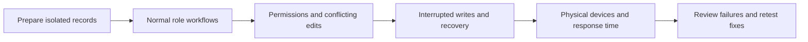

# Staff portal UAT walkthrough

**Draft — no cases are marked passed.** Use this guide for manual acceptance of the API-backed staff portal. [Service Contracts](SERVICE_CONTRACTS.md) owns the rules; [Code Owners](Code-Owners.md) identifies where a failure should be investigated. Record results against the exact build tested.

## Run record

| Field | Record before starting |
| --- | --- |
| Date / tester | |
| Site and build | URL, source commit and environment label |
| Test mode | API-backed, isolated PostgreSQL and synthetic records; demo mode does not establish persistence |
| Identity / media | Local identity substitute or real Cognito; isolated media or deployed storage |
| Device | Model, OS, browser/version; browser tab or installed PWA |
| Role accounts | Owner, Admin and each Trainer used below |
| Result log | Case ID; Pass / Fail / Blocked / Not run; actual result; evidence; response time; issue reference |

Use isolated test data for the main walkthrough. Do not use production PostgreSQL, real customer details or real invitations/messages. A prepared phone/tablet URL must point to the same isolated backend. Real-provider and deployed-environment checks are listed separately at the end.

## Prepare the records

Have the test operator prepare these records before the session. Use separate copies for destructive/lifecycle cases so one case does not invalidate another.

| Record | Required state |
| --- | --- |
| Owner and Admin | Separate active accounts; both can edit the same client for conflict checks |
| Trainer A | Active, assigned to Client A; schedule changes require approval |
| Trainer B | Active, assigned to Client B; permitted schedule changes are autonomous |
| Trainer C | Active replacement with known free slots and one deliberately conflicting slot |
| Client A | Active individual; active 12-session purchase; future, Open, attended, no-show and completed sessions; prior nonempty plan on an earlier date |
| Client B | Different Trainer and private notes/forms/report history; use as the foreign-record check |
| Couple | Two distinct people with different names, birthdays, contacts and assessment records |
| Lifecycle copies | Active client; independently inactive purchase; purchase inactivated with its client; inactive Trainer with retained assignments; inactive purchased package |
| Purchase choices | Active and inactive catalogue templates; current and queued purchases; one near the renewal threshold |
| Reporting / pay | Two purchases for one client, enough records for more than one page, closed pay cycle, pending and approved remuneration |
| Requests / media | Pending supervised request; recent eligible Undo; expired Undo; recent, expired and missing media; library attachment |
| Legacy / boundary cases | Prepared ambiguous purchase/slot links, unknown original Trainer, prior acknowledgement, approval conflict, expiry/time boundary records |

The operator prepares historical dates, expired media and failure conditions. Do not change a device clock or wait seven days to simulate a server-time rule. Never reuse a real customer's email for a synthetic account.

## How to run

1. Start with sign-in and normal workflows. Then run authority/conflict cases. Use disposable copies for deactivation, deletion and recovery.
2. For every successful save: inspect the result, reload, then check from a fresh permitted login. Confirm one intended change, retained history and no duplicate message, credit or record. A success toast alone is insufficient.
3. For every rejected/cancelled action: reload and confirm no unintended change. Check the original values and any credit/message/history effects.
4. Run shared screens as Owner, Admin and the relevant Trainer. Repeat permission checks using both assigned and foreign records. For a protected link, obtain its address with a permitted account, then try it in the restricted account's separate browser context.
5. Record slowness even when the result is correct. Time page opening, review opening, save-to-visible-result, PDF preparation and media loading. Note first versus repeat action, record volume, network/device, frozen UI, missing progress, repeated-click temptation and delayed response after navigation. No latency budget is established by this guide; flag any delay that disrupts normal use rather than silently passing it.
6. Use the case result log below. A missing fixture, disabled deployment capability or unavailable provider is **Blocked**, not Pass.

## 1. Sign-in and account access

Rules: [BR-006](SERVICE_CONTRACTS.md#br-006), [BR-007](SERVICE_CONTRACTS.md#br-007), [BR-008](SERVICE_CONTRACTS.md#br-008), [BR-030](SERVICE_CONTRACTS.md#br-030), [BR-031](SERVICE_CONTRACTS.md#br-031), [BR-037](SERVICE_CONTRACTS.md#br-037).

| Case | Role | Actions | Expected result |
| --- | --- | --- | --- |
| UAT-001 | Owner, Admin, Trainer | Sign in separately as each role; refresh; sign out; use browser Back. | Correct role and permitted data appear. Sign-out removes private content; Back does not restore access. |
| UAT-002 | Each role | Attempt a wrong password, wrong verification code and expired challenge; then complete a valid login. | Failures are readable and do not expose another account. Valid login succeeds without retaining another user’s private state. |
| UAT-003 | New staff | Complete required password/enrollment challenges with the prepared identity provider. Try a password under15 characters, whitespace, then an allowed15–128-character passphrase. | Invalid passwords are rejected. Required MFA cannot be skipped. Label this simulated-provider evidence unless real Cognito is used. |
| UAT-004 | Each role | Change password with wrong current password, mismatched confirmation and then a valid new password. Test the next login. | Only the valid request changes credentials. Existing-session behavior follows the shown policy; no false success after rejection. |
| UAT-005 | Prepared account | Use Forgot Password and reset with invalid/expired then valid code; sign in again. | Only valid recovery changes the password. Password reset does not claim to recover a lost authenticator. |
| UAT-006 | Owner / Admin / Trainer | As Owner open Create Admin; cancel once, then create a synthetic Admin with the test provider. Try the same entry/link as Admin and Trainer. | Owner can create once; cancellation creates nothing. Other roles cannot create Admins. Real invitation delivery is a separate check. |
| UAT-007 | Owner / Admin, then Trainer account holder | Request a new Trainer login email. Before verification, try the old login/recovery address. As the holder, send and verify a code. | Address remains unchanged until verified completion. After completion, new address is used and prior sessions are revoked. Managers cannot verify for the holder. |
| UAT-008 | Owner / Admin and holder | Review a pending email request; replace it with another address. Attempt the old code/request, a stale correction and correction while send/verify outcome is uncertain. | Superseded or stale requests cannot complete. Uncertain provider work blocks replacement. Correction itself sends no mail or bypasses resend limits. |
| UAT-009 | Owner, Admin, Trainer | Open personal/profile pages; try permitted edits and prohibited fields. Open Owner Profile. | Manager/self-edit boundaries hold. Trainer cannot change protected name/rate fields through self-edit. Owner Profile stays read-only. |

## 2. Clients, Trainers and package setup

Rules: [BR-003](SERVICE_CONTRACTS.md#br-003), [BR-005](SERVICE_CONTRACTS.md#br-005), [BR-012](SERVICE_CONTRACTS.md#br-012), [BR-013](SERVICE_CONTRACTS.md#br-013), [BR-021](SERVICE_CONTRACTS.md#br-021), [BR-037](SERVICE_CONTRACTS.md#br-037), [BR-038](SERVICE_CONTRACTS.md#br-038), [BR-057](SERVICE_CONTRACTS.md#br-057).

| Case | Role | Actions | Expected result |
| --- | --- | --- | --- |
| UAT-010 | Owner / Admin | Create an individual client. Leave required fields blank, enter invalid values, move Back/Edit, then confirm valid details. | Only final confirmation persists. Required fields are enforced; drafts survive wizard navigation; one client and reviewed purchase/sessions are created. |
| UAT-011 | Owner / Admin | Create a couple with distinct details for both people; edit one person afterwards. | Each person keeps their own identity, contacts and birthday. Couple display name never overwrites either person. |
| UAT-012 | Owner / Admin | Search/browse clients and Trainers, select records, filter active records, and reload a selected profile. | Lists and detail identify the same records. No fabricated package or missing-record substitute appears. Inactive Trainers are not offered as eligible replacements. |
| UAT-013 | Trainer A | Browse assigned clients; attempt Client B’s protected profile/link and a missing record. | Assigned scope works. Foreign/missing records disclose no private data. Limited historical/session access does not grant a full foreign profile. |
| UAT-014 | Owner / Admin | Edit client contacts, optional fields and remarks; cancel once, then save. | Cancellation retains the saved values. Valid save persists only intended fields and retains person identities. |
| UAT-015 | Owner / Admin | Create a Trainer with required fields; try blanks, duplicate identity and incomplete contact data. | Valid creation occurs once with correct defaults. Invalid input does not create partial staff records. Qualifications remain optional. |
| UAT-016 | Owner / Admin / Trainer | As Owner edit Trainer rates; as Admin attempt rate/remuneration pages and links; as Trainer inspect own rates. | Only Owner can change rates. Admin cannot read financial data. Trainer has only permitted own financial access. |
| UAT-017 | Trainer A | Edit own availability; try overlapping/invalid blocks, then valid blocks. Attempt another Trainer’s availability. | Only permitted valid self-availability persists. Conflicts and foreign updates are rejected without partial changes. |
| UAT-018 | Owner / Admin | Change Trainer A’s approval settings; verify the next Trainer schedule action. | Reviewed settings persist and affect new actions. A Trainer cannot grant themselves autonomy. |
| UAT-019 | Owner / Admin | Create/edit a catalogue package; test counts0,366,decimal and a valid integer. Check12/24/36-session validity and activate/deactivate the template. | Invalid counts are rejected. Standard validity is90/180/270 days respectively, inclusive of start. Inactive templates disappear from new purchases; existing purchased terms do not change. |
| UAT-020 | Owner / Admin | Add a purchase to an existing client. Review prefilled preferences, slots and Trainer; cancel, then confirm. Try overlap with an older purchase that has no remaining sessions. | Cancellation creates nothing. Valid additional purchase has independent saved terms. Invalid overlap is rejected even when the earlier purchase has no remaining bookings. |
| UAT-021 | Owner / Admin | Use a prepared queued purchase before and on its activation date; reload twice. Repeat for an inactive client/purchase. | Eligible purchase activates once using Singapore business time. Inactive records do not activate. Old credits, signatures and purchase history remain unchanged. |

## 3. Health notes and assessments

Rules: [BR-004](SERVICE_CONTRACTS.md#br-004), [BR-020](SERVICE_CONTRACTS.md#br-020), [BR-055](SERVICE_CONTRACTS.md#br-055), [BR-056](SERVICE_CONTRACTS.md#br-056).

| Case | Role | Actions | Expected result |
| --- | --- | --- | --- |
| UAT-022 | Owner / Admin | Open the initial assessment forms for each person in the couple; save different answers. | Each person has their own11-form registry and records. No answer is shared across the couple accidentally. |
| UAT-023 | Trainer A | Read/edit assigned Client A’s general health notes. Attempt initial assessment forms and Client B’s notes. | Assigned notes save; initial11 forms remain inaccessible. Foreign notes cannot be read or edited. |
| UAT-024 | Owner / Admin | Save an empty assessment draft; fill a valid draft; leave and resume; complete it; inspect history. | Explicit saves create retained revisions. No revision per keystroke. Completion retains the submitted answers, person, assessor and recording time. |
| UAT-025 | Owner / Admin | Enter zero, unchecked/checked choices, invalid options and overlong text. Try completing an empty form and the explicitly saved unchecked six-checkbox hurdle checklist. | Zero stays zero; unchecked answers remain absent; checked values retain meaning. Invalid/oversized input is rejected. Empty completion is rejected except the documented checklist case. |
| UAT-026 | Owner / Admin | Correct a completed assessment with a reason; start reassessment; void a prepared record with a reason. | Correction retains previous identity/answers. Reassessment is a new occasion. Void is terminal and history remains visible. |
| UAT-027 | Owner / Admin / Trainer | Open inactive-client forms/notes; try editing. Ask the operator for the legacy supplementary-answer fixture and inspect it. | Inactive records are read-only. Legacy evidence is not silently imported, discarded or converted into invented clinical questions. |

## 4. Sessions, schedules and approvals

Rules: [BR-014](SERVICE_CONTRACTS.md#br-014), [BR-015](SERVICE_CONTRACTS.md#br-015), [BR-018](SERVICE_CONTRACTS.md#br-018), [BR-041](SERVICE_CONTRACTS.md#br-041), [BR-042](SERVICE_CONTRACTS.md#br-042), [BR-051](SERVICE_CONTRACTS.md#br-051), [BR-053](SERVICE_CONTRACTS.md#br-053).

| Case | Role | Actions | Expected result |
| --- | --- | --- | --- |
| UAT-028 | Owner / Admin / Trainer | Open Upcoming, All, weekly and monthly session views; select a session; return using Back. | Upcoming starts near the next session; All is date/time descending with stable ties. Weekly starts today and moves seven days. Monthly is Monday-aligned; empty dates do not open a false count. Context survives Back. |
| UAT-029 | Trainer | Inspect a busy weekly day with many sessions and both current and historical assignments. | Every permitted weekly session is listed, without preview truncation. Historical access does not enable current coaching edits or unrelated client profiles. |
| UAT-030 | Owner / Admin | Schedule an Open session; check its stable identity, purchase, validity and credits before/after. | It gains an allowed date/time and appropriate ordering. Purchase and used credits remain unchanged; no duplicate session is created. |
| UAT-031 | Owner / Admin | Edit a future fixed session; try unavailable Trainer/time, overlap, invalid duration and out-of-validity date before a valid save. | Invalid combinations are rejected atomically. Valid save changes the intended booking only; session identities and purchased terms remain intact. |
| UAT-032 | Permitted actor | Preview and confirm postponement; repeat with an ineligible, started or completed target. | Eligible target returns to Open without date/time/chronological number. Other bookings do not move, though displayed numbers may change. Ineligible targets remain unchanged. |
| UAT-033 | Trainer A, then Owner / Admin | Request a future time change under supervision. Inspect the calendar before decision; approve it as a manager. | Pending proposal leaves the booking unchanged. Approval applies the reviewed change once after current conflicts/authority are rechecked. |
| UAT-034 | Trainer A, then Owner / Admin | Request a replacement Trainer; reject it. Then prepare another request, create a conflicting booking and attempt approval. | Rejection changes no assignment. Stale/conflicting approval cannot apply the proposal. Decision history remains visible. |
| UAT-035 | Trainer B | Make allowed autonomous time and replacement-Trainer changes; try a time at/before now and a conflicting replacement. | Valid actions apply directly. Autonomy does not bypass assignment, future-time, availability or conflict checks. |
| UAT-036 | Trainer A / B | Cancel A’s pending request as A. Try cancellation as B and after the request becomes terminal. Race cancellation against a manager decision in two browsers. | Only originating active Trainer may cancel a pending request. Exactly one race outcome wins; no second domain effect or duplicate recipient notice. |
| UAT-037 | Owner / Admin | Permanently reassign Client A to C; review affected current/additional purchases and sessions. Try an unavailable replacement first. | Invalid replacement rejects the whole action. Valid reassignment preserves times/terms/history, updates eligible future assignments and supersedes affected proposals; completed/started/cancelled evidence is preserved. |
| UAT-038 | Owner / Admin; supervised and autonomous Trainer | Change a client’s fixed weekly slots. Check the review and required approval path. Inspect separately scheduled additional purchases. | Eligible bookings keep their dates, IDs and Trainers while times follow the reviewed slots. Separately scheduled purchases retain their own slots. Supervised edits remain proposals until approved. |
| UAT-039 | Owner / Admin with prepared legacy data | Edit weekly slots with a known legacy mapping, then with ambiguous mappings. Use a booking whose From/To differs from old stored duration. | Unambiguous records resolve consistently. Ambiguity/conflicts reject the whole save. Duration follows From/To, not stale stored duration. |
| UAT-040 | Owner / Admin | After reassignment, inspect original, assigned and performed Trainer evidence for completed and unfinished sessions; repeat after permitted Undo. | Current assignment changes without rewriting original/performed attribution. Unproven legacy originals stay unresolved. The manager acknowledging a session is not treated as its performer. |

## 5. Exercise plans, outcomes and completion

Rules: [BR-018](SERVICE_CONTRACTS.md#br-018), [BR-025](SERVICE_CONTRACTS.md#br-025), [BR-026](SERVICE_CONTRACTS.md#br-026), [BR-029](SERVICE_CONTRACTS.md#br-029), [BR-032](SERVICE_CONTRACTS.md#br-032), [BR-033](SERVICE_CONTRACTS.md#br-033), [BR-034](SERVICE_CONTRACTS.md#br-034), [BR-043](SERVICE_CONTRACTS.md#br-043).

| Case | Role | Actions | Expected result |
| --- | --- | --- | --- |
| UAT-041 | Owner / Admin / assigned Trainer | Create an ordered plan with exercise details; reorder/edit/remove an item and save. | Reviewed plan persists in order with stable retained evidence. Removing an item does not erase prior result/media identity or silently complete the session. |
| UAT-042 | Assigned actor | Open Copy Previous Plan; inspect the preview; cancel, then confirm. Compare original and target recordings. | Cancel leaves the target unchanged. Confirm copies prescriptions into new exercise identities. Source is latest permitted nonempty plan on a strictly earlier date; Open sessions are excluded; videos remain with the source. |
| UAT-043 | Assigned actor | Try Copy Previous Plan with no eligible prior plan or only same-day plans. | No fabricated previous plan is offered and no unintended replacement occurs. |
| UAT-044 | Owner / Admin / assigned Trainer | Save measured outcomes and comments, then correct/remove a result. Inspect retained history and booked duration. | Measurements and revisions persist; duration follows booking. Completion, signatures, credits and approved pay are unchanged. |
| UAT-045 | Permitted actor | Explicitly save an empty outcome; reload and inspect progress. Compare a signed attended result and no-show. | Empty results remain empty. Progress includes only signed completed attended results in the correct purchase; no-show/prescription defaults are not invented as measurements. |
| UAT-046 | Permitted actor | Write a client summary; reject blank/overlong input; save a valid replacement. | Summary persists separately with retained previous text. It does not change measurements, credits, acknowledgement or delivery status. |
| UAT-047 | Owner / Admin / assigned Trainer | Acknowledge an eligible session with actual signature ink and signer name. Try missing ink/name and a future/Open/cancelled session. | Only eligible acknowledgement succeeds. Signature is then read-only; exactly one credit is consumed. Invalid attempts change nothing. |
| UAT-048 | Permitted actor | Mark a prepared session no-show, then correct it to a signature. Attempt the reverse correction. | No-show consumes one applicable credit. Correction retains both acknowledgement records and does not debit again. Reverse correction is unavailable/rejected. |
| UAT-049 | Permitted actor | Complete the session that reaches the two-credit reminder threshold; reload/revisit and repeat recovery. Compare a client with a later active purchase. | Exactly one applicable package-instance reminder appears. Retry/correction creates no duplicate; a later active purchase suppresses renewal as documented. |
| UAT-050 | Cover Trainer / inactive record | Open completed/cancelled ad-hoc cover and an inactive client/purchase; try outcomes, summary, acknowledgement, scheduling and media writes. | Allowed history remains readable, but restricted writes are disabled or rejected. Cover visibility never grants full client progress/profile rights. |
| UAT-051 | Permitted actor | Export a session PDF with captions and optional client summary; unselect all available content. | Selected text appears; no content keeps Continue disabled. Captions are not video bytes. PDF export does not increment legacy WhatsApp-open fields or claim delivery. |

## 6. Client, Trainer and purchase lifecycle

Rules: [BR-016](SERVICE_CONTRACTS.md#br-016), [BR-017](SERVICE_CONTRACTS.md#br-017), [BR-039](SERVICE_CONTRACTS.md#br-039), [BR-040](SERVICE_CONTRACTS.md#br-040).

| Case | Role | Actions | Expected result |
| --- | --- | --- | --- |
| UAT-052 | Owner / Admin | Deactivate a disposable client with active and independently inactive purchases; reload as its Trainer. | Client and eligible active purchases freeze with history retained. Content/coaching mutations stop; sessions and historical evidence are not silently deleted. |
| UAT-053 | Owner / Admin | Reactivate that client after reviewing schedule conflicts. Inspect independently inactive and ambiguous-legacy purchases. | Only purchases disabled by that client action are restored. Independent/ambiguous inactive purchases stay inactive. Expiry/credits remain unchanged and deleted sessions do not reappear. |
| UAT-054 | Owner / Admin | Deactivate only one purchase, then reactivate it after review. Inspect other purchases and completed history. | Only reviewed purchase changes state. Reactivation checks conflicts and preserves expiry, credits and completed evidence. Deactivation has no generic Undo. |
| UAT-055 | Owner / Admin | On an inactive purchase, preview Delete Upcoming Sessions; confirm. Include Open, future, completed, cancelled and acknowledged bookings in the fixture. | Only eligible unfinished Open/strictly future bookings are deleted. Protected bookings and credits remain. Pending related requests are rejected and history retained. |
| UAT-056 | Owner / Admin | Undo that deletion within24 hours using unchanged records and available original media. Repeat after expiry, changed dependencies or missing/expired bytes. | Eligible restoration uses original IDs/creation times and higher versions; purchase stays inactive. Ineligible restoration rejects atomically without partial sessions/media. |
| UAT-057 | Owner / Admin | Deactivate a Trainer with future and Open sessions on active clients/purchases; omit a replacement, then choose a conflicting replacement, then valid replacements. | Incomplete/conflicting review is rejected. Valid action reassigns the complete eligible set atomically and disables the Trainer/linked application account. Permanent client reassignment is not silently implied. |
| UAT-058 | Deactivated Trainer, then Owner / Admin | Try existing and new login after deactivation. Reactivate; sign in afresh and inspect previous assignments. | Old sessions stay revoked. Reactivation restores eligible application access without reclaiming bookings or rewriting history. Missing/separately disabled provider identity is not silently created or enabled. |

## 7. Messages, Undo, content and remuneration

Rules: [BR-005](SERVICE_CONTRACTS.md#br-005), [BR-022](SERVICE_CONTRACTS.md#br-022), [BR-023](SERVICE_CONTRACTS.md#br-023), [BR-024](SERVICE_CONTRACTS.md#br-024), [BR-042](SERVICE_CONTRACTS.md#br-042), [BR-044](SERVICE_CONTRACTS.md#br-044), [BR-045](SERVICE_CONTRACTS.md#br-045).

| Case | Role | Actions | Expected result |
| --- | --- | --- | --- |
| UAT-059 | Owner / Admin / recipient Trainer | Open/filter Messages; mark one record read, then unread. View it as a second recipient and inspect Dashboard reminders. | Filtering alone does not mark read. State is per recipient. Categories follow the message type; dashboard preview has at most three reminders while totals include all visible reminders. |
| UAT-060 | Permitted recipient | Dismiss a renewal reminder; inspect another recipient/client and refresh. | Only the permitted reminder action changes. Reading alone does not resolve it. No unrelated recipient/message state is changed. |
| UAT-061 | Owner / Admin / original active Trainer | Review and Undo an eligible recent operation; inspect the resulting record and original decision history. | Compensation restores permitted values with increasing versions and new evidence. Original events/receipts remain. Approved decisions are not rewritten as never having happened. |
| UAT-062 | Permitted actor | Try Undo after24 hours, after a dependent change, after loss of scope, or against started/credited scheduling or approved-pay changes. Try acknowledgement and package Add/Deactivate. | Ineligible actions are unavailable/rejected with no partial reversal. Required later changes must be reversed first. Credits and revoked logins are never rewound. |
| UAT-063 | Owner / Admin | Create/edit website content; cancel once; save; reload. Try stale edit in another browser and access as Trainer. | Permitted content saves once and survives reload. Cancellation/stale/unauthorized save does not overwrite. Staff content management does not imply the public website is launched. |
| UAT-064 | Owner / Trainer; Admin denied | Open remuneration cycle list and detail for own/permitted scope. Attempt another Trainer’s detail as Trainer and any financial detail as Admin. | Owner sees permitted totals, Trainer sees own records, Admin/foreign scope is denied. Financial data is not exposed in the general directory. |
| UAT-065 | Owner with prepared records | Check weekday06:30,08:30,18:00,20:30 starts, weekend sessions, attended and no-show records, and the16th-to15th pay cycle. | Exclusive peak ends are respected; weekends are peak. No-show uses applicable full rate with zero attended minutes. Cycle closes after the15th; invalid/future/incomplete evidence blocks approval as documented. |
| UAT-066 | Owner | Review/approve a closed valid cycle; try stale or duplicate approval. Change a source rate/name or attendance afterwards and revisit. | One approval snapshot retains original amount/names/evidence and internal notice. Later differences appear separately. No transfer/payment is claimed. Frozen unfinished inactive records neither earn pay nor block approval. |

## 8. Reports, Exercise Library and recordings

Rules: [BR-027](SERVICE_CONTRACTS.md#br-027), [BR-028](SERVICE_CONTRACTS.md#br-028), [BR-046](SERVICE_CONTRACTS.md#br-046), [BR-047](SERVICE_CONTRACTS.md#br-047), [BR-048](SERVICE_CONTRACTS.md#br-048), [BR-049](SERVICE_CONTRACTS.md#br-049), [BR-050](SERVICE_CONTRACTS.md#br-050), [BR-057](SERVICE_CONTRACTS.md#br-057).

| Case | Role | Actions | Expected result |
| --- | --- | --- | --- |
| UAT-067 | Owner / Admin / assigned Trainer | View progress for two purchases; change exercise/filter/page and return using Back. Open only one chart, then another. | No purchase mixing. Selected view survives navigation; one chart expands at a time. Only permitted signed results appear; unresolved legacy provenance is not guessed. |
| UAT-068 | Permitted report viewer | Prepare/download a full report; refresh with unchanged data, then change purchase/content. | All recorded exercises are exported. Unchanged content can reuse prepared PDF; changed content invalidates it. Late preparation cannot replace the current report. |
| UAT-069 | Physical supported device | Share the prepared PDF, cancel a share, then simulate unsupported file sharing or rendering failure. | Successful native handoff is truthfully labelled, never delivered. Cancellation records no share. Unsupported/failing share offers Download/Open; rendering failure offers Retry PDF. |
| UAT-070 | Owner / Admin; Trainer denied history | Inspect report history across clients/purchases and multiple pages. Repeat an audit recovery after a lost response. | History is immutable, correctly ordered and scoped, with ten-row pagination. Trainer cannot read it. Audit recovery does not repeat native share/download or create a duplicate action. |
| UAT-071 | Owner / Admin / Trainer | Browse Exercise Library; create/edit metadata as a manager. Try duplicate/reserved name, over180-character name and over2,000-character description. | Only valid permitted saves persist. Trainers see active entries and cannot manage metadata. Existing session plan names/identities remain unchanged. |
| UAT-072 | Owner / Admin | Attach valid reference image/video; try empty file, unsupported type and over50MiB file. Reload and open permitted media. | Only allowed nonempty JPEG/PNG/WebP/MP4/WebM/MOV is accepted within limit. Saved attachment reads correctly; invalid save does not publish successful metadata. |
| UAT-073 | Owner / Admin | Replace/remove a library attachment. Open it from an old view and as an unauthorized user; interrupt an upload. | New reads of detached/private media are denied. Interrupted publication is recoverable without duplicate attachments. Physical cleanup can be deferred; removal does not claim instant byte deletion. |
| UAT-074 | Assigned actor on physical device | Record/select session video; save; reload; play back. Replace and remove using separate records. | Only current permitted session/plan media changes. Exercise identity and credits remain unchanged. Record real capture/audio/playback issues; metadata alone is not proof of processing quality. |
| UAT-075 | Permitted actor with prepared expiry fixtures | Play recent, expired and missing recordings; try edits after completion/inactivity and during an authority change while downloading. | Expiry/access is enforced before and after retrieval. Missing bytes are not success. Original expiry is not extended by edit/Undo; restricted writes remain blocked. |

## 9. Concurrent edits and interrupted actions

Rules: [BR-007](SERVICE_CONTRACTS.md#br-007), [BR-009](SERVICE_CONTRACTS.md#br-009), [BR-010](SERVICE_CONTRACTS.md#br-010), [BR-011](SERVICE_CONTRACTS.md#br-011), [BR-020](SERVICE_CONTRACTS.md#br-020), [BR-024](SERVICE_CONTRACTS.md#br-024), [BR-030](SERVICE_CONTRACTS.md#br-030), [BR-031](SERVICE_CONTRACTS.md#br-031), [BR-039](SERVICE_CONTRACTS.md#br-039).

The operator must prepare a controlled way to delay a response, lose a response after commit, fail before commit and restart the isolated service. Turning off Wi-Fi alone cannot prove which server outcome occurred. Mark an unprepared scenario Blocked.

| Case | Role | Actions | Expected result |
| --- | --- | --- | --- |
| UAT-076 | Owner + Admin, separate browsers | Open the same record for edit. Owner saves first; Admin saves the older reviewed values. Repeat for profile, plan and schedule. | First save persists. Second receives a clear conflict/change notice and must review current data. It does not overwrite silently or discard the newer saved state. |
| UAT-077 | Permitted editor | Keep an unsaved draft open while another browser saves a same-scope update; trigger background refresh; then Cancel and reopen. | Draft stays intact during ordinary refresh. Save uses its reviewed version. Cancel reloads current saved values; it does not resurrect the old draft. |
| UAT-078 | Trainer + manager | While Trainer edits, manager reassigns/deactivates the record or changes access. Attempt Save and use browser Back. | Retired authority prevents the write and clears private detail as appropriate. Background/late replies cannot restore access. |
| UAT-079 | Each role | Open a confirmation, navigate away or sign out, then allow a delayed review response to arrive. Open a different confirmation. | Retired review never reopens or decides the newer dialog. No cancelled/unconfirmed action is written. |
| UAT-080 | Permitted actor; operator loses response after commit | Save a client/profile, creation, plan, acknowledgement, request decision, media publication and remuneration approval on separate fixtures; lose each response after commit. Use Check, then reload/fresh login. | Check reads the original outcome without a new write. Exactly one record/credit/approval/message effect exists. Old intent is retained; no duplicate invitation or upload publication. |
| UAT-081 | Permitted actor; operator fails before commit | Repeat representative writes with a known pre-commit failure. Check and use explicit retry if offered; click twice quickly. | No partial records/credits/notices exist. Retry retains original intent and is guarded against parallel duplication. No automatic replacement command is created. |
| UAT-082 | Permitted actor | Start a save, close/cancel the editor while outcome is unknown, navigate elsewhere, then return to recovery. Try submitting changed values meanwhile. | Closing does not cancel a sent command. Same-login recovery remains available. Changed intent cannot silently replace the uncertain command. |
| UAT-083 | Permitted actor; operator fails refresh only | Allow save to commit, then fail the follow-up read. Restore connection and refresh. | UI preserves saved/committed status and offers read recovery. It does not present another Save as required or repeat the write. |
| UAT-084 | Trainer / Owner | Disconnect while editing general notes; reconnect as the same verified login. Repeat with logout or another account before reconnect. | Only the same user/role/login generation may regain the in-memory draft. Private UI is hidden while unverified; changed identity/discard clears it. No offline replay occurs. |
| UAT-085 | Two roles in sequence | Leave a delayed page request running; sign out and sign in as a different account. Let the old response finish. | Old data, errors, dialogs and command outcomes do not appear in the new account. Missing/foreign records do not leak private details. |
| UAT-086 | Operator + tester | Restart the isolated API after a committed save and during a prepared interrupted write; reopen the records with a valid session. | Committed records and original receipts survive; incomplete transaction has no partial effect. Recovery does not duplicate the action. This does not prove deployed Lambda/database recovery. |

## 10. Physical devices, navigation and responsiveness

Rules: [BR-021](SERVICE_CONTRACTS.md#br-021), [BR-047](SERVICE_CONTRACTS.md#br-047), [BR-050](SERVICE_CONTRACTS.md#br-050), [BR-051](SERVICE_CONTRACTS.md#br-051), [BR-052](SERVICE_CONTRACTS.md#br-052), [BR-063](SERVICE_CONTRACTS.md#br-063), [BR-064](SERVICE_CONTRACTS.md#br-064).

| Case | Role | Actions | Expected result |
| --- | --- | --- | --- |
| UAT-087 | Owner / Admin / Trainer on desktop | Use keyboard-only navigation for menus, fields, date/select/suggestion controls, dialogs and cancellation. Try empty required and disabled controls. | Focus, labels and error states are usable; disabled controls do not act. Menus stay within the viewport and dialogs return sensible focus. |
| UAT-088 | Samsung phone and iPad | Repeat client editing, weekly schedule, session plan, signature, recording and PDF sharing on real devices. Scroll long pages and open native pickers. | No trapped scroll, missed taps, clipped controls or inaccessible Save/Cancel. Ink and native actions work without losing the draft. Record model/browser and any lag. |
| UAT-089 | Installed PWA | Rotate during an edit, open/close keyboard, background/foreground, and return through Back/Forward. | Portrait handling/fallback preserves drafts. Keyboard shrink is not mistaken for rotation. No private screen flashes for the wrong account. |
| UAT-090 | Each role on populated data | Open dashboard, lists, calendar, profile, plan and history; change filters/pages; navigate away/back and reload. | Approved ordering, counts, pagination, selected charts and context remain consistent. Navigation starts collapsed with one expanded category. No fabricated schedule fills missing data. |
| UAT-091 | Each device; operator observes responses | Measure first/repeated page opening, review, save, report render and media playback. During delays try navigation/cancel once. | Busy state and final result are understandable, no duplicate action or frozen navigation occurs, and retired work stays retired. Record disruptive slowness as a finding even if data is correct. |
| UAT-092 | Signed-out / offline device | After sign-out disconnect and revisit prior private pages/media; inspect installed PWA behavior. | Private APIs/media are not made available as offline public content. App shell availability must not be mistaken for authenticated access. |

## 11. Separate live and operational acceptance

These checks are not passed by local identity substitution, isolated PostgreSQL or the manual cases above. Execute only in a specifically authorized environment with designated test identities.

| Check | Perform and record | Expected boundary |
| --- | --- | --- |
| Real Cognito | Enrollment, MFA, repeated login, expiry/refresh, password recovery, verified email change and revoked login | Actual provider behavior and delivery confirmed; synthetic results do not count |
| Lost authenticator | Authorized operator follows the [recovery procedure](../README.md#operator-assisted-lost-authenticator-recovery); verify identity, audit, session revocation and re-enrollment | No app recovery-admin power; pool-wide MFA stays required; exact test account only |
| Real invitations / email | Confirm delivery, intended address, expiry and resend behavior using designated test recipients | No real customer contact or inference from an accepted API response |
| Deployed build | Verify frontend build and Lambda image match reviewed source; check actual database schema and runtime health | Source merge is not deployment evidence |
| Protected cloud media | Upload/read/expiry/cleanup against authorized storage and processing setup | Local RustFS does not prove S3, cloud scheduling, transcoding or capture acceptance |
| Migration / backup / recovery | Follow a reviewed populated-database migration, rollback and restore drill | Not a destructive step to improvise during ordinary UAT; retain measured recovery evidence |
| Public/member website | Separate accepted design, Glofox handoff/entitlement, public routes and content | Staff UAT does not accept the future public/member deliverable |
| Operational hardening | Use the M10 plan for mutation, latency budgets, observability, alerts and resilience | No implementation or production acceptance claimed from this guide |

## 12. Record results and close the run

| Case ID | Result | Actual result / issue | Evidence | Response time and device |
| --- | --- | --- | --- | --- |
| | Pass / Fail / Blocked / Not run | | | |

For a failure, capture the role, synthetic record, starting state, actions, expected/actual result and whether the server saved anything. Keep screenshots/recordings free of passwords, MFA codes, tokens and real health data. Link the case ID and BR rule when reporting the issue.

Retest each fix on the new build, including its permission, conflict, persistence and recovery effects. Keep the original failure and retest result. Acceptance requires every applicable case to have a result, no unresolved data-loss/permission/duplicate-effect defect, and explicit review of remaining usability or slowness findings. Record blocked and unrun cases separately; do not call the run complete while required checks are missing. Local staff acceptance, physical-device acceptance and the live/operational checks above are separate decisions.
