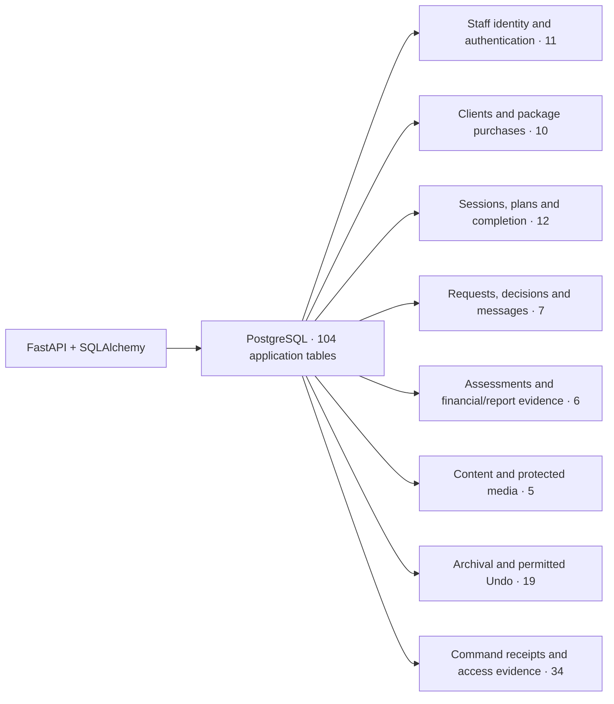
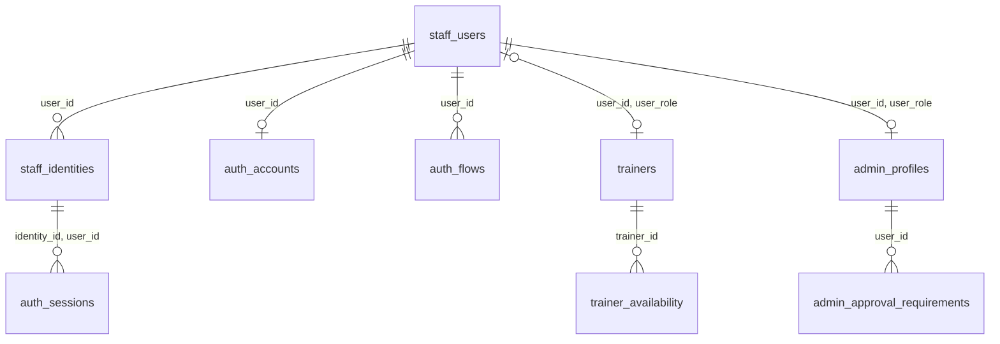
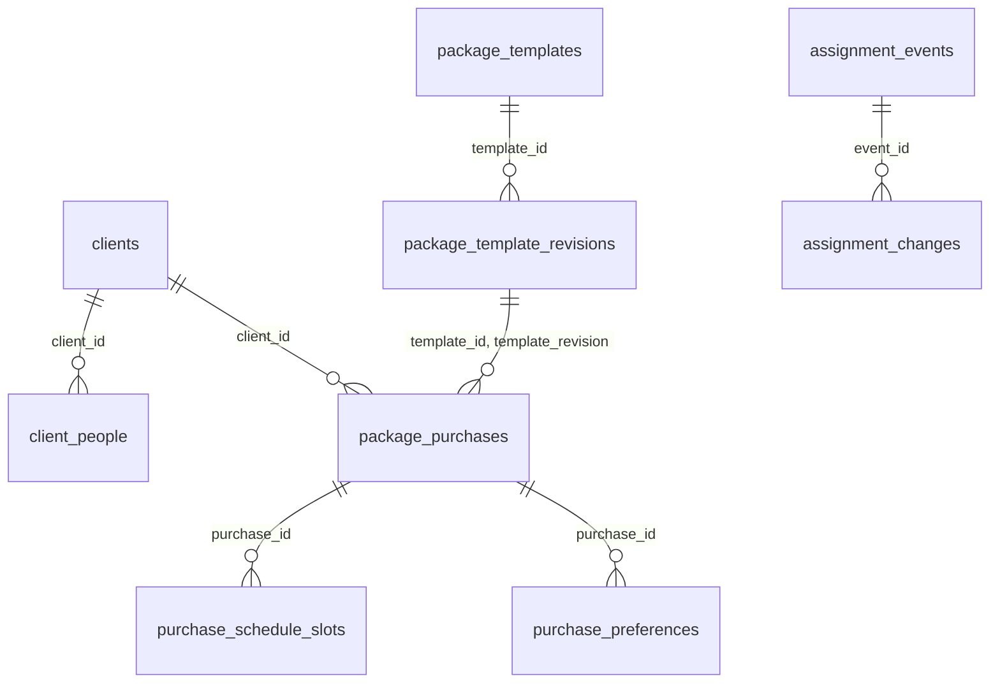
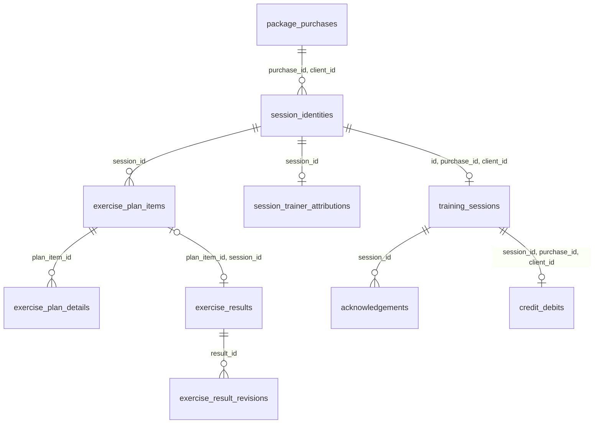
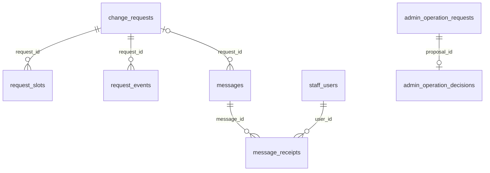
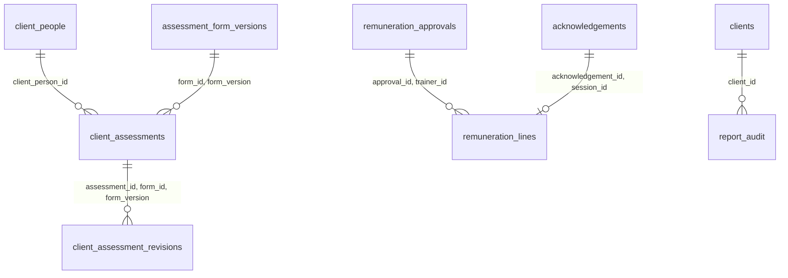
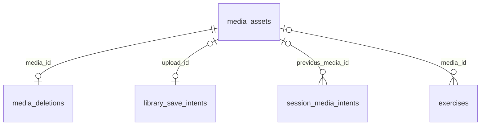
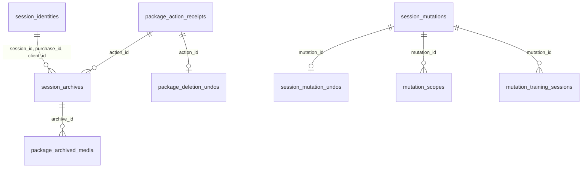
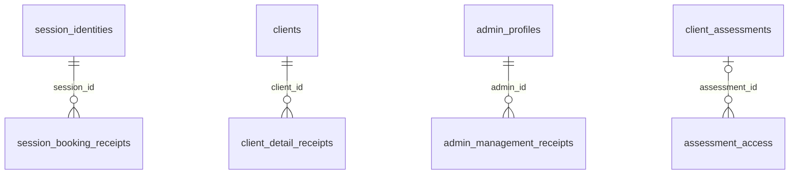

# Database schema

Source map reviewed **3 November 2026 (Singapore)** against `68b2eb2`. **104 application PostgreSQL tables** result from the 52 Alembic revisions through `20261101_0052`. Migration bookkeeping (`alembic_version`), PostgreSQL system tables and test-only fixtures are excluded.

**Deployment distinction:** this is a source-derived schema map verified in disposable local PostgreSQL 17.11. It is not an inspection of deployed RDS or customer records; the deployed migration head remains separately verified during release. Table presence does not certify provider, device or production acceptance.

The schema owners are [SQLAlchemy models](../../backend/app/models), [Alembic migrations](../../backend/migrations/versions) and [database configuration](../../backend/app/database.py). [Business rules](../business-rules.md) own domain requirements; [Data lifecycle](../data-lifecycle.md) owns retention/deletion; [Runbook](../runbook.md) owns migration and restore operations. This document owns table structure and relationships.

## Overview

FastAPI persists staff identity, client/package/session state and immutable command/history evidence in PostgreSQL. Cognito owns provider authentication and S3 owns media objects; neither is a second relational database inside this schema.

## Reading the diagrams

These use crow’s-foot ER notation: `||` means exactly one, `o|` zero or one, and `o{` zero or many. A parent can have no children even when each child must reference a parent. Solid ER lines below show selected declared PostgreSQL foreign keys, not every relationship. `PK` means primary key; `UK` means unique constraint/index. Composite keys are written together; they must not be read as separate single-column relationships.

The inventories cover every application table once, with primary/unique keys and a source link. Diagrams intentionally omit most actor links and repeated receipt fields. Full columns, nullability, partial-index predicates, checks, deferral and trigger definitions remain in the linked source. IDs embedded in JSON or references to Cognito/S3 are not SQL foreign keys. Unique nullable columns follow PostgreSQL null semantics and do not require every row to have a value.

## PostgreSQL: Staff identity and authentication

Clients do not receive staff login accounts. `trainers.user_id` is nullable; a Trainer profile need not yet have an associated login. Trainer/Admin role membership uses composite `(user_id, user_role)` foreign keys to `staff_users(id, role)`. `admin_approval_requirements.user_id` references **admin_profiles.id**, despite its column name. Provider issuer/subject values identify external Cognito accounts; they are not foreign keys to Cognito. Session tokens are ciphertext, and browser handles are hashed.

| Table | Key | Purpose |
| --- | --- | --- |
| [`staff_users`](../../backend/app/models/people.py) | PK: `id`; UK: `email`; `id, role` | Staff login role, active status and account version; clients are not staff users. |
| [`staff_identities`](../../backend/app/models/people.py) | PK: `id`; UK: `id, user_id`; `issuer, subject`; `user_id, issuer` | Provider issuer/subject and username linked to the local staff account. |
| [`auth_accounts`](../../backend/app/models/authentication.py) | PK: `user_id` | Account-wide revocation epoch and pending authentication barrier. |
| [`auth_flows`](../../backend/app/models/authentication.py) | PK: `id`; UK: `handle_hash` | Expiring sign-in/recovery challenge state and bounded attempts. |
| [`auth_sessions`](../../backend/app/models/authentication.py) | PK: `id`; UK: `handle_hash` | Hashed session handles, encrypted provider tokens, expiry and refresh leases. |
| [`trainers`](../../backend/app/models/people.py) | PK: `id`; UK: `email`; `user_id` | Trainer profile, rates, approval policy and optional staff-account association. |
| [`trainer_availability`](../../backend/app/models/people.py) | PK: `id`; UK: `trainer_id, weekday, starts_at, ends_at` | Trainer weekly availability intervals. |
| [`admin_profiles`](../../backend/app/models/staff.py) | PK: `id`; UK: `user_id` | Admin personal details linked to an Admin-role staff account. |
| [`admin_approval_requirements`](../../backend/app/models/admin_management.py) | PK: `user_id, area` | Per-Admin, per-area Owner approval selections. |
| [`staff_invitations`](../../backend/app/models/staff.py) | PK: `id`; UK: `request_key`; `user_id` | Provisioning and invitation delivery evidence, including recovery state. |
| [`staff_email_changes`](../../backend/app/models/email_changes.py) | PK: `id`; UK: `actor_id, request_key`; `supersedes_id`; `new_email` (partial; see source); `user_id` (partial; see source) | Verified login-email changes, provider evidence and superseded attempts. |

## PostgreSQL: Clients and package purchases

Each purchase owns its Trainer and schedule independently. `clients.trainer_id` is the default association, not a substitute for every purchase’s assignment. The purchase links to an exact template revision with `(template_id, template_revision)`; purchased terms remain snapshots. Purchase validity periods may overlap, but the migrated database retains `uq_current_purchase`: unique `client_id` where `stage = 'current'`. This limits the designated current slot, not all active/queued purchases. The index is migration-owned and absent from current model index declarations; inspect migrated PostgreSQL rather than inferring constraints from models alone. Lifecycle history includes optional target references and a one-target check.

| Table | Key | Purpose |
| --- | --- | --- |
| [`clients`](../../backend/app/models/people.py) | PK: `id` | Individual/couple account, default Trainer, active status and general notes. |
| [`client_people`](../../backend/app/models/people.py) | PK: `id`; UK: `client_id, position` | Named people within a client account, personal/health/emergency details. |
| [`lifecycle_events`](../../backend/app/models/people.py) | PK: `id` | Attributable client, purchase or Trainer activation/deactivation history. |
| [`package_templates`](../../backend/app/models/training.py) | PK: `id` | Stable package catalogue identity and active status. |
| [`package_template_revisions`](../../backend/app/models/training.py) | PK: `id`; UK: `template_id, revision` | Numbered purchased-term definitions with actor evidence. |
| [`package_purchases`](../../backend/app/models/training.py) | PK: `id`; UK: `id, client_id`; `client_id` (partial; see source) | Client purchase, immutable original terms, current Trainer and lifecycle stage. |
| [`purchase_schedule_slots`](../../backend/app/models/training.py) | PK: `id`; UK: `id, purchase_id`; `purchase_id, weekday` | Current fixed-weekly slots and original purchased schedule snapshot. |
| [`purchase_preferences`](../../backend/app/models/training.py) | PK: `id`; UK: `purchase_id, weekday, starts_at, ends_at` | Preferred weekly time intervals attached to a purchase. |
| [`assignment_events`](../../backend/app/models/training.py) | PK: `id` | Client reassignment actor and old/new Trainer evidence. |
| [`assignment_changes`](../../backend/app/models/training.py) | PK: `id`; UK: `event_id, purchase_id`; `event_id, session_id` | Exact purchase/session changes belonging to a reassignment event. |

## PostgreSQL: Sessions, plans and completion

`session_identities` survives when a live `training_sessions` row is archived; history, plans and several receipts reference this stable identity. Composite session/purchase/client and slot/purchase foreign keys prevent mixed scope. Booked sessions require a date/time/number; open sessions require those fields to be absent. The assignment history additionally links to a source session event. Acknowledgements reference live sessions; `credit_debits.session_id` is unique. Diagram edges omit secondary actor, Trainer and copied-from links to stay readable.

| Table | Key | Purpose |
| --- | --- | --- |
| [`session_identities`](../../backend/app/models/package_actions.py) | PK: `id`; UK: `id, purchase_id, client_id` | Stable session/purchase/client identity retained through archival. |
| [`training_sessions`](../../backend/app/models/training.py) | PK: `id`; UK: `id, purchase_id, client_id`; `purchase_id, session_number` | Live scheduled/open session, assigned Trainer, comments and summary. |
| [`session_events`](../../backend/app/models/communications.py) | PK: `id` | Session action/decision history and old/new scheduling or Trainer facts. |
| [`session_trainer_attributions`](../../backend/app/models/session_attribution.py) | PK: `session_id` | Original and performed-by Trainer attribution with evidence state. |
| [`session_trainer_assignment_history`](../../backend/app/models/session_attribution.py) | PK: `event_id` | Assignment history bound to its source session event. |
| [`exercises`](../../backend/app/models/training.py) | PK: `id`; UK: `lower(btrim(name::text))` | Exercise library description, active status and optional published media. |
| [`exercise_plan_items`](../../backend/app/models/training.py) | PK: `id`; UK: `id, session_id`; `session_id, position` | Ordered session plan, optional library source and retired-item marker. |
| [`exercise_plan_details`](../../backend/app/models/training.py) | PK: `id`; UK: `plan_item_id, detail_key`; `plan_item_id, position` | Ordered free-text instructions within a plan item. |
| [`exercise_results`](../../backend/app/models/training.py) | PK: `id`; UK: `session_id, plan_item_id` | Session outcomes, optional matching plan item and retired-result marker. |
| [`exercise_result_revisions`](../../backend/app/models/training.py) | PK: `id`; UK: `result_id, result_version` | Attributable immutable outcome revision history. |
| [`acknowledgements`](../../backend/app/models/training.py) | PK: `id`; UK: `id, session_id`; `session_id, sequence` | Session signature/no-show evidence and bounded acknowledgement sequence. |
| [`credit_debits`](../../backend/app/models/training.py) | PK: `id`; UK: `session_id` | One negative-one credit debit per completed session. |

## PostgreSQL: Requests, decisions and messages

Scheduling requests and Admin operation proposals are different tables and authority paths. Admin proposals keep target/payload meaning in application-validated data; a UUID inside JSON is not a foreign key. Message kind/scope and access still require server validation. `message_receipts` is per-user read state; `message_read_receipts` below is the immutable command result used for recovery.

| Table | Key | Purpose |
| --- | --- | --- |
| [`change_requests`](../../backend/app/models/communications.py) | PK: `id` | Reviewed scheduling/change proposal, original scope and resolution state. |
| [`request_slots`](../../backend/app/models/communications.py) | PK: `id`; UK: `request_id, side, slot_identity` | Weekly intervals attached to a change request. |
| [`request_events`](../../backend/app/models/communications.py) | PK: `id`; UK: `request_id, sequence` | Attributable request decision history. |
| [`admin_operation_requests`](../../backend/app/models/admin_requests.py) | PK: `id`; UK: `actor_id, request_key` | Frozen Admin operation proposal, payload digest and resolution state. |
| [`admin_operation_decisions`](../../backend/app/models/admin_requests.py) | PK: `id`; UK: `actor_id, request_key`; `proposal_id` | Immutable Owner decision or originating-Admin cancellation evidence. |
| [`messages`](../../backend/app/models/communications.py) | PK: `id` | Typed notifications linked to applicable domain records. |
| [`message_receipts`](../../backend/app/models/communications.py) | PK: `id`; UK: `message_id, user_id` | Per-user message delivery/read state. |

## PostgreSQL: Assessments and financial/report evidence

Assessment forms are keyed by `(form_id, version)`. The current assessment and revision tables have deferred composite links, including the current revision and previous-revision chain; these additional cyclic edges are omitted from the compact diagram. Database structure does not grant Trainers access to the initial assessment forms. Remuneration lines bind approval/Trainer and acknowledgement/session pairs, not just unrelated single-column IDs. Report audit rows are not PDF object storage.

| Table | Key | Purpose |
| --- | --- | --- |
| [`assessment_form_versions`](../../backend/app/models/assessments.py) | PK: `form_id, version` | Versioned assessment form definitions. |
| [`client_assessments`](../../backend/app/models/assessments.py) | PK: `id`; UK: `id, form_id, form_version` | Current assessment identity/version for a client person and form. |
| [`client_assessment_revisions`](../../backend/app/models/assessments.py) | PK: `id`; UK: `assessment_id, revision` | Immutable assessment payloads, revision chain and assessor evidence. |
| [`remuneration_approvals`](../../backend/app/models/evidence.py) | PK: `id`; UK: `id, trainer_id`; `trainer_id, cycle_key` | Approved Trainer pay cycle and frozen aggregate totals. |
| [`remuneration_lines`](../../backend/app/models/evidence.py) | PK: `id`; UK: `approval_id, session_id`; `session_id` | Session/acknowledgement-backed Trainer pay lines with frozen amounts. |
| [`report_audit`](../../backend/app/models/evidence.py) | PK: `id` | Attributable client/purchase report-generation evidence. |

## PostgreSQL: Content and protected media

PostgreSQL holds metadata and command intent; S3 holds video/image bytes. `(bucket, object_key)` is unique, not a cross-service foreign key. `media_assets.session_id` uses `ON DELETE SET NULL`; original session/plan IDs preserve upload scope without declared foreign keys. `library_save_intents.exercise_id` is allocated before publication and is also application-managed. A ready/expired/deleted flag does not itself prove S3 erasure. See [Data lifecycle](../data-lifecycle.md) for retention and cleanup boundaries.

| Table | Key | Purpose |
| --- | --- | --- |
| [`content_entries`](../../backend/app/models/media.py) | PK: `id`; UK: `key` | Managed content values and publication/active state. |
| [`media_assets`](../../backend/app/models/media.py) | PK: `id`; UK: `bucket, object_key` | Private object location, digest, upload state, original scope and logical expiry. |
| [`media_deletions`](../../backend/app/models/media.py) | PK: `id`; UK: `media_id` | Durable object cleanup work, claims and completion state. |
| [`library_save_intents`](../../backend/app/models/media.py) | PK: `id`; UK: `actor_id, request_key`; `upload_id` | Frozen exercise save plus optional upload association and terminal result. |
| [`session_media_intents`](../../backend/app/models/session_media.py) | PK: `id`; UK: `actor_id, request_key`; `upload_id` | Frozen session recording/upload command, processing/audio metadata and result. |

## PostgreSQL: Archival and permitted Undo

Archive rows preserve removed session state and links; they are not a second live schedule. Mutation snapshot tables all use `(mutation_id, entity_id, side)` with `before`/`after` sides. Only their `mutation_id` is a foreign key: copied entity IDs and captured values intentionally are not live-record foreign keys. `mutation_scopes.session_id` is application-managed. These records support guarded, time-limited Undo; they are not the planned mutation-testing suite, nor a database backup.

| Table | Key | Purpose |
| --- | --- | --- |
| [`package_action_receipts`](../../backend/app/models/package_actions.py) | PK: `id`; UK: `actor_id, request_key`; `message_id` | Frozen deactivate/delete-sessions action and result/Undo window. |
| [`session_archives`](../../backend/app/models/package_actions.py) | PK: `id`; UK: `action_id, session_id`; `session_id, original_version` | Preserved removed live session state bound to its package action. |
| [`package_deletion_undos`](../../backend/app/models/package_actions.py) | PK: `id`; UK: `action_id`; `actor_id, request_key` | Recorded reversal of an eligible package session-deletion action. |
| [`package_archived_media`](../../backend/app/models/package_actions.py) | PK: `id`; UK: `archive_id, media_id` | Media associated with an archived session. |
| [`package_action_requests`](../../backend/app/models/package_actions.py) | PK: `id`; UK: `action_id, request_id` | Requests affected by a package action. |
| [`session_mutations`](../../backend/app/models/session_mutations.py) | PK: `id`; UK: `actor_id, operation, request_key`; `message_id` | Reviewed mutation identity, actor, scope digest and Undo deadline. |
| [`session_mutation_undos`](../../backend/app/models/session_mutations.py) | PK: `id`; UK: `actor_id, request_key`; `mutation_id` | Attributable reversal receipt for a mutation. |
| [`mutation_scopes`](../../backend/app/models/session_mutations.py) | PK: `id` | Client/Trainer/session scope fingerprints used to reject unsafe Undo. |
| [`mutation_change_requests`](../../backend/app/models/session_mutations.py) | PK: `mutation_id, entity_id, side` | Before/after snapshots of change requests for guarded Undo. |
| [`mutation_clients`](../../backend/app/models/session_mutations.py) | PK: `mutation_id, entity_id, side` | Before/after snapshots of clients for guarded Undo. |
| [`mutation_exercise_plan_details`](../../backend/app/models/session_mutations.py) | PK: `mutation_id, entity_id, side` | Before/after snapshots of exercise plan details for guarded Undo. |
| [`mutation_exercise_plan_items`](../../backend/app/models/session_mutations.py) | PK: `mutation_id, entity_id, side` | Before/after snapshots of exercise plan items for guarded Undo. |
| [`mutation_exercise_results`](../../backend/app/models/session_mutations.py) | PK: `mutation_id, entity_id, side` | Before/after snapshots of exercise results for guarded Undo. |
| [`mutation_media_assets`](../../backend/app/models/session_mutations.py) | PK: `mutation_id, entity_id, side` | Before/after snapshots of media assets for guarded Undo. |
| [`mutation_package_purchases`](../../backend/app/models/session_mutations.py) | PK: `mutation_id, entity_id, side` | Before/after snapshots of package purchases for guarded Undo. |
| [`mutation_purchase_schedule_slots`](../../backend/app/models/session_mutations.py) | PK: `mutation_id, entity_id, side` | Before/after snapshots of purchase schedule slots for guarded Undo. |
| [`mutation_staff_users`](../../backend/app/models/session_mutations.py) | PK: `mutation_id, entity_id, side` | Before/after snapshots of staff users for guarded Undo. |
| [`mutation_trainers`](../../backend/app/models/session_mutations.py) | PK: `mutation_id, entity_id, side` | Before/after snapshots of trainers for guarded Undo. |
| [`mutation_training_sessions`](../../backend/app/models/session_mutations.py) | PK: `mutation_id, entity_id, side` | Before/after snapshots of training sessions for guarded Undo. |

## PostgreSQL: Command receipts and access evidence

Most command receipts retain `(actor_id, request_key)` uniqueness, an original request digest and a frozen result. Exact unique keys are listed below rather than assuming every ledger has the same contract. Referenced domain rows and actor foreign keys are enforced where declared; JSON result contents and retry intent require application validation. A receipt is evidence of the recorded command, not proof of external email/share delivery.

| Table | Key | Purpose |
| --- | --- | --- |
| [`admin_management_receipts`](../../backend/app/models/admin_management.py) | PK: `id`; UK: `actor_id, request_key` | Original command and saved result for admin management. |
| [`api_receipts`](../../backend/app/models/api.py) | PK: `id`; UK: `actor_id, request_key` | Assessment command idempotency/result linked to its saved revision. |
| [`assessment_access`](../../backend/app/models/api.py) | PK: `id` | Audited access to a person’s assessment. |
| [`client_assignment_receipts`](../../backend/app/models/api.py) | PK: `id`; UK: `actor_id, request_key` | Original command and saved result for client assignment. |
| [`client_create_receipts`](../../backend/app/models/api.py) | PK: `id`; UK: `actor_id, request_key` | Original command and saved result for client create. |
| [`client_deactivation_receipts`](../../backend/app/models/api.py) | PK: `id`; UK: `actor_id, request_key` | Original command and saved result for client deactivation. |
| [`client_detail_receipts`](../../backend/app/models/api.py) | PK: `id`; UK: `actor_id, request_key` | Original command and saved result for client detail. |
| [`client_note_access`](../../backend/app/models/api.py) | PK: `id` | Audited access to client general health notes. |
| [`client_note_receipts`](../../backend/app/models/api.py) | PK: `id`; UK: `actor_id, request_key` | Original command and saved result for client note. |
| [`client_reactivation_receipts`](../../backend/app/models/api.py) | PK: `id`; UK: `actor_id, request_key` | Original command and saved result for client reactivation. |
| [`client_renewal_receipts`](../../backend/app/models/api.py) | PK: `id`; UK: `actor_id, request_key`; `purchase_id` | Original command and saved result for client renewal. |
| [`client_weekly_schedule_receipts`](../../backend/app/models/api.py) | PK: `id`; UK: `actor_id, request_key` | Original command and saved result for client weekly schedule. |
| [`content_save_receipts`](../../backend/app/models/api.py) | PK: `id`; UK: `actor_id, request_key` | Original command and saved result for content save. |
| [`message_read_receipts`](../../backend/app/models/api.py) | PK: `id`; UK: `actor_id, request_key` | Original command and saved result for message read. |
| [`package_reactivation_receipts`](../../backend/app/models/api.py) | PK: `id`; UK: `actor_id, request_key` | Original command and saved result for package reactivation. |
| [`package_save_receipts`](../../backend/app/models/api.py) | PK: `id`; UK: `actor_id, request_key` | Original command and saved result for package save. |
| [`renewal_dismissal_receipts`](../../backend/app/models/api.py) | PK: `id`; UK: `actor_id, request_key` | Original command and saved result for renewal dismissal. |
| [`renewal_dismissals`](../../backend/app/models/api.py) | PK: `id`; UK: `message_id` | Retained explicit renewal-notice dismissal evidence. |
| [`request_cancellation_receipts`](../../backend/app/models/api.py) | PK: `id`; UK: `actor_id, request_key` | Original command and saved result for request cancellation. |
| [`request_resolution_receipts`](../../backend/app/models/api.py) | PK: `id`; UK: `actor_id, request_key` | Original command and saved result for request resolution. |
| [`session_acknowledgement_receipts`](../../backend/app/models/api.py) | PK: `id`; UK: `actor_id, request_key` | Original command and saved result for session acknowledgement. |
| [`session_booking_receipts`](../../backend/app/models/api.py) | PK: `id`; UK: `actor_id, request_key` | Original command and saved result for session booking. |
| [`session_change_receipts`](../../backend/app/models/api.py) | PK: `id`; UK: `actor_id, request_key` | Original command and saved result for session change. |
| [`session_handoff_receipts`](../../backend/app/models/api.py) | PK: `id`; UK: `actor_id, request_key` | Original command and saved result for session handoff. |
| [`session_outcome_receipts`](../../backend/app/models/api.py) | PK: `id`; UK: `actor_id, request_key` | Original command and saved result for session outcome. |
| [`session_plan_receipts`](../../backend/app/models/api.py) | PK: `id`; UK: `actor_id, request_key` | Original command and saved result for session plan. |
| [`session_postponement_receipts`](../../backend/app/models/api.py) | PK: `id`; UK: `actor_id, request_key` | Original command and saved result for session postponement. |
| [`session_summary_receipts`](../../backend/app/models/api.py) | PK: `id`; UK: `actor_id, request_key` | Original command and saved result for session summary. |
| [`trainer_approval_receipts`](../../backend/app/models/api.py) | PK: `id`; UK: `actor_id, request_key` | Original command and saved result for trainer approval. |
| [`trainer_availability_receipts`](../../backend/app/models/api.py) | PK: `id`; UK: `actor_id, request_key` | Original command and saved result for trainer availability. |
| [`trainer_deactivation_receipts`](../../backend/app/models/api.py) | PK: `id`; UK: `actor_id, request_key` | Original command and saved result for trainer deactivation. |
| [`trainer_detail_receipts`](../../backend/app/models/api.py) | PK: `id`; UK: `actor_id, request_key` | Original command and saved result for trainer detail. |
| [`trainer_rate_receipts`](../../backend/app/models/api.py) | PK: `id`; UK: `actor_id, request_key` | Original command and saved result for trainer rate. |
| [`trainer_reactivation_receipts`](../../backend/app/models/api.py) | PK: `id`; UK: `actor_id, request_key` | Original command and saved result for trainer reactivation. |

## Constraint ownership

Database constraints protect structural invariants even if a writer bypasses the UI. Authenticated authority, exact reviewed intent, JSON semantics and external provider evidence still require server checks inside the owning transaction. Optimistic versions and row locks complement these constraints; a diagram is not an authorization policy.

| Rule | Current enforcement boundary |
| --- | --- |
| Identity, scope and uniqueness | PostgreSQL primary/foreign keys, composite bindings, unique/partial indexes and scalar CHECK constraints; exact coverage is table-specific. |
| Versions and preserved history | SQL triggers such as `ff_version`, `ff_immutable` and `ff_preserve_fields`, plus application transition rules. Not every field or table is immutable. |
| Purchase completeness and immutable terms | Purchase/session trigger functions and transaction-aware guards preserve original terms and validate related records. Deferred constraints permit coordinated writes before commit. |
| Completed sessions, credit and pay evidence | `ff_completion`, `ff_acknowledgement`, `ff_pay_line`, `ff_pay_totals` and unique/composite keys, with server completion/approval rules. |
| Assessment history and attribution | Revision-chain constraints and `ff_assessment_revision`; session-attribution capture/guard triggers retain original and performed-by evidence. Unknown legacy attribution is not invented. |
| Admin proposals, current assignment and permission | Server authorization/transaction checks plus `ff_admin_proposal_guard`; foreign keys alone cannot decide whether an actor may perform an operation. |
| Undo and archived sessions | Snapshot/archive constraints and `ff_mutation_undo`, `ff_package_deletion_undo`, `ff_session_archive` with application time, fingerprint and authority checks. |
| External identity and object effects | Application checks and durable attempt/cleanup evidence. No PostgreSQL foreign key proves Cognito delivery, object existence or S3 erasure. |

## Schema boundaries and maintenance

- PostgreSQL 17 is the database target; SQLite is not an acceptance substitute. Local test databases and deployed RDS are different instances of the application schema.
- Deactivation and logical expiry retain evidence; they do not mean cascading deletion. Consult actual `ON DELETE` clauses and lifecycle policy before designing removal.
- UUIDs and JSONB fields may hold sensitive client/health or command data; generic names do not make them public. The signature byte column in acknowledgements is an exception to media objects living in S3.
- Alembic owns migration order and SQL trigger installation. SQLAlchemy metadata alone does not describe every trigger or prove a populated upgrade is safe. Never rewrite applied migrations to match a diagram.
- For schema changes, apply the complete migration chain to disposable PostgreSQL, inspect final tables/columns/PK/FK/unique indexes/checks/triggers, compare model table coverage and update the affected inventories/diagrams. Separately verify populated migration, concurrency, authorization and recovery behavior with the existing backend/API-browser suites.
- Validation for this document applied all 52 revisions to an empty isolated PostgreSQL 17.11 container, reached `20261101_0052`, and inspected 104 application tables. The table-name set matched registered SQLAlchemy metadata. Diagram edges and cardinalities were derived from inspected foreign keys, nullability and uniqueness; inventory primary/unique keys came from that same schema. No production connection or customer rows were used. This does not replace full application CI, populated restore or deployed migration acceptance.
