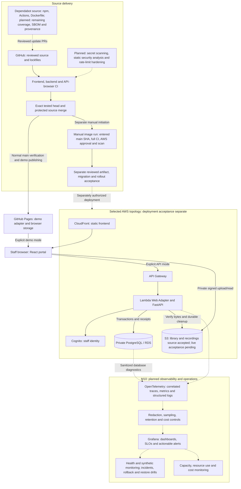
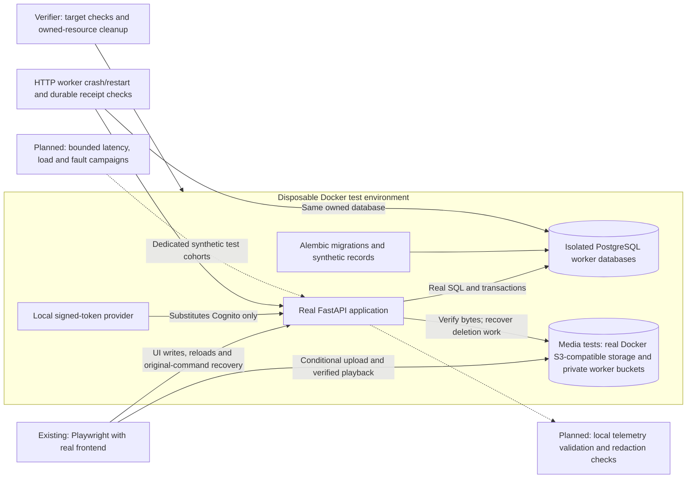

# System, test environment and verification diagrams

[Architecture decisions](adr.md) · [Current rules](../service_contracts.md#part-1--current-system-rules) · [Implementation status and backlog](../../PROGRESS.md)

Solid connections describe existing source responsibilities or the selected hosting topology; they do not certify deployment. Dashed connections and **Planned** labels identify future work. Planned hardening belongs to [M10](../../PROGRESS.md#m10-work-packages--planned); launch-critical checks remain required before launch. No diagram authorizes provisioning, paid ingestion or production testing.

## Application, delivery and planned operations

API errors never switch to demo. Dependency updates pass the same final-head gates; Dependabot does not authorize automatic merging. Telemetry export must avoid sensitive data and isolate exporter failures from application behavior. New instrumentation, dashboards and operations automation remain planned; existing infrastructure alone does not establish operational acceptance.

## Isolated real-API testing and planned measurement

No production PostgreSQL or real provider target participates. Future load/fault campaigns use controlled isolated environments and do not compete with acceptance suites on the same resources. Local startup measurements cannot establish Lambda cold-start performance; that requires separately authorized environment-specific evidence. Grafana ingestion is not required for local telemetry tests.

## Full verification suite

```mermaid
flowchart TB
  Change["Source change and test-impact review"]
  subgraph Existing["Existing automated suites"]
    Static["Lint, source health and verifier regressions"]
    Audit["npm audit including development: block high/critical; retain report"]
    Unit["Frontend units: components, services and business rules"]
    Simulator["Simulator browser: UI contracts, navigation and responsive behavior"]
    Database["Backend and PostgreSQL: transactions, authorization and migrations"]
    Browser["Real-API browser: two isolated shards, full identity gate, persistence and recovery"]
    ObjectTests["Media tests: signed IO, exact bytes, CORS and interrupted cleanup on real local storage"]
    Recovery["HTTP crash/restart; operator MFA recovery drill with synthetic provider"]
    Infra["Offline infrastructure: templates, guards and artifact contracts"]
    Forms["Assessment paper-form parity"]
    Build["Build and PWA verification"]
  end
  subgraph Future["M10: planned suites and maintenance gates"]
    Mutation["Mutation: critical JS and Python rules; surviving-mutant review"]
    Performance["Performance: p50/p95/p99, throughput, errors, resources and browser vitals"]
    Resilience["Expanded resilience: rate limits, dependency faults and broader recovery campaigns"]
    SupplyTests["Remaining Python/container audit coverage, SBOM and provenance assessment"]
    SecurityTests["Secret scanning and static security analysis"]
    Observability["OpenTelemetry and Grafana: redaction, correlation, sampling, export failure and cost controls"]
    Drills["Operations drills: synthetic monitoring, incident alerts, rollback, backup and migration recovery"]
  end
  Gates["Required final-head frontend, backend and API-browser CI"]
  Evidence["Evidence review: scope, source, environment, results and limits"]
  Live["Separate acceptance: real Cognito, deployed restart, devices and live environment"]
  Change --> Existing
  Existing --> Gates --> Evidence
  Change -.-> Future
  Future -.->|"Baseline and justified gates before adoption"| Evidence
  Evidence -.->|"Applicable authorization and prerequisites"| Live
```

Existing suites already cover selected permission, conflict and response-loss cases; the planned resilience suite expands those boundaries rather than implying they are absent. Functional test timing is not a latency benchmark. Mutation scores, performance budgets, SLOs and new security gates require measured baselines and review. **Planned suites are not current CI checks or completed acceptance.** Physical-device/provider evidence is not replaced by simulated browsers or local signed tokens.
