# Code owners and feature map

Snapshot: **28 October 2026**, based on main `08220b9969ad71933bde0c4f5458eef9e1190bc1`. “Owner” means the module responsible for a behavior, not a person or GitHub review assignment. Start with the overview and follow numbered sections into smaller diagrams and linked source files. Arrows show responsibility breakdown unless explicitly labelled as request/data flow; this is not an exhaustive import graph or execution sequence.

This document owns code navigation. [System topology](../architecture/diagram.md) owns infrastructure/test topology, [Architecture](../architecture/adr.md) records stack rationale and runtime relationships, and [Business rules](../business-rules.md) owns requirements, [API contracts](../api-contracts.md) owns the55-operation matrix and schemas, and [Journey](../journey.md) owns full history. [Progress](../../PROGRESS.md) owns acceptance and planned work; [Versions](../versions.md) owns dependency versions. Update this map when responsibilities move. Source ownership does not establish deployed/provider/device acceptance.

See [Technical behavior](technical-behavior.md) for named functions, visible behavior, guards, failures, recovery and evidence.

Format reference: [SoccerBotStudioSG Code Owners](https://github.com/LimYouSheng/SoccerBotStudioSG/tree/b137a79b3451e33fa8c9573d8532976872f64269/docs/code-owners). Fitfinity retains its own React/FastAPI/PostgreSQL/Cognito boundaries.

## 1. Overview

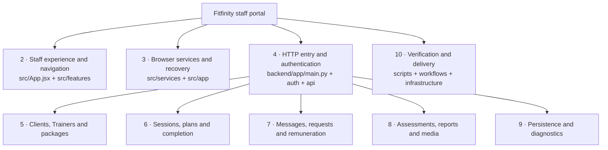

Navigation: [UI](#2-staff-experience-and-navigation) · [Services](#3-browser-contracts-and-recovery) · [Server/auth](#4-server-entry-and-identity) · [People/packages](#5-clients-trainers-and-packages) · [Sessions](#6-session-workflows) · [Operations](#7-messages-requests-and-remuneration) · [Records/media](#8-assessments-reports-and-media) · [Storage](#9-persistence-and-diagnostics) · [Delivery](#10-verification-and-delivery) · [Rule index](#11-business-rule-to-owner-index).

## 2. Staff experience and navigation

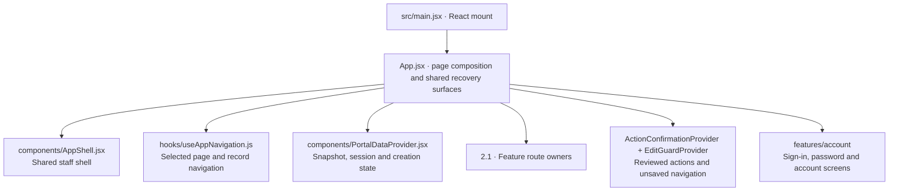

Source owners: [mount](../../src/main.jsx), [composition](../../src/App.jsx), [shell](../../src/components/AppShell.jsx), [navigation](../../src/hooks/useAppNavigation.js), [portal state](../../src/components/PortalDataProvider.jsx), [confirmation](../../src/components/ActionConfirmationProvider.jsx), [edit guard](../../src/components/EditGuardProvider.jsx).

The provider owns shared snapshots and session lifetime. Feature editors own their drafts. Confirmation ownership is distinct from navigation/discard ownership; closing a dialog cannot undo a command already sent. Notifications and shared form/modal primitives live in `src/components`; visual styles live in [styles.css](../../src/styles.css).

### 2.1 Feature route expansion

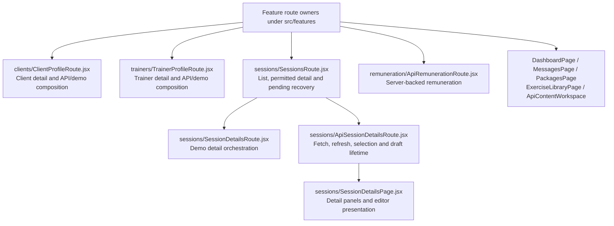

Source owners: [client route](../../src/features/clients/ClientProfileRoute.jsx), [Trainer route](../../src/features/trainers/TrainerProfileRoute.jsx), [sessions route](../../src/features/sessions/SessionsRoute.jsx), [demo detail](../../src/features/sessions/SessionDetailsRoute.jsx), [API detail lifecycle](../../src/features/sessions/ApiSessionDetailsRoute.jsx), [detail UI](../../src/features/sessions/SessionDetailsPage.jsx), [remuneration route](../../src/features/remuneration/ApiRemunerationRoute.jsx), [content workspace](../../src/features/content/ApiContentWorkspace.jsx).

## 3. Browser contracts and recovery

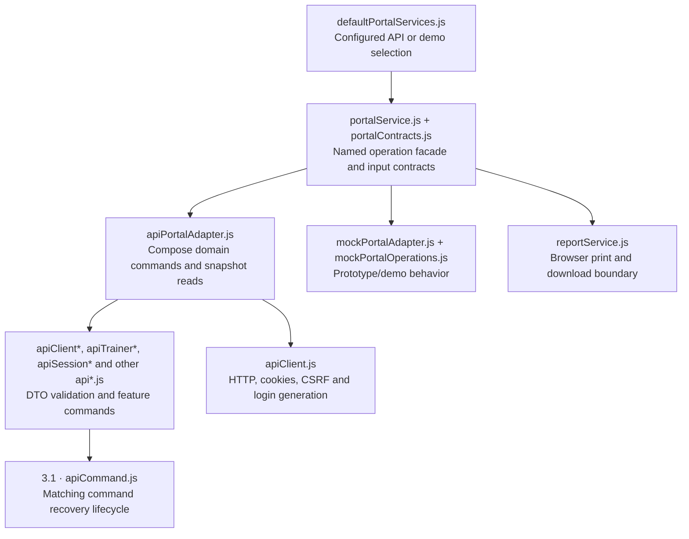

Source owners: [configuration](../../src/services/defaultPortalServices.js), [facade](../../src/services/portalService.js), [contracts](../../src/services/portalContracts.js), [API composition](../../src/services/apiPortalAdapter.js), [transport](../../src/services/apiClient.js), [shared command](../../src/services/apiCommand.js), [demo adapter](../../src/services/mockPortalAdapter.js), [browser reports](../../src/services/reportService.js), [sharing authorization](../../src/services/apiReportSharing.js), [prepared sharing lifetime](../../src/hooks/useReportSharing.js), [server report review/approval](../../backend/app/api/report_sharing.py).

API domain modules retain specialized review/recovery semantics where needed; they do not all use one identical lifecycle. `src/app` owns pure browser rules/projections (permissions, schedules, packages, progress, remuneration and assessments). These support UI and demo behavior; server checks remain authoritative. The service matrix owns operation coverage, not this diagram.

### 3.1 Command and editor recovery expansion

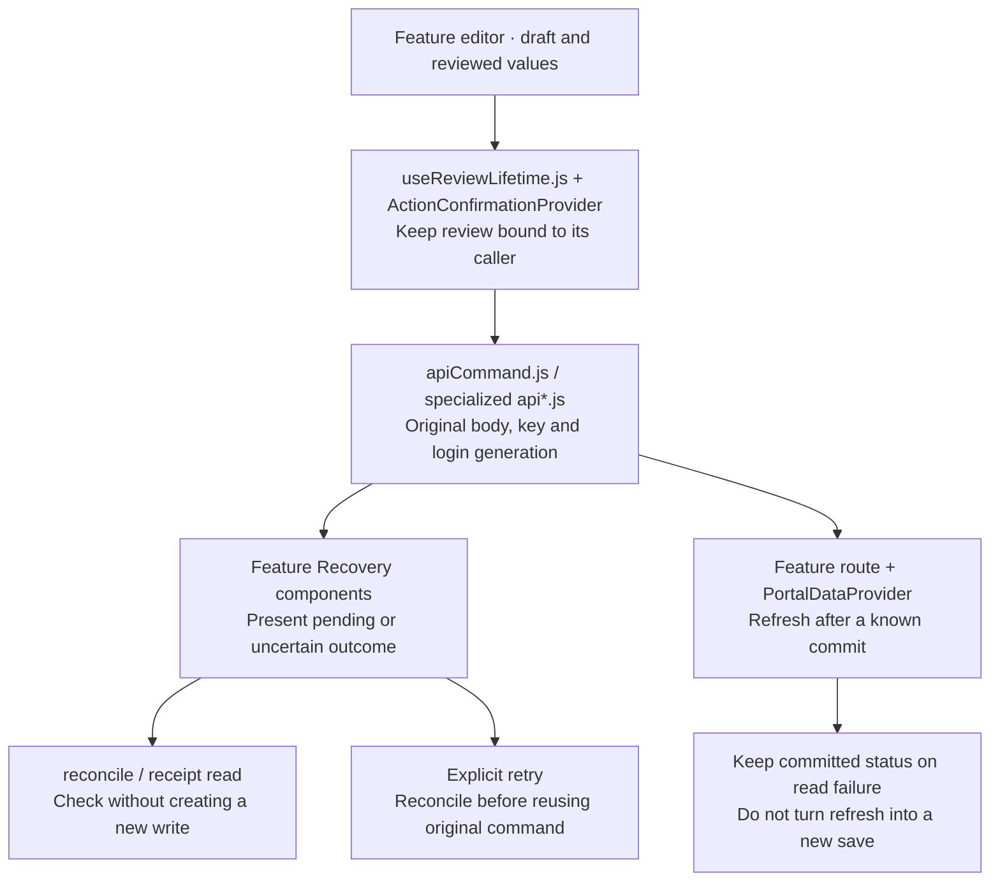

Source owners: [review lifetime](../../src/hooks/useReviewLifetime.js), [shared command](../../src/services/apiCommand.js), [profile recovery](../../src/services/apiProfileRecovery.js), [profile recovery UI](../../src/components/ProfileSaveRecovery.jsx), [plan recovery](../../src/features/sessions/SessionPlanRecovery.jsx), [media commands](../../src/services/apiSessionMedia.js), [snapshot owner](../../src/components/PortalDataProvider.jsx).

This is a responsibility map, not a universal state machine. The [architecture lifecycle table](../architecture/adr.md#adr-001) explains retained editor boundaries. Receipt read, retry, refresh and authority retirement are distinct operations.

## 4. Server entry and identity

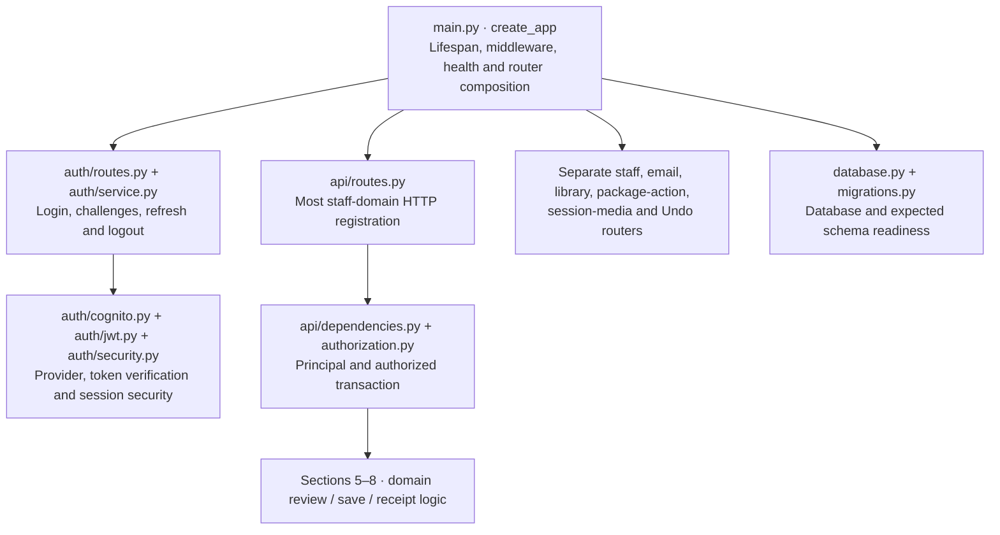

Source owners: [app entry](../../backend/app/main.py), [staff routes](../../backend/app/api/routes.py), [transaction boundary](../../backend/app/api/dependencies.py), [authorization](../../backend/app/authorization.py), [auth routes](../../backend/app/auth/routes.py), [auth service](../../backend/app/auth/service.py), [Cognito](../../backend/app/auth/cognito.py), [JWT verification](../../backend/app/auth/jwt.py), [request auth middleware](../../backend/app/auth/middleware.py).

`api/routes.py` still registers many domains; the earlier broad domain-router extraction is not merged and is not shown as implemented. Authenticated API registration is controlled by app configuration. Client capabilities and hidden buttons do not authorize writes.

### 4.1 Staff account expansion

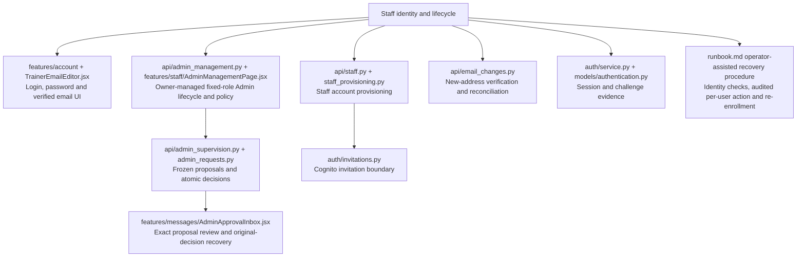

Source owners: [staff API](../../backend/app/api/staff.py), [provisioning](../../backend/app/api/staff_provisioning.py), [invitation adapter](../../backend/app/auth/invitations.py), [verified email](../../backend/app/api/email_changes.py), [authentication records](../../backend/app/models/authentication.py).

Merged PR116 adds [Admin management](../../backend/app/api/admin_management.py), [proposal enforcement](../../backend/app/api/admin_supervision.py), [decision routes](../../backend/app/api/admin_requests.py) and the [review inbox](../../src/features/messages/AdminApprovalInbox.jsx). Content, package-catalogue and library publication have focused real-API approval evidence; the registry also connects client/Trainer/session/assessment commands, including optional sharing enforcement; all required final-head and fresh-main gates passed. These source receipts do not establish deployed/provider acceptance.

The [operator recovery procedure](../runbook.md#52-operator-assisted-lost-authenticator-recovery) is an operator-owned process with test drills, not an Owner-facing MFA-reset feature. Real Cognito actions remain separately authorized.

## 5. Clients, Trainers and packages

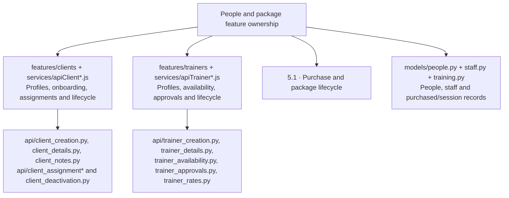

Source owners: [client profile](../../src/features/clients/ClientProfilePage.jsx), [onboarding](../../src/features/clients/ClientOnboardingForm.jsx), [client reassignment](../../src/features/clients/ApiClientAssignmentButton.jsx), [Trainer profile](../../src/features/trainers/TrainerProfilePage.jsx), [availability editor](../../src/features/trainers/TrainerAvailabilityEditor.jsx), [Trainer deactivation](../../src/features/trainers/TrainerDeactivationDialog.jsx), [package definitions](../../src/features/setup/PackagesPage.jsx).

Source owners: [client create](../../backend/app/api/client_creation.py), [client edit](../../backend/app/api/client_details.py), [assignment review](../../backend/app/api/client_assignment.py), [assignment save](../../backend/app/api/client_assignment_save.py), [Trainer creation](../../backend/app/api/trainer_creation.py), [Trainer availability](../../backend/app/api/trainer_availability.py), [Trainer deactivation review](../../backend/app/api/trainer_deactivation.py), [Trainer deactivation save](../../backend/app/api/trainer_deactivation_save.py), [Trainer reactivation](../../backend/app/api/trainer_reactivation.py).

### 5.1 Purchase and package lifecycle expansion

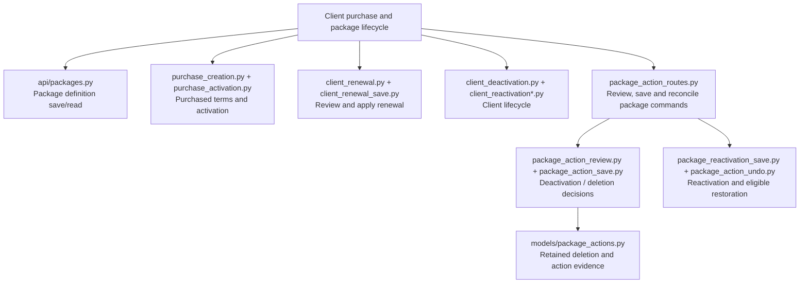

Source owners: [definitions](../../backend/app/api/packages.py), [purchase create](../../backend/app/api/purchase_creation.py), [activation](../../backend/app/api/purchase_activation.py), [renewal save](../../backend/app/api/client_renewal_save.py), [package routes](../../backend/app/api/package_action_routes.py), [package review](../../backend/app/api/package_action_review.py), [package save](../../backend/app/api/package_action_save.py), [reactivation](../../backend/app/api/package_reactivation_save.py), [package Undo](../../backend/app/api/package_action_undo.py).

## 6. Session workflows

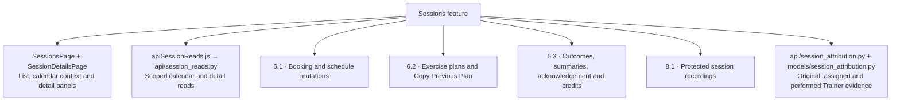

Source owners: [session list](../../src/features/sessions/SessionsPage.jsx), [session details](../../src/features/sessions/SessionDetailsPage.jsx), [schedule interaction](../../src/features/sessions/useSessionSchedule.js), [change dialogs](../../src/features/sessions/SessionChangeDialogs.jsx).

Source owners: [session reads](../../backend/app/api/session_reads.py), [attribution](../../backend/app/api/session_attribution.py).

### 6.1 Booking and schedule expansion

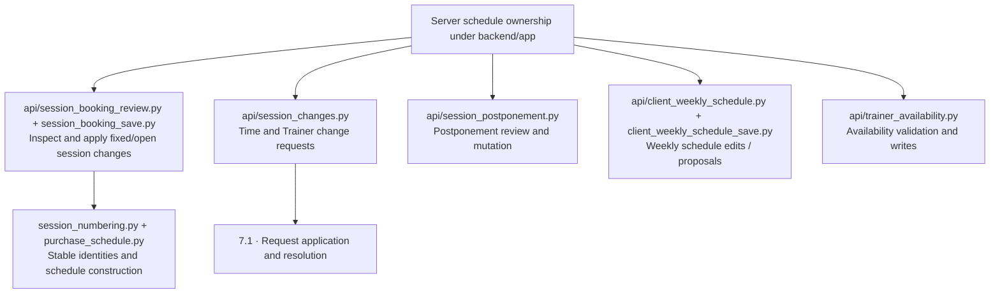

Source owners: [booking review](../../backend/app/api/session_booking_review.py), [booking save](../../backend/app/api/session_booking_save.py), [change requests](../../backend/app/api/session_changes.py), [postponement](../../backend/app/api/session_postponement.py), [weekly review](../../backend/app/api/client_weekly_schedule.py), [weekly save](../../backend/app/api/client_weekly_schedule_save.py), [numbering](../../backend/app/session_numbering.py), [purchase schedule](../../backend/app/purchase_schedule.py).

### 6.2 Exercise plan expansion

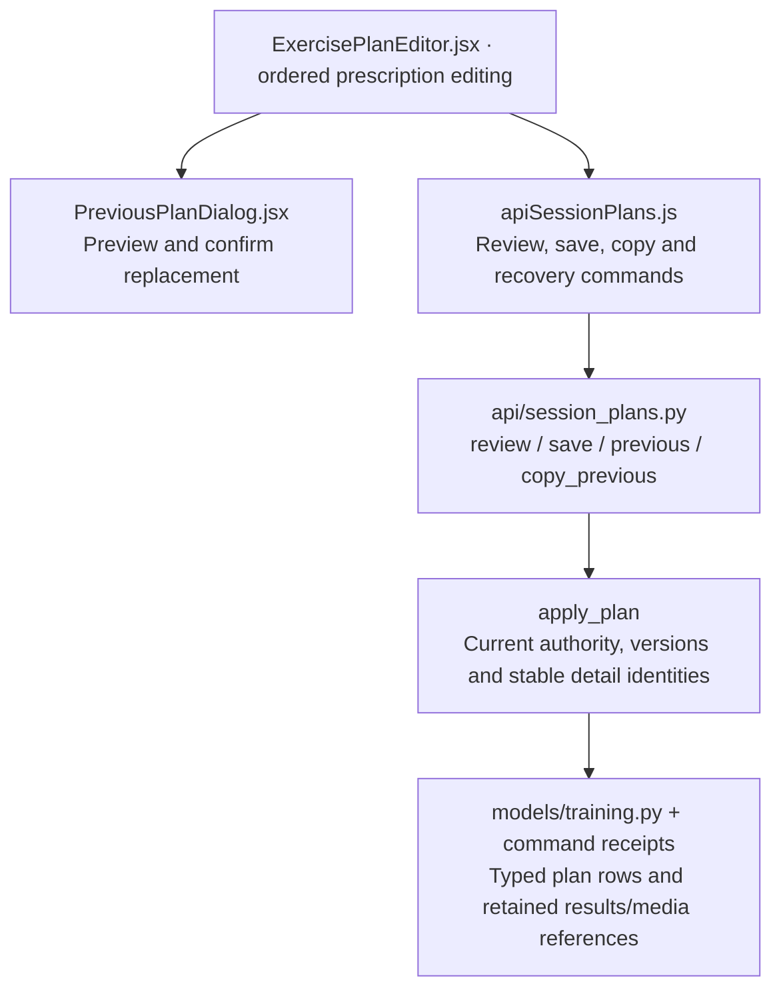

Source owners: [plan UI](../../src/features/sessions/ExercisePlanEditor.jsx), [previous-plan confirmation](../../src/features/sessions/PreviousPlanDialog.jsx), [plan commands](../../src/services/apiSessionPlans.js).

Source owners: [plan transaction](../../backend/app/api/session_plans.py), [training models](../../backend/app/models/training.py).

### 6.3 Completion and credit expansion

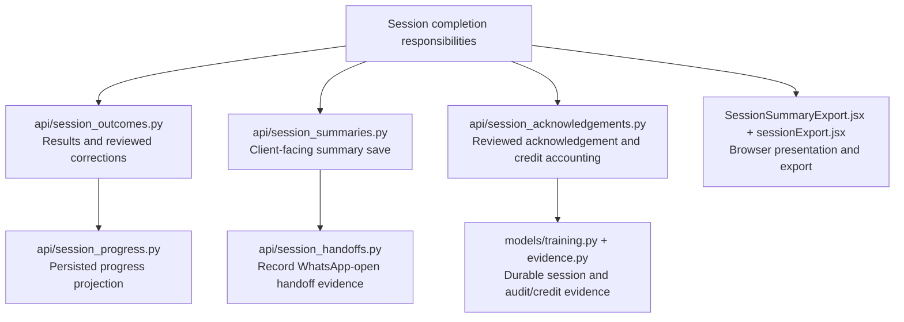

Source owners: [outcomes](../../backend/app/api/session_outcomes.py), [progress](../../backend/app/api/session_progress.py), [summaries](../../backend/app/api/session_summaries.py), [handoff](../../backend/app/api/session_handoffs.py), [acknowledgement](../../backend/app/api/session_acknowledgements.py).

Source owners: [summary export](../../src/features/sessions/SessionSummaryExport.jsx), [export formatting](../../src/features/sessions/sessionExport.jsx).

A recorded WhatsApp-open action is not proof of provider delivery or customer receipt. Completion and credit rules remain in the linked contract section below.

## 7. Messages, requests and remuneration

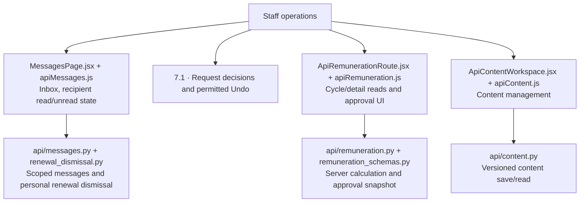

Source owners: [inbox](../../src/features/messages/MessagesPage.jsx), [request review](../../src/features/messages/RequestReview.jsx), [Undo UI](../../src/features/messages/MessageUndo.jsx), [remuneration commands](../../src/services/apiRemuneration.js), [content workspace](../../src/features/content/ApiContentWorkspace.jsx).

Source owners: [message state](../../backend/app/api/messages.py), [renewal dismissal](../../backend/app/api/renewal_dismissal.py), [remuneration](../../backend/app/api/remuneration.py), [content](../../backend/app/api/content.py).

### 7.1 Decisions and Undo expansion

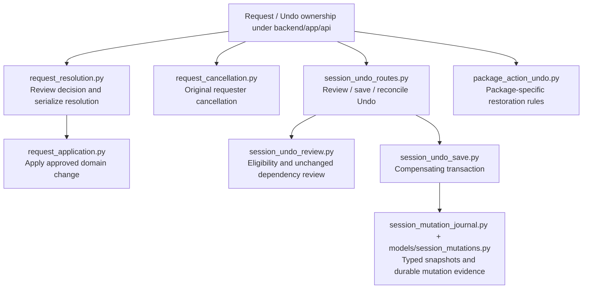

Source owners: [resolve](../../backend/app/api/request_resolution.py), [apply](../../backend/app/api/request_application.py), [cancel](../../backend/app/api/request_cancellation.py), [Undo routes](../../backend/app/api/session_undo_routes.py), [Undo review](../../backend/app/api/session_undo_review.py), [Undo save](../../backend/app/api/session_undo_save.py), [Admin Undo approval](../../backend/app/api/session_undo_approval.py), [mutation journal](../../backend/app/api/session_mutation_journal.py).

## 8. Assessments, reports and media

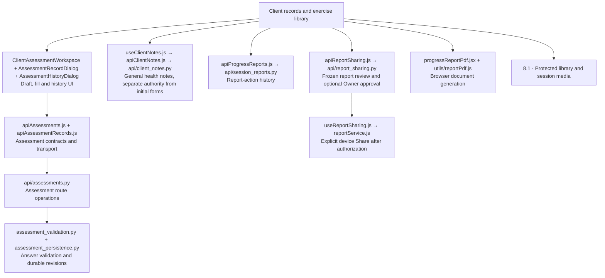

Source owners: [assessment workspace](../../src/features/clients/ClientAssessmentWorkspace.jsx), [assessment form definitions](../../src/app/assessmentForms.js), [assessment history](../../src/features/clients/AssessmentHistoryDialog.jsx), [general notes](../../src/features/clients/useClientNotes.js), [report PDF](../../src/features/clients/progressReportPdf.jsx), [report history commands](../../src/services/apiProgressReports.js).

Source owners: [assessment operations](../../backend/app/api/assessments.py), [answer validation](../../backend/app/assessment_validation.py), [revision persistence](../../backend/app/assessment_persistence.py), [notes authorization](../../backend/app/api/client_notes.py), [report actions](../../backend/app/api/session_reports.py).

### 8.1 Media expansion

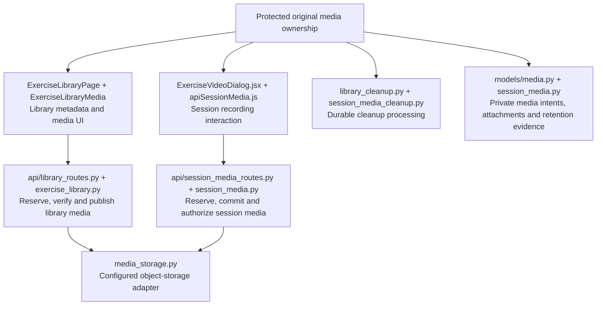

Source owners: [library UI](../../src/features/exercises/ExerciseLibraryPage.jsx), [library transport](../../src/services/apiLibraryMedia.js), [video dialog](../../src/features/sessions/ExerciseVideoDialog.jsx), [recording transport](../../src/services/apiSessionMedia.js).

Source owners: [library routes](../../backend/app/api/library_routes.py), [library operations](../../backend/app/api/exercise_library.py), [publication approval](../../backend/app/api/library_approval.py), [recording routes](../../backend/app/api/session_media_routes.py), [recording operations](../../backend/app/api/session_media.py), [storage adapter](../../backend/app/media_storage.py), [library cleanup](../../backend/app/library_cleanup.py), [recording cleanup](../../backend/app/session_media_cleanup.py).

Cleanup code ownership does not mean cloud worker scheduling, transcoding or captions are deployed. M7 processing and rollout remain in Progress. Isolated tests use real RustFS object IO; production object storage is the separately configured S3 boundary.

## 9. Persistence and diagnostics

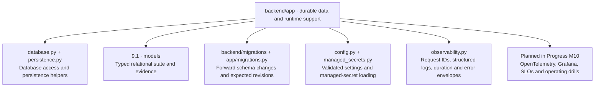

Source owners: [database](../../backend/app/database.py), [persistence helpers](../../backend/app/persistence.py), [schema readiness](../../backend/app/migrations.py), [configuration](../../backend/app/config.py), [managed secrets](../../backend/app/managed_secrets.py), [request diagnostics](../../backend/app/observability.py).

### 9.1 Model expansion

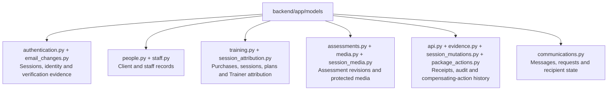

Source owners: [authentication](../../backend/app/models/authentication.py), [people](../../backend/app/models/people.py), [staff](../../backend/app/models/staff.py), [training](../../backend/app/models/training.py), [attribution](../../backend/app/models/session_attribution.py), [assessments](../../backend/app/models/assessments.py), [receipts](../../backend/app/models/api.py), [audit evidence](../../backend/app/models/evidence.py), [communications](../../backend/app/models/communications.py), [mutation history](../../backend/app/models/session_mutations.py).

## 10. Verification and delivery

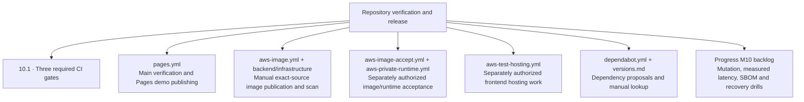

Source owners: [verification](../../.github/workflows/verify.yml), [demo publication](../../.github/workflows/pages.yml), [image publication](../../.github/workflows/aws-image.yml), [image acceptance](../../.github/workflows/aws-image-accept.yml), [private runtime](../../.github/workflows/aws-private-runtime.yml), [frontend hosting](../../.github/workflows/aws-test-hosting.yml).

Release scripts and resource reconciliation live in [backend/infrastructure](../../backend/infrastructure); [backend/Dockerfile](../../backend/Dockerfile) owns separate application/test/runtime stages. Normal source merges do not authorize AWS publication or Lambda deployment. Planned M10 work has no implied implemented module owner.

### 10.1 Verification expansion

```mermaid
flowchart TB
CI["verify.yml · required gates"]
  CI --> Front["frontend · macOS<br/>Lint, audit, units, simulator browser suites and source health"]
  Front --> FOwners["src/**/*.test.* + tests<br/>verify-lint, verify-quality and verify-code-health scripts"]
  CI --> Back["backend · Docker<br/>Actual isolated PostgreSQL and infrastructure verification"]
  Back --> BOwners["verify-backend.mjs + backend/scripts + backend/tests<br/>Transactions, authority, migrations and recovery"]
  CI --> Browser["api-browser · two shards plus required aggregate<br/>Actual UI to FastAPI to PostgreSQL"]
  Browser --> Harness["verify-api-browser.mjs + backend/tests/browser_server.py<br/>Synthetic identity, real database and media isolation"]
  Browser --> Cases["tests-api + playwright.api.config.js<br/>UI persistence, scope, conflicts and interrupted writes"]
  Browser --> Aggregate["verify-api-shards.mjs<br/>Complete discovered inventory, no omitted cases"]
```

Source owners: [backend harness](../../scripts/verify-backend.mjs), [browser harness](../../scripts/verify-api-browser.mjs), [shard aggregate](../../scripts/verify-api-shards.mjs), [quality gates](../../scripts/verify-quality.mjs), [result inventory](../../scripts/verify-test-results.mjs), [source health](../../scripts/verify-code-health.mjs).

[Real-API browser cases](../../tests-api), [backend tests](../../backend/tests) and [browser server](../../backend/tests/browser_server.py) own acceptance probes. Simulator tests are frontend evidence; synthetic Cognito is not live-provider acceptance. Physical-device, deployed-service and operational-drill evidence remain distinct.

## 11. Business rule to owner index

The **BR IDs are defined in [Business rules](../business-rules.md#current-business-rules)**. Every current rule group has one row below. Topics are navigation labels, not abbreviated replacements for the full rule. The numbered diagram areas above expand these owners. A rule can span several modules; operational procedures and planned scope are labelled explicitly instead of implying implemented automation. Preserve IDs when editing/moving rules and never reuse a retired ID.

| Rule | Topic | Feature area / responsibility | Source owners |
| --- | --- | --- | --- |
| [BR-001](../business-rules.md#br-001) | API/demo service boundary and explicit unsupported operations | 3 | [src/services/defaultPortalServices.js](../../src/services/defaultPortalServices.js), [src/services/portalService.js](../../src/services/portalService.js), [src/services/apiPortalAdapter.js](../../src/services/apiPortalAdapter.js), [src/services/portalContracts.js](../../src/services/portalContracts.js) |
| [BR-002](../business-rules.md#br-002) | Additional authenticated reads and the local availability predicate | 3, 4, 6 | [src/services/apiDirectory.js](../../src/services/apiDirectory.js), [src/app/status.js](../../src/app/status.js), [backend/app/api/session_reads.py](../../backend/app/api/session_reads.py), [backend/app/api/directory.py](../../backend/app/api/directory.py) |
| [BR-003](../business-rules.md#br-003) | Current role/assignment authority and Owner-managed Admin lifecycle/approvals | 4.1, 5, 6 | [backend/app/authorization.py](../../backend/app/authorization.py), [backend/app/api/dependencies.py](../../backend/app/api/dependencies.py), [backend/app/api/session_booking_review.py](../../backend/app/api/session_booking_review.py), [Admin management](../../backend/app/api/admin_management.py), [Admin decisions](../../backend/app/api/admin_requests.py) |
| [BR-004](../business-rules.md#br-004) | Owner/Admin initial forms; separate assigned-Trainer notes | 8 | [backend/app/api/assessments.py](../../backend/app/api/assessments.py), [backend/app/api/client_notes.py](../../backend/app/api/client_notes.py), [src/features/clients/ClientAssessmentWorkspace.jsx](../../src/features/clients/ClientAssessmentWorkspace.jsx) |
| [BR-005](../business-rules.md#br-005) | Owner financial powers, Admin restrictions and requester-only cancellation | 7, 7.1 | [backend/app/api/trainer_rates.py](../../backend/app/api/trainer_rates.py), [backend/app/api/remuneration.py](../../backend/app/api/remuneration.py), [backend/app/api/request_cancellation.py](../../backend/app/api/request_cancellation.py) |
| [BR-006](../business-rules.md#br-006) | Verify the new Trainer login/recovery email before switching | 4.1 | [backend/app/api/email_changes.py](../../backend/app/api/email_changes.py), [src/services/apiEmailChanges.js](../../src/services/apiEmailChanges.js), [src/features/trainers/TrainerEmailEditor.jsx](../../src/features/trainers/TrainerEmailEditor.jsx) |
| [BR-007](../business-rules.md#br-007) | Verified identity, cookie/CSRF security, private media and redacted diagnostics | 4, 8.1, 9 | [backend/app/auth/middleware.py](../../backend/app/auth/middleware.py), [backend/app/auth/security.py](../../backend/app/auth/security.py), [backend/app/authorization.py](../../backend/app/authorization.py), [backend/app/observability.py](../../backend/app/observability.py) |
| [BR-008](../business-rules.md#br-008) | Lost-authenticator recovery without new app administrator powers | 4.1 · operator procedure; synthetic drill, live action separate | [runbook.md](../runbook.md#52-operator-assisted-lost-authenticator-recovery), [backend/tests/test_mfa_recovery_drill.py](../../backend/tests/test_mfa_recovery_drill.py), [backend/app/auth/admin.py](../../backend/app/auth/admin.py) |
| [BR-009](../business-rules.md#br-009) | Atomic intent/version/receipt writes and same-login uncertain-command recovery | 3.1, 9 | [src/services/apiCommand.js](../../src/services/apiCommand.js), [src/services/apiProfileRecovery.js](../../src/services/apiProfileRecovery.js), [src/components/PortalDataProvider.jsx](../../src/components/PortalDataProvider.jsx), [backend/app/api/dependencies.py](../../backend/app/api/dependencies.py), [backend/app/models/api.py](../../backend/app/models/api.py) |
| [BR-010](../business-rules.md#br-010) | Session drafts, private-state retirement and caller-bound confirmations | 2.1, 3.1 | [src/features/sessions/ApiSessionDetailsRoute.jsx](../../src/features/sessions/ApiSessionDetailsRoute.jsx), [src/components/ActionConfirmationProvider.jsx](../../src/components/ActionConfirmationProvider.jsx), [src/components/EditGuardProvider.jsx](../../src/components/EditGuardProvider.jsx), [src/hooks/useReviewLifetime.js](../../src/hooks/useReviewLifetime.js) |
| [BR-011](../business-rules.md#br-011) | Stable errors, stale-reply rejection and proposal scope | 3.1, 4, 7.1 | [src/services/apiClient.js](../../src/services/apiClient.js), [backend/app/observability.py](../../backend/app/observability.py), [backend/app/api/session_changes.py](../../backend/app/api/session_changes.py), [backend/app/api/request_resolution.py](../../backend/app/api/request_resolution.py) |
| [BR-012](../business-rules.md#br-012) | Immutable purchased terms and inclusive package validity | 5.1 | [backend/app/api/purchase_creation.py](../../backend/app/api/purchase_creation.py), [backend/app/models/training.py](../../backend/app/models/training.py), [src/app/packages.js](../../src/app/packages.js) |
| [BR-013](../business-rules.md#br-013) | Reviewed future-start purchases, concurrent validity, final matching and profile-default activation | 5.1 | [src/features/clients/ClientOnboardingForm.jsx](../../src/features/clients/ClientOnboardingForm.jsx), [backend/app/api/client_matching.py](../../backend/app/api/client_matching.py), [backend/app/api/client_creation.py](../../backend/app/api/client_creation.py), [backend/app/api/purchase_activation.py](../../backend/app/api/purchase_activation.py) |
| [BR-014](../business-rules.md#br-014) | Stable Open-session identity, scheduling and target-only postponement | 6.1 | [backend/app/api/session_booking_save.py](../../backend/app/api/session_booking_save.py), [backend/app/api/session_postponement.py](../../backend/app/api/session_postponement.py), [backend/app/session_numbering.py](../../backend/app/session_numbering.py) |
| [BR-015](../business-rules.md#br-015) | Supervised decisions, autonomous checks and separate permanent/weekly scope | 6.1, 7.1 | [backend/app/api/session_changes.py](../../backend/app/api/session_changes.py), [backend/app/api/request_resolution.py](../../backend/app/api/request_resolution.py), [backend/app/api/client_assignment_save.py](../../backend/app/api/client_assignment_save.py), [backend/app/api/client_weekly_schedule_save.py](../../backend/app/api/client_weekly_schedule_save.py) |
| [BR-016](../business-rules.md#br-016) | Immutable completed evidence and lifecycle/Undo exclusions | 5.1, 6.3, 7.1 | [backend/app/api/session_acknowledgements.py](../../backend/app/api/session_acknowledgements.py), [backend/app/api/package_action_review.py](../../backend/app/api/package_action_review.py), [backend/app/api/package_reactivation_save.py](../../backend/app/api/package_reactivation_save.py), [backend/app/api/session_undo_review.py](../../backend/app/api/session_undo_review.py) |
| [BR-017](../business-rules.md#br-017) | Package-session deletion archives, conditional Undo and original media expiry | 5.1, 8.1 | [backend/app/api/package_action_save.py](../../backend/app/api/package_action_save.py), [backend/app/api/package_action_undo.py](../../backend/app/api/package_action_undo.py), [backend/app/models/package_actions.py](../../backend/app/models/package_actions.py), [backend/app/session_media_cleanup.py](../../backend/app/session_media_cleanup.py) |
| [BR-018](../business-rules.md#br-018) | Preview-confirm previous-plan copy with new item identities | 6.2 | [src/features/sessions/PreviousPlanDialog.jsx](../../src/features/sessions/PreviousPlanDialog.jsx), [src/services/apiSessionPlans.js](../../src/services/apiSessionPlans.js), [backend/app/api/session_plans.py](../../backend/app/api/session_plans.py) |
| [BR-019](../business-rules.md#br-019) | Durable feature acceptance and truthful external-action evidence | 6–8 · cross-cutting acceptance, not one implementation | [backend/app/api/session_handoffs.py](../../backend/app/api/session_handoffs.py), [backend/app/api/session_reports.py](../../backend/app/api/session_reports.py), [tests-api](../../tests-api), [PROGRESS.md](../../PROGRESS.md) |
| [BR-020](../business-rules.md#br-020) | In-memory note drafts retained only for the same verified login | 3.1, 8 | [src/features/clients/useClientNotes.js](../../src/features/clients/useClientNotes.js), [src/services/apiClientNotes.js](../../src/services/apiClientNotes.js), [src/components/PortalDataProvider.jsx](../../src/components/PortalDataProvider.jsx) |
| [BR-021](../business-rules.md#br-021) | Prototype parity and one account-scoped navigation owner | 2, 2.1 | [src/hooks/useAppNavigation.js](../../src/hooks/useAppNavigation.js), [src/components/EditGuardProvider.jsx](../../src/components/EditGuardProvider.jsx), [src/App.jsx](../../src/App.jsx) |
| [BR-022](../business-rules.md#br-022) | 24-hour Undo eligibility, current scope and dependent-change checks | 7.1 | [backend/app/api/session_undo_review.py](../../backend/app/api/session_undo_review.py), [backend/app/api/session_undo_save.py](../../backend/app/api/session_undo_save.py) |
| [BR-023](../business-rules.md#br-023) | Compensating evidence, increasing versions and original media restoration | 7.1, 8.1 | [backend/app/api/session_mutation_journal.py](../../backend/app/api/session_mutation_journal.py), [backend/app/api/session_undo_save.py](../../backend/app/api/session_undo_save.py), [backend/app/api/package_action_undo.py](../../backend/app/api/package_action_undo.py), [backend/app/models/session_mutations.py](../../backend/app/models/session_mutations.py) |
| [BR-024](../business-rules.md#br-024) | Actor-private Undo recovery and unchanged original intent | 3.1, 7.1 | [src/services/apiMessageUndo.js](../../src/services/apiMessageUndo.js), [backend/app/api/session_undo_routes.py](../../backend/app/api/session_undo_routes.py), [backend/app/api/session_undo_save.py](../../backend/app/api/session_undo_save.py) |
| [BR-025](../business-rules.md#br-025) | Reviewed completion, real signature ink and one-way no-show correction | 6.3 | [backend/app/api/session_acknowledgements.py](../../backend/app/api/session_acknowledgements.py), [src/components/SignaturePad.jsx](../../src/components/SignaturePad.jsx), [src/app/signature.js](../../src/app/signature.js) |
| [BR-026](../business-rules.md#br-026) | Atomic acknowledgement, exactly-once credit and renewal notice | 6.3 | [backend/app/api/session_acknowledgements.py](../../backend/app/api/session_acknowledgements.py), [backend/app/models/training.py](../../backend/app/models/training.py), [backend/app/models/evidence.py](../../backend/app/models/evidence.py) |
| [BR-027](../business-rules.md#br-027) | Truthful device-action audit without repeating a share/download | 8 | [src/services/apiProgressReports.js](../../src/services/apiProgressReports.js), [src/hooks/useReportService.js](../../src/hooks/useReportService.js), [backend/app/api/session_reports.py](../../backend/app/api/session_reports.py) |
| [BR-028](../business-rules.md#br-028) | Owner/Admin report history, purchase scope and immutable bounded history | 8 | [backend/app/api/session_reports.py](../../backend/app/api/session_reports.py), [src/services/apiProgressReports.js](../../src/services/apiProgressReports.js), [tests-api/progress-reports.spec.js](../../tests-api/progress-reports.spec.js) |
| [BR-029](../business-rules.md#br-029) | Legacy WhatsApp-open compatibility without delivery or financial effects | 6.3 | [backend/app/api/session_handoffs.py](../../backend/app/api/session_handoffs.py), [src/services/apiSessionHandoffs.js](../../src/services/apiSessionHandoffs.js), [src/features/sessions/SessionSummaryExport.jsx](../../src/features/sessions/SessionSummaryExport.jsx) |
| [BR-030](../business-rules.md#br-030) | Trainer email correction, predecessor reservations and compatible rollback | 4.1 | [backend/app/api/email_changes.py](../../backend/app/api/email_changes.py), [backend/app/models/email_changes.py](../../backend/app/models/email_changes.py), [src/services/apiEmailChanges.js](../../src/services/apiEmailChanges.js), [backend/tests/test_email_corrections.py](../../backend/tests/test_email_corrections.py) |
| [BR-031](../business-rules.md#br-031) | Authentication lifecycle, restart and supporting scoped read acceptance | 4, 4.1, 10.1 | [backend/app/auth/service.py](../../backend/app/auth/service.py), [backend/app/api/session_reads.py](../../backend/app/api/session_reads.py), [tests-api/authentication.spec.js](../../tests-api/authentication.spec.js), [backend/tests/test_process_restart.py](../../backend/tests/test_process_restart.py) |
| [BR-032](../business-rules.md#br-032) | Immutable outcome correction history and unchanged financial/completion state | 6.3 | [backend/app/api/session_outcomes.py](../../backend/app/api/session_outcomes.py), [src/services/apiSessionOutcomes.js](../../src/services/apiSessionOutcomes.js), [backend/app/models/training.py](../../backend/app/models/training.py) |
| [BR-033](../business-rules.md#br-033) | Signed attended purchase progress and explicit empty outcomes | 6.3 | [backend/app/api/session_progress.py](../../backend/app/api/session_progress.py), [backend/app/api/session_outcomes.py](../../backend/app/api/session_outcomes.py), [src/features/clients/useClientProgress.js](../../src/features/clients/useClientProgress.js) |
| [BR-034](../business-rules.md#br-034) | Reviewed client-facing summary separate from results and completion | 6.3 | [backend/app/api/session_summaries.py](../../backend/app/api/session_summaries.py), [src/services/apiSessionSummaries.js](../../src/services/apiSessionSummaries.js), [src/features/sessions/SessionNotes.jsx](../../src/features/sessions/SessionNotes.jsx) |
| [BR-035](../business-rules.md#br-035) | Staff portal scope; separate public website and Glofox entitlement | 2, 8 · staff source; public/member entitlement planned | [src/App.jsx](../../src/App.jsx), [src/features/content/ApiContentWorkspace.jsx](../../src/features/content/ApiContentWorkspace.jsx), [PROGRESS.md](../../PROGRESS.md) |
| [BR-036](../business-rules.md#br-036) | Read-only Owner profile, decided plan preview and unaccepted future scope | 2.1, 6.2 · remaining product decisions stay with Owner | [src/features/owner/OwnerProfilePage.jsx](../../src/features/owner/OwnerProfilePage.jsx), [src/features/sessions/PreviousPlanDialog.jsx](../../src/features/sessions/PreviousPlanDialog.jsx), [PROGRESS.md](../../PROGRESS.md) |
| [BR-037](../business-rules.md#br-037) | Staff password/MFA and individual onboarding identities/required fields | 4.1, 5 | [backend/app/auth/security.py](../../backend/app/auth/security.py), [backend/app/api/client_creation.py](../../backend/app/api/client_creation.py), [backend/app/api/trainer_creation.py](../../backend/app/api/trainer_creation.py), [src/features/clients/ClientOnboardingForm.jsx](../../src/features/clients/ClientOnboardingForm.jsx) |
| [BR-038](../business-rules.md#br-038) | Wizard drafts, additional purchase terms and once-only activation | 5.1 | [src/features/clients/ClientOnboardingForm.jsx](../../src/features/clients/ClientOnboardingForm.jsx), [backend/app/api/client_renewal.py](../../backend/app/api/client_renewal.py), [backend/app/api/client_renewal_save.py](../../backend/app/api/client_renewal_save.py), [backend/app/api/purchase_activation.py](../../backend/app/api/purchase_activation.py) |
| [BR-039](../business-rules.md#br-039) | Lifecycle authority and full Client/Trainer/purchase/catalogue lifecycle table | 5, 5.1 | [backend/app/api/client_deactivation.py](../../backend/app/api/client_deactivation.py), [backend/app/api/client_reactivation_save.py](../../backend/app/api/client_reactivation_save.py), [backend/app/api/trainer_deactivation_save.py](../../backend/app/api/trainer_deactivation_save.py), [backend/app/api/trainer_reactivation.py](../../backend/app/api/trainer_reactivation.py), [backend/app/api/package_reactivation_save.py](../../backend/app/api/package_reactivation_save.py), [backend/app/api/packages.py](../../backend/app/api/packages.py) |
| [BR-040](../business-rules.md#br-040) | Explicit future/Open deletion, pending-request cleanup and limited Undo | 5.1, 8.1 | [backend/app/api/package_action_review.py](../../backend/app/api/package_action_review.py), [backend/app/api/package_action_save.py](../../backend/app/api/package_action_save.py), [backend/app/api/package_action_undo.py](../../backend/app/api/package_action_undo.py) |
| [BR-041](../business-rules.md#br-041) | Permanent reassignment, weekly-slot matching and preserved booking duration | 6.1 | [backend/app/api/client_assignment_save.py](../../backend/app/api/client_assignment_save.py), [backend/app/api/client_weekly_schedule.py](../../backend/app/api/client_weekly_schedule.py), [backend/app/api/client_weekly_schedule_save.py](../../backend/app/api/client_weekly_schedule_save.py) |
| [BR-042](../business-rules.md#br-042) | Future-time proposals, atomic approval and requester cancellation races | 6.1, 7.1 | [backend/app/api/session_changes.py](../../backend/app/api/session_changes.py), [backend/app/api/request_resolution.py](../../backend/app/api/request_resolution.py), [backend/app/api/request_application.py](../../backend/app/api/request_application.py), [backend/app/api/request_cancellation.py](../../backend/app/api/request_cancellation.py) |
| [BR-043](../business-rules.md#br-043) | Gym-date completion, bounded ink, exactly-once debit and legacy measurements | 6.3 | [backend/app/api/session_acknowledgements.py](../../backend/app/api/session_acknowledgements.py), [backend/app/api/session_outcomes.py](../../backend/app/api/session_outcomes.py), [backend/app/api/session_progress.py](../../backend/app/api/session_progress.py), [src/app/signature.js](../../src/app/signature.js) |
| [BR-044](../business-rules.md#br-044) | Peak rates, pay cycles and immutable Owner approval; no payment transfer | 7 | [backend/app/api/remuneration.py](../../backend/app/api/remuneration.py), [backend/app/api/remuneration_schemas.py](../../backend/app/api/remuneration_schemas.py), [src/features/remuneration/ApiRemunerationRoute.jsx](../../src/features/remuneration/ApiRemunerationRoute.jsx), [src/services/apiRemuneration.js](../../src/services/apiRemuneration.js) |
| [BR-045](../business-rules.md#br-045) | Recipient-specific read state, threshold reminders and bounded previews | 7 | [backend/app/api/messages.py](../../backend/app/api/messages.py), [backend/app/api/session_acknowledgements.py](../../backend/app/api/session_acknowledgements.py), [src/features/messages/MessagesPage.jsx](../../src/features/messages/MessagesPage.jsx), [src/features/dashboard/DashboardPage.jsx](../../src/features/dashboard/DashboardPage.jsx) |
| [BR-046](../business-rules.md#br-046) | Purchase-scoped reporting, legacy provenance and bounded PDF/chart rendering | 8 | [backend/app/api/session_reports.py](../../backend/app/api/session_reports.py), [backend/app/api/session_progress.py](../../backend/app/api/session_progress.py), [src/features/clients/progressReportPdf.jsx](../../src/features/clients/progressReportPdf.jsx), [src/features/clients/StrengthProgress.jsx](../../src/features/clients/StrengthProgress.jsx) |
| [BR-047](../business-rules.md#br-047) | Prepared PDF lifecycle, native share truthfulness and no duplicate device action | 6.3, 8 | [src/hooks/usePreparedReport.js](../../src/hooks/usePreparedReport.js), [src/hooks/useReportService.js](../../src/hooks/useReportService.js), [src/services/reportService.js](../../src/services/reportService.js), [src/features/sessions/SessionSummaryExport.jsx](../../src/features/sessions/SessionSummaryExport.jsx), [src/services/apiProgressReports.js](../../src/services/apiProgressReports.js) |
| [BR-048](../business-rules.md#br-048) | Library metadata, immutable uploads, authority recheck and leased cleanup | 8.1 | [backend/app/api/exercise_library.py](../../backend/app/api/exercise_library.py), [backend/app/api/library_routes.py](../../backend/app/api/library_routes.py), [backend/app/library_cleanup.py](../../backend/app/library_cleanup.py), [src/services/apiLibraryMedia.js](../../src/services/apiLibraryMedia.js) |
| [BR-049](../business-rules.md#br-049) | Session recording publication, original expiry and durable cleanup | 8.1 | [backend/app/api/session_media.py](../../backend/app/api/session_media.py), [backend/app/api/session_media_routes.py](../../backend/app/api/session_media_routes.py), [backend/app/session_media_cleanup.py](../../backend/app/session_media_cleanup.py), [src/services/apiSessionMedia.js](../../src/services/apiSessionMedia.js) |
| [BR-050](../business-rules.md#br-050) | Private playback/finality, optional caption-conversion audio, limits and separate production capture acceptance | 8.1 · processing and physical acceptance remain separate | [src/features/sessions/ExerciseVideoDialog.jsx](../../src/features/sessions/ExerciseVideoDialog.jsx), [src/services/exerciseVideoStore.js](../../src/services/exerciseVideoStore.js), [backend/app/api/session_media.py](../../backend/app/api/session_media.py), [backend/app/media_storage.py](../../backend/app/media_storage.py), [PROGRESS.md](../../PROGRESS.md) |
| [BR-051](../business-rules.md#br-051) | Account navigation, calendar ordering and preserved view state | 2, 6 | [src/hooks/useAppNavigation.js](../../src/hooks/useAppNavigation.js), [src/app/calendar.js](../../src/app/calendar.js), [src/features/sessions/SessionsPage.jsx](../../src/features/sessions/SessionsPage.jsx), [src/hooks/usePageState.js](../../src/hooks/usePageState.js) |
| [BR-052](../business-rules.md#br-052) | Accessible shared controls, portrait handling and physical/PWA boundaries | 2 · device acceptance remains operator-owned | [src/components/SelectField.jsx](../../src/components/SelectField.jsx), [src/components/DateField.jsx](../../src/components/DateField.jsx), [src/components/SuggestionField.jsx](../../src/components/SuggestionField.jsx), [src/components/PortraitOrientation.jsx](../../src/components/PortraitOrientation.jsx), [public/sw.js](../../public/sw.js) |
| [BR-053](../business-rules.md#br-053) | Original/assigned/performed attribution and conservative additive backfill | 6, 9.1 | [backend/app/api/session_attribution.py](../../backend/app/api/session_attribution.py), [backend/app/models/session_attribution.py](../../backend/app/models/session_attribution.py), [backend/migrations](../../backend/migrations) |
| [BR-054](../business-rules.md#br-054) | Typed relational design, bounded JSONB and portable HTTP boundaries | 4, 9.1 | [backend/app/models](../../backend/app/models), [backend/app/assessment_validation.py](../../backend/app/assessment_validation.py), [backend/app/main.py](../../backend/app/main.py), [backend/app/database.py](../../backend/app/database.py) |
| [BR-055](../business-rules.md#br-055) | Person/occasion assessment records, immutable revisions and explicit saves | 8 | [backend/app/assessment_persistence.py](../../backend/app/assessment_persistence.py), [backend/app/models/assessments.py](../../backend/app/models/assessments.py), [backend/app/api/assessments.py](../../backend/app/api/assessments.py), [src/features/clients/ClientAssessmentWorkspace.jsx](../../src/features/clients/ClientAssessmentWorkspace.jsx) |
| [BR-056](../business-rules.md#br-056) | Versioned answer limits and no inferred clinical decisions | 8 | [backend/app/assessment_validation.py](../../backend/app/assessment_validation.py), [src/app/assessmentForms.js](../../src/app/assessmentForms.js), [backend/app/api/assessments.py](../../backend/app/api/assessments.py) |
| [BR-057](../business-rules.md#br-057) | Singapore policy, bounded package counts, renewal and retention defaults | 5.1, 6.3, 7, 8.1 | [src/app/constants.js](../../src/app/constants.js), [src/app/clock.js](../../src/app/clock.js), [backend/app/api/packages.py](../../backend/app/api/packages.py), [backend/app/api/remuneration.py](../../backend/app/api/remuneration.py), [backend/app/api/session_media.py](../../backend/app/api/session_media.py) |
| [BR-058](../business-rules.md#br-058) | Private database, capacity/backup targets and conditional cost planning | 9, 10 · operator release review; targets are not deployment proof | [backend/infrastructure/test-foundation.json](../../backend/infrastructure/test-foundation.json), [backend/infrastructure/egress_preflight.py](../../backend/infrastructure/egress_preflight.py), [PROGRESS.md](../../PROGRESS.md) |
| [BR-059](../business-rules.md#br-059) | Manual exact-SHA image publication separate from verification and deployment | 10 | [.github/workflows/aws-image.yml](../../.github/workflows/aws-image.yml), [backend/infrastructure](../../backend/infrastructure), [runbook.md](../runbook.md#61-verified-image-publication) |
| [BR-060](../business-rules.md#br-060) | Retained resource identity, provenance, authorization and expired exceptions | 10 · operator release review plus infrastructure checks | [backend/infrastructure](../../backend/infrastructure), [AGENTS.md](../../AGENTS.md), [runbook.md](../runbook.md#61-verified-image-publication) |
| [BR-061](../business-rules.md#br-061) | Immutable migrations, compatible evolution and rollback limits | 9, 10 · migration author and release operator | [backend/migrations](../../backend/migrations), [backend/app/migrations.py](../../backend/app/migrations.py), [backend/infrastructure](../../backend/infrastructure), [AGENTS.md](../../AGENTS.md) |
| [BR-062](../business-rules.md#br-062) | M0–M10 roadmap separate from the 55-operation matrix | 10 · milestone owner; not an application automation | [PROGRESS.md](../journey.md#full-milestone-roadmap) |
| [BR-063](../business-rules.md#br-063) | Durable 55-operation/auth/parity acceptance and meaningful real DB evidence | 10.1 · cross-cutting implementation and acceptance | [src/services/portalContracts.js](../../src/services/portalContracts.js), [tests-api](../../tests-api), [backend/tests](../../backend/tests), [PROGRESS.md](../../PROGRESS.md) |
| [BR-064](../business-rules.md#br-064) | Final-head gates and distinct provider/device/public-site acceptance | 10.1 · CI plus separately authorized operator acceptance | [.github/workflows/verify.yml](../../.github/workflows/verify.yml), [backend/tests/test_mfa_recovery_drill.py](../../backend/tests/test_mfa_recovery_drill.py), [tests-api/authentication.spec.js](../../tests-api/authentication.spec.js), [PROGRESS.md](../../PROGRESS.md) |
