# Technical behavior and recovery map

Source snapshot: main `08220b9969ad71933bde0c4f5458eef9e1190bc1` (28 October 2026). This is the function-level companion to the [feature ownership map](index.md): named operations, visible results, guards, failure recovery and evidence. It covers principal feature entry points and state changes, not every private helper or JSX callback. “Owner” means code responsibility, not an assigned incident responder.

[Business rules](../business-rules.md) own invariants, [API contracts](../api-contracts.md) own the 55-operation inventory and wire schemas, and the [runbook](../runbook.md) owns operator procedures. Source behavior does not prove deployed AWS configuration. Demo adapters and simulated Cognito remain distinct from real-API PostgreSQL evidence and live acceptance.

## Overview and reading route

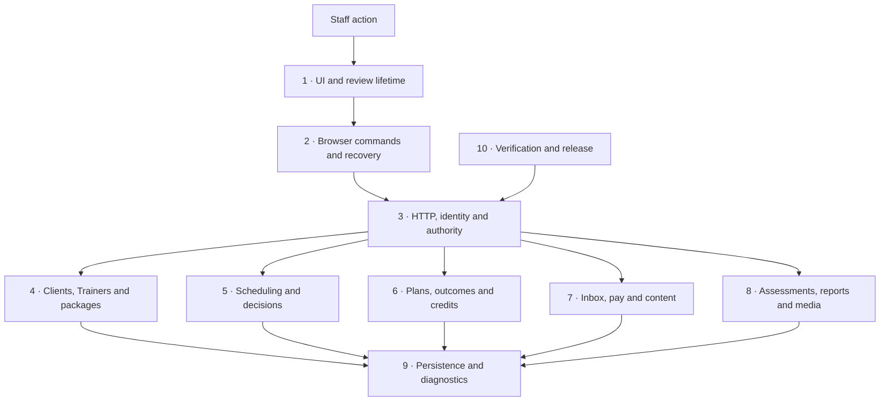

Start with the visible feature, follow its named source owner, then inspect the linked regression evidence. Arrows describe responsibility or flow; they do not guarantee authorization, parallel execution or provider success. Module-labelled rows deliberately avoid inventing a single function for a multi-step owner. Tests below are evidence entry points, not a new exhaustive suite inventory.

## 1. UI state, navigation and review lifetime

Rules: BR-009–011, BR-020–021 in [Business rules](../business-rules.md).

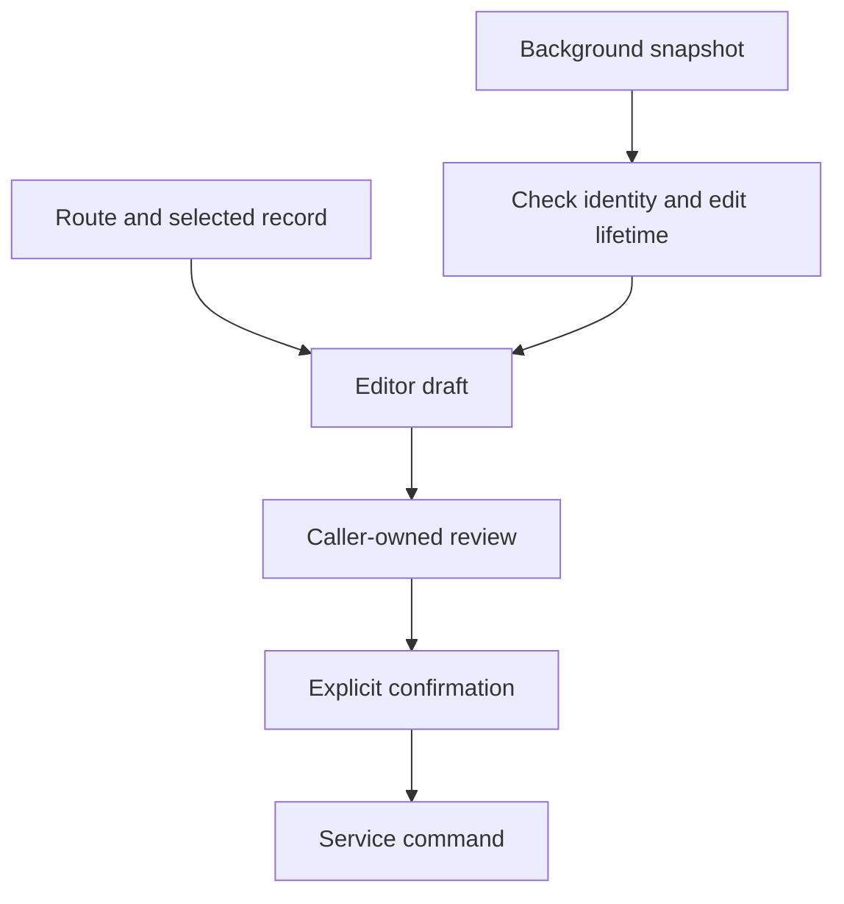

| Function / operation | Behavior and visible result | Guards | Failure and recovery |
| --- | --- | --- | --- |
| [PortalDataProvider / refresh / retireWorkflows](../../src/components/PortalDataProvider.jsx) | Loads scoped snapshots and owns shared session/draft lifetime. | Generation and identity scope reject superseded responses; changed authority retires private work. | A failed refresh is distinct from a failed save; recover the original command rather than create another. |
| [ApiSessionDetailsRoute](../../src/features/sessions/ApiSessionDetailsRoute.jsx) | Owns API detail loading and editor selection around the session detail view. | Current record identity, authority and edit lifetime determine whether a draft survives refresh. | Temporary outages retain eligible editing; definitive access loss clears private detail. Cancel reloads current values. |
| [useReviewLifetime](../../src/hooks/useReviewLifetime.js) | Binds a delayed opening review to the enabled record that requested it. | Effect lifetime changes on disabled state, identity or unmount. | Discard late review results; they must not reopen a retired dialog. |
| [ActionConfirmationProvider](../../src/components/ActionConfirmationProvider.jsx) | Presents reviewed confirmation owned by its caller. | Caller retirement and session lifetime invalidate pending decisions. | Closing a dialog does not cancel a command already dispatched. |
| [EditGuardProvider](../../src/components/EditGuardProvider.jsx) | Coordinates navigation/discard decisions for active editors. | A navigation decision is separate from mutation confirmation. | Preserve an uncertain command after leaving its editor; do not clear its receipt recovery. |

Evidence: [session-refresh.spec.js](../../tests-api/session-refresh.spec.js), [profile-recovery.spec.js](../../tests-api/profile-recovery.spec.js).

## 2. Browser commands, transport and uncertain outcomes

Rules: BR-001–002, BR-007, BR-009–011 in [Business rules](../business-rules.md).

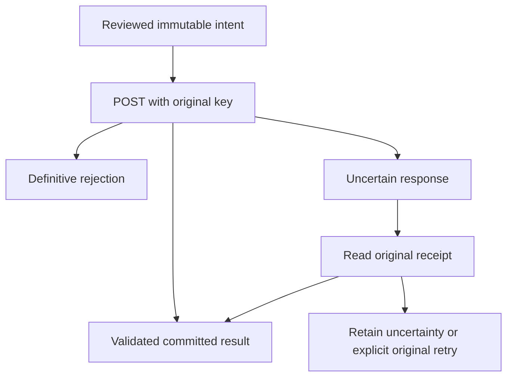

| Function / operation | Behavior and visible result | Guards | Failure and recovery |
| --- | --- | --- | --- |
| [createPortalServices](../../src/services/portalService.js) | Exposes the named operation boundary used by feature screens. | Configured API mode cannot silently fall back to demo persistence. | Unsupported capability fails explicitly; inspect the owning adapter. |
| [createApiClient / ApiError](../../src/services/apiClient.js) | Sends API requests with cookies, write CSRF and generation binding; exposes stable errors. | Login generation and server responses control acceptance, not a cached browser role. | Expiry or changed session retires old work; a network failure does not prove a rejected write. |
| [reconciledCommand / command](../../src/services/apiCommand.js) | Freezes original body/key and guards one in-flight attempt. | Role/session generation, immutable fingerprint and in-flight guard; definitive rejection handling is configurable. | Changed intent raises SAVE_UNCERTAIN. Explicit repeat first reads the original receipt, then may reuse the original body/key. |
| [command.reconcile / command.pendingInput](../../src/services/apiCommand.js) | Reads the matching receipt or exposes the retained draft without issuing a replacement POST. | Same generation; receipt interpretation uses domain validation/completion rules. | Missing receipt is not fabricated success. Receipt-read errors retain uncertainty; background discovery must not consume an active editor. |
| [Profile recovery module](../../src/services/apiProfileRecovery.js) | Coordinates profile-specific pending commands for shared recovery UI. | Recovery remains scoped to the original login and domain command. | Use explicit Check/retry; do not replace specialized profile or media semantics with a generic lifecycle. |

Evidence: [apiCommand.test.js](../../src/services/apiCommand.test.js), [offline-recovery.spec.js](../../tests-api/offline-recovery.spec.js), [profile-recovery.spec.js](../../tests-api/profile-recovery.spec.js).

## 3. HTTP entry, authentication and transaction authority

Rules: BR-003–008, BR-030–031 in [Business rules](../business-rules.md).

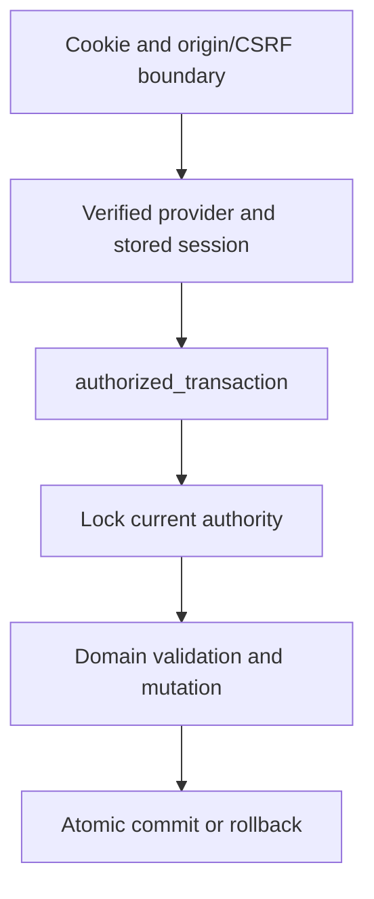

| Function / operation | Behavior and visible result | Guards | Failure and recovery |
| --- | --- | --- | --- |
| [authorized_transaction](../../backend/app/api/dependencies.py) | Verifies provider credentials, activates due purchases in maintenance, then opens the actor-authorized transaction. | Current staff, Trainer, identity, auth account, session epoch and expiry are checked under locks. | Expiry/inactive scope rejects; domain changes roll back on failure. Provider calls are not made inside the business transaction. |
| [Authentication service](../../backend/app/auth/service.py) | Owns stored login/session/provider lifecycle behind auth routes. | Cognito subject binding, local account status and session revocation remain distinct controls. | Provider ambiguity requires the identity-specific recovery path; password reset is not lost-authenticator recovery. |
| [JWT verification module](../../backend/app/auth/jwt.py) | Verifies signed provider credentials used by the auth service. | Issuer, client, token purpose and expiry checks; browser role claims alone do not authorize records. | Reject invalid tokens; inspect key/provider failures without logging tokens. |
| [Verified email-change module](../../backend/app/api/email_changes.py) | Coordinates requested email and verified provider completion; the Admin Trainer-details setting gates address requests/corrections through the shared approval registry. | Pending-address reservation, current request/version, cooldowns and account-holder verification. | Owner approval only reserves the address; the account holder sends/verifies its code. Sending/verifying ambiguity blocks replacement, and current runtime correction policy is rechecked at approval. |

Evidence: [test_auth_security.py](../../backend/tests/test_auth_security.py), [test_auth_sessions.py](../../backend/tests/test_auth_sessions.py), [authentication.spec.js](../../tests-api/authentication.spec.js), [email-corrections.spec.js](../../tests-api/email-corrections.spec.js).

The consolidated Admin draft uses [management](../../backend/app/api/admin_management.py) for Owner-only versioned account/policy changes and session revocation. [Supervision](../../backend/app/api/admin_supervision.py) stores immutable proposals through a server-owned command registry; [decisions](../../backend/app/api/admin_requests.py) apply the original domain command under current Admin authority, then commit terminal proposal and actor-private receipt atomically. The [inbox](../../src/features/messages/AdminApprovalInbox.jsx) offers explicit review/decision and read-only lost-response recovery. Content and package-catalogue saves are connected; unknown/unreviewable operations cannot be approved by this screen. The generic [proposal review](../../src/features/messages/AdminProposalReview.jsx) renders registered domain intents and captured state; expanded policy acceptance remains pending. Trainer creation separates [reservation and completion](../../backend/app/api/trainer_creation.py), with automatic post-approval provider dispatch and current Owner/originating Admin checks at each transition. New Admin creation seeds Exercise Library and Content requirements; all others default to unchecked. Downloads/uploads remain exempt, sharing has separate optional controls, and library approval belongs at Save/publication. [Library publication](../../backend/app/api/library_approval.py) gates the frozen Save intent, retains pending attachment bytes through cleanup, and authorizes Owner/origin-Admin preview with a post-download recheck. Its approve/reject and lost-decision paths have focused PostgreSQL/browser evidence. The draft [Undo approval adapter](../../backend/app/api/session_undo_approval.py) maps compensations to their original approval area and package deletion restoration to purchased-package approval; exact state, original expiry and externally verified media are rechecked before applying. Email/Undo/library lost-submission browser checks passed9/9 across the three profiles. [Report sharing](../../backend/app/api/report_sharing.py) projects persisted purchase-scoped progress or selected session captions/summary, freezes it in the existing Admin proposal, and rechecks it on approval/recovery. [Browser authorization](../../src/services/apiReportSharing.js) preserves uncertain requests and recovers matching proposals after navigation; [report lifetime](../../src/hooks/useReportSharing.js) discards late/content-mismatched files and leaves native sharing to an explicit later click. The Owner can download the reviewed content, while downloads remain approval-free. Focused sharing acceptance is in progress; the cross-screen vetting UI cleanup is deferred in [Progress](../../PROGRESS.md#remaining-work). HTTP202 proposal confirmation is distinct from a saved domain record; matching pending/closed proposal recovery retires uncertain submission without repeating POST.

## 4. Clients, Trainers and package lifecycle

Rules: BR-012–017, BR-037–041 in [Business rules](../business-rules.md).

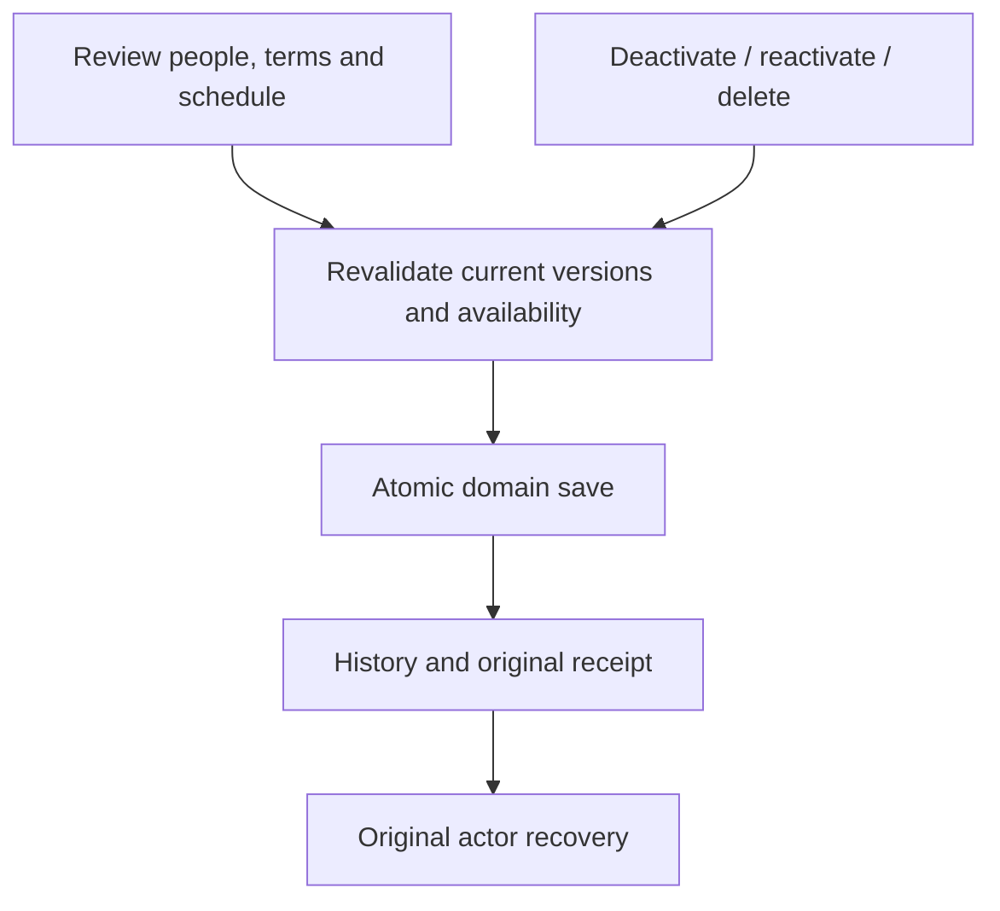

| Function / operation | Behavior and visible result | Guards | Failure and recovery |
| --- | --- | --- | --- |
| [create / reconcile](../../backend/app/api/client_creation.py) | Creates reviewed client/person/purchase data and recovers its original result. | Final wizard checks current package, Trainer and scheduling constraints. | Continue/Back are not saves; interrupted create must recover before any new creation. |
| [save / reconcile](../../backend/app/api/packages.py) | Saves catalogue definitions and returns actor-scoped original receipts. | Catalogue lock, expected version, bounded package terms and matching key/body. | Stale save rejects; catalogue edits never rewrite existing purchased snapshots. |
| [Assignment save module](../../backend/app/api/client_assignment_save.py) | Applies permanent reassignment to the explicitly selected active purchase and its eligible sessions; other purchases remain unchanged. | Selected-purchase availability, preference, version and history; original/completed attribution remains protected. | Conflict requires fresh review. Recover the matching command after lost response. |
| [Trainer deactivation save module](../../backend/app/api/trainer_deactivation_save.py) | Reassigns required unfinished work and disables the Trainer/application account together. | Complete eligible replacement set and conflict checks; revoke existing login sessions. | Partial reassignment must not survive a rejected deactivation. |
| [review / save / reconcile](../../backend/app/api/trainer_reactivation.py) | Restores the permitted Trainer/application account and returns saved state. | Current lifecycle and reviewed version; no reclamation of reassigned sessions. | Fresh sign-in remains necessary; do not create missing provider identities or revive closed logins. |
| [Package deletion Undo module](../../backend/app/api/package_action_undo.py) | Restores eligible deleted sessions using retained identities and evidence. | Separate 24-hour deletion reversal, current authority, unchanged evidence and unexpired media. | Does not reactivate a purchase or recreate unavailable recording bytes. |

Evidence: [records.spec.js](../../tests-api/records.spec.js), [staff.spec.js](../../tests-api/staff.spec.js), [package-actions.spec.js](../../tests-api/package-actions.spec.js), [persistence.spec.js](../../tests-api/persistence.spec.js).

## 5. Scheduling, proposals and decisions

Rules: BR-014–015, BR-022–024, BR-041–043 in [Business rules](../business-rules.md).

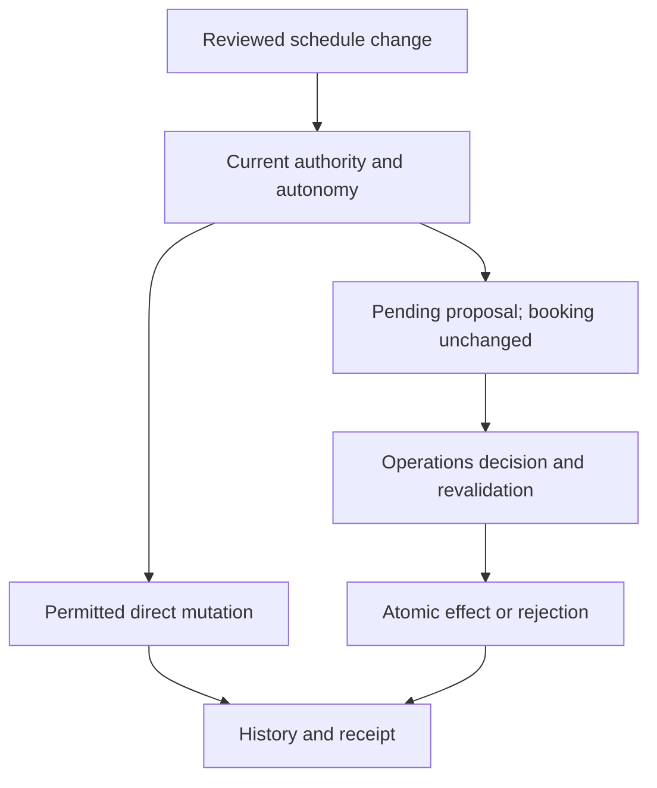

| Function / operation | Behavior and visible result | Guards | Failure and recovery |
| --- | --- | --- | --- |
| [save / apply_booking / apply_open_reassignment](../../backend/app/api/session_booking_save.py) | Schedules Open sessions or applies the supported booking/reassignment effect. | Reviewed versions, active purchase, validity and actual Trainer/client conflicts. | Reject changed slots; stable session and purchased terms survive scheduling. |
| [review / save / apply_postponement](../../backend/app/api/session_postponement.py) | Reviews postponement and applies the permitted direct effect or proposal path. | Current assignment, policy, timing and reviewed scope. | Only the eligible target returns to Open; pending approval does not move the booking. |
| [review / save](../../backend/app/api/session_changes.py) | Records Trainer change requests using reviewed current context. | Trainer authority, future-time rules, autonomy and immutable intent. | Do not present a pending proposal as an already changed booking. |
| [save / reconcile](../../backend/app/api/request_resolution.py) | Approves/rejects a reviewed proposal with domain effects and notices. | Operations authority, decision version and serialized competing decisions. | Approval rechecks current constraints. Receipt recovery never reapplies a proposal. |
| [allowed / save / reconcile](../../backend/app/api/request_cancellation.py) | Cancels an eligible pending request. | Original Trainer, current authority, pending state and decision lock. | A concurrent decision or loss of authority rejects; retain final decision history. |
| [Session Undo save module](../../backend/app/api/session_undo_save.py) | Applies a reviewed compensating mutation with new evidence. | Time window, current scope, dependencies, immutable prior evidence and media/finality restrictions. | Undo does not rewind history, credits or approved pay; reverse later dependent changes first. |

Evidence: [session-booking.spec.js](../../tests-api/session-booking.spec.js), [session-postponement.spec.js](../../tests-api/session-postponement.spec.js), [session-changes.spec.js](../../tests-api/session-changes.spec.js), [request-resolution.spec.js](../../tests-api/request-resolution.spec.js), [session-undo.spec.js](../../tests-api/session-undo.spec.js).

## 6. Plans, outcomes, summaries and credits

Rules: BR-018–019, BR-025–026, BR-032–034, BR-043 in [Business rules](../business-rules.md).

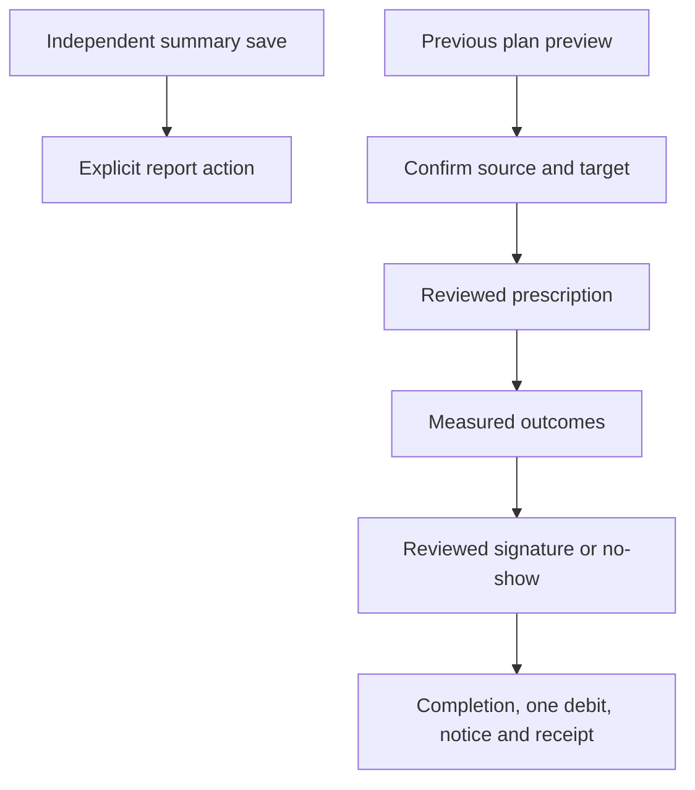

| Function / operation | Behavior and visible result | Guards | Failure and recovery |
| --- | --- | --- | --- |
| [review / save / apply_plan](../../backend/app/api/session_plans.py) | Replaces prescriptions while retaining old ownership and history. | Aggregate/item versions, current scope and acknowledgement/credit finality checks. | Retire removed items; do not move old results or media onto new identities. |
| [previous / copy_previous](../../backend/app/api/session_plans.py) | Previews the latest readable nonempty plan on an earlier day; confirmed copy creates new target items. | Both reviewed plans and latest-source selection must still match; Open/same-day sources do not qualify. | Changed source or target conflicts; copying does not transfer videos or measured outcomes. |
| [inspect / preserve / save](../../backend/app/api/session_outcomes.py) | Saves measured results and immutable correction history. | Current session/client/purchase scope and reviewed values. | Empty saved outcomes remain empty; result edits do not debit credits or alter signatures. |
| [review / save / reconcile](../../backend/app/api/session_summaries.py) | Persists reviewed client-facing text separately from outcomes. | Nonblank editor input, bounded server text, current authority and stale-version rejection. | Recover original saved text after lost response; no sharing/delivery effect. |
| [inspect / save / notify_renewal](../../backend/app/api/session_acknowledgements.py) | Commits signature/no-show completion, credit accounting, eligible renewal notice and receipt. | Current Singapore date, reviewed plan/results/credit balance, bounded actual ink and finality. | No-show-to-signature correction retains both records and one debit. Original receipt recovery does not debit again. |

Evidence: [session-plans.spec.js](../../tests-api/session-plans.spec.js), [previous-plan.spec.js](../../tests-api/previous-plan.spec.js), [session-outcomes.spec.js](../../tests-api/session-outcomes.spec.js), [session-summaries.spec.js](../../tests-api/session-summaries.spec.js), [session-acknowledgements.spec.js](../../tests-api/session-acknowledgements.spec.js).

## 7. Inbox, remuneration and content

Rules: BR-005, BR-022–024, BR-035, BR-044–045 in [Business rules](../business-rules.md).

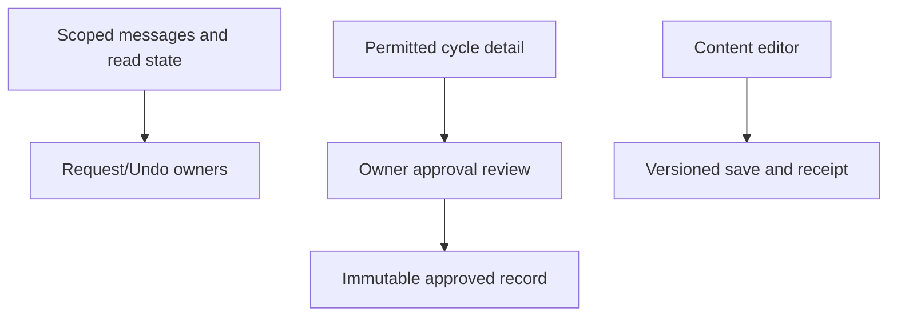

| Function / operation | Behavior and visible result | Guards | Failure and recovery |
| --- | --- | --- | --- |
| [records / save / reconcile](../../backend/app/api/messages.py) | Projects scoped messages and persists the supported private message state. | Recipient/record visibility, command lock and actor-scoped receipt. | Another recipient’s read state is not caller evidence; unknown updates reconcile without inventing delivery. |
| [listing / detail / approve / reconcile](../../backend/app/api/remuneration.py) | Builds permitted cycles and records immutable Owner approval evidence. | Role, reviewed source/rates and approved-cycle rules; Admin has no remuneration access. | Changed source requires review; later edits do not rewrite an approved pay record. |
| [records / save / reconcile](../../backend/app/api/content.py) | Reads and saves permitted content with original retry evidence. | Role, version and content lock checks remain server-side. | Stale or conflicting intent rejects; internal save does not establish public-site publication. |

Evidence: [remuneration.spec.js](../../tests-api/remuneration.spec.js), [request-resolution.spec.js](../../tests-api/request-resolution.spec.js), [records.spec.js](../../tests-api/records.spec.js).

## 8. Assessments, reports and private media

Rules: BR-004, BR-027–029, BR-046–050, BR-055–057 in [Business rules](../business-rules.md).

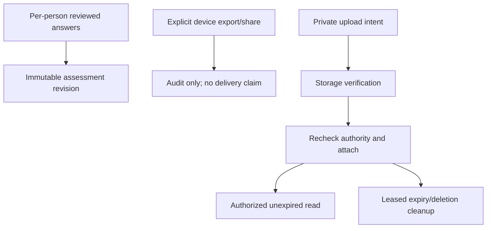

| Function / operation | Behavior and visible result | Guards | Failure and recovery |
| --- | --- | --- | --- |
| [create / save / reconcile / current_records](../../backend/app/api/assessments.py) | Persists per-person occasions and immutable assessment revisions. | Owner/Admin initial-form access, validated answer schema and expected revision. | No autosave per keystroke or inferred missing answers; correction/void retain prior evidence. |
| [General health notes module](../../backend/app/api/client_notes.py) | Owns assigned coaching-note reads/writes separately from clinical forms. | Operations, default assigned Trainer or the assigned Trainer of a started active additional purchase; reviewed version and server coaching scope. Future/inactive/expired additional purchases and temporary cover grant no coaching scope. | Transient drafts stay memory-only; authority changes clear private drafts. |
| [renderReportPdf / rasterizePage / reportEncoderWorker](../../src/utils/reportPdf.js) | Builds session/progress PDFs from canonical SVG pages; requests software-backed 2D contexts for immediate JPEG readback on the page and worker. | Two-page concurrency bound, sequential fallback, original page order and resource disposal; browser/runner settings unchanged. | Renderer errors remain explicit and prepared-file ownership rejects stale completion. The retained Linux WebKit stall is mitigated, not retrospectively proven fixed; physical-device evidence stays separate. |
| [record / history / reconcile](../../backend/app/api/session_reports.py) | Records truthful export/share/opening audits and scoped history. | Explicit client/purchase membership, actor/action ID and immutable audit scope. | Recover audit only; never repeat a native share/download merely because its audit response was lost. |
| [review / checked_review / recover_proposal](../../backend/app/api/report_sharing.py) | Projects persisted report-visible content and binds optional approval to that exact selection. The Owner can download the reviewed PDF. | Separate progress/session policies, current scoped records, matching content digest and originating-Admin recovery. Downloads stay approval-free. | [Browser commands](../../src/services/apiReportSharing.js) check uncertain requests without resubmitting; [prepared sharing](../../src/hooks/useReportSharing.js) retires files on content/login change. Authorization never invokes native sharing; the user must explicitly tap Share afterward. |
| [ExerciseVideoDialog](../../src/features/sessions/ExerciseVideoDialog.jsx) / [prepareExerciseVideo](../../src/features/sessions/exerciseVideo.js) | Prepares a captioned clip with optional original audio, using canvas MediaRecorder and a Web Audio destination; no microphone capture or speaker connection. | Default unchecked; frozen candidate option, file/duration limits and abort cleanup. | Unsupported conversion retains the original with an explicit warning and null audio/deferred status; it never claims audio removal or preservation was verified. |
| [reserve / preparation / commit / readable](../../backend/app/api/session_media.py) | Reserves private upload intent, verifies attachment completion and authorizes reading. | Current session/item/lifecycle, checked bytes and original ownership/expiry; recheck after storage work. | An upload alone is not an attached recording; recover original intent and keep incomplete/retired assets unavailable. |
| [claim / finish / run_once](../../backend/app/session_media_cleanup.py) | Claims cleanup work and records its storage result using durable lifecycle evidence. | Lease/version ownership, original expiry and retained deletion/Undo rules. | Storage failure must not fabricate deletion; reconcile the leased work rather than expose expired media. |

Evidence: [progress-reports.spec.js](../../tests-api/progress-reports.spec.js), [report-sharing.spec.js](../../tests-api/report-sharing.spec.js), [session-media.spec.js](../../tests-api/session-media.spec.js), [exercise-library.spec.js](../../tests-api/exercise-library.spec.js), [records.spec.js](../../tests-api/records.spec.js).

## 9. Persistence, diagnostics and future observability

Rules: BR-007, BR-009, BR-053–054, BR-058–061 in [Business rules](../business-rules.md).

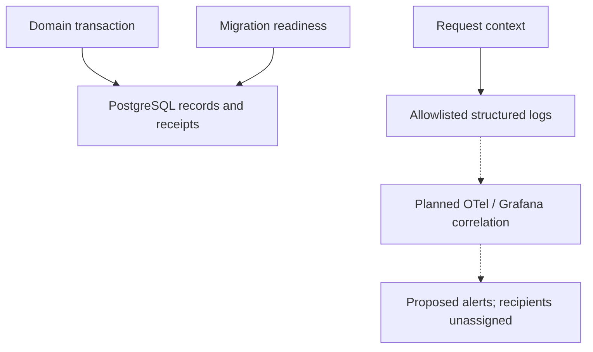

| Function / operation | Behavior and visible result | Guards | Failure and recovery |
| --- | --- | --- | --- |
| [reviewed / require_transaction](../../backend/app/persistence.py) | Supports versioned changes within explicit transactions. | Current expected versions and transaction ownership. | A failed write must not leave partial domain evidence; migration/restart tests have separate scope. |
| [expected_revisions](../../backend/app/migrations.py) | Resolves expected migration heads for schema readiness. | Checked-in migration chain must match the application schema contract. | Stop on incompatibility; do not rewrite applied migrations or equate downgrade with data recovery. |
| [RequestContextMiddleware / JsonFormatter](../../backend/app/observability.py) | Generates request IDs and allowlisted JSON status/duration/error-type events. | No bodies, credentials, raw URLs or SQL exception details in the event fields. | Generic server errors carry a request ID; failed log delivery is not proof of a successful request. |
| [Managed secrets module](../../backend/app/managed_secrets.py) | Loads configured runtime secrets through the managed boundary. | Scoped configuration and secret handling, separate runtime/migration identities. | Startup loading is not an automated rotation worker; no secret values in diagnostic output. |

Evidence: [test_process_restart.py](../../backend/tests/test_process_restart.py), [security.md](../../docs/security.md), [runbook.md](../../docs/runbook.md).

## 10. Verification, release and recovery boundaries

Rules: BR-059–064 in [Business rules](../business-rules.md).

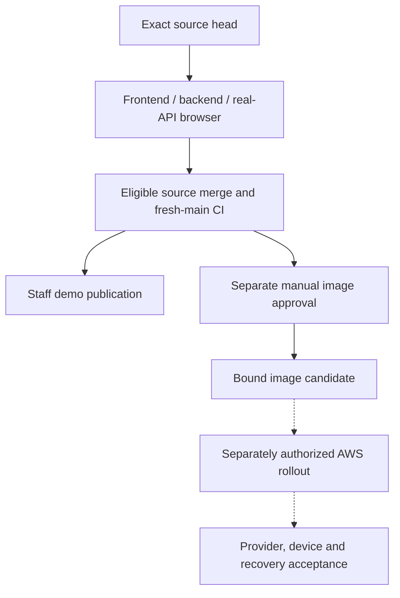

| Function / operation | Behavior and visible result | Guards | Failure and recovery |
| --- | --- | --- | --- |
| [Real-API browser harness](../../scripts/verify-api-browser.mjs) | Runs actual FastAPI/migrations and isolated Docker PostgreSQL browser acceptance. | Synthetic records and local signed-token provider; production database excluded. | Keep original failed logs and traces; passing simulator tests cannot replace this gate. |
| [Shard aggregate verifier](../../scripts/verify-api-shards.mjs) | Requires every discovered case to pass exactly once across shards. | Complete successful shards and expected inventory. | Failed, missing, duplicate or skipped cases must not be hidden by reruns or weaker counts. |
| [Verification workflow](../../.github/workflows/verify.yml) | Runs frontend, backend and real-API browser gates for the source head. | Final-head full gates and unchanged test budgets. | Diagnose environment/app/fixture failures separately; old-head success does not accept new bytes. |
| [Manual image publication workflow](../../.github/workflows/aws-image.yml) | Builds/publishes only an explicitly selected verified main candidate under protected approval. | Source/run/artifact identity, full verification and AWS environment protection. | Image publication is separate from Lambda rollout; preserve candidate evidence on failure. |
| [Staff demo workflow](../../.github/workflows/pages.yml) | Verifies main, builds its site and publishes GitHub Pages. | Verification dependencies and workflow event conditions. | Pages success does not establish Cognito, Lambda, real customer or physical-device acceptance. |

Evidence: [verify-test-results.mjs](../../scripts/verify-test-results.mjs), [development.md](../../docs/development.md), [runbook.md](../../docs/runbook.md).

OpenTelemetry/Grafana correlation, mutation testing, latency campaigns and tested backup restoration remain planned in [Progress](../../PROGRESS.md#m10-work-packages--planned). Structured request duration logs are not a measured latency budget or an active Grafana stack. Alert thresholds/recovery targets remain proposals; primary/backup responders and destinations remain unassigned.

## 11. Screenshot and evidence index

No screenshots or new live acceptance were captured for this documentation change. This is a capture checklist, not a passed test receipt. Use designated synthetic records and record revision, environment, role, device and scenario; never capture credentials, verification codes or real health/customer data. Codex may run isolated browser checks under Fitfinity's engineering rules; real provider and developer AWS actions retain their separate boundaries.

| Evidence ID | View and states to capture | Responsible owners | Existing test / worksheet |
| --- | --- | --- | --- |
| TB-UI-01 | Sign-in, expired session, email verification and rejected authority | Auth service, PortalDataProvider, API client | [Authentication](../../tests-api/authentication.spec.js), [Trainer worksheet](../uat/trainer.md) |
| TB-UI-02 | Owner/Admin edit conflict; retained draft; explicit fresh review | Profile editors, review lifetime, original-command recovery | [Profile recovery](../../tests-api/profile-recovery.spec.js), [Owner worksheet](../uat/owner.md) |
| TB-UI-03 | Open booking, pending proposal, approved/rejected decision | Booking/change/request owners | [Booking](../../tests-api/session-booking.spec.js), [Admin worksheet](../uat/admin.md) |
| TB-UI-04 | Previous-plan preview, confirmed replacement, changed source conflict | PreviousPlanDialog, session_plans | [Previous plan](../../tests-api/previous-plan.spec.js) |
| TB-UI-05 | Signature/no-show, corrected acknowledgement, unchanged single debit | Session acknowledgement and persistence owners | [Acknowledgement](../../tests-api/session-acknowledgements.spec.js) |
| TB-UI-06 | Unknown save, explicit Check, recovered result after reload | API command, domain receipts, recovery UI | [Offline recovery](../../tests-api/offline-recovery.spec.js) |
| TB-UI-07 | Assigned notes versus denied initial-form access; report export history | Assessment, notes and report owners | [Records](../../tests-api/records.spec.js), [Reports](../../tests-api/progress-reports.spec.js) |
| TB-UI-08 | Recording upload/attachment, expired or forbidden playback | Session media and cleanup owners | [Media](../../tests-api/session-media.spec.js) |
| TB-UI-09 | Pay-cycle approval and forbidden Admin view | Remuneration owner | [Remuneration](../../tests-api/remuneration.spec.js) |

Include perceived lag and failed/blocked outcomes in actual capture remarks. Passing a source test does not fill a UAT result column automatically.
