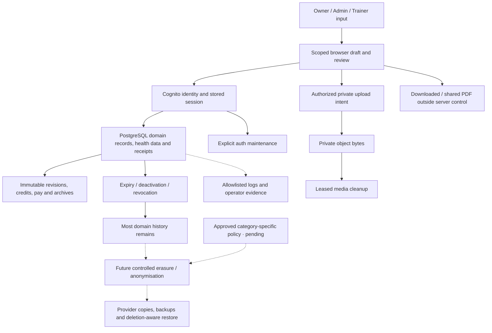

# Data lifecycle — source-based draft

**Draft for policy mapping, 28 October 2026.** Fitfinity keeps staff identity, client health/training records, purchased terms and recovery evidence in PostgreSQL; private media uses object storage, while the browser holds scoped working state and exports. Ending access or deactivating a record usually retains its history. This document distinguishes implemented expiry/cleanup from retention decisions still needed. It does not approve disposal periods, authorize deletion or certify compliance. No customer data, AWS settings or cleanup behavior was changed to prepare it.

Source baseline: application at main `1aafcbef6377f36d093260d4a63e57239cfcaefc` (merged PR116), unchanged by this documentation follow-up. Inspection covered [models](../backend/app/models), [migrations](../backend/migrations), auth maintenance, media cleanup, browser stores and checked-in infrastructure. No database was queried or migrations executed for this review. Actual deployed backup/log/provider settings remain unverified. [Business rules](business-rules.md) own invariants; [API contracts](api-contracts.md) own interfaces; [technical behavior](code-owners/technical-behavior.md) maps functions; [runbook](runbook.md) owns operational recovery. Format reference: [SoccerBot data-lifecycle draft](https://github.com/LimYouSheng/SoccerBotStudioSG/blob/91539f2829550388345740680a9b980b22c75c44/docs/data-lifecycle.md); its providers and storage design do not apply to Fitfinity.

## 1. Lifecycle and evidence boundaries

- **Expiry:** access, a command window or media playback stops being valid. The stored row or object may still exist.
- **Revocation/deactivation:** access or business activity is disabled; identity, purchases and history are not erased.
- **Archival:** retained evidence moves out of live booking state or is captured as immutable before/after history. It still exists.
- **Deletion/anonymisation:** identifying data or bytes are removed/transformed under a defined scope. UUIDs, hashes, encryption and pseudonyms do not automatically make linked data anonymous.

Here, **implemented** means inspected source behavior; **not found** means no general mechanism was identified in the reviewed paths; **pending verification** means policy or actual account/runtime evidence is still needed. Code and passing CI do not prove that maintenance is scheduled or that a deployed disposal deadline is met.

## 2. Current storage inventory

Each category needs a disposal rule, including linked JSON, prior revisions, exports and provider copies. The inventory groups related tables; the linked models/migrations own exact field definitions. It is not a claim that every current deployment has applied the latest schema.

### Browser and downloaded data

| ID | Data / location and purpose | Current behavior | Remaining decision |
| --- | --- | --- | --- |
| DL-01 | API snapshots, reviewed drafts and original pending command bodies in React/service memory | [PortalDataProvider](../src/components/PortalDataProvider.jsx), [API command](../src/services/apiCommand.js) and domain recovery owners bind private state to user/role/login generation. Eligible transient drafts remain in memory; authority changes retire them. | Shared-device handling and actual browser acceptance; an in-memory lost command key must not be treated as proof of no server effect. |
| DL-02 | `fitfinity-m2-demo-db-v4`, `fitfinity-demo-session-v1`, `fitfinity-demo-credentials-v1` in localStorage | [Demo DB](../src/services/mockDb.js) and [demo auth](../src/services/authService.js) persist prototype records and simulated credentials/session state. API mode does not use them as authoritative persistence. | Synthetic-data-only hygiene and explicit local reset procedure; sign-out is not deletion of the demo database. |
| DL-03 | IndexedDB `fitfinity-m2-exercise-videos` and `fitfinity-exercise-library-media` | [Demo video store](../src/services/exerciseVideoStore.js) supports explicit deletion and expired-video removal; [library store](../src/services/exerciseLibraryMedia.js) supports explicit removal. | Browser-controlled copies, orphan handling and test-data cleanup; not proof of production S3 deletion. |
| DL-04 | HttpOnly authentication/flow cookies; CSRF and temporary media URLs in browser work | [Auth routes](../backend/app/auth/routes.py), [API client](../src/services/apiClient.js) and media services enforce their distinct lifetimes. Provider credentials stay server-side. | Validate actual cookie configuration, tab/session restoration and shared devices; expired cookies do not delete database evidence. |
| DL-05 | PWA shell cache and exported/shared PDFs | [Service worker](../public/sw.js) caches only deployment shell/build assets, deletes older matching shell caches on activation and does not runtime-cache APIs or uploaded media. [PDF/report flow](../src/features/sessions/SessionSummaryExport.jsx) creates user-controlled copies. | Download/recipient handling and disclosure; the server cannot recall a saved PDF or already shared copy. |

### PostgreSQL application state

| ID | Tables / identifying content and purpose | Current lifecycle | Physical cleanup / gap |
| --- | --- | --- | --- |
| DL-06 | `auth_accounts`, `auth_flows`, `auth_sessions`: user/identity links, hashed handles, encrypted provider state/tokens, epoch and timestamps | [Authentication models](../backend/app/models/authentication.py) and [service](../backend/app/auth/service.py) enforce expiry, closure and account-wide revocation. | [Explicit maintenance](../backend/app/auth/admin.py) removes flows expired more than one day and sessions closed more than seven days only with cleared refresh ciphertext. It does not erase staff identities or guarantee a scheduled execution time. |
| DL-07 | `staff_users`, `staff_identities`, `trainers`, `admin_profiles`, `staff_invitations`, `staff_email_changes`: contact/profile/provider identity and provisioning/correction evidence | [People](../backend/app/models/people.py), [staff](../backend/app/models/staff.py), [email changes](../backend/app/models/email_changes.py) preserve stable identities and verified address-change history. Deactivation revokes application access. | No general staff erasure/age purge found. Pending provider outcomes and address reservations must be reconciled before disposal; removing a local row does not delete Cognito. |
| DL-08 | `clients`, `client_people`, `lifecycle_events`: individual/couple identity, contacts, emergency contacts, notes and lifecycle provenance | Deactivation freezes the applicable client/purchases; reactivation is provenance-aware. Initial forms remain a separate permission boundary. | No general client erasure workflow found. Include emergency contacts and per-person identity, not only the shared client display name. |
| DL-09 | `assessment_form_versions`, `client_assessments`, `client_assessment_revisions`, `assessment_access`, `client_note_access`: sensitive answers, actor/subject snapshots, revision/access evidence | [Assessment persistence](../backend/app/assessment_persistence.py) retains immutable revisions, completion, corrections and void evidence; general notes have separate access. | No general retention purge found. Voiding is terminal state, not erasure. Versioned JSONB may contain health information and prior identifying snapshots. |
| DL-10 | `package_templates`, revisions, purchases, preferences and schedule slots | [Training models](../backend/app/models/training.py) retain immutable purchased terms, validity, assigned identity and credit relationships. | Expiry/deactivation is not purchase deletion. No general age purge found; preserve financial and historical dependencies. |
| DL-11 | `training_sessions`, plans/details, result revisions, acknowledgements, credit debits and attribution/assignment history | [Training](../backend/app/models/training.py) and [attribution](../backend/app/models/session_attribution.py) retain session/person/Trainer links, measured outcomes, signatures and exactly-once credit evidence. | Some editable child rows are replaced/removed through domain commands, while revisions/receipts retain prior evidence. No general completed-session purge found. Signature and health records need explicit policy. |
| DL-12 | `session_identities`, `session_archives`, `package_action_receipts`, `package_deletion_undos`, archived media/request evidence | [Package deletion](../backend/app/api/package_action_save.py) removes eligible live bookings while retaining typed archives and stable identity for permitted Undo. | Removing a live booking is not full erasure. Archive/receipt/history disposal must respect stable links, credits, completed evidence and the reversal window. |
| DL-13 | `session_mutations`, `session_mutation_undos`, `mutation_*` typed snapshots | [Mutation models](../backend/app/models/session_mutations.py) retain reviewed before/after state and dependencies for compensating changes. | Twenty-four-hour Undo eligibility does not imply snapshot deletion after 24 hours. No general journal purge found. |
| DL-14 | `api_receipts`, domain `*_receipts`, `session_media_intents`, `library_save_intents` | [Receipt models](../backend/app/models/api.py) retain actor, key, target, request digest and often prior/result JSON for replay/recovery. Media intents retain immutable upload/attachment decisions. Merged PR116 adds immutable Admin proposal/decision evidence and account-change receipts, with no general purge policy. | No general receipt purge found. Digests do not anonymise associated actor/results; premature removal could permit duplicate writes or lose uncertain-outcome evidence. |
| DL-15 | `change_requests`, slots/events, messages, message receipts, session events and renewal dismissals | [Communications](../backend/app/models/communications.py) preserve proposal/decision history and recipient-private state. | Read/unread, cancellation and dismissal are state changes, not comprehensive message deletion. No general age purge found. |
| DL-16 | `remuneration_approvals`, `remuneration_lines`, `report_audit` | [Evidence models](../backend/app/models/evidence.py) preserve approved pay and truthful export/share/opening events, not external delivery. | No general purge found; reconcile financial/audit obligations with health/contact data embedded in snapshots and exported files. |
| DL-17 | `exercises`, `content_entries`, `media_assets`, `media_deletions` | [Media models](../backend/app/models/media.py) distinguish current content, pending/ready/deleted assets and durable cleanup work. | Media workers mark rows deleted/done after storage success; metadata and cleanup evidence remain. Library metadata removal is not erasure of names retained in existing plans. In merged PR116, a pending library publication proposal holds its uploaded bytes for Owner review without extending upload URL leases. Approval publishes the retained attachment; rejection/cancellation releases the hold for normal cleanup. There is no automatic pending-proposal expiry. |

### Object storage, diagnostics and external copies

| ID | Store and purpose | Current behavior | Gap / verification required |
| --- | --- | --- | --- |
| DL-18 | Private S3 library attachments and session recordings | [Storage adapter](../backend/app/media_storage.py) binds immutable object keys/checksums; [session cleanup](../backend/app/session_media_cleanup.py) and [library cleanup](../backend/app/library_cleanup.py) delete eligible objects and retain outcomes. | Worker invocation/schedule, backlog and actual bucket lifecycle/versioning/replication require verification. `delete_object` by key does not demonstrate erasure of noncurrent versions, replicas or backups. |
| DL-19 | PostgreSQL/RDS backups, snapshots and operator exports | Initial [TEST foundation](../backend/infrastructure/test-foundation.json) declares one-day backup retention; BR-058 retains a reviewed 14-day target, not observed current settings. | Confirm actual backup/snapshot retention and restore targets. No tested deletion-aware restore receipt is recorded; manual snapshots/exports need independent disposal rules. |
| DL-20 | Request logs, CI artifacts/traces and downloaded UAT/incident evidence | [Observability](../backend/app/observability.py) allowlists request IDs, route, status, duration and error type; [verification](../.github/workflows/verify.yml) retains test artifacts. | Source upload steps do not set an explicit `retention-days` here; actual GitHub settings apply. The hosting design declares a seven-day Lambda log group, not proof of every current log group. Traces/screenshots may contain fixture data; keep real health data out. Grafana remains planned. |

## 3. Implemented validity periods are not disposal periods

| Mechanism | Current source behavior | What it does not mean |
| --- | --- | --- |
| Authentication flow | `FLOW_SECONDS = 300` in [auth service](../backend/app/auth/service.py). | Five-minute validity does not immediately delete the flow; explicit maintenance has a separate age predicate. |
| Staff session | [Settings](../backend/app/config.py) default to eight hours, allowed range 1–168; JWT access expiry is separately checked. [Configuration audit](../backend/app/auth/admin.py) expects five-minute provider access tokens and matching configured refresh lifetime. | Defaults/audit expectations are not a fresh Cognito settings receipt or a staff-record retention rule. |
| Auth cleanup | Expired flows older than one day; closed sessions older than seven days with no refresh ciphertext, when explicit maintenance runs. | Not an exact wall-clock deletion promise, not a staff-account erasure, and not permission to discard pending provider revocation. |
| Session recording | [Commit](../backend/app/api/session_media.py) fixes expiry to seven days from publication; later changes/Undo must not extend it. | Playback expiry does not guarantee immediate physical byte removal or removal of metadata/backups. Monthly cleanup on the first day in Asia/Singapore is the selected routine policy; deployment remains pending, and expired bytes can incur storage charges until deletion. |
| Upload/read leases | Recording intent has a five-minute upload window; signed upload is capped at 300 seconds and remaining intent lifetime; recording read lease at 60 seconds and remaining media lifetime. | A failed/expired transfer is not proof that no bytes reached storage. Source codec/duration metadata is not processing acceptance. |
| Undo and media hold | Permitted Undo is within 24 hours; retired recording cleanup respects the earlier of hold/expiry and any outstanding upload lease. | Undo expiry is not a general purge deadline for receipts, archives, signatures, credits or pay. |
| Cleanup leases | Media workers lease work for two minutes; a recorded storage failure schedules retry eligibility after one minute. | These are concurrency/retry controls, not guaranteed scheduled execution or an approved deletion SLA. |
| Backup/log design | Initial TEST RDS one day; separate 14-day planning target; [hosting design](../backend/infrastructure/hosting_design.py) declares seven-day Lambda logs. | These are different stores/design scopes, not proof of current settings, achieved RPO/RTO or complete-copy erasure. |

## 4. Existing cleanup and important gaps

**Implemented, narrow cleanup:** explicit auth maintenance closes expired sessions, attempts bounded provider revocation, then deletes eligible flow/session rows. Session/library media workers claim durable work, release database locks around storage IO and finalize only the matching lease/version. Failed deletion retains retry evidence. Session cleanup also detects bounded batches of abandoned intents/expired assets; its CLI is a bounded manual worker and does not schedule itself. Demo video expiry and shell-cache replacement are separate browser mechanisms.

**Business mutation is not general cleanup:** package deletion archives eligible bookings; plan edits can remove details while receipts/history retain earlier state; Trainer availability replaces current slots. These paths enforce domain semantics and must not be repurposed as bulk personal-data erasure.

**Not found in reviewed application paths:** a general client/staff erasure or anonymisation workflow, category-wide PostgreSQL age purge, a cross-provider disposal orchestrator, or a tested deletion-aware backup restoration mechanism. This draft does not add a retention preview endpoint or cleanup scheduler. Source-supported media deletion must not be described as absent, but its deployed schedule and storage-copy coverage remain unverified.

**Consequences:** sensitive historical fields can accumulate even after deactivation, media expiry or logout. Unknown commands, credit debits, approved pay, signatures and revocation barriers cannot be discarded merely because an age threshold passed. Restore can reintroduce deleted records or revoked access unless later decisions are reapplied before reopening the system.

## 5. External systems must be mapped separately

| System | Application relationship | Policy/configuration questions still open |
| --- | --- | --- |
| AWS Cognito and email delivery | Staff authentication, MFA, verified email, invitations/recovery; application retains stable provider subject and local session evidence. | Exact pool/account settings, provider retention, delivery logs, deletion effects and recipient mailbox copies; no Cognito deletion follows from local deactivation. |
| AWS RDS/PostgreSQL | Domain, sensitive health, financial and recovery evidence with migrations. | Actual backups/snapshots, region, access, encryption/key retention, exports and disposal/restore obligations. |
| AWS S3 | Protected attachments/recordings; supported object-key deletion. | Versioning, noncurrent versions, replication, lifecycle rules, access logs and orphan inventory; check every relevant bucket. |
| CloudFront, API Gateway, WAF, Lambda and CloudWatch | Hosting, edge/API protections and runtime diagnostics in prepared AWS architecture. | Which logs are enabled, actual payload fields, retention/access and processing locations; do not infer a single policy from one template. |
| GitHub and operator-managed storage | Source, CI traces/screenshots, downloadable artifacts, UAT/incident/backup copies. | Account/repository retention, download access, local copy disposal and redaction. |
| Native sharing and recipient devices | Explicit PDF download/share handoff under user control. | Approved disclosures, recipient handling and support process; no guaranteed destination/delivery or remote recall. |
| Grafana/OpenTelemetry — planned | Future correlated diagnostics, metrics and traces. | Approve payload allowlist, sampling, tenant isolation, retention, cost and destinations before activation; no active receiver is claimed. |
| Glofox — future public/member scope | Planned membership entitlement and purchase handoff, separate from the staff portal. | Confirm integration scope, actual exchanged fields and provider terms before making privacy/retention promises. |

Confirm contractual roles, obligations and provider agreements with the responsible business owner; this source review does not assign legal roles or certify compliance.

## 6. Clause-to-implementation worksheet — complete before cleanup work

All policy values below are **pending business clauses and approval**. Existing source validity limits remain factual; they do not constitute approved disposal commitments.

| Decision | Inventory scope | Required business input | Engineering mapping to prepare | Approval / evidence |
| --- | --- | --- | --- | --- |
| Purpose and permitted use | DL-01–20 | Clause ID/version, categories, purposes and responsible entity | Collection points, exact fields, access and recipients | Pending |
| Retention trigger/duration | Each category separately | Trigger, period and exception basis | Indexed eligibility and all dependent rows/copies; distinguish original creation from mutable update timestamps | Pending |
| Health and signature records | DL-08–11, DL-16, DL-18 | Sensitive-data handling, correction/access rights and retention exceptions | Per-person forms, prior JSON revisions, signature evidence, reports and media | Pending |
| Access/correction/erasure requests | DL-06–18 and providers | Verified requester, authority, deadlines and applicable exclusions | Match stable people/staff/provider IDs, couple membership and archived copies without deleting another person's evidence | Pending |
| Financial/security exceptions | DL-06–07, DL-10–16 | Obligations, exception owner and review dates | Protect exactly-once credits/pay, unknown commands, revocation and immutable evidence | Pending |
| Backup and restore | DL-19 and all restored stores | Backup lifetime, deletion propagation and recovery obligations | Deletion/revocation-aware restore; reconcile external effects before reopening access | Pending |
| Logs, browser and exports | DL-01–05, DL-20 | Purpose, duration, shared-device and downloaded-copy handling | Actual GitHub/CloudWatch/browser settings and operator procedure | Pending |
| Provider disclosures/transfers | Section 5 | Approved agreements and disclosures | Actual accounts, field flows, regions and copy/deletion evidence | Pending |

For each approved rule record: `rule ID → clause/version → category → store/fields → trigger → duration → exceptions → action → owner → test evidence → deployed revision`. Broad wording such as “as long as necessary” needs a concrete operational decision; do not invent a retention period during implementation.

## 7. Proposed implementation sequence — not implemented or authorised by this draft

1. Obtain clauses and approve category-specific rules, resolving any conflict with immutable evidence and current validity/cleanup behavior before making customer-facing promises.
2. Prepare an authorized minimal deployed inventory: source/migration identity, aggregate counts/growth, worker scheduling, bucket versions, provider and backup/log settings. Do not export raw health/customer rows merely to estimate size.
3. Design dependency-aware disposal. Preserve pending/unknown commands, revocation barriers, credit and approved-pay evidence; address JSON snapshots, per-person/couple relationships and stable archive identities. Review any migration that changes immutable-history guarantees.
4. Build a read-only dry-run report with counts/reasons and protected-state exclusions. Define minimal deletion evidence and its own retention; do not create an indefinite duplicate personal-data archive.
5. Test bounded batches, locking, pagination, interruption, safe reruns and provider/storage failure using isolated Docker PostgreSQL and synthetic object storage. Cover expiry versus bytes, stale leases, concurrent Undo, prior signatures, linked receipts and multi-person scope.
6. Exercise deletion-aware restore and external-copy handling. Apply required later revocations/deletions or equivalent safeguards before reopening a restored database; reconcile financial/provider effects. No current tested restore receipt is claimed.
7. Review the concrete rollout, obtain applicable AWS/provider authorization, deploy through verified-source/artifact gates and record results. Monitor backlog, work age, failures and scheduler freshness without logging private payloads. Assign operators separately from code-module owners.

Start with approved rules and bounded jobs. Additional queues, archival services or paid observability need a measured requirement and separately scoped implementation; this draft provisions nothing.

## 8. Review checklist and handover

- [ ] Clauses/version received; category-specific purposes, periods and exceptions approved.
- [ ] Source inventory reconciled with actual schema, providers, backup/log and object-storage settings.
- [ ] Health JSON, signatures, history, browser stores, exports, archived bookings and noncurrent objects included.
- [ ] No promise equates deactivation, logout, expiry, dismissal or archival with complete erasure.
- [ ] Existing auth/media maintenance scheduling, failure handling and copy coverage verified.
- [ ] Dry-run, foreign-person scope, uncertain commands, Undo races, interruption and restore cases reviewed before cleanup implementation.
- [ ] Operational owner and review cadence assigned; alert recipients remain a separate unassigned decision.
- [ ] CI, deployed revision and actual acceptance recorded only after execution.

Current status: **source-based draft; policy mapping, external-account verification and general disposal implementation pending**. Review when clauses arrive or schema, identity, media or provider settings change. This document owns lifecycle policy mapping; the [runbook restore procedure](runbook.md#7-data-protection-and-restore) owns execution.

Admin report-sharing proposals retain the frozen report-visible projection and original request/decision evidence in the existing Admin approval records. They do not store another PDF binary or transmit it to a recipient. Progress is purchase-scoped; session snapshots contain selected captions and the client-facing summary, without private Trainer comments or signature strokes. These immutable copies follow the existing unresolved general-record retention policy; this change does not authorize disposal.
