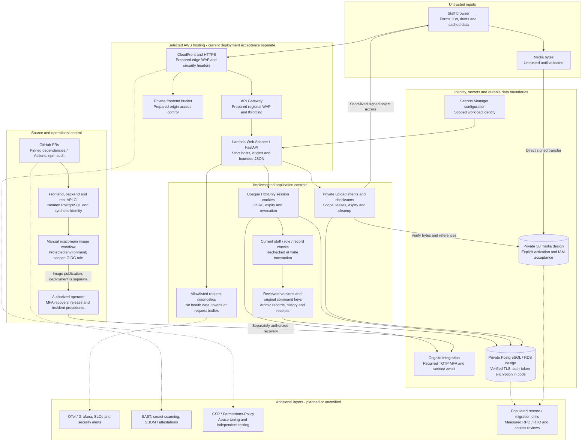

# Security infrastructure

Fitfinity uses **Amazon Cognito** for staff sign-in and authenticator-based MFA, while the **Python FastAPI** backend checks each person's role and record permissions before accessing **PostgreSQL** or saving changes. **SQLAlchemy transactions** and stored command receipts protect against conflicting edits and duplicate updates; private media uses **Amazon S3** through limited, short-lived access links. The selected AWS design uses **CloudFront**, **API Gateway**, **AWS WAF** and **Lambda** to serve and filter traffic, **Amazon RDS for PostgreSQL** for database hosting, and **Secrets Manager with IAM roles** for server credentials. **GitHub Actions**, **Dependabot**, **npm audit**, **Vitest**, **pytest** and **Playwright** support change review and verification. The document distinguishes implemented code from AWS settings requiring current deployment proof; **OpenTelemetry and Grafana** monitoring and additional scanning/recovery layers remain future work.

## Scope and status

Reviewed against repository application source on **28 October 2026**. **Implemented** means code exists; **prepared** means infrastructure configuration or an operator workflow exists; **planned** means further work. Solid arrows show responsibilities and trust boundaries, not proof that the current source is deployed. Dashed arrows identify additional layers. Historical AWS receipts do not establish the present account posture or authorize new actions.

This document owns the security overview and control/evidence map. [Business rules](business-rules.md) owns requirements, [API contracts](api-contracts.md) owns request schemas, [ADR](architecture/adr.md) owns architecture rationale, [Runbook](runbook.md) owns operational procedures, [Progress](../PROGRESS.md) owns current tasks and the H1–H7 backlog, and [Journey](journey.md) retains milestones and history. This is not a penetration-test report or compliance certification.

## Tools and services by status

Exact package, image and Action pins belong to [Versions](versions.md). This table identifies the actual owners and their security purpose; a named service is not proof of current account configuration or deployed acceptance.

| Tool / service | Security responsibility | Current status and limit |
| --- | --- | --- |
| React + Vite | Staff UI, explicit API/demo composition and retirement of private UI on identity changes | Implemented frontend; browser controls do not grant server authority. |
| Python FastAPI + Pydantic + Uvicorn | HTTP application, request/schema validation and controlled server entry | Implemented; current-source Lambda deployment remains separately evidenced. |
| Amazon Cognito User Pools | Staff authentication, TOTP MFA, password and verified-email flows | Integration implemented; actual pool/client settings and current live-provider acceptance require verification. |
| PyJWT + Python `cryptography` AES-GCM | Verify Cognito RSA-signed access tokens; encrypt retained provider authentication material with scoped context | Implemented libraries; not encryption of every business field. |
| PostgreSQL + SQLAlchemy + psycopg | Relational constraints, reviewed-version transactions and durable command receipts | Implemented, tested against isolated Docker PostgreSQL; not browser-only persistence. |
| Alembic | Versioned forward database migrations and compatibility evidence | Implemented; populated deployed migration/restore acceptance remains separate. |
| Amazon RDS for PostgreSQL | Managed database hosting, private networking, encryption and backup settings | Prepared/historical AWS foundation; actual settings and recovery guarantees need current evidence. |
| Amazon CloudFront + Amazon API Gateway + AWS WAF | HTTPS/static delivery, API routing, prepared security headers, regional/edge filtering and throttling | Infrastructure design/operator checks exist; present deployment behavior must be measured and inspected. |
| AWS Lambda + Lambda Web Adapter | Run the ordinary FastAPI HTTP container in the selected AWS runtime | Runtime image path implemented; image publication does not update the Lambda function. |
| Amazon S3 | Private frontend origin and separate protected-media storage responsibilities | Hosting design and media adapter implemented; bucket policies, origin access, CORS and media activation need environment acceptance. |
| AWS Secrets Manager + IAM + GitHub OIDC | Retrieve scoped server secrets; use short-lived, purpose-specific release credentials | Managed configuration and workflow roles prepared; actual grants, trust policies and rotation/recovery require review. |
| AWS CloudFormation + boto3 / AWS CLI operators | Prepare and validate target-bound infrastructure operations | Source tooling exists; historical templates are not permission to execute or recreate resources. |
| GitHub Actions + Dependabot + npm audit | Required CI, grouped update proposals and blocking npm high/critical advisory checks | Implemented source policy; Python custom locks, Compose images and deployed remediation remain separate maintenance scopes. |
| Vitest + pytest + Playwright + Docker Compose + RustFS | Unit, backend and browser permission/persistence/recovery evidence using isolated PostgreSQL and S3-compatible storage | Implemented suites; local signed-token provider substitutes Cognito. RustFS is a test service, not the production media host. |
| Amazon ECR image scanning and repository image-acceptance operators | Inspect the candidate image digest and retain release findings | Manual publication/acceptance path exists; no new scan or finding closure is claimed by this document. |
| Allowlisted Python JSON logging; prepared Amazon CloudWatch metrics | Request IDs/timings/error types and infrastructure signals with bounded sensitive-data exposure | Application logging implemented; prepared WAF metrics do not establish active alerts or complete monitoring. |
| OpenTelemetry + Grafana | Proposed correlated traces, metrics, dashboards, SLOs and alerts | Planned, not implemented/activated; collector, storage backend, hosting and retention choices still require design and cost review. |
| GitHub CodeQL or equivalent SAST; GitHub secret scanning / push protection | Proposed static security analysis and detection/prevention of committed secrets | Proposed/account availability unverified; no enabled-control claim. |
| AWS CloudTrail, Config, GuardDuty and Security Hub | Candidate audit, configuration/compliance signals and threat/finding aggregation | Evaluate current coverage and need; not verified enabled or authorized for provisioning. |
| SBOM and artifact-attestation tooling; media malware scanner | Proposed supply-chain provenance and content inspection | Tools not selected or implemented. Choose and test them in scoped H3/H4/M7 work; do not imply checksums perform malware scanning. |

## 1. Assets and trust boundaries

| Asset | Main threats | Protection and remaining limits |
| --- | --- | --- |
| Staff identity and sessions | Stolen credentials, bypassed MFA, stale authority, account substitution | Cognito MFA integration, opaque sessions, encrypted provider tokens, revocation and current staff checks; live-provider and operator access acceptance remain separate. |
| Client health, assessments and contact details | Cross-record reads, excessive Trainer access, diagnostics leakage | Role/assignment checks, scoped projections and redacted diagnostics. Initial11 forms are Owner/Admin-only; assigned Trainers have separately permitted general notes. |
| Schedules, credits and remuneration | Concurrent overwrite, duplicate effects, forged approval, unsafe Undo | Transactional current authority, reviewed versions, actor-private receipts and immutable evidence; restore must preserve those relationships. |
| Library/session media | Public exposure, substituted bytes, stale access, premature deletion | Private intents, signed transfers, checksum checks, reference/lease protection and fixed expiry; production IAM/CORS/activation need actual evidence. |
| Secrets and release artifacts | Wrong-account writes, leaked credentials, malicious dependencies | Server-only configuration, exact resource/source checks, scoped OIDC and verification; repository/cloud access settings need independent review. |
| Availability and recovery | Resource exhaustion, database failure, provider outage, silent errors | Bounded requests/connections and prepared edge controls; sustained-load budgets, alerting and populated recovery drills remain incomplete. |

Browser roles, hidden buttons, record IDs, stored drafts, timestamps and successful previous requests are untrusted. A capability flag describes available functionality, not permission. A valid identity token still requires current application authorization. See [BR-001–011](business-rules.md#service-boundary).

## 2. DNS, HTTPS, edge and network boundary

**Prepared hosting controls.** [Hosting design](../backend/infrastructure/hosting_design.py) specifies CloudFront with a private static S3 origin, HTTPS API forwarding, edge and regional WAF ACLs, and API Gateway throttling. Its WAF rules include an IP rate rule and AWS managed known-bad-input rules. Sampled request capture is disabled to avoid recording credentials; metrics are enabled in the design. These settings are bounded defenses, not proof of protection against every attack or distributed abuse.

The prepared response-header policy includes `nosniff`, `X-Frame-Options: DENY`, `Referrer-Policy: no-referrer` and HSTS. Static and API cache behavior differ; protected API traffic must not become a public cached response. Comprehensive CSP and Permissions-Policy are not established by this inspection. Verify actual headers, alternate origins, DNS/TLS ownership, certificate renewal and WAF/throttling behavior on the intended deployment before claiming them active.

**Private database design.** [Foundation template](../backend/infrastructure/test-foundation.json) specifies private, encrypted RDS, deletion protection and forced TLS. [Runtime design](../backend/infrastructure/private_runtime_design.py) and [hosting checks](../backend/infrastructure/hosting_operator.py) bind network/resource identities. Application [settings](../backend/app/config.py) require `sslmode=verify-full` and explicit non-wildcard hosts for staging/production. Private subnets and encryption do not replace database grants or record authorization. NAT/egress paths and security groups require review against the actual account, not assumptions from a diagram.

The existing TEST foundation template specifies a one-day backup retention baseline; other retention changes and historical receipts must be reconciled before describing deployed backup policy. It is not a production RPO/RTO guarantee. Do not replay old bootstrap or replacement commands to make infrastructure match this overview.

## 3. Identity, MFA and session security

[Cognito integration](../backend/app/auth/cognito.py), [authentication service](../backend/app/auth/service.py) and [JWT verification](../backend/app/auth/jwt.py) own sign-in and challenges. JWT checks constrain algorithm, issuer, client, token purpose, required claims and timing; JWKS retrieval is bounded and rejects redirects. Staff identity must map to the current active application account. Browser-supplied bearer authorization is rejected by the staff HTTP boundary; the browser uses the server session flow.

[Auth routes](../backend/app/auth/routes.py) issue opaque cookies with HttpOnly, Path=/ and SameSite=Lax; Secure is required outside local/test settings. Secure deployments use `__Host-` cookie names. The database stores hashed handles; sensitive retained provider tokens/flow material use [AES-GCM authenticated encryption](../backend/app/auth/security.py) with purpose/row context and configured keys. This is not field encryption of every health or business record.

Session-bound CSRF and exact Origin checks protect mutations. Expiry, account epochs and revocation guard old sessions and concurrent authentication flows. The service bounds challenge attempts and authentication demand; these controls do not establish comprehensive edge rate limiting. HttpOnly reduces cookie-value theft but does not stop an injected same-origin script acting through a signed-in browser. XSS, CSRF and stolen credentials require different defenses.

Password policy and verified Trainer email transitions remain in [Business Rules](business-rules.md#authority-and-privacy) and the auth/API owners. Lost TOTP recovery is **operator-assisted**, with identity verification, audit reference, session/flow revocation and fresh enrollment. App Owner/Admin receives no Cognito recovery-admin power. The [runbook procedure](runbook.md#52-operator-assisted-lost-authenticator-recovery) and synthetic recovery drill do not establish a live reset or authorize one.

## 4. Request validation and record authorization

[Request middleware](../backend/app/auth/middleware.py) rejects ambiguous sensitive headers, enforces JSON and exact configured origins on POST, and bounds request bodies before parsing (16KiB for authentication and128KiB for domain API requests). Pydantic schemas constrain fields and reject unsupported input in their owning contracts; domain checks additionally validate business meaning. CORS is a browser policy, not a substitute for authentication or authorization.

[Authorization](../backend/app/authorization.py), [staff API](../backend/app/api/staff.py) and domain owners scope reads and recheck current permissions at the write boundary. Trainers cannot use guessed IDs to access foreign clients or initial assessment forms. Historical session visibility does not grant current mutation or full-profile access. Owner-only remuneration/rate decisions and Admin financial exclusions remain enforced server-side. The consolidated Admin approval draft also binds proposals to the original Admin and a server-owned command registry; Owner decisions recheck current Admin status and domain versions. Proposal/decision notices are excluded from the general Admin inheritance of Owner notices unless that Admin is an explicit recipient. Report-sharing approval binds the persisted report-visible projection to its original Admin; private recovery rechecks content before preparing the final explicit Share action. Downloads remain permitted, so this is an application workflow control rather than prevention of external redistribution. Current enforcement scope and unmerged acceptance are in [Progress](../PROGRESS.md). See [the BR-to-owner index](code-owners/index.md#11-business-rule-to-owner-index) for each rule's implementation.

Frontend login-generation, review-lifetime and confirmation guards retire stale private UI and callbacks. They preserve user intent through ordinary refreshes while server versions reject stale saves. These UI guards complement server checks; they cannot authorize a write. The [ADR lifecycle table](architecture/adr.md#adr-001) explains the boundaries.

## 5. Transaction integrity, idempotency and recovery

Security includes preventing duplicate credit debits, unauthorized schedule changes and corrupted audit evidence. [Database transactions](../backend/app/database.py), [API domain owners](../backend/app/api) and [models](../backend/app/models) keep required records, reviewed versions, history and original-command receipts in the same transaction. Actor-scoped keys do not expose another actor's receipt or authorize a changed command.

A lost response is an unknown outcome. Read the original receipt before any explicitly confirmed retry; retain the same immutable intent/key. A committed save followed by refresh failure must not become a second write. Permitted Undo is a reviewed compensating transaction constrained by current authority, dependencies and original evidence; it is not arbitrary rollback or erasure of history. See [BR-009–011](business-rules.md#persistence-conflicts-and-recovery) and [Undo rules](business-rules.md#permitted-undo).

Cognito and S3 effects do not share a PostgreSQL transaction. Email-change reservations, upload intents, leases and recovery state bridge those boundaries without pretending they are atomic. Operator mistakes, restored old data or provider compromise still require reconciliation. Deploying old code does not reverse financial or database effects.

## 6. Private media and outbound integrations

[Media storage](../backend/app/media_storage.py) serves private library assets and recordings through scoped, short-lived signed operations. Publishing metadata requires verification of stored size/type/checksum and current permission/version. Reads recheck attachment scope; cleanup respects active leases, references, fixed recording expiry and permitted package-deletion Undo holds. The unmerged PR116 library-approval flow additionally keeps pending uploads out of the published catalogue, restricts review leases to the Owner/originating Admin, and checks proposal visibility again after download. Closing a proposal denies new review reads; existing signed URLs remain bounded by their original short lease. Pending review holds bytes from abandoned-upload cleanup without extending upload access. A signed URL is temporary delegated access, not proof of identity; avoid exporting it into logs or public content.

Media is default-disabled until an authorized release supplies an existing private bucket, runtime IAM and reviewed CORS. Local RustFS tests prove real object IO and application controls, not AWS S3 permissions or a deployed lifecycle policy. Transcoding, captions, malware/content scanning and scheduled worker acceptance remain future work. MIME/checksum validation is not malware detection.

Provider clients use reviewed configuration rather than accepting arbitrary caller-selected credentials or endpoints. [Managed secrets](../backend/app/managed_secrets.py) checks complete same-account Singapore secret references; [settings](../backend/app/config.py) restrict identity/origin configuration. Future Glofox entitlement/public-site integrations and real messaging must receive their own authorization, validation and threat review. Fitfinity does not inherit SoccerBot's payment/webhook architecture; PDF/share or WhatsApp-open audit is not proof of message delivery.

## 7. Secrets, encryption, retention and restore

AWS-managed configuration loads validated Secrets Manager values at startup, with runtime and migration purposes distinguished. It is not an automatic rotation worker; key/secret changes require compatible configuration and reviewed restart/redeployment. Keep secrets out of Vite bundles, source, chat, diagnostic artifacts and UAT worksheets. Workload IAM must authorize only the reviewed resources; syntactically valid ARNs alone do not grant access.

Encryption has separate layers: verified TLS in transit, prepared RDS/S3 encryption at rest, and code-level authenticated encryption for retained authentication material. None prevents an authorized but overprivileged process from reading data. Key access, runtime/migration grants, operator access and recovery copies need independent control. A backup without usable keys or corresponding media/identity evidence may not restore a working system.

[Forward migrations](../backend/migrations) preserve applied history and refuse destructive evidence loss where required. Retention, lawful deletion, backup access, recovery-point consistency and measured RPO/RTO remain operational work. Restore in isolation, fence obsolete writers and reconcile media/identity/provider effects before reopening. The [restore runbook](runbook.md#7-data-protection-and-restore) owns the procedure; no alternate host or database is claimed as a ready hot standby.

## 8. Availability and denial-of-service limits

Request-size and schema bounds, authentication attempt limits, finite database pools, statement/lock timeouts and bounded cleanup batches constrain specific work. Prepared WAF/IP rules and API Gateway throttling add another layer when actually deployed. They do not establish tenant fairness, adequate capacity or immunity to credential attacks and costly valid requests.

[Database configuration](../backend/app/database.py) disables overflow connections and keeps transaction ownership explicit. Lambda concurrency can still multiply demand across instances. Measure cold/warm p50/p95/p99, connection waits, saturation, errors, upload/cleanup backlog and browser responsiveness before choosing limits or capacity changes. Existing fault/restart tests cover defined cases; mutation, full latency campaigns and broader overload/resilience gates remain planned in [H1–H3](../PROGRESS.md#m10-work-packages--planned).

## 9. Source, dependencies and release supply chain

[Dependabot](../.github/dependabot.yml) configures bounded weekly npm, Actions and Dockerfile proposals, with separate eligible security grouping. [CI](../.github/workflows/verify.yml) audits locked npm dependencies including development tooling and blocks high/critical findings. Python hashed locks, pinned Actions and reviewed container references constrain inputs; custom Python locks and Compose images still need manual maintenance. Clean npm output is not a complete OS/container/Python vulnerability assessment or proof against unknown compromise.

The [manual image workflow](../.github/workflows/aws-image.yml) checks the exact selected main revision, reruns full verification and uses the protected `aws-test` environment and purpose-specific OIDC role for image publication/scanning. It does not deploy Lambda. Normal PR/main verification and Pages demo publishing remain separate. Deployment must bind source/artifact, account, resource identity, grants and migration compatibility; source-merge authority does not authorize AWS actions.

Repository branch protection, required reviews, organization MFA, secret scanning/push protection, SAST/CodeQL, artifact attestations and cloud security services are separate settings. Their activation is not established by this source review. The reported0-open/26-closed alert state is dated user evidence, not a fresh security audit. Use [Versions](versions.md), [dependency procedure](runbook.md#3-dependency-maintenance-and-dependabot) and Progress for maintenance scope and status; do not dismiss findings to obtain green checks.

## 10. Diagnostics, operator access and incident response

[Observability](../backend/app/observability.py) emits allowlisted request ID, method, route, status, duration and error type. It avoids request bodies, credentials, raw URLs and SQL errors; database parameters are hidden. These logs are not tamper-proof business ledgers, distributed traces or accepted SLO/alert coverage.

OpenTelemetry/Grafana, cross-layer correlation, dashboards and actionable security/availability alerts remain planned. Redaction, sampling, cardinality, retention, receiver access and cost controls must be tested before export. Export failures must not block protected writes or recovery. A quiet dashboard cannot establish health, especially before ingestion is accepted.

GitHub, AWS, database administration and future telemetry accounts need named owners, least privilege, MFA, recovery arrangements and offboarding separate from app roles. Emergency access must retain target binding and audit evidence. The [incident runbook](runbook.md#5-incident-response-and-recovery) owns containment and recovery: preserve evidence, identify affected revision/account, use authorized revocation, reconcile durable effects and restore a verified state. Do not log secrets or delete evidence while investigating.

## 11. Additional layers to adopt

These are proposed or incomplete acceptance items, not newly enabled capabilities. [Progress H1–H7](../PROGRESS.md#m10-work-packages--planned) remains the only implementation backlog. Each layer needs source/configuration, meaningful tests and environment acceptance before it can be marked active.

| Priority / backlog | Additional layer and purpose | Dependencies / acceptance evidence | Rollout boundary |
| --- | --- | --- | --- |
| Before launch · H3/H6 | Administrative access review, MFA/recovery and offboarding | Actual IAM/GitHub identities, least-privilege runtime/migration/operator grants, denied-action checks and audited recovery rehearsal | Review current account settings; no automatic grant or new app-admin power. |
| Before launch · H3/H6 | Verify edge/TLS/WAF and production isolation | Actual headers/hosts/certificates, private origins, WAF and throttling tests, wrong-account/secret/resource rejection, developer/production data separation | Existing prepared settings need deployment proof; tune with legitimate sign-in/media traffic and false-positive review. |
| Before launch · H6 | Backup/restore and migration recovery | Agreed retention and RPO/RTO; encrypted populated restores, compatible keys/media/identity, single-writer fencing and recovery timing | Start isolated; changes to AWS backup, replication or production restore require separate authority and cost review. |
| Before launch · H5/H6 | Operational/security detection | Redacted correlation, availability/auth-abuse/error/backlog dashboards, actual ingestion and alert routing with named responders | Default-disabled preparation; separately authorize Grafana/export costs, credentials and activation. |
| Next · H3 | CSP and Permissions-Policy; strengthen browser hardening | Script/connect/media inventory, report-only CSP review, camera/signature/PDF/PWA tests, enforcement and rollback evidence | Do not block approved recording/sharing or assume HSTS/CSP from local development headers. |
| Next · H3 | SAST, secret scanning/push protection and cloud posture review | Supported account/plan, safe seeded detection fixtures, actionable triage; evaluate CloudTrail/Config/GuardDuty/Security Hub coverage where justified | None is claimed enabled; assess data collection, permissions and cost before activation. |
| Next · H4 | Python/container coverage, SBOM and artifact provenance | Compatible lock regeneration, OS/browser findings triage, verified image digest, dependency inventory and rejected provenance mismatch | Preserve full CI and manual release authority; no automatic dependency merge or unreviewed image replacement. |
| Next · H1/H2/H3 | Mutation, abuse/load and dependency-failure campaigns | Critical rule baseline, surviving-mutant review, representative concurrency/cold-warm data and unchanged durability/authority invariants | Isolated synthetic targets first; production load and paid services require authorization. |
| Next · H3/H6 | Media content scanning and safe processing | Threat model, quarantine/publication policy, clean/malicious fixture handling, failure/recovery and cleanup lease tests | Future M7 integration; do not label existing checksum validation a malware scanner. |
| Later · H3/H6 | Independent threat review and penetration testing | Scoped authentication, authorization, media, recovery and deployment findings; remediation/retest against a known revision | Agreed test environment and operator scope; no uncontrolled customer/provider actions. |
| Later · H6 | Stronger recovery/continuity and key rotation drills | Measured availability/recovery need, cost model, compatible token keys and database/object restore, no split-brain writes | No hot standby or automatic promotion implied; choose architecture only after evidence. |

## 12. Verification and maintenance map

| Control family | Repository evidence owners | Separate acceptance still needed |
| --- | --- | --- |
| Identity, cookies, CSRF and revocation | [Auth security](../backend/tests/test_auth_security.py), [session tests](../backend/tests/test_auth_sessions.py), [browser authentication](../tests-api/authentication.spec.js), [MFA drill](../backend/tests/test_mfa_recovery_drill.py) | Real Cognito, exact deployed origin/cookies and authorized operator recovery. |
| Record permissions and financial integrity | [Backend tests](../backend/tests), [operation evidence matrix](api-contracts.md#domain-operation-inventory), [real-API scenarios](../tests-api) | Current deployed revision, populated data and physical role UAT. |
| Media scope, immutable bytes and cleanup | [Storage tests](../backend/tests/test_media_storage.py), [library tests](../backend/tests/test_exercise_library_api.py), [recording tests](../backend/tests/test_session_media_api.py) | Actual S3 IAM/CORS, bucket policy, scheduling and processing/retention acceptance. |
| Restart, transactions and migrations | [Process-restart drill](../backend/tests/test_process_restart.py), [migrations](../backend/migrations), [infrastructure verifiers](../backend/infrastructure) | Populated deployed recovery, grants, backups and measured RPO/RTO. |
| Hosting and release guardrails | [Hosting verifier](../backend/infrastructure/verify-hosting.py), [private-runtime verifier](../backend/infrastructure/verify-private-runtime.py), [workflows](../.github/workflows) | Actual account settings, deployed image/digest, TLS/WAF and operator access. |
| Browser/device workflows | [Owner](uat/owner.md), [Admin](uat/admin.md), [Trainer](uat/trainer.md) worksheets | Executed developer AWS/physical-device results; blank worksheets are not passed tests. |

Update this overview when a trust boundary, identity scheme, permission model, secret/storage policy or release path changes. Change the owning BR/API/runbook rather than duplicating mutable requirements here. Keep observed findings and exact remediation status in Progress, dated decisions in Journey, and verify deployed controls independently from source CI.

Format reference: [SoccerBot security overview at the inspected revision](https://github.com/LimYouSheng/SoccerBotStudioSG/blob/fc6ea03c9aaebafd76ac0eec2c14a6f3c1b26703/docs/security.md). Fitfinity retains its own React/FastAPI/PostgreSQL/Cognito/AWS architecture and permissions.
